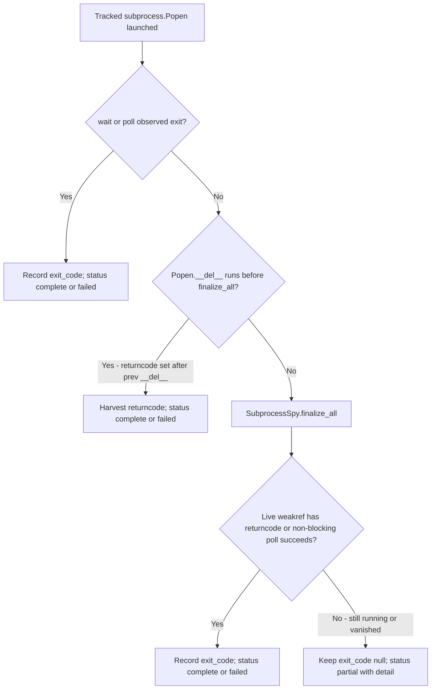

# IPD: Handle Popen children reaped via subprocess internals or left unwaited in SubprocessSpy

- Date: 2026-11-23
- Kind: child
- Concern: Subprocess exit-code and capture-state accuracy
- Scope: Harvest exit codes for `subprocess.Popen` children reaped via `subprocess._cleanup()` or garbage collection without monkeypatching private `_internal_poll`, and record an honest `"partial"` `capture_state` (with detail) for children still running or unreaped at `SubprocessSpy.finalize_all`, updating tests and `docs/manifest.md`.
- Scope-Paths: src/pubrun/capture/subprocesses.py, tests/test_capture.py, docs/manifest.md
- Item-Dependencies: none
- Status: to-review
- Work-Kind: followup
- Priority: low
- From-Backlog: 86p7x3
- Set: 86p7x3
- Order: 1
- Highest E allocated: 03
- Author: Antigravity
- Id: focjwv

> Write and proofread this plan per the technical writing standard, `.aw/system/workflows/technical-writing/technical-writing.md` (`.agents/workflows/technical-writing/technical-writing.md` in a legacy-layout install), including requirement 12 (diagrams).

## Workflow history

- 2026-11-24 draft (Antigravity): created.
- 2026-11-24 to-review (Antigravity): graduated from backlog item `86p7x3` into a review-ready plan.

## Goal

Ensure `SubprocessSpy` captures exit codes for `subprocess.Popen` children reaped through Python's internal cleanup (`subprocess._cleanup()` or `Popen.__del__`) without patching private `_internal_poll`, and reports `capture_state.status = "partial"` instead of `"complete"` for children that remain unwaited with `exit_code = None` at run finalization.

## Detailed Implementation Checklist (TODO)

Execution-state rule: mark an `E-*` item complete only after performing the action. That mark is not validation. Right-sizing rule: write for a modest executor that cannot hold much in its head. Each E-item is one step (one concern, about one file, executable in one focused pass) and its V-item names each unit it covers with its own check; a plan stays at about 5 E-items and 8 work Scope-Paths, else split it into more child plans (guidance, `IPD-Z603`). Accepted execution states: blocked, failed, pending, performed; terminal gate demands 'performed'.

### Task group 1: Harvest reaped exit codes and distinguish unwaited children

- [ ] E-01 Update `src/pubrun/capture/subprocesses.py` to retain a weak reference to each tracked `Popen` instance, harvest `returncode` on `Popen.__del__` and during `SubprocessSpy.finalize_all`, and mark genuinely unwaited/still-running children with `capture_state.status = "partial"`.
  - Depends on: none
  - Expected outcome: `SubprocessSpy` never monkeypatches private `Popen._internal_poll`. When a tracked `Popen` is reaped via `subprocess._cleanup()` or garbage collection (`Popen.__del__`), or has already exited by the time `finalize_all()` runs (non-blocking `returncode` inspection / non-blocking `prev_popen_poll(proc)`), `SubprocessSpy` completes the record with the observed integer `exit_code` (`capture_state.status = "complete"` for `0`, `"failed"` for nonzero). When a tracked child is still running or its `Popen` vanished before any `returncode` was observed, `finalize_all()` sets `ended_at_utc = None`, preserves `elapsed_seconds` up to finalization, and sets `capture_state = {"status": "partial", "detail": "child process not waited on before finalization"}`.
  - Execution state: pending

- [ ] E-02 Update `tests/test_capture.py` to cover all three cases: a `Popen` child reaped via `subprocess._cleanup()` / `Popen.__del__`, a `Popen` child that finished before `tracker.stop()` without explicit `wait()`, and a `Popen` child still running at `tracker.stop()`.
  - Depends on: E-01
  - Expected outcome: `test_detached_subprocess_finalized` asserts `capture_state["status"] == "partial"` (with a non-empty `detail`) for a still-running detached child whose `exit_code` is `None`; new tests verify that a short-lived unwaited `Popen` child (both live and garbage-collected after exiting) records its actual integer `exit_code` (both `0` and nonzero) with matching `"complete"` / `"failed"` `capture_state`, and that no `ResourceWarning` or leaked process breaks test teardown.
  - Execution state: pending

- [ ] E-03 Update the `## subprocesses` table row for `capture_state` in `docs/manifest.md` so it accurately describes `"partial"` for a process still unwaited at finalization.
  - Depends on: E-01
  - Expected outcome: The `capture_state` row under `## subprocesses` in `docs/manifest.md` states `"complete"` for exit code 0, `"failed"` for a nonzero exit code or failed launch (with a redacted `detail`), and `"partial"` while the process is still running or when it was not waited on before finalization (with `detail`). Edited lines contain zero em or en dashes.
  - Execution state: pending

## Project conventions discovered (Step 0)

- Cite code by SYMBOL (`module.function`) or by a quoted content string, with a line number only appended to one of those and never alone (`IPD-C801`).
- `src/pubrun/capture/subprocesses.py::SubprocessSpy` currently patches `Popen.__init__`, `Popen.wait`, and `Popen.poll`, and tracks active records in `self._records`. `SubprocessSpy.finalize_all` currently iterates over records where `rec.get("ended_at_utc") is None` and unconditionally sets `rec["capture_state"] = {"status": "complete"}` even when `rec["exit_code"]` is `None`.
- `schemas/manifest.schema.json` (`$defs.capture_state` and `$defs.status_value`) already permits `{"status": "partial", "detail": "..."}` on subprocess records without any schema change.
- `tests/test_capture.py::TestSubprocessCapture::test_detached_subprocess_finalized` currently asserts `assert s["capture_state"]["status"] == "complete"` for an unwaited `sleep(0.1)` child; that test must be updated to match the new `"partial"` semantics.
- `docs/manifest.md` (`## subprocesses` table, `capture_state` row) currently says `"complete"` for exit code 0 `(and for a process still unwaited at finalization)`.
- Agent execution contract: user-facing documentation (`docs/manifest.md`) must contain zero em or en dashes in authored or edited prose. Tests must test observable runtime behavior and never inspect production source code with `ast`, `inspect`, regex, or substring checks.

## Findings

When a user launches `p = subprocess.Popen(...)` and never explicitly calls `p.wait()` or `p.poll()`, three distinct outcomes occur:

1. **Reaped by Python internals:** `subprocess._cleanup()` or `Popen.__del__` calls `_internal_poll()`, populating `p.returncode` without invoking `Popen.wait` or `Popen.poll`. Today `SubprocessSpy` misses `p.returncode` and records `exit_code: null` with `capture_state.status: "complete"`.
2. **Finished before `tracker.stop()`:** The child already exited, so a non-blocking poll at finalization can observe `returncode`, yet today `finalize_all()` skips polling and records `exit_code: null` with `capture_state.status: "complete"`.
3. **Still running (or detached) at `tracker.stop()`:** No exit code exists yet, yet today `finalize_all()` marks `capture_state.status: "complete"`, misrepresenting an incomplete observation as complete.

## Proposed changes (ordered, validatable)

1. **`src/pubrun/capture/subprocesses.py` (E-01):**
   - Store a `weakref.ref(self)` (guarding with `try/except TypeError` in case a custom `Popen` subclass does not support weak references) mapped to the record alongside the existing `Popen` tracking state, and clean up the mapping entry when the record completes or during `finalize_all()`.
   - Install an identity-guarded patch on `Popen.__del__` (restored in `uninstall()` alongside `__init__`, `wait`, and `poll`) that calls `prev_popen_del(self)` in a `try/finally` and, if `self.returncode is not None`, invokes `_complete_popen_record(self, self.returncode)`. Do not patch private `Popen._internal_poll`.
   - In `SubprocessSpy.finalize_all()`:
     - For each unfinalized record, if a live `Popen` weakref exists, check `proc.returncode`; if still `None`, invoke `prev_popen_poll(proc)` inside a defensive `try/except Exception` (strictly non-blocking).
     - If an integer `returncode` is observed, complete the record via `_complete_popen_record` (setting `exit_code`, `ended_at_utc`, `elapsed_seconds`, and `capture_state` `"complete"` for `0` or `"failed"` for nonzero).
     - Otherwise (still running or `Popen` already garbage-collected without an observed exit code), keep `exit_code = None` and `ended_at_utc = None`, compute finalization `elapsed_seconds` if monotonic start time exists, and set `capture_state = {"status": "partial", "detail": "child process not waited on before finalization"}`.
2. **`tests/test_capture.py` (E-02):**
   - Update `test_detached_subprocess_finalized` to verify a still-running detached child has `exit_code is None`, `capture_state["status"] == "partial"`, and a descriptive `capture_state["detail"]` (and clean up the spawned child `p.wait()` after `tracker.stop()` so tests leave no orphan processes).
   - Add behavioral tests covering:
     - An unwaited `Popen` child that exits (both exit code `0` and nonzero, e.g. `7`) before `tracker.stop()`, verifying `finalize_all()` harvests the exact integer `exit_code` and sets `"complete"` / `"failed"`.
     - An unwaited `Popen` child that exits and is deleted + `gc.collect()`ed before `tracker.stop()` (exercising the `Popen.__del__` / `subprocess._cleanup()` path), verifying its exact integer `exit_code` is recorded.
3. **`docs/manifest.md` (E-03):**
   - Update the `capture_state` row in the `## subprocesses` table to document `"partial"` for processes still running or not waited on before finalization, with zero em or en dashes in edited lines.

## Deferred / out of scope (with reason)

None.

## Scope check

- Over-scope: none. Only `src/pubrun/capture/subprocesses.py`, `tests/test_capture.py`, and `docs/manifest.md` are modified.
- Under-scope: none. Both the reaped-exit harvesting (`_cleanup` / `__del__` / non-blocking poll) and the `"partial"` state for genuinely unwaited children are covered and verified against `schemas/manifest.schema.json`.

## Required tests / validation

- Run `pytest tests/test_capture.py` and verify all existing and new subprocess capture tests pass.
- Run the full `pytest` suite (including schema validation tests) to confirm `"partial"` subprocess records validate against `schemas/manifest.schema.json` and break no downstream report/CLI/TUI consumers.
- Run `python3 scripts/sanitize_paths.py --check --all` and confirm exit code 0.

## Spec / documentation sync

`docs/manifest.md` (`## subprocesses` table, `capture_state` row) is updated in E-03 to match the new `"partial"` semantics for unwaited subprocesses.

## Open questions

None.

## Validation and cross-check (verify before reporting done)

Validation-state rule: inspect evidence in a separate pass. Do not mark a `V-*` item complete from memory or from the matching execution checkmark. Accepted validation results: blocked, failed, pass, pending; terminal gate demands 'pass'. Runtime-demonstration reachability rule: for each `V-*` item demanding the software be observed acting (such as a run, a dispatch, or a transition), name the code path that produces the observation or the sibling `E-*` that creates it, else the demand is UNDER-SCOPE.

- [ ] V-01 validates E-01
  - Required evidence: Paste `git diff src/pubrun/capture/subprocesses.py` showing weakref tracking, identity-guarded `Popen.__del__` harvesting (with restore in `uninstall()`), non-blocking `returncode`/`poll` check in `finalize_all()`, `"partial"` `capture_state` with `detail` for unwaited children, and no patching of `_internal_poll`.
  - Observed evidence:
  - Result: pending

- [ ] V-02 validates E-02
  - Required evidence: Paste actual `pytest tests/test_capture.py` output showing `test_detached_subprocess_finalized` (asserting `"partial"`), the finished-before-stop test, and the GC/`__del__`-reaped test all passing, plus the summary line of a full `pytest` run showing 0 failures.
  - Observed evidence:
  - Result: pending

- [ ] V-03 validates E-03
  - Required evidence: Paste `git diff docs/manifest.md` showing the updated `capture_state` row under `## subprocesses` with zero em or en dashes in edited lines, plus the output of `python3 scripts/sanitize_paths.py --check --all`.
  - Observed evidence:
  - Result: pending

## Approval and execution gate

- Size assessment: standard
- Cohesion rationale: not required

Execution begins only after this plan reaches `approved`. Execute `E-01` through `E-03` in order, verify `V-01` through `V-03` with pasted evidence, commit only the scoped files through `aw commit`, and complete the post-gate lifecycle transition under `ipd-lifecycle`.
