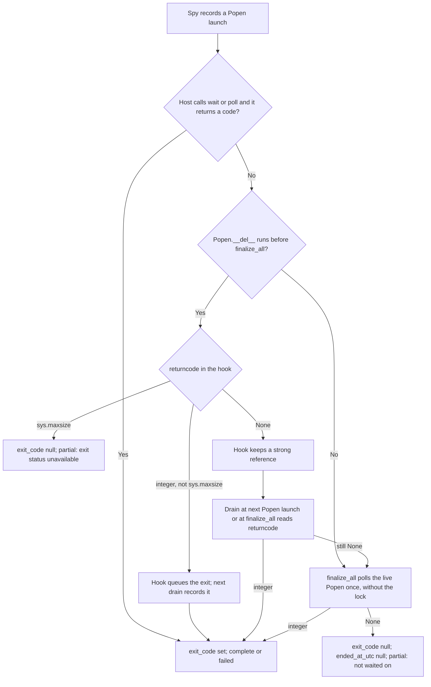

# IPD: Handle Popen children reaped via subprocess internals or left unwaited in SubprocessSpy

- Date: 2026-11-23
- Kind: child
- Concern: Subprocess exit-code and capture-state accuracy
- Scope: Record the exit code of a `subprocess.Popen` child that the host never waits on or polls, when pubrun can observe it through public attributes (`Popen.returncode`, `Popen.poll()`, a patched `Popen.__del__`) without patching the private `Popen._internal_poll`. Record `capture_state.status = "partial"` with a `detail` for a child whose exit pubrun did not observe by `SubprocessSpy.finalize_all`. Update tests, the user-facing docs that describe the spy, and `CHANGELOG.md`.
- Scope-Paths: src/pubrun/capture/subprocesses.py, tests/test_capture.py, docs/manifest.md, docs/functional_spec.md, docs/architecture.md, docs/api.md, CHANGELOG.md
- Item-Dependencies: none
- Status: approved
- Readiness: go-pending-approval
- Review-Depth: standard
- Work-Kind: followup
- Priority: low
- From-Backlog: 86p7x3
- Set: 86p7x3
- Order: 1
- Highest E allocated: 05
- Author: Antigravity
- Id: focjwv
- Approval: 2026-11-24, recorded via aw ipd set: status set to approved

> Write and proofread this plan per the technical writing standard, `.aw/system/workflows/technical-writing/technical-writing.md` (`.agents/workflows/technical-writing/technical-writing.md` in a legacy-layout install), including requirement 12 (diagrams).

## Workflow history

- 2026-11-24 approved (aw set): status set to approved
- 2026-11-24 /plan-review (uri/its_direct/pt3-claude-opus-5.5-1m-us): APPROVE WITH REVISIONS APPLIED; PR-001, PR-002, PR-003, PR-004, PR-005, PR-006, PR-007, PR-008, PR-009
- 2026-11-24 to-review (Antigravity): graduated from backlog item `86p7x3` into a review-ready plan.
- 2026-11-24 draft (Antigravity): created.

## Goal

`SubprocessSpy` (in `src/pubrun/capture/subprocesses.py`) records each `subprocess.Popen` child in the manifest's `subprocesses` list. Today it learns the exit code only when the host calls `Popen.wait()` or `Popen.poll()`. A child the host never waits on keeps `exit_code: null`, and `SubprocessSpy.finalize_all` then marks it `capture_state.status: "complete"`, which claims a complete observation that never happened.

After this plan:

1. A child that exited, and whose exit status CPython collected through `Popen.__del__` or `subprocess._cleanup()`, or that a non-blocking `poll()` at finalization can collect, records its real integer `exit_code` with `"complete"` (code 0) or `"failed"` (nonzero).
2. A child that is still running at finalization, or whose exit status was lost, records `exit_code: null`, `ended_at_utc: null`, and `capture_state: {"status": "partial", "detail": ...}`.
3. pubrun still never patches the private `Popen._internal_poll`, and the new `Popen.__del__` hook can never block or deadlock the host program.

## Detailed Implementation Checklist (TODO)

Execution-state rule: mark an `E-*` item complete only after performing the action. That mark is not validation. Right-sizing rule: write for a modest executor that cannot hold much in its head. Each E-item is one step (one concern, about one file, executable in one focused pass) and its V-item names each unit it covers with its own check; a plan stays at about 5 E-items and 8 work Scope-Paths, else split it into more child plans (guidance, `IPD-Z603`). Accepted execution states: blocked, failed, pending, performed; terminal gate demands 'performed'.

### Task group 1: Harvest unwaited exit codes and mark unobserved children partial

- [ ] E-01 Change `src/pubrun/capture/subprocesses.py::SubprocessSpy` to collect exit codes of unwaited children and to mark unobserved children `"partial"`, as specified in "Proposed changes" item 1.
  - Depends on: none
  - Expected outcome:
    1. `SubprocessSpy.install` also patches `subprocess.Popen.__del__`, chaining to the previous `__del__`, and `SubprocessSpy.uninstall` restores it with the same identity guard as `__init__`, `wait`, and `poll`. `Popen._internal_poll` is not patched.
    2. The `__del__` hook acquires no lock and calls no blocking function. It only appends to `collections.deque` queues that later code drains under `SubprocessSpy._lock`.
    3. A child whose `returncode` is an integer other than `sys.maxsize` when the hook runs, or when a later drain reads it, completes its record with that `exit_code` and `"complete"` (0) or `"failed"` (nonzero).
    4. A child still running when its `Popen` is dropped stays observable: the hook keeps a strong reference, the patched `Popen.__init__` drains that queue after the chained `__init__` returns (that call runs `subprocess._cleanup()`), and `finalize_all` drains it again.
    5. `finalize_all` polls each still-open record's live `Popen` once with the chained non-blocking `poll()`, outside `SubprocessSpy._lock`. A record still without an exit code gets `exit_code: None`, `ended_at_utc: None`, `elapsed_seconds` to finalization, and `capture_state = {"status": "partial", "detail": "child process not waited on before finalization"}`.
    6. A `returncode` equal to `sys.maxsize` gives `capture_state = {"status": "partial", "detail": "child exit status was collected outside pubrun and is unavailable"}` with `exit_code: None`, never `exit_code: 9223372036854775807`.
    7. `finalize_all` and `uninstall` release every strong reference the spy holds to a `Popen`.
  - Execution state: pending

- [ ] E-02 Update `tests/test_capture.py` so that the tests for unwaited children have deterministic outcomes, as listed in "Proposed changes" item 2.
  - Depends on: E-01
  - Expected outcome: The tests named in "Proposed changes" item 2 exist and pass, assert on records returned by `SubprocessSpy.get_records()` or on `manifest.json`, use no fixed sleeps to decide whether a child has exited, and leave no child process running after the test.
  - Execution state: pending

- [ ] E-03 Update the `## subprocesses` table in `docs/manifest.md` for the new values.
  - Depends on: E-01
  - Expected outcome: The `capture_state` row says `"complete"` for exit code 0, `"failed"` for a nonzero exit code or a failed launch (with a redacted `detail`), and `"partial"` with a `detail` while the process runs, when pubrun did not observe its exit by finalization, or when its exit status is unavailable. The phrase "and for a process still unwaited at finalization" is gone. The `exit_code` row says `null` means pubrun did not observe the exit. The `ended_at_utc` row says `null` means pubrun did not observe the end by finalization. The `elapsed_seconds` row says that for a child whose exit pubrun first observed at the next `Popen` launch or at finalization, the duration ends at that observation. Edited lines contain no em dash (U+2014) and no en dash (U+2013).
  - Execution state: pending

- [ ] E-04 Update the descriptions of the patched targets and of finalization in `docs/functional_spec.md`, `docs/architecture.md`, and `docs/api.md`.
  - Depends on: E-01
  - Expected outcome:
    1. Every list of the targets `SubprocessSpy` patches names `subprocess.Popen.__init__`, `subprocess.Popen.wait`, `subprocess.Popen.poll`, `subprocess.Popen.__del__`, and `os.system`. The lists are at `docs/functional_spec.md#15.1 Mechanism`, `docs/functional_spec.md` (the bullet starting "Enforce transactional installation"), `docs/architecture.md` (the paragraph starting "`SubprocessSpy` transparently monkey-patches", the bullet "**Live target chaining and transactional install:**", and the bullet "**Independent cleanup and hook ownership:**"), and `docs/api.md` (the table row starting "| `subprocess.Popen.__init__`, `subprocess.Popen.wait`, and `os.system` (`SubprocessSpy`)").
    2. `docs/functional_spec.md#15.2 Recorded Fields` says that finalization records the exit of an unwaited child when pubrun can observe it, and otherwise marks the record `"partial"` with a `detail`.
    3. Edited lines contain no em dash (U+2014) and no en dash (U+2013).
  - Execution state: pending

- [ ] E-05 Add a `### Fixed` entry under `## [Unreleased]` in `CHANGELOG.md`.
  - Depends on: E-01
  - Expected outcome: The entry says that a `subprocess.Popen` child the program never waited on now records its exit code when pubrun can observe it, and is otherwise reported as `capture_state.status: "partial"` with a `detail` instead of `"complete"`. It names the manifest change for readers who filter on `"complete"`. It contains no em dash and no en dash.
  - Execution state: pending

## Project conventions discovered (Step 0)

- Cite code by symbol (`path::Name`), Markdown by heading (`path#Heading text`), or by a quoted content string. A line number may follow one of those as a hint, but never stands alone (`IPD-C801`).
- `src/pubrun/capture/subprocesses.py::SubprocessSpy.install` patches `subprocess.Popen.__init__`, `subprocess.Popen.wait`, `subprocess.Popen.poll`, and `os.system`. It keeps the previous targets in a per-install `state` dict, tags each recorded `Popen` with `_pubrun_state`, `_pubrun_rec`, and `_pubrun_idx`, and keeps per-record monotonic start times in `SubprocessSpy._start_monos`. `SubprocessSpy.uninstall` restores each target only when it still holds pubrun's wrapper.
- `SubprocessSpy._lock` is a non-reentrant `threading.Lock`. `_complete_popen_record` (a closure inside `install`) acquires it. `SubprocessSpy.finalize_all` holds it for its whole loop and today sets `capture_state.status` to `"complete"` for every record with `exit_code` `None` and no `ended_at_utc`.
- `src/pubrun/tracker.py::Run._rollback_owned_hooks` calls `SubprocessSpy.finalize_all()`, then copies the list `SubprocessSpy.get_records()`, then calls `SubprocessSpy.uninstall(owner=...)`, each in its own `try/except`.
- CPython behavior, checked on CPython 3.12.3 and 3.14.6 at review:
  - `subprocess.Popen.__del__(self, _maxsize=sys.maxsize, _warn=warnings.warn)` warns `ResourceWarning` when `returncode` is `None`, calls `self._internal_poll(_deadstate=_maxsize)`, and appends a still-running instance to `subprocess._active`.
  - On POSIX, `subprocess._cleanup()` runs at the start of every `Popen.__init__`. It polls each `subprocess._active` instance and removes those that exited. On Windows `_cleanup()` does nothing and `_active` is `None`.
  - When the exit status was already collected by someone else (for example `os.waitpid`), `_internal_poll` sets `returncode` to the `_deadstate` value `sys.maxsize`.
  - `Popen.__del__` runs at most once per object (PEP 442), even when the object is resurrected.
- `schemas/manifest.schema.json` `$defs.subprocess_record` requires only `argv` and `capture_state`, and allows `null` for `exit_code` and `ended_at_utc`. `$defs.capture_state` allows `{"status": "partial", "detail": "..."}`. No schema change is needed.
- Consumers that read subprocess records are `src/pubrun/report/diagnostics.py` (prints `exit_code`), `src/pubrun/tui/widgets/details.py::_format_subprocess_rows`, and `src/pubrun/analysis/diff.py` (counts commands). None of them reads a subprocess record's `capture_state`. `src/pubrun/report/reproducibility.py` scans only dict-valued manifest sections for `"partial"`, so a list of subprocess records adds no new finding.
- `AGENTS.md` agent execution contract: user-facing docs (`docs/*.md`, `CHANGELOG.md`) must contain no em or en dashes in authored or edited prose. Tests must exercise behavior and must not read production source with `inspect`, `ast`, regex, or substring checks.
- `AGENTS.md` "Matrix-validation discipline": a change to capture-engine output shapes, or to behavior that varies by OS, must pass the CI matrix (3 OS x Python 3.8 to 3.14). Pushing requires an explicit human instruction.

## Findings

When a program runs `p = subprocess.Popen(...)` and never calls `p.wait()` or `p.poll()`, today's `SubprocessSpy` records `exit_code: null`, and `finalize_all` then records `capture_state.status: "complete"`. Backlog item `86p7x3` says the status stays `"running"`; that is not a valid status value, and the code writes `"complete"`. Four cases occur:

1. **Exited, then garbage-collected.** `Popen.__del__` calls `_internal_poll`, which sets `returncode`. A probe at review that wrapped `Popen.__del__` read `returncode == 7` after the wrapped call returned.
2. **Still running when garbage-collected, later reaped by `subprocess._cleanup()`.** `__del__` sees `returncode is None` and parks the object in `subprocess._active`. The next `Popen()` call reaps it and removes it from `_active`, and then the object is freed. At review a `weakref.ref` to such an object was dead after `_cleanup()` ran, so a weak reference alone loses the exit code. A wrapper that kept a strong reference read `returncode == 3` afterwards.
3. **Exited but never collected.** At review `os.waitid(..., WNOWAIT)` showed exit code 7 while `p.returncode` was still `None`. A non-blocking `poll()` at finalization collects it.
4. **Still running at finalization.** No exit code exists. Today this is recorded as `"complete"`, which is false.

Two hazards constrain the design:

- **Deadlock.** The cyclic garbage collector can run `Popen.__del__` on any thread, at any allocation, including inside a `with SubprocessSpy._lock:` block. At review, a `__del__` wrapper that tried to acquire a lock already held by the same thread failed to get it within its 1-second timeout. A plain `with lock:` would block forever. The hook therefore must not take `SubprocessSpy._lock`. For the same reason, `finalize_all` must not call `_complete_popen_record` while it holds the lock.
- **Sentinel exit code.** When the exit status was collected outside `subprocess` (for example by `os.waitpid` or a `SIGCHLD` handler), `__del__` sets `returncode` to `sys.maxsize`. At review this was `9223372036854775807` on both Python versions. Recording it as an exit code would be false.

The flowchart shows how each record reaches its final state.

## Proposed changes (ordered, validatable)

1. **`src/pubrun/capture/subprocesses.py` (E-01):**
   - Add `import collections`, `import sys`, and `import weakref`. Add two class attributes, `SubprocessSpy._pending_exits` and `SubprocessSpy._pending_running`, each a `collections.deque`. Add `SubprocessSpy._popen_refs: Dict[int, Tuple[Dict[str, Any], Any]]`, mapping `id(rec)` to `(rec, weakref.ref(popen))`. Add `SubprocessSpy._installed_popen_del`. `install` and `uninstall` reset all four, so no `Popen` reference outlives a run.
   - In `_patched_popen_init`, store the weak reference in `_popen_refs` when the record is appended. Skip it when `weakref.ref` raises `TypeError`. Call a new drain function (described below) in a `finally` around the chained `__init__`, so it runs after both a successful and a failed launch. On POSIX that chained call has just run `subprocess._cleanup()`. A drain failure is logged at debug level and never raised to the host.
   - Split `_complete_popen_record` into a record-level `_complete_record(rec, exit_code, end_ts, end_mono)` and the existing `Popen`-level guard that calls it. `_complete_record` acquires `SubprocessSpy._lock` and acts only when `state["active"]` is true and the record's `exit_code` is still `None`. Like today, a `wait()` that returns after `finalize_all()` but before `uninstall()` still fills in the exit code, and the monotonic `elapsed_seconds` already set by `finalize_all()` is kept. Then:
     - For a `returncode` equal to `sys.maxsize`, it sets `capture_state = {"status": "partial", "detail": "child exit status was collected outside pubrun and is unavailable"}` and `ended_at_utc = None`, and leaves `exit_code` `None`.
     - Otherwise it sets `exit_code`, `ended_at_utc`, the monotonic `elapsed_seconds`, and a fresh `capture_state` dict (`"complete"` or `"failed"`) with no stale `detail` key.
     - In both cases it removes the record's `_popen_refs` entry.
   - Add `_patched_popen_del(self, *args, **kwargs)`. It calls `prev_popen_del(self, *args, **kwargs)` inside `try/finally`. In the `finally` block it does only the following, inside `try/except Exception: pass`:
     - It returns unless `getattr(self, "_pubrun_state", None) is state` and `state["active"]`.
     - If `self.returncode is None`, it appends `self` to `_pending_running`.
     - Otherwise it appends `(self._pubrun_rec, self.returncode, time.time(), time.perf_counter())` to `_pending_exits`.
     It acquires no lock and binds `time.time` and `time.perf_counter` at install time, so it also works during interpreter shutdown. Patch and restore it like the other targets, with the same identity guard, and add it to the rollback list in `install`. Do not patch `Popen._internal_poll`.
   - Add a drain function, stored as `state["drain"]`, that runs outside `SubprocessSpy._lock`:
     1. It pops every `_pending_exits` entry and passes it to `_complete_record`.
     2. It pops every `_pending_running` object. When the object's `returncode` is now set, it passes `obj._pubrun_rec`, `obj.returncode`, and the current times to `_complete_record`. When it is still `None`, it puts the object back for the next drain.
   - Rewrite `SubprocessSpy.finalize_all` in four phases:
     1. Call `state["drain"]()`.
     2. Under `SubprocessSpy._lock`, collect the live `Popen` for each record whose `exit_code` is `None` and that has no `ended_at_utc`, from `_popen_refs` or `_pending_running`. Then release the lock.
     3. Call `state["prev_popen_poll"](proc)` once per live `Popen` inside `try/except Exception`, and complete each record that returns an integer.
     4. Under the lock again, mark every record that still has `exit_code` `None` and no `ended_at_utc` key as described in E-01 outcome 5, then clear `_popen_refs` and `_pending_running`. Phase 4 sets the `ended_at_utc` key (to `None`), so a second `finalize_all()` call changes nothing.
     When the spy is not installed (`SubprocessSpy._active_state is None`), skip phases 1 to 3 and apply phase 4.
   - Rename the `finalize_all` docstring "Mark any un-waited subprocess records as complete." to describe the new behavior.
2. **`tests/test_capture.py` (E-02):** Each test that launches a child makes the child's exit deterministic: the child runs `[sys.executable, "-c", "import sys; sys.stdin.read(); sys.exit(N)"]` with `stdin=subprocess.PIPE` and exits with code `N` only when the test closes the pipe. The test waits for exit with `os.waitid(os.P_PID, pid, os.WEXITED | os.WNOWAIT)` (POSIX only) or with the original `subprocess.Popen.poll` captured before `SubprocessSpy.install`. Every test reaps every child it starts before it returns.
   - Change `TestSubprocessInterceptor::test_detached_subprocess_finalized` to use the stdin-blocked child. After `tracker.stop()`, it asserts on `manifest.json` that the child's record has `exit_code is None`, `ended_at_utc is None`, `capture_state["status"] == "partial"`, and `capture_state["detail"] == "child process not waited on before finalization"`. Then it closes stdin and waits on the child.
   - Change `TestFinalizeAll::test_upgrades_partial_to_complete` into a test that asserts `"partial"` with the not-waited `detail` and `ended_at_utc is None` for records that have no live `Popen`. Rename it to match.
   - Change `TestSubprocessSpyMonotonicTiming::test_finalize_all_monotonic_non_collision_and_post_finalize_wait`. Before `finalize_all()`, the real child's exit must be decided: wait for it with the original `poll`. Then assert `exit_code == 0` and `"complete"` for the real record, and `"partial"` for the synthetic record. Keep the existing monotonic-duration assertions.
   - Add `test_unwaited_exited_child_exit_code_harvested_at_finalize`, parametrized over exit codes `0` and `7`. The child exits and the test waits for it with the original `poll`, so `returncode` is set without the spy's `poll`. `finalize_all()` must then record exactly that `exit_code`, with `"complete"` for 0 and `"failed"` for 7.
   - Add `test_unwaited_uncollected_child_polled_at_finalize` (skip unless `hasattr(os, "waitid")`). It waits for exit with `WNOWAIT` while `returncode` is still `None`. `finalize_all()` must record `exit_code == 7` and `"failed"`.
   - Add `test_gc_after_exit_records_exit_code`. The child exits and `returncode` is set through the original `poll`. Then `del p` and `gc.collect()`, so no live `Popen` remains for `finalize_all()` to poll. After `finalize_all()`, the record shows `exit_code == 7` and `"failed"`; this outcome is only reachable through the `__del__` hook.
   - Add `test_cleanup_reaped_child_records_exit_code` (POSIX only). It keeps `p.stdin` and `p.pid`, then runs `del p` and `gc.collect()` while the child runs, so the object enters `subprocess._active`. It closes stdin, waits with `WNOWAIT`, and launches and waits a second `Popen`. The first record must then show `exit_code == 7` before `finalize_all()` runs.
   - Add `test_externally_reaped_child_is_partial_not_sentinel` (POSIX only). It reaps the child with `os.waitpid(pid, 0)`, then runs `del p` and `gc.collect()`. After `finalize_all()`, the record has `exit_code is None` and `"partial"` with the detail "child exit status was collected outside pubrun and is unavailable". It never has `exit_code == sys.maxsize`.
   - Add `test_popen_del_hook_does_not_take_spy_lock`. In a worker thread, drop the last reference to a recorded `Popen` and run `gc.collect()` while holding `SubprocessSpy._lock`. Then join the thread with a 10-second timeout and assert it finished.
   - Add `test_uninstall_restores_popen_del`. It asserts `subprocess.Popen.__del__` is the original after `uninstall()`, and that a third-party wrapper installed after the spy stays in place.
   - Mark tests that drop a running `Popen` with `@pytest.mark.filterwarnings("ignore::ResourceWarning")`. CPython's own `__del__` warns for them.
3. **`docs/manifest.md` (E-03):** Update the `capture_state`, `exit_code`, `ended_at_utc`, and `elapsed_seconds` rows of the `## subprocesses` table as stated in E-03.
4. **`docs/functional_spec.md`, `docs/architecture.md`, `docs/api.md` (E-04):** Add `subprocess.Popen.poll` (already patched since `m780uj`, but missing from these lists) and `subprocess.Popen.__del__` to every list of patched targets named in E-04. Update `docs/functional_spec.md#15.2 Recorded Fields`.
5. **`CHANGELOG.md` (E-05):** Add the `### Fixed` entry stated in E-05.

## Deferred / out of scope (with reason)

- Running the new tests on the GitHub Actions matrix (3 OS x Python 3.8 to 3.14). `AGENTS.md` "Matrix-validation discipline" requires this for a capture-engine output change, and the `__del__` and `_cleanup()` behavior differs on Windows. A push needs an explicit human instruction, so this plan validates on Linux only and records that gap in V-02.
  - Carrier-Declined: a push needs explicit human authorization, so no plan can carry it; GitHub Actions runs the matrix automatically on the next push or pull request to `main`.
- Patching the private `Popen._internal_poll`. Backlog `86p7x3` left this open. The public hooks above cover cases 1 to 4 in Findings without depending on a CPython implementation detail.
  - Carrier-Declined: the public-hook design meets the backlog acceptance criteria, so no later work needs this patch.
- The explicit wrapper `pubrun.subprocess.Popen` (`src/pubrun/core.py::_PubrunSubprocessNamespace.Popen`) logs a manual record only on `wait()`, `communicate()`, or a completed `poll()`, so an unwaited wrapper child is not recorded at all. That path is a separate mechanism from `SubprocessSpy` and was not named in `86p7x3`.
  - Carrier-Declined: no defect report exists for the wrapper, and the wrapper writes no record that claims a false status.

## Scope check

- Over-scope: none. The three doc files besides `docs/manifest.md`, and `CHANGELOG.md`, describe the changed behavior and are added to `- Scope-Paths:`.
- Under-scope: none after review. The review added the strong-reference queue for case 2 (a weak reference alone dies when `_cleanup()` frees the object), the lock-free hook, the `sys.maxsize` sentinel handling, `finalize_all` polling outside the lock, the two other `finalize_all` tests that assert `"complete"`, the stale patched-target lists in three docs, and the `CHANGELOG.md` entry.

## Required tests / validation

- `pytest tests/test_capture.py --no-cov -q` passes, including every test named in "Proposed changes" item 2.
- `pytest tests/test_capture.py tests/test_capture_engine_bugs.py tests/test_hook_ownership_rollback.py tests/test_capture_isolation.py tests/test_pause_resume.py tests/test_tracker.py --no-cov -q` passes. These are the other suites that install `SubprocessSpy` or assert on its patched targets.
- `pytest tests/test_capture.py -k "unwaited or gc_after_exit or cleanup_reaped or externally_reaped or del_hook or popen_del" -W error::pytest.PytestUnraisableExceptionWarning --no-cov -q` passes. This shows the hook raises nothing inside `__del__`.
- The full suite (`aw suite --no-cache`) has no failure that also passes on unmodified `HEAD`. It also checks that manifests with `"partial"` subprocess records validate against `schemas/manifest.schema.json` (`tests/test_capture.py`, `tests/test_capture_isolation.py`).
- Mutation check: temporarily replace the body of `_patched_popen_del`'s `finally` block with `pass` and run `test_gc_after_exit_records_exit_code` and `test_cleanup_reaped_child_records_exit_code`; both must fail. Restore the file and confirm `git diff --stat` matches the intended edit.
- `git diff -U0 -- docs/ CHANGELOG.md | grep '^+[^+]' | grep -c '[—–]'` prints `0`.
- `python3 scripts/sanitize_paths.py --check --all` exits 0.

## Spec / documentation sync

- `docs/manifest.md` (E-03), `docs/functional_spec.md`, `docs/architecture.md`, and `docs/api.md` (E-04) describe the new behavior and the full list of patched targets.
- `CHANGELOG.md` (E-05) records a user-visible change: some subprocess records that read `"complete"` now read `"partial"`, and the exit code of an unwaited child now appears.
- No `.spec.md` file under `.aw/records/specs/` describes `SubprocessSpy`, so none is touched.

## Open questions

None.

## Validation and cross-check (verify before reporting done)

Validation-state rule: inspect evidence in a separate pass. Do not mark a `V-*` item complete from memory or from the matching execution checkmark. Accepted validation results: blocked, failed, pass, pending; terminal gate demands 'pass'. Runtime-demonstration reachability rule: for each `V-*` item demanding the software be observed acting (such as a run, a dispatch, or a transition), name the code path that produces the observation or the sibling `E-*` that creates it, else the demand is UNDER-SCOPE.

- [ ] V-01 validates E-01
  - Required evidence: (1) Paste `git diff -- src/pubrun/capture/subprocesses.py`, and for each of E-01 outcomes 1 to 7 name the added lines that satisfy it. (2) Paste the output of `grep -n "_internal_poll" src/pubrun/capture/subprocesses.py`; it must show no assignment to `Popen._internal_poll`. (3) Paste the output of the `-W error::pytest.PytestUnraisableExceptionWarning` run from "Required tests / validation". The behavior of each outcome is observed through the E-02 tests named in V-02.
  - Observed evidence:
  - Result: pending

- [ ] V-02 validates E-02
  - Required evidence: (1) Paste the `pytest tests/test_capture.py --no-cov -q -v` output lines for every test named in "Proposed changes" item 2, each `PASSED` (a POSIX-only test is `SKIPPED` only on a non-POSIX host). (2) Paste the summary line of the six-file related-suites run. (3) Paste the full-suite summary line, and for any failure paste the same test's result on unmodified `HEAD`. (4) Paste the two failing test results from the mutation check, then `git diff --stat` after restoring. (5) State which OS and Python version ran the tests, and that the CI matrix was not run.
  - Observed evidence:
  - Result: pending

- [ ] V-03 validates E-03
  - Required evidence: (1) Paste `git diff -- docs/manifest.md` and name the edited `capture_state`, `exit_code`, `ended_at_utc`, and `elapsed_seconds` rows. (2) Paste the output of `grep -n "still unwaited at finalization" docs/manifest.md`, which must show no match. (3) Paste the output of `git diff -U0 -- docs/manifest.md | grep '^+[^+]' | grep -c '[—–]'`, which must print `0`.
  - Observed evidence:
  - Result: pending

- [ ] V-04 validates E-04
  - Required evidence: (1) Paste `git diff -- docs/functional_spec.md docs/architecture.md docs/api.md` and name each edited target list and the `#15.2 Recorded Fields` change. (2) Paste the output of `grep -n 'Popen.__init__' docs/functional_spec.md docs/architecture.md docs/api.md | grep -v 'Popen.__del__'`, which must show no match (at review it matched the six lists named in E-04 outcome 1). (3) Paste the output of `git diff -U0 -- docs/functional_spec.md docs/architecture.md docs/api.md | grep '^+[^+]' | grep -c '[—–]'`, which must print `0`.
  - Observed evidence:
  - Result: pending

- [ ] V-05 validates E-05
  - Required evidence: (1) Paste `git diff -- CHANGELOG.md`, showing the entry under `## [Unreleased]` and `### Fixed`. (2) Paste the output of `git diff -U0 -- CHANGELOG.md | grep '^+[^+]' | grep -c '[—–]'`, which must print `0`. (3) Paste the output and exit code of `python3 scripts/sanitize_paths.py --check --all`, which must be 0.
  - Observed evidence:
  - Result: pending

## Approval and execution gate

- Size assessment: standard
- Cohesion rationale: not required

Execution contract:
1. Precondition: wait for human approval (`- Status: approved`) with no unresolved `Blocking: yes` open question before you change any file. This plan has no open questions.
2. Scope declaration: the expected modified files are the `- Scope-Paths:` entries (`src/pubrun/capture/subprocesses.py`, `tests/test_capture.py`, `docs/manifest.md`, `docs/functional_spec.md`, `docs/architecture.md`, `docs/api.md`, `CHANGELOG.md`). If execution requires an out-of-scope file, justify it with `--scope-reason` at finalization. If a declared file needs no edit, acknowledge it with `--scope-ack`. The mutation check edits `src/pubrun/capture/subprocesses.py` only temporarily and must restore it.
3. Validation honesty: you MUST run each required validation command and paste its actual output into the matching `V-*` `Observed evidence:` field. Do not mark a `V-*` item `pass` without output captured from that run.
4. Commit discipline: commit only the paths you changed with `aw commit focjwv -- <paths>`. Do not use `git add -A` or raw `git commit`. Do not push without an explicit human instruction.
5. Lifecycle transition: finalize this plan with `aw ipd finalize focjwv`, never with a hand-written `git mv` to `.aw/records/plans/executed/`. Inside a runner lane (`aw oc run` or `aw agy run`), the runner finalizes after the turn. Outside a runner, the executor runs `aw ipd finalize focjwv` after every `E-*` item is `performed`, every `V-*` item is `pass`, and `aw ipd lint --phase pre-transition` reports `conforming`.
