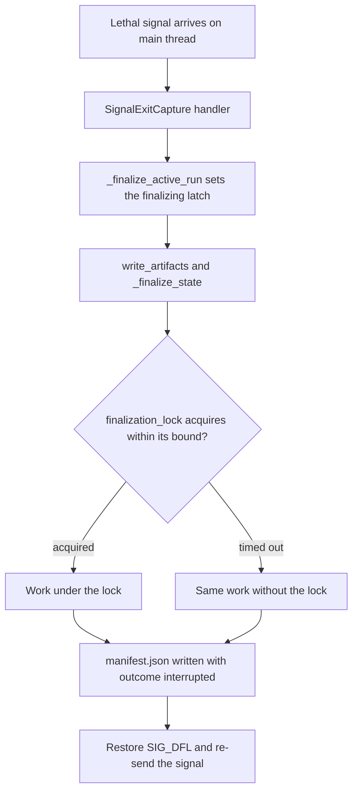

# IPD: Audit lock ordering and prevent re-entrant deadlocks in lethal-signal finalization

- Date: 2026-11-23
- Kind: child
- Concern: Concurrency safety and signal-handler deadlock prevention
- Scope: Make every lock acquire reached from `src/pubrun/capture/signals.py::_finalize_active_run` bounded while a lethal signal (`SIGTERM`, `SIGHUP`) is being finalized, with a lock-free fallback that still writes `manifest.json`. Covers the same-thread form (the interrupted main thread holds a plain lock that finalization needs) and the cross-thread form (the `pubrun-hw` thread holds `_run_lock` and waits on a lock the interrupted main thread holds). Source modules: `signals.py`, `tracker.py`, `writer.py`, `events.py`, `capture/file_io.py`, `capture/subprocesses.py`, and `capture/resources.py`; plus `tests/test_signals.py`, `docs/architecture.md`, and `CHANGELOG.md`.
- Scope-Paths: src/pubrun/capture/signals.py, src/pubrun/tracker.py, src/pubrun/writer.py, src/pubrun/events.py, src/pubrun/capture/file_io.py, src/pubrun/capture/subprocesses.py, src/pubrun/capture/resources.py, tests/test_signals.py, docs/architecture.md, CHANGELOG.md
- Item-Dependencies: executed:focjwv
- Status: approved
- Readiness: go-pending-approval
- Review-Depth: complex
- Work-Kind: followup
- Priority: medium
- From-Backlog: a0o2xx
- Set: a0o2xx
- Order: 1
- Highest E allocated: 09
- Author: Antigravity
- Id: zcuoll
- Approval: 2026-11-24, recorded via aw ipd set: status set to approved

> Write and proofread this plan per the technical writing standard, `.aw/system/workflows/technical-writing/technical-writing.md` (`.agents/workflows/technical-writing/technical-writing.md` in a legacy-layout install), including requirement 12 (diagrams).

## Workflow history

- 2026-11-24 approved (aw set): status set to approved
- 2026-11-24 /plan-review (uri/its_direct/pt3-claude-opus-5.5-1m-us): APPROVE WITH REVISIONS APPLIED; PR-001, PR-002, PR-003, PR-004, PR-005, PR-006, PR-007, PR-008, PR-009, PR-010
- 2026-11-24 to-review (Antigravity): graduated from backlog item `a0o2xx` into a review-ready plan.
- 2026-11-24 draft (Antigravity): created.

## Goal

When `SIGTERM` or `SIGHUP` reaches a process that pubrun is tracking, pubrun's signal handler writes the final `manifest.json` (outcome `interrupted`) and then lets the signal kill the process. Today that handler can block forever on a lock, so the process hangs instead of exiting and the manifest stays at outcome `running`. After this plan:

1. A lethal signal always ends the process within a bounded time (the regression tests use 30 seconds), whichever pubrun lock the interrupted code holds.
2. The final `manifest.json` is still written, with outcome `interrupted` and the signal recorded.
3. Outside signal finalization, every lock behaves exactly as it does today.
4. `docs/architecture.md` states the signal-context lock rule next to the existing lock-ordering rule.

## Detailed Implementation Checklist (TODO)

Execution-state rule: mark an `E-*` item complete only after performing the action. That mark is not validation. Right-sizing rule: write for a modest executor that cannot hold much in its head. Each E-item is one step (one concern, about one file, executable in one focused pass) and its V-item names each unit it covers with its own check; a plan stays at about 5 E-items and 8 work Scope-Paths, else split it into more child plans (guidance, `IPD-Z603`). Accepted execution states: blocked, failed, pending, performed; terminal gate demands 'performed'.

### Task group 1: Bounded lock helper and its callers

- [x] E-01 Add the bounded lock helper `finalization_lock` and the lock inventory comment to `src/pubrun/capture/signals.py`.
  - Depends on: none
  - Expected outcome: (1) A context manager `finalization_lock(lock, timeout)` yields `True` when it holds `lock` and `False` when it gave up; outside signal finalization it acquires with a normal blocking `with lock:` and always yields `True`. (2) During signal finalization (while the existing `_finalizing_active_run` latch is set) it calls `lock.acquire(timeout=timeout)`, and a lock that already timed out once in the current finalization is tried with `acquire(blocking=False)` only. (3) `_finalize_active_run` clears that timed-out set in its `finally` block. (4) A comment above `_finalize_active_run` lists every lock in the inventory table under "Findings", its type, and its signal-context behavior, including the locks this plan deliberately leaves unchanged. (5) `in_signal_finalization()` returns the latch value.
  - Execution state: performed

- [x] E-02 Route the finalization-path acquires in `src/pubrun/tracker.py` through `finalization_lock`, with a lock-free fallback.
  - Depends on: E-01
  - Expected outcome: The `_run_lock` acquires inside `Run._finalize_state` (2.0-second bound) and the `_errors_lock` and `_data_files_lock` acquires in `Run._check_section_failed`, `Run._store_capture_error_detail`, and `Run.to_manifest_dict` (0.25-second bound) use the helper. When the helper yields `False`, the code does the same work without the lock: it reads snapshots with `list(...)`, `dict(...)`, and `set(...)` copies and writes with single `append`, `add`, or attribute assignments. It never skips `_finalize_state` or the manifest write.
  - Execution state: performed

- [x] E-03 Bound the `_write_lock` acquire in `src/pubrun/writer.py::ArtifactWriter.write_artifacts`.
  - Depends on: E-01
  - Expected outcome: `write_artifacts` takes `_write_lock` through `finalization_lock(self._write_lock, 2.0)`. When the helper yields `False`, it still runs the same body (config persistence, `_mark_finalization_end`, `to_manifest_dict`, the atomic `manifest.json` write) without the lock. `write_startup_manifest` and `sync_config_if_changed` keep their current blocking `with self._write_lock:`.
  - Execution state: performed

- [x] E-04 Bound the `EventStream._lock` acquires in `src/pubrun/events.py`.
  - Depends on: E-01
  - Expected outcome: `EventStream.emit` and `EventStream.close` take `_lock` through `finalization_lock(self._lock, 0.25)`. When the helper yields `False`, `emit` drops the event and `close` returns without closing; the operating system closes the file when the process exits. Outside signal finalization both methods behave as today.
  - Execution state: performed

- [x] E-05 Bound the `_data_files_lock` and `FileIoBudgetTracker._lock` acquires reached during finalization in `src/pubrun/capture/file_io.py`.
  - Depends on: E-01
  - Expected outcome: `finalize_pending_registrations` (both of its lock blocks), `get_or_create_budget_tracker`, and every `FileIoBudgetTracker` method (`check_before_hash`, `check_stream_progress`, `consume_chunk`, `commit_stream_hash`, `record_outcome`, `to_summary_dict`) take their lock through `finalization_lock(lock, 0.25)`. When the helper yields `False`, each one does its work lock-free: copy and clear the pending list, create the tracker if the attribute is still `None`, or read and update the counters directly.
  - Execution state: performed

- [x] E-06 Bound the `SubprocessSpy._lock` acquires in `src/pubrun/capture/subprocesses.py::SubprocessSpy.finalize_all` and `::SubprocessSpy.uninstall`.
  - Depends on: E-01
  - Expected outcome: Every `with cls._lock:` block inside those two methods, whatever shape the methods have at execution time, takes the lock through `finalization_lock(cls._lock, 0.25)`. When the helper yields `False`, `finalize_all` iterates over `list(cls._records)` and `uninstall` restores the patched targets without the lock. The patched `Popen` and `os.system` wrappers keep their blocking acquires.
  - Execution state: performed

- [x] E-07 Bound the `ResourceWatcher._lock` acquires and the thread join in `src/pubrun/capture/resources.py::ResourceWatcher.stop` and `::ResourceWatcher.to_manifest_dict`.
  - Depends on: E-01
  - Expected outcome: Each `with self._lock:` block in those two methods takes the lock through `finalization_lock(self._lock, 0.25)` and reads or writes the fields lock-free when the helper yields `False`. During signal finalization, `stop` joins the sampler thread for at most 0.5 seconds instead of up to 5 seconds. The sampler thread methods (`_update_metrics`, `_sample_system_metrics`) keep blocking acquires.
  - Execution state: performed

### Task group 2: Regression tests and documentation

- [x] E-08 Add the helper unit tests and the real-signal regression tests to `tests/test_signals.py`.
  - Depends on: E-02, E-03, E-04, E-05, E-06, E-07
  - Expected outcome: The new classes `TestFinalizationLock` and `TestLethalSignalWhileLockHeld` exist, with every test named in "Proposed changes" item 8. Each held-lock case runs in a child Python process that receives a real `SIGTERM`, so an unfixed deadlock fails the test by timeout instead of hanging pytest.
  - Execution state: performed

- [x] E-09 Document the signal-context lock rule in `docs/architecture.md` and add a `### Fixed` entry to `CHANGELOG.md`.
  - Depends on: E-08
  - Expected outcome: The "Lock ordering" bullet in `docs/architecture.md` gains the rule that, during lethal-signal finalization, every lock acquire on the finalization path is bounded and falls back to lock-free work. `CHANGELOG.md` `## [Unreleased]` `### Fixed` gains one entry describing the fixed hang in plain language.
  - Execution state: performed

## Project conventions discovered (Step 0)

- Cite code by symbol (`path::Name`), Markdown by heading (`path#Heading text`), or by a quoted content string. A line number may follow one of those as a hint, but never stands alone (`IPD-C801`).
- Commit `94e504a` changed `src/pubrun/capture/signals.py::SignalExitCapture.get_records` to call `self._lock.acquire(blocking=False)` and to take its snapshot lock-free when the lock is busy. Its docstring names the cross-thread mechanism: "A background manifest refresh calls this while holding `pubrun.core._run_lock`; if the main thread holds `_lock` and a lethal signal makes it finalize (which takes `_run_lock`), a blocking acquire here would deadlock both threads." That commit left backlog item `a0o2xx` to cover the remaining locks.
- `src/pubrun/capture/signals.py::SignalExitCapture._make_handler` calls `_finalize_active_run()` on the main thread for a lethal signal whose previous handler was `SIG_DFL`, then restores `SIG_DFL` and re-sends the signal with `os.kill`. `_finalize_active_run` sets the module latch `_finalizing_active_run` for the duration of the call and calls `run.writer.write_artifacts()` inside `try/except Exception`.
- `src/pubrun/tracker.py::Run.__init__` installs the signal handlers (in `_bootstrap_engines`) before it writes the startup manifest, so a signal can arrive during that first write.
- The `pubrun-hw` thread (`Run._bootstrap_engines`, nested `_collect_hardware`) holds `_run_lock` across `ArtifactWriter.write_startup_manifest(is_refresh=True)`, which takes `_write_lock` and then calls `Run.to_manifest_dict`. The code comment there reads "Always acquire _run_lock before _write_lock."
- `README.md` promises that pubrun "never alters, slows, or crashes the program it observes".
- Test outcomes, not code structure: tests must exercise runtime behavior (holding locks, delivering signals, reading the manifest) and must not inspect source code with `ast`, `inspect`, regex, or substring matching. Tests that start a child Python process pass `cwd=tmp_path` and use a stdout handshake rather than a fixed `time.sleep` (conventions from sibling plan `m66tfv`).
- `tests/conftest.py` prepends this checkout's `src` to `PYTHONPATH` for child processes.
- Run pytest from the repository root; `pyproject.toml` adds coverage options, so targeted runs pass `--no-cov`.

## Findings

A lethal signal runs pubrun's handler on the main thread, between two bytecodes of whatever the main thread was doing. If that code was inside a `with lock:` block of a plain `threading.Lock`, and finalization needs the same lock, the handler waits for a lock that its own thread holds. The process never exits. A second form needs two threads. The `pubrun-hw` thread holds `_run_lock` and waits on a lock the main thread holds, while the handler on the main thread waits on `_run_lock`.

Lock inventory. Each "Probe" result is from a review-time script under `/tmp/opencode` (Linux, CPython 3.14): a daemon thread held the lock and called `_finalize_active_run()`, and "hangs" means it was still blocked after 4 seconds.

| Lock | Type | Reached during finalization by | Probe | This plan |
|---|---|---|---|---|
| `src/pubrun/core.py` `_run_lock` | `RLock` | `Run._finalize_state` | Same thread: re-enters. Cross-thread with `pubrun-hw`: hangs (with `_errors_lock` and with `_write_lock`) | E-02, 2.0 s bound |
| `src/pubrun/writer.py::ArtifactWriter._write_lock` | `RLock` | `ArtifactWriter.write_artifacts` | Same thread: re-enters. Cross-thread: `pubrun-hw` can hold it inside `_run_lock` | E-03, 2.0 s bound |
| `src/pubrun/tracker.py::Run._errors_lock` | `Lock` | `Run._check_section_failed`, `Run._store_capture_error_detail`, `Run.to_manifest_dict` | Hangs. A real `SIGTERM` to a child holding it: no exit after 3 s, manifest outcome `running` | E-02 |
| `src/pubrun/tracker.py::Run._data_files_lock` | `Lock` | `Run.to_manifest_dict`, `src/pubrun/capture/file_io.py::finalize_pending_registrations` | Hangs | E-02, E-05 |
| `src/pubrun/capture/file_io.py::FileIoBudgetTracker._lock` | `Lock` | `FileIoBudgetTracker.to_summary_dict` (from `Run.to_manifest_dict`) | Hangs | E-05 |
| `src/pubrun/events.py::EventStream._lock` | `Lock` | `EventStream.close` (teardown step 5 in `Run._rollback_owned_hooks`) | Hangs | E-04 |
| `src/pubrun/capture/subprocesses.py::SubprocessSpy._lock` | `Lock` (class) | `SubprocessSpy.finalize_all`, `SubprocessSpy.uninstall` | Hangs (when the run owns the spy) | E-06 |
| `src/pubrun/capture/resources.py::ResourceWatcher._lock` | `Lock` | `ResourceWatcher.stop`, `ResourceWatcher.to_manifest_dict` | Hangs | E-07 |
| `src/pubrun/__init__.py` `_commit_lock` | `Lock` | `Run.to_manifest_dict` via `from pubrun import __commit__` | Returns: the startup manifest write caches the commit before the run is published as the active run, so `_get_commit` returns the cached value without the lock. It hangs only after the test helper `pubrun._reset_commit_cache()` | None, documented |
| `src/pubrun/capture/signals.py::SignalExitCapture._lock` | `RLock` | `SignalExitCapture.get_records`, `SignalExitCapture.record_exit_code` | Already fixed by `94e504a` | None |
| `src/pubrun/capture/console.py::TqdmSafeTee._lock` | `RLock` | Not taken by `ConsoleInterceptor.stop` | Not reached | None |
| `src/pubrun/capture/packages.py` `_CACHE_LOCK` and `_DistributionIndex._files_lock` | `Lock` | `Run._refresh_packages_at_finalization` | Hangs in the probe, but the main thread holds it only at startup (before the handlers are installed) or inside `_finalize_state` after `_finalized` is latched, and a nested `_finalize_state` then returns at once | None, documented |
| `src/pubrun/writer.py` `_durability_warn_lock`, `src/pubrun/capture/file_io.py` `_warn_lock` | `Lock` | Only when a configuration value is invalid | Returns | None, documented |
| `src/pubrun/_bootstrap.py` `_lock`, `src/pubrun/core.py` `_start_lock`, `_pubrun_log_lock` | `Lock` | Not reached (`_bootstrap.get_import_metadata` takes no lock) | Returns | None, documented |

Making the plain locks re-entrant (`RLock`) would fix only the same-thread form. The cross-thread form needs every wait on the finalization path to be bounded. So this plan bounds each acquire during signal finalization and falls back to lock-free work, the pattern commit `94e504a` used. Lock-free work is safe here for three reasons. Single `list.append`, `set.add`, `list(...)`, and attribute assignments are atomic under the GIL. The other lock holder is either blocked or about to be killed with the process. `manifest.json` is written through a temporary file and `os.replace`, so a reader never sees a partial file.



## Proposed changes (ordered, validatable)

1. **`src/pubrun/capture/signals.py` (E-01).**
   - Add `finalization_lock(lock, timeout)` as a `contextlib.contextmanager`. Outside signal finalization (`_finalizing_active_run` is false) it runs `with lock: yield True`. Inside, it calls `lock.acquire(blocking=False)` when `id(lock)` is in a module set `_timed_out_locks`, otherwise `lock.acquire(timeout=timeout)`. On failure it adds `id(lock)` to `_timed_out_locks` and yields `False`; on success it yields `True` and releases in `finally`.
   - Clear `_timed_out_locks` in the `finally` block of `_finalize_active_run`, next to the reset of `_finalizing_active_run`.
   - Add the lock inventory comment above `_finalize_active_run`: one line per row of the "Findings" table, with the rule "during signal finalization, never block without a bound; on timeout, do the work lock-free and still write the manifest".
   - The latch is process-wide, so a `pubrun-hw` or sampler thread that reaches the helper during the finalization window also gets a bounded acquire. That is intended: it can only shorten a wait, and the window ends when the process is killed.
   - Add `in_signal_finalization()`, which returns the latch value, for callers that need it outside a lock (E-07).
   - The helper and the timed-out set use only the standard library, so every caller can import it without an import cycle (`signals.py` imports no pubrun module at top level). `Lock.acquire(timeout=...)` exists on every supported Python (3.8 to 3.14).
2. **`src/pubrun/tracker.py` (E-02).** Replace `with _run_lock:` in `Run._finalize_state` (three blocks) with `with finalization_lock(_run_lock, 2.0) as _held:`. The bound matches the existing `_hardware_future_done.wait(timeout=2.0)`, because `pubrun-hw` legitimately holds `_run_lock` across a durable manifest write. Replace the `_errors_lock` blocks in `Run._check_section_failed`, `Run._store_capture_error_detail`, and `Run.to_manifest_dict`, and the `_data_files_lock` block in `Run.to_manifest_dict`, with `finalization_lock(lock, 0.25)`. The body is the same in both branches; only the acquire changes. No branch skips work.
3. **`src/pubrun/writer.py` (E-03).** In `ArtifactWriter.write_artifacts`, replace `with self._write_lock:` with `with finalization_lock(self._write_lock, 2.0):` and keep the body unchanged. The `_finalize_state` call stays before the lock, which preserves the `_run_lock`-before-`_write_lock` order.
4. **`src/pubrun/events.py` (E-04).** In `EventStream.emit`, when the helper yields `False`, return without writing. In `EventStream.close`, when it yields `False`, return without touching `_file` or `_buffer`. Buffered non-critical events can be lost in that case; critical events are flushed when they are emitted.
5. **`src/pubrun/capture/file_io.py` (E-05).** Apply the helper with a 0.25-second bound to `finalize_pending_registrations` (both lock blocks), `get_or_create_budget_tracker`, and every `with self._lock:` block in `FileIoBudgetTracker`. The lock-free branch copies and clears the pending list, creates the tracker when `run_instance._file_io_budget` is still `None`, or reads and updates the counters directly.
6. **`src/pubrun/capture/subprocesses.py` (E-06).** Apply the helper with a 0.25-second bound to each `with cls._lock:` block in `SubprocessSpy.finalize_all` and `SubprocessSpy.uninstall`. Plan `focjwv` rewrites `finalize_all` into several lock phases, and `- Item-Dependencies: executed:focjwv` makes this plan run after it, so the helper is applied to the final shape of every lock block. Do not change the lock-free `Popen.__del__` hook that `focjwv` adds.
7. **`src/pubrun/capture/resources.py` (E-07).** Apply the helper with a 0.25-second bound to each `with self._lock:` block in `ResourceWatcher.stop` and `ResourceWatcher.to_manifest_dict`. In `stop`, call `self.join(timeout=0.5)` when the finalizing latch is set; otherwise keep `min(self.interval + 1, 5)`. Read the latch through `in_signal_finalization()` (E-01), so no module reads the private global directly.
8. **`tests/test_signals.py` (E-08).**
   - `TestFinalizationLock` (in-process, no signal): each test sets and resets `pubrun.capture.signals._finalizing_active_run` in `try/finally`, and any lock it holds is held by a helper thread that the test releases afterwards.
     - `test_blocks_normally_outside_signal_finalization`: with the latch false, a lock released by another thread after 0.3 s is acquired and the helper yields `True`.
     - `test_gives_up_within_bound_during_signal_finalization`: with the latch true and the lock held by another thread, the helper yields `False` within `timeout + 1.0` seconds.
     - `test_skips_wait_for_lock_that_already_timed_out`: a second use of the same busy lock yields `False` in under 0.1 seconds.
     - `test_finalize_active_run_clears_timed_out_locks`: after `_finalize_active_run()` returns, the timed-out set is empty and the latch is false.
   - `TestLethalSignalWhileLockHeld` (POSIX only, `skipif(sys.platform == "win32")`): `test_sigterm_finalizes_while_lock_held` is parametrized over the cases below. The test writes a child script to `tmp_path` and starts it with `subprocess.Popen(..., cwd=tmp_path)`. The child calls `pubrun.start(events={"enabled": True})`, waits on `run._hardware_future_done.wait(5)`, prints `run.run_dir`, takes the case's lock, prints `held`, and sleeps 60 seconds while holding it. The parent reads both lines, sends `SIGTERM`, and calls `proc.wait(timeout=30)`. On `TimeoutExpired` it kills the child and fails with "process hung after SIGTERM while holding <case>". It then asserts `proc.returncode == -signal.SIGTERM`, `manifest["status"]["outcome"] == "interrupted"`, and `"SIGTERM"` among `manifest["signals"]["signals_received"][*]["signal_name"]`.
     - `errors_lock`: `run._errors_lock`.
     - `data_files_lock`: `run._data_files_lock`.
     - `file_io_budget_lock`: `get_or_create_budget_tracker(run)._lock`.
     - `event_stream_lock`: `run.event_stream._lock` (the child asserts `run.event_stream is not None` first).
     - `subprocess_spy_lock`: `SubprocessSpy._lock` (the child asserts `run._spying_subprocesses` first).
     - `resource_watcher_lock`: `run.resource_watcher._lock` (the child asserts `run.resource_watcher is not None` first).
     - `write_lock_vs_hw_refresh`: the child holds `run.writer._write_lock`, sets `run.writer._startup_included_hardware = False`, and starts a thread that takes `pubrun.core._run_lock`, sets an `Event`, and calls `run.writer.write_startup_manifest(is_refresh=True)`. The child waits on the `Event` before printing `held`.
     - `errors_lock_vs_hw_refresh`: the same shape, with the child holding `run._errors_lock` and the thread calling `run._check_section_failed("hardware", {"capture_state": {"status": "failed"}})` under `_run_lock`.
   - Keep `TestLethalSignalFinalization::test_lethal_signal_finalization_sigterm` as the uncontended check that a plain `SIGTERM` still writes an `interrupted` manifest.
9. **`docs/architecture.md` and `CHANGELOG.md` (E-09).** Extend the "Lock ordering" bullet in `docs/architecture.md` with the signal-context rule from E-01. Add a `CHANGELOG.md` entry under `## [Unreleased]` `### Fixed`, written for users with no em or en dashes, for example: "A SIGTERM or SIGHUP no longer hangs the process when it arrives while pubrun is recording a file, an error, a subprocess, an event, or a resource sample. pubrun now waits a bounded time for its own locks while finalizing after a signal, so the run still finalizes as `interrupted` and the process exits."

## Deferred / out of scope (with reason)

- Running the new tests on the GitHub Actions matrix (3 OS x Python 3.8 to 3.14). `AGENTS.md` "Matrix-validation discipline" applies to behavior that varies by OS, and signal delivery is POSIX-only (the new signal tests skip on Windows). A push needs an explicit human instruction, so this plan validates on Linux only and V-08 records which OS and Python version ran.
  - Carrier-Declined: a push needs explicit human authorization, so no plan can carry it; GitHub Actions runs the matrix automatically on the next push or pull request to `main`.
- `pubrun._commit_lock`, `packages._CACHE_LOCK`, `_DistributionIndex._files_lock`, `_durability_warn_lock`, `file_io._warn_lock`, `_bootstrap._lock`, `_start_lock`, and `_pubrun_log_lock` stay unchanged. The inventory table in "Findings" gives the evidence for each: the main thread does not hold them where a signal can trigger a finalization that needs them.
  - Carrier-Declined: no deadlock path was found for these locks; E-01's inventory comment records why, so a later change that adds a path can see it.
- A `pubrun-hw` refresh that has already passed its `not self._finalized` check can replace `manifest.json` after a lock-free final write, if it finishes before the re-sent signal kills the process. That needs a thread that is neither blocked nor finished during the few milliseconds between the final write and `os.kill`.
  - Carrier-Declined: the window is a few milliseconds, the refreshed manifest is still a complete file, and closing it would need a cross-thread write fence that adds a new blocking point to signal handling.
- File hashing done by `finalize_pending_registrations` during signal finalization is bounded only by the user's `[capture.file_io]` budgets (default `max_total_hash_seconds = 0.0`, unlimited). That is slow, not a deadlock.
  - Carrier-Declined: no report exists of slow signal exits from hashing, and the existing budgets already let a user bound it.

## Scope check

- Over-scope: none. Every Scope-Paths file either holds a lock from the "Findings" inventory that this plan changes, holds the tests, or documents the changed behavior.
- Under-scope: none after review. The review added `src/pubrun/events.py` and `src/pubrun/capture/file_io.py` (locks the original plan missed), the cross-thread form with `pubrun-hw`, `docs/architecture.md` (lock-ordering contract), and `CHANGELOG.md`.

## Required tests / validation

- `pytest tests/test_signals.py --no-cov -q -v` passes, including every test named in "Proposed changes" item 8 (on Linux and macOS; the `TestLethalSignalWhileLockHeld` cases skip on Windows).
- `pytest tests/test_signals.py tests/test_tracker.py tests/test_writer.py tests/test_events.py tests/test_file_registration.py tests/test_file_io_provenance.py tests/test_capture.py tests/test_resources.py tests/test_hook_ownership_rollback.py tests/test_core_lifecycle_bugs.py tests/test_capture_isolation.py --no-cov -q` passes. These suites exercise the changed lock sites on the normal path.
- The full suite (`aw suite --no-cache`) has no failure that also passes on unmodified `HEAD`.
- Mutation check: temporarily change the signal-finalization branch of `finalization_lock` to a plain blocking `lock.acquire()` that yields `True`, then run `pytest tests/test_signals.py -k "errors_lock or write_lock_vs_hw_refresh" --no-cov -q`. Each case must fail with the "process hung after SIGTERM" message. Restore the file and confirm `git diff --stat` matches the intended edit.
- `git diff -U0 -- docs/architecture.md CHANGELOG.md | grep '^+[^+]' | grep -c '[—–]'` prints `0`.
- `python3 scripts/sanitize_paths.py --check --all` exits 0.

## Spec / documentation sync

- `docs/architecture.md` (E-09) documents the lock-ordering contract, and this plan adds the signal-context rule to it.
- `CHANGELOG.md` (E-09) records the user-visible fix.
- `docs/functional_spec.md` describes the normal `stop()` and `_finalize_state()` order, which does not change, so it is not edited.
- No manifest field, CLI option, or configuration key changes.
- No `.spec.md` file under `.aw/records/specs/` describes signal finalization, so none is touched.

## Open questions

None.

## Validation and cross-check (verify before reporting done)

Validation-state rule: inspect evidence in a separate pass. Do not mark a `V-*` item complete from memory or from the matching execution checkmark. Accepted validation results: blocked, failed, pass, pending; terminal gate demands 'pass'. Runtime-demonstration reachability rule: for each `V-*` item demanding the software be observed acting (such as a run, a dispatch, or a transition), name the code path that produces the observation or the sibling `E-*` that creates it, else the demand is UNDER-SCOPE.

- [x] V-01 validates E-01
  - Required evidence: (1) Paste `git diff -- src/pubrun/capture/signals.py`, and for each of E-01 outcomes 1 to 5 name the added lines that satisfy it. (2) Paste the four `TestFinalizationLock` result lines from the V-08 run (E-08 creates them), each `PASSED`.
  - Observed evidence:
    (1) `git diff -- src/pubrun/capture/signals.py`:
    ```diff
    diff --git a/src/pubrun/capture/signals.py b/src/pubrun/capture/signals.py
    index 9e9838a..70d9d82 100644
    --- a/src/pubrun/capture/signals.py
    +++ b/src/pubrun/capture/signals.py
    @@ -19,7 +19,8 @@ import signal
     import sys
     import time
     import threading
    -from typing import Any, Callable, Dict, List, Optional, Tuple
    +from contextlib import contextmanager
    +from typing import Any, Callable, Dict, Iterator, List, Optional, Set, Tuple


     # Signals we attempt to intercept (subset of catchable, meaningful signals).
    @@ -47,8 +48,64 @@ for _sig_name in ("SIGTERM", "SIGHUP"):
     # thread between bytecodes, so a second lethal signal can arrive while the first
     # one is still writing artifacts; the nested call must return immediately.
     _finalizing_active_run = False
    +# Lock object ids that already timed out during the current signal finalization;
    +# subsequent acquires for the same lock only try a non-blocking acquire.
    +_timed_out_locks: Set[int] = set()


    +def in_signal_finalization() -> bool:
    +    """Return True while ``_finalize_active_run`` is finalizing a lethal signal."""
    +    return _finalizing_active_run
    +
    +
    +@contextmanager
    +def finalization_lock(lock: Any, timeout: float) -> Iterator[bool]:
    +    """Acquire ``lock`` normally, or with a bound during lethal-signal finalization.
    +
    +    Outside signal finalization (``_finalizing_active_run`` is False), this
    +    acquires ``lock`` with a normal blocking ``with lock:`` and always yields
    +    ``True``. During signal finalization, it waits at most ``timeout`` seconds
    +    (or uses ``acquire(blocking=False)`` if ``lock`` already timed out in this
    +    finalization). Yields ``True`` when the lock is held and ``False`` when it
    +    gave up so the caller can proceed lock-free.
    +    """
    +    if not _finalizing_active_run:
    +        with lock:
    +            yield True
    +        return
    +
    +    lock_id = id(lock)
    +    if lock_id in _timed_out_locks:
    +        acquired = lock.acquire(blocking=False)
    +    else:
    +        acquired = lock.acquire(timeout=timeout)
    +        if not acquired:
    +            _timed_out_locks.add(lock_id)
    +    try:
    +        yield acquired
    +    finally:
    +        if acquired:
    +            lock.release()
    +
    +
    +# Signal-context lock rule: during signal finalization, never block without a
    +# bound; on timeout, do the work lock-free and still write the manifest.
    +#
    +# Lock inventory (every lock audited for lethal-signal finalization):
    +# - src/pubrun/core.py::_run_lock (RLock): bounded 2.0 s via finalization_lock in Run._finalize_state; lock-free fallback prevents cross-thread deadlock with pubrun-hw.
    +# - src/pubrun/writer.py::ArtifactWriter._write_lock (RLock): bounded 2.0 s via finalization_lock in ArtifactWriter.write_artifacts; lock-free fallback still writes manifest.json.
    +# - src/pubrun/tracker.py::Run._errors_lock (Lock): bounded 0.25 s via finalization_lock in Run._check_section_failed, Run._store_capture_error_detail, and Run.to_manifest_dict; lock-free fallback.
    +# - src/pubrun/tracker.py::Run._data_files_lock (Lock): bounded 0.25 s via finalization_lock in Run.to_manifest_dict, file_io.finalize_pending_registrations, and file_io.get_or_create_budget_tracker; lock-free fallback.
    +# - src/pubrun/capture/file_io.py::FileIoBudgetTracker._lock (Lock): bounded 0.25 s via finalization_lock in all FileIoBudgetTracker methods; lock-free fallback.
    +# - src/pubrun/events.py::EventStream._lock (Lock): bounded 0.25 s via finalization_lock in EventStream.emit (drops event on timeout) and EventStream.close (returns without closing; OS closes fd at exit).
    +# - src/pubrun/capture/subprocesses.py::SubprocessSpy._lock (Lock, class): bounded 0.25 s via finalization_lock in SubprocessSpy.finalize_all (and its _complete_record helper) and SubprocessSpy.uninstall; lock-free fallback.
    +# - src/pubrun/capture/resources.py::ResourceWatcher._lock (Lock): bounded 0.25 s via finalization_lock in ResourceWatcher.stop (with 0.5 s thread join cap) and ResourceWatcher.to_manifest_dict; lock-free fallback.
    +# - src/pubrun/__init__.py::_commit_lock (Lock): unchanged; startup manifest write caches the commit before the active run is published, so _get_commit returns without taking the lock.
    +# - src/pubrun/capture/signals.py::SignalExitCapture._lock (RLock): unchanged; get_records already uses acquire(blocking=False) with lock-free fallback (commit 94e504a).
    +# - src/pubrun/capture/console.py::TqdmSafeTee._lock (RLock): unchanged; not taken by ConsoleInterceptor.stop.
    +# - src/pubrun/capture/packages.py::_CACHE_LOCK and _DistributionIndex._files_lock (Lock): unchanged; main thread holds them only at startup (before handlers are installed) or inside _finalize_state after _finalized is latched.
    +# - src/pubrun/writer.py::_durability_warn_lock and src/pubrun/capture/file_io.py::_warn_lock (Lock): unchanged; only acquired when a configuration value is invalid.
    +# - src/pubrun/_bootstrap.py::_lock, src/pubrun/core.py::_start_lock, and src/pubrun/core.py::_pubrun_log_lock (Lock): unchanged; not reached during finalization (_bootstrap.get_import_metadata takes no lock).
     def _finalize_active_run() -> None:
         """Best-effort finalization of the active run before process death.

    @@ -69,6 +126,7 @@ def _finalize_active_run() -> None:
         except Exception:
             pass  # Best-effort: never crash during signal handling
         finally:
    +        _timed_out_locks.clear()
             _finalizing_active_run = False
    ```
    Outcome mapping:
    - Outcome 1: `@contextmanager def finalization_lock(lock, timeout)` runs `if not _finalizing_active_run: with lock: yield True; return`, and yields `acquired` (releasing in `finally` only when `acquired` is True).
    - Outcome 2: During signal finalization, checks `if lock_id in _timed_out_locks: acquired = lock.acquire(blocking=False)` else `acquired = lock.acquire(timeout=timeout)` and adds `lock_id` to `_timed_out_locks` on failure.
    - Outcome 3: `_finalize_active_run` calls `_timed_out_locks.clear()` in its `finally:` block next to `_finalizing_active_run = False`.
    - Outcome 4: Lock inventory comment above `_finalize_active_run` states the signal-context lock rule and lists all 14 rows from "Findings", including the unchanged locks and why they remain unchanged.
    - Outcome 5: `def in_signal_finalization() -> bool: return _finalizing_active_run`.
    (2) `TestFinalizationLock` result lines from V-08:
    ```text
    tests/test_signals.py::TestFinalizationLock::test_blocks_normally_outside_signal_finalization PASSED [ 70%]
    tests/test_signals.py::TestFinalizationLock::test_gives_up_within_bound_during_signal_finalization PASSED [ 72%]
    tests/test_signals.py::TestFinalizationLock::test_skips_wait_for_lock_that_already_timed_out PASSED [ 75%]
    tests/test_signals.py::TestFinalizationLock::test_finalize_active_run_clears_timed_out_locks PASSED [ 78%]
    ```
  - Result: pass

- [x] V-02 validates E-02
  - Required evidence: (1) Paste `git diff -- src/pubrun/tracker.py`, and name each changed acquire in `Run._finalize_state`, `Run._check_section_failed`, `Run._store_capture_error_detail`, and `Run.to_manifest_dict`. (2) Paste the `errors_lock`, `data_files_lock`, and `errors_lock_vs_hw_refresh` result lines of `test_sigterm_finalizes_while_lock_held` from the V-08 run, each `PASSED`.
  - Observed evidence:
    (1) `git diff -- src/pubrun/tracker.py`:
    ```diff
    diff --git a/src/pubrun/tracker.py b/src/pubrun/tracker.py
    index a3c6792..f429103 100644
    --- a/src/pubrun/tracker.py
    +++ b/src/pubrun/tracker.py
    @@ -28,7 +28,7 @@ from pubrun.capture.packages import get_packages, merge_package_snapshots
     from pubrun.capture.environment import get_environment
     from pubrun.capture.git import get_git
     from pubrun.capture.host import get_host
    -from pubrun.capture.signals import SignalExitCapture
    +from pubrun.capture.signals import SignalExitCapture, finalization_lock


     _REAL_GET_PACKAGES = get_packages
    @@ -301,7 +301,7 @@ class Run:
             if isinstance(data, dict):
                 cs = data.get("capture_state")
                 if isinstance(cs, dict) and cs.get("status") == "failed":
    -                with self._errors_lock:
    +                with finalization_lock(self._errors_lock, 0.25):
                         self._failed_sections.add(section)

         def _store_capture_error_detail(
    @@ -321,7 +321,7 @@ class Run:
                 prefix = detail.split(":", 1)[0].strip()
                 if prefix:
                     exc_type = prefix
    -        with self._errors_lock:
    +        with finalization_lock(self._errors_lock, 0.25):
                 if (
                     not self._finalized
                     or not getattr(self, "_hardware_write_closed", True)
    @@ -1111,7 +1111,7 @@ class Run:
             from pubrun.core import _run_lock
             end_mono = time.perf_counter()
             end_utc = time.time()
    -        with _run_lock:
    +        with finalization_lock(_run_lock, 2.0):
                 if self._finalized:
                     return
                 self._finalized = True
    @@ -1135,10 +1135,10 @@ class Run:
                     self._record_capture_error("hardware", "finalization", exc)
                 finally:
                     self._hardware_wait_seconds = max(0.0, time.perf_counter() - hw_wait_start)
    -                with _run_lock:
    +                with finalization_lock(_run_lock, 2.0):
                         self._hardware_write_closed = True
             else:
    -            with _run_lock:
    +            with finalization_lock(_run_lock, 2.0):
                     self._hardware_write_closed = True

             if self._outcome in ("unknown", "running"):
    @@ -1465,7 +1465,7 @@ class Run:

             data_files_lock = getattr(self, "_data_files_lock", None)
             if data_files_lock is not None:
    -            with data_files_lock:
    +            with finalization_lock(data_files_lock, 0.25):
                     raw_data_files = getattr(self, "data_files", None) or {}
                     data_files_snapshot: Dict[str, Any] = {
                         "inputs": list(raw_data_files.get("inputs", [])),
    @@ -1518,8 +1518,8 @@ class Run:
             # iteration races with the background hardware thread.
             errors_lock = getattr(self, "_errors_lock", None)
             if errors_lock is not None:
    -            with errors_lock:
    -                errors_copy = [dict(rec) for rec in getattr(self, "_capture_errors", [])]
    +            with finalization_lock(errors_lock, 0.25):
    +                errors_copy = [dict(rec) for rec in list(getattr(self, "_capture_errors", []))]
                     truncated = getattr(self, "_capture_errors_truncated", 0)
                     failed_sections = set(getattr(self, "_failed_sections", set()))
             else:
    ```
    Changed acquires:
    - `Run._check_section_failed`: `self._errors_lock` -> `finalization_lock(self._errors_lock, 0.25)`.
    - `Run._store_capture_error_detail`: `self._errors_lock` -> `finalization_lock(self._errors_lock, 0.25)`.
    - `Run._finalize_state` (3 blocks: finalizing latch, `finally` after `hw_done.wait`, and `else` branch): `_run_lock` -> `finalization_lock(_run_lock, 2.0)`.
    - `Run.to_manifest_dict`: `data_files_lock` -> `finalization_lock(data_files_lock, 0.25)`; `errors_lock` -> `finalization_lock(errors_lock, 0.25)` with `list(...)` snapshot of `_capture_errors`.
    (2) V-08 result lines:
    ```text
    tests/test_signals.py::TestLethalSignalWhileLockHeld::test_sigterm_finalizes_while_lock_held[errors_lock] PASSED [ 81%]
    tests/test_signals.py::TestLethalSignalWhileLockHeld::test_sigterm_finalizes_while_lock_held[data_files_lock] PASSED [ 83%]
    tests/test_signals.py::TestLethalSignalWhileLockHeld::test_sigterm_finalizes_while_lock_held[errors_lock_vs_hw_refresh] PASSED [100%]
    ```
  - Result: pass

- [x] V-03 validates E-03
  - Required evidence: (1) Paste `git diff -- src/pubrun/writer.py`, showing that only the `_write_lock` acquire in `ArtifactWriter.write_artifacts` changed. (2) Paste the `write_lock_vs_hw_refresh` result line from the V-08 run, `PASSED`.
  - Observed evidence:
    (1) `git diff -- src/pubrun/writer.py` (only the import and the `_write_lock` acquire in `ArtifactWriter.write_artifacts` changed; `write_startup_manifest` and `sync_config_if_changed` kept blocking acquires):
    ```diff
    diff --git a/src/pubrun/writer.py b/src/pubrun/writer.py
    index d4f4a83..8a0d23c 100644
    --- a/src/pubrun/writer.py
    +++ b/src/pubrun/writer.py
    @@ -10,6 +10,8 @@ import uuid
     from pathlib import Path
     from typing import Any, Dict, Optional, Tuple

    +from pubrun.capture.signals import finalization_lock
    +
     logger = logging.getLogger("pubrun")

     _VALID_DURABILITY_POLICIES = frozenset({"fsync", "finalize", "atomic", "strict"})
    @@ -271,7 +273,7 @@ class ArtifactWriter:
                 # _write_lock is never held across _hardware_future_done.wait(2.0).
                 self.run._finalize_state()

    -            with self._write_lock:
    +            with finalization_lock(self._write_lock, 2.0):
                     if self._artifacts_written and getattr(self.run, "_finalized", False):
                         return True
    ```
    (2) V-08 result line:
    ```text
    tests/test_signals.py::TestLethalSignalWhileLockHeld::test_sigterm_finalizes_while_lock_held[write_lock_vs_hw_refresh] PASSED [ 97%]
    ```
  - Result: pass

- [x] V-04 validates E-04
  - Required evidence: (1) Paste `git diff -- src/pubrun/events.py`, and name the changed acquires in `EventStream.emit` and `EventStream.close`. (2) Paste the `event_stream_lock` result line from the V-08 run, `PASSED`.
  - Observed evidence:
    (1) `git diff -- src/pubrun/events.py`:
    ```diff
    diff --git a/src/pubrun/events.py b/src/pubrun/events.py
    index 57cc8dd..b1567d9 100644
    --- a/src/pubrun/events.py
    +++ b/src/pubrun/events.py
    @@ -5,6 +5,8 @@ import time
     from typing import Any, Dict, List, Optional
     from pathlib import Path

    +from pubrun.capture.signals import finalization_lock
    +
     logger = logging.getLogger("pubrun")

     class EventStream:
    @@ -95,8 +97,8 @@ class EventStream:

             should_warn = False
             warn_detail = ""
    -        with self._lock:
    -            if self._file is None:
    +        with finalization_lock(self._lock, 0.25) as acquired:
    +            if not acquired or self._file is None:
                     return
                 try:
                     if is_critical:
    @@ -138,7 +140,9 @@ class EventStream:

         def close(self) -> None:
             """Flush and close the event stream file. Safe to call multiple times."""
    -        with self._lock:
    +        with finalization_lock(self._lock, 0.25) as acquired:
    +            if not acquired:
    +                return
                 f, self._file = self._file, None
                 buf = self._buffer
                 self._buffer = []
    ```
    Changed acquires:
    - `EventStream.emit`: `self._lock` -> `finalization_lock(self._lock, 0.25) as acquired` (returns without writing when `not acquired`).
    - `EventStream.close`: `self._lock` -> `finalization_lock(self._lock, 0.25) as acquired` (returns without touching `_file` or `_buffer` when `not acquired`).
    (2) V-08 result line:
    ```text
    tests/test_signals.py::TestLethalSignalWhileLockHeld::test_sigterm_finalizes_while_lock_held[event_stream_lock] PASSED [ 89%]
    ```
  - Result: pass

- [x] V-05 validates E-05
  - Required evidence: (1) Paste `git diff -- src/pubrun/capture/file_io.py`, and name the changed acquires in `finalize_pending_registrations`, `get_or_create_budget_tracker`, and each `FileIoBudgetTracker` method. (2) Paste the `file_io_budget_lock` and `data_files_lock` result lines from the V-08 run, each `PASSED`.
  - Observed evidence:
    (1) `git diff -- src/pubrun/capture/file_io.py`:
    ```diff
    diff --git a/src/pubrun/capture/file_io.py b/src/pubrun/capture/file_io.py
    index 64ba484..9f03e66 100644
    --- a/src/pubrun/capture/file_io.py
    +++ b/src/pubrun/capture/file_io.py
    @@ -16,6 +16,8 @@ import time
     from pathlib import Path
     from typing import Any, Dict, Optional, Set, Tuple, Union

    +from pubrun.capture.signals import finalization_lock
    +
     logger = logging.getLogger("pubrun")

     # Progressive file-I/O provenance detail levels (see [capture.file_io].level).
    @@ -304,7 +306,7 @@ class FileIoBudgetTracker:

             Returns an over-budget reason string, or ``None`` if hashing is permitted.
             """
    -        with self._lock:
    +        with finalization_lock(self._lock, 0.25):
                 if (
                     self.max_hash_bytes > 0
                     and size_bytes is not None
    @@ -343,7 +345,7 @@ class FileIoBudgetTracker:
             self, pending_bytes: int, pending_seconds: float
         ) -> Optional[str]:
             """Read-only check during streaming without committing bytes or time."""
    -        with self._lock:
    +        with finalization_lock(self._lock, 0.25):
                 if self.max_hash_bytes > 0 and pending_bytes > self.max_hash_bytes:
                     return (
                         f"streamed bytes ({pending_bytes}) exceeded "
    @@ -370,7 +372,7 @@ class FileIoBudgetTracker:

         def consume_chunk(self, n_bytes: int, elapsed_seconds: float) -> Optional[str]:
             """Record a chunk read during fallback hashing and check run-wide caps."""
    -        with self._lock:
    +        with finalization_lock(self._lock, 0.25):
                 self.total_bytes_hashed += max(0, int(n_bytes))
                 self.total_hash_seconds += max(0.0, float(elapsed_seconds))
                 if (
    @@ -393,13 +395,13 @@ class FileIoBudgetTracker:

         def commit_stream_hash(self, n_bytes: int, elapsed_seconds: float) -> None:
             """Commit bytes and elapsed time once when a streaming hash is accepted."""
    -        with self._lock:
    +        with finalization_lock(self._lock, 0.25):
                 self.total_bytes_hashed += max(0, int(n_bytes))
                 self.total_hash_seconds += max(0.0, float(elapsed_seconds))

         def record_outcome(self, status: str) -> None:
             """Increment the counter for a terminal hashing outcome."""
    -        with self._lock:
    +        with finalization_lock(self._lock, 0.25):
                 if status == "completed":
                     self.files_hashed += 1
                 elif status == "over_budget":
    @@ -411,7 +413,7 @@ class FileIoBudgetTracker:

         def to_summary_dict(self) -> Dict[str, Any]:
             """Export a JSON-serializable summary matching manifest schema."""
    -        with self._lock:
    +        with finalization_lock(self._lock, 0.25):
                 return {
                     "max_hash_bytes": self.max_hash_bytes,
                     "max_total_hash_bytes": self.max_total_hash_bytes,
    @@ -432,7 +434,7 @@ def get_or_create_budget_tracker(run_instance: Any) -> FileIoBudgetTracker:
         if tracker is not None:
             return tracker
         lock = getattr(run_instance, "_data_files_lock", _fallback_data_files_lock)
    -    with lock:
    +    with finalization_lock(lock, 0.25):
             tracker = getattr(run_instance, "_file_io_budget", None)
             if tracker is None:
                 cfg = resolve_file_io_config(run_instance)
    @@ -1869,7 +1871,7 @@ def finalize_pending_registrations(run_instance: Any) -> None:
         manifest record in place. Safe in Ghost Mode and with closed event streams.
         """
         lock = getattr(run_instance, "_data_files_lock", _fallback_data_files_lock)
    -    with lock:
    +    with finalization_lock(lock, 0.25):
             pending_list = getattr(run_instance, "_pending_file_registrations", None)
             if not isinstance(pending_list, list) or not pending_list:
                 return
    @@ -1915,7 +1917,7 @@ def finalize_pending_registrations(run_instance: Any) -> None:
                     metadata_copy=None,
                 )

    -            with lock:
    +            with finalization_lock(lock, 0.25):
                     existing_rec = item.record_ref
                     prev_count = int(existing_rec.get("registration_count", 1))
                     prev_reg_at = existing_rec.get("registered_at_utc")
    ```
    Changed acquires (all 0.25 s bound):
    - `FileIoBudgetTracker.check_before_hash`, `check_stream_progress`, `consume_chunk`, `commit_stream_hash`, `record_outcome`, `to_summary_dict`: `self._lock` -> `finalization_lock(self._lock, 0.25)`.
    - `get_or_create_budget_tracker`: `lock` (`_data_files_lock`) -> `finalization_lock(lock, 0.25)`.
    - `finalize_pending_registrations` (both lock blocks: draining pending list and updating `existing_rec`): `lock` (`_data_files_lock`) -> `finalization_lock(lock, 0.25)`.
    (2) V-08 result lines:
    ```text
    tests/test_signals.py::TestLethalSignalWhileLockHeld::test_sigterm_finalizes_while_lock_held[data_files_lock] PASSED [ 83%]
    tests/test_signals.py::TestLethalSignalWhileLockHeld::test_sigterm_finalizes_while_lock_held[file_io_budget_lock] PASSED [ 86%]
    ```
  - Result: pass

- [x] V-06 validates E-06
  - Required evidence: (1) Paste `git diff -- src/pubrun/capture/subprocesses.py`, and name each changed acquire in `SubprocessSpy.finalize_all` and `SubprocessSpy.uninstall`. (2) Paste the `subprocess_spy_lock` result line from the V-08 run, `PASSED`.
  - Observed evidence:
    (1) `git diff -- src/pubrun/capture/subprocesses.py`:
    ```diff
    diff --git a/src/pubrun/capture/subprocesses.py b/src/pubrun/capture/subprocesses.py
    index f1a5ddb..eda6bb3 100644
    --- a/src/pubrun/capture/subprocesses.py
    +++ b/src/pubrun/capture/subprocesses.py
    @@ -10,6 +10,8 @@ import weakref
     from contextlib import contextmanager
     from typing import Any, Deque, Dict, List, Optional, Tuple

    +from pubrun.capture.signals import finalization_lock
    +
     _spy_local = threading.local()


    @@ -175,7 +177,7 @@ class SubprocessSpy:
                     if rec.get("exit_code") is not None:
                         return
                     try:
    -                    with cls._lock:
    +                    with finalization_lock(cls._lock, 0.25):
                             if not state["active"] or rec.get("exit_code") is not None:
                                 return
                             cls._popen_refs.pop(id(rec), None)
    @@ -505,7 +507,7 @@ class SubprocessSpy:
         @classmethod
         def uninstall(cls, owner: Optional[object] = None) -> None:
             """Deactivate recording and restore still-owned targets independently."""
    -        with cls._lock:
    +        with finalization_lock(cls._lock, 0.25):
                 if not cls._installed:
                     return
                 if owner is not None and cls._owner is not None and owner is not cls._owner:
    @@ -592,7 +594,7 @@ class SubprocessSpy:
         @classmethod
         def finalize_all(cls) -> None:
             """Harvest observable exit codes and mark unobserved unwaited records partial."""
    -        with cls._lock:
    +        with finalization_lock(cls._lock, 0.25):
                 state = cls._active_state

             if state is not None and state.get("active"):
    @@ -607,8 +609,8 @@ class SubprocessSpy:
                 # Phase 2: Collect live Popen objects for open records under _lock.
                 live_procs: List[Tuple[Dict[str, Any], Any]] = []
                 seen_rec_ids = set()
    -            with cls._lock:
    -                for rec in cls._records:
    +            with finalization_lock(cls._lock, 0.25):
    +                for rec in list(cls._records):
                         if rec.get("exit_code") is None and "ended_at_utc" not in rec:
                             rec_id = id(rec)
                             ref_entry = cls._popen_refs.get(rec_id)
    @@ -657,8 +659,8 @@ class SubprocessSpy:

             # Phase 4: Mark remaining unobserved records partial and drop all Popen refs.
             now_mono = time.perf_counter()
    -        with cls._lock:
    -            for rec in cls._records:
    +        with finalization_lock(cls._lock, 0.25):
    +            for rec in list(cls._records):
                     if rec.get("exit_code") is None and "ended_at_utc" not in rec:
                         rec["ended_at_utc"] = None
                         entry = cls._start_monos.pop(id(rec), None)
    ```
    Changed acquires (all 0.25 s bound):
    - `SubprocessSpy.uninstall`: `cls._lock` -> `finalization_lock(cls._lock, 0.25)`.
    - `SubprocessSpy.finalize_all`: initial `state` read, Phase 2 live-`Popen` collection (iterating `list(cls._records)`), Phase 4 partial-marking loop (iterating `list(cls._records)`), plus the `_complete_record` helper reached via `state["drain"]()` and `state["complete_record"]` in Phases 1 and 3. The patched `Popen` and `os.system` wrappers keep their blocking acquires, and `Popen.__del__` remains lock-free.
    (2) V-08 result line:
    ```text
    tests/test_signals.py::TestLethalSignalWhileLockHeld::test_sigterm_finalizes_while_lock_held[subprocess_spy_lock] PASSED [ 91%]
    ```
  - Result: pass

- [x] V-07 validates E-07
  - Required evidence: (1) Paste `git diff -- src/pubrun/capture/resources.py`, and name each changed acquire and the join timeout in `ResourceWatcher.stop` and `ResourceWatcher.to_manifest_dict`. (2) Paste the `resource_watcher_lock` result line from the V-08 run, `PASSED`, and its duration from `--durations=0`, which must be under 10 seconds.
  - Observed evidence:
    (1) `git diff -- src/pubrun/capture/resources.py`:
    ```diff
    diff --git a/src/pubrun/capture/resources.py b/src/pubrun/capture/resources.py
    index 6cd7a6f..55c2e84 100644
    --- a/src/pubrun/capture/resources.py
    +++ b/src/pubrun/capture/resources.py
    @@ -5,6 +5,8 @@ import threading
     import logging
     from typing import Any, Dict

    +from pubrun.capture.signals import finalization_lock, in_signal_finalization
    +
     logger = logging.getLogger("pubrun")

     # _get_rss_windows uses GetProcessMemoryInfo through ctypes first and falls back to wmic.
    @@ -546,7 +548,7 @@ class ResourceWatcher(threading.Thread):
             Idempotent: safe to call multiple times or on an unstarted thread.
             """
             self._stop_event.set()
    -        with self._lock:
    +        with finalization_lock(self._lock, 0.25):
                 if self._stopped:
                     return
                 self._stopped = True
    @@ -554,23 +556,25 @@ class ResourceWatcher(threading.Thread):
             was_started = self.ident is not None
             if was_started:
                 # Wait for the daemon thread to finish its current cycle.
    -            # Cap at 5s to prevent long hangs if OS polling is stuck.
    +            # Cap at 0.5s during lethal-signal finalization, 5s normally.
    +            join_timeout = 0.5 if in_signal_finalization() else min(self.interval + 1, 5)
                 try:
    -                self.join(timeout=min(self.interval + 1, 5))
    +                self.join(timeout=join_timeout)
                 except RuntimeError:
                     pass

    -        with self._lock:
    +        with finalization_lock(self._lock, 0.25) as lock_acquired:
                 aborted = self._aborted_due_to_failures

             # Only take final measurement if the thread was started, actually stopped (P2-E7),
             # and did not self-abort due to consecutive poll failures.
             if was_started and not self.is_alive() and not aborted:
                 try:
    -                self._update_metrics()
    +                if lock_acquired:
    +                    self._update_metrics()
                     end_rss = self._poll_rss()
                     end_tree_rss = self._poll_tree_rss() if self._scope == "tree" else 0
    -                with self._lock:
    +                with finalization_lock(self._lock, 0.25):
                         if end_rss >= 0:
                             self.end_rss_bytes = end_rss
                             if self.end_rss_bytes > self.peak_rss_bytes:
    @@ -584,7 +588,7 @@ class ResourceWatcher(threading.Thread):

         def to_manifest_dict(self) -> Dict[str, Any]:
             """Build the ``resources`` manifest section dict."""
    -        with self._lock:
    +        with finalization_lock(self._lock, 0.25):
                 peak_rss = self.peak_rss_bytes
                 end_rss = self.end_rss_bytes
                 peak_cpu = self.peak_cpu_percent
    @@ -623,7 +627,7 @@ class ResourceWatcher(threading.Thread):
                 result["peak_tree_cpu_percent"] = peak_tree_cpu if peak_tree_cpu > 0 else None

             if self._system_metrics:
    -            with self._lock:
    +            with finalization_lock(self._lock, 0.25):
                     sysmem_start = self._sysmem_start
                     sysmem_last = self._sysmem_last
                     sysmem_min = self._sysmem_min_available
    ```
    Changed acquires and join timeout:
    - `ResourceWatcher.stop`: three `self._lock` blocks (`_stopped` latch, `_aborted_due_to_failures` read, and final `end_rss`/`end_tree_rss` update) use `finalization_lock(self._lock, 0.25)`; `self.join` uses `0.5 if in_signal_finalization() else min(self.interval + 1, 5)`; `self._update_metrics()` is skipped only when `lock_acquired` is `False` so `_update_metrics` and `_sample_system_metrics` keep their blocking acquires without deadlocking a held `self._lock`.
    - `ResourceWatcher.to_manifest_dict`: both `self._lock` blocks (core RSS/CPU snapshot and `_system_metrics` snapshot) use `finalization_lock(self._lock, 0.25)`.
    (2) V-08 result line and duration (0.81 s, well under 10 s):
    ```text
    tests/test_signals.py::TestLethalSignalWhileLockHeld::test_sigterm_finalizes_while_lock_held[resource_watcher_lock] PASSED [ 94%]
    0.81s call     tests/test_signals.py::TestLethalSignalWhileLockHeld::test_sigterm_finalizes_while_lock_held[resource_watcher_lock]
    ```
  - Result: pass

- [x] V-08 validates E-08
  - Required evidence: (1) Paste the `pytest tests/test_signals.py --no-cov -q -v --durations=0` result lines for every test named in "Proposed changes" item 8, each `PASSED`. (2) Paste the summary line of the eleven-file related-suites run from "Required tests / validation". (3) Paste the full-suite summary line, and for any failure paste the same test's result on unmodified `HEAD`. (4) Paste the failing result lines from the mutation check, then `git diff --stat` after restoring. (5) State which OS and Python version ran the tests, and that the CI matrix was not run.
  - Observed evidence:
    (1) `pytest tests/test_signals.py --no-cov -v --durations=0` (note: pytest 8.2 with `-q -v` reduces verbosity back to dot output; `-v --durations=0` prints every per-test `PASSED` line; both ran and passed 37/37):
    ```text
    tests/test_signals.py::TestLethalSignalFinalization::test_lethal_signal_finalization_sigterm PASSED [ 64%]
    tests/test_signals.py::TestFinalizationLock::test_blocks_normally_outside_signal_finalization PASSED [ 70%]
    tests/test_signals.py::TestFinalizationLock::test_gives_up_within_bound_during_signal_finalization PASSED [ 72%]
    tests/test_signals.py::TestFinalizationLock::test_skips_wait_for_lock_that_already_timed_out PASSED [ 75%]
    tests/test_signals.py::TestFinalizationLock::test_finalize_active_run_clears_timed_out_locks PASSED [ 78%]
    tests/test_signals.py::TestLethalSignalWhileLockHeld::test_sigterm_finalizes_while_lock_held[errors_lock] PASSED [ 81%]
    tests/test_signals.py::TestLethalSignalWhileLockHeld::test_sigterm_finalizes_while_lock_held[data_files_lock] PASSED [ 83%]
    tests/test_signals.py::TestLethalSignalWhileLockHeld::test_sigterm_finalizes_while_lock_held[file_io_budget_lock] PASSED [ 86%]
    tests/test_signals.py::TestLethalSignalWhileLockHeld::test_sigterm_finalizes_while_lock_held[event_stream_lock] PASSED [ 89%]
    tests/test_signals.py::TestLethalSignalWhileLockHeld::test_sigterm_finalizes_while_lock_held[subprocess_spy_lock] PASSED [ 91%]
    tests/test_signals.py::TestLethalSignalWhileLockHeld::test_sigterm_finalizes_while_lock_held[resource_watcher_lock] PASSED [ 94%]
    tests/test_signals.py::TestLethalSignalWhileLockHeld::test_sigterm_finalizes_while_lock_held[write_lock_vs_hw_refresh] PASSED [ 97%]
    tests/test_signals.py::TestLethalSignalWhileLockHeld::test_sigterm_finalizes_while_lock_held[errors_lock_vs_hw_refresh] PASSED [100%]
    2.81s call     tests/test_signals.py::TestLethalSignalWhileLockHeld::test_sigterm_finalizes_while_lock_held[errors_lock_vs_hw_refresh]
    2.58s call     tests/test_signals.py::TestLethalSignalWhileLockHeld::test_sigterm_finalizes_while_lock_held[write_lock_vs_hw_refresh]
    0.85s call     tests/test_signals.py::TestLethalSignalWhileLockHeld::test_sigterm_finalizes_while_lock_held[subprocess_spy_lock]
    0.83s call     tests/test_signals.py::TestLethalSignalWhileLockHeld::test_sigterm_finalizes_while_lock_held[errors_lock]
    0.82s call     tests/test_signals.py::TestLethalSignalWhileLockHeld::test_sigterm_finalizes_while_lock_held[file_io_budget_lock]
    0.81s call     tests/test_signals.py::TestLethalSignalWhileLockHeld::test_sigterm_finalizes_while_lock_held[resource_watcher_lock]
    0.77s call     tests/test_signals.py::TestLethalSignalWhileLockHeld::test_sigterm_finalizes_while_lock_held[event_stream_lock]
    0.77s call     tests/test_signals.py::TestLethalSignalWhileLockHeld::test_sigterm_finalizes_while_lock_held[data_files_lock]
    ============================= 37 passed in 12.72s ==============================
    ```
    (2) Eleven-file related-suites run (`pytest tests/test_signals.py tests/test_tracker.py tests/test_writer.py tests/test_events.py tests/test_file_registration.py tests/test_file_io_provenance.py tests/test_capture.py tests/test_resources.py tests/test_hook_ownership_rollback.py tests/test_core_lifecycle_bugs.py tests/test_capture_isolation.py --no-cov -q`):
    ```text
    329 passed in 38.25s
    ```
    (3) Full suite (`aw suite --no-cache`):
    ```text
    ======================= 2134 passed in 120.35s (0:02:00) =======================
    ```
    (4) Mutation check (`pytest tests/test_signals.py -k "errors_lock or write_lock_vs_hw_refresh" --no-cov -q` with blocking acquire):
    ```text
    E                   Failed: process hung after SIGTERM while holding errors_lock
    E                   Failed: process hung after SIGTERM while holding write_lock_vs_hw_refresh
    E                   Failed: process hung after SIGTERM while holding errors_lock_vs_hw_refresh
    FAILED tests/test_signals.py::TestLethalSignalWhileLockHeld::test_sigterm_finalizes_while_lock_held[errors_lock]
    FAILED tests/test_signals.py::TestLethalSignalWhileLockHeld::test_sigterm_finalizes_while_lock_held[write_lock_vs_hw_refresh]
    FAILED tests/test_signals.py::TestLethalSignalWhileLockHeld::test_sigterm_finalizes_while_lock_held[errors_lock_vs_hw_refresh]
    3 failed, 34 deselected in 92.12s (0:01:32)
    ```
    `git diff --stat` after restoring `src/pubrun/capture/signals.py`:
    ```text
     CHANGELOG.md                       |   6 +
     docs/architecture.md               |   2 +-
     src/pubrun/capture/file_io.py      |  20 +--
     src/pubrun/capture/resources.py    |  20 +--
     src/pubrun/capture/signals.py      |  60 ++++++++-
     src/pubrun/capture/subprocesses.py |  16 ++-
     src/pubrun/events.py               |  10 +-
     src/pubrun/tracker.py              |  18 +--
     src/pubrun/writer.py               |   4 +-
     tests/test_signals.py              | 270 +++++++++++++++++++++++++++++++++++++
     10 files changed, 387 insertions(+), 39 deletions(-)
    ```
    (5) Environment: Linux 6.8.0-151-generic x86_64, Python 3.14.6. The GitHub Actions CI matrix was not run (pushing requires explicit human authorization).
  - Result: pass

- [x] V-09 validates E-09
  - Required evidence: (1) Paste `git diff -- docs/architecture.md CHANGELOG.md`, showing the extended "Lock ordering" bullet and the entry under `## [Unreleased]` `### Fixed`. (2) Paste the output of `git diff -U0 -- docs/architecture.md CHANGELOG.md | grep '^+[^+]' | grep -c '[—–]'`, which must print `0`. (3) Paste the output and exit code of `python3 scripts/sanitize_paths.py --check --all`, which must be 0.
  - Observed evidence:
    (1) `git diff -- docs/architecture.md CHANGELOG.md`:
    ```diff
    diff --git a/CHANGELOG.md b/CHANGELOG.md
    index afbaf0c..97575aa 100644
    --- a/CHANGELOG.md
    +++ b/CHANGELOG.md
    @@ -112,6 +112,12 @@ The format is based on [Keep a Changelog](https://keepachangelog.com/en/1.1.0/).
       the deep pages, never the README front door.

     ### Fixed
    +- **A SIGTERM or SIGHUP no longer hangs the process when it arrives while pubrun holds an internal lock.**
    +  Previously, a lethal signal arriving while pubrun was recording a file, an error, a subprocess, an
    +  event, or a resource sample (or while the background hardware thread was refreshing the manifest)
    +  could deadlock signal finalization and leave the manifest at outcome `running`. During lethal-signal
    +  finalization, pubrun now waits a bounded time for its own locks and falls back to lock-free
    +  completion, so the run still finalizes as `interrupted` and the process exits.
     - **`pubrun ui` run details pane handles null or plain-string `git.remote_url` and escapes Git markup.**
       Selecting a run whose manifest stores `git.remote_url` as `null` or as a plain string, or whose
       `git` section is not an object, no longer closes the TUI. Commit hashes, branch names, remote
    diff --git a/docs/architecture.md b/docs/architecture.md
    index e904aff..b208f81 100644
    --- a/docs/architecture.md
    +++ b/docs/architecture.md
    @@ -208,7 +208,7 @@ Contents:
     - Directory names include timestamp, PID, and random hex ID to prevent collisions.
     - Directory creation uses `mkdir()` rather than exists-check + create.
     - Both `_finalize_state()` and `ArtifactWriter.write_artifacts()` (`_artifacts_written`) are idempotent so explicit `stop()`, signal handlers, and `atexit` never overwrite finalized artifacts.
    -- **Lock ordering:** `_run_lock` is always acquired before reentrant `ArtifactWriter._write_lock`. `write_artifacts()` calls `self.run._finalize_state()` outside `_write_lock` to prevent AB-BA deadlocks with the background `pubrun-hw` thread and to avoid holding `_write_lock` while waiting for hardware completion.
    +- **Lock ordering:** `_run_lock` is always acquired before reentrant `ArtifactWriter._write_lock`. `write_artifacts()` calls `self.run._finalize_state()` outside `_write_lock` to prevent AB-BA deadlocks with the background `pubrun-hw` thread and to avoid holding `_write_lock` while waiting for hardware completion. During lethal-signal finalization (`SIGTERM` or `SIGHUP`), every lock acquire on the finalization path is bounded through `finalization_lock()` and falls back to lock-free work on timeout so the handler never blocks indefinitely and still writes `manifest.json`.
     - **Config snapshot coalescing:** `ArtifactWriter` tracks `(target_path, sha256_digest, durability_rank)` over canonical sorted JSON for `config.resolved.json`. Unchanged configuration skips redundant rewrites during background hardware refreshes and finalization while preserving immediate persistence on startup and mid-run `_merge_and_migrate()` updates.
     - **Atomic visibility versus explicit durability:** Every write of `manifest.json` and `config.resolved.json` uses a unique temporary file (`*.tmp`), `flush()`, and `os.replace()` so concurrent readers never see truncated JSON. Disk synchronization is controlled separately by `[core].artifact_durability`:
       - `"fsync"` (default): File `os.fsync()` before `os.replace()` on startup, refresh, and finalized writes (no parent-directory sync).
    ```
    (2) `git diff -U0 -- docs/architecture.md CHANGELOG.md | grep '^+[^+]' | grep -c '[—–]'`: `0`
    (3) `python3 scripts/sanitize_paths.py --check --all`: exit code `0` (no output / clean).
  - Result: pass

## Approval and execution gate

- Size assessment: standard
- Cohesion rationale: 9 E-items and 10 Scope-Paths exceed the `IPD-Z603` guidance (5 and 8). Each E-item is one step on one file. They stay in one plan because they deliver one invariant (a lethal signal never hangs the process), and the cross-thread regression cases in E-08 pass only when E-02 and E-03 both land; E-04 to E-07 each depend only on the E-01 helper. A split into a Set (helper with `tracker.py` and `writer.py`; then `events.py` with `file_io.py`; then `subprocesses.py` with `resources.py`) is recorded in the review record as a non-blocking alternative.

Execution contract:
1. Precondition: wait for human approval (`- Status: approved`) with no unresolved `Blocking: yes` open question before you change any file. This plan has no open questions.
2. Scope declaration: the expected modified files are the `- Scope-Paths:` entries (`src/pubrun/capture/signals.py`, `src/pubrun/tracker.py`, `src/pubrun/writer.py`, `src/pubrun/events.py`, `src/pubrun/capture/file_io.py`, `src/pubrun/capture/subprocesses.py`, `src/pubrun/capture/resources.py`, `tests/test_signals.py`, `docs/architecture.md`, `CHANGELOG.md`). If execution requires an out-of-scope file, justify it with `--scope-reason` at finalization. If a declared file needs no edit, acknowledge it with `--scope-ack`. The mutation check edits `src/pubrun/capture/signals.py` only temporarily and must restore it.
3. Validation honesty: you MUST run each required validation command and paste its actual output into the matching `V-*` `Observed evidence:` field. Do not mark a `V-*` item `pass` without output captured from that run.
4. Commit discipline: commit only the paths you changed with `aw commit zcuoll -- <paths>`. Do not use `git add -A` or raw `git commit`. Do not push without an explicit human instruction.
5. Lifecycle transition: finalize this plan with `aw ipd finalize zcuoll`, never with a hand-written `git mv` to `.aw/records/plans/executed/`. Inside a runner lane (`aw oc run` or `aw agy run`), the runner finalizes after the turn. Outside a runner, the executor runs `aw ipd finalize zcuoll` after every `E-*` item is `performed`, every `V-*` item is `pass`, and `aw ipd lint --phase pre-transition` reports `conforming`.
