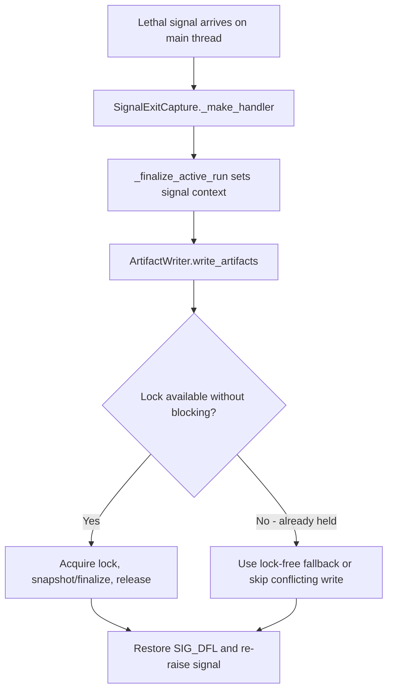

# IPD: Audit lock ordering and prevent re-entrant deadlocks in lethal-signal finalization

- Date: 2026-11-23
- Kind: child
- Concern: Concurrency safety and signal-handler deadlock prevention
- Scope: Audit every lock reachable from `src/pubrun/capture/signals.py::_finalize_active_run` and eliminate same-thread re-entrant deadlocks during lethal-signal finalization across `signals.py`, `tracker.py`, `writer.py`, `subprocesses.py`, and `resources.py`.
- Scope-Paths: src/pubrun/capture/signals.py, src/pubrun/tracker.py, src/pubrun/writer.py, src/pubrun/capture/subprocesses.py, src/pubrun/capture/resources.py, tests/test_signals.py
- Item-Dependencies: none
- Status: to-review
- Work-Kind: followup
- Priority: medium
- From-Backlog: a0o2xx
- Set: a0o2xx
- Order: 1
- Highest E allocated: 04
- Author: Antigravity
- Id: zcuoll

> Write and proofread this plan per the technical writing standard, `.aw/system/workflows/technical-writing/technical-writing.md` (`.agents/workflows/technical-writing/technical-writing.md` in a legacy-layout install), including requirement 12 (diagrams).

## Workflow history

- 2026-11-24 draft (Antigravity): created.
- 2026-11-24 to-review (Antigravity): graduated from backlog item `a0o2xx` into a review-ready plan.

## Goal

Prevent same-thread deadlocks when a lethal signal (`SIGTERM` or `SIGHUP`) interrupts the main thread while that thread already holds a `pubrun` lock on the finalization call chain, and document the lock-ordering contract across all locks reachable from `signals._finalize_active_run`.

## Detailed Implementation Checklist (TODO)

Execution-state rule: mark an `E-*` item complete only after performing the action. That mark is not validation. Right-sizing rule: write for a modest executor that cannot hold much in its head. Each E-item is one step (one concern, about one file, executable in one focused pass) and its V-item names each unit it covers with its own check; a plan stays at about 5 E-items and 8 work Scope-Paths, else split it into more child plans (guidance, `IPD-Z603`). Accepted execution states: blocked, failed, pending, performed; terminal gate demands 'performed'.

### Task group 1: Lock audit and deadlock-safe signal finalization

- [ ] E-01 Audit every lock reachable from `signals._finalize_active_run` and add a concise lock-ordering and signal-safety note in `src/pubrun/capture/signals.py`.
  - Depends on: none
  - Expected outcome: Every lock touched by `_finalize_active_run` -> `ArtifactWriter.write_artifacts` -> `Run._finalize_state` / `Run.to_manifest_dict` and capture-engine snapshot getters (`_run_lock`, `ArtifactWriter._write_lock`, `Run._errors_lock`, `Run._data_files_lock`, `SubprocessSpy._lock`, `ResourceWatcher._lock`, `SignalExitCapture._lock`, `pubrun._commit_lock`, `_bootstrap._lock`) is inventoried with its acquisition order and signal-context behavior in a module comment near `_finalize_active_run` in `src/pubrun/capture/signals.py`.
  - Execution state: pending

- [ ] E-02 Make `Run._finalize_state`, `Run.to_manifest_dict`, and `ArtifactWriter.write_artifacts` safe against same-thread re-entrant entry from `signals._finalize_active_run` in `src/pubrun/tracker.py` and `src/pubrun/writer.py`.
  - Depends on: E-01
  - Expected outcome: When invoked on a thread that already holds `_run_lock`, `Run._errors_lock`, `Run._data_files_lock`, or `ArtifactWriter._write_lock` (for example during a lethal-signal handler), finalization uses re-entrant or non-blocking lock acquisition (`acquire(blocking=False)` or `threading.RLock` where safe, with a graceful best-effort skip/snapshot fallback when contention prevents immediate acquisition) so `_finalize_active_run` never blocks indefinitely, while preserving normal-path mutual exclusion and the existing `_run_lock`-before-`_write_lock` ordering between the main thread and `pubrun-hw`.
  - Execution state: pending

- [ ] E-03 Make `SubprocessSpy` (`src/pubrun/capture/subprocesses.py`) and `ResourceWatcher` (`src/pubrun/capture/resources.py`) snapshot/finalization methods non-blocking or re-entrant when invoked from signal finalization, matching the `SignalExitCapture.get_records` pattern from commit `94e504a`.
  - Depends on: E-01
  - Expected outcome: `SubprocessSpy.finalize_all`, `SubprocessSpy.get_records`, and `ResourceWatcher` summary/stop helpers called during `to_manifest_dict` / `write_artifacts` do not deadlock if the main thread already holds `SubprocessSpy._lock` or `ResourceWatcher._lock` at signal delivery; when a lock cannot be acquired immediately in signal context, the helper returns a safe copy or skips mutation without raising or blocking.
  - Execution state: pending

- [ ] E-04 Add behavioral regression tests in `tests/test_signals.py` verifying that `_finalize_active_run` returns promptly without deadlocking when invoked while the main thread already holds each critical lock.
  - Depends on: E-02, E-03
  - Expected outcome: `tests/test_signals.py` includes behavioral tests that hold `_run_lock`, `ArtifactWriter._write_lock`, `Run._errors_lock`, `Run._data_files_lock`, `SubprocessSpy._lock`, and `ResourceWatcher._lock` on the calling thread, invoke `_finalize_active_run` (or deliver the signal handler path), and assert bounded completion with no deadlock and no uncaught exception, plus normal-path finalization still writes a valid manifest.
  - Execution state: pending

## Project conventions discovered (Step 0)

- Cite code by SYMBOL (`module.function`) or by a quoted content string, with a line number only appended to one of those and never alone (`IPD-C801`).
- Commit `94e504a` fixed `SignalExitCapture.get_records` in `src/pubrun/capture/signals.py` to use `self._lock.acquire(blocking=False)` when snapshotting records and left backlog item `a0o2xx` to cover the remaining locks reachable from `_finalize_active_run`.
- `src/pubrun/capture/signals.py::_make_handler` invokes `_finalize_active_run()` synchronously on the main thread when handling a lethal signal (`SIGTERM`, `SIGHUP`) whose previous handler was `SIG_DFL`.
- Test outcomes, not code structure: tests in `tests/test_signals.py` must exercise runtime behavior (acquiring locks, calling `_finalize_active_run`, checking return and artifacts) and must not inspect source code with `ast`, `inspect`, regex, or substring matching.
- Run pytest via `pytest` from the repository root (`pyproject.toml` configures pytest).

## Findings

When `SIGTERM` or `SIGHUP` interrupts the main thread during normal execution, Python executes `SignalExitCapture._make_handler` on that same main thread. That handler calls `_finalize_active_run()`, which calls `run.writer.write_artifacts()`. That call chain acquires multiple locks:

1. `src/pubrun/tracker.py`: `_run_lock`, `Run._errors_lock`, `Run._data_files_lock`.
2. `src/pubrun/writer.py`: `ArtifactWriter._write_lock` (and `Run._finalize_state` inside `write_artifacts`).
3. `src/pubrun/capture/subprocesses.py`: `SubprocessSpy._lock` (via `finalize_all` / `get_records`).
4. `src/pubrun/capture/resources.py`: `ResourceWatcher._lock` (via `get_summary` / `stop`).
5. `src/pubrun/capture/signals.py`: `SignalExitCapture._lock` (already `threading.RLock` with non-blocking `get_records`).
6. `src/pubrun/__init__.py::_commit_lock` and `src/pubrun/_bootstrap.py::_lock` (if reached via `get_import_metadata()` during `to_manifest_dict`).

Any non-reentrant `threading.Lock` on this chain self-deadlocks the process if the signal arrives while the main thread holds that lock, preventing the lethal signal handler from restoring `SIG_DFL` and re-raising the signal.

## Proposed changes (ordered, validatable)

1. **`src/pubrun/capture/signals.py` (E-01):** Track when `_finalize_active_run` is executing in signal-handler context (for example via a module-level boolean or thread-id flag reset in a `finally` block, or by passing `from_signal=True` to `write_artifacts`). Add a short lock-ordering comment documenting all locks reachable from `_finalize_active_run` and the rule that signal-context finalization must never perform a blocking acquire on a non-reentrant lock.
2. **`src/pubrun/tracker.py` and `src/pubrun/writer.py` (E-02):**
   - Audit `_run_lock`, `Run._errors_lock`, `Run._data_files_lock`, and `ArtifactWriter._write_lock`.
   - Ensure `write_artifacts(..., from_signal=False)` (or a signal-context check) acquires `_write_lock` with `blocking=False` when invoked from a signal handler; if `_write_lock` is already held (either by the interrupted main thread or by `pubrun-hw`), return cleanly without deadlocking rather than blocking forever.
   - Ensure `_finalize_state` and `to_manifest_dict` use non-blocking acquisition (or `RLock` where invariant preservation is safe, with non-blocking fallback when `from_signal=True`) for `_run_lock`, `_errors_lock`, and `_data_files_lock`. Preserve normal-path blocking behavior and lock ordering (`_run_lock` before `_write_lock`) when not in signal context.
   - Verify whether `pubrun._bootstrap.get_import_metadata()` acquires `_bootstrap._lock` (and if so, ensure `_bootstrap._lock` cannot block signal finalization or snapshot without blocking; check during E-01 and only touch files within `Scope-Paths`; note `_bootstrap._lock` is only held during import-mode registration, never during normal workload execution, so document that in E-01).
3. **`src/pubrun/capture/subprocesses.py` and `src/pubrun/capture/resources.py` (E-03):**
   - In `SubprocessSpy.get_records` and `SubprocessSpy.finalize_all`, support non-blocking lock acquisition when called from signal finalization (falling back to a shallow list copy or skipping mutation if `_lock` is held).
   - In `ResourceWatcher` methods called by `to_manifest_dict` or `write_artifacts`, use non-blocking acquisition in signal context so holding `ResourceWatcher._lock` on the main thread cannot deadlock signal exit.
4. **`tests/test_signals.py` (E-04):**
   - Add deterministic tests that acquire each lock (`_run_lock`, `writer._write_lock`, `run._errors_lock`, `run._data_files_lock`, `SubprocessSpy._lock`, and `ResourceWatcher._lock`) on the current thread, invoke `_finalize_active_run()` inside a watchdog/timeout guard (for example a `threading.Timer` or subprocess timeout), and assert that `_finalize_active_run()` returns promptly without hanging or raising.
   - Add a test confirming normal (uncontended) `_finalize_active_run()` still writes `manifest.json` cleanly.

## Deferred / out of scope (with reason)

None.

## Scope check

- Over-scope: none. This plan touches only signal finalization, the lock-bearing tracker/writer/capture modules reachable from `_finalize_active_run`, and `tests/test_signals.py`.
- Under-scope: none. All locks identified in backlog item `a0o2xx` and verified in the codebase are covered by E-01 through E-04.

## Required tests / validation

- Run `pytest tests/test_signals.py` and verify all new and existing signal-finalization tests pass.
- Run `pytest tests/test_capture.py tests/test_concurrency.py` (or the relevant concurrency/tracker test modules if present) plus the full `pytest` suite to confirm no regressions in normal-path locking or `pubrun-hw` coordination.

## Spec / documentation sync

N/A beyond the inline lock-ordering comment in `src/pubrun/capture/signals.py` (E-01). No user-facing CLI flags, manifest schema fields, or external contracts change.

## Open questions

None.

## Validation and cross-check (verify before reporting done)

Validation-state rule: inspect evidence in a separate pass. Do not mark a `V-*` item complete from memory or from the matching execution checkmark. Accepted validation results: blocked, failed, pass, pending; terminal gate demands 'pass'. Runtime-demonstration reachability rule: for each `V-*` item demanding the software be observed acting (such as a run, a dispatch, or a transition), name the code path that produces the observation or the sibling `E-*` that creates it, else the demand is UNDER-SCOPE.

- [ ] V-01 validates E-01
  - Required evidence: Paste the relevant `git diff src/pubrun/capture/signals.py` showing the lock-ordering and signal-safety inventory comment naming `_run_lock`, `_write_lock`, `_errors_lock`, `_data_files_lock`, `SubprocessSpy._lock`, `ResourceWatcher._lock`, `SignalExitCapture._lock`, `_commit_lock`, and `_bootstrap._lock`.
  - Observed evidence:
  - Result: pending

- [ ] V-02 validates E-02
  - Required evidence: Paste the `git diff src/pubrun/tracker.py src/pubrun/writer.py` showing non-blocking or re-entrant signal-context handling for `_run_lock`, `_errors_lock`, `_data_files_lock`, and `_write_lock` while preserving normal-path blocking lock ordering.
  - Observed evidence:
  - Result: pending

- [ ] V-03 validates E-03
  - Required evidence: Paste the `git diff src/pubrun/capture/subprocesses.py src/pubrun/capture/resources.py` showing non-blocking signal-context handling for `SubprocessSpy._lock` and `ResourceWatcher._lock`.
  - Observed evidence:
  - Result: pending

- [ ] V-04 validates E-04
  - Required evidence: Paste actual `pytest tests/test_signals.py` output showing every new held-lock deadlock test (covering `_run_lock`, `_write_lock`, `_errors_lock`, `_data_files_lock`, `SubprocessSpy._lock`, and `ResourceWatcher._lock` via `_finalize_active_run` from E-02/E-03/E-04) and existing tests passing, plus the summary line of a full `pytest` run showing 0 failures.
  - Observed evidence:
  - Result: pending

## Approval and execution gate

- Size assessment: standard
- Cohesion rationale: not required

Execution begins only after this plan reaches `approved`. Execute `E-01` through `E-04` in order, verify `V-01` through `V-04` with pasted evidence, commit only the scoped files through `aw commit`, and complete the post-gate lifecycle transition under `ipd-lifecycle`.
