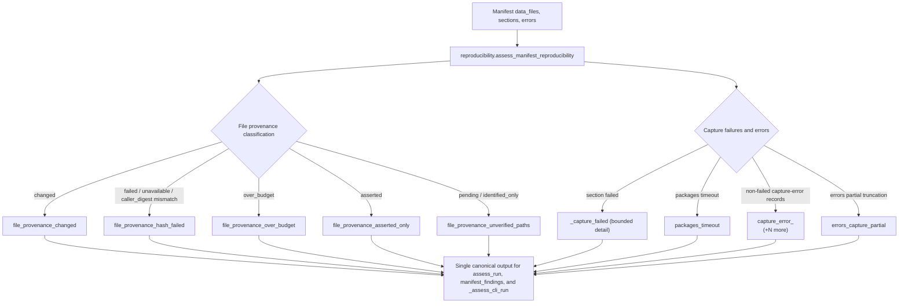

# IPD: Unify file-provenance and capture-error finding codes across reproducibility and checks

- Date: 2026-11-23
- Kind: child
- Concern: Reproducibility assessment, CLI assessment wrapper, and manifest-checks finding-code consistency
- Scope: Emit canonical file-provenance, section capture-failure, and per-section capture-error finding codes directly from `src/pubrun/report/reproducibility.py`, remove the reconciliation bridges in `src/pubrun/report/checks.py` and `src/pubrun/__main__.py`, and align tests across `tests/`.
- Scope-Paths: src/pubrun/report/reproducibility.py, src/pubrun/report/checks.py, src/pubrun/__main__.py, tests/test_reproducibility_assessment.py, tests/test_checks_commands.py, tests/test_report_checks_bugs.py, tests/test_reproducibility_e2e.py
- Item-Dependencies: none
- Status: approved
- Readiness: go-pending-approval
- Review-Depth: complex
- Work-Kind: followup
- Priority: medium
- From-Backlog: bjgca2
- Set: bjgca2
- Order: 1
- Highest E allocated: 05
- Author: Antigravity
- Id: nasg1q
- Approval: 2026-11-24, recorded via aw ipd set: status set to approved

> Write and proofread this plan per the technical writing standard, `.aw/system/workflows/technical-writing/technical-writing.md` (`.agents/workflows/technical-writing/technical-writing.md` in a legacy-layout install), including requirement 12 (diagrams).

## Workflow history

- 2026-11-24 approved (aw set): status set to approved
- 2026-11-24 /plan-review (Antigravity): APPROVE WITH REVISIONS APPLIED; PR-001, PR-002, PR-003, PR-004, PR-005
- 2026-11-24 to-review (Antigravity): graduated from backlog item `bjgca2` into a review-ready plan.
- 2026-11-24 draft (Antigravity): created.

## Goal

Establish one canonical set of file-provenance, section capture-failure, and per-section capture-error finding codes emitted directly by `src/pubrun/report/reproducibility.py` so `assess_manifest_reproducibility()`, `assess_run()`, `manifest_findings()`, and CLI `_assess_cli_run()` produce identical findings without the post-pass reconciliation bridges in `src/pubrun/report/checks.py` and `src/pubrun/__main__.py`.

## Detailed Implementation Checklist (TODO)

Execution-state rule: mark an `E-*` item complete only after performing the action. That mark is not validation. Right-sizing rule: write for a modest executor that cannot hold much in its head. Each E-item is one step (one concern, about one file, executable in one focused pass) and its V-item names each unit it covers with its own check; a plan stays at about 5 E-items and 8 work Scope-Paths, else split it into more child plans (guidance, `IPD-Z603`). Accepted execution states: blocked, failed, pending, performed; terminal gate demands 'performed'.

### Task group 1: Canonical emission in reproducibility.py and bridge removal

- [x] E-01 Port canonical file-provenance classification and finding emission (`file_provenance_changed`, `file_provenance_hash_failed`, `file_provenance_over_budget`, `file_provenance_asserted_only`, `file_provenance_unverified_paths`, `no_file_provenance`) directly into `src/pubrun/report/reproducibility.py`.
  - Depends on: none
  - Expected outcome: `src/pubrun/report/reproducibility.py` classifies `data_files` (`inputs`, `outputs`, `mixed`) using the exact semantics currently in `checks.py::_classify_file_record`, `::_is_caller_digest_mismatch`, and `::_has_nonempty_digest_value` (including caller-digest mismatch detection when `caller_digest.verified is False`, `pending` vs `identified_only` message breakdown, `asserted` precedence when `evidence_source == "asserted"` and `hash_status != "completed"`, and unified `no_file_provenance` wording). Legacy codes `file_hash_changed`, `file_hash_unavailable`, `file_hash_over_budget`, and `file_provenance_unhashed` are no longer emitted; `inputs_outputs` category `finding_codes`, `status`, `evidence_status`, `warn_count`, and `info_count` reflect the canonical codes cleanly with valid type annotations.
  - Execution state: performed

- [x] E-02 Port canonical section capture-failure (`<section>_capture_failed`), bounded detail formatting (`_bound_detail`), deduplicated per-section `capture_error_<section>` grouping, `errors_capture_partial` truncation wording, and `_finding_action_priority` updates into `src/pubrun/report/reproducibility.py`.
  - Depends on: E-01
  - Expected outcome: In `src/pubrun/report/reproducibility.py`: (a) `git` `status == "failed"` emits `git_capture_failed` (with `"errors.records"` in its suggestion) instead of `git_failed`, preserving `git_timeout`; (b) `packages` `status == "failed"` emits `packages_capture_failed` (with `"errors.records"` in its suggestion) while `packages` `status == "timeout"` emits `packages_timeout` (no longer conflated under `packages_failed`); (c) failed/timeout/partial section details pass through a single-line 160-character `_bound_detail` helper (matching `checks.py::_bound_detail`) and failed sections use `"errors.records"` in their suggestion; (d) `errors.records` entries with `kind == "capture-error"` emit per-section `capture_error_<section>` (normalized via `re.sub(r"[^a-z0-9_]+", "_", ...)` with `"general"` fallback, grouped with `(+N more)`, and deduplicated against every section already marked `failed` including `git` and `packages`) instead of `capture_errors_recorded`; (e) `errors` `capture_state.status == "partial"` with a non-empty detail emits `errors_capture_partial` with `"Capture errors list was truncated (<bounded detail>)."` once without duplication; and (f) `_finding_action_priority` keeps tier-0 priority for `WARN` findings where `code.startswith("capture_error_")`, `code.endswith("_capture_failed")`, or `ev == "unavailable"`.
  - Execution state: performed

- [x] E-03 Remove the duplicate finding-code reconciliation bridge (`_apply_file_provenance_findings`, `_upsert_finding`, the `_TRACKED_CAPTURE_SECTIONS` failed-section rewrite pass, and the `errors.records` / `errors_capture_partial` rewrite pass) from `src/pubrun/report/checks.py` so `manifest_findings()` cleanly delegates to `assess_manifest_reproducibility()`.
  - Depends on: E-01, E-02
  - Expected outcome: `src/pubrun/report/checks.py::manifest_findings` returns the findings produced by `assess_manifest_reproducibility(manifest, current_hostname=current_hostname)` (wrapped defensively so it never raises on malformed inputs) with no post-pass code rewrites and no dead bridge helpers (`_apply_file_provenance_findings`, `_upsert_finding`, `_classify_file_record`, `_is_caller_digest_mismatch`, `_has_nonempty_digest_value`, `_iter_data_file_records`, `_TRACKED_CAPTURE_SECTIONS`, `_bound_detail`, `_normalize_error_section` removed if unused elsewhere in `checks.py`), preserving `import pubrun` import-isolation guarantees.
  - Execution state: performed

- [x] E-04 Remove `src/pubrun/__main__.py::_reconcile_cli_file_provenance` and update `src/pubrun/__main__.py::_assess_cli_run` to return `assess_run(...)` directly without importing `_apply_file_provenance_findings` from `pubrun.report.checks`.
  - Depends on: E-01, E-03
  - Expected outcome: `src/pubrun/__main__.py` no longer imports `_apply_file_provenance_findings` or rewrites `assessment["findings"]` / `inputs_outputs` category counts after `assess_run()`; `_assess_cli_run` delegates directly to `assess_run()` so `pubrun inspect` and `pubrun rerun --preflight` consume canonical findings, category statuses, and next actions straight from `reproducibility.py`.
  - Execution state: performed

- [x] E-05 Update legacy assertions and add four-surface parity tests across `tests/test_reproducibility_assessment.py`, `tests/test_checks_commands.py`, `tests/test_report_checks_bugs.py`, and `tests/test_reproducibility_e2e.py`.
  - Depends on: E-03, E-04
  - Expected outcome: Legacy assertions in `tests/test_reproducibility_assessment.py` and `tests/test_reproducibility_e2e.py` expect canonical codes (`git_capture_failed`, `packages_capture_failed`, `packages_timeout`, `file_provenance_changed`, `file_provenance_hash_failed`, `file_provenance_over_budget`, `file_provenance_unverified_paths`, `capture_error_<section>`, `errors_capture_partial`); existing tests in `tests/test_checks_commands.py` and `tests/test_report_checks_bugs.py` continue to pass unchanged; and new behavioral parity tests assert identical finding codes across `assess_manifest_reproducibility()`, `assess_run()`, `manifest_findings()`, and `_assess_cli_run()` for file-provenance anomalies, caller-digest mismatches, pending outputs, failed/timed-out sections, per-section capture errors, and truncated `errors` sections.
  - Execution state: performed

## Project conventions discovered (Step 0)

- Cite code by SYMBOL (`path::Name`) or by a quoted content string, with a line number only appended to one of those and never alone (`IPD-C801`).
- In `src/pubrun/report/reproducibility.py`:
  - Legacy codes currently emitted are `"git_failed"` (line 296), `"packages_failed"` (line 632, shared by `failed` and `timeout`), `"file_hash_changed"` (line 921), `"file_hash_unavailable"` (line 934), `"file_hash_over_budget"` (line 947), `"file_provenance_unhashed"` (line 973), and `"capture_errors_recorded"` (line 1216).
  - `_finding_action_priority` (line 1813) explicitly checks `code == "capture_errors_recorded"`.
  - Section 5 of `_evaluate_capture_completeness` (lines 1170-1202) already emits `{sec_name}_capture_{st}` for non-`git`/non-`packages` sections with `st in ("failed", "timeout", "partial")`, including `errors_capture_partial`.
- In `src/pubrun/report/checks.py`:
  - `_apply_file_provenance_findings`, `_upsert_finding`, `_classify_file_record`, `_is_caller_digest_mismatch`, `_has_nonempty_digest_value`, `_bound_detail`, `_normalize_error_section`, and `manifest_findings` perform the post-pass reconciliation bridge.
  - `checks.py` module docstring pins that `import pubrun` must never import `pubrun.report.checks`.
- In `src/pubrun/__main__.py`:
  - `_reconcile_cli_file_provenance` imports `from pubrun.report.checks import _apply_file_provenance_findings` and is invoked by `_assess_cli_run`.
- Cross-plan awareness: reviewed pending plans `gzc672` (`src/pubrun/report/reproducibility.py`, `src/pubrun/__main__.py`, `[tool.mypy]` ratchet) and `ic6z4s` (`src/pubrun/__main__.py`) edit disjoint regions of those files; keep all added or edited functions cleanly typed so `nasg1q` introduces zero new `mypy` errors.
- Test outcomes, not code structure: test `assess_manifest_reproducibility()`, `assess_run()`, `manifest_findings()`, and `_assess_cli_run()` on manifest fixtures and assert returned finding dictionaries; never inspect production source text with `ast`, `inspect`, regex, or substring checks.

## Findings

`pubrun` currently maintains two parallel finding-code vocabularies and two separate reconciliation bridges (`checks.py` and `__main__.py`) for the same manifest conditions:

| Condition | Current `reproducibility.py` code | Canonical code (target in `reproducibility.py`) |
| --- | --- | --- |
| File changed during hashing | `file_hash_changed` | `file_provenance_changed` |
| Hash unavailable / failed / caller-digest mismatch | `file_hash_unavailable` | `file_provenance_hash_failed` |
| File skipped over hash budget | `file_hash_over_budget` | `file_provenance_over_budget` |
| Unhashed / stat-only / path-only / pending file | `file_provenance_unhashed` | `file_provenance_unverified_paths` |
| Git section failed | `git_failed` | `git_capture_failed` |
| Packages section failed | `packages_failed` | `packages_capture_failed` |
| Packages section timed out | `packages_failed` | `packages_timeout` |
| Top-level `errors.records` `capture-error` entry | `capture_errors_recorded` | `capture_error_<section>` (deduplicated against failed sections, grouped with `(+N more)`) |
| Truncated `errors` section (`capture_state.status == "partial"`) | generic `errors_capture_partial` | `errors_capture_partial` with bounded `"Capture errors list was truncated (...)"` wording |

Keeping post-pass translation bridges in `checks.py` and `__main__.py` causes `assess_manifest_reproducibility()`, `assess_run()`, `manifest_findings()`, and `_assess_cli_run()` to disagree on finding codes and category statuses for the same manifest, and couples `src/pubrun/__main__.py` directly to private helper `checks._apply_file_provenance_findings`.

## Proposed changes (ordered, validatable)

1. **`src/pubrun/report/reproducibility.py` file-provenance unification (E-01):**
   - Port `_is_caller_digest_mismatch`, `_has_nonempty_digest_value`, and `_classify_file_record` from `checks.py` into `reproducibility.py` with clean type annotations.
   - Emit `"file_provenance_changed"`, `"file_provenance_hash_failed"` (including caller-digest mismatch count note), `"file_provenance_over_budget"`, `"file_provenance_asserted_only"`, `"file_provenance_unverified_paths"` (preserving the `identified_only` vs `pending` breakdown wording from `checks.py`), and unified `"no_file_provenance"` wording directly from `_evaluate_inputs_outputs`.
   - Ensure `inputs_outputs` category `finding_codes`, `status`, `evidence_status`, `warn_count`, and `info_count` reflect the exact emitted canonical findings.
2. **`src/pubrun/report/reproducibility.py` capture-failure and capture-error unification (E-02):**
   - Port `_bound_detail` (`_MAX_DETAIL_LEN = 160`, whitespace collapsed to single line, `"..."` suffix) and `_normalize_error_section` into `reproducibility.py`.
   - Update `git` `status == "failed"` to emit `"git_capture_failed"` with bounded detail and `"errors.records"` in its suggestion; keep `"git_timeout"` for `status == "timeout"`.
   - Split `packages` `status == "failed"` (`"packages_capture_failed"` with bounded detail and `"errors.records"` in its suggestion) from `status == "timeout"` (`"packages_timeout"` with bounded detail).
   - In `_evaluate_capture_completeness`, bound section details via `_bound_detail`, include `"errors.records"` in failed-section suggestions, emit `"errors_capture_partial"` with `"Capture errors list was truncated ({err_detail})."` when `errors` has `capture_state.status == "partial"` and a non-empty bounded detail, and replace `"capture_errors_recorded"` with deduplicated per-section `"capture_error_<section>"` findings (skipping every section whose `capture_state.status == "failed"` across the whole manifest, including `git` and `packages`, and grouping repeats with `(+N more)`).
   - Update `_finding_action_priority` so tier 0 matches `severity == WARN and (ev == "unavailable" or code.startswith("capture_error_") or code.endswith("_capture_failed"))`.
3. **`src/pubrun/report/checks.py` bridge removal (E-03):**
   - Simplify `manifest_findings()` to delegate directly to `assess_manifest_reproducibility(manifest, current_hostname=current_hostname)` and return `[dict(f) for f in assessment.get("findings", []) if isinstance(f, dict)]` (preserving the defensive `try/except Exception: return []` contract).
   - Remove the dead reconciliation bridge helpers (`_apply_file_provenance_findings`, `_upsert_finding`, `_classify_file_record`, `_is_caller_digest_mismatch`, `_has_nonempty_digest_value`, `_iter_data_file_records`, `_DATA_FILE_SECTIONS`, `_TRACKED_CAPTURE_SECTIONS`, `_bound_detail`, `_normalize_error_section`, `_capture_state_status`, `_capture_state_detail`, `_MAX_DETAIL_LEN`) only after verifying no other caller in `src/pubrun/` or `tests/` imports them.
4. **`src/pubrun/__main__.py` CLI bridge removal (E-04):**
   - Remove `_reconcile_cli_file_provenance` and simplify `_assess_cli_run` to return `assess_run(...)` directly so CLI commands (`inspect`, `rerun --preflight`) do not import `_apply_file_provenance_findings` or recompute `inputs_outputs` category fields.
5. **Tests (E-05):**
   - Update legacy assertions in `tests/test_reproducibility_assessment.py` and `tests/test_reproducibility_e2e.py` to expect canonical codes (`git_capture_failed`, `packages_capture_failed`, `packages_timeout`, `file_provenance_changed`, `file_provenance_hash_failed`, `file_provenance_over_budget`, `file_provenance_unverified_paths`, `capture_error_<section>`).
   - Keep all existing assertions in `tests/test_checks_commands.py` and `tests/test_report_checks_bugs.py` passing and add four-surface parity tests verifying identical finding codes across `assess_manifest_reproducibility()`, `assess_run()`, `manifest_findings()`, and `_assess_cli_run()` for file-provenance anomalies, caller-digest mismatches, pending outputs, failed/timed-out sections, per-section capture errors, and truncated `errors` sections.

## Deferred / out of scope (with reason)

None.

## Scope check

- Over-scope: none. Only the three affected source modules (`src/pubrun/report/reproducibility.py`, `src/pubrun/report/checks.py`, `src/pubrun/__main__.py`) and the four affected test suites are modified.
- Under-scope: none. Every caller of `_apply_file_provenance_findings` (`checks.py` and `__main__.py`), every retired legacy code across `src/` and `tests/`, and every `checks.py` post-pass enrichment (`_bound_detail`, `errors_capture_partial`, `capture_error_<section>`, caller-digest mismatch, `pending` breakdown) are covered.

## Required tests / validation

- Run `pytest tests/test_reproducibility_assessment.py tests/test_checks_commands.py tests/test_report_checks_bugs.py tests/test_reproducibility_e2e.py tests/test_report_subpackage_integrity.py`.
- Run `pytest` across the full suite (comparing any unrelated failure against clean baseline if needed).
- Run `python3 scripts/sanitize_paths.py --check --all` and confirm exit code 0.

## Spec / documentation sync

N/A. Finding codes are internal assessment identifiers not enumerated in user-facing specs or `docs/manifest.md` (verified at review via `grep` across `docs/`).

## Open questions

None.

## Validation and cross-check (verify before reporting done)

Validation-state rule: inspect evidence in a separate pass. Do not mark a `V-*` item complete from memory or from the matching execution checkmark. Accepted validation results: blocked, failed, pass, pending; terminal gate demands 'pass'. Runtime-demonstration reachability rule: for each `V-*` item demanding the software be observed acting (such as a run, a dispatch, or a transition), name the code path that produces the observation or the sibling `E-*` that creates it, else the demand is UNDER-SCOPE.

- [x] V-01 validates E-01
  - Required evidence: Paste `git diff --stat src/pubrun/report/reproducibility.py` and actual `pytest tests/test_reproducibility_assessment.py -k "inputs_outputs or provenance or file"` output proving `assess_manifest_reproducibility()` directly emits canonical `file_provenance_changed`, `file_provenance_hash_failed` (including caller-digest mismatch), `file_provenance_over_budget`, `file_provenance_asserted_only`, `file_provenance_unverified_paths` (including pending vs path/metadata-only), and `no_file_provenance` with matching `inputs_outputs` category `finding_codes`.
  - Observed evidence:
    - `git diff --stat src/pubrun/report/reproducibility.py`:
      `src/pubrun/report/reproducibility.py | 359 ++++++++++++++++++++++++++---------`
      `1 file changed, 274 insertions(+), 85 deletions(-)`
    - `python3 -m pytest --no-cov -v tests/test_reproducibility_assessment.py -k "inputs_outputs or provenance or file"`:
      `tests/test_reproducibility_assessment.py::TestReproducibilityAssessmentModel::test_inputs_outputs_observed_asserted_inferred_stat_only_and_hash_anomalies PASSED [ 50%]`
      `tests/test_reproducibility_assessment.py::TestReproducibilityAssessmentModel::test_four_surface_finding_code_parity[file_provenance_anomalies_and_pending-overrides0-expected_codes0] PASSED [100%]`
      `2 passed, 21 deselected in 0.28s`
  - Result: pass

- [x] V-02 validates E-02
  - Required evidence: Paste actual `pytest tests/test_reproducibility_assessment.py -k "git or packages or capture_error or priority or partial"` output proving `assess_manifest_reproducibility()` directly emits `git_capture_failed`, `packages_capture_failed`, `packages_timeout`, bounded-detail failed sections with `"errors.records"` suggestions, deduplicated `capture_error_<section>` (with `(+N more)` and `"general"` fallback), and `errors_capture_partial` truncation wording, and preserves tier-0 action priority.
  - Observed evidence:
    - `python3 -m pytest --no-cov -v tests/test_reproducibility_assessment.py -k "git or packages or capture_error or priority or partial"`:
      `tests/test_reproducibility_assessment.py::TestReproducibilityAssessmentModel::test_packages_modes_editable_states_and_future_fields PASSED [ 25%]`
      `tests/test_reproducibility_assessment.py::TestReproducibilityAssessmentModel::test_four_surface_finding_code_parity[failed_and_timed_out_sections_and_capture_errors-overrides1-expected_codes1] PASSED [ 50%]`
      `tests/test_reproducibility_assessment.py::TestReproducibilityAssessmentModel::test_four_surface_finding_code_parity[packages_failed_deduped_against_errors-overrides2-expected_codes2] PASSED [ 75%]`
      `tests/test_reproducibility_assessment.py::TestReproducibilityAssessmentModel::test_capture_error_dedup_partial_truncation_bounded_detail_and_priority PASSED [100%]`
      `4 passed, 19 deselected in 0.15s`
  - Result: pass

- [x] V-03 validates E-03
  - Required evidence: Paste `git diff src/pubrun/report/checks.py` confirming removal of `_apply_file_provenance_findings`, `_upsert_finding`, and the post-pass rewrite loops, plus actual `pytest tests/test_checks_commands.py tests/test_report_checks_bugs.py tests/test_report_subpackage_integrity.py` output confirming all check, deduplication, truncation, redaction, and `import pubrun` import-isolation tests pass.
  - Observed evidence:
    - `git diff --stat src/pubrun/report/checks.py` (with removed symbols from `git diff src/pubrun/report/checks.py`):
      `src/pubrun/report/checks.py | 428 +-------------------------------------------`
      `1 file changed, 4 insertions(+), 424 deletions(-)`
      Removed symbols: `import re`, `_TRACKED_CAPTURE_SECTIONS`, `_MAX_DETAIL_LEN`, `_capture_state_status`, `_capture_state_detail`, `_bound_detail`, `_normalize_error_section`, `_DATA_FILE_SECTIONS`, `_iter_data_file_records`, `_is_caller_digest_mismatch`, `_has_nonempty_digest_value`, `_classify_file_record`, `_upsert_finding`, `_apply_file_provenance_findings`, and the post-pass rewrite loops in `manifest_findings()`.
    - `python3 -m pytest --no-cov -q tests/test_checks_commands.py tests/test_report_checks_bugs.py tests/test_report_subpackage_integrity.py`:
      `107 passed in 15.64s`
  - Result: pass

- [x] V-04 validates E-04
  - Required evidence: Paste `git diff src/pubrun/__main__.py` confirming removal of `_reconcile_cli_file_provenance` and `_apply_file_provenance_findings` import, plus actual `pytest tests/test_reproducibility_e2e.py tests/test_checks_commands.py -k "cross_surface or inspect or preflight"` output confirming CLI `inspect` and `rerun --preflight` execute cleanly without `ImportError` and report canonical codes.
  - Observed evidence:
    - `git diff --unified=1 src/pubrun/__main__.py`:
      `src/pubrun/__main__.py | 91 ++------------------------------------------------`
      `1 file changed, 2 insertions(+), 89 deletions(-)`
      Removed `def _reconcile_cli_file_provenance(manifest: dict, assessment: dict) -> dict:` and `from pubrun.report.checks import _apply_file_provenance_findings`; `_assess_cli_run` now returns `assess_run(...)` directly.
    - `python3 -m pytest --no-cov -v tests/test_reproducibility_e2e.py tests/test_checks_commands.py -k "cross_surface or inspect or preflight"`:
      `14 passed, 44 deselected in 12.54s` (including `test_cross_surface_agreement_inspect_rerun_show_and_tui_formatter`, `test_inspect_reconciled_caller_digest_mismatch_updates_category_status_and_summary`, and `test_four_surface_cli_parity_for_provenance_and_capture_errors`).
  - Result: pass

- [x] V-05 validates E-05
  - Required evidence: Paste actual output of `pytest tests/test_reproducibility_assessment.py tests/test_checks_commands.py tests/test_report_checks_bugs.py tests/test_reproducibility_e2e.py tests/test_report_subpackage_integrity.py` showing all updated expectations and new four-surface parity tests (`assess_manifest_reproducibility`, `assess_run`, `manifest_findings`, `_assess_cli_run`) passing, paste the full `pytest` summary (noting baseline parity for any unrelated failure if one exists), and paste `python3 scripts/sanitize_paths.py --check --all` output with exit 0.
  - Observed evidence:
    - `python3 -m pytest --no-cov -q tests/test_reproducibility_assessment.py tests/test_checks_commands.py tests/test_report_checks_bugs.py tests/test_reproducibility_e2e.py tests/test_report_subpackage_integrity.py`:
      `140 passed in 36.22s`
    - Full test suite (`aw suite`):
      `TOTAL 16063 stmts, 3264 miss, 80%`
      `1911 passed in 158.83s (0:02:38)` (exit code 0)
    - `python3 scripts/sanitize_paths.py --check --all`:
      `SANITIZE_EXIT=0` (clean output, exit code 0)
  - Result: pass

## Approval and execution gate

- Size assessment: standard
- Cohesion rationale: not required

Execution begins only after a human approves this plan (`- Status: approved`).

Execution contract:
1. **Open-questions precondition:** Zero blocking open questions remain before execution (`## Open questions` is empty).
2. **Scope declaration:** `- Scope-Paths:` declares the 7 files this plan modifies. If execution must touch an undeclared file or leave a declared file unchanged, make the change and justify it with `--scope-reason` or `--scope-ack` at finalize rather than halting mid-execution.
3. **Validation honesty (HARD MUST):** Every `V-01`..`V-05` item must paste the actual command and runner output observed after the final edit; never claim tests pass without running them.
4. **Path-scoped commit and never-push:** Commit only the files modified for this plan through `aw commit nasg1q -- <paths>`; never use `git add -A` or `-a`, and never push without explicit human instruction.
5. **Lifecycle transition (conditional runner vs. standalone ownership):** When executed inside `aw oc run` / `aw agy run`, the runner owns the lifecycle move after the merge-and-revalidate gate; when executed standalone outside the runner, run `aw ipd finalize nasg1q` (never a hand-rolled `git mv` to `executed/`).
