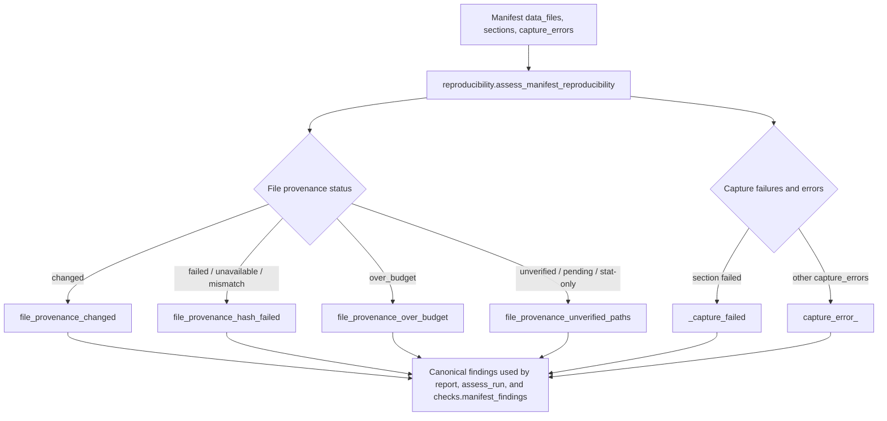

# IPD: Unify file-provenance and capture-error finding codes across reproducibility and checks

- Date: 2026-11-23
- Kind: child
- Concern: Reproducibility assessment and CLI checks finding-code consistency
- Scope: Emit canonical file-provenance and per-section capture-error finding codes directly from `src/pubrun/report/reproducibility.py`, remove the post-pass reconciliation bridge in `src/pubrun/report/checks.py`, and update tests across `tests/`.
- Scope-Paths: src/pubrun/report/reproducibility.py, src/pubrun/report/checks.py, tests/test_reproducibility_assessment.py, tests/test_checks_commands.py, tests/test_report_checks_bugs.py, tests/test_reproducibility_e2e.py
- Item-Dependencies: none
- Status: to-review
- Work-Kind: followup
- Priority: medium
- From-Backlog: bjgca2
- Set: bjgca2
- Order: 1
- Highest E allocated: 04
- Author: Antigravity
- Id: nasg1q

> Write and proofread this plan per the technical writing standard, `.aw/system/workflows/technical-writing/technical-writing.md` (`.agents/workflows/technical-writing/technical-writing.md` in a legacy-layout install), including requirement 12 (diagrams).

## Workflow history

- 2026-11-24 draft (Antigravity): created.
- 2026-11-24 to-review (Antigravity): graduated from backlog item `bjgca2` into a review-ready plan.

## Goal

Establish one canonical set of file-provenance and capture-error finding codes emitted directly by `src/pubrun/report/reproducibility.py` so `assess_manifest_reproducibility()`, `assess_run()`, and `manifest_findings()` produce identical finding codes without the reconciliation bridge in `src/pubrun/report/checks.py`.

## Detailed Implementation Checklist (TODO)

Execution-state rule: mark an `E-*` item complete only after performing the action. That mark is not validation. Right-sizing rule: write for a modest executor that cannot hold much in its head. Each E-item is one step (one concern, about one file, executable in one focused pass) and its V-item names each unit it covers with its own check; a plan stays at about 5 E-items and 8 work Scope-Paths, else split it into more child plans (guidance, `IPD-Z603`). Accepted execution states: blocked, failed, pending, performed; terminal gate demands 'performed'.

### Task group 1: Canonical emission in reproducibility.py and bridge removal in checks.py

- [ ] E-01 Emit the canonical file-provenance finding codes (`file_provenance_changed`, `file_provenance_hash_failed`, `file_provenance_over_budget`, `file_provenance_asserted_only`, `file_provenance_unverified_paths`, `no_file_provenance`) directly from `src/pubrun/report/reproducibility.py`.
  - Depends on: none
  - Expected outcome: `assess_manifest_reproducibility()` in `src/pubrun/report/reproducibility.py` emits the canonical `file_provenance_*` codes (including caller-digest mismatch handling and pending/path-only/metadata-only unverified-path handling currently performed by `checks._apply_file_provenance_findings`), no longer emits legacy `file_hash_changed`, `file_hash_unavailable`, `file_hash_over_budget`, or `file_provenance_unhashed`, and records matching codes in category `finding_codes`.
  - Execution state: pending

- [ ] E-02 Emit canonical per-section capture-failure (`<section>_capture_failed`) and deduplicated per-section capture-error (`capture_error_<section>`) finding codes directly from `src/pubrun/report/reproducibility.py`, and update `_finding_action_priority` to recognize them.
  - Depends on: E-01
  - Expected outcome: `src/pubrun/report/reproducibility.py` emits `git_capture_failed`, `packages_capture_failed`, and per-section `capture_error_<section>` (deduplicated against sections already reporting `<section>_capture_failed`) instead of legacy `git_failed`, `packages_failed`, and `capture_errors_recorded`, and `_finding_action_priority` preserves tier-0 priority for per-section capture-error and capture-failure findings.
  - Execution state: pending

- [ ] E-03 Remove the duplicate finding-code reconciliation bridge (`_apply_file_provenance_findings`, `_upsert_finding`, and the capture-error / `<section>_capture_failed` rewrite pass) from `src/pubrun/report/checks.py` so `manifest_findings()` consumes canonical findings directly from `assess_manifest_reproducibility()`.
  - Depends on: E-01, E-02
  - Expected outcome: `src/pubrun/report/checks.py` contains no rewrite mapping from `file_hash_*`, `file_provenance_unhashed`, `git_failed`, `packages_failed`, or `capture_errors_recorded`; `manifest_findings()` preserves existing finding severity, message quality, and deduplication behavior by delegating to `assess_manifest_reproducibility()`.
  - Execution state: pending

- [ ] E-04 Update existing expectations and add parity tests in `tests/test_reproducibility_assessment.py`, `tests/test_checks_commands.py`, `tests/test_report_checks_bugs.py`, and `tests/test_reproducibility_e2e.py` proving `assess_manifest_reproducibility()` and `manifest_findings()` return identical canonical codes.
  - Depends on: E-03
  - Expected outcome: All test files assert the canonical finding codes across file-provenance anomalies (`file_provenance_changed`, `file_provenance_hash_failed`, `file_provenance_over_budget`, `file_provenance_asserted_only`, `file_provenance_unverified_paths`), section capture failures (`git_capture_failed`, `packages_capture_failed`), and per-section capture errors (`capture_error_<section>`), and explicit parity tests confirm `assess_manifest_reproducibility()` and `manifest_findings()` agree on every scenario.
  - Execution state: pending

## Project conventions discovered (Step 0)

- Cite code by SYMBOL (`module.function`) or by a quoted content string, with a line number only appended to one of those and never alone (`IPD-C801`).
- In `src/pubrun/report/reproducibility.py`, legacy codes currently emitted are `"git_failed"`, `"packages_failed"`, `"file_hash_changed"`, `"file_hash_unavailable"`, `"file_hash_over_budget"`, `"file_provenance_unhashed"`, and `"capture_errors_recorded"`; `_finding_action_priority` explicitly checks `code == "capture_errors_recorded"`.
- In `src/pubrun/report/checks.py`, `_apply_file_provenance_findings`, `_upsert_finding`, and `manifest_findings` currently strip those legacy codes and rewrite them to canonical codes (`file_provenance_changed`, `file_provenance_hash_failed`, `file_provenance_over_budget`, `file_provenance_unverified_paths`, `<section>_capture_failed`, `capture_error_<section>`).
- Existing tests asserting the legacy codes in `reproducibility.py` live in `tests/test_reproducibility_assessment.py` and `tests/test_reproducibility_e2e.py`; tests asserting the canonical codes via `checks.py` live in `tests/test_checks_commands.py` and `tests/test_report_checks_bugs.py`.
- Test outcomes, not code structure: test `assess_manifest_reproducibility()`, `assess_run()`, and `manifest_findings()` on manifest fixtures and assert returned finding dictionaries; do not inspect source text with `ast`, `inspect`, regex, or substring matching.

## Findings

`pubrun` currently maintains two parallel finding-code vocabularies for the same manifest conditions:

| Condition | Current `reproducibility.py` code | Current `checks.py` canonical code |
| --- | --- | --- |
| File changed during hashing | `file_hash_changed` | `file_provenance_changed` |
| Hash unavailable / failed / caller-digest mismatch | `file_hash_unavailable` | `file_provenance_hash_failed` |
| File skipped over hash budget | `file_hash_over_budget` | `file_provenance_over_budget` |
| Unhashed / stat-only / path-only / pending file | `file_provenance_unhashed` | `file_provenance_unverified_paths` |
| Git section failed | `git_failed` | `git_capture_failed` |
| Packages section failed | `packages_failed` | `packages_capture_failed` |
| Top-level `capture_errors` entry | `capture_errors_recorded` | `capture_error_<section>` (deduplicated against `<section>_capture_failed`) |

Maintaining a post-pass translation bridge in `checks.py` causes `assess_manifest_reproducibility()` / `pubrun report` and `manifest_findings()` / `pubrun check` to disagree on finding codes for the same manifest, and risks drift whenever new file-provenance statuses (such as `caller_digest_mismatch` or `pending`) are added.

## Proposed changes (ordered, validatable)

1. **`src/pubrun/report/reproducibility.py` file-provenance unification (E-01):**
   - Replace emission of `"file_hash_changed"`, `"file_hash_unavailable"`, `"file_hash_over_budget"`, and `"file_provenance_unhashed"` with `"file_provenance_changed"`, `"file_provenance_hash_failed"`, `"file_provenance_over_budget"`, and `"file_provenance_unverified_paths"`.
   - Port the richer classification logic currently inside `checks._apply_file_provenance_findings` (distinguishing `caller_digest_mismatch`, `failed`/`unavailable` hash failures, `pending`/unverified paths, and `asserted_only` files) directly into the file-provenance evaluator in `reproducibility.py` so no signal is lost when the bridge is removed.
   - Ensure category `finding_codes` and summary counts reflect the exact emitted codes.
2. **`src/pubrun/report/reproducibility.py` capture-failure and capture-error unification (E-02):**
   - Replace `"git_failed"` and `"packages_failed"` with `"git_capture_failed"` and `"packages_capture_failed"` (matching the `<section>_capture_failed` convention used across `checks.py` for all manifest sections).
   - Replace the single catch-all `"capture_errors_recorded"` finding with per-section `"capture_error_<section>"` findings, skipping sections that already emitted `"<section>_capture_failed"` so duplicate findings are not generated.
   - Update `_finding_action_priority` so any finding with `code.startswith("capture_error_")` or `code.endswith("_capture_failed")` (when `severity == WARN`) stays in priority tier 0.
3. **`src/pubrun/report/checks.py` bridge removal (E-03):**
   - Remove `_apply_file_provenance_findings`, `_upsert_finding`, and the post-pass rewrite logic in `manifest_findings()` that replaced `file_hash_*`, `file_provenance_unhashed`, `git_failed`, `packages_failed`, and `capture_errors_recorded`.
   - Keep any `checks.py`-specific checks that `reproducibility.py` intentionally does not own (verify each block in `manifest_findings` carefully before deleting so no check behavior regresses).
4. **Tests (E-04):**
   - Update legacy code assertions in `tests/test_reproducibility_assessment.py` and `tests/test_reproducibility_e2e.py` to expect the canonical codes.
   - Keep existing `tests/test_checks_commands.py` and `tests/test_report_checks_bugs.py` assertions passing and add parity tests checking that `assess_manifest_reproducibility(manifest)` and `manifest_findings(manifest)` emit matching finding codes for file-provenance anomalies, failed sections, and `capture_errors`.

## Deferred / out of scope (with reason)

None.

## Scope check

- Over-scope: none. Only the two report modules (`reproducibility.py`, `checks.py`) and the four affected test suites are modified.
- Under-scope: none. Check whether any docs or CLI formatters reference the old code names during E-01/E-02; if none do, the six files in `Scope-Paths` cover the entire change.

## Required tests / validation

- Run `pytest tests/test_reproducibility_assessment.py tests/test_checks_commands.py tests/test_report_checks_bugs.py tests/test_reproducibility_e2e.py`.
- Run the full `pytest` suite to confirm no other test or CLI/TUI consumer depended on the retired legacy finding codes.

## Spec / documentation sync

N/A. Finding codes are internal assessment identifiers not enumerated in user-facing specs; if any doc mentions a retired code name, note it in execution findings.

## Open questions

None.

## Validation and cross-check (verify before reporting done)

Validation-state rule: inspect evidence in a separate pass. Do not mark a `V-*` item complete from memory or from the matching execution checkmark. Accepted validation results: blocked, failed, pass, pending; terminal gate demands 'pass'. Runtime-demonstration reachability rule: for each `V-*` item demanding the software be observed acting (such as a run, a dispatch, or a transition), name the code path that produces the observation or the sibling `E-*` that creates it, else the demand is UNDER-SCOPE.

- [ ] V-01 validates E-01
  - Required evidence: Paste `git diff src/pubrun/report/reproducibility.py` for the file-provenance section and paste output of `pytest tests/test_reproducibility_assessment.py -k "provenance or file"` showing canonical `file_provenance_*` codes emitted directly by `assess_manifest_reproducibility()`.
  - Observed evidence:
  - Result: pending

- [ ] V-02 validates E-02
  - Required evidence: Paste `git diff src/pubrun/report/reproducibility.py` for section capture failures, `capture_errors`, and `_finding_action_priority`, plus output of `pytest tests/test_reproducibility_assessment.py -k "git or packages or capture_error"` showing canonical `<section>_capture_failed` and `capture_error_<section>` codes.
  - Observed evidence:
  - Result: pending

- [ ] V-03 validates E-03
  - Required evidence: Paste `git diff src/pubrun/report/checks.py` confirming removal of `_apply_file_provenance_findings`, `_upsert_finding`, and legacy code rewrites, plus `grep -n "file_hash_changed\|file_hash_unavailable\|file_hash_over_budget\|file_provenance_unhashed\|capture_errors_recorded\|git_failed\|packages_failed" src/pubrun/report/checks.py src/pubrun/report/reproducibility.py` returning zero matches.
  - Observed evidence:
  - Result: pending

- [ ] V-04 validates E-04
  - Required evidence: Paste actual output of `pytest tests/test_reproducibility_assessment.py tests/test_checks_commands.py tests/test_report_checks_bugs.py tests/test_reproducibility_e2e.py` showing all updated and new parity tests passing, plus the summary line of a full `pytest` run showing 0 failures.
  - Observed evidence:
  - Result: pending

## Approval and execution gate

- Size assessment: standard
- Cohesion rationale: not required

Execution begins only after this plan reaches `approved`. Execute `E-01` through `E-04` in order, verify `V-01` through `V-04` with pasted evidence, commit only the scoped files through `aw commit`, and complete the post-gate lifecycle transition under `ipd-lifecycle`.
