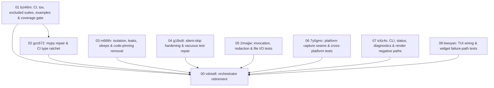

# IPD: Testing rigor and completeness remediation

- Date: 2026-11-23
- Kind: orchestrator
- Concern: Testing rigor and completeness audit across the `pubrun` source package, test suite, CI workflows, static type checking, examples, and benchmark/intake validation scripts.
- Scope: Whole repository substance (`src/pubrun/`, `tests/`, `.github/workflows/ci.yml`, `.github/scripts/`, `benchmarks/`, `examples/`, `pyproject.toml`, `tox.ini`, `hatch_build.py`, `schemas/`), excluding `.aw/` process artifacts and work already owned by the 11 approved pending bug/hygiene plans (`vv4vdd`, `4cy3ft`, `whacr3`, `t336id`, `updt75`, `3aalwv`, `2e6xfq`, `68iw9a`, `0vwc5z`, `6bgkyj`, `46fixy`) and open backlog item `0mnekm`.
- Scope-Paths: .aw/records/plans/pending/20261123-test-audit-00-vdxiw8-testing-rigor-and-completeness-remediation.ipd.md
- Item-Dependencies: executed:bzi46m, executed:gzc672, executed:m66tfv, executed:g18xdt, executed:2mwjjw, executed:7y0gmc, executed:ic6z4s, executed:bwoyan
- Status: to-review
- Coverage: pass
- Coverage-Fingerprint: c7b50600bb5b64ff9630504929822395fdebb0d5f7e4424ce8bfd17c1464c3e6
- Coverage-Checked: 2026-11-23 by uri/its_direct/pt3-claude-opus-5.5-1m-us
- Short-Description: Coordinate CI, type-check, test quality, capture, CLI, and TUI testing remediation from /assess-testing
- Work-Kind: chore
- Priority: high
- Set: test-audit
- Order: 0
- Highest E allocated: 08
- Author: Antigravity
- Id: vdxiw8

> Write and proofread this plan per the technical writing standard, `.aw/system/workflows/technical-writing/technical-writing.md` (`.agents/workflows/technical-writing/technical-writing.md` in a legacy-layout install), including requirement 12 (diagrams).

## Workflow history

- 2026-11-23 to-review (aw set): authored 8 child plans from /assess-testing
- 2026-11-23 coverage pass (aw oc run): fingerprint c7b50600bb5b, model uri/its_direct/pt3-claude-opus-5.5-1m-us
- 2026-11-23 coverage pass (aw oc run): fingerprint eb90c1b168d7, model uri/its_direct/pt3-claude-opus-5.5-1m-us
- 2026-11-23 draft (Antigravity): created from `/assess-testing` whole-project audit (`1821 passed`, `79%` coverage, `90` un-CI'd script/benchmark tests, `175` mypy errors across 24 files).

## Goal

Close the 17 actionable testing, CI-gating, type-checking, test-hygiene, capture, CLI, and TUI verification gaps surfaced by `/assess-testing` (run record `.aw/workflow-artifacts/assess-testing/20261123-085500/`). Coordinate execution through 8 right-sized child Implementation Plan Documents (IPDs) with disjoint working scopes (with `gzc672` serialized after `bzi46m` for `pyproject.toml` and `.github/workflows/ci.yml`).

### Set dependency architecture

## Detailed Implementation Checklist (TODO)

Execution-state rule: mark an `E-*` item complete only after performing the action. That mark is not validation. Accepted execution states: blocked, failed, pending, performed; terminal gate demands 'performed'.

### Task group 1: Child plan execution confirmation

- [ ] E-01 CONFIRM bzi46m REACHED executed
  - Depends on: none
  - Expected outcome: `.aw/records/plans/executed/20261123-test-audit-01-bzi46m-ci-pipeline-tox-excluded-suites-examples-and-coverage-gate.ipd.md` exists with `- Status: executed`, all `E-*` items `performed`, and all `V-*` items `pass`.
  - Execution state: pending

- [ ] E-02 CONFIRM gzc672 REACHED executed
  - Depends on: E-01
  - Expected outcome: `.aw/records/plans/executed/20261123-test-audit-02-gzc672-mypy-type-check-repair-and-ci-type-gate.ipd.md` exists with `- Status: executed`, all `E-*` items `performed`, and all `V-*` items `pass`.
  - Execution state: pending

- [ ] E-03 CONFIRM m66tfv REACHED executed
  - Depends on: none
  - Expected outcome: `.aw/records/plans/executed/20261123-test-audit-03-m66tfv-test-isolation-global-state-leaks-flaky-sleeps-and-code-pinn.ipd.md` exists with `- Status: executed`, all `E-*` items `performed`, and all `V-*` items `pass`.
  - Execution state: pending

- [ ] E-04 CONFIRM g18xdt REACHED executed
  - Depends on: none
  - Expected outcome: `.aw/records/plans/executed/20261123-test-audit-04-g18xdt-silent-skip-hardening-and-vacuous-or-zero-assertion-test-rep.ipd.md` exists with `- Status: executed`, all `E-*` items `performed`, and all `V-*` items `pass`.
  - Execution state: pending

- [ ] E-05 CONFIRM 2mwjjw REACHED executed
  - Depends on: none
  - Expected outcome: `.aw/records/plans/executed/20261123-test-audit-05-2mwjjw-capture-security-and-provenance-tests-for-invocation-redacti.ipd.md` exists with `- Status: executed`, all `E-*` items `performed`, and all `V-*` items `pass`.
  - Execution state: pending

- [ ] E-06 CONFIRM 7y0gmc REACHED executed
  - Depends on: none
  - Expected outcome: `.aw/records/plans/executed/20261123-test-audit-06-7y0gmc-platform-capture-tests-and-testable-seams-for-hardware-files.ipd.md` exists with `- Status: executed`, all `E-*` items `performed`, and all `V-*` items `pass`.
  - Execution state: pending

- [ ] E-07 CONFIRM ic6z4s REACHED executed
  - Depends on: none
  - Expected outcome: `.aw/records/plans/executed/20261123-test-audit-07-ic6z4s-cli-status-diagnostics-and-render-negative-paths-and-asserti.ipd.md` exists with `- Status: executed`, all `E-*` items `performed`, and all `V-*` items `pass`.
  - Execution state: pending

- [ ] E-08 CONFIRM bwoyan REACHED executed
  - Depends on: none
  - Expected outcome: `.aw/records/plans/executed/20261123-test-audit-08-bwoyan-tui-interactive-wiring-and-widget-failure-path-tests.ipd.md` exists with `- Status: executed`, all `E-*` items `performed`, and all `V-*` items `pass`.
  - Execution state: pending

## Child IPDs, sequence, and dependencies

| Order | Id | File | What it does | Depends on |
|---|---|---|---|---|
| 01 | `bzi46m` | `20261123-test-audit-01-bzi46m-ci-pipeline-tox-excluded-suites-examples-and-coverage-gate.ipd.md` | Gates excluded `.github/scripts/` and `benchmarks/` contract suites, non-TUI + wheel/sdist build installs, `tox.ini`, `pyproject.toml` `addopts` / `slow` marker / CI coverage floor, `examples/verify_all.py` isolation, and example smoke tests; removes `benchmarks/test_benchmarks.py` code-pinning regex. | none |
| 02 | `gzc672` | `20261123-test-audit-02-gzc672-mypy-type-check-repair-and-ci-type-gate.ipd.md` | Fixes duplicate-module import in `src/pubrun/__main__.py`, fixes real type defects in `actions.py`, `diff.py`, and `reproducibility.py`, configures `[tool.mypy]` ratchet, and adds a blocking Linux `mypy` CI job. | 01 |
| 03 | `m66tfv` | `20261123-test-audit-03-m66tfv-test-isolation-global-state-leaks-flaky-sleeps-and-code-pinn.ipd.md` | Extends `tests/conftest.py` isolation resets, fixes `test_signals.py`/`test_env_capture.py`/`test_resources.py`/`test_startup_overhead_writes.py` leaks and fixed sleeps, and replaces code-pinning/private-dict tests in `test_bench_command.py`, `benchmarks/test_pull_submissions.py`, and `test_output.py`. | none |
| 04 | `g18xdt` | `20261123-test-audit-04-g18xdt-silent-skip-hardening-and-vacuous-or-zero-assertion-test-rep.ipd.md` | Hardens silent skips in `test_manifest_schema.py` and `test_methods_multi.py`, and repairs zero-assertion, vacuous, and tautological tests in `test_capture_engines.py`, `test_tracker.py`, `test_quality.py`, `test_new_features.py`, `test_capture.py`, and `test_api.py`. | none |
| 05 | `2mwjjw` | `20261123-test-audit-05-2mwjjw-capture-security-and-provenance-tests-for-invocation-redacti.ipd.md` | Cleans dead pre-redaction code and adds tests for `invocation.py`, `redaction.py` JSON/token heuristics, `file_io.py` proxy edge methods and `truncate` budget recovery, `core`/`process`/`host`/`python_runtime` fallbacks, and `test_sanitize_paths.py` TOML parser assertion. | none |
| 06 | `7y0gmc` | `20261123-test-audit-06-7y0gmc-platform-capture-tests-and-testable-seams-for-hardware-files.ipd.md` | Adds backward-compatible testable seams in `liveness.py`, `filesystem.py`, `system_metrics.py`, and `resources.py`, hardens silent skips in `test_liveness.py`, and adds cross-platform unit tests for `hardware.py`, `filesystem.py`, `system_metrics.py`, `resources.py`, and `liveness.py`. | none |
| 07 | `ic6z4s` | `20261123-test-audit-07-ic6z4s-cli-status-diagnostics-and-render-negative-paths-and-asserti.ipd.md` | Strengthens weak CLI/status/report assertions, fixes `"python"`/`PYTHONPATH` subprocess helpers, relative timestamps, and leaks, hardens `test_status.py` skips, and adds corrupt-manifest, flag, `status.py`, and `render.py` negative-path tests. | none |
| 08 | `bwoyan` | `20261123-test-audit-08-bwoyan-tui-interactive-wiring-and-widget-failure-path-tests.ipd.md` | Adds defensive `git.remote_url` guard in `src/pubrun/tui/widgets/details.py` and adds Textual Pilot tests for sidebar-to-workspace wiring, `RunsSidebar`, `ActionsPanel`, `DiffView`, `LogViewer`, `ConfigPanel`, `RunDetailsView`, and `RunResourcesView`. | none |

## Completion criteria (the whole Set is done only when)

- CI gates excluded `.github/scripts/` and `benchmarks/` contract tests, non-TUI installs, real sdist/wheel build-and-install verification, example smoke tests, `tox.ini`, and a coverage floor. Owner: `bzi46m`.
- `mypy` runs cleanly without duplicate-module crashes, real type bugs in `actions.py`, `diff.py`, and `reproducibility.py` are fixed, and a blocking Linux `mypy` ratchet job runs in CI. Owner: `gzc672`.
- Global state isolation, leaked threads/hooks, fixed sleeps, and code-pinning tests are eliminated across the test infrastructure. Owner: `m66tfv`.
- Silent bug-masking skips and zero-assertion, vacuous, or tautological core/schema tests are hardened to fail on real regressions. Owner: `g18xdt`.
- High-risk capture paths (`invocation.py`, `redaction.py`, `file_io.py`, core fallbacks, and `test_sanitize_paths.py`) have deterministic behavioral tests. Owner: `2mwjjw`.
- Platform capture modules (`hardware.py`, `filesystem.py`, `system_metrics.py`, `resources.py`, `liveness.py`) expose testable seams and pass cross-platform unit tests without Linux silent skips. Owner: `7y0gmc`.
- CLI, `status.py`, `diagnostics.py`, and `render.py` negative paths, flags, and assertion rigor are verified with deterministic subprocess and unit tests. Owner: `ic6z4s`.
- TUI end-to-end tree-selection wiring and widget interactive/error flows pass under Textual Pilot. Owner: `bwoyan`.

## Cross-IPD validation

- `gzc672` runs after `bzi46m` (`Item-Dependencies: executed:bzi46m`) and validates the combined `.github/workflows/ci.yml` and `pyproject.toml` configuration (both pytest coverage/markers and `[tool.mypy]`). Owner: `gzc672`.
- Each child IPD runs `pytest` on its owned test modules and `python3 scripts/sanitize_paths.py --check --all` before transition. Owners: `bzi46m`, `gzc672`, `m66tfv`, `g18xdt`, `2mwjjw`, `7y0gmc`, `ic6z4s`, `bwoyan`.

## Deferred / out of scope (with reason)

- **T-18 (`src/pubrun/__main__.py:main` 878-line CLI entrypoint refactor and `diagnostics.py:print_*` stream/exit refactor):** Deferred. Remediation Risk **Medium-High** on **complexity** and **functionality** because refactoring the global `sys.argv`/`NO_COLOR`/`_DISPLAY_UTC`/`pbr` entrypoint risks regressions across all CLI subcommands. Safe behavioral coverage is executed now by `ic6z4s`.
  - Carrier: riulkx
- **T-19 (Enabling `pytest-randomly` across all 21 CI jobs and rewriting all 24 source files to clear all 175 legacy `mypy` errors in one sweep):** Deferred. Remediation Risk **Medium-High** on **functionality** and **complexity**. Safe incremental steps are executed now by `m66tfv` (`conftest.py` isolation) and `gzc672` (`__main__.py`, real type bugs, and `[tool.mypy]` ratchet).
  - Carrier: qqwebg

## Scope check

- Over-scope: none. Already-approved pending plans (`vv4vdd`, `4cy3ft`, `whacr3`, `t336id`, `updt75`, `3aalwv`, `2e6xfq`, `68iw9a`, `0vwc5z`, `6bgkyj`, `46fixy`) and open backlog item `0mnekm` are explicitly excluded to avoid duplication.
- Under-scope: none. Every finding from `/assess-testing` with Remediation Risk Low or Medium is assigned to a child IPD in `## Child IPDs, sequence, and dependencies`.

## Required tests / validation

This orchestrator executes no code and runs no tests directly. Each child plan (`bzi46m`, `gzc672`, `m66tfv`, `g18xdt`, `2mwjjw`, `7y0gmc`, `ic6z4s`, `bwoyan`) executes and records its own targeted `pytest`, `mypy`, build, and `scripts/sanitize_paths.py --check --all` evidence.

## Open questions

None. Non-blocking policy defaults (coverage floor in `bzi46m`, unknown `show` section behavior in `ic6z4s`) are recorded inside the owning child IPDs.

## Validation and cross-check (verify before reporting the Set complete)

Validation-state rule: inspect evidence in a separate pass. Do not mark a `V-*` item complete from memory or from the matching execution checkmark. Accepted validation results: blocked, failed, pass, pending; terminal gate demands 'pass'. Runtime-demonstration reachability rule: for each `V-*` item demanding the software be observed acting (as distinct from items demanding a diff, a file's content, or a test result, which are reachable by construction), name the code path that produces the observation or the sibling `E-*` that creates it, else the demand is UNDER-SCOPE.

- [ ] V-01 validates E-01
  - Required evidence: `aw ipd lint .aw/records/plans/executed/20261123-test-audit-01-bzi46m-ci-pipeline-tox-excluded-suites-examples-and-coverage-gate.ipd.md` reports `executed` and `conforming`.
  - Observed evidence:
  - Result: pending

- [ ] V-02 validates E-02
  - Required evidence: `aw ipd lint .aw/records/plans/executed/20261123-test-audit-02-gzc672-mypy-type-check-repair-and-ci-type-gate.ipd.md` reports `executed` and `conforming`.
  - Observed evidence:
  - Result: pending

- [ ] V-03 validates E-03
  - Required evidence: `aw ipd lint .aw/records/plans/executed/20261123-test-audit-03-m66tfv-test-isolation-global-state-leaks-flaky-sleeps-and-code-pinn.ipd.md` reports `executed` and `conforming`.
  - Observed evidence:
  - Result: pending

- [ ] V-04 validates E-04
  - Required evidence: `aw ipd lint .aw/records/plans/executed/20261123-test-audit-04-g18xdt-silent-skip-hardening-and-vacuous-or-zero-assertion-test-rep.ipd.md` reports `executed` and `conforming`.
  - Observed evidence:
  - Result: pending

- [ ] V-05 validates E-05
  - Required evidence: `aw ipd lint .aw/records/plans/executed/20261123-test-audit-05-2mwjjw-capture-security-and-provenance-tests-for-invocation-redacti.ipd.md` reports `executed` and `conforming`.
  - Observed evidence:
  - Result: pending

- [ ] V-06 validates E-06
  - Required evidence: `aw ipd lint .aw/records/plans/executed/20261123-test-audit-06-7y0gmc-platform-capture-tests-and-testable-seams-for-hardware-files.ipd.md` reports `executed` and `conforming`.
  - Observed evidence:
  - Result: pending

- [ ] V-07 validates E-07
  - Required evidence: `aw ipd lint .aw/records/plans/executed/20261123-test-audit-07-ic6z4s-cli-status-diagnostics-and-render-negative-paths-and-asserti.ipd.md` reports `executed` and `conforming`.
  - Observed evidence:
  - Result: pending

- [ ] V-08 validates E-08
  - Required evidence: `aw ipd lint .aw/records/plans/executed/20261123-test-audit-08-bwoyan-tui-interactive-wiring-and-widget-failure-path-tests.ipd.md` reports `executed` and `conforming`.
  - Observed evidence:
  - Result: pending

## Approval and execution gate

- Size assessment: standard
- Cohesion rationale: not required

This orchestrator and its 8 child plans must be reviewed and explicitly approved by a human (`- Status: approved`) before execution. This `/assess-testing` workflow proposes the Set only and does not execute any plan. When every child in `Set: test-audit` reaches `executed/`, the runner retires this Order-0 plan to `.aw/records/plans/executed/` as a bookkeeping transaction without spending an agent turn.
