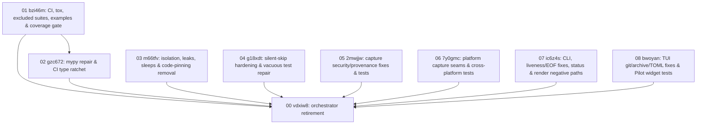

# IPD: Testing rigor and completeness remediation

- Date: 2026-11-23
- Kind: orchestrator
- Concern: Testing rigor and completeness audit across the `pubrun` source package, test suite, Continuous Integration (CI) workflows, static type checking, examples, and benchmark/intake validation scripts.
- Scope: Whole repository substance (`src/pubrun/`, `tests/`, `.github/workflows/ci.yml`, `.github/scripts/`, `benchmarks/`, `examples/`, `pyproject.toml`, `tox.ini`, `hatch_build.py`, `schemas/`), excluding `.aw/` process artifacts and work already completed by the 11 executed bug/hygiene plans (`vv4vdd`, `4cy3ft`, `whacr3`, `t336id`, `updt75`, `3aalwv`, `2e6xfq`, `68iw9a`, `0vwc5z`, `6bgkyj`, `46fixy`) and graduated backlog item `0mnekm` (tracked in reviewed plan `67hcid`).
- Scope-Paths: .aw/records/plans/pending/20261123-test-audit-00-vdxiw8-testing-rigor-and-completeness-remediation.ipd.md
- Item-Dependencies: executed:bzi46m, executed:gzc672, executed:m66tfv, executed:g18xdt, executed:2mwjjw, executed:7y0gmc, executed:ic6z4s, executed:bwoyan
- Status: reviewed
- Readiness: go-pending-approval
- Review-Depth: orchestrator
- Coverage: pass
- Coverage-Fingerprint: 83387f0c398a5a47f72770e29341319ac29129d60b85f8621acb992da7189969
- Coverage-Checked: 2026-11-24 by uri/its_direct/pt3-claude-opus-5.5-1m-us
- Short-Description: Coordinate CI, type-check, test quality, capture, CLI, and TUI testing remediation from /assess-testing
- Work-Kind: chore
- Priority: high
- Set: test-audit
- Order: 0
- Highest E allocated: 08
- Author: Antigravity
- Id: vdxiw8

> Write and proofread this plan per the technical writing standard, `.aw/system/workflows/technical-writing/technical-writing.md` (`.agents/workflows/technical-writing/technical-writing.md` in a legacy-layout install), including requirement 12 (diagrams).

## Workflow history

- 2026-11-24 coverage pass (aw oc run): fingerprint 83387f0c398a, model uri/its_direct/pt3-claude-opus-5.5-1m-us
- 2026-11-24 /plan-review (Antigravity): APPROVE WITH REVISIONS APPLIED; PR-001, PR-002, PR-003
- 2026-11-23 to-review (aw set): authored 8 child plans from /assess-testing
- 2026-11-23 coverage pass (aw oc run): fingerprint c7b50600bb5b64ff9630504929822395fdebb0d5f7e4424ce8bfd17c1464c3e6, model uri/its_direct/pt3-claude-opus-5.5-1m-us
- 2026-11-23 coverage pass (aw oc run): fingerprint eb90c1b168d7, model uri/its_direct/pt3-claude-opus-5.5-1m-us
- 2026-11-23 draft (Antigravity): created from `/assess-testing` whole-project audit (`1821 passed`, `79%` coverage, `90` un-CI'd script/benchmark tests, `175` mypy errors across 24 files).

## Goal

Close the 17 actionable testing, CI-gating, type-checking, test-hygiene, capture, command-line interface (CLI), and terminal user interface (TUI) verification gaps surfaced by `/assess-testing` (run record `.aw/workflow-artifacts/assess-testing/20261123-085500/`), together with the concrete production defects surfaced during child plan reviews. Coordinate execution through 8 right-sized child Implementation Plan Documents (IPDs) with `gzc672` serialized after `bzi46m` (`executed:bzi46m`) for `pyproject.toml`, `.github/workflows/ci.yml`, `CONTRIBUTING.md`, and `CHANGELOG.md`; remaining additive overlaps across isolated worktrees (`CHANGELOG.md`, `src/pubrun/__main__.py` between `gzc672` and `ic6z4s`, and `src/pubrun/tui/widgets/actions.py` between `gzc672` and `bwoyan`) touch disjoint sections and integrate through the runner's merge-and-revalidate gate.

### Set dependency architecture

## Detailed Implementation Checklist (TODO)

Execution-state rule: mark an `E-*` item complete only after performing the action. That mark is not validation. Accepted execution states: blocked, failed, pending, performed; terminal gate demands 'performed'.

### Task group 1: Child plan execution confirmation

- [ ] E-01 CONFIRM bzi46m REACHED executed
  - Depends on: none
  - Expected outcome: `.aw/records/plans/executed/20261123-test-audit-01-bzi46m-ci-pipeline-tox-excluded-suites-examples-and-coverage-gate.ipd.md` exists with `- Status: executed`, all `E-*` items `performed`, and all `V-*` items `pass`.
  - Execution state: pending

- [ ] E-02 CONFIRM gzc672 REACHED executed
  - Depends on: E-01
  - Expected outcome: `.aw/records/plans/executed/20261123-test-audit-02-gzc672-mypy-type-check-repair-and-ci-type-gate.ipd.md` exists with `- Status: executed`, all `E-*` items `performed`, and all `V-*` items `pass`.
  - Execution state: pending

- [ ] E-03 CONFIRM m66tfv REACHED executed
  - Depends on: none
  - Expected outcome: `.aw/records/plans/executed/20261123-test-audit-03-m66tfv-test-isolation-global-state-leaks-flaky-sleeps-and-code-pinn.ipd.md` exists with `- Status: executed`, all `E-*` items `performed`, and all `V-*` items `pass`.
  - Execution state: pending

- [ ] E-04 CONFIRM g18xdt REACHED executed
  - Depends on: none
  - Expected outcome: `.aw/records/plans/executed/20261123-test-audit-04-g18xdt-silent-skip-hardening-and-vacuous-or-zero-assertion-test-rep.ipd.md` exists with `- Status: executed`, all `E-*` items `performed`, and all `V-*` items `pass`.
  - Execution state: pending

- [ ] E-05 CONFIRM 2mwjjw REACHED executed
  - Depends on: none
  - Expected outcome: `.aw/records/plans/executed/20261123-test-audit-05-2mwjjw-capture-security-and-provenance-tests-for-invocation-redacti.ipd.md` exists with `- Status: executed`, all `E-*` items `performed`, and all `V-*` items `pass`.
  - Execution state: pending

- [ ] E-06 CONFIRM 7y0gmc REACHED executed
  - Depends on: none
  - Expected outcome: `.aw/records/plans/executed/20261123-test-audit-06-7y0gmc-platform-capture-tests-and-testable-seams-for-hardware-files.ipd.md` exists with `- Status: executed`, all `E-*` items `performed`, and all `V-*` items `pass`.
  - Execution state: pending

- [ ] E-07 CONFIRM ic6z4s REACHED executed
  - Depends on: none
  - Expected outcome: `.aw/records/plans/executed/20261123-test-audit-07-ic6z4s-cli-status-diagnostics-and-render-negative-paths-and-asserti.ipd.md` exists with `- Status: executed`, all `E-*` items `performed`, and all `V-*` items `pass`.
  - Execution state: pending

- [ ] E-08 CONFIRM bwoyan REACHED executed
  - Depends on: none
  - Expected outcome: `.aw/records/plans/executed/20261123-test-audit-08-bwoyan-tui-interactive-wiring-and-widget-failure-path-tests.ipd.md` exists with `- Status: executed`, all `E-*` items `performed`, and all `V-*` items `pass`.
  - Execution state: pending

## Child IPDs, sequence, and dependencies

| Order | Id | File | What it does | Depends on |
|---|---|---|---|---|
| 01 | `bzi46m` | `20261123-test-audit-01-bzi46m-ci-pipeline-tox-excluded-suites-examples-and-coverage-gate.ipd.md` | Gates excluded `.github/scripts/` and `benchmarks/` contract suites, non-TUI installs (fixing two `tests/test_tui.py` failures when Textual is absent), real wheel/sdist builds, `tox.ini`, `pyproject.toml` `addopts` / `slow` marker / CI coverage floor, `examples/verify_all.py` isolation, example smoke tests, and contributor docs (`benchmarks/README.md`, `CONTRIBUTING.md`, `CHANGELOG.md`); removes `benchmarks/test_benchmarks.py` code-pinning regex. | none |
| 02 | `gzc672` | `20261123-test-audit-02-gzc672-mypy-type-check-repair-and-ci-type-gate.ipd.md` | Fixes duplicate-module import in `src/pubrun/__main__.py`, fixes real type defects in `__main__.py`, `actions.py`, `diff.py`, and `reproducibility.py`, configures the `[tool.mypy]` ratchet in `pyproject.toml`, adds a blocking Linux `typecheck` CI job, adds `tests/test_type_repair_regressions.py`, and updates `CONTRIBUTING.md` and `CHANGELOG.md`. | 01 |
| 03 | `m66tfv` | `20261123-test-audit-03-m66tfv-test-isolation-global-state-leaks-flaky-sleeps-and-code-pinn.ipd.md` | Extends `tests/conftest.py` isolation resets (with regression coverage in `tests/test_conftest_isolation.py`), fixes `test_signals.py`/`test_env_capture.py`/`test_resources.py`/`test_startup_overhead_writes.py` leaks and fixed sleeps, and replaces code-pinning/private-dict tests in `test_bench_command.py`, `benchmarks/test_pull_submissions.py`, and `test_output.py`. | none |
| 04 | `g18xdt` | `20261123-test-audit-04-g18xdt-silent-skip-hardening-and-vacuous-or-zero-assertion-test-rep.ipd.md` | Hardens silent skips in `test_manifest_schema.py` and `test_methods_multi.py`, and repairs zero-assertion, vacuous, and tautological tests in `test_capture_engines.py`, `test_tracker.py`, `test_quality.py`, `test_new_features.py`, `test_capture.py`, and `test_api.py`. | none |
| 05 | `2mwjjw` | `20261123-test-audit-05-2mwjjw-capture-security-and-provenance-tests-for-invocation-redacti.ipd.md` | Fixes four capture defects (`invocation.inputs` secret-flag leak, hyphenated OpenAI `sk-proj-...` redaction, `pathlib.Path` in `sys.argv` failing `invocation`, and silent unknown `[capture.profiling].backend`), updates `docs/manifest.md` and `CHANGELOG.md`, and adds tests for `invocation.py`, `redaction.py`, `file_io.py`, core fallbacks, and `test_sanitize_paths.py`. | none |
| 06 | `7y0gmc` | `20261123-test-audit-06-7y0gmc-platform-capture-tests-and-testable-seams-for-hardware-files.ipd.md` | Adds backward-compatible testable seams in `filesystem.py`, `system_metrics.py`, and `resources.py`, hardens silent skips in `test_liveness.py`, and adds cross-platform unit tests in `test_hardware.py`, `test_liveness.py`, and `test_platform_capture_seams.py`. | none |
| 07 | `ic6z4s` | `20261123-test-audit-07-ic6z4s-cli-status-diagnostics-and-render-negative-paths-and-asserti.ipd.md` | Fixes `python -m <package>` live-process detection in `src/pubrun/capture/liveness.py` and `--create-config` end-of-file (EOF) handling in `src/pubrun/__main__.py`, strengthens CLI/status/report/render assertions, fixes subprocess helpers and relative timestamps, hardens `test_status.py` skips, adds `tests/test_cli_negative_paths.py`, and updates `CHANGELOG.md`. | none |
| 08 | `bwoyan` | `20261123-test-audit-08-bwoyan-tui-interactive-wiring-and-widget-failure-path-tests.ipd.md` | Fixes three TUI defects (`details.py` `git`/`remote_url` null handling and Textual markup escaping, `actions.py` archive error handling, and `config.py` TOML control-character/surrogate escaping), adds Textual Pilot tests in `tests/test_tui_widgets.py`, and updates `CHANGELOG.md`. | none |

## Completion criteria (the whole Set is done only when)

- CI gates excluded `.github/scripts/` and `benchmarks/` contract tests, non-TUI installs, real sdist/wheel build-and-install verification, example smoke tests, `tox.ini`, and a coverage floor, with updated contributor docs. Owner: `bzi46m`.
- `mypy` runs cleanly without duplicate-module crashes, real type bugs in `__main__.py`, `actions.py`, `diff.py`, and `reproducibility.py` are fixed, and a blocking Linux `mypy` ratchet job runs in CI. Owner: `gzc672`.
- Global state isolation, leaked threads/hooks, fixed sleeps, and code-pinning tests are eliminated across the test infrastructure. Owner: `m66tfv`.
- Silent bug-masking skips and zero-assertion, vacuous, or tautological core/schema tests are hardened to fail on real regressions. Owner: `g18xdt`.
- High-risk capture paths (`invocation.py`, `redaction.py`, `core.py`, `file_io.py`, core fallbacks, and `test_sanitize_paths.py`) fix the four review-confirmed capture defects and have deterministic behavioral tests. Owner: `2mwjjw`.
- Platform capture modules (`hardware.py`, `filesystem.py`, `system_metrics.py`, `resources.py`, `liveness.py`) expose backward-compatible seams where needed (`filesystem.py`, `system_metrics.py`, `resources.py`) and pass cross-platform unit tests without Linux silent skips. Owner: `7y0gmc`.
- CLI, `liveness.py` (`python -m`), `--create-config` EOF handling, `status.py`, `diagnostics.py`, and `render.py` negative paths, flags, and assertion rigor are verified with deterministic subprocess and unit tests. Owner: `ic6z4s`.
- TUI `details.py`/`actions.py`/`config.py` defects are fixed and end-to-end tree-selection wiring plus widget interactive/error flows pass under Textual Pilot. Owner: `bwoyan`.

## Cross-IPD validation

- `gzc672` runs after `bzi46m` (`Item-Dependencies: executed:bzi46m`) and validates the combined `.github/workflows/ci.yml`, `pyproject.toml`, `CONTRIBUTING.md`, and `CHANGELOG.md` updates (both pytest coverage/markers and `[tool.mypy]`). Owner: `gzc672`.
- Overlapping edits to `src/pubrun/__main__.py` (`gzc672` and `ic6z4s`), `src/pubrun/tui/widgets/actions.py` (`gzc672` and `bwoyan`), and `CHANGELOG.md` (`bzi46m`, `gzc672`, `2mwjjw`, `ic6z4s`, `bwoyan`) touch disjoint sections and are validated sequentially on combined `main` by each child's merge-and-revalidate gate. Owners: `bzi46m`, `gzc672`, `2mwjjw`, `ic6z4s`, `bwoyan`.
- Each child IPD runs `pytest` on its owned test modules and `python3 scripts/sanitize_paths.py --check --all` before transition. Owners: `bzi46m`, `gzc672`, `m66tfv`, `g18xdt`, `2mwjjw`, `7y0gmc`, `ic6z4s`, `bwoyan`.

## Deferred / out of scope (with reason)

- **T-18 (`src/pubrun/__main__.py::main` 878-line CLI entrypoint refactor and `src/pubrun/report/diagnostics.py` `print_*` stream/exit refactor):** Deferred. Remediation Risk **Medium-High** on **complexity** and **functionality** because refactoring the global `sys.argv`/`NO_COLOR`/`_DISPLAY_UTC`/`pbr` entrypoint risks regressions across all CLI subcommands. Safe behavioral coverage is executed now by `ic6z4s`.
  - Carrier: riulkx
- **T-19 (Enabling `pytest-randomly` across all 21 CI jobs and rewriting all 24 source files to clear all 175 legacy `mypy` errors in one sweep):** Deferred. Remediation Risk **Medium-High** on **functionality** and **complexity**. Safe incremental steps are executed now by `m66tfv` (`conftest.py` isolation) and `gzc672` (`__main__.py`, real type bugs, and `[tool.mypy]` ratchet).
  - Carrier: qqwebg

## Scope check

- Over-scope: none. The 11 already-executed bug/hygiene plans (`vv4vdd`, `4cy3ft`, `whacr3`, `t336id`, `updt75`, `3aalwv`, `2e6xfq`, `68iw9a`, `0vwc5z`, `6bgkyj`, `46fixy`) and graduated backlog item `0mnekm` (reviewed plan `67hcid`) are explicitly excluded to avoid duplication.
- Under-scope: none. Every finding from `/assess-testing` with Remediation Risk Low or Medium is assigned to a child IPD in `## Child IPDs, sequence, and dependencies`, and every child plan (`01`..`08`) is `reviewed` with `- Readiness: go-pending-approval`.

## Required tests / validation

This orchestrator executes no code and runs no tests directly. Each child plan (`bzi46m`, `gzc672`, `m66tfv`, `g18xdt`, `2mwjjw`, `7y0gmc`, `ic6z4s`, `bwoyan`) executes and records its own targeted `pytest`, `mypy`, build, and `scripts/sanitize_paths.py --check --all` evidence.

## Open questions

None. All child policy questions (`bzi46m` `OQ-01` coverage floor and `ic6z4s` `OQ-01` unknown `show` section behavior) are resolved inside the owning child IPDs.

## Validation and cross-check (verify before reporting the Set complete)

Validation-state rule: inspect evidence in a separate pass. Do not mark a `V-*` item complete from memory or from the matching execution checkmark. Accepted validation results: blocked, failed, pass, pending; terminal gate demands 'pass'. Runtime-demonstration reachability rule: for each `V-*` item demanding the software be observed acting (as distinct from items demanding a diff, a file's content, or a test result, which are reachable by construction), name the code path that produces the observation or the sibling `E-*` that creates it, else the demand is UNDER-SCOPE.

- [ ] V-01 validates E-01
  - Required evidence: Confirm `.aw/records/plans/executed/20261123-test-audit-01-bzi46m-ci-pipeline-tox-excluded-suites-examples-and-coverage-gate.ipd.md` exists with `- Status: executed`, all `E-*` items `performed`, and all `V-*` items `pass`, and paste the output of `aw ipd lint --phase post-transition .aw/records/plans/executed/20261123-test-audit-01-bzi46m-ci-pipeline-tox-excluded-suites-examples-and-coverage-gate.ipd.md` showing exit 0 and `conforming`.
  - Observed evidence:
  - Result: pending

- [ ] V-02 validates E-02
  - Required evidence: Confirm `.aw/records/plans/executed/20261123-test-audit-02-gzc672-mypy-type-check-repair-and-ci-type-gate.ipd.md` exists with `- Status: executed`, all `E-*` items `performed`, and all `V-*` items `pass`, and paste the output of `aw ipd lint --phase post-transition .aw/records/plans/executed/20261123-test-audit-02-gzc672-mypy-type-check-repair-and-ci-type-gate.ipd.md` showing exit 0 and `conforming`.
  - Observed evidence:
  - Result: pending

- [ ] V-03 validates E-03
  - Required evidence: Confirm `.aw/records/plans/executed/20261123-test-audit-03-m66tfv-test-isolation-global-state-leaks-flaky-sleeps-and-code-pinn.ipd.md` exists with `- Status: executed`, all `E-*` items `performed`, and all `V-*` items `pass`, and paste the output of `aw ipd lint --phase post-transition .aw/records/plans/executed/20261123-test-audit-03-m66tfv-test-isolation-global-state-leaks-flaky-sleeps-and-code-pinn.ipd.md` showing exit 0 and `conforming`.
  - Observed evidence:
  - Result: pending

- [ ] V-04 validates E-04
  - Required evidence: Confirm `.aw/records/plans/executed/20261123-test-audit-04-g18xdt-silent-skip-hardening-and-vacuous-or-zero-assertion-test-rep.ipd.md` exists with `- Status: executed`, all `E-*` items `performed`, and all `V-*` items `pass`, and paste the output of `aw ipd lint --phase post-transition .aw/records/plans/executed/20261123-test-audit-04-g18xdt-silent-skip-hardening-and-vacuous-or-zero-assertion-test-rep.ipd.md` showing exit 0 and `conforming`.
  - Observed evidence:
  - Result: pending

- [ ] V-05 validates E-05
  - Required evidence: Confirm `.aw/records/plans/executed/20261123-test-audit-05-2mwjjw-capture-security-and-provenance-tests-for-invocation-redacti.ipd.md` exists with `- Status: executed`, all `E-*` items `performed`, and all `V-*` items `pass`, and paste the output of `aw ipd lint --phase post-transition .aw/records/plans/executed/20261123-test-audit-05-2mwjjw-capture-security-and-provenance-tests-for-invocation-redacti.ipd.md` showing exit 0 and `conforming`.
  - Observed evidence:
  - Result: pending

- [ ] V-06 validates E-06
  - Required evidence: Confirm `.aw/records/plans/executed/20261123-test-audit-06-7y0gmc-platform-capture-tests-and-testable-seams-for-hardware-files.ipd.md` exists with `- Status: executed`, all `E-*` items `performed`, and all `V-*` items `pass`, and paste the output of `aw ipd lint --phase post-transition .aw/records/plans/executed/20261123-test-audit-06-7y0gmc-platform-capture-tests-and-testable-seams-for-hardware-files.ipd.md` showing exit 0 and `conforming`.
  - Observed evidence:
  - Result: pending

- [ ] V-07 validates E-07
  - Required evidence: Confirm `.aw/records/plans/executed/20261123-test-audit-07-ic6z4s-cli-status-diagnostics-and-render-negative-paths-and-asserti.ipd.md` exists with `- Status: executed`, all `E-*` items `performed`, and all `V-*` items `pass`, and paste the output of `aw ipd lint --phase post-transition .aw/records/plans/executed/20261123-test-audit-07-ic6z4s-cli-status-diagnostics-and-render-negative-paths-and-asserti.ipd.md` showing exit 0 and `conforming`.
  - Observed evidence:
  - Result: pending

- [ ] V-08 validates E-08
  - Required evidence: Confirm `.aw/records/plans/executed/20261123-test-audit-08-bwoyan-tui-interactive-wiring-and-widget-failure-path-tests.ipd.md` exists with `- Status: executed`, all `E-*` items `performed`, and all `V-*` items `pass`, and paste the output of `aw ipd lint --phase post-transition .aw/records/plans/executed/20261123-test-audit-08-bwoyan-tui-interactive-wiring-and-widget-failure-path-tests.ipd.md` showing exit 0 and `conforming`.
  - Observed evidence:
  - Result: pending

## Approval and execution gate

- Size assessment: standard
- Cohesion rationale: not required

Execution begins only after a human approves this orchestrator and its 8 child plans (`- Status: approved`).

Execution contract:
1. **Open-questions precondition:** Zero blocking open questions remain before execution (`## Open questions` is empty, and all child questions are resolved).
2. **Scope declaration:** This Order-0 orchestrator modifies no product code or tests; its declared `- Scope-Paths:` covers only this orchestrator file. If a manual closeout must record an unexpected path change or leave a declared path untouched, justify it with `--scope-reason` or `--scope-ack` at finalize rather than inventing an ad-hoc move.
3. **Validation honesty (HARD MUST):** Every `V-01`..`V-08` validation claim in standalone retirement must paste the actual `aw ipd lint --phase post-transition` output observed on disk. Never claim a child is executed without verifying its executed file.
4. **Path-scoped commit and never-push:** Commit only this orchestrator's retirement files through `aw commit vdxiw8` (or the runner's bookkeeping transaction); never use `git add -A` or `-a`, and never push without explicit human instruction.
5. **Lifecycle transition (conditional runner vs. standalone ownership):** When executed inside `aw oc run` / `aw agy run`, the runner retires this Order-0 orchestrator to `.aw/records/plans/executed/` as a bookkeeping transaction once all 8 children (`bzi46m`, `gzc672`, `m66tfv`, `g18xdt`, `2mwjjw`, `7y0gmc`, `ic6z4s`, `bwoyan`) reach `executed/`, spending no agent turn; if retired manually outside the runner after all 8 children are executed, run `aw ipd finalize vdxiw8` (never a hand-rolled `git mv` to `executed/`).
