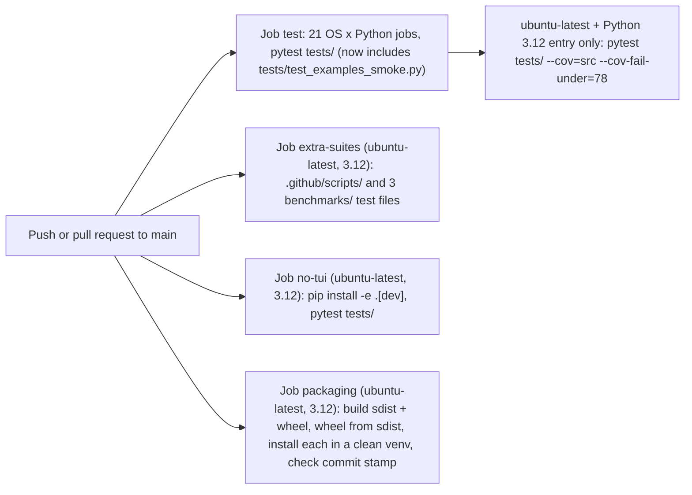

# IPD: CI pipeline, tox, excluded suites, examples, and coverage gate

- Date: 2026-11-23
- Kind: child
- Concern: Testing rigor and completeness (CI coverage of excluded script/benchmark suites, minimal non-TUI and sdist/wheel installs, working `tox.ini`, coverage floor, `slow` marker, and example smoke testing).
- Scope: `.github/workflows/ci.yml`, `pyproject.toml`, `tox.ini`, `benchmarks/test_benchmarks.py`, `examples/verify_all.py`, new `tests/test_examples_smoke.py`, `tests/test_tui.py` (two tests that fail on an install without the `tui` extra), and the contributor documentation that describes the test commands (`benchmarks/README.md`, `CONTRIBUTING.md`, `CHANGELOG.md`).
- Scope-Paths: .github/workflows/ci.yml, pyproject.toml, tox.ini, benchmarks/test_benchmarks.py, examples/verify_all.py, tests/test_examples_smoke.py, tests/test_tui.py, benchmarks/README.md, CONTRIBUTING.md, CHANGELOG.md
- Item-Dependencies: none
- Status: approved
- Readiness: go-pending-approval
- Review-Depth: standard
- Short-Description: Gate excluded script/benchmark suites, non-TUI and wheel installs, tox.ini, example smoke tests, and CI coverage floor
- Work-Kind: chore
- Priority: high
- Set: test-audit
- Order: 1
- Highest E allocated: 09
- Author: Antigravity
- Id: bzi46m
- Approval: 2026-11-24, recorded via aw ipd set: status set to approved

> Write and proofread this plan per the technical writing standard, `.aw/system/workflows/technical-writing/technical-writing.md` (`.agents/workflows/technical-writing/technical-writing.md` in a legacy-layout install), including requirement 12 (diagrams).

## Workflow history

- 2026-11-24 approved (aw set): status set to approved
- 2026-11-23 /plan-review (uri/its_direct/pt3-claude-opus-5.5-1m-us): APPROVE WITH REVISIONS APPLIED; PR-001, PR-002, PR-003, PR-004, PR-005, PR-006, PR-007, PR-008, PR-009, PR-010, PR-011
- 2026-11-23 to-review (Antigravity): authored from `/assess-testing` findings T-01, T-02, T-03, T-04, and T-07 (benchmark file).
- 2026-11-23 draft (Antigravity): created.

## Goal

Make GitHub Actions CI and local `tox` exercise the parts of the repository that no automated run covers today: the `.github/scripts/` intake scripts, the benchmark schema contracts, an install without the `tui` extra, a real sdist and wheel build (`hatch_build.py` stamps the commit into both), the numbered examples, and a coverage floor. At the same time, stop forcing `--cov` on every local `pytest` run, so a run in an environment without `pytest-cov` (such as the current `tox.ini`) no longer fails with exit code 4.

### CI verification topology

The diagram shows the workflow jobs after this plan. The `test` matrix keeps its 21 OS and Python combinations; the other three jobs are new.

## Detailed Implementation Checklist (TODO)

Execution-state rule: mark an `E-*` item complete only after performing the action. That mark is not validation. Right-sizing rule: each E-item addresses one concern executable in one focused pass. Accepted execution states: blocked, failed, pending, performed; terminal gate demands 'performed'.

### Task group 1: Test configuration, tox, and contributor documentation

- [ ] E-01 Remove the unconditional `--cov` flags from `pyproject.toml` `addopts`, register the `slow` pytest marker, and repair `tox.ini` for tox 4 and the `dev` extra.
  - Depends on: none
  - Expected outcome: `pyproject.toml` `[tool.pytest.ini_options]` sets `addopts = "-p no:randomly"` (keep the existing comment about `pytest-randomly`) and adds `markers = ["slow: runs the benchmark harness or another multi-subprocess workload (deselect with -m 'not slow')"]`. `tox.ini` drops `isolated_build = True`, replaces `deps = pytest>=7.0` with `extras = dev`, and keeps `commands = pytest tests/ -v`. Before this change, `python3 -m pytest -p no:cov tests/test_config.py -q` exits 4 (measured at review); after it, the same command exits 0.
  - Execution state: pending

- [ ] E-06 Update the contributor documentation that describes the test commands, which E-01 makes stale.
  - Depends on: E-01, E-05
  - Expected outcome: (a) `benchmarks/README.md` "Optional figures and the micro-benchmark suite" shows `pytest benchmarks/ --benchmark-only` and no longer says that `-o addopts=""` is needed to clear `--cov`. (b) `CONTRIBUTING.md` keeps `python -m pytest` and adds the coverage command `python -m pytest --cov=src --cov-report=term-missing`, states that CI fails below 78% total coverage on the `ubuntu-latest` Python 3.12 job, and gives the command for the suites outside `tests/` (`python -m pytest .github/scripts/ benchmarks/test_share_safety.py benchmarks/test_pull_submissions.py benchmarks/test_benchmarks.py`). (c) `CHANGELOG.md` `## [Unreleased]` gains one `### Changed` entry stating that coverage is no longer collected by default, that `tox` works again, and which new CI jobs exist. User-facing prose follows the `AGENTS.md` dash rule.
  - Execution state: pending

### Task group 2: Benchmark contract tests and code-pinning removal

- [ ] E-02 In `benchmarks/test_benchmarks.py`, replace the source-text regex check `TestSchema5Shape.test_schema_is_v5` with a behavioral assertion, extend `TestSchema5Conformance.test_committed_redacted_sample_conforms` to `benchmarks/data/accepted/`, mark the harness-running tests `slow`, and update the module docstring.
  - Depends on: E-01
  - Expected outcome: (a) `test_schema_is_v5(self, tmp_path)` calls `self._make(tmp_path)` and asserts `result["schema"] == "pubrun-benchmark/5"` and `on_disk["schema"] == "pubrun-benchmark/5"`; the file no longer reads `benchmarks/harness.py` as text or imports `re` for it. (b) `test_committed_redacted_sample_conforms` is parametrized over the sorted union of `benchmarks/results/*.redacted.json` and `benchmarks/data/accepted/*.redacted.json`, with each test id naming the file, and a guard asserts the union is non-empty. Both committed samples validate against `schemas/benchmark.schema.json` today (measured at review: 0 errors each). (c) Every test that calls `harness.run` (the `TestSchema5Shape` tests that use `_make`, `TestSchema5Conformance.test_fresh_result_and_redaction_conform`, and `TestSchema5Conformance.test_broken_result_is_rejected`) carries `@pytest.mark.slow`; each takes 40 to 58 seconds (measured at review). (d) The module docstring gives `pytest benchmarks/ --benchmark-only` and drops the `-o addopts=""` and `-p no:cov` advice.
  - Execution state: pending

### Task group 3: Safe example runner and smoke test

- [ ] E-03 Update `examples/verify_all.py` to run every example inside a fresh temporary working directory, add a per-example timeout, and remove `shell=True`.
  - Depends on: none
  - Expected outcome: `examples/verify_all.py` creates one `tempfile.TemporaryDirectory()`, runs each example with `cwd=` set to it, reads new run directories from `<temp dir>/runs`, and passes `--output-dir <temp dir>/outputs` to `minimal-research-workflow/analysis.py`. It no longer deletes `<repo_root>/runs/`; the cleanup block and its Windows `rmdir /s /q` call with `shell=True` are removed. `--no-clear` stays accepted for compatibility, and its help text says it has no effect because each run uses a fresh temporary directory. Each `subprocess.run` passes `timeout=120`; a `subprocess.TimeoutExpired` is reported as a failure of that example and the script continues with the next one.
  - Execution state: pending

- [ ] E-04 Create `tests/test_examples_smoke.py` with one parametrized test per `examples/[0-9]*.py` file.
  - Depends on: E-03
  - Expected outcome: Each test runs one example with `subprocess.run([sys.executable, <example>], cwd=tmp_path, timeout=120, capture_output=True, text=True)` and an environment whose `PYTHONPATH` starts with `<repo>/src` and whose `XDG_CONFIG_HOME` and `APPDATA` point into `tmp_path` (so a developer's user configuration cannot change the result). It asserts exit code 0, `"[PASS]"` in stdout, and at least one `tmp_path/runs/*/manifest.json`. All 13 examples (`00_auto_start.py` through `12_external_file_provenance.py`, including `11_cli_report.py`, which creates its own run) are included; at review each exited 0 and wrote at least one manifest inside a temporary directory, and the 13 together took about 8 seconds. The test does not use the `slow` marker, so it runs in every matrix job.
  - Execution state: pending

### Task group 4: Tests that pass on an install without the `tui` extra

- [ ] E-07 Make the two `tests/test_tui.py` tests that fail without `textual` pass or skip on a `pip install -e ".[dev]"` install.
  - Depends on: none
  - Expected outcome: `test_tui_cli_parser_and_run` builds its mock application with `mock_app = mock.Mock()` inside the loop instead of `mock.patch("pubrun.tui.app.PubrunTUIApp")`, which imports the real `pubrun.tui.app` and therefore `textual`; it keeps the `mock.patch.dict(sys.modules, ...)` injection and both `assert_called_once` checks. `test_tui_toml_serialization` calls `pytest.importorskip("textual")` before importing `pubrun.tui.widgets.config`, which imports `textual` at module level. At review, `pytest tests/` on a `.[dev]` install gave `2 failed, 1822 passed, 10 skipped`, the two failures being these tests, and the revised form of the first test passed both with and without `textual`. `test_tui_cli_parser_and_run_leaves_real_tui_module` still passes with `textual` installed.
  - Execution state: pending

### Task group 5: CI pipeline gates

- [ ] E-05 In `.github/workflows/ci.yml`, add the coverage floor to the `ubuntu-latest` Python 3.12 entry of the `test` matrix, and add an `extra-suites` job for the test files outside `tests/`.
  - Depends on: E-01, E-02
  - Expected outcome: The `test` job keeps its 21 entries. Its test step is split into two steps with `if:` conditions: every entry except `ubuntu-latest` plus `3.12` runs `pytest tests/ -v`, and that one entry runs `pytest tests/ -v --cov=src --cov-report=term-missing --cov-fail-under=78`. A new `extra-suites` job (`ubuntu-latest`, Python 3.12) runs `pip install -e ".[dev]" pyyaml` and then `pytest .github/scripts/ benchmarks/test_share_safety.py benchmarks/test_pull_submissions.py benchmarks/test_benchmarks.py -v`. PyYAML is installed so the two YAML cross-check tests run instead of skipping; the three `pytest-benchmark` tests skip because the `bench` extra is not installed.
  - Execution state: pending

- [ ] E-08 Add a `no-tui` job to `.github/workflows/ci.yml` that tests an install without the `tui` extra.
  - Depends on: E-07, E-04
  - Expected outcome: A `no-tui` job (`ubuntu-latest`, Python 3.12) runs `pip install -e ".[dev]"` and then `pytest tests/ -v`, and passes with no failures; the `textual` tests skip.
  - Execution state: pending

- [ ] E-09 Add a `packaging` job to `.github/workflows/ci.yml` that builds and installs the real sdist and wheel and checks the commit stamp.
  - Depends on: none
  - Expected outcome: A `packaging` job (`ubuntu-latest`, Python 3.12) runs `pip install build`, then `python -m build --outdir dist .`. It installs `dist/*.whl` into one new virtual environment; it unpacks `dist/*.tar.gz`, builds a wheel from the unpacked tree with `python -m build --wheel`, and installs that wheel into a second new virtual environment. For each wheel, `python -m zipfile -l` lists `pubrun/_build_meta.json`, `pubrun/COMMIT`, and `pubrun/py.typed`. For each environment, run from a directory outside the checkout, `pubrun.__commit__` equals `git rev-parse HEAD` of the checkout, and the first line of both `pubrun --version` and `pbr --version` contains `(commit <that SHA>)`. Any mismatch fails the job.
  - Execution state: pending

## Project conventions discovered (Step 0)

- `.github/workflows/ci.yml` runs 21 OS x Python jobs (`pip install -e ".[dev,tui]"` -> `pytest tests/ -v`). `fd636d0` is the `origin/main` tip; the plan author recorded CI run `45109957606` as green there (not re-verified at review).
- `pyproject.toml` `[tool.pytest.ini_options]` currently hardcodes `addopts = "--cov=src --cov-report=term-missing --cov-report=xml -p no:randomly"`, causing `tox.ini` (which only installs `pytest>=7.0`) to fail with exit code 4.
- Running `pytest -o addopts="" .github/scripts/ benchmarks/test_share_safety.py benchmarks/test_pull_submissions.py benchmarks/test_benchmarks.py -q` passed `90 passed, 3 skipped` locally (re-run at review: `90 passed, 3 skipped in 372.46s`), proving these suites work today and simply lack CI execution.
- `AGENTS.md` prohibits code-pinning tests (`inspect`, `ast`, regex, or substring searches against production source files).
- `pubrun --run-tests` (`src/pubrun/__main__.py::_run_tests`) runs `pytest tests/ -q`; after E-01 it prints no coverage table. `docs/cli.md#--run-tests` does not mention coverage, so it needs no edit.
- `.coverage` and `coverage.xml` are already gitignored, and `dist/` is gitignored, so the coverage step and a local build leave no untracked files.

## Findings

| ID | Severity | Remediation Risk | Persona | Evidence | Finding |
|---|---|---|---|---|---|
| T-01 | High | Low | QA engineer / Testing expert | `.github/workflows/ci.yml`; `benchmarks/test_benchmarks.py:TestSchema5Conformance` | CI skips 7 test files (90 tests across `.github/scripts/` and `benchmarks/`); `TestSchema5Conformance` omits `benchmarks/data/accepted/*.redacted.json`. |
| T-02 | High | Low | QA engineer / Testing expert | `.github/workflows/ci.yml`; `hatch_build.py`; `tests/test_commit_identity.py:TestHatchBuildHook` | CI never tests a minimal non-TUI install or a real sdist/wheel build and install. |
| T-03 | High | Low | QA engineer / Software engineer | `tox.ini`; `pyproject.toml`; `.github/workflows/ci.yml` | `tox.ini` crashes with exit code 4 due to hardcoded `--cov` in `pyproject.toml` `addopts`; CI has no `--cov-fail-under` gate; no `slow` marker registered. |
| T-04 | Medium | Low | QA engineer / Novice user | `examples/verify_all.py`; `examples/00_auto_start.py`..`12_external_file_provenance.py` | 13 of 14 examples are untested in CI; `verify_all.py` deletes repo-root `runs/`, omits timeouts, and uses `shell=True`. |
| T-07 (part) | Medium | Low | Testing expert | `benchmarks/test_benchmarks.py:TestSchema5Shape.test_schema_is_v5` | Regex-scans `benchmarks/harness.py` source text instead of asserting on harness output. |

## Proposed changes (ordered, validatable)

1. Update `pyproject.toml` and `tox.ini` (Remediation Risk: Low) so `pytest` runs cleanly without `pytest-cov`, registers `slow`, and makes `tox.ini` tox-4 compliant. Update `benchmarks/README.md`, `CONTRIBUTING.md`, and `CHANGELOG.md` to match (Remediation Risk: Low).
2. Replace `benchmarks/test_benchmarks.py:TestSchema5Shape.test_schema_is_v5` with an output-based assertion, include `benchmarks/data/accepted/*.redacted.json` in `TestSchema5Conformance`, and mark the harness-running tests `slow` (Remediation Risk: Low).
3. Harden `examples/verify_all.py` to use a temporary working directory, timeouts, and argv-only commands, and add `tests/test_examples_smoke.py` (Remediation Risk: Low).
4. Make the two `tests/test_tui.py` tests that need `textual` pass or skip without it (E-07) (Remediation Risk: Low).
5. In `.github/workflows/ci.yml`, add the coverage floor to one matrix entry and add the `extra-suites` job (E-05), the `no-tui` job (E-08), and the `packaging` job (E-09) (Remediation Risk: Low).

## Deferred / out of scope (with reason)

- `mypy` configuration and CI job are owned by dependent child plan `gzc672` (Order 02).
  - Carrier: gzc672
- Running the changed `.github/workflows/ci.yml` on GitHub Actions requires a push, and pushing requires explicit human instruction (`AGENTS.md` agent execution contract). Local validation covers the YAML structure and every command each job runs; the first CI run on GitHub after a human-authorized push is the remaining check.
  - Carrier-Declined: a push needs explicit human authorization, so no plan can carry it; GitHub Actions runs the workflow automatically on the next push or pull request to `main`.
- Enforcing the `slow` marker in CI (for example `-m "not slow"` on the matrix): not needed, because no test under `tests/` carries the marker, and the marked tests run only in the single `extra-suites` job.
  - Carrier-Declined: no CI job needs to deselect `slow` tests today; a developer can use `-m "not slow"` locally.

## Scope check

- Over-scope: none.
- Under-scope: none after review. Review added `tests/test_tui.py` (required for a passing `no-tui` job) and the three documentation files (required by the documentation sync).

## Required tests / validation

- Run `pytest tests/test_examples_smoke.py -v` and `pytest .github/scripts/ benchmarks/test_share_safety.py benchmarks/test_pull_submissions.py benchmarks/test_benchmarks.py -v`. Do not add `-k "not benchmark"`: the keyword matches the module name `test_benchmarks` and deselected 74 of 93 tests at review.
- Run `pytest -m "not slow" benchmarks/test_benchmarks.py -q` and `pytest -m slow benchmarks/test_benchmarks.py --co -q` to show the marker selects exactly the harness-running tests.
- Run `pytest -p no:cov tests/test_config.py -q` to show `addopts` no longer requires `pytest-cov`.
- Run `pytest tests/ --cov=src --cov-fail-under=78 -q` on Python 3.12. At review on this lane, it gave `Total coverage: 79.53%` (`1855 passed, 2 skipped`) on Python 3.12.3 and `79.48%` on Python 3.14.6.
- Run `pytest tests/ -q` in a virtual environment created with `pip install -e ".[dev]"` (no `tui` extra).
- Build the sdist and wheel locally (`python -m build`), build a wheel from the unpacked sdist, install each into a clean temporary virtual environment, and check `_build_meta.json`, `COMMIT`, `py.typed`, `pubrun.__commit__`, `pubrun --version`, and `pbr --version`. At review, all of these were present and carried the HEAD commit.
- Validate `.github/workflows/ci.yml` with Python `yaml.safe_load` and list each job's steps.
- Run `python3 scripts/sanitize_paths.py --check --all`.

## Spec / documentation sync

No spec changes: CI workflow, `tox.ini`, and test-runner changes do not change public `pubrun` library or CLI behavior, and no `.spec.md` describes the test configuration. Documentation changes are required, because E-01 makes two documented commands stale:

- `benchmarks/README.md` says `-o addopts=""` "clears the repo's global `--cov` options"; after E-01 there are no such options. E-06 (a) updates it.
- The module docstring of `benchmarks/test_benchmarks.py` gives the same advice; E-02 (d) updates it.
- `CONTRIBUTING.md` gives `python -m pytest` as the test command. After E-01 that command no longer reports coverage, so the file needs the coverage command and the CI floor. E-06 (b) adds them.
- `CHANGELOG.md` `## [Unreleased]` records (E-06 (c)) the change in default `pytest` behavior, because a contributor who relied on the default coverage report will notice it.
- `docs/cli.md#--run-tests` and `docs/functional_spec.md#11.4 Self-Test (\`--run-tests\`)` do not mention coverage and need no edit.

## Open questions

### OQ-01: Coverage floor threshold in CI

- Blocking: no
- Status: resolved
- Owner: plan author
- Resolution or deferral rationale: Baseline total coverage measured on Python 3.14 Linux is `79%` (`16032` statements). Resolved to `--cov-fail-under=78` (1% headroom for minor platform variance) on the `ubuntu-latest` Python 3.12 entry of the `test` matrix (E-05). Review re-measured `pytest tests/ --cov=src` on this lane: `79.53%` on Python 3.12.3 and `79.48%` on Python 3.14.6, both above the floor. The maintainer may adjust the threshold before approving.

## Validation and cross-check (verify before reporting done)

Validation-state rule: inspect evidence in a separate pass. Do not mark a `V-*` item complete from memory or from the matching execution checkmark. Accepted validation results: blocked, failed, pass, pending; terminal gate demands 'pass'.

- [ ] V-01 validates E-01
  - Required evidence: Pasted diff of `pyproject.toml` and `tox.ini`; pasted output of `pytest -p no:cov tests/test_config.py -q` ending in a pass line with exit 0; pasted output of `pytest --markers | grep slow` showing the `slow` marker; and, if `tox` is installed, pasted output of `tox -e py312 -- tests/test_config.py -q` passing (otherwise state that `tox` was not available).
  - Observed evidence:
  - Result: pending

- [ ] V-02 validates E-02
  - Required evidence: Pasted output of `pytest benchmarks/test_benchmarks.py -k "TestSchema5" -v` showing `test_schema_is_v5` and one `test_committed_redacted_sample_conforms` case per file (including the `benchmarks/data/accepted/` file) as `PASSED`; pasted output of `grep -nE 'read_text\(\)|re\.search' benchmarks/test_benchmarks.py` returning no line that reads `harness.py` (the `_load(..., "benchmarks/harness.py")` imports are expected and are not source scans); pasted output of `pytest -m slow benchmarks/test_benchmarks.py --co -q` listing exactly the tests that call `harness.run`; and the diff of the module docstring.
  - Observed evidence:
  - Result: pending

- [ ] V-03 validates E-03
  - Required evidence: Create a marker file `runs/bzi46m-marker` in the repository root, run `python3 examples/verify_all.py` from the repository root, and paste its output ending in `[SUCCESS] All examples passed.`; paste `ls runs/` showing the marker file still present and no new run directory; paste `git status --short` showing no new untracked file; and paste `grep -n "shell=True" examples/verify_all.py` returning no match and `grep -n "timeout=" examples/verify_all.py` showing the timeout. Remove the marker file afterwards.
  - Observed evidence:
  - Result: pending

- [ ] V-04 validates E-04
  - Required evidence: Pasted output of `pytest tests/test_examples_smoke.py -v` showing 13 `PASSED` cases, one per file from `00_auto_start.py` to `12_external_file_provenance.py`, and `git status --short` clean afterwards.
  - Observed evidence:
  - Result: pending

- [ ] V-05 validates E-05
  - Required evidence: Pasted diff of `.github/workflows/ci.yml` for the `test` job and the `extra-suites` job; pasted output of a Python `yaml.safe_load` check that prints the `test` job's 21 matrix entries (`os`, `python-version`) and the `if:` condition of each test step; pasted output of `pytest tests/ -v --cov=src --cov-report=term-missing --cov-fail-under=78` on Python 3.12 ending in `Required test coverage of 78% reached`; and pasted output of the `extra-suites` command (`pytest .github/scripts/ benchmarks/test_share_safety.py benchmarks/test_pull_submissions.py benchmarks/test_benchmarks.py -v`) with PyYAML installed, showing no `could not import 'yaml'` skip; and pasted output of `python3 scripts/sanitize_paths.py --check --all` exiting 0.
  - Observed evidence:
  - Result: pending

- [ ] V-06 validates E-06
  - Required evidence: Pasted diff of `benchmarks/README.md`, `CONTRIBUTING.md`, and `CHANGELOG.md`; pasted output of `grep -n 'addopts' benchmarks/README.md` returning no match; pasted output of `grep -n -- '--cov=src' CONTRIBUTING.md` and `grep -n -- '78' CONTRIBUTING.md` each showing the new line; and pasted output of `pytest benchmarks/test_benchmarks.py --co -q` (the README's documented suite now runs with no `-o addopts=""`) exiting 0.
  - Observed evidence:
  - Result: pending

- [ ] V-07 validates E-07
  - Required evidence: In a virtual environment created with `pip install -e ".[dev]"` (confirm `python -c "import textual"` fails there), pasted output of `pytest tests/test_tui.py -v -rs` showing `test_tui_cli_parser_and_run` `PASSED` and `test_tui_toml_serialization` `SKIPPED` with reason `could not import 'textual'`; and, in an environment with the `tui` extra, pasted output of the same command showing `test_tui_cli_parser_and_run`, `test_tui_cli_parser_and_run_leaves_real_tui_module`, and `test_tui_toml_serialization` all `PASSED`.
  - Observed evidence:
  - Result: pending

- [ ] V-08 validates E-08
  - Required evidence: Pasted diff of the `no-tui` job in `.github/workflows/ci.yml`; pasted output of a `yaml.safe_load` check printing the job's `runs-on`, Python version, and step commands; and pasted output of the job's own commands run locally in a fresh virtual environment (`pip install -e ".[dev]"`, then `pytest tests/ -q`) ending in a line with `0 failed` or no `failed` count, followed by `echo exit=$?` printing `exit=0`.
  - Observed evidence:
  - Result: pending

- [ ] V-09 validates E-09
  - Required evidence: Pasted diff of the `packaging` job in `.github/workflows/ci.yml`; pasted output of a `yaml.safe_load` check printing the job's step commands; and pasted output of the job's commands run locally: `python -m build` reporting `Successfully built` both files, `python -m zipfile -l` on each of the two wheels listing `pubrun/_build_meta.json`, `pubrun/COMMIT`, and `pubrun/py.typed`, and in each of the two clean virtual environments (run from a directory outside the checkout) `pubrun.__commit__`, `pubrun --version`, and `pbr --version` showing the same SHA as `git rev-parse HEAD`.
  - Observed evidence:
  - Result: pending

## Approval and execution gate

- Size assessment: standard
- Cohesion rationale: 9 E-items and 10 Scope-Paths exceed the `IPD-Z603` guidance (5 and 8). Each E-item is one step on about one file. They stay in one plan because four of them edit the same file (`.github/workflows/ci.yml`), the CI jobs depend on the configuration and test changes in the same plan, and sibling `gzc672` depends on this plan as a single unit. Splitting is offered to the maintainer as a non-blocking choice in the review record.

Execution contract:
1. Precondition: wait for human approval (`- Status: approved`) with no unresolved `Blocking: yes` open question before you change any file. OQ-01 is resolved.
2. Scope declaration: the expected modified files are the `- Scope-Paths:` entries (`.github/workflows/ci.yml`, `pyproject.toml`, `tox.ini`, `benchmarks/test_benchmarks.py`, `examples/verify_all.py`, `tests/test_examples_smoke.py`, `tests/test_tui.py`, `benchmarks/README.md`, `CONTRIBUTING.md`, `CHANGELOG.md`). If execution requires an out-of-scope file, justify it with `--scope-reason` at finalization. If a declared file needs no edit, acknowledge it with `--scope-ack`. Sibling `gzc672` edits `pyproject.toml` and `.github/workflows/ci.yml` after this plan is executed (`Item-Dependencies: executed:bzi46m`); do not add `mypy` configuration or a `mypy` job here.
3. Validation honesty: you MUST run each required validation command and paste its actual output into the matching `V-*` `Observed evidence:` field. Do not mark a `V-*` item `pass` without output captured from that run.
4. Commit discipline: commit only the paths you changed with `aw commit bzi46m -- <paths>`. Do not use `git add -A` or raw `git commit`. Do not push without an explicit human instruction.
5. Lifecycle transition: finalize this plan with `aw ipd finalize bzi46m`, never with a hand-written `git mv` to `.aw/records/plans/executed/`. Inside a runner lane (`aw oc run` or `aw agy run`), the runner finalizes after the turn. Outside a runner, the executor runs `aw ipd finalize bzi46m` after every `E-*` item is `performed`, every `V-*` item is `pass`, and `aw ipd lint --phase pre-transition` reports `conforming`.
