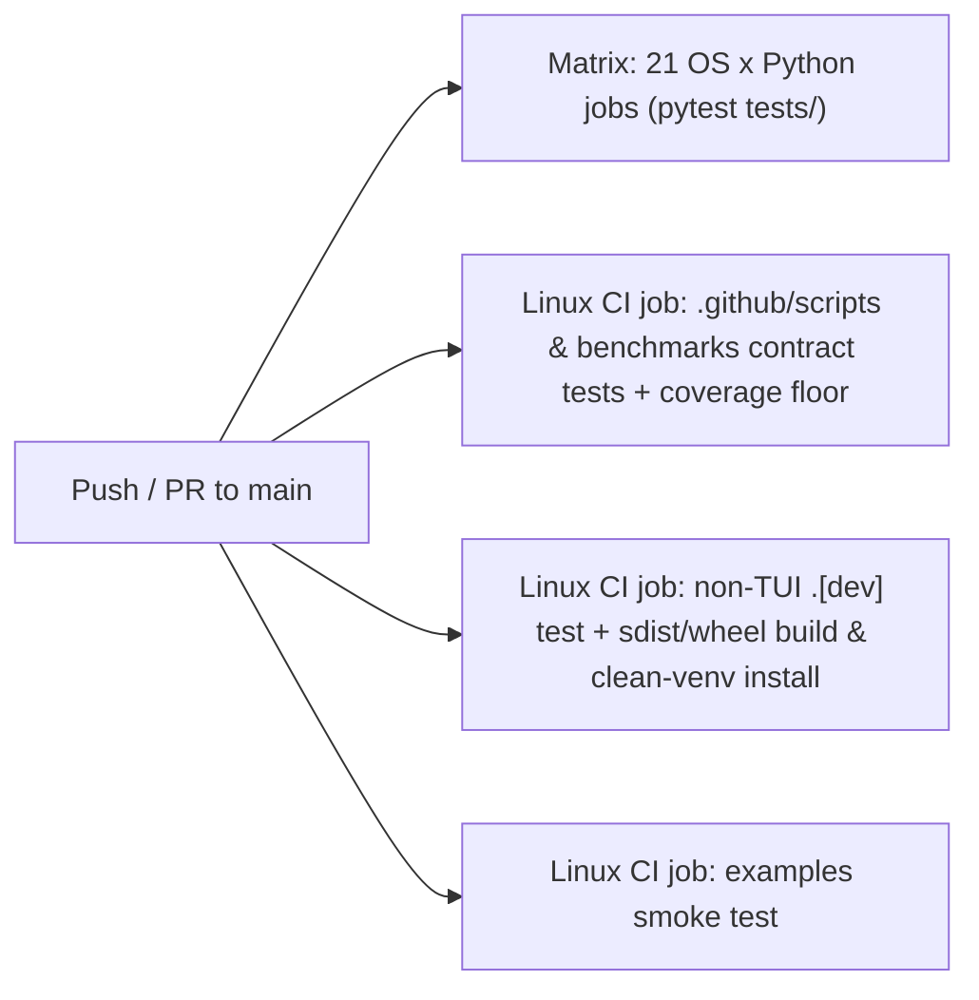

# IPD: CI pipeline, tox, excluded suites, examples, and coverage gate

- Date: 2026-11-23
- Kind: child
- Concern: Testing rigor and completeness (CI coverage of excluded script/benchmark suites, minimal non-TUI and sdist/wheel installs, working `tox.ini`, coverage floor, `slow` marker, and example smoke testing).
- Scope: `.github/workflows/ci.yml`, `pyproject.toml`, `tox.ini`, `benchmarks/test_benchmarks.py`, `examples/verify_all.py`, and new `tests/test_examples_smoke.py`.
- Scope-Paths: .github/workflows/ci.yml, pyproject.toml, tox.ini, benchmarks/test_benchmarks.py, examples/verify_all.py, tests/test_examples_smoke.py
- Item-Dependencies: none
- Status: to-review
- Short-Description: Gate excluded script/benchmark suites, non-TUI and wheel installs, tox.ini, example smoke tests, and CI coverage floor
- Work-Kind: chore
- Priority: high
- Set: test-audit
- Order: 1
- Highest E allocated: 05
- Author: Antigravity
- Id: bzi46m

> Write and proofread this plan per the technical writing standard, `.aw/system/workflows/technical-writing/technical-writing.md` (`.agents/workflows/technical-writing/technical-writing.md` in a legacy-layout install), including requirement 12 (diagrams).

## Workflow history

- 2026-11-23 to-review (Antigravity): authored from `/assess-testing` findings T-01, T-02, T-03, T-04, and T-07 (benchmark file).
- 2026-11-23 draft (Antigravity): created.

## Goal

Ensure GitHub Actions CI and local `tox` actually exercise the repository's security/intake scripts, benchmark schema contracts, minimal non-TUI installation, real sdist/wheel packaging (`hatch_build.py`), runnable examples, and a coverage floor, while keeping local single-file `pytest` runs free of forced `--cov` failures.

### CI verification topology

## Detailed Implementation Checklist (TODO)

Execution-state rule: mark an `E-*` item complete only after performing the action. That mark is not validation. Right-sizing rule: each E-item addresses one concern executable in one focused pass. Accepted execution states: blocked, failed, pending, performed; terminal gate demands 'performed'.

### Task group 1: Test configuration and tox repair

- [ ] E-01 Decouple unconditional `--cov` flags from `pyproject.toml` `addopts`, register the `slow` pytest marker, and repair `tox.ini` for tox 4 and dev extras.
  - Depends on: none
  - Expected outcome: `pyproject.toml` `[tool.pytest.ini_options]` sets `addopts = "-p no:randomly"` and registers `markers = ["slow: multi-subprocess benchmark and long-running tests"]`; `tox.ini` removes deprecated `isolated_build = True`, installs `extras = dev` (or explicit `pytest>=7.0`, `pytest-cov`, `jsonschema>=4.0`), and runs `pytest tests/ -v` cleanly without exit code 4.
  - Execution state: pending

### Task group 2: Benchmark contract tests and code-pinning removal

- [ ] E-02 Replace the source-text regex check in `benchmarks/test_benchmarks.py:TestSchema5Shape.test_schema_is_v5` with a behavioral assertion on harness output and extend `TestSchema5Conformance.test_committed_redacted_sample_conforms` to validate `benchmarks/data/accepted/*.redacted.json` alongside `benchmarks/results/*.redacted.json`.
  - Depends on: none
  - Expected outcome: `benchmarks/test_benchmarks.py` never reads `benchmarks/harness.py` source text with regex; both `benchmarks/results/*.redacted.json` and `benchmarks/data/accepted/*.redacted.json` are validated against `schemas/benchmark.schema.json`.
  - Execution state: pending

### Task group 3: Safe example runner and smoke test

- [ ] E-03 Update `examples/verify_all.py` to execute examples inside an isolated temporary working directory by default (never deleting repo-root `runs/`), add explicit subprocess timeouts, and remove `shell=True` from the Windows fallback.
  - Depends on: none
  - Expected outcome: `examples/verify_all.py` runs safely from the repository root without mutating or deleting `<repo_root>/runs/`, applies a per-example `timeout=`, and invokes no `shell=True`.
  - Execution state: pending

- [ ] E-04 Create `tests/test_examples_smoke.py` with a parametrized smoke test executing `examples/[0-9]*.py` in `tmp_path` with `PYTHONPATH=src` and a bounded timeout, asserting exit code 0 and manifest creation where applicable.
  - Depends on: E-03
  - Expected outcome: Every runnable numbered example (`examples/00_auto_start.py` through `examples/12_external_file_provenance.py`, excluding `11_cli_report.py` only if it requires a pre-existing run or seeding one in `tmp_path`) passes deterministically inside `tmp_path` and leaves zero artifacts in the repository root.
  - Execution state: pending

### Task group 4: CI pipeline gates

- [ ] E-05 Extend `.github/workflows/ci.yml` with dedicated Linux CI jobs covering: (a) `.github/scripts/`, `benchmarks/test_share_safety.py`, `benchmarks/test_pull_submissions.py`, and `benchmarks/test_benchmarks.py` (contract/conformance tests) plus `--cov=src --cov-fail-under=78` on the primary Linux Python 3.12 run; (b) a minimal non-TUI install (`pip install -e ".[dev]"` without `[tui]`) running `pytest tests/ -v`; and (c) building sdist + wheel (`python -m build`), installing the wheel and a wheel built from the unpacked sdist into clean virtual environments, and verifying `pubrun/_build_meta.json`, `pubrun/COMMIT`, `pubrun/py.typed`, `pubrun.__commit__`, and `pubrun --version` / `pbr --version`.
  - Depends on: E-01, E-02, E-04
  - Expected outcome: `.github/workflows/ci.yml` gates all 4 previously un-CI'd surfaces (excluded suites, non-TUI install, real wheel/sdist build-and-install, and coverage floor) while preserving the 21-job OS x Python test matrix.
  - Execution state: pending

## Project conventions discovered (Step 0)

- `.github/workflows/ci.yml` runs 21 OS x Python jobs (`pip install -e ".[dev,tui]"` -> `pytest tests/ -v`), all green on `origin/main` (`fd636d0`, run `45109957606`).
- `pyproject.toml` `[tool.pytest.ini_options]` currently hardcodes `addopts = "--cov=src --cov-report=term-missing --cov-report=xml -p no:randomly"`, causing `tox.ini` (which only installs `pytest>=7.0`) to fail with exit code 4.
- Running `pytest -o addopts="" .github/scripts/ benchmarks/test_share_safety.py benchmarks/test_pull_submissions.py benchmarks/test_benchmarks.py -q` passed `90 passed, 3 skipped` locally, proving these suites work today and simply lack CI execution.
- `AGENTS.md` prohibits code-pinning tests (`inspect`, `ast`, regex, or substring searches against production source files).

## Findings

| ID | Severity | Remediation Risk | Persona | Evidence | Finding |
|---|---|---|---|---|---|
| T-01 | High | Low | QA engineer / Testing expert | `.github/workflows/ci.yml`; `benchmarks/test_benchmarks.py:TestSchema5Conformance` | CI skips 7 test files (90 tests across `.github/scripts/` and `benchmarks/`); `TestSchema5Conformance` omits `benchmarks/data/accepted/*.redacted.json`. |
| T-02 | High | Low | QA engineer / Testing expert | `.github/workflows/ci.yml`; `hatch_build.py`; `tests/test_commit_identity.py:TestHatchBuildHook` | CI never tests a minimal non-TUI install or a real sdist/wheel build and install. |
| T-03 | High | Low | QA engineer / Software engineer | `tox.ini`; `pyproject.toml`; `.github/workflows/ci.yml` | `tox.ini` crashes with exit code 4 due to hardcoded `--cov` in `pyproject.toml` `addopts`; CI has no `--cov-fail-under` gate; no `slow` marker registered. |
| T-04 | Medium | Low | QA engineer / Novice user | `examples/verify_all.py`; `examples/00_auto_start.py`..`12_external_file_provenance.py` | 13 of 14 examples are untested in CI; `verify_all.py` deletes repo-root `runs/`, omits timeouts, and uses `shell=True`. |
| T-07 (part) | Medium | Low | Testing expert | `benchmarks/test_benchmarks.py:TestSchema5Shape.test_schema_is_v5` | Regex-scans `benchmarks/harness.py` source text instead of asserting on harness output. |

## Proposed changes (ordered, validatable)

1. Update `pyproject.toml` and `tox.ini` (Remediation Risk: Low) so `pytest` runs cleanly without `pytest-cov`, registers `slow`, and makes `tox.ini` tox-4 compliant.
2. Replace `benchmarks/test_benchmarks.py:TestSchema5Shape.test_schema_is_v5` with an output-based assertion and include `benchmarks/data/accepted/*.redacted.json` in `TestSchema5Conformance` (Remediation Risk: Low).
3. Harden `examples/verify_all.py` to use a temporary working directory, timeouts, and argv-only commands, and add `tests/test_examples_smoke.py` (Remediation Risk: Low).
4. Add Linux CI jobs in `.github/workflows/ci.yml` for the excluded script/benchmark suites + `--cov-fail-under=78`, minimal non-TUI install, and real sdist/wheel packaging smoke check (Remediation Risk: Low).

## Deferred / out of scope (with reason)

- `mypy` configuration and CI job are owned by dependent child plan `gzc672` (Order 02).
  - Carrier: gzc672

## Scope check

- Over-scope: none.
- Under-scope: none.

## Required tests / validation

- Run `pytest tests/test_examples_smoke.py .github/scripts/ benchmarks/test_share_safety.py benchmarks/test_pull_submissions.py benchmarks/test_benchmarks.py -k "not benchmark" -v`.
- Run `pytest --co -q tests/` (without `pytest-cov` flags) to verify `addopts` works cleanly.
- Build wheel and sdist locally (`python3 -m build` or `pip wheel --no-deps`) and verify `_build_meta.json`, `COMMIT`, `py.typed`, and `pubrun --version` inside a clean temporary venv.
- Validate `.github/workflows/ci.yml` YAML syntax with Python `yaml.safe_load`.
- Run `python3 scripts/sanitize_paths.py --check --all`.

## Spec / documentation sync

N/A with reason: CI workflow, `tox.ini`, and test-runner hardening do not change public `pubrun` library or CLI behavior.

## Open questions

### OQ-01: Coverage floor threshold in CI

- Blocking: no
- Status: resolved
- Owner: none
- Resolution or deferral rationale: Baseline total coverage measured on Python 3.14 Linux is `79%` (`16032` statements). Resolved to `--cov-fail-under=78` (1% headroom for minor platform variance) on the primary Linux CI job; the maintainer may adjust the threshold during plan review before approving.

## Validation and cross-check (verify before reporting done)

Validation-state rule: inspect evidence in a separate pass. Do not mark a `V-*` item complete from memory or from the matching execution checkmark. Accepted validation results: blocked, failed, pass, pending; terminal gate demands 'pass'.

- [ ] V-01 validates E-01
  - Required evidence: Pasted diff of `pyproject.toml` and `tox.ini`, plus pasted output of `pytest tests/test_config.py -q` confirming exit 0 with no `--cov` error and `pytest --markers | grep slow` showing the registered `slow` marker.
  - Observed evidence:
  - Result: pending

- [ ] V-02 validates E-02
  - Required evidence: Pasted output of `pytest benchmarks/test_benchmarks.py -k "TestSchema5" -v` showing all schema conformance tests pass (including `benchmarks/data/accepted/*.redacted.json`) and `grep -n "harness.py" benchmarks/test_benchmarks.py` confirming no source-text regex scan remains.
  - Observed evidence:
  - Result: pending

- [ ] V-03 validates E-03
  - Required evidence: Pasted output of `python3 examples/verify_all.py` (or `--help`/dry-run) and `git status --short` proving no repo-root `runs/` directory is deleted or left untracked, plus `grep -n "shell=True" examples/verify_all.py` returning no matches.
  - Observed evidence:
  - Result: pending

- [ ] V-04 validates E-04
  - Required evidence: Pasted output of `pytest tests/test_examples_smoke.py -v` showing all numbered example smoke tests pass with exit code 0 and `git status --short` clean.
  - Observed evidence:
  - Result: pending

- [ ] V-05 validates E-05
  - Required evidence: Pasted output of YAML parse check on `.github/workflows/ci.yml`, pasted output of `pytest .github/scripts/ benchmarks/test_share_safety.py benchmarks/test_pull_submissions.py -v`, pasted output of local sdist+wheel build and clean-venv verification (`pubrun/_build_meta.json`, `pubrun/COMMIT`, `pubrun/py.typed`, `pubrun.__commit__`, `pubrun --version`), and `python3 scripts/sanitize_paths.py --check --all` exit 0.
  - Observed evidence:
  - Result: pending

## Approval and execution gate

- Size assessment: standard
- Cohesion rationale: not required

This plan must be reviewed and explicitly approved by a human (`- Status: approved`) before execution. During execution, commit only the scoped files through `aw commit`, never push without explicit human instruction, and move this plan to `.aw/records/plans/executed/` only after all `E-*` items are `performed`, all `V-*` items are `pass`, and `aw ipd lint` reports `conforming`.
