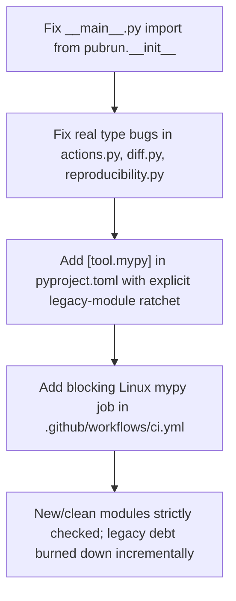

# IPD: Mypy type-check repair and CI type gate

- Date: 2026-11-23
- Kind: child
- Concern: Testing rigor and completeness (static type-checking reliability and CI enforcement for a package shipping `src/pubrun/py.typed` and `Typing :: Typed`).
- Scope: `src/pubrun/__main__.py`, `src/pubrun/tui/widgets/actions.py`, `src/pubrun/tui/widgets/diff.py`, `src/pubrun/report/reproducibility.py`, `pyproject.toml`, and `.github/workflows/ci.yml`.
- Scope-Paths: src/pubrun/__main__.py, src/pubrun/tui/widgets/actions.py, src/pubrun/tui/widgets/diff.py, src/pubrun/report/reproducibility.py, pyproject.toml, .github/workflows/ci.yml
- Item-Dependencies: executed:bzi46m
- Status: to-review
- Short-Description: Fix duplicate-module import in __main__.py, fix real TUI/report type bugs, configure [tool.mypy], and add CI mypy ratchet
- Work-Kind: bug
- Priority: high
- Set: test-audit
- Order: 2
- Highest E allocated: 05
- Author: Antigravity
- Id: gzc672

> Write and proofread this plan per the technical writing standard, `.aw/system/workflows/technical-writing/technical-writing.md` (`.agents/workflows/technical-writing/technical-writing.md` in a legacy-layout install), including requirement 12 (diagrams).

## Workflow history

- 2026-11-23 to-review (Antigravity): authored from `/assess-testing` finding T-05 (serialized after `bzi46m` for `pyproject.toml` and `.github/workflows/ci.yml`).
- 2026-11-23 draft (Antigravity): created.

## Goal

Make `mypy` runnable and blocking in CI by fixing the duplicate-module import in `src/pubrun/__main__.py`, fixing concrete type bugs in TUI and reproducibility code, adding `[tool.mypy]` configuration with a per-module legacy ratchet in `pyproject.toml`, and wiring a blocking Linux `mypy` job into `.github/workflows/ci.yml`.

### Mypy ratchet workflow

## Detailed Implementation Checklist (TODO)

Execution-state rule: mark an `E-*` item complete only after performing the action. That mark is not validation. Right-sizing rule: each E-item addresses one concern executable in one focused pass. Accepted execution states: blocked, failed, pending, performed; terminal gate demands 'performed'.

### Task group 1: Fix mypy abort and real type defects

- [ ] E-01 Fix the duplicate-module import in `src/pubrun/__main__.py` (`from pubrun.__init__ import __version__` -> `from pubrun import __version__`) so `mypy` no longer aborts with `Source file found twice under different module names: "pubrun" and "pubrun.__init__"`.
  - Depends on: none
  - Expected outcome: Running `mypy --explicit-package-bases src/pubrun` proceeds past module discovery across all 58 source files without exit code 2.
  - Execution state: pending

- [ ] E-02 Fix the concrete type defects surfaced by `mypy` in `src/pubrun/tui/widgets/actions.py` (`RunInfo | None` guards before `.run_dir`/`.status`/`.run_id`, `ConfirmDeleteModal` callback type `Optional[bool]`, and typed `RefreshSidebar` message dispatch), `src/pubrun/tui/widgets/diff.py` (`NoSelection` / `_is_select_empty` narrowing before `Path(...)` and `compare_manifests(..., depth=...)`), and `src/pubrun/report/reproducibility.py` (guard `None` before `+` arithmetic).
  - Depends on: E-01
  - Expected outcome: `mypy` reports zero errors on `src/pubrun/tui/widgets/actions.py`, `src/pubrun/tui/widgets/diff.py`, and `src/pubrun/report/reproducibility.py` while all existing TUI and reproducibility tests remain green.
  - Execution state: pending

### Task group 2: Configure `[tool.mypy]` ratchet and CI gate

- [ ] E-03 Add `[tool.mypy]` to `pyproject.toml` (`mypy_path = "src"`, `explicit_package_bases = true`, `ignore_missing_imports = true` for optional dependencies like `IPython`/`yappi`, plus explicit `[[tool.mypy.overrides]]` documenting only the remaining legacy modules that still carry pre-existing type debt so every clean module and every new module is checked strictly).
  - Depends on: E-01, E-02
  - Expected outcome: Running bare `mypy src/pubrun` from the repository root exits 0 with zero errors, while introducing a deliberate type error into any clean module (`actions.py`, `diff.py`, `reproducibility.py`, `config.py`, `analysis/diff.py`, etc.) fails `mypy src/pubrun` with exit code 1.
  - Execution state: pending

- [ ] E-04 Add a blocking Linux `mypy` job (or step on the Linux quality job) in `.github/workflows/ci.yml` running `mypy src/pubrun`.
  - Depends on: E-03
  - Expected outcome: `.github/workflows/ci.yml` runs `mypy src/pubrun` on every push and pull request and fails CI on type regressions in checked modules.
  - Execution state: pending

- [ ] E-05 Verify no regressions across TUI, CLI, and reproducibility suites plus YAML validity and path sanitizer.
  - Depends on: E-02, E-03, E-04
  - Expected outcome: `mypy src/pubrun`, `pytest tests/test_tui*.py tests/test_reproducibility*.py tests/test_cli.py -v`, YAML parse of `.github/workflows/ci.yml`, and `python3 scripts/sanitize_paths.py --check --all` all exit 0.
  - Execution state: pending

## Project conventions discovered (Step 0)

- `pyproject.toml` advertises `"Typing :: Typed"`, ships `src/pubrun/py.typed`, and lists `mypy>=1.0` in `[project.optional-dependencies].dev`, yet had no `[tool.mypy]` section and no CI `mypy` job.
- Empirically verified at assessment: `mypy src/` exited with code 2 due to `from pubrun.__init__ import __version__` in `src/pubrun/__main__.py`; `mypy --no-namespace-packages --ignore-missing-imports src/pubrun` found `175 errors in 24 files (checked 58 source files)`.
- `gzc672` declares `Item-Dependencies: executed:bzi46m` because both plans update `pyproject.toml` and `.github/workflows/ci.yml`.

## Findings

| ID | Severity | Remediation Risk | Persona | Evidence | Finding |
|---|---|---|---|---|---|
| T-05 | High | Medium (complexity/type-debt; lowered to Low via incremental ratchet) | Software engineer / Testing expert | `src/pubrun/__main__.py` (`from pubrun.__init__ import __version__`); `src/pubrun/tui/widgets/actions.py`; `src/pubrun/tui/widgets/diff.py`; `src/pubrun/report/reproducibility.py`; `pyproject.toml`; `.github/workflows/ci.yml` | `mypy` is unenforced in CI, aborts immediately on `__main__.py`, and hides real `None`/`NoSelection` type bugs despite `py.typed`. |

## Proposed changes (ordered, validatable)

1. Fix `src/pubrun/__main__.py` import (`from pubrun import __version__`) (Remediation Risk: Low).
2. Fix real `None`/`NoSelection`/`RefreshSidebar` type bugs in `actions.py`, `diff.py`, and `reproducibility.py` (Remediation Risk: Low).
3. Configure `[tool.mypy]` in `pyproject.toml` with explicit per-module ratchet overrides for remaining legacy-debt modules (Remediation Risk: Low).
4. Add a blocking Linux `mypy src/pubrun` check to `.github/workflows/ci.yml` (Remediation Risk: Low).

## Deferred / out of scope (with reason)

- Clearing all remaining legacy `mypy` errors across the other ~20 files in one sweep (T-19): Remediation Risk **Medium-High** on **complexity** and **functionality**; deferred to incremental module-by-module removal from `[[tool.mypy.overrides]]`.
  - Carrier: qqwebg

## Scope check

- Over-scope: none.
- Under-scope: none.

## Required tests / validation

- `mypy src/pubrun` exits 0.
- `mypy --no-error-summary src/pubrun/tui/widgets/actions.py src/pubrun/tui/widgets/diff.py src/pubrun/report/reproducibility.py` exits 0 without being listed in legacy overrides.
- `pytest tests/test_tui.py tests/test_tui_bugs.py tests/test_reproducibility_assessment.py tests/test_reproducibility_preflight.py tests/test_reproducibility_e2e.py tests/test_cli.py -v` passes.
- `python3 -c "import yaml; yaml.safe_load(open('.github/workflows/ci.yml'))"` and `python3 scripts/sanitize_paths.py --check --all` exit 0.

## Spec / documentation sync

N/A with reason: internal typing cleanup and CI type-checking gate do not alter public API contracts.

## Open questions

None.

## Validation and cross-check (verify before reporting done)

Validation-state rule: inspect evidence in a separate pass. Do not mark a `V-*` item complete from memory or from the matching execution checkmark. Accepted validation results: blocked, failed, pass, pending; terminal gate demands 'pass'.

- [ ] V-01 validates E-01
  - Required evidence: Pasted diff of `src/pubrun/__main__.py` and pasted output of `grep -n "pubrun.__init__" src/pubrun/__main__.py` returning zero matches.
  - Observed evidence:
  - Result: pending

- [ ] V-02 validates E-02
  - Required evidence: Pasted output of `mypy src/pubrun/tui/widgets/actions.py src/pubrun/tui/widgets/diff.py src/pubrun/report/reproducibility.py` reporting `Success: no issues found in 3 source files` (and confirming none of those three modules appear in any `ignore_errors` override).
  - Observed evidence:
  - Result: pending

- [ ] V-03 validates E-03
  - Required evidence: Pasted `[tool.mypy]` section from `pyproject.toml` and pasted output of `mypy src/pubrun` exiting 0 (`Success: no issues found in 58 source files`).
  - Observed evidence:
  - Result: pending

- [ ] V-04 validates E-04
  - Required evidence: Pasted diff of `.github/workflows/ci.yml` showing the blocking `mypy src/pubrun` step/job and pasted output of YAML parse check exiting 0.
  - Observed evidence:
  - Result: pending

- [ ] V-05 validates E-05
  - Required evidence: Pasted pytest output for `tests/test_tui.py`, `tests/test_tui_bugs.py`, `tests/test_reproducibility_*.py`, and `tests/test_cli.py` showing 0 failures, plus `python3 scripts/sanitize_paths.py --check --all` exit 0.
  - Observed evidence:
  - Result: pending

## Approval and execution gate

- Size assessment: standard
- Cohesion rationale: not required

This plan must be reviewed and explicitly approved by a human (`- Status: approved`) before execution. During execution, commit only the scoped files through `aw commit`, never push without explicit human instruction, and move this plan to `.aw/records/plans/executed/` only after all `E-*` items are `performed`, all `V-*` items are `pass`, and `aw ipd lint` reports `conforming`.
