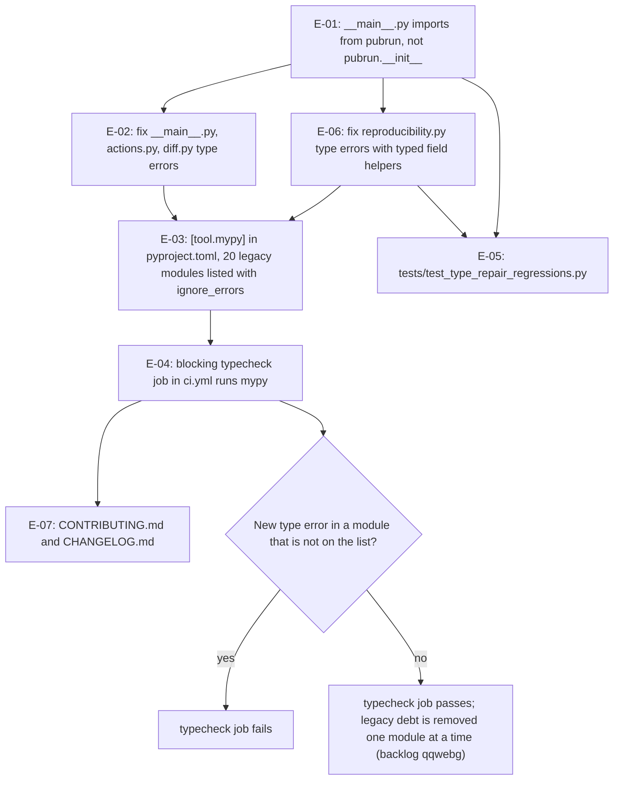

# IPD: Mypy type-check repair and CI type gate

- Date: 2026-11-23
- Kind: child
- Concern: Testing rigor and completeness (static type-checking reliability and CI enforcement for a package shipping `src/pubrun/py.typed` and `Typing :: Typed`).
- Scope: `src/pubrun/__main__.py`, `src/pubrun/tui/widgets/actions.py`, `src/pubrun/tui/widgets/diff.py`, `src/pubrun/report/reproducibility.py`, `pyproject.toml`, `.github/workflows/ci.yml`, new `tests/test_type_repair_regressions.py`, and the contributor documentation (`CONTRIBUTING.md`, `CHANGELOG.md`).
- Scope-Paths: src/pubrun/__main__.py, src/pubrun/tui/widgets/actions.py, src/pubrun/tui/widgets/diff.py, src/pubrun/report/reproducibility.py, pyproject.toml, .github/workflows/ci.yml, tests/test_type_repair_regressions.py, CONTRIBUTING.md, CHANGELOG.md
- Item-Dependencies: executed:bzi46m
- Status: reviewed
- Readiness: go-pending-approval
- Review-Depth: standard
- Short-Description: Fix the duplicate-module import in __main__.py, fix type errors in four modules, configure a [tool.mypy] ratchet, and add a blocking CI mypy job
- Work-Kind: bug
- Priority: high
- Set: test-audit
- Order: 2
- Highest E allocated: 07
- Author: Antigravity
- Id: gzc672

> Write and proofread this plan per the technical writing standard, `.aw/system/workflows/technical-writing/technical-writing.md` (`.agents/workflows/technical-writing/technical-writing.md` in a legacy-layout install), including requirement 12 (diagrams).

## Workflow history

- 2026-11-23 /plan-review (uri/its_direct/pt3-claude-opus-5.5-1m-us): APPROVE WITH REVISIONS APPLIED; PR-001, PR-002, PR-003, PR-004, PR-005, PR-006, PR-007, PR-008, PR-009, PR-010, PR-011, PR-012, PR-013, PR-014, PR-015
- 2026-11-23 to-review (Antigravity): authored from `/assess-testing` finding T-05 (serialized after `bzi46m` for `pyproject.toml` and `.github/workflows/ci.yml`).
- 2026-11-23 draft (Antigravity): created.

## Goal

Make `mypy` (the Python static type checker) run to completion on `src/pubrun`, and make it a blocking CI check that fails when a type error appears in any module that is already clean.

Four changes do this:

1. `src/pubrun/__main__.py` imports `from pubrun.__init__ import __version__`. Python then loads the package file a second time as a separate module named `pubrun.__init__`, and `mypy` stops before checking anything (exit code 2, `Source file found twice under different module names`). Changing the import to `from pubrun import __version__` fixes both.
2. Fix the type errors in `__main__.py`, `tui/widgets/actions.py`, `tui/widgets/diff.py`, and `report/reproducibility.py`, so that these four modules are checked strictly.
3. Add a `[tool.mypy]` section to `pyproject.toml` with a ratchet. A ratchet here is an explicit list of legacy modules whose existing errors are ignored (`ignore_errors = true`). Every module not on the list, including every new module, is checked. A module leaves the list when its errors are fixed and never rejoins it.
4. Add a blocking `typecheck` job to `.github/workflows/ci.yml` that runs `mypy`.

### Mypy ratchet workflow

## Detailed Implementation Checklist (TODO)

Execution-state rule: mark an `E-*` item complete only after performing the action. That mark is not validation. Right-sizing rule: each E-item addresses one concern executable in one focused pass. Accepted execution states: blocked, failed, pending, performed; terminal gate demands 'performed'.

### Task group 1: Fix the mypy abort and the type errors in four modules

- [ ] E-01 In `src/pubrun/__main__.py` `_run_bug_report`, replace `from pubrun.__init__ import __version__` with `from pubrun import __version__`.
  - Depends on: none
  - Expected outcome: `grep -rn "pubrun.__init__ import" src/ tests/` finds no match. `mypy src/pubrun`, run from the repository root with the E-03 configuration, no longer exits 2. At runtime, `pubrun report-bug` no longer creates a second module object `sys.modules["pubrun.__init__"]`. At review, with the old import, `"pubrun.__init__" in sys.modules` was `True` after `_run_bug_report()`, and that object was not `sys.modules["pubrun"]`, so the package's import-time code (`_execute_boot_sequence`) ran a second time.
  - Execution state: pending

- [ ] E-02 Fix the type errors in `src/pubrun/__main__.py` (4), `src/pubrun/tui/widgets/actions.py` (8), and `src/pubrun/tui/widgets/diff.py` (3) without changing behavior. The review prototype used these edits, and each module then reported zero errors:
  (a) `__main__.py`: annotate `self.run_info: Optional[RunInfo] = RunInfo(run_dir)` in `RunInProgressOrCrashedError.__init__`; in `_run_cite` (the function containing `from pubrun import __version__ as _ver`), import as `_ver_imported` and assign `_ver: Optional[str] = _ver_imported`; annotate `entries: list = []` in `_parse_log_file`; change `_SubcommandAwareArgumentParser.error` to return `NoReturn` (add `NoReturn` to the `typing` import), matching the `argparse.ArgumentParser.error` signature.
  (b) `actions.py`: in `ActionsPanel.on_button_pressed`, add `if self.run_info is None: return` at the start of the `btn-copy-md`/`btn-copy-latex` branch and of the `btn-delete-selected` branch. The early return at the top of the method already handles this case, but `mypy` does not narrow `self.run_info` across it. Change `handle_deletion_result(self, confirmed: bool)` to `confirmed: Optional[bool]`, the type `push_screen` passes to its callback. Replace the three `self.app.post_message(self.app.RefreshSidebar())` calls with `self.app.post_message(_refresh_sidebar_message())`, where a new module-level helper `_refresh_sidebar_message() -> Message` imports `PubrunTUIApp` from `pubrun.tui.app` inside the function body (a top-level import would be circular, because `tui/app.py` imports `actions.py`) and returns `PubrunTUIApp.RefreshSidebar()`. Import `Message` from `textual.message`.
  (c) `diff.py`: in `DiffView.run_difference`, use `Path(str(run_dir_a))` and `Path(str(run_dir_b))` (the values are already checked by `_is_select_empty` and the falsy test above), and replace the `depth` reassignment with `depth_val = ...value` followed by `depth = "basic" if _is_select_empty(depth_val) or not depth_val else str(depth_val)`.
  - Depends on: E-01
  - Expected outcome: With the E-03 configuration, `mypy src/pubrun` reports no error in these three files, and none of the three is on the `ignore_errors` list. `tests/test_tui.py`, `tests/test_tui_bugs.py`, `tests/test_timing_consumers.py`, and `tests/test_cli.py` pass. At review, `tests/test_tui.py` and `tests/test_tui_bugs.py` failed 5 tests when `_refresh_sidebar_message` returned a plain `Message()`, and `tests/test_tui_bugs.py` failed 1 test when the empty-depth fallback was changed from `"basic"` to `"deep"`, so these suites catch a broken refactor of either edit.
  - Execution state: pending

- [ ] E-06 Fix the 49 type errors in `src/pubrun/report/reproducibility.py` without changing behavior. Most come from one pattern, `d.get(k) if isinstance(d.get(k), dict) else {}`. `mypy` cannot narrow the second `.get()` call from the `isinstance` check on the first, so the result type stays `Any | None`. Add three private helpers above `_make_finding`:
  - `_dict_field(container: Dict[str, Any], key: str) -> Dict[str, Any]` returns `container[key]` when it is a dict, else `{}`;
  - `_list_field(container: Dict[str, Any], key: str) -> List[Any]` returns `container[key]` when it is a list, else `[]`;
  - `_str_field(container: Dict[str, Any], key: str) -> Optional[str]` returns `container[key].strip()` when it is a non-blank string, else `None`.
  Replace each one-line or parenthesized `x.get("k") if isinstance(x.get("k"), dict|list) else {}|[]` expression with `_dict_field`/`_list_field`, and each `x.get("k").strip() if isinstance(x.get("k"), str) and x.get("k").strip() else None` expression with `_str_field`. Leave expressions whose default is `None` unchanged unless they produce an error. In `_resolve_input_local_path`, replace the three `rec.get(...) if isinstance(..., str) else ""` assignments and their three `.strip()` lines with `_str_field(rec, "<key>") or ""`. In the `mode_no_subprocess_patch` finding, read `selected_mode` from the already-narrowed dict (`_dict_field(manifest, "pubrun_imports")`). Annotate the first `details = {` assignment in each function as `details: Dict[str, Any] = {`; annotating a later one in the same function is a `no-redef` error. At review the prototype made 15 one-line and 2 multi-line dict/list replacements and 5 string replacements, about 100 changed lines, and reduced the module from 49 errors to 0.
  - Depends on: E-01
  - Expected outcome: With the E-03 configuration, `mypy src/pubrun` reports no error in `reproducibility.py`, and the module is not on the `ignore_errors` list. `tests/test_reproducibility_assessment.py`, `tests/test_reproducibility_preflight.py`, `tests/test_reproducibility_e2e.py`, `tests/test_checks_commands.py`, `tests/test_report_subpackage_integrity.py`, and `tests/test_templates.py` pass. At review, these suites failed 9 tests when `_dict_field` always returned `{}`, but passed when `_str_field` stopped stripping whitespace; E-05 adds the test that catches the second mutation.
  - Execution state: pending

- [ ] E-05 Create `tests/test_type_repair_regressions.py` with behavior tests for the two runtime effects of task group 1 that existing tests do not catch. Use only Python 3.8 syntax.
  (a) `test_report_bug_does_not_load_package_twice`: run a subprocess with `sys.executable -c`, `PYTHONPATH=<repo>/src`, and `PUBRUN_IMPORT_MODE=noauto`. The child replaces `webbrowser.open` with a function that returns `True`, imports `pubrun.__main__`, calls `_run_bug_report()` with stdout redirected, and prints `"pubrun.__init__" in sys.modules`. Assert exit code 0 and that the last line is `False`.
  (b) `test_working_directory_path_is_stripped`: call `compare_with_current_environment({"invocation": {"working_directory": {"path": "  <tmp_path>  "}, "argv": ["x"]}}, cwd=str(tmp_path))` and assert the `working_directory` check's `details["recorded_working_directory"]` equals `str(tmp_path)` with no surrounding spaces.
  (c) `test_blank_working_directory_is_not_checked`: the same call with `"path": "   "` produces the message `No working directory path was recorded in the manifest.`
  (d) `test_entrypoint_script_path_is_stripped`: write `tmp_path / "train.py"`, call with `{"invocation": {"entrypoint_type": "script", "script": {"path": "  <script>  "}, "argv": ["x"]}}`, and assert the `entrypoint_script` check (`name == "entrypoint_script"`) has `details["resolved_path"] == str(script)` and a message containing `exists locally`.
  - Depends on: E-01, E-06
  - Expected outcome: The file passes (4 tests). At review, a prototype of these four tests passed against the E-01 and E-06 prototype, failed 2 tests when `_str_field` returned the value unstripped, and failed 1 test when the `pubrun.__init__` import was restored.
  - Execution state: pending

### Task group 2: Configure the `[tool.mypy]` ratchet and the CI gate

- [ ] E-03 Add this configuration to `pyproject.toml` after the existing `[tool.*]` sections:
  - `[tool.mypy]` with `mypy_path = "src"`, `explicit_package_bases = true`, and `files = ["src/pubrun"]`. Do not set `python_version`: `mypy` 2.x refuses targets below 3.10, and the project supports 3.8.
  - `[[tool.mypy.overrides]]` with `module = ["IPython", "IPython.*", "yappi", "tomli"]` and `ignore_missing_imports = true`. These are optional imports without stubs: `IPython` in `capture/console.py`, `yappi` in `core.py`, and `tomli` (installed only on Python below 3.11) in `__init__.py`, `config.py`, and `_config_boot.py`. Do not set `ignore_missing_imports` globally, because that would hide a missing first-party module.
  - `[[tool.mypy.overrides]]` with `ignore_errors = true` and this exact `module` list, sorted, with a TOML comment saying the list may only shrink and pointing at backlog item `qqwebg`: `pubrun._bootstrap`, `pubrun.analysis.diff`, `pubrun.analysis.render`, `pubrun.auto`, `pubrun.capture.console`, `pubrun.capture.file_io`, `pubrun.capture.filesystem`, `pubrun.capture.packages`, `pubrun.capture.resources`, `pubrun.config`, `pubrun.core`, `pubrun.events`, `pubrun.full`, `pubrun.minimal`, `pubrun.noauto`, `pubrun.noconsole`, `pubrun.nopatch`, `pubrun.report.diagnostics`, `pubrun.status`, `pubrun.tracker`. These are the 20 modules that still had errors at review after task group 1 (111 errors in total). Do not list `pubrun.__main__`: an `ignore_errors` override on that module also hides the duplicate-module error that E-01 fixes, so a reverted import would pass the gate.
  - Depends on: E-02, E-06
  - Expected outcome: From the repository root, both `mypy` and `mypy src/pubrun` print `Success: no issues found in 58 source files` and exit 0. The gate catches regressions: appending `_aw_mut: int = "x"` to `tui/widgets/actions.py`, `tui/widgets/diff.py`, `report/reproducibility.py`, or a module that was already clean (`report/methods.py`) makes `mypy` exit 1; a new file containing that line makes `mypy` exit 1; restoring `from pubrun.__init__ import __version__` makes `mypy` exit 2; and the same line appended to a listed module (`tracker.py`) still exits 0. At review, the prototype configuration gave every one of these results with `mypy` 2.3.1 and `textual` 8.2.8 on Python 3.14, and also exited 0 under `--python-version 3.10` and `--python-version 3.12`.
  - Execution state: pending

- [ ] E-04 Add a `typecheck` job to `.github/workflows/ci.yml`, alongside the jobs that `bzi46m` adds. It runs on `ubuntu-latest` with Python `3.12` (the same pinned version as `bzi46m`'s `extra-suites`, `no-tui`, and `packaging` jobs). Steps: `actions/checkout@v7`; `actions/setup-python@v7` with `python-version: "3.12"`; `pip install -e ".[dev,tui]"` (the `tui` extra installs `textual`, whose bundled types `mypy` needs for the TUI widgets); `mypy --version`; and `mypy`. The job has no `continue-on-error`, so a type error fails CI.
  - Depends on: E-03
  - Expected outcome: `yaml.safe_load` of `.github/workflows/ci.yml` lists a `typecheck` job with `runs-on: ubuntu-latest`, Python `3.12`, and the steps above. The `test` matrix and the `bzi46m` jobs are unchanged. The job runs only on Linux because `mypy` checks one platform per run: at review, `mypy --platform win32` reported 7 errors in `capture/liveness.py`, `capture/system_metrics.py`, and `capture/subprocesses.py` (`os.sysconf`, `os.getloadavg`, `os.WIFEXITED` are POSIX-only), while `--platform darwin` reported none.
  - Execution state: pending

- [ ] E-07 Document the type check for contributors. In `CONTRIBUTING.md` "Development setup", after the test-suite command, add a short paragraph and code block: `python -m pip install -e ".[dev,tui]"` then `mypy`, and say that CI runs the same check on Linux and fails on a type error in any module not listed in the `ignore_errors` override in `pyproject.toml`. In `CHANGELOG.md` `## [Unreleased]`, add one `### Changed` entry (create the subsection if `bzi46m` did not) stating that `mypy` now runs cleanly on the package with a per-module ratchet, that CI has a blocking `typecheck` job, and that `pubrun report-bug` no longer loads the package a second time. Follow the `AGENTS.md` dash rule: no em or en dashes in this prose.
  - Depends on: E-04
  - Expected outcome: `grep -n mypy CONTRIBUTING.md` and `grep -n typecheck CHANGELOG.md` each show the new lines; both files keep the `bzi46m` edits.
  - Execution state: pending

## Project conventions discovered (Step 0)

- `pyproject.toml` advertises `"Typing :: Typed"`, ships `src/pubrun/py.typed`, and lists `mypy>=1.0` in `[project.optional-dependencies].dev`, but has no `[tool.mypy]` section, and CI has no `mypy` job.
- Review measurements (lane HEAD `8ac3407`, `mypy` 2.3.1, Python 3.14.6, `textual` 8.2.8): `mypy src/pubrun` and `mypy --explicit-package-bases src/pubrun` both exit 2 on the duplicate-module error. With only E-01 applied, `mypy --ignore-missing-imports src/pubrun` reports `175 errors in 24 files (checked 58 source files)`. `reproducibility.py` has 49, `capture/resources.py` 19, `tracker.py` 18, `core.py` 11, `actions.py` 8, `__main__.py` 4, and `diff.py` 3. After task group 1, 111 errors remain in the 20 legacy modules listed in E-03.
- `config.py` (1 error) and `analysis/diff.py` (5 errors) are not clean. They stay on the legacy list.
- Run `mypy` from the repository root of the checkout being changed. The developer virtual environment's editable `pubrun` install can point at another checkout, and `mypy` then reports paths outside the working tree. The E-03 `mypy_path = "src"` setting makes `mypy` resolve `pubrun` from the local `src/`. At review, the prototype output contained no path outside the scratch copy.
- `mypy` writes `.mypy_cache/` with its own `.gitignore` (`*`), so the cache is never staged.
- `gzc672` declares `Item-Dependencies: executed:bzi46m` because `bzi46m` also edits `pyproject.toml`, `.github/workflows/ci.yml`, `CONTRIBUTING.md`, and `CHANGELOG.md`. This plan adds to those edits and must not revert them.
- Sibling `bwoyan` (Order 08) adds TUI tests for `ActionsPanel` and edits `src/pubrun/tui/widgets/details.py`, not `actions.py` or `diff.py`. No other `test-audit` plan lists a file in this plan's `- Scope-Paths:`.
- Tests and source must use Python 3.8 syntax (`requires-python = ">=3.8"`): use `Optional[...]` and `List[...]`, not `X | None` or `list[int]`.

## Findings

| ID | Severity | Remediation Risk | Persona | Evidence | Finding |
|---|---|---|---|---|---|
| T-05 | High | Medium (complexity/type-debt; lowered to Low via incremental ratchet) | Software engineer / Testing expert | `src/pubrun/__main__.py` (`from pubrun.__init__ import __version__`); `src/pubrun/tui/widgets/actions.py`; `src/pubrun/tui/widgets/diff.py`; `src/pubrun/report/reproducibility.py`; `pyproject.toml`; `.github/workflows/ci.yml` | `mypy` is unenforced in CI, aborts immediately on `__main__.py`, and hides real `None`/`NoSelection` type bugs despite `py.typed`. |

## Proposed changes (ordered, validatable)

1. Fix the `src/pubrun/__main__.py` import to `from pubrun import __version__` (E-01; Remediation Risk: Low).
2. Fix the type errors in `__main__.py`, `actions.py`, and `diff.py` (E-02; Remediation Risk: Low).
3. Fix the type errors in `reproducibility.py` with three typed field helpers (E-06; Remediation Risk: Low, because the helpers keep the existing semantics and E-05 plus the existing reproducibility suites catch a changed default or a dropped `strip()`).
4. Add regression tests for the duplicate-module load and for whitespace stripping (E-05; Remediation Risk: Low).
5. Configure `[tool.mypy]` in `pyproject.toml` with an explicit 20-module `ignore_errors` list (E-03; Remediation Risk: Low).
6. Add a blocking Linux `typecheck` job to `.github/workflows/ci.yml` (E-04; Remediation Risk: Low).
7. Document the check in `CONTRIBUTING.md` and `CHANGELOG.md` (E-07; Remediation Risk: Low).

## Deferred / out of scope (with reason)

- Clearing the remaining 111 legacy `mypy` errors in the 20 listed modules in one sweep (T-19): Remediation Risk **Medium-High** on **complexity** and **functionality**; deferred to incremental module-by-module removal from the `ignore_errors` override.
  - Carrier: qqwebg
- Type-checking the Windows and macOS branches (`mypy --platform win32` reports 7 POSIX-only errors in `capture/liveness.py`, `capture/system_metrics.py`, and `capture/subprocesses.py`). Those branches are guarded at runtime, and the fix (platform guards `mypy` understands, such as `sys.platform` checks) belongs with the legacy burn-down.
  - Carrier: qqwebg
- Pinning an exact `mypy` version in CI. The `dev` extra requires `mypy>=1.0`, so a new `mypy` release can report new errors and fail the `typecheck` job without a code change. The job prints `mypy --version` so such a failure is visible. Pinning would change the `dev` extra contract that `bzi46m` and contributors use, and the project's other tools are not pinned either.
  - Carrier-Declined: the project pins no development tool; a new-release failure is visible in the job log and is fixed by a normal follow-up change.
- Running the new `typecheck` job on GitHub Actions requires a push, and pushing requires explicit human instruction (`AGENTS.md` agent execution contract). Local validation runs the same commands.
  - Carrier-Declined: a push needs explicit human authorization, so no plan can carry it; GitHub Actions runs the job automatically on the next push or pull request to `main`.

## Scope check

- Over-scope: none. The `reproducibility.py` refactor (E-06) is larger than the original "guard `None` before `+`" description, but every changed line is a type-narrowing rewrite with the same runtime result, and it is needed to take the module off the legacy list as the Goal requires.
- Under-scope: none after review. Review added `tests/test_type_repair_regressions.py` (E-05), because no existing test catches the duplicate-module load or a dropped `strip()`, and `CONTRIBUTING.md` and `CHANGELOG.md` (E-07), because a contributor-facing CI check needs a documented local command.

## Required tests / validation

- From the repository root: `mypy --version`, then `mypy`, then `mypy src/pubrun`; both checks print `Success: no issues found in 58 source files` and exit 0.
- The E-03 mutation checks, each restored before the next: the `_aw_mut` line in `actions.py`, `diff.py`, `reproducibility.py`, and `report/methods.py` (exit 1 each); a new file `src/pubrun/_aw_mut.py` (exit 1); the restored `pubrun.__init__` import (exit 2); the `_aw_mut` line in `tracker.py` (exit 0). Delete `.mypy_cache/` before each run.
- `python3 -m pytest tests/test_type_repair_regressions.py tests/test_tui.py tests/test_tui_bugs.py tests/test_timing_consumers.py tests/test_reproducibility_assessment.py tests/test_reproducibility_preflight.py tests/test_reproducibility_e2e.py tests/test_cli.py tests/test_cli_diff_bugs.py tests/test_checks_commands.py tests/test_report_subpackage_integrity.py tests/test_templates.py -q`. At review, the prototype passed all of these except tests that read repository files missing from the scratch copy (`README.md`, `CITATION.cff`, `docs/research-use.md`), which passed in the full checkout.
- The E-05 and E-06 mutation checks named in V-05 and V-06.
- `python3 -c "import yaml; yaml.safe_load(open('.github/workflows/ci.yml'))"` and `python3 scripts/sanitize_paths.py --check --all` exit 0.

## Spec / documentation sync

- No `.spec.md` under `.aw/records/specs/` and no file under `docs/` mentions `mypy` or type checking (checked with `grep -rln "mypy\|type-check" .aw/records/specs docs` at review: no match).
- `CONTRIBUTING.md` "Development setup" documents only the test command. E-07 adds the type-check command, because the new CI job can fail a contributor's pull request.
- `CHANGELOG.md` `## [Unreleased]` records the new CI job and the `report-bug` fix (E-07).

## Open questions

None.

## Validation and cross-check (verify before reporting done)

Validation-state rule: inspect evidence in a separate pass. Do not mark a `V-*` item complete from memory or from the matching execution checkmark. Accepted validation results: blocked, failed, pass, pending; terminal gate demands 'pass'.

Mutation-check procedure for V-03, V-05, and V-06: copy the file aside, apply the one-line change, delete `.mypy_cache/` and the relevant `__pycache__/` directories, run with `PYTHONDONTWRITEBYTECODE=1`, record the output, restore the file from the copy, and confirm `git diff --stat` shows only the intended E-item edits. A stale cache or `.pyc` file can otherwise hide a mutation.

- [ ] V-01 validates E-01
  - Required evidence: Pasted diff of the `_run_bug_report` import in `src/pubrun/__main__.py`, and pasted output of `grep -rn "pubrun.__init__ import" src/ tests/` with no match (exit 1).
  - Observed evidence:
  - Result: pending

- [ ] V-02 validates E-02
  - Required evidence: Pasted diffs of `src/pubrun/__main__.py`, `src/pubrun/tui/widgets/actions.py`, and `src/pubrun/tui/widgets/diff.py`; pasted output of `mypy 2>&1 | grep -E "__main__.py|widgets/(actions|diff).py"` with no match; pasted `pyproject.toml` `ignore_errors` list showing none of `pubrun.__main__`, `pubrun.tui.widgets.actions`, `pubrun.tui.widgets.diff`; and pasted pytest output for `tests/test_tui.py tests/test_tui_bugs.py tests/test_timing_consumers.py tests/test_cli.py tests/test_cli_diff_bugs.py` with 0 failures.
  - Observed evidence:
  - Result: pending

- [ ] V-03 validates E-03
  - Required evidence: Pasted `[tool.mypy]` and `[[tool.mypy.overrides]]` sections from `pyproject.toml`; pasted output of `mypy --version`, `mypy`, and `mypy src/pubrun`, each check ending in `Success: no issues found in 58 source files` with `echo exit=$?` printing `exit=0`; and pasted output of each E-03 mutation check with its exit code (1 for `actions.py`, `diff.py`, `reproducibility.py`, `report/methods.py`, and the new file; 2 for the restored `pubrun.__init__` import; 0 for `tracker.py`).
  - Observed evidence:
  - Result: pending

- [ ] V-04 validates E-04
  - Required evidence: Pasted diff of `.github/workflows/ci.yml`; pasted output of a `yaml.safe_load` script that prints every job name and, for `typecheck`, its `runs-on`, Python version, step commands, and the absence of `continue-on-error`; and pasted output of the job's commands run locally in a fresh virtual environment created with Python 3.12 (`pip install -e ".[dev,tui]"`, `mypy --version`, `mypy`) ending in `Success` and `exit=0`.
  - Observed evidence:
  - Result: pending

- [ ] V-05 validates E-05
  - Required evidence: Pasted output of `python3 -m pytest tests/test_type_repair_regressions.py -v` showing 4 passed; pasted output of the same command with `_str_field` changed to return the unstripped value (at least 1 failure); and pasted output with `from pubrun.__init__ import __version__` restored in `_run_bug_report` (`test_report_bug_does_not_load_package_twice` fails). Both files restored afterwards.
  - Observed evidence:
  - Result: pending

- [ ] V-06 validates E-06
  - Required evidence: Pasted diff of `src/pubrun/report/reproducibility.py`; pasted output of `mypy 2>&1 | grep reproducibility.py` with no match; pasted pytest output for `tests/test_reproducibility_assessment.py tests/test_reproducibility_preflight.py tests/test_reproducibility_e2e.py tests/test_checks_commands.py tests/test_report_subpackage_integrity.py tests/test_templates.py` with 0 failures; and pasted output of the same pytest command with `_dict_field` changed to always return `{}` (at least 1 failure), file restored afterwards.
  - Observed evidence:
  - Result: pending

- [ ] V-07 validates E-07
  - Required evidence: Pasted diffs of `CONTRIBUTING.md` and `CHANGELOG.md`; pasted output of `grep -n mypy CONTRIBUTING.md` and `grep -n typecheck CHANGELOG.md` showing the new lines; pasted output of `grep -nP "[\x{2013}\x{2014}]"` on both added hunks with no match; and pasted output of `python3 scripts/sanitize_paths.py --check --all` exiting 0.
  - Observed evidence:
  - Result: pending

## Approval and execution gate

- Size assessment: standard
- Cohesion rationale: 7 E-items and 9 Scope-Paths exceed the 5 and 8 guidance (`IPD-Z603` advisories). The items are kept in one plan because the ratchet is one invariant: the `ignore_errors` list in E-03 is correct only for the exact module set that E-01, E-02, and E-06 make clean, and the E-03 mutation checks and the E-04 job can be validated only after all three. Splitting E-06 into its own plan would require a temporary `pubrun.report.reproducibility` entry on the list and a second `pyproject.toml` edit. E-05 and E-07 are small and depend on the same edits.

Execution contract:
1. Precondition: wait for human approval (`- Status: approved`) with no unresolved `Blocking: yes` open question before you change any file, and confirm `bzi46m` is executed (its `pyproject.toml`, `.github/workflows/ci.yml`, `CONTRIBUTING.md`, and `CHANGELOG.md` edits are present). This plan has no open questions.
2. Scope declaration: the expected modified files are the `- Scope-Paths:` entries (`src/pubrun/__main__.py`, `src/pubrun/tui/widgets/actions.py`, `src/pubrun/tui/widgets/diff.py`, `src/pubrun/report/reproducibility.py`, `pyproject.toml`, `.github/workflows/ci.yml`, `tests/test_type_repair_regressions.py`, `CONTRIBUTING.md`, `CHANGELOG.md`). If execution requires an out-of-scope file, justify it with `--scope-reason` at finalization. If a declared file needs no edit, acknowledge it with `--scope-ack`. The mutation checks edit `src/pubrun/report/methods.py`, `src/pubrun/tracker.py`, and a new `src/pubrun/_aw_mut.py` only temporarily; restore or delete them and do not commit them.
3. Validation honesty: you MUST run each required validation command and paste its actual output into the matching `V-*` `Observed evidence:` field. Do not mark a `V-*` item `pass` without output captured from that run.
4. Commit discipline: commit only the paths you changed with `aw commit gzc672 -- <paths>`. Do not use `git add -A` or raw `git commit`. Do not push without an explicit human instruction.
5. Lifecycle transition: finalize this plan with `aw ipd finalize gzc672`, never with a hand-written `git mv` to `.aw/records/plans/executed/`. Inside a runner lane (`aw oc run` or `aw agy run`), the runner finalizes after the turn. Outside a runner, the executor runs `aw ipd finalize gzc672` after every `E-*` item is `performed`, every `V-*` item is `pass`, and `aw ipd lint --phase pre-transition` reports `conforming`.
