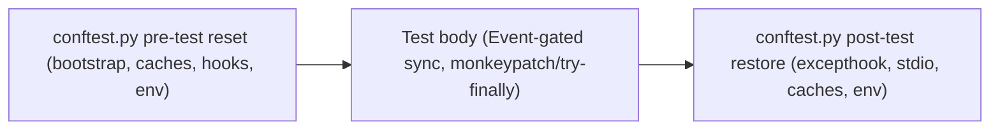

# IPD: Test isolation, global-state leaks, flaky sleeps, and code-pinning removal

- Date: 2026-11-23
- Kind: child
- Concern: Testing rigor and completeness (process-global state isolation, deterministic synchronization, leak cleanup, and compliance with the `AGENTS.md` ban on code-pinning tests).
- Scope: `tests/conftest.py`, `tests/test_signals.py`, `tests/test_env_capture.py`, `tests/test_resources.py`, `tests/test_startup_overhead_writes.py`, `tests/test_bench_command.py`, `benchmarks/test_pull_submissions.py`, and `tests/test_output.py`.
- Scope-Paths: tests/conftest.py, tests/test_signals.py, tests/test_env_capture.py, tests/test_resources.py, tests/test_startup_overhead_writes.py, tests/test_bench_command.py, benchmarks/test_pull_submissions.py, tests/test_output.py
- Item-Dependencies: none
- Status: to-review
- Short-Description: Extend conftest isolation, fix signal/env/resource leaks and fixed sleeps, and replace code-pinning tests
- Work-Kind: bug
- Priority: high
- Set: test-audit
- Order: 3
- Highest E allocated: 05
- Author: Antigravity
- Id: m66tfv

> Write and proofread this plan per the technical writing standard, `.aw/system/workflows/technical-writing/technical-writing.md` (`.agents/workflows/technical-writing/technical-writing.md` in a legacy-layout install), including requirement 12 (diagrams).

## Workflow history

- 2026-11-23 to-review (Antigravity): authored from `/assess-testing` findings T-06 and T-07.
- 2026-11-23 draft (Antigravity): created.

## Goal

Eliminate process-global test leaks, flaky fixed-duration `time.sleep` synchronization, and code-pinning source-inspection tests so tests remain order-independent, deterministic under CI load, and aligned with the observable-behavior contract in `AGENTS.md`.

### Isolation and teardown lifecycle

## Detailed Implementation Checklist (TODO)

Execution-state rule: mark an `E-*` item complete only after performing the action. That mark is not validation. Right-sizing rule: each E-item addresses one concern executable in one focused pass. Accepted execution states: blocked, failed, pending, performed; terminal gate demands 'performed'.

### Task group 1: Process-global state isolation in `conftest.py`

- [ ] E-01 Extend `pubrun_state_isolation` in `tests/conftest.py` to reset/restore `pubrun.capture.packages.invalidate_package_cache()`, `pubrun._reset_commit_cache()`, `pubrun.capture.signals._finalizing_active_run`, `pubrun.core.phase._yappi_active`, and snapshot/restore `sys.excepthook`, `sys.exit`, `sys.stdout`, and `sys.stderr` around every test.
  - Depends on: none
  - Expected outcome: A test that mutates any of those globals or fails mid-run cannot leak state into subsequent tests regardless of execution order.
  - Execution state: pending

### Task group 2: Fix leaks and fixed-sleep synchronization

- [ ] E-02 Fix `tests/test_signals.py` (`TestSignalNonMainThread.test_warns_on_non_main_thread` and other `cap.install()` tests to always call `cap.uninstall()` in `try/finally`, and update `test_lethal_signal_finalization_sigterm` to pass `cwd=tmp_path` and remove the arbitrary `time.sleep(0.5)` after the child prints `run.run_dir`).
  - Depends on: E-01
  - Expected outcome: All signal tests uninstall hooks deterministically even on failure and `test_lethal_signal_finalization_sigterm` passes without fixed post-startup sleep.
  - Execution state: pending

- [ ] E-03 Replace fixed sleeps and leaked 30-second daemon threads in `tests/test_env_capture.py` (`TestLiveProbe.test_hang_reports_pending_and_does_not_block` and `test_slow_return_marked_slow_on_late_read`) with `threading.Event` gates released in `finally:` (and `p._done.wait(timeout=5.0)`), so `_live_probe_sem` permits are never leaked across tests.
  - Depends on: E-01
  - Expected outcome: Both `TestLiveProbe` tests run quickly and deterministically without leaving 30s background threads or racing wall-clock sleeps.
  - Execution state: pending

- [ ] E-04 Replace the 1-second busy-wait and post-start private state reset in `tests/test_resources.py:test_resource_watcher_legit_zero_does_not_abort` with deterministic poll-count synchronization (`threading.Event` / pre-start mock), and replace the bare `time.sleep(0.02)` in `tests/test_startup_overhead_writes.py:test_concurrent_readers_always_see_valid_json_and_zero_tmp_leftovers` with an `Event` waiting for at least one reader pass after `run.stop()`.
  - Depends on: E-01
  - Expected outcome: Both tests assert the exact same invariants without fixed wall-clock sleeps or setup races.
  - Execution state: pending

### Task group 3: Remove code-pinning and private-dict tests

- [ ] E-05 Remove code-pinning and private-table tests while fixing `sys.modules` cleanup: (a) replace `tests/test_bench_command.py:TestSchema5RawTimings.test_schema_is_v5` source-regex check with an assertion on the real dict returned by `h.run(...)["schema"] == "pubrun-benchmark/5"` and use `monkeypatch.setitem(sys.modules, ...)` for `_bench_scenarios`/`_bench_aggregate`; (b) remove the source-substring scan `benchmarks/test_pull_submissions.py:test_no_eval_exec_in_source` (retaining behavioral argv/injection tests); and (c) update `tests/test_output.py:TestStreams.test_default_streams_preserved` to invoke `out.info`/`warn`/`error`/`debug`/`ok`/`fail` with `stream=None` and assert on `capsys.readouterr().out` vs `.err` instead of inspecting private `_DEFAULT_STREAM`.
  - Depends on: none
  - Expected outcome: Zero code-pinning source-inspection tests remain in these files, `sys.modules` is not leaked, and `test_output.py` tests observable stdout/stderr routing.
  - Execution state: pending

## Project conventions discovered (Step 0)

- `AGENTS.md` mandates: "TEST OUTCOMES, NOT CODE STRUCTURE (NO CODE-PINNING TESTS): NEVER write or restore tests that read production source code using `inspect`, `ast`, regex, or substring search."
- `tests/conftest.py:pubrun_state_isolation` already resets `_bootstrap`, `_active_run`, `_DISPLAY_UTC`, and `os.environ`, making it the canonical home for process-global isolation.

## Findings

| ID | Severity | Remediation Risk | Persona | Evidence | Finding |
|---|---|---|---|---|---|
| T-06 | High | Low | Testing expert / QA engineer | `tests/conftest.py:pubrun_state_isolation`; `tests/test_signals.py:TestSignalNonMainThread`; `tests/test_env_capture.py:TestLiveProbe`; `tests/test_resources.py:test_resource_watcher_legit_zero_does_not_abort`; `tests/test_startup_overhead_writes.py` | Global hook/semaphore/cache leaks and fixed sleeps cause order dependence and CI flakiness. |
| T-07 | High | Low | Testing expert | `tests/test_bench_command.py:TestSchema5RawTimings.test_schema_is_v5`; `benchmarks/test_pull_submissions.py:test_no_eval_exec_in_source`; `tests/test_output.py:TestStreams.test_default_streams_preserved` | Source-text regex/substring scans violate `AGENTS.md`, and `_DEFAULT_STREAM` check inspects internals instead of observable streams. |

## Proposed changes (ordered, validatable)

1. Harden `tests/conftest.py:pubrun_state_isolation` with cache/hook/stdio resets (Remediation Risk: Low).
2. Fix hook cleanup and fixed sleeps in `tests/test_signals.py`, `tests/test_env_capture.py`, `tests/test_resources.py`, and `tests/test_startup_overhead_writes.py` (Remediation Risk: Low).
3. Replace code-pinning/private-dict tests and fix `sys.modules` cleanup in `tests/test_bench_command.py`, `benchmarks/test_pull_submissions.py`, and `tests/test_output.py` (Remediation Risk: Low).

## Deferred / out of scope (with reason)

- Enabling `pytest-randomly` across all 21 CI matrix jobs immediately (T-19): Remediation Risk **Medium-High** on **functionality**; this plan completes the foundational isolation hardening first.
  - Carrier: qqwebg

## Scope check

- Over-scope: none.
- Under-scope: none.

## Required tests / validation

- Run `pytest tests/test_signals.py tests/test_env_capture.py tests/test_resources.py tests/test_startup_overhead_writes.py tests/test_bench_command.py benchmarks/test_pull_submissions.py tests/test_output.py -v`.
- Run the same subset with `-p randomly --randomly-seed=12345` to verify order independence.
- Run `python3 scripts/sanitize_paths.py --check --all`.

## Spec / documentation sync

N/A with reason: test-only isolation and behavioral-test cleanup.

## Open questions

None.

## Validation and cross-check (verify before reporting done)

Validation-state rule: inspect evidence in a separate pass. Do not mark a `V-*` item complete from memory or from the matching execution checkmark. Accepted validation results: blocked, failed, pass, pending; terminal gate demands 'pass'.

- [ ] V-01 validates E-01
  - Required evidence: Pasted diff of `tests/conftest.py` showing package/commit/signal/yappi/stdio/excepthook/exit resets and pasted output of `pytest tests/test_signals.py tests/test_env_capture.py -p randomly --randomly-seed=12345 -v` exiting 0.
  - Observed evidence:
  - Result: pending

- [ ] V-02 validates E-02
  - Required evidence: Pasted output of `pytest tests/test_signals.py -v` passing with 0 failures and diff confirming `try/finally: cap.uninstall()` and removal of `time.sleep(0.5)`.
  - Observed evidence:
  - Result: pending

- [ ] V-03 validates E-03
  - Required evidence: Pasted output of `pytest tests/test_env_capture.py -v` passing in < 5s and `grep -n "sleep(" tests/test_env_capture.py` showing zero fixed sync sleeps.
  - Observed evidence:
  - Result: pending

- [ ] V-04 validates E-04
  - Required evidence: Pasted output of `pytest tests/test_resources.py tests/test_startup_overhead_writes.py -v` passing with 0 failures.
  - Observed evidence:
  - Result: pending

- [ ] V-05 validates E-05
  - Required evidence: Pasted output of `pytest tests/test_bench_command.py benchmarks/test_pull_submissions.py tests/test_output.py -v` passing with 0 failures, `grep -n "test_no_eval_exec_in_source\|_DEFAULT_STREAM" benchmarks/test_pull_submissions.py tests/test_output.py` returning zero matches, and `python3 scripts/sanitize_paths.py --check --all` exit 0.
  - Observed evidence:
  - Result: pending

## Approval and execution gate

- Size assessment: standard
- Cohesion rationale: not required

This plan must be reviewed and explicitly approved by a human (`- Status: approved`) before execution. During execution, commit only the scoped files through `aw commit`, never push without explicit human instruction, and move this plan to `.aw/records/plans/executed/` only after all `E-*` items are `performed`, all `V-*` items are `pass`, and `aw ipd lint` reports `conforming`.
