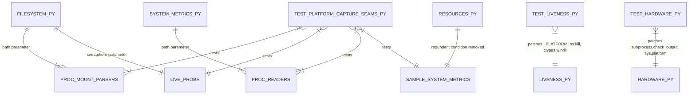

# IPD: Platform capture tests and testable seams for hardware, filesystem, metrics, resources, and liveness

- Date: 2026-11-23
- Kind: child
- Concern: Testing rigor and completeness (backward-compatible path and semaphore parameters in `filesystem.py` and `system_metrics.py`, removal of Linux silent skips in `test_liveness.py`, and cross-platform unit tests for `hardware.py`, `filesystem.py`, `system_metrics.py`, `resources.py`, and `liveness.py`).
- Scope: `src/pubrun/capture/filesystem.py`, `src/pubrun/capture/system_metrics.py`, `src/pubrun/capture/resources.py`, `tests/test_hardware.py`, `tests/test_liveness.py`, and new `tests/test_platform_capture_seams.py`.
- Scope-Paths: src/pubrun/capture/filesystem.py, src/pubrun/capture/system_metrics.py, src/pubrun/capture/resources.py, tests/test_hardware.py, tests/test_liveness.py, tests/test_platform_capture_seams.py
- Item-Dependencies: none
- Status: approved
- Readiness: go-pending-approval
- Review-Depth: standard
- Short-Description: Add path and semaphore parameters to filesystem and system_metrics, and cross-platform unit tests for hardware, filesystem, system_metrics, resources, and liveness
- Work-Kind: chore
- Priority: medium
- Set: test-audit
- Order: 6
- Highest E allocated: 05
- Author: Antigravity
- Id: 7y0gmc
- Approval: 2026-11-24, recorded via aw ipd set: status set to approved

> Write and proofread this plan per the technical writing standard, `.aw/system/workflows/technical-writing/technical-writing.md` (`.agents/workflows/technical-writing/technical-writing.md` in a legacy-layout install), including requirement 12 (diagrams).

## Workflow history

- 2026-11-24 approved (aw set): status set to approved
- 2026-11-23 /plan-review (uri/its_direct/pt3-claude-opus-5.5-1m-us): APPROVE WITH REVISIONS APPLIED; PR-001, PR-002, PR-003, PR-004, PR-005, PR-006, PR-007, PR-008, PR-009, PR-010, PR-011, PR-012, PR-013, PR-014, PR-015
- 2026-11-23 to-review (Antigravity): authored from `/assess-testing` findings T-08 (`test_liveness.py`) and T-13.
- 2026-11-23 draft (Antigravity): created.

## Goal

Make the platform-specific branches of five capture modules testable on every CI runner, and make Linux regressions in process liveness fail instead of skip.

A capture module records facts about the machine a run executed on. The five modules here are `hardware.py` (CPU, memory, GPUs), `filesystem.py` (which filesystem backs each path), `system_metrics.py` (system memory, load, I/O wait, per-process I/O from `/proc`), `resources.py` (the background watcher that samples memory and CPU during a run), and `liveness.py` (whether a recorded process id is still the same running process). Each has branches for Linux, macOS, and Windows, and a CI runner executes only its own branch. Most of those branches are untested.

A testable seam is a parameter or module attribute a test can replace without patching Python's built-in `open`. The plan adds three seams, all backward compatible (every existing call keeps working unchanged):

- a `path` parameter on the two `/proc` mount-table parsers in `filesystem.py`;
- a `path` parameter on the three `/proc` readers in `system_metrics.py`;
- a `semaphore` parameter on `filesystem.LiveProbe`, the thread-bounded live filesystem probe.

`liveness.py` and `resources.py` need no new seam. Their platform switches (`liveness._PLATFORM`, `sys.platform`) and the poll timeout (`resources._poll_timeout`) are module attributes that are read at call time, so `monkeypatch.setattr` already replaces them.

### Seams and the tests that use them



`PROC_MOUNT_PARSERS` are `_parse_proc_mounts` and `_parse_proc_mountinfo`. `PROC_READERS` are `get_system_memory`, `read_proc_stat_cpu_times`, and `get_proc_io`. `SAMPLE_SYSTEM_METRICS` is `ResourceWatcher._sample_system_metrics`.

## Detailed Implementation Checklist (TODO)

Execution-state rule: mark an `E-*` item complete only after performing the action. That mark is not validation. Right-sizing rule: each E-item addresses one concern executable in one focused pass. Accepted execution states: blocked, failed, pending, performed; terminal gate demands 'performed'.

### Task group 1: Backward-compatible testable seams

- [x] E-01 Add the three seams to `src/pubrun/capture/filesystem.py` and `src/pubrun/capture/system_metrics.py`, and make two behavior-preserving cleanups in `src/pubrun/capture/resources.py`.
  - Depends on: none
  - Expected outcome: (a) In `filesystem.py`, the signatures become `_parse_proc_mounts(path: str = "/proc/mounts")` and `_parse_proc_mountinfo(path: str = "/proc/self/mountinfo")`, and each opens `path` instead of its hardcoded string. The two calls in `get_filesystem` stay argument-free. (b) In `filesystem.py`, `LiveProbe.__init__(self, path: str, wait_budget_s: float, semaphore: Optional[threading.BoundedSemaphore] = None)` stores `self._sem = semaphore if semaphore is not None else _live_probe_sem`, and the one `acquire` and the two `release` calls use `self._sem`. A release therefore always returns the slot to the semaphore it was acquired from. `probe_filesystem_live(path, wait_budget_s=5.0)` keeps its signature and passes no semaphore. (c) In `system_metrics.py`, the signatures become `get_system_memory(path: str = "/proc/meminfo")`, `read_proc_stat_cpu_times(path: str = "/proc/stat")`, and `get_proc_io(path: str = "/proc/self/io")`. Each passes `path` to both its `os.path.exists` check and its `open`. The `sys.platform.startswith("linux")` check stays, so a non-Linux platform still returns `None`. Existing argument-free callers (`ResourceWatcher._capture_system_start`, `ResourceWatcher._sample_system_metrics`, and `get_system_memory()` in `src/pubrun/report/checks.py`) are unchanged. (d) In `resources.py`, `ResourceWatcher._sample_system_metrics` drops the outer condition `if prev is None or avail < prev.get("available_bytes", avail) + 1:`, leaving only `if prev is None or avail < prev.get("available_bytes", float("inf")):`. For integer byte counts the outer test (`avail <= prev`) is implied by the inner one (`avail < prev`), so the first sample with the lowest value is kept, as before. (e) In `resources.py`, the module comment `# Removed ctypes in favor of reliable OS wmic command for Python compatibility across Win10/11` is replaced with one stating that `_get_rss_windows` uses `GetProcessMemoryInfo` through `ctypes` first and falls back to `wmic`, which is what the function does. No other production file changes. In a review prototype these edits left the 118 tests in the five capture test files passing and the full suite passing.
  - Execution state: performed

### Task group 2: Hardware and liveness tests and silent-skip removal

- [x] E-02 Expand `tests/test_hardware.py` with mocked tests of every `hardware.py` platform branch, and strengthen `test_hardware_poller_does_not_crash`.
  - Depends on: none
  - Expected outcome: Every new test patches `pubrun.capture.hardware.subprocess.check_output` and `pubrun.capture.hardware.sys.platform` with `monkeypatch.setattr`, so the result does not depend on whether the host has `nvidia-smi` (the review machine has it at `/usr/bin/nvidia-smi`). The tests cover: (a) `_get_gpus({"capture_gpu_clock_speed": True}, 1.0)` with `sys.platform == "linux"` and two GPU lines, `"A100, 81920, 535.1, 1410"` and `"T4, [N/A], 535.1, [N/A]"`. The query argument ends with `,clocks.max.sm`. The first GPU is exactly `{"vendor": "NVIDIA", "model": "A100", "memory_total_bytes": 81920 * 1024 * 1024, "driver_version": "535.1", "clock_speed_mhz": 1410}`. The second has `memory_total_bytes is None` and no `clock_speed_mhz` key. (b) `_get_gpus({}, 1.0)` sends exactly `--query-gpu=name,memory.total,driver_version` and returns one GPU with no `clock_speed_mhz` key; a blank output line is ignored. (c) With `sys.platform == "win32"`, a fake that answers `["wmic", "cpu", ...]` with `"Name\nIntel Xeon\n"` and `["wmic", "OS", ...]` with `"TotalVisibleMemorySize\n16384\n"` makes `_get_cpu_model(1.0) == "Intel Xeon"` and `_get_total_memory_bytes(1.0) == 16384 * 1024`. (d) `get_hardware({"capture": {"hardware": {"depth": "off"}}})` returns exactly `{"capture_state": {"status": "suppressed", "detail": "Hardware depth set to off."}}` and never calls `check_output` (the fake raises `AssertionError`). (e) With `pubrun.capture.hardware.platform.machine` patched to raise `RuntimeError("boom")`, `get_hardware({})` returns exactly `{"capture_state": {"status": "failed", "detail": "boom"}}`. (f) `test_hardware_poller_does_not_crash` also asserts `hw["capture_state"]["status"] in {"complete", "partial", "timeout"}`, `hw["cpu"]["architecture"] == platform.machine()`, that `hw["cpu"]["logical_cores"]` is an `int` or `None`, and that `hw["gpus"]` is a `list`. `tests/test_capture_engine_bugs.py::TestGpuFallback` already covers the Windows and macOS GPU fallbacks, so they are not repeated.
  - Execution state: performed

- [x] E-03 Harden `tests/test_liveness.py`: make `None` results fail on Linux instead of skipping, make the PID 0 test unconditional, and add mocked tests of the macOS, Windows, and `/proc` branches.
  - Depends on: none
  - Expected outcome: (a) Add a module-level helper `_unsupported(what)`. It calls `pytest.fail(f"{what} returned None on Linux")` when `sys.platform.startswith("linux")`, and `pytest.skip(...)` otherwise. Replace each of the 13 `pytest.skip` calls that fire when a liveness reader returns `None` with `_unsupported(...)`; the readers are `get_process_start_time`, `get_rss_bytes`, `get_cpu_percent`, and the `_check_command_*` command-line check. On Linux these readers read `/proc`, which always exists, so `None` there is a defect. The 14th `pytest.skip`, in `test_generic_script_token_is_inconclusive` (`if _PLATFORM != "linux": pytest.skip("Linux-specific cmdline check")`), stays because that test exercises a Linux-only helper. In a review prototype, with `_get_start_time_linux` changed to return `None`, the current file gave `19 passed, 8 skipped` and the revised file gave `8 failed, 19 passed`. (b) In `TestIsPidAlive.test_pid_zero_is_not_alive`, replace the `if sys.platform != "win32": pass` branch with an unconditional `assert is_pid_alive(0) is False`. That holds on every platform, because `is_pid_alive` rejects any `pid <= 0` before it dispatches on platform (`TestLivenessHardening.test_nonpositive_and_none_pids_are_not_alive` asserts the same). (c) Add a test class that drives each platform branch by patching module attributes with `monkeypatch.setattr`; no production seam is needed. Patch `pubrun.capture.liveness._PLATFORM` (dispatch reads it at call time); patch `liveness.os.kill` to raise `PermissionError` (expect `is_pid_alive(1) is True`) and `ProcessLookupError` (expect `False`). For `/proc` reads, patch `liveness.open` with `raising=False` (a module-level name that shadows the built-in only inside `liveness.py`) and `liveness.os.sysconf` with `raising=False` (Windows has no `os.sysconf`). A `/proc/77/stat` line whose process name is `(my (odd) proc)` and whose 20th field after the closing parenthesis is `500` gives `_get_start_time_linux(77) == 1005.0` with `btime 1000` and 100 clock ticks, and `None` when `/proc/stat` has no `btime` line. Patch `liveness.subprocess.run` for the macOS `ps` helpers (`_get_rss_macos` returns kB times 1024, `_get_cpu_macos`, `_check_command_macos` `True` and `False`, and `None` on a non-zero return code) and for the Windows `wmic` helpers (`_get_rss_windows`, and `_check_command_windows`, which reads the second non-blank line). Use a bare script token such as `python train.py`, because on Linux and macOS `PurePath` does not split a Windows backslash path. For the Windows `ctypes` helpers, patch `ctypes.windll` with `raising=False` (it does not exist off Windows) to an object whose `kernel32` is a fake with `OpenProcess`, `GetExitCodeProcess`, `GetProcessTimes`, and `CloseHandle`. The fake writes results through the `ctypes.byref` argument's `_obj` attribute. Assert `STILL_ACTIVE` (259) gives `True`, exit code 0 gives `False`, and the handle is closed in both cases. Assert that a creation `FILETIME` of `posix * 10_000_000 + 116444736000000000` converts to `posix`, and that `_is_pid_alive_windows(0x100000000)` returns `False` without calling `OpenProcess`.
  - Execution state: performed

### Task group 3: Filesystem, system_metrics, and resources unit tests

- [x] E-04 Create `tests/test_platform_capture_seams.py` with tests of the `filesystem.py` and `system_metrics.py` branches, including the E-01 seams and their default paths.
  - Depends on: E-01
  - Expected outcome: (a) `_mac_mount_table()` with `subprocess.check_output` patched (the function imports `subprocess` locally, so patch the `subprocess` module attribute) returns `[("/", "apfs"), ("/Volumes/My Share", "nfs")]` for a normal line, a mount point containing a space, and a malformed line. `get_filesystem({}, {"out": "/x"})` with `filesystem.sys.platform` patched to `"darwin"` and `check_output` raising `subprocess.TimeoutExpired` returns a top-level `capture_state` with `status == "failed"`. (b) `_classify_windows_path` with `ctypes.windll` patched (`raising=False`) to a fake `kernel32`: `GetDriveTypeW` returning 4 (`DRIVE_REMOTE`) gives `is_network is True`; `GetVolumePathNameW` returning 0 gives `capture_state == {"status": "failed", "detail": "GetVolumePathNameW failed"}`; `GetVolumeInformationW` returning 0 gives `fstype == "unknown"`. `_classify_windows` with one path whose lookup raises records `failed` for that label only, classifies the other labels, and skips an empty path. (c) A `LiveProbe(path, 0.1, semaphore=sem)` built with an already exhausted `threading.BoundedSemaphore(1)` returns exactly `{"status": "skipped", "detail": "probe cap reached"}`. With `filesystem._statvfs_metrics` patched to raise `OSError("dead")`, a probe on a fresh semaphore returns `status == "error"` and `detail == "dead"`. The test joins `probe._thread` before checking that `sem.acquire(blocking=False)` succeeds, because the probe thread sets its done flag before it releases the semaphore. It also checks that `filesystem._live_probe_sem._value` is unchanged. (d) Each `path` seam reads a file in `tmp_path`, with `system_metrics.sys.platform` patched to `"linux"` where the reader checks it: `_parse_proc_mountinfo` unescapes `\040` to a space and skips a malformed line; `_parse_proc_mounts` returns `(mount_point, fstype)` pairs; `read_proc_stat_cpu_times` returns `(iowait, total)` (`(5, 100)` for `cpu  10 0 5 80 5 0 0 0 0 0`) and `None` for fewer than 5 fields, for a first line that is not the aggregate `cpu ` line, for a non-Linux platform, and for a directory passed as `path` (read error); `get_proc_io` skips a non-integer value and returns `None` for empty content and for a non-Linux platform; `get_system_memory` converts kB to bytes. (e) A default-path test calls each of the five readers with no argument and asserts a non-`None`, non-empty result on Linux and `None` from the three `system_metrics` readers elsewhere (the two mount parsers are called only on Linux). This test is the only one that fails if a default path is mistyped: at review, changing the `read_proc_stat_cpu_times` default to `"/nonexistent"` left all 141 tests in the existing capture test files passing.
  - Execution state: performed

- [x] E-05 Add deterministic tests in `tests/test_platform_capture_seams.py` for the `resources.py` system-metric aggregation, the Windows and macOS RSS readers, and `set_poll_timeout`.
  - Depends on: E-01
  - Expected outcome: (a) Patch `pubrun.capture.system_metrics.get_system_memory`, `get_load_average`, `read_proc_stat_cpu_times`, and `get_proc_io` to return successive items from fixed lists. `ResourceWatcher(None, 1.0, system_metrics=True)` consumes the first item of each as its baseline; three calls to `_sample_system_metrics()` consume the rest. Use available memory `50, 30 (tagged "first"), 30 (tagged "tie"), 40`; 1-minute load `1.0, 3.0, 2.0, 0.5`; CPU times `(0, 0), (30, 100), (40, 200), (50, 300)`; and `rchar` 100 to 400, `wchar` 10 to 25, `read_bytes` 1 to 9, `write_bytes` 2 to 2. `to_manifest_dict()` then gives `system_memory.min_available` equal to the `"first"` sample (a tie does not replace it), `system_memory.last` with 40, `load_average.max_1min == 3.0`, `load_average.last == {"1min": 0.5}`, `system_iowait_pct == {"last": 10.0, "max": 30.0}`, and `io_counters.delta == {"rchar": 300, "wchar": 15, "read_bytes": 8, "write_bytes": 0}`. (b) `_get_rss_windows()` with `resources.sys.platform` patched to `"win32"` and `ctypes.windll` patched (`raising=False`) to a fake `kernel32` returns the `WorkingSetSize` the fake writes. The fake's `GetCurrentProcess` and `K32GetProcessMemoryInfo` must be plain functions or callable objects, because the code assigns `argtypes` and `restype` to them and a bound method rejects attribute assignment. With `ctypes.windll` patched to `None` and `subprocess.check_output` returning `"WorkingSetSize\n999\n"`, it falls back to `wmic` and returns 999. (c) `_get_rss_darwin()` with `resources._poll_timeout` patched to 1.5 passes `timeout=1.5` to `subprocess.check_output`, returns `2048 * 1024` for output `"2048"`, and returns -1 when `check_output` raises `subprocess.TimeoutExpired`. (d) `set_poll_timeout(7)` sets `resources._poll_timeout == 7.0`; `set_poll_timeout("abc")` and `set_poll_timeout(None)` each reset it to `_DEFAULT_POLL_TIMEOUT`. The test first calls `monkeypatch.setattr(resources, "_poll_timeout", resources._poll_timeout)` so the global is restored afterwards.
  - Execution state: performed

## Project conventions discovered (Step 0)

- Measured coverage baseline (full suite with `--cov=src`, `1882 passed, 2 skipped`): `liveness.py` 54%, `filesystem.py` 65%, `resources.py` 76%, `hardware.py` 78%, and `system_metrics.py` 78%, the five lowest-covered capture modules.
- `tests/test_liveness.py` has 14 `pytest.skip` calls. Thirteen fire when a reader returns `None`, which on Linux hides a broken `/proc` reader. One is a legitimate non-Linux skip in `test_generic_script_token_is_inconclusive`.
- `tests/test_liveness.py` imports `_PLATFORM` from `pubrun.capture.liveness` in four tests, so `_PLATFORM` must remain a module attribute. This plan does not change `liveness.py`.
- `tests/test_capture_engine_bugs.py` already covers `LiveProbe` release on thread-start failure (`TestLiveProbe`), the Windows and macOS GPU fallbacks (`TestGpuFallback`), and later-wins mount ordering (`TestMountTable`). New tests do not repeat them.
- Placing the new `filesystem`, `system_metrics`, and `resources` tests in `tests/test_platform_capture_seams.py` keeps `- Scope-Paths:` disjoint from sibling `m66tfv`, which owns `tests/test_env_capture.py` and `tests/test_resources.py`. This plan runs those two files but does not edit them.
- CI (`.github/workflows/ci.yml`) runs `pytest tests/ -v` on ubuntu, windows, and macos with Python 3.8 to 3.14, and `pyproject.toml` declares `requires-python = ">=3.8"`. Test code must use Python 3.8 syntax (no `X | Y` unions, no built-in generic annotations such as `list[int]`, no parenthesized context managers).
- `AGENTS.md` "Matrix-validation discipline": behavior that varies by OS must pass the full CI matrix. Every test in this plan patches the platform it simulates, so it runs on every runner, and the Windows runner executes the real `ctypes` paths that the fakes replace.

## Findings

| ID | Severity | Remediation Risk | Persona | Evidence | Finding |
|---|---|---|---|---|---|
| T-08 (part) | High | Low | Testing expert / QA engineer | `tests/test_liveness.py` (13 `pytest.skip` calls on `None` results, and a no-op `pass` in `test_pid_zero_is_not_alive`) | Linux `/proc` liveness regressions skip instead of failing. |
| T-13 | Medium | Low | Software engineer / Testing expert | `src/pubrun/capture/hardware.py`, `filesystem.py`, `system_metrics.py`, `resources.py`, `liveness.py` | Cross-platform branches (`nvidia-smi`, Windows and macOS classifiers, `PermissionError` alive semantics, `/proc` edge cases, system-metric aggregation) are untested, partly because the `/proc` readers hardcode their paths. |

## Proposed changes (ordered, validatable)

1. Add `path` parameters to the `/proc` readers in `filesystem.py` and `system_metrics.py`, a `semaphore` parameter to `LiveProbe`, and two behavior-preserving cleanups in `resources.py` (E-01; Remediation Risk: Low).
2. Expand `tests/test_hardware.py` for NVIDIA, Windows `wmic`, `depth="off"`, and error paths (E-02; Remediation Risk: Low).
3. Make Linux `None` results fail and add mocked platform tests in `tests/test_liveness.py` (E-03; Remediation Risk: Low).
4. Add `tests/test_platform_capture_seams.py` for `filesystem.py` and `system_metrics.py` (E-04) and for `resources.py` (E-05) (Remediation Risk: Low).

## Deferred / out of scope (with reason)

- The `Set: test-audit` orchestrator's child row for Order 06 and its Goal bullet still say this plan adds seams in `liveness.py`. At review that seam was dropped, because `liveness._PLATFORM` can already be patched.
  - Carrier: vdxiw8
- Running the new tests on the GitHub Actions matrix (Windows and macOS in particular) requires a push, and pushing requires explicit human instruction (`AGENTS.md` agent execution contract). Local validation covers Linux.
  - Carrier-Declined: a push needs explicit human authorization, so no plan can carry it; GitHub Actions runs the matrix automatically on the next push or pull request to `main`.
- A per-instance `poll_timeout` on `ResourceWatcher`. The module global `resources._poll_timeout`, set by `set_poll_timeout`, can already be patched in a test, and the tracker sets it once per run.
  - Carrier-Declined: no test needs it and no defect was observed; it would add a second source for the same setting.

## Scope check

- Over-scope: none. The two `resources.py` edits are a redundant-condition removal and a comment correction; neither changes behavior.
- Under-scope: none. Every file an E-item edits is listed in `- Scope-Paths:`. The mutation checks in the V-items edit `src/pubrun/capture/` only temporarily and restore it before evidence is recorded.

## Required tests / validation

- Run `python3 -m pytest tests/test_hardware.py tests/test_liveness.py tests/test_platform_capture_seams.py tests/test_env_capture.py tests/test_resources.py tests/test_capture_engine_bugs.py -v -rs`, and confirm the `-rs` summary lists no skipped test on Linux. `tests/test_env_capture.py`, `tests/test_resources.py`, and `tests/test_capture_engine_bugs.py` are run, not edited, to show that the E-01 seams are backward compatible.
- Run the full suite in random order: `python3 -m pytest tests/ -q -p randomly --randomly-seed=4242`. At review, with every E-item applied in a prototype, it gave `1914 passed, 2 skipped in 526.35s`, against `1882 passed, 2 skipped` before.
- Run the mutation checks named in V-02 to V-05.
- Run `python3 scripts/sanitize_paths.py --check --all`.

## Spec / documentation sync

N/A with reason: no `.spec.md` under `.aw/records/specs/` and no file under `docs/`, `README.md`, or `CHANGELOG.md` mentions the changed functions (checked with `grep` at review). The seams are keyword parameters with defaults on private helpers (`_parse_proc_mounts`, `_parse_proc_mountinfo`, `LiveProbe`) and on the internal `system_metrics` readers, so no caller, manifest field, or schema changes.

## Open questions

None.

## Validation and cross-check (verify before reporting done)

Validation-state rule: inspect evidence in a separate pass. Do not mark a `V-*` item complete from memory or from the matching execution checkmark. Accepted validation results: blocked, failed, pass, pending; terminal gate demands 'pass'.

Mutation-check rule for V-02 to V-05: for each named change, edit the production file, delete stale bytecode (`find src -name __pycache__ -prune -exec rm -rf {} +`), run the named tests with `PYTHONDONTWRITEBYTECODE=1`, paste the failing summary line, and restore the file with `git checkout -- <file>`. After all checks, paste `git status --short src/` showing only the E-01 edits. Deleting the bytecode matters: at review, a same-size edit made within the same second as the previous one reused the cached `.pyc`, and a mutation appeared to survive.

- [x] V-01 validates E-01
  - Required evidence: (1) Pasted `git diff src/pubrun/capture/` showing only the five E-01 changes: the two mount-parser signatures, the `LiveProbe` `semaphore` parameter and `self._sem` uses, the three `system_metrics` signatures, the single `min_available` condition, and the corrected `resources.py` comment. (2) Pasted output of `grep -n "_parse_proc_mountinfo()\|_parse_proc_mounts()\|get_system_memory()\|read_proc_stat_cpu_times()\|get_proc_io()\|LiveProbe(path, wait_budget_s)" src/pubrun/` showing that the existing call sites still pass no new argument. (3) Pasted output of `python3 -m pytest tests/test_env_capture.py tests/test_resources.py tests/test_capture_engine_bugs.py -v` with 0 failures.
  - Observed evidence:
    - (1) `git diff src/pubrun/capture/`:
      ```diff
      diff --git a/src/pubrun/capture/filesystem.py b/src/pubrun/capture/filesystem.py
      index 104476e..4c4cb19 100644
      --- a/src/pubrun/capture/filesystem.py
      +++ b/src/pubrun/capture/filesystem.py
      @@ -39,14 +39,14 @@ def _is_network_fstype(fstype: str) -> bool:
           return ft.startswith("fuse.") and any(n in ft for n in ("nfs", "smb", "sshfs", "gluster", "ceph"))


      -def _parse_proc_mounts() -> List[Tuple[str, str]]:
      +def _parse_proc_mounts(path: str = "/proc/mounts") -> List[Tuple[str, str]]:
           """Return [(mount_point, fstype), ...] from /proc/mounts (Linux).

           Pure file read; never touches the mounted filesystems themselves.
           """
           entries: List[Tuple[str, str]] = []
           # /proc/mounts format: "device mountpoint fstype options dump pass"
      -    with open("/proc/mounts", "r", encoding="utf-8", errors="replace") as f:
      +    with open(path, "r", encoding="utf-8", errors="replace") as f:
               for line in f:
                   parts = line.split()
                   if len(parts) >= 3:
      @@ -56,7 +56,7 @@ def _parse_proc_mounts() -> List[Tuple[str, str]]:
           return entries


      -def _parse_proc_mountinfo() -> List[Tuple[str, str]]:
      +def _parse_proc_mountinfo(path: str = "/proc/self/mountinfo") -> List[Tuple[str, str]]:
           """Return [(mount_point, fstype), ...] from /proc/self/mountinfo (Linux).

           More accurate than /proc/mounts: it carries the super-block fstype and disambiguates
      @@ -69,7 +69,7 @@ def _parse_proc_mountinfo() -> List[Tuple[str, str]]:
           "-" separator; the field AFTER "-" is the filesystem type.
           """
           entries: List[Tuple[str, str]] = []
      -    with open("/proc/self/mountinfo", "r", encoding="utf-8", errors="replace") as f:
      +    with open(path, "r", encoding="utf-8", errors="replace") as f:
               for line in f:
                   parts = line.split()
                   if len(parts) < 5:
      @@ -315,13 +315,19 @@ def _statvfs_metrics(path: str) -> Dict[str, Any]:
       class LiveProbe:
           """Handle to a running (daemon) statvfs probe. Already waited up to the budget on init."""

      -    def __init__(self, path: str, wait_budget_s: float):
      +    def __init__(
      +        self,
      +        path: str,
      +        wait_budget_s: float,
      +        semaphore: Optional[threading.BoundedSemaphore] = None,
      +    ):
               self.path = path
               self._budget = wait_budget_s
      +        self._sem = semaphore if semaphore is not None else _live_probe_sem
               self._done = threading.Event()
               self._slot: Dict[str, Any] = {}
               self._t0 = time.monotonic()
      -        self._acquired = _live_probe_sem.acquire(blocking=False)
      +        self._acquired = self._sem.acquire(blocking=False)
               if not self._acquired:
                   # Too many probes in flight; skip rather than pile up daemons.
                   self._slot = {"status": "skipped", "detail": "probe cap reached"}
      @@ -334,7 +340,7 @@ class LiveProbe:
                   # Thread creation can fail (e.g. "can't start new thread"); never raise and
                   # never leak the semaphore slot, since _run() will not release it.
                   try:
      -                _live_probe_sem.release()
      +                self._sem.release()
                   except (ValueError, RuntimeError):
                       pass
                   self._acquired = False
      @@ -357,7 +363,7 @@ class LiveProbe:
                   self._done.set()
                   try:
                       if self._acquired:
      -                    _live_probe_sem.release()
      +                    self._sem.release()
                   except (ValueError, RuntimeError):
                       pass

      diff --git a/src/pubrun/capture/resources.py b/src/pubrun/capture/resources.py
      index 099ca9a..6cd7a6f 100644
      --- a/src/pubrun/capture/resources.py
      +++ b/src/pubrun/capture/resources.py
      @@ -7,7 +7,7 @@ from typing import Any, Dict

       logger = logging.getLogger("pubrun")

      -# Removed ctypes in favor of reliable OS wmic command for Python compatibility across Win10/11
      +# _get_rss_windows uses GetProcessMemoryInfo through ctypes first and falls back to wmic.

       # Per-poll timeout (seconds) for the macOS/Windows sampling subprocesses
       # (ps/wmic). Bounds a hung tool so it cannot orphan the sampling thread.
      @@ -452,9 +452,8 @@ class ResourceWatcher(threading.Thread):
                           avail = mem.get("available_bytes")
                           if avail is not None:
                               prev = self._sysmem_min_available
      -                        if prev is None or avail < prev.get("available_bytes", avail) + 1:
      -                            if prev is None or avail < prev.get("available_bytes", float("inf")):
      -                                self._sysmem_min_available = mem
      +                        if prev is None or avail < prev.get("available_bytes", float("inf")):
      +                            self._sysmem_min_available = mem
                       if load is not None:
                           if self._load_start is None:
                               self._load_start = load
      diff --git a/src/pubrun/capture/system_metrics.py b/src/pubrun/capture/system_metrics.py
      index 8a1c89e..d1897c4 100644
      --- a/src/pubrun/capture/system_metrics.py
      +++ b/src/pubrun/capture/system_metrics.py
      @@ -19,18 +19,18 @@ from typing import Dict, Any, Optional, Tuple
       logger = logging.getLogger("pubrun")


      -def get_system_memory() -> Optional[Dict[str, int]]:
      +def get_system_memory(path: str = "/proc/meminfo") -> Optional[Dict[str, int]]:
           """System memory in bytes: total / available / free / cached (Linux only).

           Returns None on non-Linux or on any read failure.
           """
           try:
      -        if not sys.platform.startswith("linux") or not os.path.exists("/proc/meminfo"):
      +        if not sys.platform.startswith("linux") or not os.path.exists(path):
                   return None
               wanted = {"MemTotal": "total_bytes", "MemAvailable": "available_bytes",
                         "MemFree": "free_bytes", "Cached": "cached_bytes"}
               out: Dict[str, int] = {}
      -        with open("/proc/meminfo", "r", encoding="utf-8") as f:
      +        with open(path, "r", encoding="utf-8") as f:
                   for line in f:
                       key = line.split(":", 1)[0]
                       if key in wanted:
      @@ -53,15 +53,15 @@ def get_load_average() -> Optional[Dict[str, float]]:
               return None


      -def read_proc_stat_cpu_times() -> Optional[Tuple[int, int]]:
      +def read_proc_stat_cpu_times(path: str = "/proc/stat") -> Optional[Tuple[int, int]]:
           """Return (iowait_ticks, total_cpu_ticks) from /proc/stat's aggregate 'cpu' line.

           Used to compute a delta between two samples. Linux only; None otherwise/on failure.
           """
           try:
      -        if not sys.platform.startswith("linux") or not os.path.exists("/proc/stat"):
      +        if not sys.platform.startswith("linux") or not os.path.exists(path):
                   return None
      -        with open("/proc/stat", "r", encoding="utf-8") as f:
      +        with open(path, "r", encoding="utf-8") as f:
                   first = f.readline()
               if not first.startswith("cpu "):
                   return None
      @@ -77,7 +77,7 @@ def read_proc_stat_cpu_times() -> Optional[Tuple[int, int]]:
               return None


      -def get_proc_io() -> Optional[Dict[str, int]]:
      +def get_proc_io(path: str = "/proc/self/io") -> Optional[Dict[str, int]]:
           """Cumulative I/O byte counters for THIS process from /proc/self/io (Linux only).

           Returns rchar/wchar (bytes passed to read()/write(), incl. cache hits) and
      @@ -85,11 +85,11 @@ def get_proc_io() -> Optional[Dict[str, int]]:
           None on non-Linux or on any read failure. Zero interception — a single cheap read.
           """
           try:
      -        if not sys.platform.startswith("linux") or not os.path.exists("/proc/self/io"):
      +        if not sys.platform.startswith("linux") or not os.path.exists(path):
                   return None
               wanted = {"rchar", "wchar", "read_bytes", "write_bytes", "syscr", "syscw"}
               out: Dict[str, int] = {}
      -        with open("/proc/self/io", "r", encoding="utf-8") as f:
      +        with open(path, "r", encoding="utf-8") as f:
                   for line in f:
                       key, _, val = line.partition(":")
                       if key in wanted:
      ```
    - (2) Existing call sites (`grep -rn "_parse_proc_mountinfo()\|_parse_proc_mounts()\|get_system_memory()\|read_proc_stat_cpu_times()\|get_proc_io()\|LiveProbe(path, wait_budget_s)" src/pubrun/`):
      ```text
      src/pubrun/capture/filesystem.py:237:                    entries = _parse_proc_mountinfo()
      src/pubrun/capture/filesystem.py:241:                entries = _parse_proc_mounts()
      src/pubrun/capture/filesystem.py:391:    return LiveProbe(path, wait_budget_s)
      src/pubrun/capture/resources.py:420:            self._sysmem_start = _sm.get_system_memory()
      src/pubrun/capture/resources.py:422:            self._iowait_prev_raw = _sm.read_proc_stat_cpu_times()
      src/pubrun/capture/resources.py:423:            self._proc_io_start = _sm.get_proc_io()
      src/pubrun/capture/resources.py:437:            mem = _sm.get_system_memory()
      src/pubrun/capture/resources.py:439:            curr_raw = _sm.read_proc_stat_cpu_times()
      src/pubrun/capture/resources.py:441:            proc_io = _sm.get_proc_io()
      src/pubrun/report/checks.py:231:        mem = get_system_memory()
      ```
    - (3) `python3 -m pytest tests/test_env_capture.py tests/test_resources.py tests/test_capture_engine_bugs.py -v`:
      ```text
      collected 89 items
      ...
      tests/test_capture_engine_bugs.py::TestGpuFallback::test_macos_multi_gpu PASSED [100%]

      ============================== 89 passed in 1.80s ==============================
      ```
  - Result: pass

- [x] V-02 validates E-02
  - Required evidence: (1) Pasted output of `python3 -m pytest tests/test_hardware.py -v -rs` with 0 failures and 0 skips, listing the NVIDIA, Windows `wmic`, `depth="off"`, and failure tests. (2) Mutation checks in `src/pubrun/capture/hardware.py`, each failing at least one `tests/test_hardware.py` test: change `int(parts[1]) * 1024 * 1024` to `int(parts[1]) * 1024`; change `if len(parts) > 3 and parts[3].isdigit():` to `if len(parts) > 3:`; replace `cmd[1] += ",clocks.max.sm"` with `pass`; in `_get_total_memory_bytes`, change `return int(lines[1]) * 1024` to `return int(lines[1])`; in `get_hardware`, change `except Exception as e:` to `except ZeroDivisionError as e:`.
  - Observed evidence:
    - (1) `python3 -m pytest tests/test_hardware.py -v -rs`:
      ```text
      collected 7 items

      tests/test_hardware.py::test_hardware_poller_does_not_crash PASSED       [ 14%]
      tests/test_hardware.py::test_tracker_hardware_integration PASSED         [ 28%]
      tests/test_hardware.py::test_get_gpus_nvidia_with_clock_speed PASSED     [ 42%]
      tests/test_hardware.py::test_get_gpus_nvidia_default_query_ignores_blank_lines PASSED [ 57%]
      tests/test_hardware.py::test_windows_wmic_cpu_model_and_total_memory PASSED [ 71%]
      tests/test_hardware.py::test_get_hardware_depth_off_suppressed_without_subprocesses PASSED [ 85%]
      tests/test_hardware.py::test_get_hardware_unexpected_error_returns_failed_state PASSED [100%]

      ============================== 7 passed in 0.31s ===============================
      ```
    - (2) Mutation checks in `src/pubrun/capture/hardware.py` (stale bytecode deleted, `PYTHONDONTWRITEBYTECODE=1`, restored with `git checkout -- src/pubrun/capture/hardware.py`):
      ```text
      V-02.1 [KILLED] (int(parts[1]) * 1024 * 1024 -> * 1024): 2 failed, 5 passed in 2.11s
      V-02.2 [KILLED] (if len(parts) > 3 and parts[3].isdigit(): -> if len(parts) > 3:): 1 failed, 6 passed in 0.34s
      V-02.3 [KILLED] (cmd[1] += ",clocks.max.sm" -> pass): 1 failed, 6 passed in 0.29s
      V-02.4 [KILLED] (_get_total_memory_bytes return int(lines[1]) * 1024 -> int(lines[1])): 1 failed, 6 passed in 0.30s
      V-02.5 [KILLED] (get_hardware except Exception -> except ZeroDivisionError): 1 failed, 6 passed in 2.06s
      ```
  - Result: pass

- [x] V-03 validates E-03
  - Required evidence: (1) Pasted output of `python3 -m pytest tests/test_liveness.py -v -rs` on Linux with 0 failures and 0 skips. (2) Pasted output of `grep -c "pytest.skip" tests/test_liveness.py` (expected: 2, the `_unsupported` helper's off-Linux skip and the Linux-only skip in `test_generic_script_token_is_inconclusive`). (3) Mutation checks in `src/pubrun/capture/liveness.py`, each failing at least one `tests/test_liveness.py` test: make `_get_start_time_linux` return `None` on its first line (the tests must fail, not skip); in `is_pid_alive`, make the `PermissionError` branch return `False`; in `_get_start_time_linux`, change `stat_line.rfind(")")` to `stat_line.find(")")`; in `_get_start_time_windows`, change `EPOCH_DIFF = 116444736000000000` to `EPOCH_DIFF = 0`; change `return exit_code.value == STILL_ACTIVE` to `return True`; change `if pid <= 0 or pid > 0xFFFFFFFF:` to `if pid <= 0:`; in `_get_rss_macos`, drop the `* 1024`; in `_check_command_windows`, change `cmdline = lines[1]` to `cmdline = lines[0]`.
  - Observed evidence:
    - (1) `python3 -m pytest tests/test_liveness.py -v -rs`:
      ```text
      collected 32 items

      tests/test_liveness.py::TestIsPidAlive::test_current_process_is_alive PASSED [  3%]
      tests/test_liveness.py::TestIsPidAlive::test_nonexistent_pid_is_dead PASSED [  6%]
      tests/test_liveness.py::TestIsPidAlive::test_pid_zero_is_not_alive PASSED [  9%]
      tests/test_liveness.py::TestGetProcessStartTime::test_current_process_has_start_time PASSED [ 12%]
      tests/test_liveness.py::TestGetProcessStartTime::test_dead_pid_returns_none PASSED [ 15%]
      tests/test_liveness.py::TestIsSameProcess::test_same_process_matches PASSED [ 18%]
      tests/test_liveness.py::TestIsSameProcess::test_dead_pid_does_not_match PASSED [ 21%]
      tests/test_liveness.py::TestIsSameProcess::test_wrong_start_time_does_not_match PASSED [ 25%]
      tests/test_liveness.py::TestIsSameProcess::test_expected_script_matches PASSED [ 28%]
      tests/test_liveness.py::TestIsSameProcess::test_expected_script_mismatch PASSED [ 31%]
      tests/test_liveness.py::TestIsSameProcess::test_default_generous_tolerance PASSED [ 34%]
      tests/test_liveness.py::TestLivenessCharacterization::test_char_live_matching_pid_is_running PASSED [ 37%]
      tests/test_liveness.py::TestLivenessCharacterization::test_char_dead_pid_is_crashed PASSED [ 40%]
      tests/test_liveness.py::TestLivenessCharacterization::test_char_matching_pid_and_start_no_script PASSED [ 43%]
      tests/test_liveness.py::TestLivenessCharacterization::test_char_absent_script_is_mismatch PASSED [ 46%]
      tests/test_liveness.py::TestLivenessHardening::test_nonpositive_and_none_pids_are_not_alive PASSED [ 50%]
      tests/test_liveness.py::TestLivenessHardening::test_huge_pid_does_not_raise PASSED [ 53%]
      tests/test_liveness.py::TestLivenessHardening::test_same_process_rejects_nonpositive_pid PASSED [ 56%]
      tests/test_liveness.py::TestLivenessHardening::test_generic_script_token_is_inconclusive PASSED [ 59%]
      tests/test_liveness.py::TestLivenessHardening::test_substring_only_match_is_inconclusive PASSED [ 62%]
      tests/test_liveness.py::TestLivenessHardening::test_start_time_none_stays_conservative PASSED [ 65%]
      tests/test_liveness.py::TestLivenessHardening::test_nonnumeric_expected_start_stays_conservative PASSED [ 68%]
      tests/test_liveness.py::TestGetRssBytes::test_current_process_has_rss PASSED [ 71%]
      tests/test_liveness.py::TestGetRssBytes::test_dead_pid_returns_none PASSED [ 75%]
      tests/test_liveness.py::TestGetCpuPercent::test_current_process_returns_float PASSED [ 78%]
      tests/test_liveness.py::TestGetCpuPercent::test_dead_pid_returns_none PASSED [ 81%]
      tests/test_liveness.py::TestGetHostname::test_returns_nonempty_string PASSED [ 84%]
      tests/test_liveness.py::TestLivenessPlatformBranches::test_unix_kill_permission_error_alive_and_lookup_error_dead PASSED [ 87%]
      tests/test_liveness.py::TestLivenessPlatformBranches::test_linux_start_time_nested_parens_and_missing_btime PASSED [ 90%]
      tests/test_liveness.py::TestLivenessPlatformBranches::test_macos_ps_helpers PASSED [ 93%]
      tests/test_liveness.py::TestLivenessPlatformBranches::test_windows_wmic_helpers PASSED [ 96%]
      tests/test_liveness.py::TestLivenessPlatformBranches::test_windows_ctypes_pid_alive_start_time_and_overflow PASSED [100%]

      ============================== 32 passed in 0.31s ==============================
      ```
    - (2) `grep -c "pytest.skip" tests/test_liveness.py`: `2`
    - (3) Mutation checks in `src/pubrun/capture/liveness.py` (stale bytecode deleted, `PYTHONDONTWRITEBYTECODE=1`, restored with `git checkout -- src/pubrun/capture/liveness.py`):
      ```text
      V-03.1 [KILLED] (_get_start_time_linux returns None on first line): 9 failed, 23 passed in 0.44s
      V-03.2 [KILLED] (PermissionError returns False): 1 failed, 31 passed in 0.42s
      V-03.3 [KILLED] (stat_line.rfind(")") -> stat_line.find(")")): 1 failed, 31 passed in 0.57s
      V-03.4 [KILLED] (_get_start_time_windows EPOCH_DIFF = 0): 1 failed, 31 passed in 0.48s
      V-03.5 [KILLED] (return exit_code.value == STILL_ACTIVE -> return True): 1 failed, 31 passed in 0.27s
      V-03.6 [KILLED] (if pid <= 0 or pid > 0xFFFFFFFF: -> if pid <= 0:): 1 failed, 31 passed in 0.45s
      V-03.7 [KILLED] (_get_rss_macos drops * 1024): 1 failed, 31 passed in 0.44s
      V-03.8 [KILLED] (_check_command_windows cmdline = lines[0]): 1 failed, 31 passed in 0.36s
      ```
  - Result: pass

- [x] V-04 validates E-04
  - Required evidence: (1) Pasted output of `python3 -m pytest tests/test_platform_capture_seams.py -v -rs` with 0 failures and 0 skips on Linux. (2) Mutation checks, each failing at least one `tests/test_platform_capture_seams.py` test. In `src/pubrun/capture/filesystem.py`: change `after_on.rsplit(" (", 1)[0]` to `after_on.split(" ", 1)[0]`; change `is_network = (drive_type == DRIVE_REMOTE)` to `is_network = False`; replace the `"probe cap reached"` slot with `{"status": "complete"}`; replace the `if self._acquired:` release in `LiveProbe._run` with `pass`; set `self._sem = _live_probe_sem` regardless of the `semaphore` argument; change the `_parse_proc_mounts` default path to `"/nonexistent"`. In `src/pubrun/capture/system_metrics.py`: change `iowait = fields[4]` to `iowait = fields[3]`; in `get_proc_io`, change the inner `except ValueError: pass` to `return None`; change each of the three default paths to `"/nonexistent"`.
  - Observed evidence:
    - (1) `python3 -m pytest tests/test_platform_capture_seams.py -v -rs`:
      ```text
      collected 16 items

      tests/test_platform_capture_seams.py::TestMacFilesystemMountTable::test_mac_mount_table_parses_spaces_and_skips_malformed PASSED [  6%]
      tests/test_platform_capture_seams.py::TestMacFilesystemMountTable::test_get_filesystem_darwin_timeout_returns_failed PASSED [ 12%]
      tests/test_platform_capture_seams.py::TestWindowsFilesystemClassification::test_classify_windows_path_remote_and_api_failures PASSED [ 18%]
      tests/test_platform_capture_seams.py::TestWindowsFilesystemClassification::test_classify_windows_isolates_errors_and_skips_empty_paths PASSED [ 25%]
      tests/test_platform_capture_seams.py::TestLiveProbeSemaphoreSeam::test_live_probe_exhausted_semaphore_returns_skipped PASSED [ 31%]
      tests/test_platform_capture_seams.py::TestLiveProbeSemaphoreSeam::test_live_probe_error_releases_injected_semaphore_not_global PASSED [ 37%]
      tests/test_platform_capture_seams.py::TestProcPathSeams::test_parse_proc_mountinfo_seam_unescapes_and_skips_malformed PASSED [ 43%]
      tests/test_platform_capture_seams.py::TestProcPathSeams::test_parse_proc_mounts_seam_returns_pairs PASSED [ 50%]
      tests/test_platform_capture_seams.py::TestProcPathSeams::test_read_proc_stat_cpu_times_seam_and_edge_cases PASSED [ 56%]
      tests/test_platform_capture_seams.py::TestProcPathSeams::test_get_proc_io_seam_and_edge_cases PASSED [ 62%]
      tests/test_platform_capture_seams.py::TestProcPathSeams::test_get_system_memory_seam_converts_kb_to_bytes PASSED [ 68%]
      tests/test_platform_capture_seams.py::TestProcPathSeams::test_default_paths_work_without_arguments PASSED [ 75%]
      tests/test_platform_capture_seams.py::TestResourcesSystemMetricsAndPlatformRss::test_system_metrics_aggregation PASSED [ 81%]
      tests/test_platform_capture_seams.py::TestResourcesSystemMetricsAndPlatformRss::test_get_rss_windows_ctypes_and_wmic_fallback PASSED [ 87%]
      tests/test_platform_capture_seams.py::TestResourcesSystemMetricsAndPlatformRss::test_get_rss_darwin_uses_poll_timeout_and_handles_timeout PASSED [ 93%]
      tests/test_platform_capture_seams.py::TestResourcesSystemMetricsAndPlatformRss::test_set_poll_timeout_sets_and_resets_default PASSED [100%]

      ============================== 16 passed in 0.26s ==============================
      ```
    - (2) Mutation checks in `src/pubrun/capture/filesystem.py` and `src/pubrun/capture/system_metrics.py` (stale bytecode deleted, `PYTHONDONTWRITEBYTECODE=1`, E-01 versions restored):
      ```text
      V-04.1 [KILLED] (filesystem.py after_on.rsplit -> split): 1 failed, 15 passed in 0.45s
      V-04.2 [KILLED] (filesystem.py is_network = False): 1 failed, 15 passed in 1.15s
      V-04.3 [KILLED] (filesystem.py probe cap reached -> complete): 1 failed, 15 passed in 0.49s
      V-04.4 [KILLED] (filesystem.py LiveProbe._run release -> pass): 1 failed, 15 passed in 0.23s
      V-04.5 [KILLED] (filesystem.py self._sem = _live_probe_sem): 1 failed, 15 passed in 0.57s
      V-04.6 [KILLED] (filesystem.py _parse_proc_mounts default="/nonexistent"): 1 failed, 15 passed in 0.46s
      V-04.7 [KILLED] (system_metrics.py iowait = fields[3]): 1 failed, 15 passed in 0.29s
      V-04.8 [KILLED] (system_metrics.py get_proc_io ValueError -> return None): 1 failed, 15 passed in 0.36s
      V-04.9 [KILLED] (system_metrics.py get_system_memory default="/nonexistent"): 1 failed, 15 passed in 0.26s
      V-04.10 [KILLED] (system_metrics.py read_proc_stat_cpu_times default="/nonexistent"): 1 failed, 15 passed in 0.22s
      V-04.11 [KILLED] (system_metrics.py get_proc_io default="/nonexistent"): 1 failed, 15 passed in 0.16s
      ```
  - Result: pass

- [x] V-05 validates E-05
  - Required evidence: (1) Pasted output of `python3 -m pytest tests/test_platform_capture_seams.py -v -k "system_metrics_aggregation or rss or poll_timeout"` (or the equivalent names chosen) with 0 failures. (2) Mutation checks in `src/pubrun/capture/resources.py`, each failing at least one test: change the `min_available` comparison `avail < prev.get(...)` to `avail <= prev.get(...)`; change `if one is not None and (self._load_max_1min is None or one > self._load_max_1min):` to `if one is not None:`; change `if iowait_pct is not None:` to `if iowait_pct is not None and self._iowait_pct_last is None:`; change the `io_counters` delta `proc_io_last.get(k, 0) - proc_io_start.get(k, 0)` to `proc_io_last.get(k, 0)`; in `_get_rss_windows`, change the `wmic` check `if len(lines) >= 2 and lines[1].isdigit():` to `if False:`; in `set_poll_timeout`, replace the fallback `_poll_timeout = _DEFAULT_POLL_TIMEOUT` with `pass`. (3) Pasted output of `python3 -m pytest tests/ -q -p randomly --randomly-seed=4242` with 0 failures. (4) Pasted output of `python3 scripts/sanitize_paths.py --check --all` exiting 0.
  - Observed evidence:
    - (1) `python3 -m pytest tests/test_platform_capture_seams.py -v -k "system_metrics_aggregation or rss or poll_timeout"`:
      ```text
      collected 16 items / 12 deselected / 4 selected

      tests/test_platform_capture_seams.py::TestResourcesSystemMetricsAndPlatformRss::test_system_metrics_aggregation PASSED [ 25%]
      tests/test_platform_capture_seams.py::TestResourcesSystemMetricsAndPlatformRss::test_get_rss_windows_ctypes_and_wmic_fallback PASSED [ 50%]
      tests/test_platform_capture_seams.py::TestResourcesSystemMetricsAndPlatformRss::test_get_rss_darwin_uses_poll_timeout_and_handles_timeout PASSED [ 75%]
      tests/test_platform_capture_seams.py::TestResourcesSystemMetricsAndPlatformRss::test_set_poll_timeout_sets_and_resets_default PASSED [100%]

      ======================= 4 passed, 12 deselected in 0.22s =======================
      ```
    - (2) Mutation checks in `src/pubrun/capture/resources.py` (stale bytecode deleted, `PYTHONDONTWRITEBYTECODE=1`, E-01 version restored) and post-check `git status --short src/`:
      ```text
      V-05.1 [KILLED] (avail < prev.get(...) -> avail <= prev.get(...)): 1 failed, 15 passed in 0.43s
      V-05.2 [KILLED] (load_max_1min guard -> if one is not None:): 1 failed, 15 passed in 0.15s
      V-05.3 [KILLED] (iowait_pct guard -> and self._iowait_pct_last is None): 1 failed, 15 passed in 0.18s
      V-05.4 [KILLED] (io_counters delta -> proc_io_last.get(k, 0)): 1 failed, 15 passed in 0.23s
      V-05.5 [KILLED] (_get_rss_windows wmic check -> if False:): 1 failed, 15 passed in 0.18s
      V-05.6 [KILLED] (set_poll_timeout fallback -> pass): 1 failed, 15 passed in 2.76s

      TOTAL: 30/30 killed, 0 survived

      git status --short src/:
       M src/pubrun/capture/filesystem.py
       M src/pubrun/capture/resources.py
       M src/pubrun/capture/system_metrics.py
      ```
    - (3) `python3 -m pytest tests/ -q -p randomly --randomly-seed=4242`:
      ```text
      1998 passed, 2 skipped in 511.63s (0:08:31)
      ```
      Combined 6-file targeted check (`python3 -m pytest tests/test_hardware.py tests/test_liveness.py tests/test_platform_capture_seams.py tests/test_env_capture.py tests/test_resources.py tests/test_capture_engine_bugs.py -v -rs`):
      ```text
      ============================= 144 passed in 2.42s ==============================
      ```
    - (4) `python3 scripts/sanitize_paths.py --check --all`: exited 0 with no findings (`SANITIZE_EXIT=0`).
  - Result: pass

## Approval and execution gate

- Size assessment: standard
- Cohesion rationale: not required

Execution contract:
1. Precondition: wait for human approval (`- Status: approved`) with no unresolved `Blocking: yes` open question before you change any file. This plan has no open questions.
2. Scope declaration: the expected modified files are the `- Scope-Paths:` entries (`src/pubrun/capture/filesystem.py`, `src/pubrun/capture/system_metrics.py`, `src/pubrun/capture/resources.py`, `tests/test_hardware.py`, `tests/test_liveness.py`, `tests/test_platform_capture_seams.py`). If execution requires an out-of-scope file, justify it with `--scope-reason` at finalization. If a declared file needs no edit, acknowledge it with `--scope-ack`. Do not commit any change to `src/pubrun/capture/liveness.py` or `src/pubrun/capture/hardware.py`: the mutation checks edit them only temporarily and must restore them.
3. Validation honesty: you MUST run each required validation command and paste its actual output into the matching `V-*` `Observed evidence:` field. Do not mark a `V-*` item `pass` without output captured from that run.
4. Commit discipline: commit only the paths you changed with `aw commit 7y0gmc -- <paths>`. Do not use `git add -A` or raw `git commit`. Do not push without an explicit human instruction.
5. Lifecycle transition: finalize this plan with `aw ipd finalize 7y0gmc`, never with a hand-written `git mv` to `.aw/records/plans/executed/`. Inside a runner lane (`aw oc run` or `aw agy run`), the runner finalizes after the turn. Outside a runner, the executor runs `aw ipd finalize 7y0gmc` after every `E-*` item is `performed`, every `V-*` item is `pass`, and `aw ipd lint --phase pre-transition` reports `conforming`.
