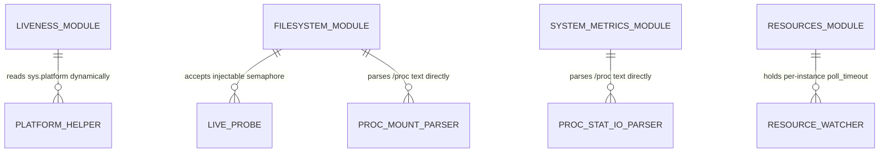

# IPD: Platform capture tests and testable seams for hardware, filesystem, metrics, resources, and liveness

- Date: 2026-11-23
- Kind: child
- Concern: Testing rigor and completeness (backward-compatible testable seams, removal of Linux silent skips in `test_liveness.py`, and cross-platform unit tests for `hardware.py`, `filesystem.py`, `system_metrics.py`, `resources.py`, and `liveness.py`).
- Scope: `src/pubrun/capture/liveness.py`, `src/pubrun/capture/filesystem.py`, `src/pubrun/capture/system_metrics.py`, `src/pubrun/capture/resources.py`, `tests/test_hardware.py`, `tests/test_liveness.py`, and new `tests/test_platform_capture_seams.py`.
- Scope-Paths: src/pubrun/capture/liveness.py, src/pubrun/capture/filesystem.py, src/pubrun/capture/system_metrics.py, src/pubrun/capture/resources.py, tests/test_hardware.py, tests/test_liveness.py, tests/test_platform_capture_seams.py
- Item-Dependencies: none
- Status: to-review
- Short-Description: Add dynamic platform/proc/semaphore seams and cross-platform unit tests for hardware, filesystem, system_metrics, resources, and liveness
- Work-Kind: chore
- Priority: medium
- Set: test-audit
- Order: 6
- Highest E allocated: 05
- Author: Antigravity
- Id: 7y0gmc

> Write and proofread this plan per the technical writing standard, `.aw/system/workflows/technical-writing/technical-writing.md` (`.agents/workflows/technical-writing/technical-writing.md` in a legacy-layout install), including requirement 12 (diagrams).

## Workflow history

- 2026-11-23 to-review (Antigravity): authored from `/assess-testing` findings T-08 (`test_liveness.py`) and T-13.
- 2026-11-23 draft (Antigravity): created.

## Goal

Introduce minimal, backward-compatible testable seams in platform capture modules (`liveness.py`, `filesystem.py`, `system_metrics.py`, `resources.py`), eliminate silent Linux skips in `tests/test_liveness.py`, and add cross-platform mocked unit tests so macOS, Windows, NVIDIA, and `/proc` edge branches are verified on every CI runner.

### Testable seams across platform capture modules

## Detailed Implementation Checklist (TODO)

Execution-state rule: mark an `E-*` item complete only after performing the action. That mark is not validation. Right-sizing rule: each E-item addresses one concern executable in one focused pass. Accepted execution states: blocked, failed, pending, performed; terminal gate demands 'performed'.

### Task group 1: Minimal backward-compatible testable seams

- [ ] E-01 Refactor `src/pubrun/capture/liveness.py` to dispatch on dynamic `sys.platform` (retaining `_PLATFORM` compatibility if existing tests patch it), and update `src/pubrun/capture/filesystem.py` (`LiveProbe.__init__` optional `semaphore` parameter defaulting to `_live_probe_sem`; pure text parsers for `_parse_proc_mounts`/`_parse_proc_mountinfo`), `src/pubrun/capture/system_metrics.py` (optional path or pure text parsers for `get_system_memory`, `read_proc_stat_cpu_times`, `get_proc_io`), and `src/pubrun/capture/resources.py` (per-instance `poll_timeout` on `ResourceWatcher` passed to `_get_rss_darwin`/`_get_rss_windows`/`_get_tree_rss_darwin`, cleaning the redundant `min_available` condition in `_sample_system_metrics`).
  - Depends on: none
  - Expected outcome: All existing public signatures and defaults remain unchanged while every platform branch and `/proc` parser can be unit-tested cleanly without global state leaks or `builtins.open` patching.
  - Execution state: pending

### Task group 2: Hardware and liveness tests + silent-skip removal

- [ ] E-02 Expand `tests/test_hardware.py` to test `nvidia-smi` CSV parsing (single/multi-GPU, MiB-to-bytes conversion, `[N/A]` memory/clock fields, `capture_gpu_clock_speed=True` and `False`), Windows `wmic` CPU/RAM parsing, `depth="off"` suppression, `get_hardware` top-level exception -> `capture_state.status == "failed"`, and strengthen `test_hardware_poller_does_not_crash` to assert concrete `capture_state["status"]` and value types.
  - Depends on: none
  - Expected outcome: `hardware.py` NVIDIA, Windows, and error paths are verified deterministically across all OSes.
  - Execution state: pending

- [ ] E-03 Harden `tests/test_liveness.py`: (a) fail hard on Linux (`sys.platform.startswith("linux")`) instead of calling `pytest.skip` when `/proc`-backed `get_process_start_time`, `get_process_rss_bytes`, `get_process_cpu_seconds`, or cmdline parsing returns `None`; (b) replace the no-op `pass` in `TestIsPidAlive.test_pid_zero_is_not_alive` with an unconditional `assert is_pid_alive(0) is False`; and (c) add mocked cross-platform unit tests covering `is_pid_alive` `PermissionError` -> `True` and `ProcessLookupError` -> `False`, `/proc/<pid>/stat` with spaces/parentheses in `comm` and missing `btime`, macOS `ps` helpers, and Windows `> 0xFFFFFFFF` guard, `STILL_ACTIVE`, `FILETIME` conversion, and `wmic` helpers.
  - Depends on: E-01
  - Expected outcome: Linux liveness regressions cannot silently skip, and macOS/Windows/HPC-`PermissionError` liveness branches are unit-tested on every platform.
  - Execution state: pending

### Task group 3: Filesystem, system_metrics, and resources cross-platform unit tests

- [ ] E-04 Create `tests/test_platform_capture_seams.py` covering `filesystem.py` (`_mac_mount_table` normal, spaces in mount path, malformed lines, timeout; `_classify_windows` `DRIVE_REMOTE`, `GetVolumePathNameW` failure, `"unknown"` fallback, per-path isolation; `LiveProbe` injected-semaphore cap reached -> `"skipped"` and `_statvfs_metrics` `OSError` -> `"error"` with semaphore release) and `system_metrics.py` (`read_proc_stat_cpu_times` valid, `< 5` fields, non-`cpu` line, non-Linux, read error; `get_proc_io` malformed values, empty output -> `None`, non-Linux, `OSError`).
  - Depends on: E-01
  - Expected outcome: All previously uncovered `filesystem.py` and `system_metrics.py` branches execute deterministically on every OS.
  - Execution state: pending

- [ ] E-05 Add deterministic multi-sample unit tests in `tests/test_platform_capture_seams.py` for `ResourceWatcher._sample_system_metrics()` + `to_manifest_dict()` asserting exact `system_memory.min_available`, `load_average.max_1min`, `system_iowait_pct.max`/`last`, and `io_counters.delta` arithmetic, plus mocked unit tests for `_get_rss_windows` (ctypes primary + `wmic` fallback), `_get_rss_darwin`, and `set_poll_timeout` invalid-value fallback.
  - Depends on: E-01
  - Expected outcome: Resource system-metric aggregation math and Windows/macOS RSS fallbacks are verified deterministically.
  - Execution state: pending

## Project conventions discovered (Step 0)

- Measured coverage baseline: `liveness.py` is `54%`, `filesystem.py` is `65%`, `resources.py` is `76%`, `hardware.py` is `78%`, and `system_metrics.py` is `78%` (the five lowest-covered capture modules).
- `tests/test_liveness.py` currently has 13 `pytest.skip` calls that silently mask `None` returns even on Linux where `/proc` is guaranteed.
- Placing new `filesystem`/`system_metrics`/`resources` unit tests in `tests/test_platform_capture_seams.py` keeps `Scope-Paths` strictly disjoint from `m66tfv` (`tests/test_env_capture.py`, `tests/test_resources.py`).

## Findings

| ID | Severity | Remediation Risk | Persona | Evidence | Finding |
|---|---|---|---|---|---|
| T-08 (part) | High | Low | Testing expert / QA engineer | `tests/test_liveness.py` (13 unconditional `pytest.skip` sites + no-op `pass`) | Linux `/proc` liveness regressions silently skip instead of failing. |
| T-13 | Medium | Low | Software engineer / Testing expert | `src/pubrun/capture/hardware.py`, `filesystem.py`, `system_metrics.py`, `resources.py`, `liveness.py` | Cross-platform branches (`nvidia-smi`, Windows/macOS classifiers, `PermissionError` alive semantics, `/proc` edge cases, system-metric aggregation math) are untested, hindered by import-time `_PLATFORM`, hardcoded `/proc` opens, and uninjectable globals. |

## Proposed changes (ordered, validatable)

1. Add minimal backward-compatible testable seams in `liveness.py`, `filesystem.py`, `system_metrics.py`, and `resources.py` (Remediation Risk: Low).
2. Expand `tests/test_hardware.py` for NVIDIA, Windows `wmic`, `depth="off"`, and error paths (Remediation Risk: Low).
3. Harden Linux skips and add cross-platform mocked tests in `tests/test_liveness.py` (Remediation Risk: Low).
4. Add `tests/test_platform_capture_seams.py` covering `filesystem.py`, `system_metrics.py`, and `resources.py` (Remediation Risk: Low).

## Deferred / out of scope (with reason)

None.

## Scope check

- Over-scope: none.
- Under-scope: none.

## Required tests / validation

- Run `pytest tests/test_hardware.py tests/test_liveness.py tests/test_platform_capture_seams.py tests/test_env_capture.py tests/test_resources.py tests/test_capture_engine_bugs.py -v`.
- Verify zero skipped tests on Linux in `tests/test_liveness.py`.
- Run `python3 scripts/sanitize_paths.py --check --all`.

## Spec / documentation sync

N/A with reason: internal backward-compatible seams and unit tests do not alter public APIs or manifest schemas.

## Open questions

None.

## Validation and cross-check (verify before reporting done)

Validation-state rule: inspect evidence in a separate pass. Do not mark a `V-*` item complete from memory or from the matching execution checkmark. Accepted validation results: blocked, failed, pass, pending; terminal gate demands 'pass'.

- [ ] V-01 validates E-01
  - Required evidence: Pasted diff of `liveness.py`, `filesystem.py`, `system_metrics.py`, and `resources.py` confirming backward-compatible defaults and pasted output of `pytest tests/test_env_capture.py tests/test_resources.py tests/test_capture_engine_bugs.py -v` passing.
  - Observed evidence:
  - Result: pending

- [ ] V-02 validates E-02
  - Required evidence: Pasted output of `pytest tests/test_hardware.py -v` showing NVIDIA, Windows `wmic`, `depth="off"`, and exception tests passing.
  - Observed evidence:
  - Result: pending

- [ ] V-03 validates E-03
  - Required evidence: Pasted output of `pytest tests/test_liveness.py -v` showing 0 skipped tests on Linux and all `PermissionError` and cross-platform mocked tests passing.
  - Observed evidence:
  - Result: pending

- [ ] V-04 validates E-04
  - Required evidence: Pasted output of `pytest tests/test_platform_capture_seams.py -k "filesystem or proc or probe" -v` showing all `filesystem.py` and `system_metrics.py` tests passing.
  - Observed evidence:
  - Result: pending

- [ ] V-05 validates E-05
  - Required evidence: Pasted output of `pytest tests/test_platform_capture_seams.py -k "resource or rss or timeout" -v` showing system-metric aggregation math and RSS fallback tests passing, plus `python3 scripts/sanitize_paths.py --check --all` exit 0.
  - Observed evidence:
  - Result: pending

## Approval and execution gate

- Size assessment: standard
- Cohesion rationale: not required

This plan must be reviewed and explicitly approved by a human (`- Status: approved`) before execution. During execution, commit only the scoped files through `aw commit`, never push without explicit human instruction, and move this plan to `.aw/records/plans/executed/` only after all `E-*` items are `performed`, all `V-*` items are `pass`, and `aw ipd lint` reports `conforming`.
