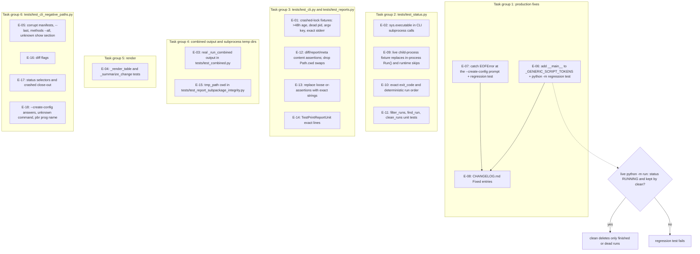

# IPD: CLI, status, diagnostics, and render negative paths and assertion hardening

- Date: 2026-11-23
- Kind: child
- Concern: Testing rigor and completeness (exact assertions in CLI, status, report, combined-output, and render tests; deterministic live-run and crashed-run fixtures; negative-path tests for corrupt manifests, invalid flags, and status selectors), plus two production defects the review found while removing the `test_status.py` silent skips: `pubrun clean -y` deletes a live `python -m <package>` run, and `pubrun --create-config` raises an uncaught `EOFError` when stdin is closed.
- Scope: `src/pubrun/capture/liveness.py`, `src/pubrun/__main__.py`, `CHANGELOG.md`, `tests/test_cli.py`, `tests/test_status.py`, `tests/test_reports.py`, `tests/test_render.py`, `tests/test_combined.py`, `tests/test_report_subpackage_integrity.py`, and new `tests/test_cli_negative_paths.py`.
- Scope-Paths: src/pubrun/capture/liveness.py, src/pubrun/__main__.py, CHANGELOG.md, tests/test_cli.py, tests/test_status.py, tests/test_reports.py, tests/test_render.py, tests/test_combined.py, tests/test_report_subpackage_integrity.py, tests/test_cli_negative_paths.py
- Item-Dependencies: none
- Status: reviewed
- Readiness: go-pending-approval
- Review-Depth: standard
- Short-Description: Keep live python -m runs from being cleaned, stop the --create-config EOF traceback, and replace weak CLI/status/report/render assertions and fixtures with exact, deterministic tests
- Work-Kind: bug
- Priority: high
- Set: test-audit
- Order: 7
- Highest E allocated: 18
- Author: Antigravity
- Id: ic6z4s

> Write and proofread this plan per the technical writing standard, `.aw/system/workflows/technical-writing/technical-writing.md` (`.agents/workflows/technical-writing/technical-writing.md` in a legacy-layout install), including requirement 12 (diagrams).

## Workflow history

- 2026-11-23 /plan-review (uri/its_direct/pt3-claude-opus-5.5-1m-us): APPROVE WITH REVISIONS APPLIED; PR-001..PR-020 fixed (PR-001 live `python -m` run cleaned: E-06; PR-004 `--create-config` EOF traceback: E-07); review record `.aw/records/reviews/20261123-test-audit-07-ic6z4s-cli-status-diagnostics-and-render-negative-paths-and-asserti.review.md`.
- 2026-11-23 to-review (Antigravity): authored from `/assess-testing` findings T-08 (`test_status.py`), T-14, and T-15.
- 2026-11-23 draft (Antigravity): created.

## Goal

Make the CLI, status, report, combined-output, and render tests fail when the behavior they cover breaks, and fix the two defects the review found while doing so.

Many of these tests check only that a command exits 0, or accept either of two strings with `or`, so a broken output still passes. Some depend on the calendar (a hard-coded 2026 timestamp), on a fixed process id (`99999`) being dead, or on the name of the test runner. Several paths have no test at all: corrupt `manifest.json` files, invalid `--last` durations, `methods --all` errors, `diff` and `status` flags, `--create-config` prompt answers, and the `--table` renderer.

Two tests in `tests/test_status.py`, `test_scan_running_run` and `test_clean_does_not_delete_running`, skip at run time when the current process is not classified as running. The review found that this skip hides a real defect:

1. pubrun records the script name in the run's lock file (`.pubrun.lock`) as the stem of `sys.argv[0]` (`src/pubrun/tracker.py`, `raw_script = Path(sys.argv[0]).stem`). For `python -m <package>`, `sys.argv[0]` is `<package>/__main__.py`, so the lock records `__main__`.
2. To decide whether a run is still alive, `src/pubrun/capture/liveness.py` `is_same_process` looks for the recorded script name in the process command line (`/proc/<pid>/cmdline` on Linux). The command line is `python3 -m <package>` and does not contain `__main__`, so the check reports a confirmed mismatch and the run is classified `crashed`.
3. `pubrun status` then closes out the live run as crashed (it writes `status.outcome: crashed` to `manifest.json` and removes the lock), and `pubrun clean -y` deletes its run directory. At review, `pubrun clean -y` against a live `python -m livepkg` child printed `Deleted 1 run(s).`, although `docs/cli.md` (`pubrun clean` section) states "Running processes are never deleted".

The same mechanism is why the two tests skip under `python3 -m pytest` (the in-process script name is `__main__`) and pass under `pytest` (the script name is `pytest`).

The fix adds `__main__` to `_GENERIC_SCRIPT_TOKENS`, the set of names too generic to confirm or refute a match. A generic name makes the command-line check inconclusive, and `is_same_process` then decides from the process start time, as it already does for `python` and `-m`. The second defect is smaller: `pubrun --create-config` with no destination asks a question with `input()` and catches only `KeyboardInterrupt`, so closed stdin (end of file) ends the command with an `EOFError` traceback.

### Work plan

## Detailed Implementation Checklist (TODO)

Execution-state rule: mark an `E-*` item complete only after performing the action. That mark is not validation. Right-sizing rule: each E-item addresses one concern executable in one focused pass. Accepted execution states: blocked, failed, pending, performed; terminal gate demands 'performed'.

### Task group 1: Production fixes

- [ ] E-06 In `src/pubrun/capture/liveness.py`, add `"__main__"` to the `_GENERIC_SCRIPT_TOKENS` frozenset, and in `tests/test_status.py` add `test_python_dash_m_package_run_is_running_and_not_cleaned`, marked `@pytest.mark.skipif(sys.platform == "win32", reason="uses POSIX-style child control via stdin")` like `TestConcurrentLiveRuns` (line 910). The test writes a package `tmp_path / "pkgroot" / "livepkg"` with an empty `__init__.py` and a `__main__.py` that runs `import sys; import pubrun.noauto as p; p.start(); print("READY", flush=True); sys.stdin.readline(); p.stop()`. It starts `subprocess.Popen([sys.executable, "-m", "livepkg"], cwd=str(tmp_path), env=<os.environ with tmp_path/"pkgroot" prepended to PYTHONPATH>, stdin=PIPE, stdout=PIPE, text=True)`, asserts the first stdout line is `READY`, then asserts `[(r.script, r.status) for r in scan_runs(str(tmp_path / "runs"))] == [("__main__", STATUS_RUNNING)]`, `clean_runs(output_dir=str(tmp_path / "runs"), yes=True) == 0`, and that the run directory still exists. In a `finally` block it writes a newline to the child's stdin and waits with `timeout=30`. Put the test in `tests/test_status.py`, not `tests/test_liveness.py`, which sibling `7y0gmc` owns.
  - Depends on: none
  - Expected outcome: The new test passes under both `python3 -m pytest` and `pytest`. With the `liveness.py` line reverted it fails (measured at review: the run scanned as `crashed`). `tests/test_liveness.py` and `tests/test_status_bugs.py` still pass. Because `_script_is_generic` is shared by `_check_command_linux`, `_check_command_macos`, and `_check_command_windows`, the fix applies on every platform. A `python -m pkg.module` run records `module`, which already gave an inconclusive result at review (`_match_script_in_tokens("worker", ["python3", "-m", "livepkg.worker"])` returned `None`), so only the package form was affected.
  - Execution state: pending

- [ ] E-07 In `src/pubrun/__main__.py`, at the `--create-config` destination prompt (`choice = input("Select an option [1/2] (Default: 1): ").strip()`), change `except KeyboardInterrupt:` to `except (KeyboardInterrupt, EOFError):`, the form the other `input()` prompts in this file already use. In `tests/test_cli.py` `TestCliCreateConfig`, add `test_create_config_prompt_eof_abandons`: run `subprocess.run([sys.executable, "-m", "pubrun", "--create-config"], cwd=str(tmp_path), stdin=subprocess.DEVNULL, capture_output=True, text=True, timeout=30)` and assert exit code 1, `"Configuration abandoned." in stderr`, `"Traceback" not in stderr`, and that `tmp_path / ".pubrun.toml"` does not exist. Pass `stdin=subprocess.DEVNULL` explicitly: `run_pubrun` inherits the terminal, and an interactive run would hang on the prompt.
  - Depends on: none
  - Expected outcome: The new test passes. With the old `except KeyboardInterrupt:` line it fails (measured at review: exit 1 with an `EOFError` traceback in stderr).
  - Execution state: pending

- [ ] E-08 In `CHANGELOG.md` `## [Unreleased]`, under the existing `### Fixed` subsection, add two entries: (1) `pubrun clean` no longer deletes, and `pubrun status` no longer closes out as crashed, a run that is still executing when it was started with `python -m <package>`; the lock file records the script as `__main__`, which the liveness check now treats as too generic to decide by name and resolves by process start time. (2) `pubrun --create-config` with no destination now prints `Configuration abandoned.` and exits 1 when stdin is closed, instead of printing an `EOFError` traceback. Follow the `AGENTS.md` dash rule: no em or en dashes in this prose.
  - Depends on: none
  - Expected outcome: `git diff CHANGELOG.md` shows only the two new entries under `## [Unreleased]` `### Fixed`.
  - Execution state: pending

### Task group 2: `tests/test_status.py`

- [ ] E-02 In `tests/test_status.py`, replace `"python"` with `sys.executable` in the four `subprocess.run(["python", "-m", "pubrun", ...])` calls in `TestStatusCli` and `TestCleanCli` (lines 478, 488, 683, 696). Add no `PYTHONPATH` handling: the session fixture `tests/conftest.py` `_subprocess_pythonpath` (lines 15-34) already prepends this checkout's `src` to `PYTHONPATH` for the whole session (plan `4cy3ft`, executed).
  - Depends on: none
  - Expected outcome: `grep -n '"python", "-m"' tests/test_status.py` finds no match, and the tests run the interpreter pytest runs under rather than whichever `python` is first on `PATH`.
  - Execution state: pending

- [ ] E-09 In `tests/test_status.py`, add a module-level fixture `live_child(tmp_path)` that writes `tmp_path / "livechild.py"` (the same five-line body as the E-06 package), starts it with `subprocess.Popen([sys.executable, str(script)], cwd=str(tmp_path), stdin=PIPE, stdout=PIPE, text=True)`, asserts the first stdout line is `READY`, yields `(child, str(tmp_path / "runs"))`, and on teardown writes a newline to stdin and waits with `timeout=30`. Rewrite `test_scan_running_run`, `test_clean_does_not_delete_running`, and `test_clean_running_filter_stripped` to use it, with the same `win32` `skipif` marker as E-06 and no `pytest.skip` call. `test_scan_running_run` asserts `[(r.script, r.status, r.pid) for r in scan_runs(od)] == [("livechild", STATUS_RUNNING, child.pid)]`; the current version asserts only `pid == os.getpid()`, so removing its skip alone would leave the status unchecked. `test_clean_does_not_delete_running` asserts `clean_runs(output_dir=od, yes=True) == 0` and that the run directory exists. `test_clean_running_filter_stripped` first asserts the scanned status is `STATUS_RUNNING`, then `clean_runs(output_dir=od, status_filter=["running", "completed"], yes=True) == 0` and that the directory exists.
  - Depends on: none
  - Expected outcome: The three tests pass with no skip under both `python3 -m pytest` and `pytest` on Linux. A child process is used because the current in-process `Run()` records the runner's own script name, so its classification depends on how pytest was started (at review: skipped under `python3 -m pytest`, passed under `pytest`). The CI `macos-latest` job already runs `TestConcurrentLiveRuns`, which asserts `STATUS_RUNNING` for child processes started the same way.
  - Execution state: pending

- [ ] E-10 In `tests/test_status.py`, (1) in `test_scan_broken_pipe_run`, replace `assert runs[0].exit_code is not None or runs[0].exit_code is None` with `assert runs[0].exit_code == 0` (the value the run records after `run.stop()`, measured at review); (2) in `test_clean_interactive_selection_and_confirm`, replace the three back-to-back `Run()` runs with three manifests written directly, `pubrun-old`, `pubrun-mid`, `pubrun-new`, with `timing.started_at_utc` `1000.0`, `2000.0`, `3000.0`, and assert that answering `1-2` then `y` returns `2` and leaves only `pubrun-old`.
  - Depends on: none
  - Expected outcome: `grep -n "exit_code is not None or" tests/test_status.py` finds no match, and the interactive test's result no longer depends on two runs created in the same clock tick sorting in creation order.
  - Execution state: pending

- [ ] E-11 In `tests/test_status.py`, add unit tests built on a helper that writes minimal manifests (`run.run_id`, `timing.started_at_utc`, `status.outcome`, `invocation.argv`, `signals.exit_code`) under `tmp_path / "runs"`:
  - `filter_runs`: with runs `aaaa1111` (argv `["train.py", "--tag", "TRAIN[x]"]`, exit 0) and `bbbb2222` (`["eval.py"]`, exit 3), `filter_str="train["` (an invalid regular expression, so the literal case-insensitive fallback applies) returns `["aaaa1111"]`, `not_filter_str="train["` returns `["bbbb2222"]`, `exit_code=3` returns `["bbbb2222"]`, and `exit_code=0` returns `["aaaa1111"]`.
  - `find_run`: with ids `abcd1111` (directory `pubrun-alpha`) and `abcd2222` (`pubrun-beta`), `find_run("abcd", od)` is `None` (ambiguous prefix), `find_run("lph", od).run_id == "abcd1111"` (directory-name substring), and `find_run("pubrun-", od)` is `None`. The existing `TestFindRun` tests at lines 378-390 cover integer-selector collisions, not these.
  - `clean_runs` interactive cancel, parametrized over the answers to `input()`, each leaving the run directory in place, returning `0`, and printing the message followed by a newline on stdout: `KeyboardInterrupt` and `EOFError` at selection print `\nCleanup cancelled.`; `n` and `none` print `Cleanup cancelled.`; `abc` and `9` print `No valid selections. Cleanup cancelled.`; `all` then `KeyboardInterrupt` or `EOFError` print `\nCleanup cancelled.`; `all` then `n` prints `Cleanup cancelled.`.
  - `clean_runs` removal failure: with `pubrun.status.shutil.rmtree` patched to raise `OSError("denied")` for `pubrun-a` only, `clean_runs(output_dir=od, yes=True) == 1`, stderr contains `  Failed to remove pubrun-a: denied`, stdout contains `Deleted 1 run(s).`, `pubrun-a` remains, and `pubrun-b` is gone.
  - Depends on: none
  - Expected outcome: All new tests pass. At review a prototype of these 13 tests passed, and each mutation listed in V-11 failed at least one of them.
  - Execution state: pending

### Task group 3: `tests/test_cli.py` and `tests/test_reports.py`

- [ ] E-01 In `tests/test_cli.py`, make the crashed-run lock fixtures deterministic and their assertions exact. Add `import time` to the module imports and a module-level helper `_dead_pid()` that starts `subprocess.Popen([sys.executable, "-c", "pass"])`, waits for it, and returns its pid. Then:
  - In `test_report_running_or_crashed_run` and `test_report_auto_detected_crashed_run_with_suggestion` (hostname `localhost`, pid `99999`), set `started_at_utc` to `time.time() - 3 * 86400`. pubrun cannot check a process on another host, and treats such a lock as crashed only when it is more than 48 hours old (`src/pubrun/status.py` `RunInfo._load_from_lock`, `if age > 172800:  # 48 hours`, about line 399), so the age must stay above 48 hours. Remove the now-redundant function-local `import time`.
  - In `test_report_crashed_run_tails_stderr` and `test_report_crashed_run_tails_stdout_fallback` (current host), replace pid `99999` with `_dead_pid()` and set `started_at_utc` to `time.time() - 60`.
  - In all four lock fixtures, replace the key `"args": ["--epochs", "10"]` with `"argv": ["train.py", "--epochs", "10"]`; the lock reader (`RunInfo` in `src/pubrun/status.py`) reads `argv`, and `args` is ignored.
  - In `test_status_filtering_options`, set `base = time.time() - 4 * 86400` and replace `1782000000.0`, `1782000100.0`, and `1782000200.0` with `base`, `base + 100`, and `base + 200`.
  - Pass `env={"NO_COLOR": "1"}` to the two `report` calls and replace `assert "crashed" in result.stderr or "running" in result.stderr` with exact lines: in the first test `[ERROR] Run directory 'pubrun-crashed' is currently crashed and does not contain a manifest.json.`, `  - Arguments: train.py --epochs 10`, and `Status: CRASHED`; in the second, `Status: CRASHED`.
  - Depends on: none
  - Expected outcome: `grep -c 1782000 tests/test_cli.py` and `grep -c '"args"' tests/test_cli.py` print `0`. At review the prototype of these edits passed `-k "crashed or filtering_options"` (8 tests) under both `python3 -m pytest` and `pytest`.
  - Execution state: pending

- [ ] E-12 In `tests/test_cli.py`, replace exit-code-only checks in `TestCliDiff`, `TestCliReport`, and `TestCliMeta` with content assertions, and remove the manual `Path.cwd = staticmethod(lambda: tmp_path)` swaps and their `try`/`finally` restores in the fixtures and tests at lines 317, 352, 381, 488, 543, 857, and 891. The autouse `isolated_cwd` fixture (`tests/conftest.py` `isolated_cwd`) already changes directory to `tmp_path` and patches `pathlib.Path.cwd`, so the swaps are redundant. Pass `cwd=str(tmp_path)` to every `run_pubrun` call these classes make. Assertions:
  - `TestCliDiff`: `--basic`, `--standard`, and `--deep` with `--no-color` give three different stdouts; with `env={"NO_COLOR": ""}` the default stdout contains `\x1b[` and the `--no-color` stdout does not; `--export json` writes `.pubrun_diff_A_<run A dir name>_clean.json` and `.pubrun_diff_B_<run B dir name>_clean.json` in `tmp_path`, each holding a JSON object; `--export txt` writes `.pubrun_diff_A_<name>_clean.txt` whose first line contains ` = `, and stdout contains `Successfully exported semantic baseline A to: .pubrun_diff_A_<name>_clean.txt`.
  - `TestCliReport` with `env={"NO_COLOR": "1"}`: the default report contains the run id from the run's `manifest.json`; `[ Packages ]` appears only with `--deep`; line counts satisfy basic < default < deep.
  - `TestCliMeta`: in `test_meta_default_creates_file`, assert `{"host", "python", "hardware"} <= set(data)` instead of the `or` chain; in `test_meta_basic_depth`, the written `runs/meta.json` has `set(data["packages"]) == {"capture_state"}`; in `test_meta_deep_depth`, `"records" in data["packages"]`.
  - Depends on: none
  - Expected outcome: `grep -c "Path.cwd = staticmethod" tests/test_cli.py` prints `0`. At review the prototype assertions (6 tests) passed, and failed when `_has_color` in `src/pubrun/analysis/render.py` always returned `False`.
  - Execution state: pending

- [ ] E-13 In `tests/test_cli.py`, replace these loose assertions with exact checks measured at review:
  - `test_info_prints_system_info` (line 107): `"pubrun Hardware Diagnostics" in result.stdout`.
  - `test_show_config_prints_toml` (line 119): `"[core]" in result.stdout.splitlines()`.
  - `test_no_args_prints_help` (line 682): `result.stdout.splitlines()[0].startswith("usage: pubrun ")`.
  - `test_diff_export_bad_format_exits_1` (line 768): `"Unsupported export format 'yaml'. Use 'txt' or 'json'." in result.stderr`.
  - `test_status_nonexistent_run_id_exits_1` (line 775): `"No run found matching 'zzzznonexistent'." in result.stderr`.
  - `test_subcommand_help_examples` (line 1202): the text after `Examples:` contains `  pubrun ` for each subcommand, except `tui` and `gui`, which are aliases of `ui` and print `  pubrun ui`.
  - `test_empty_invocation_shows_help_and_run_count` (line 1242): the first output line starts with `usage: pubrun `.
  - `test_dead_dispatch_aliases_error_cleanly` (line 1479): exit code `2` and `unknown command '<dead>'` in stderr, captured with `capsys`.
  - Depends on: none
  - Expected outcome: Each listed assertion names one exact string or value. At review the prototype of the last three passed, and failed when the `unknown command` wording in `_SubcommandAwareArgumentParser.error` changed.
  - Execution state: pending

- [ ] E-14 In `tests/test_reports.py` `TestPrintReportUnit`, call `monkeypatch.setenv("NO_COLOR", "1")` in each test (`print_report` colors its output otherwise) and replace the `or` assertions at lines 335, 343, and 351 with exact output lines from the `_make_manifest` fixture: `basic` contains `Status      : completed (0)` and `Elapsed (legacy wall-clock, includes capture) : 00:01:00 (60.0s)` and no line containing `Git Commit`; `standard` contains `Git Commit  : abcdef12 (unknown origin)` and `Packages    : 1 recorded` and no `[ Packages ]`; `deep` contains `[ Packages ]` and `torch==2.0.1`.
  - Depends on: none
  - Expected outcome: The three tests pass. At review a prototype failed when the commit was printed as 7 characters instead of 8.
  - Execution state: pending

### Task group 4: Combined output and subprocess temp directories

- [ ] E-03 In `tests/test_combined.py`, remove the three `patch("pubrun.__main__.open")` blocks whose `side_effect = Exception("Stop execution here")` stops `_run_combined` before it prints, in `test_combined_size_checks_force`, `test_combined_size_checks_warning_yes`, and `test_combined_size_checks_warning_prompt_accept`. Call `_run_combined` directly (the `Path.stat` size patch stays), add the `capsys` fixture to each test, and assert `capsys.readouterr().out.strip().splitlines() == ["[stdout] line", "[stderr] line"]`. The run files already exist: `create_mock_run` writes one `line` to each log.
  - Depends on: none
  - Expected outcome: `grep -n "Stop execution here" tests/test_combined.py` finds no match and the file passes (9 tests at review). With the stream prefix in `_run_combined` changed from `[{stream}] ` to `<{stream}> `, the revised file failed 6 tests at review; the current file passed all 9.
  - Execution state: pending

- [ ] E-15 In `tests/test_report_subpackage_integrity.py`, give `_run(code)` a `cwd` parameter passed to `subprocess.run`, add `tmp_path` to the three tests, pass `cwd=tmp_path`, and delete the `import os, tempfile` and `os.chdir(tempfile.mkdtemp())` lines from the two child code strings (about lines 61-62 and 111-112). The child processes then write under the test's own `tmp_path`, which pytest removes, instead of a new directory under the system temporary directory that nothing removes.
  - Depends on: none
  - Expected outcome: `grep -n mkdtemp tests/test_report_subpackage_integrity.py` finds no match and the file passes (13 tests). At review, with `TMPDIR` set to an empty directory and `--basetemp` outside it, the current file left 7 entries in that directory and the revised file left 0.
  - Execution state: pending

### Task group 5: Render

- [ ] E-04 In `tests/test_render.py`, add tests for `_summarize_change` and `_render_table` in `src/pubrun/analysis/render.py`, with these values measured at review:
  - `_render_table({"modified": {"pkgs": {"type": "list_diff", "added": ["a", "b"], "removed": ["c"], "order_changed": True}}}, use_color=False)` prints the line `~  pkgs   list [+2, -1, reordered]`.
  - `_summarize_change` truncation at `max_length`: `({"type": "path_split", "added": ["a"] * 3}, 5)` gives `PATH  ...`; `({"type": "list_diff", "added": ["a"] * 3}, 5)` gives `list  ...`; `({"type": "standard", "old": "abcdef", "new": "ghijkl"}, 10)` gives `abcdef  -> ...`; `({"type": "list_diff"}, 300)` gives `list changed`.
  - A 60-character key with value `"a\nb"` in `added` prints 4 lines, the last `+  ` + 47 `k` characters + `…  a b` (the key is cut with an ellipsis and the newline is flattened to a space).
  - With `use_color=True`, the header line is `\x1b[1m   Field  Change\x1b[0m`, and the output contains `\x1b[92m+\x1b[0m  y      \x1b[92m1\x1b[0m`, `\x1b[93m~\x1b[0m  x      \x1b[93m1  ->  2\x1b[0m`, and `\x1b[2m=\x1b[0m  w      \x1b[2m3\x1b[0m` for a report with `x` modified 1 to 2, `y` added as 1, `z` removed, and `w` the same at 3.
  - Depends on: none
  - Expected outcome: The new tests pass, and each `render.py` mutation listed in V-04 fails at least one of them.
  - Execution state: pending

### Task group 6: `tests/test_cli_negative_paths.py`

All tests in this new file run the CLI through `run_pubrun` (import it with `from test_cli import run_pubrun`; at review this import worked under both `python3 -m pytest` and `pytest`), pass `cwd=str(tmp_path)`, and pass `env={"NO_COLOR": "1", "PUBRUN_AUTO_START": "false"}`. A good manifest is `{"schema_version": "1.0", "manifest_type": "pubrun-manifest", "run": {"run_id": "aaaa1111"}, "status": {"outcome": "completed"}, "invocation": {"argv": ["train.py"]}, "timing": {"started_at_utc": 1000.0}}`. A corrupt manifest is the text `{bad`.

- [ ] E-05 Add diagnostics error-path tests:
  - Corrupt manifest, parametrized; each exits 1 with no `Traceback` in stderr: `show` and `res` print `is corrupt or contains invalid JSON.`; `diff <bad> <bad>` prints `Failed to generate diff report: `; `methods` prints `Failed to generate methods section: `; `rerun` prints `Failed to fetch rerun command: `; `inspect` prints `Failed to read manifest: `.
  - `res <run> --last bogus` and `--last ""` with two `resource_sample` events in `events.jsonl` exit 1 with `Invalid duration for --last: could not convert string to float: 'bogu'` and `Invalid duration for --last: duration string is empty`. The duration is parsed only when samples exist.
  - `res`, `cpu`, and `mem` with an empty `events.jsonl` exit 0 and print `No resource samples found in events.jsonl.`.
  - `methods --all <run_dir>` exits 1 with `do not also pass a specific run directory`; `methods --all` with one good and one corrupt run exits 0, prints `### Computational Methods`, and writes `1 matching run(s) had no readable manifest and were skipped.` to stderr; `methods --all -f nomatch` exits 1 with `No runs match the filter criteria.`; `methods --all` with only a corrupt run exits 1 with `No readable manifests among the matching runs.`.
  - `show <run> bogus_section` exits 0 and prints stdout byte-identical to `show <run>` (characterizes the OQ-01 behavior).
  - Depends on: none
  - Expected outcome: All tests pass (14 at review), and each mutation listed in V-05 fails at least one.
  - Execution state: pending

- [ ] E-16 Add `diff` flag tests on two manifests that differ in `python.version` (`3.11.1` vs `3.12.0`), `invocation.argv` (`--lr 0.1` vs `0.2`), and `hardware.cpu_model` (`Intel X` vs `AMD Y`):
  - Default inline output contains `~ [CHANGED] python.version:` followed by `    - 3.11.1` and `    + 3.12.0`, and no `--- Unchanged ---`.
  - `--table` rows, split on whitespace, include `["~", "python.version", "3.11.1", "->", "3.12.0"]` and `["~", "invocation.argv", "list", "[+1,", "-1]"]`; `--table --max-length 5` rows include `["~", "python.version", "3.11.", "..."]` and `["~", "invocation.argv", "list", "..."]`.
  - `--same` adds `--- Unchanged ---` and `= schema_version: 1.0`; `--no-same` does not.
  - `--max-length 3 --no-wrap` prints `    - Int ... [TRUNCATED]`; `--max-length 3` alone prints `    - Intel X`, because wrapping is on by default.
  - Bare `--export` prints `[ OK  ] Successfully exported semantic baseline A to: .pubrun_diff_A_pubrun-a_clean.txt`, and that file contains the line `python.version = 3.11.1`.
  - The count of lines containing `hardware.cpu_model` is 0 with `--basic`, 1 with `--standard`, and 1 by default.
  - Depends on: none
  - Expected outcome: All 6 tests pass, and the V-16 mutation fails at least one.
  - Execution state: pending

- [ ] E-17 Add `status` selector tests on manifests written under `tmp_path / "runs"`:
  - `status --dir <runs> --utc` with runs started at `1000.0` and `2000.0` prints `1970-01-01 00:16Z` and `1970-01-01 00:33Z`; `-v` prints the lines `  Run ID:    aaaa1111` and `  Run ID:    bbbb2222`, and the non-verbose output has no `  Run ID:`.
  - With run ids `2` (newest), `bbbb2222`, and `cccc3333`, `status 2` exits 1 with `'2' is ambiguous: it means both the 2th-most-recent run (id bbbb2222) AND run id '2'. Refusing to guess.` (the current wording, including `2th`).
  - `status zzzz` exits 1 with `No run found matching 'zzzz'.`.
  - A lock on the current host (`get_hostname()` from `pubrun.capture.liveness`) with a dead pid (spawn and wait on a child) and `started_at_utc = time.time() - 60`: `status deadbeef` exits 0 and prints the line `  Status:        crashed`; afterwards `manifest.json` has `status.outcome == "crashed"` and `.pubrun.lock` is gone. The list view `status --dir <runs>` closes out the same way.
  - Depends on: none
  - Expected outcome: All 5 tests pass, and the V-17 mutation fails at least one.
  - Execution state: pending

- [ ] E-18 Add in-process tests of the top-level CLI that call `pubrun.__main__.main()` with `sys.argv` patched and `SystemExit` caught (the autouse `isolated_cwd` fixture makes `tmp_path` the working directory):
  - `--create-config` with `builtins.input` patched: answers `1` and `""` write `tmp_path / ".pubrun.toml"`; answer `2` with `XDG_CONFIG_HOME` and `APPDATA` both set to `tmp_path / "xdg"` writes `tmp_path / "xdg" / "pubrun" / "config.toml"` and no `.pubrun.toml`; answer `3` exits 1 with `Invalid selection.` in stderr and writes nothing; `KeyboardInterrupt` exits 1 with `Configuration abandoned.` in stderr.
  - `pubrun bogus` exits 2; stderr contains `unknown command 'bogus' (choose from: init, report-bug,`, and the parsed choice list contains `res` but neither `tui` nor `gui`.
  - `sys.argv = ["/x/pbr", "--help"]` exits 0 and stdout starts with `usage: pbr `.
  - Depends on: none
  - Expected outcome: All 7 tests pass, and each mutation listed in V-18 fails at least one.
  - Execution state: pending

## Project conventions discovered (Step 0)

- The session fixture `tests/conftest.py` `_subprocess_pythonpath` (lines 15-34) prepends this checkout's `src` to `PYTHONPATH` for the whole test session, so child processes import the local `pubrun` (plan `4cy3ft`, executed). No test in this plan needs its own `PYTHONPATH` handling.
- The autouse fixture `tests/conftest.py` `isolated_cwd` changes directory to `tmp_path` and patches `pathlib.Path.cwd` for every test.
- `tests/test_cli.py` `run_pubrun` is the canonical CLI helper: `[sys.executable, "-m", "pubrun", ...]`, an `env` overlay, and `timeout=30`.
- CI runs `pytest tests/ -v` (`.github/workflows/ci.yml:37`, `tox.ini:10`); `CONTRIBUTING.md:18` documents `python -m pytest`. These give a different `sys.argv[0]` inside the pytest process (`pytest` vs `__main__`), which is why every V-item runs both.
- `pyproject.toml` `addopts` adds coverage (`--cov=src ...`); targeted validation runs may pass `--no-cov`.
- `print_report`, `pubrun report`, and `pubrun status` color their output unless `NO_COLOR` is set or `--no-color` is passed; exact-string tests set `NO_COLOR=1`.
- A lock whose `hostname` is not the current host cannot be checked by process id, so `RunInfo` treats it as crashed only when it is more than 48 hours old (`src/pubrun/status.py` `RunInfo._load_from_lock`, `if age > 172800:  # 48 hours`, about line 399).
- Plan `6bgkyj` (executed) owns the `print_report` host line; E-14 does not assert on it.
- Sibling `7y0gmc` owns `tests/test_liveness.py`; this plan's liveness regression test is in `tests/test_status.py`. Sibling `gzc672` also edits `src/pubrun/__main__.py`, at other lines.
- Tests must use Python 3.8 syntax (`requires-python = ">=3.8"`).

## Findings

| ID | Severity | Remediation Risk | Persona | Evidence | Finding |
|---|---|---|---|---|---|
| T-08 (part) | High | Low | Testing expert / QA engineer | `tests/test_status.py:test_scan_running_run`, `test_clean_does_not_delete_running` | A runtime `pytest.skip` masks `STATUS_RUNNING` regressions on Linux. |
| T-14 | High | Low | QA engineer / Testing expert | `tests/test_cli.py:TestCliDiff`, `TestCliReport`, `TestCliMeta`; `tests/test_status.py`; `tests/test_reports.py`; `tests/test_combined.py`; `tests/test_report_subpackage_integrity.py` | Exit-0-only assertions, a tautological `exit_code` check, hardcoded `"python"` and `1782000000.0` epochs, the `"args"` lock key, leaked `/tmp` directories, and `open()` sentinel mocks. |
| T-15 | High | Low | QA engineer / Testing expert | `src/pubrun/__main__.py`; `src/pubrun/report/diagnostics.py`; `src/pubrun/status.py`; `src/pubrun/analysis/render.py` | Corrupt manifests, invalid `--last`, `methods --all` errors, CLI `diff`/`status`/`--create-config`/`pbr`/unknown-command paths, `status.py` regex/cancel/ambiguous paths, and `render.py` table/color branches lack tests. |
| PR-001 (review) | High | Low | QA engineer | `src/pubrun/capture/liveness.py` `_GENERIC_SCRIPT_TOKENS`; `src/pubrun/tracker.py` `raw_script = Path(sys.argv[0]).stem`; `docs/cli.md` "Running processes are never deleted" | A live `python -m <package>` run is classified `crashed`; `pubrun status` closes it out and `pubrun clean -y` deletes it. |
| PR-004 (review) | Medium | Low | QA engineer | `src/pubrun/__main__.py` `--create-config` prompt `except KeyboardInterrupt:` | `pubrun --create-config` with closed stdin ends with an `EOFError` traceback. |

## Proposed changes (ordered, validatable)

1. Treat `__main__` as a generic script name in the liveness check, with a `python -m` regression test (E-06; Remediation Risk: Low, because the change only makes the name check inconclusive, and `is_same_process` then uses the start-time check it already uses for `python` and `-m`).
2. Catch `EOFError` at the `--create-config` prompt, with a regression test (E-07; Remediation Risk: Low).
3. Record both fixes in `CHANGELOG.md` (E-08; Remediation Risk: Low).
4. Harden `tests/test_status.py`: interpreter, live child-process fixture, exact assertions, and new unit tests (E-02, E-09, E-10, E-11; Remediation Risk: Low).
5. Harden `tests/test_cli.py` and `tests/test_reports.py`: crashed-lock fixtures, diff/report/meta content, exact strings, and `print_report` lines (E-01, E-12, E-13, E-14; Remediation Risk: Low).
6. Assert real combined output and stop the subprocess temp-directory leak (E-03, E-15; Remediation Risk: Low).
7. Test the `--table` renderer and change summaries (E-04; Remediation Risk: Low).
8. Add `tests/test_cli_negative_paths.py` for diagnostics errors, `diff` flags, `status` selectors, and the top-level CLI (E-05, E-16, E-17, E-18; Remediation Risk: Low).

## Deferred / out of scope (with reason)

- Refactoring the monolithic `src/pubrun/__main__.py:main` and `diagnostics.py:print_*` functions (T-18): Remediation Risk **Medium-High** on **complexity** and **functionality**; deferred.
  - Carrier: riulkx
- The live-run tests (E-06, E-09) skip on Windows, as `TestConcurrentLiveRuns` already does, because they control the child through stdin. The `__main__` fix itself is platform-independent (`_script_is_generic` is shared by the Linux, macOS, and Windows command-line checks).
  - Carrier-Declined: the existing Windows liveness path (`wmic`) is covered by `7y0gmc`'s patched-subprocess tests; a Windows live-child test needs a different child-control mechanism and is not required for this fix.

## Scope check

- Over-scope: none.
- Under-scope: none after review. Review added the two production fixes (E-06, E-07) and their `CHANGELOG.md` entry (E-08), because removing the `test_status.py` skips exposed the first defect and testing every `--create-config` answer exposed the second. Review also added the loose-assertion fixes in `tests/test_cli.py` (E-13), which the original plan placed only in `tests/test_reports.py`.

## Required tests / validation

- Run both `python3 -m pytest <files> -v -rs --no-cov` and `pytest <files> -v -rs --no-cov` for `tests/test_cli.py tests/test_status.py tests/test_reports.py tests/test_render.py tests/test_combined.py tests/test_report_subpackage_integrity.py tests/test_cli_negative_paths.py tests/test_liveness.py tests/test_status_bugs.py`: 0 failures, and no `SKIPPED` line on Linux for `test_scan_running_run`, `test_clean_does_not_delete_running`, `test_clean_running_filter_stripped`, or `test_python_dash_m_package_run_is_running_and_not_cleaned`.
- The mutation checks named in each `V-*` item.
- `python3 scripts/sanitize_paths.py --check --all` exits 0.

## Spec / documentation sync

- `docs/cli.md` ("Running processes are never deleted, even if explicitly included in `--status`") and `docs/functional_spec.md` ("Running processes are never deleted regardless of filters.") already state the behavior E-06 restores; no change.
- `docs/cli.md` section for `--create-config [DEST]` documents the prompt and does not describe end of input; no change.
- `grep -rln "GENERIC_SCRIPT\|_script_is_generic\|create-config\|create_config" .aw/records/specs` found no spec at review; no spec change.
- `CHANGELOG.md` records both fixes (E-08).

## Open questions

### OQ-01: Behavior of `pubrun show <run> <unknown_section>`

- Blocking: no
- Status: resolved
- Owner: plan author
- Resolution or deferral rationale: Characterize the current behavior without changing it. At review, `pubrun show <run> bogus_section` exited 0 and printed stdout byte-identical to `pubrun show <run>`. E-05 adds a test that pins this, so a future change to reject unknown sections is a deliberate, visible edit.

## Validation and cross-check (verify before reporting done)

Validation-state rule: inspect evidence in a separate pass. Do not mark a `V-*` item complete from memory or from the matching execution checkmark. Accepted validation results: blocked, failed, pass, pending; terminal gate demands 'pass'.

Mutation-check procedure: copy the production file aside, apply the one-line change, run the named tests with `PYTHONDONTWRITEBYTECODE=1 python3 -m pytest <tests> -q --no-cov -p no:cacheprovider`, paste the summary line, restore the file from the copy, and confirm `git diff --stat` shows only this plan's intended edits.

- [ ] V-01 validates E-01
  - Required evidence: Pasted output of `grep -c 1782000 tests/test_cli.py` and `grep -c '"args"' tests/test_cli.py` (both `0`); pasted output of `python3 -m pytest tests/test_cli.py -k "crashed or filtering_options" -v --no-cov` and the same with `pytest`, each with 0 failures; and the mutation check: in `src/pubrun/__main__.py`, replace `print(f"  - Arguments: {run_info.args}", file=sys.stderr)` with `pass` (at least 1 failure).
  - Observed evidence:
  - Result: pending

- [ ] V-02 validates E-02
  - Required evidence: Pasted output of `grep -n '"python", "-m"' tests/test_status.py` with no match, and of `python3 -m pytest tests/test_status.py -k "StatusCli or CleanCli" -v --no-cov` with 0 failures.
  - Observed evidence:
  - Result: pending

- [ ] V-03 validates E-03
  - Required evidence: Pasted output of `grep -n "Stop execution here" tests/test_combined.py` with no match; pasted output of `python3 -m pytest tests/test_combined.py -v --no-cov` and the same with `pytest`, each with 0 failures; and the mutation check: in `src/pubrun/__main__.py` `_run_combined`, change `else f"[{stream}] "` to `else f"<{stream}> "` (at least 3 failures, including the three tests E-03 changed).
  - Observed evidence:
  - Result: pending

- [ ] V-04 validates E-04
  - Required evidence: Pasted output of `python3 -m pytest tests/test_render.py -v --no-cov` and the same with `pytest`, each with 0 failures; and four mutation checks in `src/pubrun/analysis/render.py`, each giving at least 1 failure: replace `k[: key_w - 1] + "\u2026"` with `k`; replace `detail = detail.replace("\n", " ")` with `pass`; replace `parts.append("reordered")` with `pass`; replace the `list_diff` cell expression with `cell = "list changed"`.
  - Observed evidence:
  - Result: pending

- [ ] V-05 validates E-05
  - Required evidence: Pasted output of `python3 -m pytest tests/test_cli_negative_paths.py -v --no-cov` and the same with `pytest`, each with 0 failures; and four mutation checks, each giving at least 1 failure: in `src/pubrun/report/diagnostics.py` `print_report`, delete the `except json.JSONDecodeError:` block that prints `is corrupt or contains invalid JSON.` (the first of two such blocks in the file; measured: 1 failure); in `print_resources_report`, delete the `sys.exit(1)` after `_print_error(f"Invalid duration for --last: {e}")` (measured: 2 failures); in `src/pubrun/__main__.py`, change `if skipped:` (before the `had no readable manifest` note) to `if False:`; replace the `No readable manifests among the matching runs.` error and its `sys.exit(1)` with `sys.exit(0)`.
  - Observed evidence:
  - Result: pending

- [ ] V-06 validates E-06
  - Required evidence: Pasted diff of `src/pubrun/capture/liveness.py` (one added `"__main__"` token); pasted output of `python3 -m pytest tests/test_status.py tests/test_liveness.py tests/test_status_bugs.py -v -rs --no-cov` and the same with `pytest`, each with 0 failures and no skip for `test_python_dash_m_package_run_is_running_and_not_cleaned`; and the same test run alone with the `liveness.py` change reverted (1 failure), file restored afterwards.
  - Observed evidence:
  - Result: pending

- [ ] V-07 validates E-07
  - Required evidence: Pasted diff of the `src/pubrun/__main__.py` prompt change; pasted output of `python3 -m pytest tests/test_cli.py -k create_config -v --no-cov` with 0 failures; and the same command with `except (KeyboardInterrupt, EOFError):` reverted to `except KeyboardInterrupt:` (at least 1 failure, `test_create_config_prompt_eof_abandons`), file restored afterwards.
  - Observed evidence:
  - Result: pending

- [ ] V-08 validates E-08
  - Required evidence: Pasted `git diff CHANGELOG.md` showing the two entries under `## [Unreleased]` `### Fixed`; pasted output of `git diff CHANGELOG.md | grep -nP "^\+.*[\x{2013}\x{2014}]"` with no match; and pasted output of `python3 scripts/sanitize_paths.py --check --all` exiting 0.
  - Observed evidence:
  - Result: pending

- [ ] V-09 validates E-09
  - Required evidence: Pasted output of `python3 -m pytest tests/test_status.py -k "running" -v -rs --no-cov` and the same with `pytest`, each showing `test_scan_running_run`, `test_clean_does_not_delete_running`, and `test_clean_running_filter_stripped` as `PASSED` with no `SKIPPED` line; pasted output of `grep -n "pytest.skip(\"PID liveness" tests/test_status.py` with no match; and the mutation check: in `src/pubrun/capture/liveness.py` `is_same_process`, replace the body after `if not is_pid_alive(pid): return False` with `return False` (at least 2 failures).
  - Observed evidence:
  - Result: pending

- [ ] V-10 validates E-10
  - Required evidence: Pasted output of `grep -n "exit_code is not None or" tests/test_status.py` with no match, and of `python3 -m pytest tests/test_status.py -k "broken_pipe or interactive_selection" -v --no-cov` and the same with `pytest`, each with 0 failures.
  - Observed evidence:
  - Result: pending

- [ ] V-11 validates E-11
  - Required evidence: Pasted output of `python3 -m pytest tests/test_status.py -v --no-cov` listing the new `filter_runs`, `find_run`, cancel, and removal-failure tests as `PASSED`; and three mutation checks in `src/pubrun/status.py`, each giving at least 1 failure: change `except OSError as e:` in `clean_runs` to `except FileNotFoundError as e:`; replace the first `except re.error:` branch body in `filter_runs` with `runs = []`; change `No valid selections. Cleanup cancelled.` to `Cleanup cancelled.`.
  - Observed evidence:
  - Result: pending

- [ ] V-12 validates E-12
  - Required evidence: Pasted output of `grep -c "Path.cwd = staticmethod" tests/test_cli.py` (`0`); pasted output of `python3 -m pytest tests/test_cli.py -k "TestCliDiff or TestCliReport or TestCliMeta" -v --no-cov` and the same with `pytest`, each with 0 failures; and the mutation check: in `src/pubrun/analysis/render.py` `_has_color`, replace `if no_color_flag: return False` with `return False` (at least 1 failure).
  - Observed evidence:
  - Result: pending

- [ ] V-13 validates E-13
  - Required evidence: Pasted diff of the eight changed assertions in `tests/test_cli.py`; pasted output of `python3 -m pytest tests/test_cli.py -v --no-cov` with 0 failures; and the mutation check: in `src/pubrun/__main__.py`, change `unknown command '{bad_cmd}'` to `bad command '{bad_cmd}'` (at least 1 failure in `tests/test_cli.py`).
  - Observed evidence:
  - Result: pending

- [ ] V-14 validates E-14
  - Required evidence: Pasted output of `python3 -m pytest tests/test_reports.py -k TestPrintReportUnit -v --no-cov` with 0 failures; and the mutation check: in `src/pubrun/report/diagnostics.py`, change `{commit[:8]} ({remote})` to `{commit[:7]} ({remote})` (at least 1 failure).
  - Observed evidence:
  - Result: pending

- [ ] V-15 validates E-15
  - Required evidence: Pasted output of `grep -n mkdtemp tests/test_report_subpackage_integrity.py` with no match; and pasted output of `TMPDIR=<empty dir> python3 -m pytest tests/test_report_subpackage_integrity.py -q --no-cov --basetemp=<dir outside TMPDIR>` (13 passed) followed by `ls -A <empty dir> | wc -l` printing `0`.
  - Observed evidence:
  - Result: pending

- [ ] V-16 validates E-16
  - Required evidence: Pasted output of `python3 -m pytest tests/test_cli_negative_paths.py -v --no-cov` listing the 6 `diff` flag tests as `PASSED`; and the mutation check: in `src/pubrun/analysis/render.py` `_fmt`, change `return s[:max_length] + " ... [TRUNCATED]"` to `return s[:max_length]` (at least 1 failure).
  - Observed evidence:
  - Result: pending

- [ ] V-17 validates E-17
  - Required evidence: Pasted output of `python3 -m pytest tests/test_cli_negative_paths.py -v --no-cov` listing the 5 `status` tests as `PASSED`; and the mutation check: in `src/pubrun/__main__.py` `_run_status`, delete the two lines that call `close_out_crashed_run(run_info.run_dir, run_info.lock_data)` before `print(render_inspect(run_info))` (at least 1 failure).
  - Observed evidence:
  - Result: pending

- [ ] V-18 validates E-18
  - Required evidence: Pasted output of `python3 -m pytest tests/test_cli_negative_paths.py -v --no-cov` listing the 7 top-level CLI tests as `PASSED`; and two mutation checks in `src/pubrun/__main__.py`, each giving at least 1 failure: change `elif choice in ["1", ""]:` to `elif choice in ["1"]:`; change `_known_aliases = {"tui", "gui"}` (which keeps aliases out of the `unknown command` choice list) to `_known_aliases = {"gui"}` (measured: 2 failures).
  - Observed evidence:
  - Result: pending

## Approval and execution gate

- Size assessment: exception
- Cohesion rationale: 18 E-items and 10 Scope-Paths exceed the 5 and 8 guidance (`IPD-Z603` advisories). Each E-item is one focused edit, and the plan has one subject: the CLI and status tests named by findings T-08 (part), T-14, and T-15, which the orchestrator `vdxiw8` assigns to this plan as one row (Order 07). The two production fixes and the `CHANGELOG.md` entry are included because the hardened `test_status.py` tests cannot pass under `python3 -m pytest` without E-06, and E-18's prompt tests exposed E-07. Splitting would add new Set members and change the orchestrator's child table, which this plan cannot do.

Execution contract:
1. Precondition: wait for human approval (`- Status: approved`) with no unresolved `Blocking: yes` open question before you change any file. This plan has no blocking open question.
2. Scope declaration: the expected modified files are the `- Scope-Paths:` entries (`src/pubrun/capture/liveness.py`, `src/pubrun/__main__.py`, `CHANGELOG.md`, `tests/test_cli.py`, `tests/test_status.py`, `tests/test_reports.py`, `tests/test_render.py`, `tests/test_combined.py`, `tests/test_report_subpackage_integrity.py`, `tests/test_cli_negative_paths.py`). If execution requires an out-of-scope file, justify it with `--scope-reason` at finalization. If a declared file needs no edit, acknowledge it with `--scope-ack`. The mutation checks edit `src/pubrun/capture/liveness.py`, `src/pubrun/__main__.py`, `src/pubrun/status.py`, `src/pubrun/analysis/render.py`, and `src/pubrun/report/diagnostics.py` only temporarily; restore them and do not commit the mutations.
3. Validation honesty: you MUST run each required validation command and paste its actual output into the matching `V-*` `Observed evidence:` field. Do not mark a `V-*` item `pass` without output captured from that run.
4. Commit discipline: commit only the paths you changed with `aw commit ic6z4s -- <paths>`. Do not use `git add -A` or raw `git commit`. Do not push without an explicit human instruction.
5. Lifecycle transition: finalize this plan with `aw ipd finalize ic6z4s`, never with a hand-written `git mv` to `.aw/records/plans/executed/`. Inside a runner lane (`aw oc run` or `aw agy run`), the runner finalizes after the turn. Outside a runner, the executor runs `aw ipd finalize ic6z4s` after every `E-*` item is `performed`, every `V-*` item is `pass`, and `aw ipd lint --phase pre-transition` reports `conforming`.
