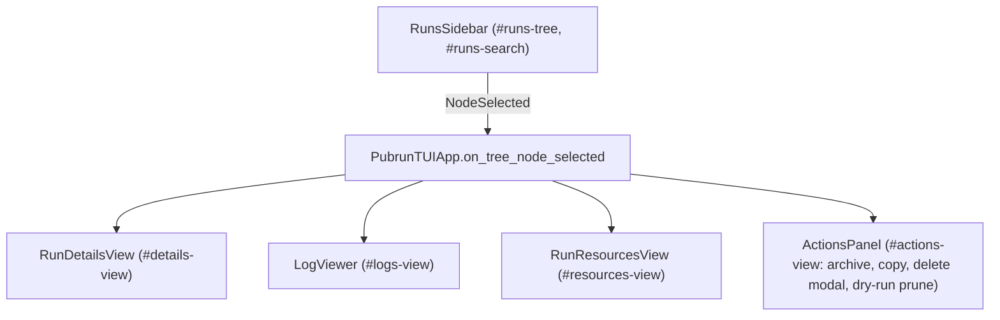

# IPD: TUI interactive wiring and widget failure-path tests

- Date: 2026-11-23
- Kind: child
- Concern: Testing rigor and completeness (TUI end-to-end sidebar-to-workspace wiring, interactive flows, error/degraded states across all 8 TUI modules, and defensive guard for `git.remote_url = None` in `details.py`).
- Scope: `src/pubrun/tui/widgets/details.py` and new `tests/test_tui_widgets.py`.
- Scope-Paths: src/pubrun/tui/widgets/details.py, tests/test_tui_widgets.py
- Item-Dependencies: none
- Status: to-review
- Short-Description: Add Textual Pilot tests for sidebar-to-workspace wiring, ActionsPanel archive/copy/delete/prune, and all TUI widget error states
- Work-Kind: chore
- Priority: high
- Set: test-audit
- Order: 8
- Highest E allocated: 05
- Author: Antigravity
- Id: bwoyan

> Write and proofread this plan per the technical writing standard, `.aw/system/workflows/technical-writing/technical-writing.md` (`.agents/workflows/technical-writing/technical-writing.md` in a legacy-layout install), including requirement 12 (diagrams).

## Workflow history

- 2026-11-23 to-review (Antigravity): authored from `/assess-testing` findings T-16 and T-17.
- 2026-11-23 draft (Antigravity): created.

## Goal

Close the TUI verification gap (where `actions.py` is at 67% coverage and `PubrunTUIApp.on_tree_node_selected` has zero tests) by adding Textual Pilot integration and negative-path tests across all TUI widgets and guarding `git.remote_url = None` in `RunDetailsView`.

### TUI interactive wiring tested

## Detailed Implementation Checklist (TODO)

Execution-state rule: mark an `E-*` item complete only after performing the action. That mark is not validation. Right-sizing rule: each E-item addresses one concern executable in one focused pass. Accepted execution states: blocked, failed, pending, performed; terminal gate demands 'performed'.

### Task group 1: Guard malformed `git.remote_url` in `RunDetailsView`

- [ ] E-01 Guard non-dict `git.remote_url` values (such as `None` or a string) in `src/pubrun/tui/widgets/details.py:RunDetailsView.display_run` so malformed manifests do not raise `AttributeError` when rendering git metadata.
  - Depends on: none
  - Expected outcome: Rendering a manifest with `"git": {"remote_url": None}` or `"git": {"remote_url": "https://example.com/repo"}` succeeds without raising `AttributeError`.
  - Execution state: pending

### Task group 2: App wiring and `RunsSidebar` Pilot tests

- [ ] E-02 Create `tests/test_tui_widgets.py` with Textual Pilot tests (compatible with both Textual 0.x on Python 3.8 and Textual 8.x on Python 3.9+, using `_SELECT_EMPTY_VALUE` where `Select` empty state is checked) covering `PubrunTUIApp.on_tree_node_selected` (selecting a real run node in `#runs-tree` and asserting `#details-view`, `#logs-view`, `#resources-view`, and `#actions-view` all update), `PubrunTUIApp.action_toggle_sidebar`, and `RunsSidebar` (`on_input_changed` filtering by run ID and script name, empty match `"No runs found"`, and `scan_runs` exception `"Scan failed: ..."`).
  - Depends on: none
  - Expected outcome: Full tree-selection dispatch and sidebar search/error handling are verified end-to-end.
  - Execution state: pending

### Task group 3: `ActionsPanel` interactive, archive, clipboard, and modal tests

- [ ] E-03 Add tests in `tests/test_tui_widgets.py` for `ActionsPanel`: (a) `archive_selected_run` creating a valid ZIP archive, with and without `check-delete-raw` deleting the raw run dir and posting `RefreshSidebar`, plus missing `run_dir` and archive-failure notification; (b) `btn-copy-md`, `btn-copy-latex`, clipboard-failure notifications, and no-run-selected guard; (c) `ConfirmDeleteModal` interactive typing (`"no"` keeps `#btn-confirm-del` disabled, `"yes"` enables it, Cancel dismisses `False`, and `shutil.rmtree` error path); (d) `run_bulk_prune(dry_run=True)` verifying non-deletion and no `RefreshSidebar` post; and (e) pure-Python unit tests for `copy_to_clipboard` across `darwin` (`pbcopy`), `win32` (`clip`), and Linux (`xclip` -> `xsel` fallback and failure returning `False`).
  - Depends on: E-02
  - Expected outcome: All interactive and failure paths of `src/pubrun/tui/widgets/actions.py` are verified.
  - Execution state: pending

### Task group 4: `DiffView`, `LogViewer`, `ConfigPanel`, `RunDetailsView`, and `RunResourcesView` tests

- [ ] E-04 Add Pilot tests in `tests/test_tui_widgets.py` for `DiffView` (same-run guard, missing manifest A/B, corrupt JSON error, `btn-execute-diff` and `btn-clear-diff`, `render_diff_report` branches for `added`/`removed`/`path_split`/`same`/`#check-show-same`/identical `"No differences detected"`, and `populate_dropdowns` preserving prior selection) and `LogViewer` (missing `run_dir`, directory with no logs, switching files via `on_select_changed`, `btn-toggle-wrap` toggling `RichLog.wrap`, and unreadable/missing log file).
  - Depends on: E-02
  - Expected outcome: All interactive and error states of `DiffView` and `LogViewer` are verified.
  - Execution state: pending

- [ ] E-05 Add Pilot and unit tests in `tests/test_tui_widgets.py` for `ConfigPanel` (`btn-reset-config`, write-error notification, and `dict_to_toml` escaping/lists/floats/booleans/empty nested dicts), `RunDetailsView` (degraded run with neither manifest nor lock, `refresh_live_metrics`, `assess_run` exception fallback, and malformed `git.remote_url = None` / string), and `RunResourcesView` (corrupt `events.jsonl` / `read_resource_series` exception fallback).
  - Depends on: E-01, E-02
  - Expected outcome: All remaining TUI widget failure and edge branches pass on Python 3.8 through 3.14.
  - Execution state: pending

## Project conventions discovered (Step 0)

- Measured coverage baseline: `src/pubrun/tui/widgets/actions.py` is `67%`, `viewer.py` `81%`, `diff.py` `83%`, `app.py` `84%`, `sidebar.py` `84%`, `details.py` `85%`.
- Python 3.8 runs Textual 0.x (`Select.BLANK`) while Python 3.9+ runs Textual 8.x (`Select.NULL`); tests must import `_SELECT_EMPTY_VALUE` from `pubrun.tui.widgets.config` (established in commit `c3734e7`) and guard `pytest.importorskip("textual")` at module top so non-TUI installs skip cleanly.
- Pending approved plans `whacr3` (`tests/test_tui.py`), `46fixy` (`details.py` OS line), and open backlog `0mnekm` (`details.py` CPU line) are excluded from duplication; putting all new widget tests in `tests/test_tui_widgets.py` keeps test-file scope completely disjoint from `tests/test_tui.py` and `tests/test_tui_bugs.py`.

## Findings

| ID | Severity | Remediation Risk | Persona | Evidence | Finding |
|---|---|---|---|---|---|
| T-16 | High | Low | QA engineer / UX reviewer | `src/pubrun/tui/widgets/actions.py` (67% coverage); `src/pubrun/tui/app.py:on_tree_node_selected`; `src/pubrun/tui/widgets/sidebar.py` | Archive, clipboard, MD/LaTeX copy, modal typing/cancel, dry-run prune, 4-pane tree-selection wiring, toggle sidebar, and sidebar search/errors have zero tests. |
| T-17 | Medium | Low | QA engineer / UX reviewer | `src/pubrun/tui/widgets/diff.py`, `viewer.py`, `config.py`, `details.py`, `resources.py` | Error and interactive states across five widgets are untested, and `details.py` raises `AttributeError` when `git.remote_url` is `None`. |

## Proposed changes (ordered, validatable)

1. Guard non-dict `git.remote_url` in `src/pubrun/tui/widgets/details.py` (Remediation Risk: Low).
2. Add Textual Pilot tests in `tests/test_tui_widgets.py` for app wiring, `RunsSidebar`, `ActionsPanel`, `DiffView`, `LogViewer`, `ConfigPanel`, `RunDetailsView`, and `RunResourcesView` (Remediation Risk: Low).

## Deferred / out of scope (with reason)

- Optional injectable seams for `ConfigPanel.save_settings` and `ActionsPanel.run_bulk_prune` stdout capture: deferred alongside CLI/diagnostics testable seams because Pilot tests cover the real widgets directly.
  - Carrier: riulkx

## Scope check

- Over-scope: none.
- Under-scope: none.

## Required tests / validation

- Run `pytest tests/test_tui_widgets.py tests/test_tui.py tests/test_tui_bugs.py -v`.
- Run `python3 scripts/sanitize_paths.py --check --all`.

## Spec / documentation sync

N/A with reason: defensive `None` guard and TUI tests do not alter documented user-facing behavior.

## Open questions

None.

## Validation and cross-check (verify before reporting done)

Validation-state rule: inspect evidence in a separate pass. Do not mark a `V-*` item complete from memory or from the matching execution checkmark. Accepted validation results: blocked, failed, pass, pending; terminal gate demands 'pass'.

- [ ] V-01 validates E-01
  - Required evidence: Pasted diff of `src/pubrun/tui/widgets/details.py` and pasted pytest output for the malformed `git.remote_url` test case passing.
  - Observed evidence:
  - Result: pending

- [ ] V-02 validates E-02
  - Required evidence: Pasted output of `pytest tests/test_tui_widgets.py -k "sidebar or tree or toggle" -v` showing all app wiring and sidebar search/error tests passing.
  - Observed evidence:
  - Result: pending

- [ ] V-03 validates E-03
  - Required evidence: Pasted output of `pytest tests/test_tui_widgets.py -k "action or archive or clipboard or modal or prune" -v` showing all `ActionsPanel` and `copy_to_clipboard` tests passing.
  - Observed evidence:
  - Result: pending

- [ ] V-04 validates E-04
  - Required evidence: Pasted output of `pytest tests/test_tui_widgets.py -k "diff or viewer or log" -v` showing all `DiffView` and `LogViewer` tests passing.
  - Observed evidence:
  - Result: pending

- [ ] V-05 validates E-05
  - Required evidence: Pasted output of `pytest tests/test_tui_widgets.py tests/test_tui.py tests/test_tui_bugs.py -v` passing with 0 failures and `python3 scripts/sanitize_paths.py --check --all` exit 0.
  - Observed evidence:
  - Result: pending

## Approval and execution gate

- Size assessment: standard
- Cohesion rationale: not required

This plan must be reviewed and explicitly approved by a human (`- Status: approved`) before execution. During execution, commit only the scoped files through `aw commit`, never push without explicit human instruction, and move this plan to `.aw/records/plans/executed/` only after all `E-*` items are `performed`, all `V-*` items are `pass`, and `aw ipd lint` reports `conforming`.
