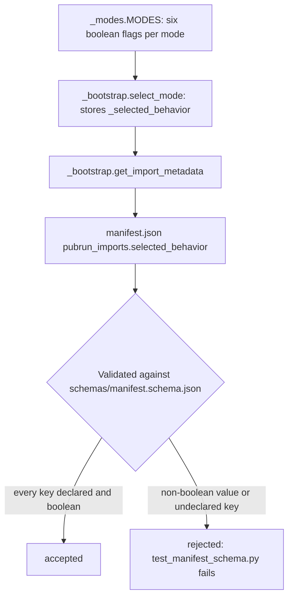

# IPD: Declare all selected_behavior keys in the manifest schema

- Date: 2026-11-24
- Kind: child
- Concern: The published manifest JSON Schema declares only two of the six import-mode behavior flags that pubrun writes to `pubrun_imports.selected_behavior`, so it does not type-check the other four and does not detect a new undeclared flag.
- Scope: In `schemas/manifest.schema.json`, declare `patch_subprocesses`, `patch_console`, `signal_hooks`, and `force_console` as booleans under `properties.pubrun_imports.properties.selected_behavior`, add a description, and close the object with `additionalProperties: false`. Add schema conformance tests for real manifests written under each of the six import modes, plus accept and reject tests for the subschema, to `tests/test_manifest_schema.py`. Add one `CHANGELOG.md` entry.
- Scope-Paths: schemas/manifest.schema.json, tests/test_manifest_schema.py, CHANGELOG.md
- Item-Dependencies: none
- Status: to-review
- Short-Description: Declare patch_subprocesses, patch_console, signal_hooks, and force_console under pubrun_imports.selected_behavior in schemas/manifest.schema.json
- Work-Kind: followup
- Priority: low
- From-Backlog: 31kpnv
- Set: 31kpnv
- Order: 1
- Highest E allocated: 03
- Author: opencode
- Id: 4r4ymv

> Write and proofread this plan per the technical writing standard, `.aw/system/workflows/technical-writing/technical-writing.md` (`.agents/workflows/technical-writing/technical-writing.md` in a legacy-layout install), including requirement 12 (diagrams).

## Workflow history

- 2026-11-25 to-review (opencode): graduated from backlog item `31kpnv` into a review-ready plan.
- 2026-11-25 draft (opencode): created.

## Goal

Every manifest records the effective import-mode behavior flags in `pubrun_imports.selected_behavior`. The shipped schema `schemas/manifest.schema.json` declares only `auto_start` and `global_hooks` there, although pubrun writes six flags. After this plan:

1. The schema declares all six flags that `src/pubrun/_modes.py::MODES` can produce, each as a boolean.
2. The schema rejects a non-boolean value for any of the six flags, and rejects an undeclared flag. A flag added to `MODES` without a schema update therefore fails `tests/test_manifest_schema.py`.
3. A real manifest written under each of the six import modes (`auto`, `noauto`, `nopatch`, `noconsole`, `minimal`, `full`) validates against the schema, and a test proves it.

## Detailed Implementation Checklist (TODO)

Execution-state rule: mark an `E-*` item complete only after performing the action. That mark is not validation. Right-sizing rule: write for a modest executor that cannot hold much in its head. Each E-item is one step (one concern, about one file, executable in one focused pass) and its V-item names each unit it covers with its own check; a plan stays at about 5 E-items and 8 work Scope-Paths, else split it into more child plans (guidance, `IPD-Z603`). Accepted execution states: blocked, failed, pending, performed; terminal gate demands 'performed'.

### Task group 1: Schema

- [ ] E-01 In `schemas/manifest.schema.json`, replace the `selected_behavior` property inside `properties.pubrun_imports.properties` with the declaration given in "Proposed changes" item 1.
  - Depends on: none
  - Expected outcome: (1) `selected_behavior` keeps `"type": ["object", "null"]`. (2) It gains a `description` string. (3) Its `properties` declare exactly these six keys, each `{"type": "boolean", "description": ...}`: `auto_start`, `global_hooks`, `patch_subprocesses`, `patch_console`, `signal_hooks`, `force_console`. (4) It carries `"additionalProperties": false`. (5) It has no `required` list. (6) No other part of the schema changes, and the file keeps its 4-space JSON indentation.
  - Execution state: pending

### Task group 2: Tests and changelog

- [ ] E-02 In `tests/test_manifest_schema.py`, add the three tests named in "Proposed changes" item 2.
  - Depends on: E-01
  - Expected outcome: The file contains `test_import_mode_manifest_selected_behavior_conforms` (parametrized over the six modes), `test_selected_behavior_schema_accepts_null_legacy_and_partial_shapes`, and `test_selected_behavior_schema_rejects_bad_values`, plus the helper `_selected_behavior_subschema`. Every test asserts on a real manifest or on `jsonschema` validation results, and none reads production source code. All tests in the file pass.
  - Execution state: pending

- [ ] E-03 Add one bullet to `CHANGELOG.md` under `## [Unreleased]` `### Fixed`.
  - Depends on: E-01
  - Expected outcome: One bullet, written for users with no em or en dashes, states that the manifest schema now declares the `patch_subprocesses`, `patch_console`, `signal_hooks`, and `force_console` flags in `pubrun_imports.selected_behavior` as booleans and rejects undeclared flags there, and that manifests pubrun writes are unchanged.
  - Execution state: pending

## Project conventions discovered (Step 0)

- `tests/test_manifest_schema.py` is the drift guard for the schema. Its module docstring says the schema "drifted silently as manifest sections were added over time", and `test_full_manifest_conforms_to_schema` is a hard gate. It loads the schema with `_schema()` and extracts subschemas with helpers such as `_timing_subschema` that copy `$defs` into the extracted dictionary.
- `jsonschema` is a dev and test dependency only (`pyproject.toml` lists `"jsonschema>=4.0"`), and the test file skips cleanly through `pytest.importorskip("jsonschema")` when it is absent. pubrun has no runtime dependencies.
- An import mode is chosen once per process: `src/pubrun/_bootstrap.py::select_mode` keeps the first selection and warns on a later conflicting one. `tests/test_full_mode.py::TestFullModeEndToEnd` therefore drives each mode in a child process with `subprocess.run([PYTHON, "-c", script], ...)` and the environment `{**os.environ, "PUBRUN_IMPORT_MODE": "", "PUBRUN_AUTO_START": ""}`. `tests/conftest.py` prepends this checkout's `src` to `PYTHONPATH` for the whole session, so the child imports the code under test.
- Test outcomes, not code structure (`AGENTS.md` "Agent execution contract"): tests must not read production source with `inspect`, `ast`, regex, or substring search. Loading the schema JSON file is how the existing tests work; the schema is a published data contract, not source code.
- `AGENTS.md` "Matrix-validation discipline" names `schemas/manifest.schema.json` explicitly: a change there must pass the CI matrix (3 operating systems x Python 3.8 to 3.14) before the work counts as complete. Pushing requires an explicit human instruction.
- `CHANGELOG.md` `## [Unreleased]` already has `### Added`, `### Changed`, `### Documentation`, and `### Fixed` subsections. Earlier schema fixes (for example "Manifest schema now accepts the `imported-transitive` packages mode") are recorded as `### Fixed` bullets.
- Cite code by SYMBOL (`module.function`) or by a quoted content string, with a line number only appended to one of those and never alone: an offset expires before this plan executes (advisory `IPD-C801`).

## Findings

Measured at authoring on Linux with Python 3.14.6 and `jsonschema` 4.26.0, at `HEAD` `3c6ae50`.

The producer chain for `pubrun_imports.selected_behavior`:

| Step | Code | What it does |
|---|---|---|
| 1 | `src/pubrun/_modes.py::MODES` | Maps each of the six mode names to a dictionary of boolean flags. Every mode has `auto_start`, `global_hooks`, `patch_subprocesses`, `patch_console`, and `signal_hooks`. Only `full` also has `force_console: True`. |
| 2 | `src/pubrun/_bootstrap.py::select_mode` | Stores a copy of the chosen mode's dictionary (`get_mode_behavior(mode)`) in the module global `_selected_behavior`. |
| 3 | `src/pubrun/_bootstrap.py::get_import_metadata` | Returns `"selected_behavior": _selected_behavior`, which is `None` before any mode is selected. |
| 4 | `src/pubrun/tracker.py::RunTracker._get_import_metadata` | Writes that dictionary as the manifest's `pubrun_imports` section. |

The current schema entry, inside `"pubrun_imports"` in `schemas/manifest.schema.json`:

```json
"selected_behavior": {
    "type": ["object", "null"],
    "properties": {
        "auto_start": {"type": "boolean"},
        "global_hooks": {"type": "boolean"}
    }
}
```

The object has no `additionalProperties` keyword, so JSON Schema accepts any extra key with any value. A check at authoring against the extracted subschema gave:

| Input | Current result |
|---|---|
| `{"patch_console": "yes"}` | accepted |
| `{"force_console": 1, "bogus": true}` | accepted |
| `{"auto_start": "x"}` | rejected: `'x' is not of type 'boolean'` |

A manifest written under each mode in a child process, then validated against the current schema, passed for all six modes. The recorded keys were the five base flags for `auto`, `noauto`, `nopatch`, `noconsole`, and `minimal`, and the five plus `force_console` for `full`. Real manifests therefore conform today; the gap is that the schema does not describe or check four of the keys. The same check run against the proposed declaration (six booleans and `additionalProperties: false`) accepted `None` and the two-key legacy shape `{"auto_start": true, "global_hooks": false}`, and rejected `{"bogus": true}` and `{"patch_console": "yes"}`.

History of the key set, from `git log -- src/pubrun/_modes.py`:

- Commit `6ff6837` (2026-06-04) defined modes with only `auto_start` and `global_hooks`.
- Commit `6bd3284` (2026-06-20) added `patch_subprocesses`, `patch_console`, and `signal_hooks`.
- Commit `d3f77c1` (2026-07-05) added the `full` mode and its `force_console` flag.

Manifests written before 2026-06-20 therefore carry only two flags. That is why the declaration must not list any key as `required`.

`docs/manifest.md` (section `## pubrun_imports`, row `selected_behavior`) already documents all six flags, including "`force_console`: true only for `full`", so only the schema lags.

Consumers that read the flags: `src/pubrun/tracker.py` reads `patch_subprocesses`, `patch_console`, `signal_hooks`, and `force_console` with `.get(...)` defaults, and `src/pubrun/report/reproducibility.py` checks `behavior.get("patch_subprocesses") is False`. Neither reads the schema, so the schema change does not affect them.



## Proposed changes (ordered, validatable)

1. **Schema declaration (E-01).** Replace the `selected_behavior` entry with this declaration, formatted with the file's 4-space indentation:

   ```json
   "selected_behavior": {
       "type": ["object", "null"],
       "description": "Effective import-mode behavior flags for the selected mode. Null until a mode is selected. Manifests written before 2026-06-20 carry only auto_start and global_hooks.",
       "properties": {
           "auto_start": {"type": "boolean", "description": "Importing pubrun starts tracking automatically."},
           "global_hooks": {"type": "boolean", "description": "Obsolete unified flag kept for backward compatibility; true when process-global hooks are permitted."},
           "patch_subprocesses": {"type": "boolean", "description": "The mode permits the subprocess spy."},
           "patch_console": {"type": "boolean", "description": "The mode permits redirecting sys.stdout and sys.stderr (console tee)."},
           "signal_hooks": {"type": "boolean", "description": "The mode permits signal and excepthook handlers."},
           "force_console": {"type": "boolean", "description": "The mode forces the console tee on regardless of capture_mode. Present only for the full mode."}
       },
       "additionalProperties": false
   }
   ```

   The existing file writes each `"type"` array across several lines (`"type": [` then one value per line). Follow that layout so the diff stays limited to this entry.

2. **Tests (E-02).** Add to `tests/test_manifest_schema.py`:
   - Helper `_selected_behavior_subschema(schema)`: returns `schema["properties"]["pubrun_imports"]["properties"]["selected_behavior"]`, asserting each key on the path exists.
   - `test_import_mode_manifest_selected_behavior_conforms`, parametrized over `["auto", "noauto", "nopatch", "noconsole", "minimal", "full"]`. For each mode, run a child process with `subprocess.run([sys.executable, "-c", script, mode], capture_output=True, text=True, timeout=60, cwd=str(tmp_path), env={**os.environ, "PUBRUN_IMPORT_MODE": "", "PUBRUN_AUTO_START": ""})`. The script imports `pubrun.<mode>` with `importlib.import_module`, takes `get_current_run()` or calls `start()` when no run is active (the `noauto` and `minimal` modes do not auto-start), calls `stop()`, and prints the run directory as its last stdout line. The parent asserts `returncode == 0` (showing stderr on failure), loads `manifest.json` from that directory, asserts `pubrun_imports.selected_mode == mode`, asserts the key set of `pubrun_imports.selected_behavior` equals the key set of `pubrun._modes.get_mode_behavior(mode)`, and calls `jsonschema.validate(manifest, _schema())`. Add `import os` and `import subprocess` at module level if they are not already imported there.
   - `test_selected_behavior_schema_accepts_null_legacy_and_partial_shapes`, parametrized over `None`, `{"auto_start": True, "global_hooks": True}`, and `{}`. Each validates against `_selected_behavior_subschema(_schema())` without raising.
   - `test_selected_behavior_schema_rejects_bad_values`, parametrized over seven cases: `{key: "yes"}` for each of the six keys, and `{"auto_start": True, "bogus_flag": True}`. Each must raise `jsonschema.ValidationError`.

3. **Changelog (E-03).** Example wording under `### Fixed`: "**Manifest schema now declares every import-mode behavior flag.** `pubrun_imports.selected_behavior` in `schemas/manifest.schema.json` now declares `patch_subprocesses`, `patch_console`, `signal_hooks`, and `force_console` as booleans, alongside `auto_start` and `global_hooks`, and rejects flags it does not declare. Previously the schema checked only two of the six flags pubrun writes. Manifests are unchanged; older manifests with only `auto_start` and `global_hooks` still validate."

## Deferred / out of scope (with reason)

- Declaring the shape of `pubrun_imports.requests[]` items (including `effective_behavior`, which holds the same six flags). The schema types `requests` only as `"type": "array"`. The backlog item names only `selected_behavior`, and widening the work to every request field would need its own decisions about `caller` and legacy shapes.
  - Carrier-Declined: no defect report exists for `requests[]`, and `docs/manifest.md` `### pubrun_imports.requests[]` already documents the fields for readers.
- Closing `pubrun_imports` itself with `additionalProperties: false`. It is open on purpose: `src/pubrun/tracker.py::RunTracker._get_import_metadata` falls back to `{"selected_mode": None, "capture_state": {"status": "unavailable"}}`, and `capture_state` is not declared in that section.
  - Carrier-Declined: changing that fallback or the section's openness is a separate contract decision that the backlog item does not ask for.
- Adding `full` to the Lock File `import_mode` row in `docs/manifest.md`. Commit `142672074b` filed it as a sibling backlog item together with this one. It touches a different file and does not depend on this plan.
  - Carrier: kiir0y
- Updating the stale mode list in the `src/pubrun/_bootstrap.py::select_mode` docstring. Commit `142672074b` filed it as a sibling backlog item together with this one. It touches a different file and does not depend on this plan.
  - Carrier: szf342
- Running the changed tests on the GitHub Actions CI matrix (3 operating systems x Python 3.8 to 3.14). `AGENTS.md` "Matrix-validation discipline" requires it for a `schemas/manifest.schema.json` change. A push needs an explicit human instruction, so this plan validates on Linux only and V-02 records which operating system and Python version ran.
  - Carrier-Declined: a push needs explicit human authorization, so no plan can carry it; GitHub Actions runs the matrix automatically on the next push or pull request to `main`.

## Scope check

- Over-scope: none. The tests and changelog entry are the minimum needed to prove and announce the schema change.
- Under-scope: none. `docs/manifest.md` already lists all six flags, so no documentation edit is needed. No code produces or reads the schema at runtime, so no source file changes.

## Required tests / validation

- `python3 -m pytest tests/test_manifest_schema.py --no-cov -q -v` passes, including the 6 + 3 + 7 parametrized cases of the three new tests.
- `python3 -m pytest tests/test_import_modes.py tests/test_full_mode.py --no-cov -q` passes. These suites cover the mode presets and the `full` mode end to end.
- The full suite (`aw suite --no-cache`) has no failure that also passes on unmodified `HEAD`.
- Mutation checks, each restored afterwards and confirmed with `git diff --stat -- schemas/manifest.schema.json` matching the E-01 edit only:
  - Delete the `"additionalProperties": false` line from `selected_behavior`. `python3 -m pytest tests/test_manifest_schema.py -k rejects_bad_values --no-cov -q` must report exactly 1 failure (the `bogus_flag` case).
  - Delete the `force_console` property. `python3 -m pytest tests/test_manifest_schema.py -k "selected_behavior_conforms and full" --no-cov -q` must fail with an "Additional properties are not allowed ('force_console' was unexpected)" error.
- `git diff -U0 -- CHANGELOG.md | grep '^+[^+]' | grep -c '[—–]'` prints `0`.
- `python3 scripts/sanitize_paths.py --check --all` exits 0.

## Spec / documentation sync

- `schemas/manifest.schema.json` (E-01) is the published contract that changes.
- `CHANGELOG.md` (E-03) records the change.
- `docs/manifest.md` already documents all six flags in the `selected_behavior` row of `## pubrun_imports`, so it is not edited.
- `docs/functional_spec.md` says the manifest "MUST strictly adhere to the JSON Schema defined in `schemas/manifest.schema.json`". It names no individual field, so it is not edited.
- `.aw/records/specs/` contains no `.spec.md` file, so no spec is touched.

## Open questions

### OQ-01: Should `selected_behavior` reject undeclared keys with `additionalProperties: false`?

- Blocking: no
- Status: resolved
- Owner: plan author
- Resolution or deferral rationale: Yes. Declaring the keys without closing the object would still accept `{"bogus": true}`, so a flag added to `src/pubrun/_modes.py::MODES` without a schema update would pass every test. That is the silent drift the module docstring of `tests/test_manifest_schema.py` describes. The top-level manifest object and most `$defs` entries in the schema already use `additionalProperties: false`. Every flag pubrun has ever written (Findings, "History of the key set") is declared, so no real manifest, old or new, is rejected; the six-mode check at authoring confirmed this for current manifests.

### OQ-02: Should the five flags that every current mode writes be `required`?

- Blocking: no
- Status: resolved
- Owner: plan author
- Resolution or deferral rationale: No. Manifests written before commit `6bd3284` (2026-06-20) carry only `auto_start` and `global_hooks`, and `force_console` appears only for `full`. A `required` list would reject those older manifests, which `pubrun status`, `show`, and `diff` still read. The declaration constrains key names and value types only.

## Validation and cross-check (verify before reporting done)

Validation-state rule: inspect evidence in a separate pass. Do not mark a `V-*` item complete from memory or from the matching execution checkmark. Accepted validation results: blocked, failed, pass, pending; terminal gate demands 'pass'. Runtime-demonstration reachability rule: for each `V-*` item demanding the software be observed acting (such as a run, a dispatch, or a transition), as distinct from items demanding a diff, a file's content, or a test result, which are reachable by construction, name the code path that produces the observation or the sibling `E-*` that creates it, else the demand is UNDER-SCOPE.

- [ ] V-01 validates E-01
  - Required evidence: (1) Paste `git diff -- schemas/manifest.schema.json` and confirm it changes only the `selected_behavior` entry. (2) Paste the output of `python3 -c "import json; s=json.load(open('schemas/manifest.schema.json')); b=s['properties']['pubrun_imports']['properties']['selected_behavior']; print(sorted(b['properties'])); print({k: v['type'] for k, v in b['properties'].items()}); print(b['additionalProperties'], 'required' in b, b['type'])"`, which must print the six key names, `boolean` for each, and `False False ['object', 'null']`. (3) Paste the `test_schema_is_valid_draft` result line from the V-02 run, `PASSED`.
  - Observed evidence:
  - Result: pending

- [ ] V-02 validates E-02
  - Required evidence: (1) Paste every result line for `test_import_mode_manifest_selected_behavior_conforms`, `test_selected_behavior_schema_accepts_null_legacy_and_partial_shapes`, and `test_selected_behavior_schema_rejects_bad_values` from `python3 -m pytest tests/test_manifest_schema.py --no-cov -q -v`, 16 lines, each `PASSED`, and the summary line. The six conformance cases observe real manifests written by the child process that the test itself starts (E-02), through `src/pubrun/tracker.py::RunTracker._get_import_metadata`. (2) Paste the summary line of `python3 -m pytest tests/test_import_modes.py tests/test_full_mode.py --no-cov -q`. (3) Paste the `aw suite --no-cache` summary, and for any failure paste the same test's result on unmodified `HEAD`. (4) Paste the failing output of both mutation checks in "Required tests / validation", then the `git diff --stat -- schemas/manifest.schema.json` after restoring. (5) State which operating system and Python version ran the tests, and that the CI matrix was not run.
  - Observed evidence:
  - Result: pending

- [ ] V-03 validates E-03
  - Required evidence: (1) Paste `git diff -- CHANGELOG.md`, showing one added bullet under `## [Unreleased]` `### Fixed` that names the four added flags and says manifests are unchanged. (2) Paste the output of `git diff -U0 -- CHANGELOG.md | grep '^+[^+]' | grep -c '[—–]'`, which must print `0`. (3) Paste the exit status of `python3 scripts/sanitize_paths.py --check --all`, which must be `0`.
  - Observed evidence:
  - Result: pending

## Approval and execution gate

- Size assessment: standard
- Cohesion rationale: not required

Execution contract:
1. Precondition: wait for human approval (`- Status: approved`) with no unresolved `Blocking: yes` open question before you change any file. This plan has no blocking open questions.
2. Scope declaration: the expected modified files are the `- Scope-Paths:` entries (`schemas/manifest.schema.json`, `tests/test_manifest_schema.py`, `CHANGELOG.md`). If execution requires an out-of-scope file, justify it with `--scope-reason` at finalization. If a declared file needs no edit, acknowledge it with `--scope-ack`. The mutation checks edit `schemas/manifest.schema.json` only temporarily; restore it and do not commit the mutations.
3. Validation honesty: you MUST run each required validation command and paste its actual output into the matching `V-*` `Observed evidence:` field. Do not mark a `V-*` item `pass` without output captured from that run.
4. Commit discipline: commit only the paths you changed with `aw commit 4r4ymv -- <paths>`. Do not use `git add -A` or raw `git commit`. Do not push without an explicit human instruction.
5. Lifecycle transition: finalize this plan with `aw ipd finalize 4r4ymv`, never with a hand-written `git mv` to `.aw/records/plans/executed/`. Inside a runner lane (`aw oc run` or `aw agy run`), the runner finalizes after the turn. Outside a runner, the executor runs `aw ipd finalize 4r4ymv` after every `E-*` item is `performed`, every `V-*` item is `pass`, and `aw ipd lint --phase pre-transition` reports `conforming`.
