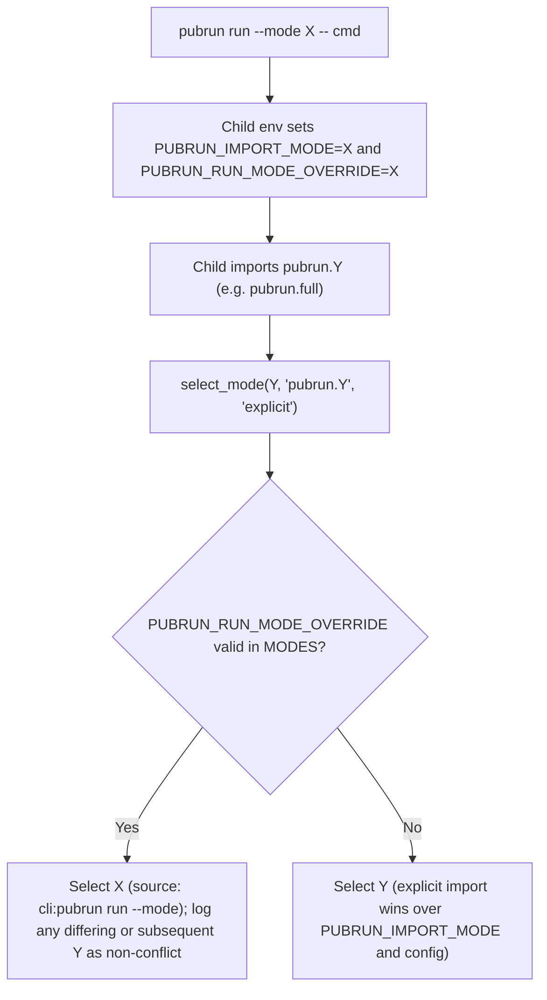

# IPD: Implement launch-time pubrun run --mode override over in-code mode submodule imports

- Date: 2026-11-24
- Kind: child
- Concern: Import-mode precedence between launch-time `pubrun run --mode <mode>` and explicit in-code `import pubrun.<mode>` submodule imports
- Scope: Pass a dedicated launch-time override environment variable (`PUBRUN_RUN_MODE_OVERRIDE`) from `pubrun run --mode <mode>` in `src/pubrun/__main__.py`, honor it ahead of explicit submodule imports and subsequent in-code imports in `src/pubrun/_bootstrap.py::select_mode` without weakening ordinary `PUBRUN_IMPORT_MODE` precedence, add end-to-end and unit tests in `tests/test_import_modes.py` and `tests/test_full_mode.py`, and synchronize `CHANGELOG.md`, `docs/manifest.md`, `docs/cli.md`, and `docs/functional_spec.md`.
- Scope-Paths: src/pubrun/__main__.py, src/pubrun/_bootstrap.py, tests/test_import_modes.py, tests/test_full_mode.py, CHANGELOG.md, docs/manifest.md, docs/cli.md, docs/functional_spec.md
- Item-Dependencies: none
- Status: approved
- Readiness: go-pending-approval
- Review-Depth: standard
- Short-Description: Make pubrun run --mode override in-code import pubrun.<mode> submodule imports via a launch-time override marker
- Work-Kind: bug
- Priority: medium
- From-Backlog: oubh58
- Blocks-Release: next
- Set: oubh58
- Order: 1
- Highest E allocated: 04
- Author: Antigravity
- Id: lhwy0t
- Approval: 2026-11-25, recorded via aw ipd set: status set to approved

> Write and proofread this plan per the technical writing standard, `.aw/system/workflows/technical-writing/technical-writing.md` (`.agents/workflows/technical-writing/technical-writing.md` in a legacy-layout install), including requirement 12 (diagrams).

## Workflow history

- 2026-11-25 approved (aw set): status set to approved
- 2026-11-25 /plan-review (Antigravity): APPROVE WITH REVISIONS APPLIED; PR-001, PR-002, PR-003, PR-004, PR-005
- 2026-11-25 to-review (Antigravity): graduated from backlog item `oubh58` into a review-ready plan following the user's `/askme` decision.
- 2026-11-25 draft (Antigravity): created.

## Goal

Make `pubrun run --mode <mode> -- <command>` genuinely override an explicit in-code `import pubrun.<mode>` submodule import (honoring the settled 2026-07-05 precedence decision in `.aw/records/plans/executed/20260705-1828-01-full-capture-mode.md` and the user's 2026-11-25 `/askme` decision), while keeping ordinary `PUBRUN_IMPORT_MODE` environment variables below explicit in-code submodule imports.

## Detailed Implementation Checklist (TODO)

Execution-state rule: mark an `E-*` item complete only after performing the action. That mark is not validation. Right-sizing rule: write for a modest executor that cannot hold much in its head. Each E-item is one step (one concern, about one file, executable in one focused pass) and its V-item names each unit it covers with its own check; a plan stays at about 5 E-items and 8 work Scope-Paths, else split it into more child plans (guidance, `IPD-Z603`). Accepted execution states: blocked, failed, pending, performed; terminal gate demands 'performed'.

### Task group 1: Launch-time CLI override in __main__.py and _bootstrap.py

- [ ] E-01 In `src/pubrun/__main__.py` (`args.command == "run"` branch), set `PUBRUN_RUN_MODE_OVERRIDE` to `args.mode` in `child_env` alongside `PUBRUN_IMPORT_MODE` (preserving existing `PUBRUN_IMPORT_MODE` behavior for backward compatibility and existing tests).
  - Depends on: none
  - Expected outcome: Running `pubrun run --mode <mode> -- <command>` spawns the child process with both `PUBRUN_IMPORT_MODE=<mode>` and `PUBRUN_RUN_MODE_OVERRIDE=<mode>` set in `child_env`, and invalid or unset override values are ignored downstream.
  - Execution state: pending

- [ ] E-02 In `src/pubrun/_bootstrap.py::select_mode`, check `os.environ.get("PUBRUN_RUN_MODE_OVERRIDE", "").strip().lower()` against `MODES` when `_selected_mode is None`, apply the CLI launch-time override before any submodule's requested mode, and treat subsequent in-code mode requests under an active `"cli:pubrun run --mode"` selection as non-conflicting overridden requests.
  - Depends on: E-01
  - Expected outcome: When `_selected_mode is None` and `PUBRUN_RUN_MODE_OVERRIDE` names a valid mode in `MODES`, `select_mode(mode, selected_by, source)` computes `cli_behavior = get_mode_behavior(cli_mode)` (distinct from the caller's `behavior = get_mode_behavior(mode)`), selects `cli_mode` with `_selected_behavior = cli_behavior`, `_selected_by = "cli:pubrun run --mode"`, and `_selected_source = "cli:pubrun run --mode"`, appends the winning CLI request (`requested_mode: cli_mode`, `selected_by: "cli:pubrun run --mode"`, `effective_behavior: cli_behavior`, `selected: True`, `conflict: False`) to `_requests`, and when `mode != cli_mode` also appends the overridden caller request (`requested_mode: mode`, `selected_by: selected_by`, `effective_behavior: behavior`, `selected: False`, `conflict: False`) without warning or raising under `[imports].on_conflict`, returning `cli_behavior`. When `_selected_mode is not None` and `_selected_source == "cli:pubrun run --mode"`, any subsequent `select_mode` call records `selected: False, conflict: False` (respecting `_max_requests`) and returns `_selected_behavior` without warning or raising under `[imports].on_conflict` (so `import pubrun` followed by `import pubrun.full`, or multiple differing submodule imports under `pubrun run --mode`, never spuriously trigger a conflict error). When `PUBRUN_RUN_MODE_OVERRIDE` is unset or invalid, existing behavior is unchanged (plain `PUBRUN_IMPORT_MODE` still loses to explicit `import pubrun.<mode>`). `os` is imported cleanly (`import os`) and all edited lines are type-annotated for Python 3.8+ and `mypy`.
  - Execution state: pending

### Task group 2: End-to-end verification tests, changelog, and doc sync

- [ ] E-03 Add end-to-end subprocess and unit tests in `tests/test_import_modes.py` and `tests/test_full_mode.py` verifying launch-time `pubrun run --mode` overrides across submodule imports, invalid override fallback, subsequent non-conflicting imports under a CLI override, and ordinary `PUBRUN_IMPORT_MODE` yielding to explicit submodule imports, and isolate existing test helpers from `PUBRUN_RUN_MODE_OVERRIDE`.
  - Depends on: E-01, E-02
  - Expected outcome: Tests drive real `python -m pubrun run --mode <X> -- python -c ...` child processes and unit-level `select_mode` calls asserting: (a) `pubrun run --mode nopatch` sets both `PUBRUN_IMPORT_MODE=nopatch` and `PUBRUN_RUN_MODE_OVERRIDE=nopatch` in child env; (b) `pubrun run --mode minimal` overrides `import pubrun.full` (`selected_mode == "minimal"`, `get_current_run() is None`, `selected_source == "cli:pubrun run --mode"`, `selected_by == "cli:pubrun run --mode"`); (c) `pubrun run --mode full` overrides `import pubrun.minimal` (`selected_mode == "full"`, run auto-starts and wraps console); (d) `pubrun run --mode noconsole` overrides `import pubrun.full` (`patch_console is False`); (e) plain `PUBRUN_IMPORT_MODE=minimal` without `PUBRUN_RUN_MODE_OVERRIDE` still allows `import pubrun.full` to win (`selected_mode == "full"`); (f) invalid `PUBRUN_RUN_MODE_OVERRIDE=bogus` is ignored and allows `import pubrun.full` to win; and (g) `PUBRUN_IMPORT_CONFLICT=error` neither warns nor raises when `pubrun run --mode minimal` overrides `import pubrun.full`, including when `import pubrun` precedes `import pubrun.full` (or two differing submodule imports run in the same overridden process). `tests/test_import_modes.py::clean_bootstrap` strips `PUBRUN_RUN_MODE_OVERRIDE` via `monkeypatch.delenv("PUBRUN_RUN_MODE_OVERRIDE", raising=False)`, and every existing child-env sanitization site in `tests/test_import_modes.py` (including `test_default_auto_starts`, `TestHookSuppression`, `test_legacy_auto_start_false_still_works`, `TestModeAliasApiParity._clean_env`, `TestModeModuleBackgroundCapture._env`) and `tests/test_full_mode.py` strips `PUBRUN_RUN_MODE_OVERRIDE` alongside `PUBRUN_IMPORT_MODE`.
  - Execution state: pending

- [ ] E-04 Synchronize `CHANGELOG.md`, `docs/manifest.md`, `docs/cli.md`, and `docs/functional_spec.md` with the launch-time override behavior, new `"cli:pubrun run --mode"` manifest provenance values, and `PUBRUN_RUN_MODE_OVERRIDE` mechanism, with zero em or en dashes in all added or edited lines.
  - Depends on: E-02
  - Expected outcome: (1) `CHANGELOG.md` under `## [Unreleased]` -> the top-most `### Fixed` subsection carries one clear user-facing bullet documenting that `pubrun run --mode <mode>` now overrides explicit in-code `import pubrun.<mode>` imports as documented; (2) `docs/manifest.md` (``## `pubrun_imports` ``, `selected_by` and `selected_source` rows) documents `"cli:pubrun run --mode"`; (3) `docs/cli.md` (the `run` command section) and `docs/functional_spec.md#11.13 Import Mode Wrapper (run)` note that `pubrun run --mode` sets `PUBRUN_RUN_MODE_OVERRIDE` alongside `PUBRUN_IMPORT_MODE` so the launch-time mode overrides explicit in-code `import pubrun.<mode>` imports; and (4) zero em or en dashes appear in any added diff line across all four files.
  - Execution state: pending

## Project conventions discovered (Step 0)

- Cite code by SYMBOL (`path::Name`) or by a quoted content string, with a line number only appended to one of those and never alone (`IPD-C801`).
- `.aw/records/plans/executed/20260705-1828-01-full-capture-mode.md#Design decisions (resolved in discussion 2026-07-05)` (item 2) established that explicit `import pubrun.<mode>` overrides config files and environment variables (`PUBRUN_IMPORT_MODE`), and only launch-time `pubrun run --mode <mode>` overrides an explicit in-code import.
- `src/pubrun/__main__.py` (`elif args.command == "run":`) currently sets `child_env = {**os.environ, "PUBRUN_IMPORT_MODE": args.mode}`. Existing test `tests/test_import_modes.py::TestPubrunRunCommand.test_run_sets_import_mode_env_var` asserts that `pubrun run --mode nopatch` sets `PUBRUN_IMPORT_MODE=nopatch` in the child, so `PUBRUN_IMPORT_MODE` must remain populated alongside `PUBRUN_RUN_MODE_OVERRIDE`.
- `src/pubrun/core.py::_execute_boot_sequence` already reads `get_selected_behavior()` when `is_mode_selected()` is true, and `src/pubrun/tracker.py::Run` reads `get_selected_behavior()` for hooks and `force_console`, so enforcing the CLI override inside `src/pubrun/_bootstrap.py::select_mode` governs all six mode submodules (`auto`, `noauto`, `nopatch`, `noconsole`, `minimal`, `full`) and root `import pubrun` automatically.
- `schemas/manifest.schema.json` (`properties.pubrun_imports`) stores `selected_mode`, `selected_behavior`, `selected_by`, `selected_source`, `selected_at_utc`, `core_loaded`, `conflict_policy`, `conflicts_detected`, and `requests` (string fields for `selected_by`/`selected_source`, so `"cli:pubrun run --mode"` validates cleanly without schema changes), while `docs/manifest.md` (``## `pubrun_imports` ``) enumerates `selected_source` values in prose and must add `"cli:pubrun run --mode"`.
- `pyproject.toml` (`[[tool.mypy.overrides]]`) currently lists `"pubrun._bootstrap"` under `ignore_errors = true` (pending cleanup in the `rand-mypy` set), while `src/pubrun/__main__.py` is actively type-checked by `python3 -m mypy`.
- Agent execution contract: user-facing prose (`CHANGELOG.md`, `docs/manifest.md`, `docs/cli.md`, `docs/functional_spec.md`) must contain zero em or en dashes in authored or edited lines; tests must drive runtime behavior without inspecting production source text.

## Findings

Today, `docs/functional_spec.md#3.4 Import Modes`, `docs/api.md`, `docs/configuration.md`, `README.md`, and `src/pubrun/full.py` state that `pubrun run --mode <mode>` overrides an in-code `import pubrun.<mode>`, but `src/pubrun/__main__.py` only sets `PUBRUN_IMPORT_MODE`. Because submodule imports call `select_mode("<mode>", "pubrun.<mode>", "explicit")` without reading `PUBRUN_IMPORT_MODE`, the in-code import always wins.

## Proposed changes (ordered, validatable)

1. **`src/pubrun/__main__.py` (E-01):** In the `args.command == "run"` branch, set `"PUBRUN_RUN_MODE_OVERRIDE": args.mode` in `child_env` alongside `"PUBRUN_IMPORT_MODE": args.mode`.
2. **`src/pubrun/_bootstrap.py` (E-02):** Import `os` and in `select_mode(mode, selected_by, source)`: (a) when `_selected_mode is None`, check `os.environ.get("PUBRUN_RUN_MODE_OVERRIDE", "").strip().lower()`; when that value is in `MODES`, compute `cli_behavior = get_mode_behavior(cli_mode)`, select `cli_mode` (`_selected_behavior = cli_behavior`, `_selected_by = "cli:pubrun run --mode"`, `_selected_source = "cli:pubrun run --mode"`), record the CLI selection in `_requests` (`requested_mode: cli_mode`, `selected_by: "cli:pubrun run --mode"`, `effective_behavior: cli_behavior`, `selected: True`, `conflict: False`), and if `mode != cli_mode` also record the overridden request (`requested_mode: mode`, `selected_by: selected_by`, `effective_behavior: behavior`, `selected: False`, `conflict: False`) without raising or warning under `[imports].on_conflict`, returning `cli_behavior`; (b) when `_selected_mode is not None` and `_selected_source == "cli:pubrun run --mode"`, record the subsequent request with `selected: False, conflict: False` (respecting `_max_requests`) and return `_selected_behavior` without raising or warning.
3. **`tests/test_import_modes.py` and `tests/test_full_mode.py` (E-03):** Add subprocess and unit tests covering `pubrun run --mode nopatch` setting both env vars, `pubrun run --mode minimal` over `import pubrun.full`, `pubrun run --mode full` over `import pubrun.minimal`, `pubrun run --mode noconsole` over `import pubrun.full`, plain `PUBRUN_IMPORT_MODE=minimal` losing to `import pubrun.full`, invalid `PUBRUN_RUN_MODE_OVERRIDE=bogus` falling through to `import pubrun.full`, and `PUBRUN_IMPORT_CONFLICT=error` tolerating both first and subsequent overridden imports under `pubrun run --mode`. Update `clean_bootstrap` and all child-env sanitization helpers in `tests/test_import_modes.py` and `tests/test_full_mode.py` to strip `PUBRUN_RUN_MODE_OVERRIDE` where they strip `PUBRUN_IMPORT_MODE`.
4. **`CHANGELOG.md`, `docs/manifest.md`, `docs/cli.md`, and `docs/functional_spec.md` (E-04):** Add one bullet under `## [Unreleased]` -> the top-most `### Fixed` in `CHANGELOG.md`, add `"cli:pubrun run --mode"` to `selected_by` and `selected_source` in `docs/manifest.md` (``## `pubrun_imports` ``), and note `PUBRUN_RUN_MODE_OVERRIDE` alongside `PUBRUN_IMPORT_MODE` in `docs/cli.md` (the `run` command section) and `docs/functional_spec.md#11.13 Import Mode Wrapper (run)`, with zero em or en dashes in all added diff lines.

## Deferred / out of scope (with reason)

None.

## Scope check

- Over-scope: none. Only `src/pubrun/__main__.py`, `src/pubrun/_bootstrap.py`, `tests/test_import_modes.py`, `tests/test_full_mode.py`, `CHANGELOG.md`, `docs/manifest.md`, `docs/cli.md`, and `docs/functional_spec.md` are modified.
- Under-scope: none. Covers the CLI wrapper, bootstrap mode selector (first and subsequent imports), manifest provenance recording, conflict-policy interaction, backward compatibility with `PUBRUN_IMPORT_MODE`, end-to-end and unit tests, and full documentation sync.

## Required tests / validation

- Run `python3 -m pytest tests/test_import_modes.py tests/test_full_mode.py tests/test_manifest_schema.py -v`.
- Run `python3 -m mypy` to confirm zero type regressions in `src/pubrun/__main__.py` and all type-checked modules (noting `pyproject.toml` still lists `pubrun._bootstrap` under `ignore_errors = true` until `rand-mypy` clears it).
- Verify zero em or en dashes in added diff lines across `CHANGELOG.md`, `docs/manifest.md`, `docs/cli.md`, and `docs/functional_spec.md` using a portable exit-0 Python check on `git diff`.
- Run `python3 scripts/sanitize_paths.py --check --all` and confirm exit code 0.

## Spec / documentation sync

`CHANGELOG.md`, `docs/manifest.md` (`selected_by` and `selected_source` for `"cli:pubrun run --mode"`), `docs/cli.md` (`run` wrapper), and `docs/functional_spec.md#11.13 Import Mode Wrapper (run)` are updated in E-04. `docs/functional_spec.md#3.4 Import Modes`, `docs/api.md`, `docs/configuration.md`, `README.md`, and `src/pubrun/full.py` already state that launch-time `pubrun run --mode` overrides in-code submodule imports.

## Open questions

### OQ-01: Should `pubrun run --mode <mode>` override an in-code `import pubrun.<mode>` import, or should the documentation be changed to match the current code?

- Blocking: yes
- Status: resolved
- Owner: maintainer
- Resolution or deferral rationale: RESOLVED 2026-11-25 by the user via /askme: Implement the launch-time override so `pubrun run --mode <mode>` overrides an in-code `import pubrun.<mode>` import. No reason was given.

## Validation and cross-check (verify before reporting done)

Validation-state rule: inspect evidence in a separate pass. Do not mark a `V-*` item complete from memory or from the matching execution checkmark. Accepted validation results: blocked, failed, pass, pending; terminal gate demands 'pass'. Runtime-demonstration reachability rule: for each `V-*` item demanding the software be observed acting (as distinct from items demanding a diff, a file's content, or a test result, which are reachable by construction), name the code path that produces the observation or the sibling `E-*` that creates it, else the demand is UNDER-SCOPE.

- [ ] V-01 validates E-01
  - Required evidence: Paste `git diff src/pubrun/__main__.py` showing `PUBRUN_RUN_MODE_OVERRIDE` set alongside `PUBRUN_IMPORT_MODE` in the `args.command == "run"` branch, plus output of `python3 -m pytest tests/test_import_modes.py -k "run" -v` passing and `python3 -m mypy` exiting 0.
  - Observed evidence:
  - Result: pending

- [ ] V-02 validates E-02
  - Required evidence: Paste `git diff src/pubrun/_bootstrap.py` showing `PUBRUN_RUN_MODE_OVERRIDE` handling in `select_mode` (both `_selected_mode is None` with `cli_behavior = get_mode_behavior(cli_mode)` and subsequent calls when `_selected_source == "cli:pubrun run --mode"`), paste output of `python3 -m pytest tests/test_import_modes.py -k "Bootstrap or Conflict" -v` passing, and paste output of `python3 -m mypy` exiting 0 (noting whether `pubrun._bootstrap` remains in `pyproject.toml`'s `ignore_errors` list).
  - Observed evidence:
  - Result: pending

- [ ] V-03 validates E-03
  - Required evidence: Paste actual output of `python3 -m pytest tests/test_import_modes.py tests/test_full_mode.py tests/test_manifest_schema.py -v` showing all new launch-time override tests (both env vars set by `pubrun run --mode`, `minimal` over `full`, `full` over `minimal`, `noconsole` over `full`, plain `PUBRUN_IMPORT_MODE` losing to `import pubrun.full`, invalid `PUBRUN_RUN_MODE_OVERRIDE=bogus` ignored, and `PUBRUN_IMPORT_CONFLICT=error` non-conflict on first and subsequent overridden imports) and existing tests passing with zero failures.
  - Observed evidence:
  - Result: pending

- [ ] V-04 validates E-04
  - Required evidence: Paste `git diff CHANGELOG.md docs/manifest.md docs/cli.md docs/functional_spec.md` showing the new `### Fixed` bullet under `## [Unreleased]`, `"cli:pubrun run --mode"` in `docs/manifest.md`, and `PUBRUN_RUN_MODE_OVERRIDE` documented in `docs/cli.md` and `docs/functional_spec.md`; paste output of a portable exit-0 Python check confirming zero em or en dashes (`\u2014`, `\u2013`) in all added (`+`) diff lines across those four files (e.g., `python3 -c 'import subprocess; diff = subprocess.check_output(["git", "diff", "--", "CHANGELOG.md", "docs/manifest.md", "docs/cli.md", "docs/functional_spec.md"], text=True); added = [l for l in diff.splitlines() if l.startswith("+") and not l.startswith("+++")]; assert added, "empty diff"; bad = [l for l in added if "\u2014" in l or "\u2013" in l]; assert not bad, bad; print("OK added lines:", len(added))'`); and paste `python3 scripts/sanitize_paths.py --check --all` exiting 0.
  - Observed evidence:
  - Result: pending

## Approval and execution gate

- Size assessment: standard
- Cohesion rationale: not required

Execution begins only after a human approves this plan (`- Status: approved`).

Execution contract:
1. **Open-questions precondition:** Zero unresolved blocking open questions remain before execution (`OQ-01` is `resolved`).
2. **Scope declaration:** `- Scope-Paths:` declares `src/pubrun/__main__.py`, `src/pubrun/_bootstrap.py`, `tests/test_import_modes.py`, `tests/test_full_mode.py`, `CHANGELOG.md`, `docs/manifest.md`, `docs/cli.md`, and `docs/functional_spec.md`. If execution must edit another file or leave a declared file unchanged, make the change and justify it with `--scope-reason` or `--scope-ack` at finalize.
3. **Validation honesty (HARD MUST):** Paste the actual `pytest`, `mypy`, and `sanitize_paths.py` output observed after the final edit into `V-01`..`V-04`; never claim checks pass without running them.
4. **Path-scoped commit and never-push:** Commit only the modified paths through `aw commit lhwy0t -- <paths>`; never use `git add -A` or `-a`, and never push without explicit human instruction.
5. **Lifecycle transition (conditional runner vs. standalone ownership):** When executed inside `aw oc run` / `aw agy run`, the runner owns the lifecycle move after the merge-and-revalidate gate; when executed standalone outside the runner, run `aw ipd finalize lhwy0t` (never a hand-rolled `git mv` to `executed/`).
