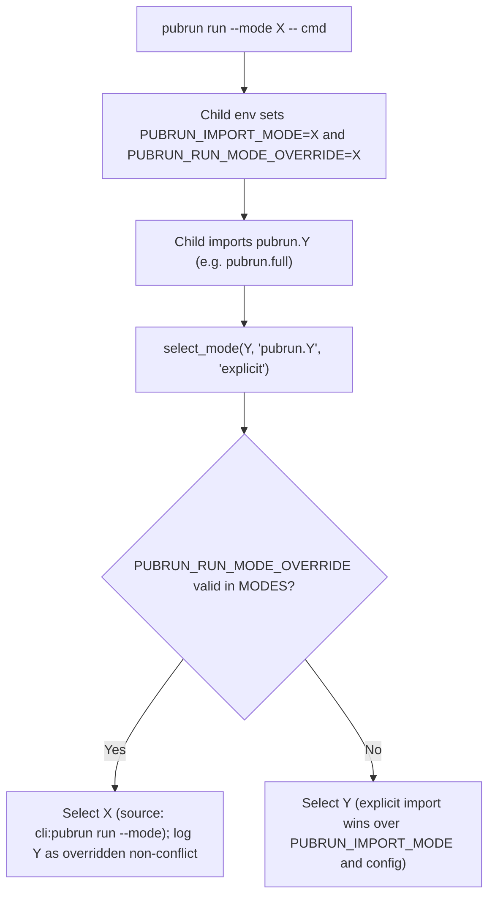

# IPD: Implement launch-time pubrun run --mode override over in-code mode submodule imports

- Date: 2026-11-24
- Kind: child
- Concern: Import-mode precedence between launch-time `pubrun run --mode <mode>` and explicit in-code `import pubrun.<mode>` submodule imports
- Scope: Pass a dedicated launch-time override environment variable (`PUBRUN_RUN_MODE_OVERRIDE`) from `pubrun run --mode <mode>` in `src/pubrun/__main__.py`, honor it ahead of explicit submodule imports in `src/pubrun/_bootstrap.py::select_mode` without weakening ordinary `PUBRUN_IMPORT_MODE` precedence, add end-to-end tests in `tests/test_import_modes.py` and `tests/test_full_mode.py`, and add a `CHANGELOG.md` entry.
- Scope-Paths: src/pubrun/__main__.py, src/pubrun/_bootstrap.py, tests/test_import_modes.py, tests/test_full_mode.py, CHANGELOG.md
- Item-Dependencies: none
- Status: to-review
- Short-Description: Make pubrun run --mode override in-code import pubrun.<mode> submodule imports via a launch-time override marker
- Work-Kind: bug
- Priority: medium
- From-Backlog: oubh58
- Blocks-Release: next
- Set: oubh58
- Order: 1
- Highest E allocated: 04
- Author: Antigravity
- Id: lhwy0t

> Write and proofread this plan per the technical writing standard, `.aw/system/workflows/technical-writing/technical-writing.md` (`.agents/workflows/technical-writing/technical-writing.md` in a legacy-layout install), including requirement 12 (diagrams).

## Workflow history

- 2026-11-25 to-review (Antigravity): graduated from backlog item `oubh58` into a review-ready plan following the user's `/askme` decision.
- 2026-11-25 draft (Antigravity): created.

## Goal

Make `pubrun run --mode <mode> -- <command>` genuinely override an explicit in-code `import pubrun.<mode>` submodule import (honoring the settled 2026-07-05 precedence decision in `.aw/records/plans/executed/20260705-1828-01-full-capture-mode.md` and the user's 2026-11-25 `/askme` decision), while keeping ordinary `PUBRUN_IMPORT_MODE` environment variables below explicit in-code submodule imports.

## Detailed Implementation Checklist (TODO)

Execution-state rule: mark an `E-*` item complete only after performing the action. That mark is not validation. Right-sizing rule: write for a modest executor that cannot hold much in its head. Each E-item is one step (one concern, about one file, executable in one focused pass) and its V-item names each unit it covers with its own check; a plan stays at about 5 E-items and 8 work Scope-Paths, else split it into more child plans (guidance, `IPD-Z603`). Accepted execution states: blocked, failed, pending, performed; terminal gate demands 'performed'.

### Task group 1: Launch-time CLI override in __main__.py and _bootstrap.py

- [ ] E-01 In `src/pubrun/__main__.py` (`args.command == "run"` branch), set `PUBRUN_RUN_MODE_OVERRIDE` to `args.mode` in `child_env` alongside `PUBRUN_IMPORT_MODE` (preserving existing `PUBRUN_IMPORT_MODE` behavior for backward compatibility and existing tests).
  - Depends on: none
  - Expected outcome: Running `pubrun run --mode <mode> -- <command>` spawns the child process with both `PUBRUN_IMPORT_MODE=<mode>` and `PUBRUN_RUN_MODE_OVERRIDE=<mode>` set in `child_env`, and invalid or unset override values are ignored downstream.
  - Execution state: pending

- [ ] E-02 In `src/pubrun/_bootstrap.py::select_mode`, check `os.environ.get("PUBRUN_RUN_MODE_OVERRIDE", "").strip().lower()` against `MODES` when `_selected_mode is None`, and apply the CLI launch-time override before any submodule's requested mode.
  - Depends on: E-01
  - Expected outcome: When `_selected_mode is None` and `PUBRUN_RUN_MODE_OVERRIDE` names a valid mode in `MODES`, `select_mode(mode, selected_by, source)` selects that CLI mode with `_selected_by = "cli:pubrun run --mode"` and `_selected_source = "cli:pubrun run --mode"`, appends the winning CLI request (`selected: True, conflict: False`) to `_requests`, and when `mode != cli_mode` also appends the overridden caller request with `selected: False, conflict: False` (so an intentional CLI launch override is recorded in manifest provenance without falsely triggering `[imports].on_conflict = "warn"` or `"error"`). When `PUBRUN_RUN_MODE_OVERRIDE` is unset or invalid, existing behavior is unchanged (plain `PUBRUN_IMPORT_MODE` still loses to explicit `import pubrun.<mode>`). All edited lines are cleanly type-annotated for Python 3.8+ and `mypy`.
  - Execution state: pending

### Task group 2: End-to-end verification tests and changelog

- [ ] E-03 Add end-to-end subprocess tests in `tests/test_import_modes.py` and `tests/test_full_mode.py` verifying launch-time `pubrun run --mode` overrides across submodule imports and verifying ordinary `PUBRUN_IMPORT_MODE` still yields to explicit submodule imports.
  - Depends on: E-01, E-02
  - Expected outcome: Tests run real `python -m pubrun run --mode <X> -- python -c ...` child processes asserting: (a) `pubrun run --mode minimal` overrides `import pubrun.full` (`selected_mode == "minimal"`, `get_current_run() is None`, `selected_source == "cli:pubrun run --mode"`); (b) `pubrun run --mode full` overrides `import pubrun.minimal` (`selected_mode == "full"`, run auto-starts and wraps console); (c) `pubrun run --mode noconsole` overrides `import pubrun.full` (`patch_console is False`); (d) plain `PUBRUN_IMPORT_MODE=minimal` without `pubrun run --mode` still allows `import pubrun.full` to win (`selected_mode == "full"`); and (e) `PUBRUN_IMPORT_CONFLICT=error` does not crash when `pubrun run --mode minimal` intentionally overrides `import pubrun.full`. Any existing test helper stripping `PUBRUN_IMPORT_MODE` from child environments also strips `PUBRUN_RUN_MODE_OVERRIDE` so host environment cannot bleed into tests.
  - Execution state: pending

- [ ] E-04 Add one bullet to `CHANGELOG.md` under `## [Unreleased]` -> `### Fixed` documenting that `pubrun run --mode <mode>` now overrides explicit in-code `import pubrun.<mode>` imports as documented, with zero em or en dashes.
  - Depends on: E-02
  - Expected outcome: `CHANGELOG.md` contains a clear user-facing `### Fixed` entry under `## [Unreleased]` with zero em or en dashes.
  - Execution state: pending

## Project conventions discovered (Step 0)

- Cite code by SYMBOL (`path::Name`) or by a quoted content string, with a line number only appended to one of those and never alone (`IPD-C801`).
- `.aw/records/plans/executed/20260705-1828-01-full-capture-mode.md` ("Design decisions", item 2) established that explicit `import pubrun.<mode>` overrides config files and environment variables (`PUBRUN_IMPORT_MODE`), and only launch-time `pubrun run --mode <mode>` overrides an explicit in-code import.
- `src/pubrun/__main__.py` (`elif args.command == "run":`) currently sets `child_env = {**os.environ, "PUBRUN_IMPORT_MODE": args.mode}`. Existing test `tests/test_import_modes.py` (`P3-R1`) asserts that `pubrun run --mode nopatch` sets `PUBRUN_IMPORT_MODE=nopatch` in the child, so `PUBRUN_IMPORT_MODE` must remain populated alongside `PUBRUN_RUN_MODE_OVERRIDE`.
- `src/pubrun/core.py::_execute_boot_sequence` already reads `get_selected_behavior()` when `is_mode_selected()` is true, and `src/pubrun/tracker.py` reads `get_selected_behavior()` for hooks and `force_console`, so enforcing the CLI override inside `src/pubrun/_bootstrap.py::select_mode` governs all six mode submodules (`auto`, `noauto`, `nopatch`, `noconsole`, `minimal`, `full`) and root `import pubrun` automatically.
- `schemas/manifest.schema.json` (`properties.pubrun_imports`) stores `selected_mode`, `selected_behavior`, `selected_by`, `selected_source`, `selected_at_utc`, `core_loaded`, `conflict_policy`, `conflicts_detected`, and `requests` (string fields for `selected_by`/`selected_source`, so `"cli:pubrun run --mode"` validates cleanly without schema changes).
- Agent execution contract: user-facing prose (`CHANGELOG.md`) must contain zero em or en dashes; tests must drive runtime behavior without inspecting production source text.

## Findings

Today, `docs/functional_spec.md#3.4 Import Modes`, `docs/api.md`, `docs/configuration.md`, `README.md`, and `src/pubrun/full.py` state that `pubrun run --mode <mode>` overrides an in-code `import pubrun.<mode>`, but `src/pubrun/__main__.py` only sets `PUBRUN_IMPORT_MODE`. Because submodule imports call `select_mode("<mode>", "pubrun.<mode>", "explicit")` without reading `PUBRUN_IMPORT_MODE`, the in-code import always wins.

## Proposed changes (ordered, validatable)

1. **`src/pubrun/__main__.py` (E-01):** In the `args.command == "run"` branch, set `"PUBRUN_RUN_MODE_OVERRIDE": args.mode` in `child_env` alongside `"PUBRUN_IMPORT_MODE": args.mode`.
2. **`src/pubrun/_bootstrap.py` (E-02):** In `select_mode(mode, selected_by, source)`, when `_selected_mode is None`, check `os.environ.get("PUBRUN_RUN_MODE_OVERRIDE", "").strip().lower()`. When that value is in `MODES`, select that CLI mode (`selected_by = "cli:pubrun run --mode"`, `source = "cli:pubrun run --mode"`), record the CLI selection in `_requests` (`selected: True, conflict: False`), and if the calling `mode` differs from the CLI mode, record the overridden request (`selected: False, conflict: False`) without raising or warning under `[imports].on_conflict`. Return `_selected_behavior`.
3. **`tests/test_import_modes.py` and `tests/test_full_mode.py` (E-03):** Add subprocess tests covering `pubrun run --mode minimal` over `import pubrun.full`, `pubrun run --mode full` over `import pubrun.minimal`, `pubrun run --mode noconsole` over `import pubrun.full`, plain `PUBRUN_IMPORT_MODE=minimal` losing to `import pubrun.full`, and `PUBRUN_IMPORT_CONFLICT=error` tolerating an intentional `pubrun run --mode` override. Ensure child-env sanitization helpers in those test files clear `PUBRUN_RUN_MODE_OVERRIDE` where they clear `PUBRUN_IMPORT_MODE`.
4. **`CHANGELOG.md` (E-04):** Add one `### Fixed` bullet under `## [Unreleased]` with zero em or en dashes.

## Deferred / out of scope (with reason)

None.

## Scope check

- Over-scope: none. Only `src/pubrun/__main__.py`, `src/pubrun/_bootstrap.py`, `tests/test_import_modes.py`, `tests/test_full_mode.py`, and `CHANGELOG.md` are modified; the five documentation files already document the launch-time override contract.
- Under-scope: none. Covers the CLI wrapper, bootstrap mode selector, manifest provenance recording, conflict-policy interaction, backward compatibility with `PUBRUN_IMPORT_MODE`, and end-to-end tests.

## Required tests / validation

- Run `python3 -m pytest tests/test_import_modes.py tests/test_full_mode.py tests/test_manifest_schema.py -v`.
- Run `python3 -m mypy` to confirm zero type regressions.
- Run `python3 scripts/sanitize_paths.py --check --all` and confirm exit code 0.

## Spec / documentation sync

`CHANGELOG.md` is updated in E-04. `docs/functional_spec.md`, `docs/api.md`, `docs/configuration.md`, `README.md`, and `src/pubrun/full.py` already state that launch-time `pubrun run --mode` overrides in-code submodule imports.

## Open questions

### OQ-01: Should `pubrun run --mode <mode>` override an in-code `import pubrun.<mode>` import, or should the documentation be changed to match the current code?

- Blocking: yes
- Status: resolved
- Owner: maintainer
- Resolution or deferral rationale: RESOLVED 2026-11-25 by the user via /askme: Implement the launch-time override so `pubrun run --mode <mode>` overrides an in-code `import pubrun.<mode>` import. No reason was given.

## Validation and cross-check (verify before reporting done)

Validation-state rule: inspect evidence in a separate pass. Do not mark a `V-*` item complete from memory or from the matching execution checkmark. Accepted validation results: blocked, failed, pass, pending; terminal gate demands 'pass'. Runtime-demonstration reachability rule: for each `V-*` item demanding the software be observed acting (as distinct from items demanding a diff, a file's content, or a test result, which are reachable by construction), name the code path that produces the observation or the sibling `E-*` that creates it, else the demand is UNDER-SCOPE.

- [ ] V-01 validates E-01
  - Required evidence: Paste `git diff src/pubrun/__main__.py` showing `PUBRUN_RUN_MODE_OVERRIDE` set alongside `PUBRUN_IMPORT_MODE` in the `args.command == "run"` branch, plus output of `python3 -m pytest tests/test_import_modes.py -k "run" -v` passing.
  - Observed evidence:
  - Result: pending

- [ ] V-02 validates E-02
  - Required evidence: Paste `git diff src/pubrun/_bootstrap.py` showing `PUBRUN_RUN_MODE_OVERRIDE` handling in `select_mode` and paste output of `python3 -m mypy` exiting 0.
  - Observed evidence:
  - Result: pending

- [ ] V-03 validates E-03
  - Required evidence: Paste actual output of `python3 -m pytest tests/test_import_modes.py tests/test_full_mode.py tests/test_manifest_schema.py -v` showing all new launch-time override tests (`minimal` over `full`, `full` over `minimal`, `noconsole` over `full`, plain `PUBRUN_IMPORT_MODE` losing to `import pubrun.full`, and `PUBRUN_IMPORT_CONFLICT=error` non-conflict) and existing tests passing.
  - Observed evidence:
  - Result: pending

- [ ] V-04 validates E-04
  - Required evidence: Paste `git diff CHANGELOG.md` showing the new `### Fixed` bullet under `## [Unreleased]` with zero em or en dashes, plus `python3 scripts/sanitize_paths.py --check --all` exiting 0.
  - Observed evidence:
  - Result: pending

## Approval and execution gate

- Size assessment: standard
- Cohesion rationale: not required

Execution begins only after a human approves this plan (`- Status: approved`).

Execution contract:
1. **Open-questions precondition:** Zero unresolved blocking open questions remain before execution (`OQ-01` is `resolved`).
2. **Scope declaration:** `- Scope-Paths:` declares `src/pubrun/__main__.py`, `src/pubrun/_bootstrap.py`, `tests/test_import_modes.py`, `tests/test_full_mode.py`, and `CHANGELOG.md`. If execution must edit another file or leave a declared file unchanged, make the change and justify it with `--scope-reason` or `--scope-ack` at finalize.
3. **Validation honesty (HARD MUST):** Paste the actual `pytest`, `mypy`, and `sanitize_paths.py` output observed after the final edit into `V-01`..`V-04`; never claim checks pass without running them.
4. **Path-scoped commit and never-push:** Commit only the modified paths through `aw commit lhwy0t -- <paths>`; never use `git add -A` or `-a`, and never push without explicit human instruction.
5. **Lifecycle transition (conditional runner vs. standalone ownership):** When executed inside `aw oc run` / `aw agy run`, the runner owns the lifecycle move after the merge-and-revalidate gate; when executed standalone outside the runner, run `aw ipd finalize lhwy0t` (never a hand-rolled `git mv` to `executed/`).
