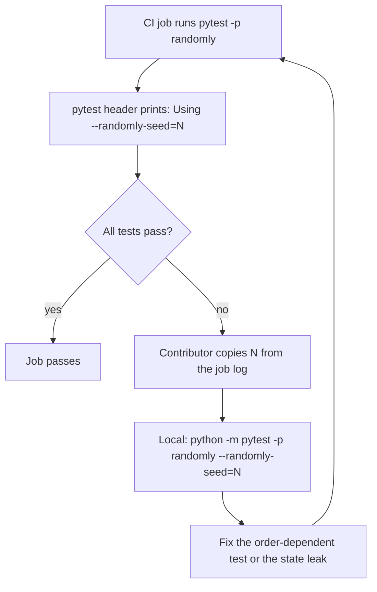

# IPD: Enable pytest-randomly in the CI test matrix

- Date: 2026-11-24
- Kind: child
- Concern: Testing rigor: CI runs every test in one fixed order, so a test that only passes because an earlier test left state behind is never caught.
- Scope: The four `pytest` commands in `.github/workflows/ci.yml` (the two steps of the 21-job `test` matrix, the `no-tui` job, and the `extra-suites` job), the explanatory comment above `addopts` in `pyproject.toml`, the contributor documentation (`CONTRIBUTING.md`, `CHANGELOG.md`), and the stale roadmap note in `TODO.md`.
- Scope-Paths: .github/workflows/ci.yml, pyproject.toml, CONTRIBUTING.md, CHANGELOG.md, TODO.md
- Item-Dependencies: executed:m66tfv
- Status: to-review
- Short-Description: Run the 21 CI matrix test jobs in a randomized, reproducible order
- Work-Kind: chore
- Priority: low
- From-Backlog: qqwebg
- Set: rand-mypy
- Order: 1
- Highest E allocated: 04
- Author: uri/its_direct/pt3-claude-opus-5.5-1m-us
- Id: 1kcrdn

> Write and proofread this plan per the technical writing standard, `.aw/system/workflows/technical-writing/technical-writing.md` (`.agents/workflows/technical-writing/technical-writing.md` in a legacy-layout install), including requirement 12 (diagrams).

## Workflow history

- 2026-11-24 to-review (aw set): authored from backlog qqwebg
- 2026-11-24 draft (uri/its_direct/pt3-claude-opus-5.5-1m-us): created.

## Goal

Make every CI job that runs `pytest` run the tests in a random order, so that a test which depends on state left by another test fails in CI instead of hiding behind a fixed order. Each job prints the seed it used, so any failure can be reproduced locally with the same order.

`pytest-randomly` is a `pytest` plugin that shuffles test order and reseeds Python's `random` module before each test. It is already in the `dev` extra (`pytest-randomly>=3.0` in `pyproject.toml`), but `pyproject.toml` disables it for every run with `addopts = "-p no:randomly"`. A later `-p randomly` on the command line overrides that, because `pytest` applies `addopts` before the command-line arguments. This plan adds `-p randomly` to the four CI `pytest` commands and leaves local runs and `tox` deterministic.

### How a randomized CI failure is handled

## Detailed Implementation Checklist (TODO)

Execution-state rule: mark an `E-*` item complete only after performing the action. That mark is not validation. Right-sizing rule: write for a modest executor that cannot hold much in its head. Each E-item is one step (one concern, about one file, executable in one focused pass) and its V-item names each unit it covers with its own check; a plan stays at about 5 E-items and 8 work Scope-Paths, else split it into more child plans (guidance, `IPD-Z603`). Accepted execution states: blocked, failed, pending, performed; terminal gate demands 'performed'.

### Task group 1: Randomize the CI test order

- [ ] E-01 In `.github/workflows/ci.yml`, add `-p randomly` to each of the four `pytest` commands and change nothing else in the file:
  - `test` job, step "Run tests": `pytest tests/ -v` becomes `pytest tests/ -v -p randomly`.
  - `test` job, step "Run tests with coverage gate": `pytest tests/ -v --cov=src --cov-report=term-missing --cov-fail-under=78` becomes `pytest tests/ -v -p randomly --cov=src --cov-report=term-missing --cov-fail-under=78`.
  - `no-tui` job, step "Run tests": `pytest tests/ -v` becomes `pytest tests/ -v -p randomly`.
  - `extra-suites` job, step "Run script and benchmark contract tests": append ` -p randomly` to the existing command.
  Do not pass `--randomly-seed`: each job then draws its own seed, so the 21 matrix jobs exercise 21 different orders per push, and each job prints its seed in the `pytest` header.
  - Depends on: none
  - Expected outcome: `yaml.safe_load` of the file shows `-p randomly` in exactly these four `run:` commands, and the job set, the matrix, and every other step are unchanged.
  - Execution state: pending

- [ ] E-02 In `pyproject.toml` `[tool.pytest.ini_options]`, replace the four-line comment above `addopts = "-p no:randomly"` (it begins "`pytest-randomly` is a dev dependency for LOCAL adverse-order testing" and says enabling random order in CI "is a separate, later step"). The new comment says: `pytest-randomly` stays disabled by default so local and `tox` runs are deterministic; CI passes `-p randomly` to every `pytest` command (`.github/workflows/ci.yml`), and a later `-p randomly` overrides this setting; reproduce a CI order with `-p randomly --randomly-seed=<N>` using the seed from the job log. Leave the `addopts` value itself unchanged.
  - Depends on: E-01
  - Expected outcome: `python3 -m pytest tests/test_config.py -q` prints no `Using --randomly-seed` header (still disabled locally), and `python3 -m pytest tests/test_config.py -v -p randomly` prints one.
  - Execution state: pending

- [ ] E-03 Document the change for contributors. In `CONTRIBUTING.md` "Development setup", after the `python -m pytest` code block, add a short paragraph and code block: CI runs every test suite in random order with `pytest-randomly`; the job log's `pytest` header shows `Using --randomly-seed=<N>`; reproduce the same order locally with `python -m pytest -p randomly --randomly-seed=<N>`. In `CHANGELOG.md` `## [Unreleased]` `### Changed`, add one entry saying CI now runs the test suites in random order with a logged, reproducible seed, while local and `tox` runs keep the fixed order. In `TODO.md`, delete the "### Enable pytest-randomly in CI" section (heading and its paragraph), which this plan completes. Follow the `AGENTS.md` dash rule for `CONTRIBUTING.md` and `CHANGELOG.md`: no em or en dashes in the added prose.
  - Depends on: E-01
  - Expected outcome: `grep -n "randomly-seed" CONTRIBUTING.md CHANGELOG.md` shows the new lines; `grep -n "Enable pytest-randomly in CI" TODO.md` finds no match.
  - Execution state: pending

### Task group 2: Prove the randomized order on the full CI matrix

- [ ] E-04 Run the local random-order checks named in "Required tests / validation" and record their output. Then ask the human to push the branch (pushing needs an explicit human instruction under the `AGENTS.md` agent execution contract), and record the conclusion of every CI job in that workflow run. If any job fails on an order dependence, reproduce it locally with the job's seed, record the seed and the failing test, and stop: the fix is a new corrective plan, not an edit to this one.
  - Depends on: E-01, E-02, E-03
  - Expected outcome: Local runs exit 0 under three seeds, and every job of the GitHub Actions run passes with a `Using --randomly-seed=` header in its log.
  - Execution state: pending

## Project conventions discovered (Step 0)

- `pyproject.toml` `[tool.pytest.ini_options]` sets `addopts = "-p no:randomly"`; `dev` lists `pytest-randomly>=3.0`. CI installs `.[dev,tui]` (`test` job) or `.[dev]` (`no-tui`, `extra-suites`), so the plugin is present in every `pytest` job.
- `pytest-randomly` 4.x requires Python 3.10 or later. On the 3.8 and 3.9 matrix jobs, `pip` resolves 3.15.0 (`Requires-Python: >=3.8`), which supports the same `-p randomly` and `--randomly-seed` options and prints the same `Using --randomly-seed=` header (`pytest_report_header` in `pytest_randomly/__init__.py`, checked in the 3.15.0 wheel at authoring).
- `tox.ini` runs `pytest tests/ -v` and inherits `addopts`, so `tox` stays deterministic. `tox` is a local tool here; CI does not call it.
- `tests/test_conftest_isolation.py` `test_conftest_teardown_stops_active_run_and_restores_hooks` runs an inner `pytest` through `pytester` with its own `makeini("[pytest]\naddopts = -p no:randomly\n")`. The outer `-p randomly` does not reach that inner session, so the test's inner order stays fixed. This is intended and needs no change.
- Plan `m66tfv` (executed) hardened `tests/conftest.py` isolation and recorded `1941 passed, 2 skipped` for `python3 -m pytest tests/ benchmarks/test_pull_submissions.py -p randomly --randomly-seed=12345 -q`. Its deferral of "Enabling `pytest-randomly` across all 21 CI matrix jobs" (T-19) names backlog item `qqwebg` as carrier, which this plan graduates.
- The `test` matrix has 21 jobs: `ubuntu-latest`, `windows-latest`, and `macos-latest` for Python 3.8 to 3.14, with Ubuntu 3.8 and 3.9 moved to `ubuntu-24.04` by the matrix `exclude`/`include` entries.
- `AGENTS.md` "Matrix-validation discipline": a change that varies by OS or Python version must be validated on the full CI matrix before the plan moves to `executed/`. Random order can expose a leak that only exists on Windows or macOS, so E-04 requires the CI run.

## Findings

| ID | Severity | Remediation Risk | Evidence | Finding |
|---|---|---|---|---|
| T-19a | Medium | Low (measured: the full suite passes locally in three random orders) | `pyproject.toml` `addopts = "-p no:randomly"`; `.github/workflows/ci.yml` `pytest` commands have no `-p randomly` | CI runs one fixed order, so cross-test state leaks stay hidden. |

Authoring measurements (lane HEAD `a4b7d12`, Python 3.14.6, `pytest` 8.2.2, `pytest-randomly` 4.1.0, Linux):

- `python3 -m pytest tests/ -p randomly --randomly-seed=20261124 -q -x -p no:cacheprovider`: `2052 passed in 583.46s (0:09:43)`, exit 0.
- Same command with `--randomly-seed=777`: `2052 passed in 573.99s (0:09:33)`, exit 0.
- `python3 -m pytest .github/scripts/ benchmarks/test_share_safety.py benchmarks/test_pull_submissions.py benchmarks/test_benchmarks.py -p randomly --randomly-seed=20261124 -q -p no:cacheprovider`: `90 passed, 3 skipped in 437.40s (0:07:17)`, exit 0.
- The plugin really reorders: a two-test canary in which the second test asserts state written by the first passed under the default fixed order and failed under `-p randomly --randomly-seed=1` and `--randomly-seed=3` (`1 failed, 1 passed`).
- Not measured locally: Windows, macOS, Python 3.8 to 3.13, and the `no-tui` job without `textual`. E-04 covers these through CI.

## Proposed changes (ordered, validatable)

1. Add `-p randomly` to the four CI `pytest` commands (E-01; Remediation Risk: Low).
2. Rewrite the `addopts` comment in `pyproject.toml` (E-02; Remediation Risk: Low).
3. Document seed reproduction in `CONTRIBUTING.md`, record the change in `CHANGELOG.md`, and delete the completed `TODO.md` note (E-03; Remediation Risk: Low).
4. Validate locally and on the full CI matrix (E-04; Remediation Risk: Low).

Rejected alternatives:

- Removing `-p no:randomly` from `addopts`: every local and `tox` run would then use a new order, so a developer could see a failure that a rerun does not repeat. The current comment records the deliberate choice to keep local runs deterministic; this plan keeps it.
- Setting `PYTEST_ADDOPTS=-p randomly` once at workflow level: the variable also reaches every `pytest` process that a test starts as a subprocess, which widens the change beyond the four commands. Explicit flags keep the scope visible in the diff.
- One fixed seed for all jobs (for example `--randomly-seed=${{ github.run_id }}`): all 21 jobs would then run the same order, which finds fewer leaks. The per-job seed is printed, so reproduction does not need a shared seed.

## Deferred / out of scope (with reason)

- Fixing an order-dependent test that the first randomized CI run exposes. No such test is known (three local random orders pass), and a fix would be a separate defect with its own scope; E-04 records the seed and the test and stops for a corrective plan.
  - Carrier-Declined: Hypothetical future defect; no order-dependent test is known locally and E-04 files a corrective plan only if randomized CI exposes one.
- Randomizing `tox` or local runs. Kept deterministic on purpose (see "Rejected alternatives").
  - Carrier-Declined: Deliberate non-goal (local and tox runs remain deterministic by design).

## Scope check

- Over-scope: none. `TODO.md` is edited only to delete the note this plan completes.
- Under-scope: none. No test is added, because the property "CI uses a random order" is observable only in the CI log (V-04), and a test that read `ci.yml` would pin configuration text rather than behavior.

## Required tests / validation

- `python3 -m pytest tests/ -p randomly --randomly-seed=<S> -q -p no:cacheprovider` for `S` = 1, 20261124, and one seed the executor draws at random; each exits 0.
- `python3 -m pytest .github/scripts/ benchmarks/test_share_safety.py benchmarks/test_pull_submissions.py benchmarks/test_benchmarks.py -p randomly -q -p no:cacheprovider` exits 0.
- `python3 -m pytest tests/test_config.py -q` (no seed header) and `python3 -m pytest tests/test_config.py -v -p randomly` (seed header).
- One GitHub Actions run of the pushed branch with every job passing.
- `python3 scripts/sanitize_paths.py --check --all` exits 0.

## Spec / documentation sync

- No `.spec.md` under `.aw/records/specs/` and no file under `docs/` mentions `pytest-randomly` (checked at authoring with `grep -rln "randomly" .aw/records/specs docs`: no match). No spec is amended.
- `CONTRIBUTING.md`, `CHANGELOG.md`, and `TODO.md` are updated by E-03.

## Open questions

### OQ-01: Should each CI job draw its own seed, or should all jobs share one seed?

- Blocking: no
- Status: resolved
- Owner: none
- Resolution or deferral rationale: Each job draws its own seed. Twenty-one different orders per push find more leaks than one shared order, and every job prints its seed in the `pytest` header (`Using --randomly-seed=N`, from `pytest_randomly.pytest_report_header`), so any failure is reproducible without a shared seed. The repository's existing choice to keep local runs deterministic (`pyproject.toml` comment above `addopts`) is preserved.

## Validation and cross-check (verify before reporting done)

Validation-state rule: inspect evidence in a separate pass. Do not mark a `V-*` item complete from memory or from the matching execution checkmark. Accepted validation results: blocked, failed, pass, pending; terminal gate demands 'pass'. Runtime-demonstration reachability rule: for each `V-*` item demanding the software be observed acting (such as a run, a dispatch, or a transition), as distinct from items demanding a diff, a file's content, or a test result, which are reachable by construction, name the code path that produces the observation or the sibling `E-*` that creates it, else the demand is UNDER-SCOPE.

- [ ] V-01 validates E-01
  - Required evidence: Pasted diff of `.github/workflows/ci.yml` showing only the four `-p randomly` additions; pasted output of a `python3 -c` script that `yaml.safe_load`s the file and prints every job name and every `run:` command containing `pytest`, with `-p randomly` in exactly four commands.
  - Observed evidence:
  - Result: pending

- [ ] V-02 validates E-02
  - Required evidence: Pasted diff of `pyproject.toml` showing the comment change and an unchanged `addopts = "-p no:randomly"` line; pasted output of `python3 -m pytest tests/test_config.py -v 2>&1 | grep -c "Using --randomly-seed"` printing `0`, and of `python3 -m pytest tests/test_config.py -v -p randomly 2>&1 | grep "Using --randomly-seed"` printing one header line.
  - Observed evidence:
  - Result: pending

- [ ] V-03 validates E-03
  - Required evidence: Pasted diffs of `CONTRIBUTING.md`, `CHANGELOG.md`, and `TODO.md`; pasted output of `grep -n "randomly-seed" CONTRIBUTING.md CHANGELOG.md` showing the new lines; pasted output of `grep -n "Enable pytest-randomly in CI" TODO.md` with no match; pasted output of `grep -nP "[\x{2013}\x{2014}]"` on the added `CONTRIBUTING.md` and `CHANGELOG.md` hunks with no match; and pasted output of `python3 scripts/sanitize_paths.py --check --all` exiting 0.
  - Observed evidence:
  - Result: pending

- [ ] V-04 validates E-04
  - Required evidence: (1) The last two lines of each local run in "Required tests / validation", each with its seed header and `exit=0` (three `tests/` seeds and the extra suites). (2) The GitHub Actions run URL for the pushed commit and a pasted list (for example from `gh run view <id> --json jobs --jq '.jobs[] | [.name, .conclusion] | @tsv'`) showing all 21 `test` jobs and the `extra-suites`, `no-tui`, `packaging`, and any `typecheck` job with conclusion `success`. (3) One `Using --randomly-seed=` line copied from the log of a Windows job and one from a macOS job (`gh run view <id> --log --job <job-id> | grep "Using --randomly-seed"`). The CI observation is produced by the commands E-01 edits.
  - Observed evidence:
  - Result: pending

## Approval and execution gate

- Size assessment: standard
- Cohesion rationale: not required

Execution contract:
1. Precondition: wait for human approval (`- Status: approved`) with no unresolved `Blocking: yes` open question before you change any file. This plan has no blocking open question.
2. Scope declaration: the expected modified files are the `- Scope-Paths:` entries. If execution requires an out-of-scope file, justify it with `--scope-reason` at finalization. If a declared file needs no edit, acknowledge it with `--scope-ack`.
3. Validation honesty: you MUST run each required validation command and paste its actual output into the matching `V-*` `Observed evidence:` field. Do not mark a `V-*` item `pass` without output captured from that run. V-04 needs a CI run, which needs a push, which needs an explicit human instruction; until then V-04 stays `pending` and the plan stays in `pending/`.
4. Commit discipline: commit only the paths you changed with `aw commit 1kcrdn -- <paths>`. Do not use `git add -A` or raw `git commit`. Do not push without an explicit human instruction.
5. Lifecycle transition: finalize this plan with `aw ipd finalize 1kcrdn`, never with a hand-written `git mv`. Outside a runner, run it after every `E-*` item is `performed`, every `V-*` item is `pass`, and `aw ipd lint --phase pre-transition` reports `conforming`.
