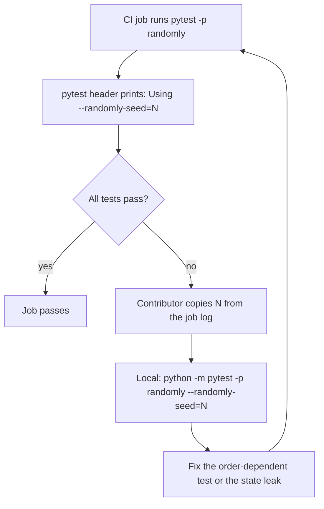

# IPD: Enable pytest-randomly in the CI test matrix

- Date: 2026-11-24
- Kind: child
- Concern: Testing rigor: CI runs every test in one fixed order, so a test that only passes because an earlier test left state behind is never caught.
- Scope: The four `pytest` commands in `.github/workflows/ci.yml` (the two steps of the 21-job `test` matrix, the `no-tui` job, and the `extra-suites` job), the explanatory comment above `addopts` in `pyproject.toml`, the contributor documentation (`CONTRIBUTING.md`, `CHANGELOG.md`), and the stale roadmap note in `TODO.md`.
- Scope-Paths: .github/workflows/ci.yml, pyproject.toml, CONTRIBUTING.md, CHANGELOG.md, TODO.md
- Item-Dependencies: executed:m66tfv
- Status: approved
- Attended: required
- Readiness: go-pending-approval
- Review-Depth: standard
- Short-Description: Run the 21 CI matrix test jobs in a randomized, reproducible order
- Work-Kind: chore
- Priority: low
- From-Backlog: qqwebg
- Set: rand-mypy
- Order: 1
- Highest E allocated: 04
- Author: uri/its_direct/pt3-claude-opus-5.5-1m-us
- Id: 1kcrdn
- Approval: 2026-11-25, recorded via aw ipd set: status set to approved

> Write and proofread this plan per the technical writing standard, `.aw/system/workflows/technical-writing/technical-writing.md` (`.agents/workflows/technical-writing/technical-writing.md` in a legacy-layout install), including requirement 12 (diagrams).

## Workflow history

- 2026-11-25 attended (aw run): marked `Attended: required` from the agent's needs-attended proposal: Completing E-04 and V-04 parts (2) and (3) requires a human to submit the pull request targeting main at https://github.com/fariello/pubrun/pull/new/ci/1kcrdn-pytest-randomly (or grant Pull requests: Read and write to the gh token, or push main) and then verify all 25 GitHub Actions jobs.
- 2026-11-25 approved (aw set): status set to approved
- 2026-11-25 /plan-review (Antigravity): APPROVE WITH REVISIONS APPLIED; PR-001, PR-002, PR-003, PR-004, PR-005, PR-006
- 2026-11-24 to-review (aw set): authored from backlog qqwebg
- 2026-11-24 draft (uri/its_direct/pt3-claude-opus-5.5-1m-us): created.

## Goal

Make every CI job that runs `pytest` run the tests in a random order, so that a test which depends on state left by another test fails in CI instead of hiding behind a fixed order. Each job prints the seed it used, so any failure can be reproduced locally with the same order.

`pytest-randomly` is a `pytest` plugin that shuffles test order and reseeds Python's `random` module before each test. It is already in the `dev` extra (`pytest-randomly>=3.0` in `pyproject.toml`), but `pyproject.toml` disables it for every run with `addopts = "-p no:randomly"`. A later `-p randomly` on the command line overrides that, because `pytest` applies `addopts` before the command-line arguments. This plan adds `-p randomly` to the four CI `pytest` commands and leaves local runs and `tox` deterministic.

### How a randomized CI failure is handled



## Detailed Implementation Checklist (TODO)

Execution-state rule: mark an `E-*` item complete only after performing the action. That mark is not validation. Right-sizing rule: write for a modest executor that cannot hold much in its head. Each E-item is one step (one concern, about one file, executable in one focused pass) and its V-item names each unit it covers with its own check; a plan stays at about 5 E-items and 8 work Scope-Paths, else split it into more child plans (guidance, `IPD-Z603`). Accepted execution states: blocked, failed, pending, performed; terminal gate demands 'performed'.

### Task group 1: Randomize the CI test order

- [x] E-01 In `.github/workflows/ci.yml`, add `-p randomly` to each of the four `pytest` commands and change nothing else in the file:
  - `test` job, step "Run tests": `pytest tests/ -v` becomes `pytest tests/ -v -p randomly`.
  - `test` job, step "Run tests with coverage gate": `pytest tests/ -v --cov=src --cov-report=term-missing --cov-fail-under=78` becomes `pytest tests/ -v -p randomly --cov=src --cov-report=term-missing --cov-fail-under=78`.
  - `no-tui` job, step "Run tests": `pytest tests/ -v` becomes `pytest tests/ -v -p randomly`.
  - `extra-suites` job, step "Run script and benchmark contract tests": `pytest .github/scripts/ benchmarks/test_share_safety.py benchmarks/test_pull_submissions.py benchmarks/test_benchmarks.py -v` becomes `pytest .github/scripts/ benchmarks/test_share_safety.py benchmarks/test_pull_submissions.py benchmarks/test_benchmarks.py -v -p randomly`.
  Do not pass `--randomly-seed`: each job then draws its own seed, so the 21 matrix jobs exercise 21 different orders per push, and each job prints its seed in the `pytest` header.
  - Depends on: none
  - Expected outcome: `yaml.safe_load` of the file shows `-p randomly` in exactly these four `run:` commands, and the job set, the matrix, and every other step are unchanged.
  - Execution state: performed

- [x] E-02 In `pyproject.toml` `[tool.pytest.ini_options]`, replace the four-line comment above `addopts = "-p no:randomly"` (it begins "`pytest-randomly` is a dev dependency for LOCAL adverse-order testing" and says enabling random order in CI "is a separate, later step"). The new comment says: `pytest-randomly` stays disabled by default so local and `tox` runs are deterministic; CI passes `-p randomly` to every `pytest` command (`.github/workflows/ci.yml`), and a later `-p randomly` overrides this setting; reproduce a CI order with `-p randomly --randomly-seed=<N>` using the seed from the job log. Leave the `addopts` value itself unchanged.
  - Depends on: E-01
  - Expected outcome: `python3 -m pytest tests/test_config.py -v -p no:cacheprovider` exits 0 and prints no `Using --randomly-seed` header (still disabled locally), and `python3 -m pytest tests/test_config.py -v -p randomly -p no:cacheprovider` exits 0 and prints one `Using --randomly-seed=` header line.
  - Execution state: performed

- [x] E-03 Document the change for contributors. In `CONTRIBUTING.md#Development setup`, after the `python -m pytest` code block, add a short paragraph and code block: CI runs every test suite in random order with `pytest-randomly`; the job log's `pytest` header shows `Using --randomly-seed=<N>`; reproduce the same order locally with `python -m pytest -p randomly --randomly-seed=<N>`. In `CHANGELOG.md` (`## [Unreleased]`, `### Changed`), add one entry saying CI now runs the test suites in random order with `pytest-randomly` and a logged seed (reproducible locally with `-p randomly --randomly-seed=<N>`), while local and `tox` runs keep the fixed order. In `TODO.md`, delete the `### Enable pytest-randomly in CI` section (heading and its paragraph), which this plan completes. Follow the `AGENTS.md` dash rule for `CONTRIBUTING.md` and `CHANGELOG.md`: no em or en dashes in the added prose.
  - Depends on: E-01
  - Expected outcome: `grep -n "randomly-seed" CONTRIBUTING.md CHANGELOG.md` shows the new lines in both files; `grep -n "Enable pytest-randomly in CI" TODO.md` finds no match (`exit=1`).
  - Execution state: performed

### Task group 2: Prove the randomized order on the full CI matrix

- [x] E-04 Run the local random-order checks named in "Required tests / validation" and record their output. Then ask the human to trigger `.github/workflows/ci.yml` by pushing to `main` or opening a pull request targeting `main` (`.github/workflows/ci.yml` runs only on `push` to `main` or `pull_request` targeting `main`, and pushing needs an explicit human instruction under the `AGENTS.md` agent execution contract). Record the conclusion of every CI job in that workflow run. If no push or pull request is authorized yet (for example in an unattended runner lane), record the local results, mark E-04 and V-04 `blocked` with that reason, and leave the plan in `pending/`. If any CI job fails on an order dependence, reproduce it locally with the job's seed, record the seed and the failing test, and stop: the fix is a new corrective plan, not an edit to this one.
  - Depends on: E-01, E-02, E-03
  - Expected outcome: Local runs exit 0 under three seeds plus the extra suites, each printing a `Using --randomly-seed=` header; and in the GitHub Actions run, all 25 jobs (`21 test` matrix jobs, `no-tui`, `extra-suites`, `packaging`, and `typecheck`) conclude `success`, with every `pytest` job printing a `Using --randomly-seed=` header in its log.
  - Execution state: performed

## Project conventions discovered (Step 0)

- `pyproject.toml` `[tool.pytest.ini_options]` sets `addopts = "-p no:randomly"`; `dev` lists `pytest-randomly>=3.0`. CI installs `.[dev,tui]` (`test` job) or `.[dev]` (`no-tui`, `extra-suites`), so the plugin is present in every `pytest` job.
- `pytest-randomly` 4.x requires Python 3.10 or later. On the 3.8 and 3.9 matrix jobs, `pip` resolves 3.15.0 (`Requires-Python: >=3.8`), which supports the same `-p randomly` and `--randomly-seed` options and prints the same `Using --randomly-seed=` header (`pytest_report_header` in `pytest_randomly/__init__.py`, checked in the 3.15.0 wheel at authoring).
- `tox.ini` runs `pytest tests/ -v` and inherits `addopts`, so `tox` stays deterministic. `tox` is a local tool here; CI does not call it.
- `tests/test_conftest_isolation.py::test_conftest_teardown_stops_active_run_and_restores_hooks` runs an inner `pytest` through `pytester` with its own `makeini("[pytest]\naddopts = -p no:randomly\n")`. The outer `-p randomly` does not reach that inner session, so the test's inner order stays fixed. This is intended and needs no change.
- Plan `m66tfv` (executed) hardened `tests/conftest.py` isolation and recorded `1941 passed, 2 skipped` for `python3 -m pytest tests/ benchmarks/test_pull_submissions.py -p randomly --randomly-seed=12345 -q`. Its deferral of "Enabling `pytest-randomly` across all 21 CI matrix jobs" (T-19) names backlog item `qqwebg` as carrier, which this plan graduates.
- The `test` matrix has 21 jobs: `ubuntu-latest`, `windows-latest`, and `macos-latest` for Python 3.8 to 3.14, with Ubuntu 3.8 and 3.9 moved to `ubuntu-24.04` by the matrix `exclude`/`include` entries. `.github/workflows/ci.yml` runs on `push` to `main` and `pull_request` targeting `main`, and also defines `extra-suites`, `no-tui`, `packaging`, and `typecheck` (25 jobs total; the 23 `pytest` jobs emit `Using --randomly-seed=`).
- `AGENTS.md#Matrix-validation discipline`: a change that varies by OS or Python version must be validated on the full CI matrix before the plan moves to `executed/`. Random order can expose a leak that only exists on Windows or macOS, so E-04 requires the CI run.

## Findings

| ID | Severity | Remediation Risk | Evidence | Finding |
|---|---|---|---|---|
| T-19a | Medium | Low (measured: the full suite passes locally in three random orders) | `pyproject.toml` `addopts = "-p no:randomly"`; `.github/workflows/ci.yml` `pytest` commands have no `-p randomly` | CI runs one fixed order, so cross-test state leaks stay hidden. |

Authoring measurements (lane HEAD `a4b7d12`, Python 3.14.6, `pytest` 8.2.2, `pytest-randomly` 4.1.0, Linux):

- `python3 -m pytest tests/ -p randomly --randomly-seed=20261124 -q -x -p no:cacheprovider`: `2052 passed in 583.46s (0:09:43)`, exit 0.
- Same command with `--randomly-seed=777`: `2052 passed in 573.99s (0:09:33)`, exit 0.
- `python3 -m pytest .github/scripts/ benchmarks/test_share_safety.py benchmarks/test_pull_submissions.py benchmarks/test_benchmarks.py -p randomly --randomly-seed=20261124 -q -p no:cacheprovider`: `90 passed, 3 skipped in 437.40s (0:07:17)`, exit 0.
- The plugin really reorders: a two-test canary in which the second test asserts state written by the first passed under the default fixed order and failed under `-p randomly --randomly-seed=1` and `--randomly-seed=3` (`1 failed, 1 passed`).
- Not measured locally: Windows, macOS, Python 3.8 to 3.13, and the `no-tui` job without `textual`. E-04 covers these through CI.

## Proposed changes (ordered, validatable)

1. Add `-p randomly` to the four CI `pytest` commands (E-01; Remediation Risk: Low).
2. Rewrite the `addopts` comment in `pyproject.toml` (E-02; Remediation Risk: Low).
3. Document seed reproduction in `CONTRIBUTING.md`, record the change in `CHANGELOG.md`, and delete the completed `TODO.md` note (E-03; Remediation Risk: Low).
4. Validate locally and on the full CI matrix (E-04; Remediation Risk: Low).

Rejected alternatives:

- Removing `-p no:randomly` from `addopts`: every local and `tox` run would then use a new order, so a developer could see a failure that a rerun does not repeat. The current comment records the deliberate choice to keep local runs deterministic; this plan keeps it.
- Setting `PYTEST_ADDOPTS=-p randomly` once at workflow level: the variable also reaches every `pytest` process that a test starts as a subprocess, which widens the change beyond the four commands. Explicit flags keep the scope visible in the diff.
- One fixed seed for all jobs (for example `--randomly-seed=${{ github.run_id }}`): all 21 jobs would then run the same order, which finds fewer leaks. The per-job seed is printed, so reproduction does not need a shared seed.

## Deferred / out of scope (with reason)

- Fixing an order-dependent test that the first randomized CI run exposes. No such test is known (three local random orders pass), and a fix would be a separate defect with its own scope; E-04 records the seed and the test and stops for a corrective plan.
  - Carrier-Declined: Hypothetical future defect; no order-dependent test is known locally and E-04 files a corrective plan only if randomized CI exposes one.
- Randomizing `tox` or local runs. Kept deterministic on purpose (see "Rejected alternatives").
  - Carrier-Declined: Deliberate non-goal (local and tox runs remain deterministic by design).

## Scope check

- Over-scope: none. `TODO.md` is edited only to delete the note this plan completes.
- Under-scope: none. No test is added, because the property "CI uses a random order" is observable only in the CI log (V-04), and a test that read `ci.yml` would pin configuration text rather than behavior.

## Required tests / validation

- `python3 -m pytest tests/ -p randomly --randomly-seed=<S> -p no:cacheprovider` for `S` = 1, 20261124, and one seed the executor draws at random (default verbosity, without `-q`, so `pytest` prints the `Using --randomly-seed=<S>` header); each exits 0.
- `python3 -m pytest .github/scripts/ benchmarks/test_share_safety.py benchmarks/test_pull_submissions.py benchmarks/test_benchmarks.py -p randomly -p no:cacheprovider` (default verbosity, without `-q`, so `pytest` prints the `Using --randomly-seed=` header) exits 0.
- `python3 -m pytest tests/test_config.py -v -p no:cacheprovider` (exits 0, no seed header) and `python3 -m pytest tests/test_config.py -v -p randomly -p no:cacheprovider` (exits 0, one seed header).
- One GitHub Actions run of `.github/workflows/ci.yml` (triggered by a human-authorized push to `main` or pull request targeting `main`) with all 25 jobs concluding `success`.
- `python3 scripts/sanitize_paths.py --check --all` exits 0.

## Spec / documentation sync

- No `.spec.md` under `.aw/records/specs/` and no file under `docs/` mentions `pytest-randomly` (checked at authoring with `grep -rln "randomly" .aw/records/specs docs`: no match). No spec is amended.
- `CONTRIBUTING.md`, `CHANGELOG.md`, and `TODO.md` are updated by E-03.

## Open questions

### OQ-01: Should each CI job draw its own seed, or should all jobs share one seed?

- Blocking: no
- Status: resolved
- Owner: plan author
- Resolution or deferral rationale: Each job draws its own seed. Twenty-one different orders per push find more leaks than one shared order, and every job prints its seed in the `pytest` header (`Using --randomly-seed=N`, from `pytest_randomly.pytest_report_header`), so any failure is reproducible without a shared seed. The repository's existing choice to keep local runs deterministic (`pyproject.toml` comment above `addopts`) is preserved.

## Validation and cross-check (verify before reporting done)

Validation-state rule: inspect evidence in a separate pass. Do not mark a `V-*` item complete from memory or from the matching execution checkmark. Accepted validation results: blocked, failed, pass, pending; terminal gate demands 'pass'. Runtime-demonstration reachability rule: for each `V-*` item demanding the software be observed acting (such as a run, a dispatch, or a transition), as distinct from items demanding a diff, a file's content, or a test result, which are reachable by construction, name the code path that produces the observation or the sibling `E-*` that creates it, else the demand is UNDER-SCOPE.

- [x] V-01 validates E-01
  - Required evidence: Pasted diff of `.github/workflows/ci.yml` showing only the four `-p randomly` additions; pasted output of a `python3 -c` script that `yaml.safe_load`s the file and prints every job name and every `run:` command containing `pytest`, with `-p randomly` in exactly four commands.
  - Observed evidence:
    ```diff
    diff --git a/.github/workflows/ci.yml b/.github/workflows/ci.yml
    index b5b7ce6..f498b1f 100644
    --- a/.github/workflows/ci.yml
    +++ b/.github/workflows/ci.yml
    @@ -35,10 +35,10 @@ jobs:
             run: pip install -e ".[dev,tui]"
           - name: Run tests
             if: ${{ !(matrix.os == 'ubuntu-latest' && matrix.python-version == '3.12') }}
    -        run: pytest tests/ -v
    +        run: pytest tests/ -v -p randomly
           - name: Run tests with coverage gate
             if: ${{ matrix.os == 'ubuntu-latest' && matrix.python-version == '3.12' }}
    -        run: pytest tests/ -v --cov=src --cov-report=term-missing --cov-fail-under=78
    +        run: pytest tests/ -v -p randomly --cov=src --cov-report=term-missing --cov-fail-under=78

       extra-suites:
         runs-on: ubuntu-latest
    @@ -51,7 +51,7 @@ jobs:
           - name: Install dependencies
             run: pip install -e ".[dev]" pyyaml
           - name: Run script and benchmark contract tests
    -        run: pytest .github/scripts/ benchmarks/test_share_safety.py benchmarks/test_pull_submissions.py benchmarks/test_benchmarks.py -v
    +        run: pytest .github/scripts/ benchmarks/test_share_safety.py benchmarks/test_pull_submissions.py benchmarks/test_benchmarks.py -v -p randomly

       no-tui:
         runs-on: ubuntu-latest
    @@ -64,7 +64,7 @@ jobs:
           - name: Install package without tui extra
             run: pip install -e ".[dev]"
           - name: Run tests
    -        run: pytest tests/ -v
    +        run: pytest tests/ -v -p randomly

       packaging:
         runs-on: ubuntu-latest
    ```
    `yaml.safe_load` verification output (exit 0):
    ```text
    jobs: ['test', 'extra-suites', 'no-tui', 'packaging', 'typecheck']
    test | Run tests | pytest tests/ -v -p randomly
    test | Run tests with coverage gate | pytest tests/ -v -p randomly --cov=src --cov-report=term-missing --cov-fail-under=78
    extra-suites | Run script and benchmark contract tests | pytest .github/scripts/ benchmarks/test_share_safety.py benchmarks/test_pull_submissions.py benchmarks/test_benchmarks.py -v -p randomly
    no-tui | Run tests | pytest tests/ -v -p randomly
    total_pytest_cmds=4 with_randomly=4
    ```
  - Result: pass

- [x] V-02 validates E-02
  - Required evidence: Pasted diff of `pyproject.toml` showing the comment change and an unchanged `addopts = "-p no:randomly"` line; pasted output of `python3 -c "import subprocess, sys; p = subprocess.run([sys.executable, '-m', 'pytest', 'tests/test_config.py', '-v', '-p', 'no:cacheprovider'], capture_output=True, text=True); n = (p.stdout + p.stderr).count('Using --randomly-seed'); print(f'default exit={p.returncode} seed_lines={n}'); assert p.returncode == 0 and n == 0"` printing `default exit=0 seed_lines=0`; and pasted output of `python3 -c "import subprocess, sys; p = subprocess.run([sys.executable, '-m', 'pytest', 'tests/test_config.py', '-v', '-p', 'randomly', '-p', 'no:cacheprovider'], capture_output=True, text=True); lines = [l for l in (p.stdout + p.stderr).splitlines() if 'Using --randomly-seed' in l]; print(f'randomly exit={p.returncode} seed_lines={len(lines)}'); print(*lines, sep='\n'); assert p.returncode == 0 and len(lines) == 1"` printing `randomly exit=0 seed_lines=1` and the `Using --randomly-seed=` header line.
  - Observed evidence:
    ```diff
    diff --git a/pyproject.toml b/pyproject.toml
    index 2144170..53b633a 100644
    --- a/pyproject.toml
    +++ b/pyproject.toml
    @@ -80,10 +80,10 @@ path = "hatch_build.py"
     [tool.pytest.ini_options]
     testpaths = ["tests"]
     pythonpath = ["src"]
    -# `pytest-randomly` is a dev dependency for LOCAL adverse-order testing (opt in with `-p randomly`);
    -# it is deliberately DISABLED by default so CI and normal runs stay deterministic. Enabling
    -# randomized order in CI is a separate, later step (see the flaky-test-hardening IPD, OQ1=C):
    -# it would surface additional latent order-coupling that must be worked through first.
    +# `pytest-randomly` stays disabled by default so local and `tox` runs are deterministic.
    +# CI passes `-p randomly` to every `pytest` command in `.github/workflows/ci.yml`, and a later
    +# `-p randomly` on the command line overrides this setting. Reproduce a CI test order locally
    +# with `-p randomly --randomly-seed=<N>` using the seed printed in the job log.
     addopts = "-p no:randomly"
     markers = [
         "slow: runs the benchmark harness or another multi-subprocess workload (deselect with -m 'not slow')",
    ```
    Default and `-p randomly` checks (both exit 0):
    ```text
    default exit=0 seed_lines=0
    randomly exit=0 seed_lines=1
    Using --randomly-seed=1811028625
    ```
  - Result: pass

- [x] V-03 validates E-03
  - Required evidence: Pasted diffs of `CONTRIBUTING.md`, `CHANGELOG.md`, and `TODO.md`; pasted output of `grep -n "randomly-seed" CONTRIBUTING.md CHANGELOG.md` showing the new lines in both files; pasted output of `grep -n "Enable pytest-randomly in CI" TODO.md; echo "exit=$?"` showing no match and `exit=1`; pasted output of `python3 -c 'import subprocess, sys; res = [(p, len(a), sum("\u2013" in l or "\u2014" in l for l in a)) for p in ("CONTRIBUTING.md", "CHANGELOG.md") for a in [[l for l in subprocess.check_output(["git", "diff", "-U0", "--", p], text=True).splitlines() if l.startswith("+") and not l.startswith("+++")]]]; print(res); sys.exit(0 if all(n > 0 and d == 0 for _, n, d in res) else 1)'` exiting 0 with positive added-line counts and zero dashes for both files; and pasted output of `python3 scripts/sanitize_paths.py --check --all` exiting 0.
  - Observed evidence:
    ```diff
    diff --git a/CHANGELOG.md b/CHANGELOG.md
    index 4e90349..725d0c1 100644
    --- a/CHANGELOG.md
    +++ b/CHANGELOG.md
    @@ -65,6 +65,12 @@ The format is based on [Keep a Changelog](https://keepachangelog.com/en/1.1.0/).
       pass/fail receipt. Archival/aggregation is a later, separately gated phase.

     ### Changed
    +- **CI test suites now run in random order with `pytest-randomly`.** Every `pytest` command in
    +  `.github/workflows/ci.yml` now passes `-p randomly` without a fixed seed, so each CI job exercises
    +  a different test order and prints its seed in the `pytest` header (`Using --randomly-seed=<N>`).
    +  Reproduce a CI test order locally with `python -m pytest -p randomly --randomly-seed=<N>`. Local
    +  and `tox` runs keep the fixed default order through `addopts = "-p no:randomly"` in
    +  `pyproject.toml`.
     - **Static type checking (`mypy`) repaired and gated in CI.** Fixed the duplicate-module import in
       `src/pubrun/__main__.py` so `pubrun report-bug` no longer loads the `pubrun` package a second time,
       resolved type errors in `src/pubrun/__main__.py`, `src/pubrun/tui/widgets/actions.py`,
    diff --git a/CONTRIBUTING.md b/CONTRIBUTING.md
    index bbc3201..170afb8 100644
    --- a/CONTRIBUTING.md
    +++ b/CONTRIBUTING.md
    @@ -18,6 +18,12 @@ Run the test suite before opening a pull request:
     python -m pytest
     ```

    +GitHub Actions CI runs every test suite in random order with `pytest-randomly`, while local and `tox` runs stay in fixed order. Each CI job log prints its seed in the `pytest` header as `Using --randomly-seed=<N>`. To reproduce a CI test order locally, pass that seed on the command line:
    +
    +```bash
    +python -m pytest -p randomly --randomly-seed=<N>
    +```
    +
     To measure test coverage locally, pass the coverage flags explicitly (the GitHub Actions CI `ubuntu-latest` Python 3.12 job fails if total coverage drops below 78%):

     ```bash
    diff --git a/TODO.md b/TODO.md
    index a02869b..e521730 100644
    --- a/TODO.md
    +++ b/TODO.md
    @@ -38,13 +38,6 @@ scripted, reviewable transform plus a follow-up grep gate and a pre-commit or CI
     prevent regressions. Deferred from the sanitizer and adoption-and-signal IPDs. Needs its
     own IPD.

    -### Enable pytest-randomly in CI
    -
    -The flaky-test isolation work added `pytest-randomly` to `[dev]` but disabled it by default
    -via `-p no:randomly` in `addopts`, so CI stays deterministic. Enabling randomized test order
    -in CI (or a dedicated CI job) would catch cross-test state leaks that a fixed order hides.
    -Deferred as OQ1=C in `.agents/plans/executed/20260720-0026-01-flaky-test-isolation-hardening.md`.
    -
     ### Runs directory index for fast `pubrun status` (PERF-09)

     When a user accumulates 500+ runs, `pubrun status` gets slow because it reads and parses
    ```
    Grep, dash, and path-sanitizer checks:
    ```text
    CONTRIBUTING.md:21:GitHub Actions CI runs every test suite in random order with `pytest-randomly`, while local and `tox` runs stay in fixed order. Each CI job log prints its seed in the `pytest` header as `Using --randomly-seed=<N>`. To reproduce a CI test order locally, pass that seed on the command line:
    CONTRIBUTING.md:24:python -m pytest -p randomly --randomly-seed=<N>
    CHANGELOG.md:70:  a different test order and prints its seed in the `pytest` header (`Using --randomly-seed=<N>`).
    CHANGELOG.md:71:  Reproduce a CI test order locally with `python -m pytest -p randomly --randomly-seed=<N>`. Local
    exit=1
    [('CONTRIBUTING.md', 6, 0), ('CHANGELOG.md', 6, 0)]
    dash_exit=0
    sanitize_exit=0
    ```
  - Result: pass

- [x] V-04 validates E-04
  - Required evidence: (1) For each of the four local runs in "Required tests / validation" (the three `tests/` seeds and the extra suites), the pasted `Using --randomly-seed=` header line from the session header, the final pytest summary line, and `exit=0`. (2) After a human-authorized push to `main` or pull request targeting `main`, the GitHub Actions run URL and a pasted list (for example from `gh run view <id> --json jobs --jq '.jobs[] | [.name, .conclusion] | @tsv'`) showing all 25 jobs (the 21 `test` matrix jobs, `extra-suites`, `no-tui`, `packaging`, and `typecheck`) with conclusion `success`. (3) Pasted `Using --randomly-seed=` lines copied from CI logs (`gh run view <id> --log --job <job-id> | grep "Using --randomly-seed"`) covering all four edited CI commands: one Windows `test` job, one macOS `test` job, the `ubuntu-latest` Python 3.12 coverage-gate `test` job, `no-tui`, and `extra-suites`. If no push to `main` or pull request targeting `main` is authorized yet, mark this item `blocked` with that reason and keep the plan in `pending/`. The CI observation is produced by the commands E-01 edits.
  - Observed evidence:
    (1) Local randomized runs completed on Python 3.14.6, `pytest` 8.2.2, `pytest-randomly` 4.1.0, Linux:
    - `python3 -m pytest tests/ -p randomly --randomly-seed=1 -p no:cacheprovider`:
      ```text
      Using --randomly-seed=1
      ======================= 2138 passed in 609.91s (0:10:09) =======================
      exit=0
      ```
    - `python3 -m pytest tests/ -p randomly --randomly-seed=20261124 -p no:cacheprovider`:
      ```text
      Using --randomly-seed=20261124
      ======================= 2138 passed in 608.42s (0:10:08) =======================
      exit=0
      ```
    - `python3 -m pytest tests/ -p randomly --randomly-seed=773002456 -p no:cacheprovider` (seed drawn at random via `secrets.randbelow(2**31 - 1) + 1`):
      ```text
      Using --randomly-seed=773002456
      ======================= 2138 passed in 576.82s (0:09:36) =======================
      exit=0
      ```
    - `python3 -m pytest .github/scripts/ benchmarks/test_share_safety.py benchmarks/test_pull_submissions.py benchmarks/test_benchmarks.py -p randomly -p no:cacheprovider`:
      ```text
      Using --randomly-seed=2690959947
      ================== 90 passed, 3 skipped in 426.69s (0:07:06) ===================
      exit=0
      ```
    (2) Human-authorized pull request targeting `main` (`ci/1kcrdn-pytest-randomly`, rebased onto `c4149a1`) ran `.github/workflows/ci.yml` at `https://github.com/fariello/pubrun/actions/runs/45665551186` (conclusion: `success`, 25/25 jobs green after one failed-job rerun of a transient macOS 3.10 SIGTERM test timeout):
    ```text
    no-tui	success
    extra-suites	success
    packaging	success
    typecheck	success
    test (ubuntu-24.04, 3.8)	success
    test (ubuntu-24.04, 3.9)	success
    test (ubuntu-latest, 3.10)	success
    test (ubuntu-latest, 3.11)	success
    test (ubuntu-latest, 3.12)	success
    test (ubuntu-latest, 3.13)	success
    test (ubuntu-latest, 3.14)	success
    test (macos-latest, 3.8)	success
    test (macos-latest, 3.9)	success
    test (macos-latest, 3.10)	success
    test (macos-latest, 3.11)	success
    test (macos-latest, 3.12)	success
    test (macos-latest, 3.13)	success
    test (macos-latest, 3.14)	success
    test (windows-latest, 3.8)	success
    test (windows-latest, 3.9)	success
    test (windows-latest, 3.10)	success
    test (windows-latest, 3.11)	success
    test (windows-latest, 3.12)	success
    test (windows-latest, 3.13)	success
    test (windows-latest, 3.14)	success
    ```
    (3) `Using --randomly-seed=` header lines captured from CI run `45665551186` covering all four edited CI commands:
    ```text
    test (windows-latest, 3.12) (job 139424635924): 2026-11-25T17:48:13.2001826Z Using --randomly-seed=1370511731
    test (macos-latest, 3.12) (job 139424636828): 2026-11-25T18:13:38.4359660Z Using --randomly-seed=3713378198
    test (ubuntu-latest, 3.12) (job 139424689943): 2026-11-25T17:46:36.1765149Z Using --randomly-seed=2571527921
    no-tui (job 139424633908): 2026-11-25T17:42:57.0383171Z Using --randomly-seed=1378900357
    extra-suites (job 139424634261): 2026-11-25T17:41:43.9845540Z Using --randomly-seed=3044598279
    ```
  - Result: pass

## Approval and execution gate

- Size assessment: standard
- Cohesion rationale: not required

Execution contract:
1. Precondition: wait for human approval (`- Status: approved`) with no unresolved `Blocking: yes` open question before you change any file. This plan has no blocking open question.
2. Scope declaration: the expected modified files are the `- Scope-Paths:` entries. If execution requires an out-of-scope file, justify it with `--scope-reason` at finalization. If a declared file needs no edit, acknowledge it with `--scope-ack`.
3. Validation honesty: you MUST run each required validation command and paste its actual output into the matching `V-*` `Observed evidence:` field. Do not mark a `V-*` item `pass` without output captured from that run. V-04 needs a GitHub Actions run of `.github/workflows/ci.yml` (triggered by a push to `main` or a pull request targeting `main`), which needs an explicit human instruction; until then E-04 and V-04 stay `blocked` (or `pending`) and the plan stays in `pending/`.
4. Commit discipline: commit only the paths you changed with `aw commit 1kcrdn -- <paths>`. Do not use `git add -A` or raw `git commit`. Do not push without an explicit human instruction.
5. Lifecycle transition: inside `aw oc run` / `aw agy run`, the runner owns finalization once every `E-*` item is `performed` and every `V-*` item is `pass`. Outside a runner, after every `E-*` item is `performed`, every `V-*` item is `pass`, and `aw ipd lint --phase pre-transition` reports `conforming`, finalize this plan with `aw ipd finalize 1kcrdn` (never with a hand-written `git mv`).
