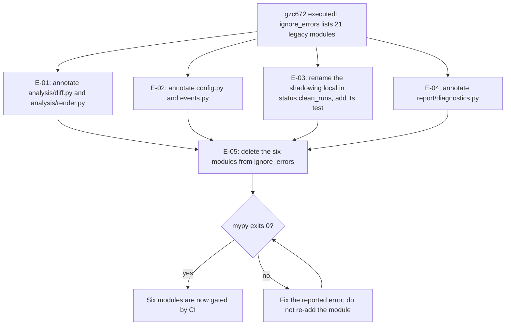

# IPD: Clear mypy errors in analysis, report, config, status, and events

- Date: 2026-11-24
- Kind: child
- Concern: Static type checking: six non-capture modules are excused from `mypy` by the `ignore_errors` override that plan `gzc672` adds, so a new type error in them would not fail the CI `typecheck` job.
- Scope: `src/pubrun/analysis/diff.py`, `src/pubrun/analysis/render.py`, `src/pubrun/config.py`, `src/pubrun/status.py`, `src/pubrun/events.py`, `src/pubrun/report/diagnostics.py`, a new `tests/test_status_clean_table.py`, and the removal of the six modules from the `ignore_errors` module list in `pyproject.toml`.
- Scope-Paths: src/pubrun/analysis/diff.py, src/pubrun/analysis/render.py, src/pubrun/config.py, src/pubrun/status.py, src/pubrun/events.py, src/pubrun/report/diagnostics.py, tests/test_status_clean_table.py, pyproject.toml
- Item-Dependencies: executed:gzc672, executed:m66tfv
- Status: approved
- Readiness: go-pending-approval
- Review-Depth: standard
- Short-Description: Fix mypy errors in analysis/diff, analysis/render, config, status, events, and report/diagnostics and take them off the ignore_errors list
- Work-Kind: chore
- Priority: low
- From-Backlog: qqwebg
- Set: rand-mypy
- Order: 3
- Highest E allocated: 05
- Author: uri/its_direct/pt3-claude-opus-5.5-1m-us
- Id: qe6dad
- Approval: 2026-11-25, recorded via aw ipd set: status set to approved

> Write and proofread this plan per the technical writing standard, `.aw/system/workflows/technical-writing/technical-writing.md` (`.agents/workflows/technical-writing/technical-writing.md` in a legacy-layout install), including requirement 12 (diagrams).

## Workflow history

- 2026-11-25 approved (aw set): status set to approved
- 2026-11-25 /plan-review (Antigravity): APPROVE WITH REVISIONS APPLIED; PR-001, PR-002, PR-003, PR-004, PR-005
- 2026-11-24 to-review (aw set): authored from backlog qqwebg
- 2026-11-24 draft (uri/its_direct/pt3-claude-opus-5.5-1m-us): created.

## Goal

Fix the 20 `mypy` errors in six non-capture modules (`analysis/diff`, `analysis/render`, `config`, `status`, `events`, `report/diagnostics`) and delete those modules from the `ignore_errors` override in `pyproject.toml`, so the CI `typecheck` job checks them. Every fix is an annotation or a local rename; no runtime behavior changes.

### Ratchet step for this plan



## Detailed Implementation Checklist (TODO)

Execution-state rule: mark an `E-*` item complete only after performing the action. That mark is not validation. Right-sizing rule: write for a modest executor that cannot hold much in its head. Each E-item is one step (one concern, about one file, executable in one focused pass) and its V-item names each unit it covers with its own check; a plan stays at about 5 E-items and 8 work Scope-Paths, else split it into more child plans (guidance, `IPD-Z603`). Accepted execution states: blocked, failed, pending, performed; terminal gate demands 'performed'.

### Task group 1: Fix the type errors

- [x] E-01 Annotate two empty containers in `src/pubrun/analysis/diff.py` and widen two parameters in `src/pubrun/analysis/render.py`. `Dict`, `Any`, and `List` are already imported in `diff.py`.
  - `src/pubrun/analysis/diff.py::_normalize_manifest`: `flat = {}` becomes `flat: Dict[str, Any] = {}`. Without the annotation, `mypy` infers `dict[str, str]` from the first assignment and then rejects the later `int` and `list` values (4 errors).
  - `src/pubrun/analysis/diff.py::compare_manifests`: `diff_report = {` becomes `diff_report: Dict[str, Dict[str, Any]] = {` (1 error).
  - `src/pubrun/analysis/render.py::_format_array_diff`: the parameters `added_set: set,` and `removed_set: set,` become `added_set: Iterable[Any],` and `removed_set: Iterable[Any],`, and `from typing import Any, Dict` becomes `from typing import Any, Dict, Iterable`. Its only caller, `src/pubrun/analysis/render.py::_render_inline`, passes lists, and the function only iterates over both arguments to build tag sets (4 errors).
  - Depends on: none
  - Expected outcome: The diff of the two files is these four annotation and parameter lines plus the one import line (five lines total).
  - Execution state: performed

- [x] E-02 Annotate `src/pubrun/config.py` and `src/pubrun/events.py`:
  - `src/pubrun/config.py::load_local_config`: `merged = {}` becomes `merged: Dict[str, Any] = {}` (1 error; `Dict` and `Any` are already imported).
  - `src/pubrun/events.py::EventStream.__init__`: after the line `self._buffer: List[str] = []`, add `self._file: Optional[TextIO] = None`, and change `from typing import Any, Dict, List, Optional` to `from typing import Any, Dict, List, Optional, TextIO`. The `try` block below still assigns the opened file; the new line only declares the attribute's type before the first assignment, because `mypy` otherwise infers it from `open(...)` and rejects the five later `self._file = None` assignments (5 errors).
  - Depends on: none
  - Expected outcome: The diff of the two files is these lines and nothing else.
  - Execution state: performed

- [x] E-03 In `src/pubrun/status.py::clean_runs`, rename the local variable `exit_code` that holds the display string in the confirmation table loop to `exit_str`: the line `exit_code = str(r.exit_code) if r.exit_code is not None else "-"` becomes `exit_str = str(r.exit_code) if r.exit_code is not None else "-"`, and the row line `f"{exit_code:<6}"` becomes `f"{exit_str:<6}"`. The old name rebound the function's `exit_code: Optional[int]` parameter (the exit-code filter) to a string after the filter had been used (1 error). Then create `tests/test_status_clean_table.py` with one test, `test_clean_dry_run_table_shows_each_run_exit_code`: it writes two finished run directories under `tmp_path / "runs"` (a `manifest.json` each, following the minimal shape in `tests/test_status_bugs.py::_make_completed`, one with `"status": {"outcome": "completed"}` and `"signals": {"exit_code": 0}`, one with `"outcome": "failed"` and `"exit_code": 3`), calls `clean_runs(output_dir=..., dry_run=True, status_filter="completed,failed")`, asserts it returns `0`, and asserts from `capsys` output that the table row for each run ID shows its own exit code (`0` and `3`) in the `EXIT` column (locate the `EXIT` column by header slice offset or use a single-token `argv` without extra arguments so spaces inside `SCRIPT` cannot shift column splits).
  - Depends on: none
  - Expected outcome: The new test passes before and after the rename (it characterizes the table), and fails when the `EXIT` cell is replaced by a constant (mutation check in V-03).
  - Execution state: performed

- [x] E-04 Annotate four locals in `src/pubrun/report/diagnostics.py` (`Optional`, `Dict`, `Any`, `List`, and `Tuple` are already imported on line 5; no import edit is needed):
  - `src/pubrun/report/diagnostics.py::read_resource_series`: `out = {"timestamps": [], "rss": [], "cpu": [], "tree_rss": [], "tree_cpu": []}` becomes `out: Dict[str, List[Any]] = {...}` with the same value.
  - `src/pubrun/report/diagnostics.py::print_report`: insert `elapsed_val: Optional[float]` on its own line immediately before `if timing_sem.get("elapsed_basis") == "session" and elapsed_raw is not None:`. The `else` branch assigns `workload_val if workload_val is not None else elapsed_raw`, which may be `None`.
  - `src/pubrun/report/diagnostics.py::draw_ascii_chart`: `bins = [[] for _ in range(width)]` becomes `bins: List[List[Any]] = [[] for _ in range(width)]`, and `placed = {}  # maps idx -> (start_col, end_col, lbl_str)` becomes `placed: Dict[int, Tuple[int, int, str]] = {}  # maps idx -> (start_col, end_col, lbl_str)`.
  - Depends on: none
  - Expected outcome: The diff of `src/pubrun/report/diagnostics.py` is exactly these four annotation changes and nothing else (4 errors fixed).
  - Execution state: performed

### Task group 2: Ratchet the type check

- [x] E-05 In `pyproject.toml`, delete these six entries from the `module` list of the `[[tool.mypy.overrides]]` block that sets `ignore_errors = true`: `pubrun.analysis.diff`, `pubrun.analysis.render`, `pubrun.config`, `pubrun.events`, `pubrun.report.diagnostics`, `pubrun.status`. Keep the remaining entries sorted and keep the comment that says the list may only shrink. Change nothing else in `pyproject.toml`.
  - Depends on: E-01, E-02, E-03, E-04
  - Expected outcome: After deleting `.mypy_cache/`, `mypy` prints `Success: no issues found in <N> source files` (`58` at review; re-derive at execution time if modules were added) and exits 0, and the override list no longer names any of the six modules.
  - Execution state: performed

## Project conventions discovered (Step 0)

- Plan `gzc672` (now `executed`; `approved` at authoring) created `[tool.mypy]` in `pyproject.toml` with an `ignore_errors = true` override listing 21 legacy modules (the original 20 plus `pubrun.capture.subprocesses`, added during `gzc672` execution; comment cites backlog items `qqwebg` and `z5xr49`), and added a blocking Linux `typecheck` CI job (`gzc672` E-03 and E-04). This plan depends on that configuration (`Item-Dependencies: executed:gzc672`).
- Because `gzc672` added `pubrun.capture.subprocesses` to the `ignore_errors` override during execution (until child `k6fs5k` fixes its 2 errors), `mypy` already exits 0 on `main` and exits 0 after E-05 regardless of whether `k6fs5k` has run yet.
- No `python_version` is set for `mypy` because `mypy` 2.x refuses targets below 3.10 and the project supports 3.8. Use only `typing` names available on Python 3.8 (`Dict`, `List`, `Optional`, `Tuple`, `Iterable`, `TextIO`).
- `tests/test_status_bugs.py::_make_completed` shows the minimal `manifest.json` that `status.scan_runs` accepts as a finished run. `clean_runs` with `dry_run=True` prints the confirmation table (`#`, `RUN ID`, `SCRIPT`, `STATUS`, `EXIT`, `AGE`, `SIZE`) and deletes nothing; note that if `argv` has extra arguments beyond `argv[0]`, `SCRIPT` renders `"<script> <args>"` with an embedded space, so tests should either slice by header offset or pass a single-token `argv`.
- Existing behavior tests for these modules: `tests/test_render.py`, `tests/test_diff_usability.py`, `tests/test_cli_diff_bugs.py`, `tests/test_config.py`, `tests/test_status.py`, `tests/test_status_bugs.py`, `tests/test_events.py`, `tests/test_reports.py`, `tests/test_timing_consumers.py`, `tests/test_report_checks_bugs.py`.

## Findings

| ID | Severity | Remediation Risk | Evidence | Finding |
|---|---|---|---|---|
| M-03 | Low | Low | `src/pubrun/analysis/diff.py::_normalize_manifest`: `Incompatible types in assignment (expression has type "int", target has type "str")` (2), `"list[Never]"` (1), `"list[str]"` (1); `src/pubrun/analysis/diff.py::compare_manifests`: `Need type annotation for "diff_report"` | 5 errors from unannotated empty dictionaries. |
| M-04 | Low | Low | `src/pubrun/analysis/render.py::_render_inline`: `Argument 3 to "_format_array_diff" has incompatible type "list[Any]"; expected "set[Any]"` (4, arguments 3 and 4 on two calls) | The parameter annotation is narrower than what the only caller passes. |
| M-05 | Low | Low | `src/pubrun/config.py::load_local_config`: `Need type annotation for "merged"`; `src/pubrun/events.py::EventStream`: `Incompatible types in assignment (expression has type "None", variable has type "TextIOWrapper[_WrappedBuffer]")` (5) | 6 errors from attributes or locals typed by their first assignment. |
| M-06 | Low | Low | `src/pubrun/status.py::clean_runs`: `Incompatible types in assignment (expression has type "str", variable has type "int \| None")` | The display loop reuses the name of the `exit_code` filter parameter for a string. It runs after the filter was applied, so output is correct today, but any later use of the parameter in that loop would read the string. |
| M-07 | Low | Low | `src/pubrun/report/diagnostics.py` (`read_resource_series`, `draw_ascii_chart`): `Need type annotation for "out"`, `"bins"`, `"placed"`; `src/pubrun/report/diagnostics.py::print_report`: `Incompatible types in assignment (expression has type "float \| None", variable has type "float")` | 4 errors from unannotated locals. |

Authoring measurements (lane HEAD `a4b7d12`, `mypy` 2.3.1, Python 3.14.6, Linux), on a scratch copy of `src/pubrun` with `gzc672`'s `__main__.py` import fix applied:

- With no `ignore_errors` override: `Found 177 errors in 25 files`. Applying only this plan's edits to that copy left 0 errors in the six modules (the remaining errors were all in other modules).
- With `gzc672`'s pre-execution 20-module ratchet configuration and these six modules deleted from the override: only the 2 `capture/subprocesses.py` errors remained (`gzc672` subsequently added `pubrun.capture.subprocesses` to `pyproject.toml`'s override list when it executed, so `mypy` exits 0 on `main` and after E-05).
- With every edit in this Set applied: `python3 -m pytest tests/test_render.py tests/test_diff_usability.py tests/test_cli_diff_bugs.py tests/test_config.py tests/test_status.py tests/test_status_bugs.py tests/test_events.py tests/test_reports.py tests/test_timing_consumers.py tests/test_report_checks_bugs.py <prototype of E-03's test> -q` gave `405 passed`.
- The E-03 test prototype passed against the unmodified `status.py` and against the renamed one, and failed (`1 failed`) when the row's `EXIT` cell was replaced by the constant `"?"`. Before this test, replacing that cell left `tests/test_status.py` and `tests/test_status_bugs.py` green (`129 passed`), so no existing test covered the column the rename touches.

## Proposed changes (ordered, validatable)

1. Annotate `analysis/diff.py` and widen `analysis/render.py` parameters (E-01; Remediation Risk: Low).
2. Annotate `config.py` and declare `EventStream._file` (E-02; Remediation Risk: Low).
3. Rename the shadowing local in `status.clean_runs` and add a test of the table's exit-code column (E-03; Remediation Risk: Low).
4. Annotate four locals in `report/diagnostics.py` (E-04; Remediation Risk: Low).
5. Delete the six modules from the `ignore_errors` override (E-05; Remediation Risk: Low).

Rejected alternative: `# type: ignore[...]` comments on each error line. They hide the next real error on those lines, and every error here has a precise annotation.

## Deferred / out of scope (with reason)

- The capture modules: owned by child `k6fs5k`.
  - Carrier: k6fs5k
  - Carrier-Evidence: .aw/records/plans/executed/20261124-rand-mypy-04-k6fs5k-clear-mypy-errors-in-capture-modules.ipd.md
- `core.py` and `tracker.py`: owned by child `0uxy76`.
  - Carrier: 0uxy76
- The import-mode modules and `_bootstrap.py`: owned by child `f5yisk`.
  - Carrier: f5yisk
  - Carrier-Evidence: .aw/records/plans/executed/20261124-rand-mypy-02-f5yisk-clear-mypy-errors-in-import-mode-shims-and-bootstrap.ipd.md
- Errors that appear only under `mypy --platform win32`: owned by child `juoqy2`; none is in this plan's modules.
  - Carrier: juoqy2

## Scope check

- Over-scope: none. `tests/test_status_clean_table.py` is the only addition beyond annotations; it covers the one renamed variable, which no existing test reached.
- Under-scope: none.

## Required tests / validation

- `rm -rf .mypy_cache && mypy; echo "exit=$?"`: prints `Success: no issues found in <N> source files` (`58` at review; re-derive at execution time if modules were added) and `exit=0`.
- Mutation checks, each restored before the next: append `_aw_mut: int = "x"` to `src/pubrun/status.py`, run `mypy --no-incremental; echo "exit=$?"` (expect an `error:` line for `src/pubrun/status.py` and `exit=1`), restore; repeat for `src/pubrun/report/diagnostics.py`.
- `python3 -m pytest tests/test_status_clean_table.py tests/test_render.py tests/test_diff_usability.py tests/test_cli_diff_bugs.py tests/test_config.py tests/test_status.py tests/test_status_bugs.py tests/test_events.py tests/test_reports.py tests/test_timing_consumers.py tests/test_report_checks_bugs.py -q`: exit 0.
- `python3 scripts/sanitize_paths.py --check --all`: exit 0.

## Spec / documentation sync

- No `.spec.md` under `.aw/records/specs/` and no file under `docs/` mentions `mypy` (checked at authoring with `grep -rln "randomly\|mypy" .aw/records/specs docs`: no match). No spec is amended.
- `CONTRIBUTING.md` and `CHANGELOG.md` are updated once for the whole burn-down by child `0uxy76`.

## Open questions

None.

## Validation and cross-check (verify before reporting done)

Validation-state rule: inspect evidence in a separate pass. Do not mark a `V-*` item complete from memory or from the matching execution checkmark. Accepted validation results: blocked, failed, pass, pending; terminal gate demands 'pass'. Runtime-demonstration reachability rule: for each `V-*` item demanding the software be observed acting (such as a run, a dispatch, or a transition), as distinct from items demanding a diff, a file's content, or a test result, which are reachable by construction, name the code path that produces the observation or the sibling `E-*` that creates it, else the demand is UNDER-SCOPE.

- [x] V-01 validates E-01
  - Required evidence: Pasted `git diff src/pubrun/analysis/diff.py src/pubrun/analysis/render.py` showing only the two annotations, the two parameter changes, and the import; and the last line of `python3 -m pytest tests/test_render.py tests/test_diff_usability.py tests/test_cli_diff_bugs.py -q` showing all passed.
  - Observed evidence:
    `git diff src/pubrun/analysis/diff.py src/pubrun/analysis/render.py`:
    ```diff
    diff --git a/src/pubrun/analysis/diff.py b/src/pubrun/analysis/diff.py
    index e3deb60..6263337 100644
    --- a/src/pubrun/analysis/diff.py
    +++ b/src/pubrun/analysis/diff.py
    @@ -35,7 +35,7 @@ def _normalize_manifest(manifest: Dict[str, Any], ignores: List[str], depth: str
         Environment variables and packages are expanded into individual keys.
         Keys matching any pattern in ``ignores`` are excluded.
         """
    -    flat = {}
    +    flat: Dict[str, Any] = {}

         # Helper to check if a key matches any ignore pattern
         def _should_ignore(key: str) -> bool:
    @@ -239,7 +239,7 @@ def compare_manifests(raw_a: Dict[str, Any], raw_b: Dict[str, Any], ignores: Opt
         flat_a = _normalize_manifest(raw_a, ignores, depth)
         flat_b = _normalize_manifest(raw_b, ignores, depth)

    -    diff_report = {
    +    diff_report: Dict[str, Dict[str, Any]] = {
             "added": {},    # Exists in B, missing from A
             "removed": {},  # Exists in A, missing from B
             "modified": {}, # Shared key, but value changed
    diff --git a/src/pubrun/analysis/render.py b/src/pubrun/analysis/render.py
    index ecae684..e535d3d 100644
    --- a/src/pubrun/analysis/render.py
    +++ b/src/pubrun/analysis/render.py
    @@ -3,7 +3,7 @@ Diff report rendering -- plain-text ANSI output (git-style).
     """
     import json
     import os
    -from typing import Any, Dict
    +from typing import Any, Dict, Iterable


     class Colors:
    @@ -23,8 +23,8 @@ def _tag(x: Any) -> Any:
     def _format_array_diff(
         elements: list,
         is_new_list: bool,
    -    added_set: set,
    -    removed_set: set,
    +    added_set: Iterable[Any],
    +    removed_set: Iterable[Any],
         common_a: list,
         common_b: list,
         use_color: bool
    ```
    `python3 -m pytest tests/test_render.py tests/test_diff_usability.py tests/test_cli_diff_bugs.py -q`:
    ```text
    92 passed in 5.53s
    exit=0
    ```
  - Result: pass

- [x] V-02 validates E-02
  - Required evidence: Pasted `git diff src/pubrun/config.py src/pubrun/events.py` showing only the `merged` annotation, the `self._file: Optional[TextIO] = None` line placed before the `try:` block, and the import; and the last line of `python3 -m pytest tests/test_config.py tests/test_events.py -q` showing all passed.
  - Observed evidence:
    `git diff src/pubrun/config.py src/pubrun/events.py`:
    ```diff
    diff --git a/src/pubrun/config.py b/src/pubrun/config.py
    index f99a2ce..dd021da 100644
    --- a/src/pubrun/config.py
    +++ b/src/pubrun/config.py
    @@ -114,7 +114,7 @@ def load_local_config(start_dir: Optional[Path] = None) -> Optional[Dict[str, An
         if start_dir is None:
             start_dir = Path.cwd()

    -    merged = {}
    +    merged: Dict[str, Any] = {}

         # Base local configuration standard targeting explicit ecosystems
         deep_path = start_dir / ".config" / "pubrun" / "config.toml"
    diff --git a/src/pubrun/events.py b/src/pubrun/events.py
    index b1567d9..73f5427 100644
    --- a/src/pubrun/events.py
    +++ b/src/pubrun/events.py
    @@ -2,7 +2,7 @@ import json
     import logging
     import threading
     import time
    -from typing import Any, Dict, List, Optional
    +from typing import Any, Dict, List, Optional, TextIO
     from pathlib import Path

     from pubrun.capture.signals import finalization_lock
    @@ -45,6 +45,7 @@ class EventStream:
             # Critical events still get immediate flush for crash safety.
             self._flush_interval = config.get("events", {}).get("flush_interval_events", 100)
             self._buffer: List[str] = []
    +        self._file: Optional[TextIO] = None

             try:
                 # We keep the handle open in append mode for rapid high-frequency writes
    ```
    `python3 -m pytest tests/test_config.py tests/test_events.py -q`:
    ```text
    54 passed in 0.60s
    exit=0
    ```
  - Result: pass

- [x] V-03 validates E-03
  - Required evidence: (1) Pasted `git diff src/pubrun/status.py` showing exactly the two renamed lines. (2) Pasted content of `tests/test_status_clean_table.py`. (3) The last line of `python3 -m pytest tests/test_status_clean_table.py tests/test_status.py tests/test_status_bugs.py -q` showing all passed. (4) Mutation: replace `f"{exit_str:<6}"` with `f"{'?':<6}"`, run `python3 -m pytest tests/test_status_clean_table.py -q`, paste the failing assertion and `1 failed`, then restore and paste `git diff --stat src/pubrun/status.py` showing `2 insertions(+), 2 deletions(-)` (only the E-03 rename).
  - Observed evidence:
    (1) `git diff src/pubrun/status.py`:
    ```diff
    diff --git a/src/pubrun/status.py b/src/pubrun/status.py
    index 633b0b4..a1fab13 100644
    --- a/src/pubrun/status.py
    +++ b/src/pubrun/status.py
    @@ -1448,7 +1448,7 @@ def clean_runs(
                 script_with_args = script_name
             script = _truncate(script_with_args, script_max - 2)
             status = r.status
    -        exit_code = str(r.exit_code) if r.exit_code is not None else "-"
    +        exit_str = str(r.exit_code) if r.exit_code is not None else "-"
             age_seconds = (now - r.started_at_utc) if r.started_at_utc else None
             age = _format_age(age_seconds)
             size = _format_bytes(_dir_size(r.run_dir))
    @@ -1457,7 +1457,7 @@ def clean_runs(
                 f"{run_id:<10}"
                 f"{script:<{script_max}}"
                 f"{status:<13}"
    -            f"{exit_code:<6}"
    +            f"{exit_str:<6}"
                 f"{age:<14}"
                 f"{size:<10}"
             )
    ```
    (2) Content of `tests/test_status_clean_table.py`:
    ```python
    """Behavioral test for the clean_runs dry-run confirmation table."""
    import json
    import time
    from pathlib import Path

    from pubrun.status import clean_runs


    def _make_finished_run(
        base: Path,
        run_id: str,
        outcome: str,
        exit_code: int,
        age_seconds: float,
        script: str = "train",
    ) -> Path:
        run_dir = base / f"pubrun-{script}-20260101T000000Z-1234-{run_id}"
        run_dir.mkdir(parents=True)
        started = time.time() - age_seconds
        manifest = {
            "schema_version": "1.0",
            "run": {"run_id": run_id},
            "status": {"outcome": outcome},
            "timing": {
                "started_at_utc": started,
                "ended_at_utc": started + 1.0,
                "elapsed_seconds": 1.0,
            },
            "invocation": {
                "script": {"basename": f"{script}.py"},
                "argv": [f"{script}.py"],
            },
            "signals": {"exit_code": exit_code},
            "host": {"hostname": "node-a"},
            "process": {"pid": 1234},
        }
        (run_dir / "manifest.json").write_text(json.dumps(manifest), encoding="utf-8")
        return run_dir


    def test_clean_dry_run_table_shows_each_run_exit_code(tmp_path: Path, capsys) -> None:
        runs_base = tmp_path / "runs"
        runs_base.mkdir()
        _make_finished_run(runs_base, "okrun001", "completed", 0, age_seconds=120.0)
        _make_finished_run(runs_base, "fail0003", "failed", 3, age_seconds=60.0)

        deleted = clean_runs(
            output_dir=str(runs_base),
            dry_run=True,
            status_filter="completed,failed",
        )

        assert deleted == 0
        lines = capsys.readouterr().out.splitlines()
        header = next(line for line in lines if "RUN ID" in line and "EXIT" in line and "AGE" in line)
        exit_start = header.index("EXIT")
        exit_end = header.index("AGE")

        exit_by_run_id = {}
        for line in lines:
            for run_id in ("okrun001", "fail0003"):
                if run_id in line:
                    exit_by_run_id[run_id] = line[exit_start:exit_end].strip()

        assert exit_by_run_id == {"okrun001": "0", "fail0003": "3"}
    ```
    (Pre-rename characterization check: `python3 -m pytest tests/test_status_clean_table.py -q` gave `1 passed in 0.20s`.)
    (3) `python3 -m pytest tests/test_status_clean_table.py tests/test_status.py tests/test_status_bugs.py -q`:
    ```text
    130 passed in 6.43s
    exit=0
    ```
    (4) Mutation check (`f"{exit_str:<6}"` -> `f"{'?':<6}"`) and restore:
    ```text
        assert exit_by_run_id == {"okrun001": "0", "fail0003": "3"}
    E       AssertionError: assert {'fail0003': ...krun001': '?'} == {'fail0003': ...krun001': '0'}
    E
    E         Differing items:
    E         {'okrun001': '?'} != {'okrun001': '0'}
    E         {'fail0003': '?'} != {'fail0003': '3'}
    E         Use -v to get more diff

    FAILED tests/test_status_clean_table.py::test_clean_dry_run_table_shows_each_run_exit_code
    1 failed in 0.17s
    exit=1
    ```
    Restored `git diff --stat src/pubrun/status.py`:
    ```text
     src/pubrun/status.py | 4 ++--
     1 file changed, 2 insertions(+), 2 deletions(-)
    ```
  - Result: pass

- [x] V-04 validates E-04
  - Required evidence: Pasted `git diff src/pubrun/report/diagnostics.py` showing only the four annotation changes and nothing else; and the last line of `python3 -m pytest tests/test_reports.py tests/test_timing_consumers.py tests/test_report_checks_bugs.py -q` showing all passed.
  - Observed evidence:
    `git diff src/pubrun/report/diagnostics.py`:
    ```diff
    diff --git a/src/pubrun/report/diagnostics.py b/src/pubrun/report/diagnostics.py
    index 49f5679..b523aeb 100644
    --- a/src/pubrun/report/diagnostics.py
    +++ b/src/pubrun/report/diagnostics.py
    @@ -389,7 +389,7 @@ def read_resource_series(events_path) -> Dict[str, Any]:
         ``tree_rss``, ``tree_cpu`` (present only when captured). Shared by the ``res``/``report``
         summary, the ASCII charts, and the TUI. Never raises; returns empty lists on any error.
         """
    -    out = {"timestamps": [], "rss": [], "cpu": [], "tree_rss": [], "tree_cpu": []}
    +    out: Dict[str, List[Any]] = {"timestamps": [], "rss": [], "cpu": [], "tree_rss": [], "tree_cpu": []}
         try:
             with open(events_path, "r", encoding="utf-8") as ef:
                 for line in ef:
    @@ -801,6 +801,7 @@ def print_report(
         timing_sem = classify_timing_semantics(timing)
         workload_val = _as_float(timing.get("workload_seconds"))
         elapsed_raw = _as_float(timing.get("elapsed_seconds"))
    +    elapsed_val: Optional[float]
         if timing_sem.get("elapsed_basis") == "session" and elapsed_raw is not None:
             elapsed_val = elapsed_raw
         else:
    @@ -1144,7 +1145,7 @@ def draw_ascii_chart(
             total_time = t_end - t_start

             # Initialize bins
    -        bins = [[] for _ in range(width)]
    +        bins: List[List[Any]] = [[] for _ in range(width)]
             for i in range(n):
                 t = timestamps[i]
                 if total_time > 0:
    @@ -1254,7 +1255,7 @@ def draw_ascii_chart(
             tick_indices.append(width - 1)

         # Greedy placement of elapsed labels
    -    placed = {}  # maps idx -> (start_col, end_col, lbl_str)
    +    placed: Dict[int, Tuple[int, int, str]] = {}  # maps idx -> (start_col, end_col, lbl_str)

         # Priority order: End tick, Start tick, Middle tick, then the rest
         priority_order = []
    ```
    `python3 -m pytest tests/test_reports.py tests/test_timing_consumers.py tests/test_report_checks_bugs.py -q`:
    ```text
    145 passed in 4.28s
    exit=0
    ```
  - Result: pass

- [x] V-05 validates E-05
  - Required evidence: (1) Pasted `git diff pyproject.toml` showing only the six deleted list entries. (2) Pasted output of `rm -rf .mypy_cache && mypy; echo "exit=$?"` showing `Success: no issues found in <N> source files` (`58` at review; re-derive at execution time) and `exit=0`. (3) Pasted output of the two `mypy --no-incremental` mutation checks in "Required tests / validation", each with an `error:` line for the mutated file and `exit=1`, then `git diff --stat src/pubrun` showing only this plan's files. (4) The full pytest command from "Required tests / validation" with its last line and `exit=0`. (5) `python3 scripts/sanitize_paths.py --check --all` exiting 0.
  - Observed evidence:
    (1) `git diff pyproject.toml`:
    ```diff
    diff --git a/pyproject.toml b/pyproject.toml
    index 34a6bd3..2f1e11a 100644
    --- a/pyproject.toml
    +++ b/pyproject.toml
    @@ -116,13 +116,7 @@ ignore_missing_imports = true
     # Legacy type-check ratchet: this list may only shrink, never grow.
     # Remove each module as its existing errors are fixed (backlog item qqwebg).
     module = [
    -    "pubrun.analysis.diff",
    -    "pubrun.analysis.render",
    -    "pubrun.config",
         "pubrun.core",
    -    "pubrun.events",
    -    "pubrun.report.diagnostics",
    -    "pubrun.status",
         "pubrun.tracker",
     ]
     ignore_errors = true
    ```
    (2) `rm -rf .mypy_cache && mypy; echo "exit=$?"`:
    ```text
    Success: no issues found in 59 source files
    exit=0
    ```
    (3) `mypy --no-incremental` mutation checks and `git diff --stat src/pubrun`:
    Mutation 1 (`src/pubrun/status.py`):
    ```text
    src/pubrun/status.py:1558: error: Incompatible types in assignment (expression has type "str", variable has type "int")  [assignment]
    Found 1 error in 1 file (checked 59 source files)
    exit=1
    ```
    Mutation 2 (`src/pubrun/report/diagnostics.py`):
    ```text
    src/pubrun/report/diagnostics.py:1615: error: Incompatible types in assignment (expression has type "str", variable has type "int")  [assignment]
    Found 1 error in 1 file (checked 59 source files)
    exit=1
    ```
    `git diff --stat src/pubrun`:
    ```text
     src/pubrun/analysis/diff.py      | 4 ++--
     src/pubrun/analysis/render.py    | 6 +++---
     src/pubrun/config.py             | 2 +-
     src/pubrun/events.py             | 3 ++-
     src/pubrun/report/diagnostics.py | 7 ++++---
     src/pubrun/status.py             | 4 ++--
     6 files changed, 14 insertions(+), 12 deletions(-)
    ```
    (4) `python3 -m pytest tests/test_status_clean_table.py tests/test_render.py tests/test_diff_usability.py tests/test_cli_diff_bugs.py tests/test_config.py tests/test_status.py tests/test_status_bugs.py tests/test_events.py tests/test_reports.py tests/test_timing_consumers.py tests/test_report_checks_bugs.py -q`:
    ```text
    421 passed in 14.15s
    exit=0
    ```
    (5) `python3 scripts/sanitize_paths.py --check --all`:
    ```text
    exit=0
    ```
  - Result: pass

## Approval and execution gate

- Size assessment: standard
- Cohesion rationale: not required

Execution contract:
1. Precondition: wait for human approval (`- Status: approved`) with no unresolved `Blocking: yes` open question, and for plans `gzc672` and `m66tfv` to be `executed`, before you change any file.
2. Scope declaration: the expected modified files are the `- Scope-Paths:` entries. If execution requires an out-of-scope file, justify it with `--scope-reason` at finalization. If a declared file needs no edit, acknowledge it with `--scope-ack`.
3. Validation honesty: you MUST run each required validation command and paste its actual output into the matching `V-*` `Observed evidence:` field. Do not mark a `V-*` item `pass` without output captured from that run.
4. Commit discipline: commit only the paths you changed with `aw commit qe6dad -- <paths>`. Do not use `git add -A` or raw `git commit`. Do not push without an explicit human instruction.
5. Lifecycle transition: inside `aw oc run` / `aw agy run`, the runner owns finalization once every `E-*` item is `performed` and every `V-*` item is `pass`. Outside a runner, after every `E-*` item is `performed`, every `V-*` item is `pass`, and `aw ipd lint --phase pre-transition` reports `conforming`, finalize this plan with `aw ipd finalize qe6dad` (never with a hand-written `git mv`).
