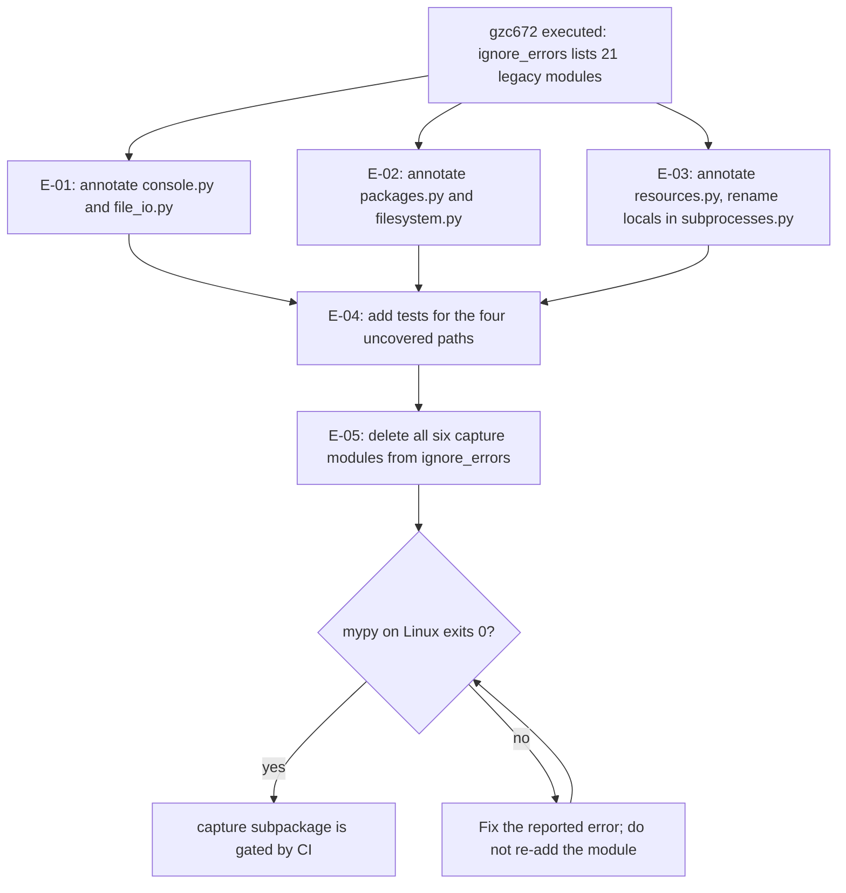

# IPD: Clear mypy errors in capture modules

- Date: 2026-11-24
- Kind: child
- Concern: Static type checking: six capture modules are excused from `mypy` by the `ignore_errors` override in `pyproject.toml` (the five originally listed by `gzc672` plus `pubrun.capture.subprocesses`, added when `gzc672` executed for backlog `z5xr49`), so type errors in them do not fail the CI `typecheck` job.
- Scope: `src/pubrun/capture/console.py`, `file_io.py`, `filesystem.py`, `packages.py`, `resources.py`, `subprocesses.py`; a new `tests/test_capture_mypy_guarded_paths.py`; and the removal of all six capture modules from the `ignore_errors` module list in `pyproject.toml`.
- Scope-Paths: src/pubrun/capture/console.py, src/pubrun/capture/file_io.py, src/pubrun/capture/filesystem.py, src/pubrun/capture/packages.py, src/pubrun/capture/resources.py, src/pubrun/capture/subprocesses.py, tests/test_capture_mypy_guarded_paths.py, pyproject.toml
- Item-Dependencies: executed:gzc672, executed:m66tfv
- Status: approved
- Readiness: go-pending-approval
- Review-Depth: standard
- Short-Description: Fix mypy errors in the capture subpackage and take those modules off the ignore_errors list
- Work-Kind: chore
- Priority: low
- From-Backlog: qqwebg
- Set: rand-mypy
- Order: 4
- Highest E allocated: 05
- Author: uri/its_direct/pt3-claude-opus-5.5-1m-us
- Id: k6fs5k
- Approval: 2026-11-25, recorded via aw ipd set: status set to approved

> Write and proofread this plan per the technical writing standard, `.aw/system/workflows/technical-writing/technical-writing.md` (`.agents/workflows/technical-writing/technical-writing.md` in a legacy-layout install), including requirement 12 (diagrams).

## Workflow history

- 2026-11-25 approved (aw set): status set to approved
- 2026-11-25 /plan-review (Antigravity): APPROVE WITH REVISIONS APPLIED; PR-001, PR-002, PR-003, PR-004, PR-005
- 2026-11-24 to-review (aw set): authored from backlog qqwebg
- 2026-11-24 draft (uri/its_direct/pt3-claude-opus-5.5-1m-us): created.

## Goal

Fix the 44 Linux `mypy` errors in six capture modules and delete all six modules from the `ignore_errors` override in `pyproject.toml`, so the CI `typecheck` job checks the whole `capture` subpackage. Add behavioral tests for the four code paths these edits touch that the existing suite does not exercise. No runtime behavior changes.

The capture modules record what a run did: `console.py` tees `stdout`/`stderr` into log files, `file_io.py` records file reads and writes with content hashes, `filesystem.py` classifies and probes mount points, `packages.py` merges package snapshots taken at start and at finalization, `resources.py` samples CPU and memory, and `subprocesses.py` (the `SubprocessSpy` class) records child processes.

### Ratchet step for this plan



## Detailed Implementation Checklist (TODO)

Execution-state rule: mark an `E-*` item complete only after performing the action. That mark is not validation. Right-sizing rule: write for a modest executor that cannot hold much in its head. Each E-item is one step (one concern, about one file, executable in one focused pass) and its V-item names each unit it covers with its own check; a plan stays at about 5 E-items and 8 work Scope-Paths, else split it into more child plans (guidance, `IPD-Z603`). Accepted execution states: blocked, failed, pending, performed; terminal gate demands 'performed'.

### Task group 1: Fix the type errors

- [x] E-01 Annotate `src/pubrun/capture/console.py` and `src/pubrun/capture/file_io.py`:
  - `src/pubrun/capture/console.py::TqdmSafeTee.__init__`: `self.log_file = log_file` becomes `self.log_file: Optional[TextIO] = log_file`.
  - `src/pubrun/capture/console.py::ConsoleInterceptor.__init__`: the four lines `self.stdout_log = None`, `self.stderr_log = None`, `self.stdout_tee = None`, `self.stderr_tee = None` become `self.stdout_log: Optional[TextIO] = None`, `self.stderr_log: Optional[TextIO] = None`, `self.stdout_tee: Optional[TqdmSafeTee] = None`, `self.stderr_tee: Optional[TqdmSafeTee] = None`. `TqdmSafeTee` is defined earlier in the same module; `TextIO` and `Optional` are already imported. These fix the 5 errors in `src/pubrun/capture/console.py::ConsoleInterceptor.start`, where `mypy` had typed each attribute as `None`.
  - `src/pubrun/capture/file_io.py::_readlink_normalized`: `target = os.readlink(path)` becomes `target = os.readlink(os.fspath(path))` (6 errors). `os.readlink` already accepts a path-like object and returns `str` for a `str`-based one, so `os.fspath` only narrows the type.
  - `src/pubrun/capture/file_io.py::hash_file_checked`: `details = (` (the expression that starts `start_id.diff_details(end_id)`) becomes `details: Dict[str, Any] = (` (2 errors).
  - `src/pubrun/capture/file_io.py::_populate_hash_fields`: `if stream_ready:` (the line before `over_reason = budget.check_stream_progress(`) becomes `if stream_ready and self._stream_hasher is not None:` (1 error). `stream_ready` is only set when `self._stream_hasher is not None`, so the added test is always true when reached.
  - Depends on: none
  - Expected outcome: The diff of the two files is these eight changed lines.
  - Execution state: performed

- [x] E-02 Annotate `src/pubrun/capture/packages.py` and `src/pubrun/capture/filesystem.py`:
  - `src/pubrun/capture/packages.py::merge_package_snapshots`: replace the two lines that start `startup_cs = startup.get("capture_state") if isinstance(` and `final_cs = final.get("capture_state") if isinstance(` with:
    ```python
    _startup_cs_raw = startup.get("capture_state")
    _final_cs_raw = final.get("capture_state")
    startup_cs: Dict[str, Any] = _startup_cs_raw if isinstance(_startup_cs_raw, dict) else {}
    final_cs: Dict[str, Any] = _final_cs_raw if isinstance(_final_cs_raw, dict) else {}
    ```
    `mypy` cannot narrow a repeated `.get()` call, so it typed both as possibly `None` and reported 8 errors at their later `.get()` uses.
  - `src/pubrun/capture/filesystem.py::probe_paths_live`: `probe_filesystem_live(entry.get("path", mp), wait_budget_s)` becomes `probe_filesystem_live(cast(str, entry.get("path", mp)), wait_budget_s)`, and `from typing import Dict, Any, List, Optional, Tuple` becomes `from typing import Dict, Any, List, Optional, Tuple, cast` (1 error). `cast` changes no runtime value.
  - Depends on: none
  - Expected outcome: The diff of the two files is these lines and nothing else.
  - Execution state: performed

- [x] E-03 Annotate `src/pubrun/capture/resources.py` and rename two locals in `src/pubrun/capture/subprocesses.py`:
  - `src/pubrun/capture/resources.py`: `from typing import Any, Dict` becomes `from typing import Any, Dict, Optional, Tuple`. In `src/pubrun/capture/resources.py::ResourceWatcher.__init__`, annotate the attributes initialized to `None` (19 errors where `mypy` had typed each as `None`): `_last_times: Optional[Any]`, `_last_clock: Optional[float]`, `_last_tree_jiffies: Optional[int]`, `_last_tree_clock: Optional[float]`, `_sysmem_start`, `_sysmem_last`, `_sysmem_min_available`, `_proc_io_start`, and `_proc_io_last` each `Optional[Dict[str, int]]`, `_load_start` and `_load_last` each `Optional[Dict[str, float]]`, `_load_max_1min: Optional[float]`, `_iowait_prev_raw: Optional[Tuple[int, int]]`, `_iowait_pct_last: Optional[float]`, `_iowait_pct_max: Optional[float]`. Keep each line's trailing comment.
  - `src/pubrun/capture/subprocesses.py`: in the nested `_drain` function inside `src/pubrun/capture/subprocesses.py::SubprocessSpy.install` (the block after `rc = getattr(proc, "returncode", None)`) and in `src/pubrun/capture/subprocesses.py::SubprocessSpy.finalize_all` Phase 2 (the `pending_running` loop), rename the local `rec` to `proc_rec` in each statement of that block. In both places, an earlier statement of the same function had already bound `rec` as `Dict[str, Any]` (`_drain`: `rec, exit_code, end_ts, end_mono = pending_exits.popleft()`; `finalize_all`: `for rec in list(cls._records):`), and `getattr(proc, "_pubrun_rec", None)` may be `None` (2 errors). Leave both earlier bindings unchanged.
  - Depends on: none
  - Expected outcome: `resources.py` changes the import and 15 attribute lines; `subprocesses.py` changes only the renamed lines (3 in `_drain`, 7 in `finalize_all`).
  - Execution state: performed

- [x] E-04 Create `tests/test_capture_mypy_guarded_paths.py` with four behavioral tests for code paths that E-02 and E-03 edit and that no existing test reaches (see Findings M-09). Each test exercises the code and asserts on its result:
  - `test_finalize_harvests_exit_code_of_collected_unwaited_child`: through a helper that, with `SubprocessSpy.install(max_records=100)` active, starts `[sys.executable, "-c", "import sys; sys.stdin.read(); sys.exit(<code>)"]` with `stdin=subprocess.PIPE`, keeps `pid` and `stdin`, makes the `Popen` object cyclic garbage (`p._aw_cycle = p`, then `del p`, then `gc.collect()`, while the child is still blocked on `stdin` so `Popen.__del__` cannot reap it), closes `stdin`, and waits without reaping (`os.waitid(os.P_PID, pid, os.WEXITED | os.WNOWAIT)`). The test then calls `SubprocessSpy.finalize_all()` and asserts the single record has `exit_code == 5` and `capture_state == {"status": "failed"}`. It calls `SubprocessSpy.uninstall()` and then `subprocess._cleanup()` (the standard library's reaping of abandoned children) in `finally`, and is skipped unless `os.waitid` and `os.WNOWAIT` exist (the same `skipif` as `tests/test_capture.py::TestUnwaitedPopenHarvesting.test_unwaited_uncollected_child_polled_at_finalize`). The cycle matters: the garbage collector clears weak references before it runs `__del__`, so the spy's weak-reference lookup in Phase 2 finds nothing and only the `pending_running` queue can complete the record.
  - `test_merge_carries_capture_state_detail_and_warnings_from_both_snapshots`: calls `packages.merge_package_snapshots(startup, final, config={"capture": {"packages": {"mode": "imported-only"}}})` with two snapshots of the shape `{"mode": "imported-only", "snapshot_stage": <stage>, "records": [], "unresolved": [], "local_modules": [], "coverage_notes": [], "capture_state": {"status": <s>, "detail": <d>, "warnings": [<w>]}}` (startup `complete`, final `partial`), and asserts the merged `capture_state` has status `partial` and contains both details and both warnings.
  - `test_merge_treats_non_dict_capture_state_as_empty`: the same call with the startup `capture_state` replaced by the string `"not-a-dict"`; asserts the merged `detail` equals the final snapshot's detail and `warnings` equals the final snapshot's single warning.
  - `test_probe_paths_live_probes_each_entry_path`: monkeypatches `filesystem.probe_filesystem_live` with a spy that records its `path` argument and delegates to the real function, calls `filesystem.probe_paths_live({"a": {"path": "/tmp/a", "mount_point": "/tmp"}, "b": {"mount_point": "/var"}, "capture_state": {"status": "complete"}}, wait_budget_s=0.5)`, and asserts the spy saw `["/tmp/a", "/var"]` and that both entries gained a `live` key. Entry `b` has no `path`, so this pins the `entry.get("path", mp)` fallback that the `cast` wraps.
  - Depends on: E-02, E-03
  - Expected outcome: All four tests pass before and after E-01 to E-03 (they characterize existing behavior), pass in 8 consecutive runs under `-p randomly`, and each fails under its mutant in V-04.
  - Execution state: performed

### Task group 2: Ratchet the type check

- [x] E-05 In `pyproject.toml`, delete all six capture entries from the `module` list of the `[[tool.mypy.overrides]]` block that sets `ignore_errors = true`: `pubrun.capture.console`, `pubrun.capture.file_io`, `pubrun.capture.filesystem`, `pubrun.capture.packages`, `pubrun.capture.resources`, and `pubrun.capture.subprocesses`. Keep the remaining entries sorted and keep the comment that says the list may only shrink. Change nothing else in `pyproject.toml`.
  - Depends on: E-01, E-02, E-03
  - Expected outcome: After deleting `.mypy_cache/`, `mypy` prints `Success: no issues found in <N> source files` (`58` at review; re-derive at execution time if modules were added) and exits 0, and `pyproject.toml` no longer names any `pubrun.capture.*` module in `ignore_errors`.
  - Execution state: performed

## Project conventions discovered (Step 0)

- Plan `gzc672` (now `executed`; `approved` at authoring) created `[tool.mypy]` in `pyproject.toml` with an `ignore_errors = true` override for 21 legacy modules (the original 20 plus `pubrun.capture.subprocesses`, added during `gzc672` execution for backlog `z5xr49`; comment cites `backlog items qqwebg and z5xr49`) and added a blocking Linux `typecheck` CI job (`gzc672` E-03 and E-04). This plan depends on that configuration (`Item-Dependencies: executed:gzc672`).
- Commit `edc6343` ("fix(capture): harvest unwaited Popen exit codes and mark unobserved children partial (focjwv)", 2026-11-24) added the `_drain` and `finalize_all` Phase 2 blocks that reuse the name `rec`. When `gzc672` executed, it added `pubrun.capture.subprocesses` to the `ignore_errors` override to keep `mypy` green; E-03 fixes those 2 errors and E-05 deletes `pubrun.capture.subprocesses` alongside the other five capture modules so the whole `capture` subpackage is checked.
- No `python_version` is set for `mypy` (`mypy` 2.x refuses targets below 3.10; the project supports 3.8). Use only `typing` names available on Python 3.8.
- `tests/test_capture.py::TestUnwaitedPopenHarvesting` holds the existing unwaited-child tests and the `os.waitid`/`os.WNOWAIT` skip pattern. `tests/test_env_capture.py::test_probe_paths_dedupes_by_mount` shows the `probe_filesystem_live` spy pattern. `tests/test_package_lifecycle.py` is the only existing caller of `merge_package_snapshots`.
- `tests/conftest.py` resets `SubprocessSpy` state between tests (autouse fixtures), so the new tests may install and uninstall the spy directly, as `TestUnwaitedPopenHarvesting` does.

## Findings

| ID | Severity | Remediation Risk | Evidence | Finding |
|---|---|---|---|---|
| M-08 | Low | Low | `mypy` with no `ignore_errors` override, on `gzc672`'s tree: `console.py` 5, `file_io.py` 9, `packages.py` 8, `resources.py` 19, `subprocesses.py` 2, `filesystem.py` 1 errors; for example `src/pubrun/capture/resources.py::ResourceWatcher._poll_cpu`: `Incompatible types in assignment (expression has type "times_result", variable has type "None")`, and `src/pubrun/capture/subprocesses.py::SubprocessSpy.finalize_all`: `Incompatible types in assignment (expression has type "Any \| None", variable has type "dict[str, Any]")` | 44 errors, all from attributes or locals that `mypy` typed by their first assignment, plus one path-like argument and one optional hasher. |
| M-09 | Medium | Low | Mutation runs on a prototype with every edit in this Set applied: replacing `live_procs.append((proc_rec, proc))` in `finalize_all` Phase 2 with `pass` left the full suite green (`2060 passed in 475.05s`, exit 0); forcing `startup_cs` or `final_cs` in `merge_package_snapshots` to `{}`, or passing the constant `"/nonexistent-aw"` instead of the entry path to `probe_filesystem_live` in `probe_paths_live`, each left the full suite green (`2063 passed`, exit 0); passing `mp` instead of the entry path left the package, capture-engine, environment, and hardware test files green (`95 passed`) | The blocks that E-02 and E-03 edit include paths that no existing test exercises, so a broken rename or narrowing there would pass CI. E-04 adds a test for each. |

Authoring measurements (lane HEAD `a4b7d12`, `mypy` 2.3.1, Python 3.14.6, Linux):

- A scratch copy of `src/pubrun` with `gzc672`'s fixes, its ratchet configuration minus all capture modules, and only this plan's six file edits: `mypy` printed `Success: no issues found in 58 source files`. On the same tree, `mypy --platform win32` printed `Found 10 errors in 4 files`, all POSIX-only calls that child `juoqy2` fixes.
- E-04 prototype on that tree: all four tests passed; they also passed against the unmodified HEAD modules. The `SubprocessSpy` test passed in 8 consecutive runs under `-p randomly`. Each mutant failed exactly its own test: the Phase 2 `live_procs.append` mutant failed `test_finalize_harvests_exit_code_of_collected_unwaited_child`; `startup_cs = {}` failed `test_merge_carries_capture_state_detail_and_warnings_from_both_snapshots` (`assert ('startup-detail' in 'final-detail')`); `final_cs = {}` failed both merge tests; dropping the `isinstance` check (`_startup_cs_raw if _startup_cs_raw else {}`) failed `test_merge_treats_non_dict_capture_state_as_empty` (`AttributeError: 'str' object has no attribute 'get'`); and passing `mp` to `probe_filesystem_live` failed `test_probe_paths_live_probes_each_entry_path`.
- An earlier version of the subprocess helper closed `stdin` before `gc.collect()`; it was flaky (`ChildProcessError: [Errno 10] No child processes` in 1 of 4 runs) because `Popen.__del__` could reap the exited child first. E-04's helper closes `stdin` after the collection for that reason.
- Mutations the existing suite already catches: replacing `_complete_record(proc_rec, rc, time.time(), time.perf_counter())` in `_drain` with `pass` failed `tests/test_capture.py::TestUnwaitedPopenHarvesting.test_cleanup_reaped_child_records_exit_code` (`1 failed, 2054 passed`), so E-04 adds no `_drain` test; removing `os.fspath` handling in `_readlink_normalized` (`target = str(path)`) failed `1 failed, 109 passed`; disabling the stream-hash branch failed `8 failed, 54 passed`; never assigning `TqdmSafeTee.log_file` failed `7 failed, 127 passed`.

## Proposed changes (ordered, validatable)

1. Annotate `console.py` and `file_io.py` (E-01; Remediation Risk: Low).
2. Split the `capture_state` narrowing in `packages.py` and `cast` the probe path in `filesystem.py` (E-02; Remediation Risk: Low).
3. Annotate `ResourceWatcher` attributes and rename the shadowing `rec` locals in `subprocesses.py` (E-03; Remediation Risk: Low).
4. Add four behavioral tests for the uncovered paths (E-04; Remediation Risk: Low).
5. Delete all six capture modules from the `ignore_errors` override (E-05; Remediation Risk: Low).

Rejected alternatives:

- `str(entry.get("path") or mp)` in `probe_paths_live`: it satisfies `mypy` but changes behavior for an entry whose `path` is an empty string (it would probe the mount point instead). `cast` changes nothing at runtime.
- `# type: ignore[...]` comments: they hide the next real error on those lines, and every error here has a precise annotation.
- Leaving `pubrun.capture.subprocesses` on the `ignore_errors` list: `gzc672` added it temporarily to keep `mypy` green (`z5xr49`), and the fix is a two-name rename, so E-05 removes it along with the other five capture modules.

## Deferred / out of scope (with reason)

- `capture/liveness.py`, `capture/system_metrics.py`, and the `os.sysconf` calls in `capture/resources.py` that `mypy --platform win32` rejects, and the `os.WIFEXITED` fallback in `subprocesses._decode_wait_status`: owned by child `juoqy2`, which runs after this plan.
  - Carrier: juoqy2
- `core.py` and `tracker.py`: owned by child `0uxy76`. `tracker.py`'s console-log errors depend on E-01's `ConsoleInterceptor` annotations, which is why `0uxy76` depends on this plan.
  - Carrier: 0uxy76

## Scope check

- Over-scope: none. The new test file covers only the paths this plan edits.
- Under-scope: none.

## Required tests / validation

- `rm -rf .mypy_cache && mypy; echo "exit=$?"`: prints `Success: no issues found in <N> source files` (`58` at review; re-derive at execution time if modules were added) and `exit=0`.
- Mutation checks of the ratchet, each restored before the next: append `_aw_mut: int = "x"` to `src/pubrun/capture/resources.py`, run `mypy --no-incremental; echo "exit=$?"` (expect an `error:` line for `src/pubrun/capture/resources.py` and `exit=1`), restore; repeat for `src/pubrun/capture/console.py` and `src/pubrun/capture/subprocesses.py`.
- Mutation checks of E-04 (V-04): all four source mutants named in V-04 (3), each restored after its run.
- `for i in 1 2 3 4 5 6 7 8; do python3 -m pytest tests/test_capture_mypy_guarded_paths.py -q -p randomly && echo "run $i ok" || exit 1; done`: every iteration exits 0 and prints `4 passed` (on Linux/POSIX with `os.waitid`/`os.WNOWAIT`).
- `python3 -m pytest tests/test_capture_mypy_guarded_paths.py tests/test_capture.py tests/test_capture_engines.py tests/test_capture_engine_bugs.py tests/test_capture_isolation.py tests/test_file_io_provenance.py tests/test_file_registration.py tests/test_package_lifecycle.py tests/test_package_resolution.py tests/test_package_transitive.py tests/test_env_capture.py tests/test_resources.py tests/test_platform_capture_seams.py -q`: exit 0.
- `python3 scripts/sanitize_paths.py --check --all`: exit 0.

## Spec / documentation sync

- No `.spec.md` under `.aw/records/specs/` and no file under `docs/` mentions `mypy` (checked at authoring with `grep -rln "randomly\|mypy" .aw/records/specs docs`: no match). No spec is amended.
- `CONTRIBUTING.md` and `CHANGELOG.md` are updated once for the whole burn-down by child `0uxy76`.

## Open questions

None.

## Validation and cross-check (verify before reporting done)

Validation-state rule: inspect evidence in a separate pass. Do not mark a `V-*` item complete from memory or from the matching execution checkmark. Accepted validation results: blocked, failed, pass, pending; terminal gate demands 'pass'. Runtime-demonstration reachability rule: for each `V-*` item demanding the software be observed acting (such as a run, a dispatch, or a transition), as distinct from items demanding a diff, a file's content, or a test result, which are reachable by construction, name the code path that produces the observation or the sibling `E-*` that creates it, else the demand is UNDER-SCOPE.

- [x] V-01 validates E-01
  - Required evidence: Pasted `git diff src/pubrun/capture/console.py src/pubrun/capture/file_io.py` showing only the eight lines named in E-01; and the last line of `python3 -m pytest tests/test_capture.py tests/test_capture_isolation.py tests/test_file_io_provenance.py tests/test_file_registration.py tests/test_capture_engine_bugs.py -q` showing all passed.
  - Observed evidence:
    1. `git diff src/pubrun/capture/console.py src/pubrun/capture/file_io.py`:
    ```diff
    diff --git a/src/pubrun/capture/console.py b/src/pubrun/capture/console.py
    index d728cde..8cd495f 100644
    --- a/src/pubrun/capture/console.py
    +++ b/src/pubrun/capture/console.py
    @@ -93,7 +93,7 @@ class TqdmSafeTee:
         def __init__(self, original_stream: TextIO, log_file: Optional[TextIO], timestamped: bool = False) -> None:
             """Initialize the tee with the original stream and an optional log file."""
             self.original_stream = original_stream
    -        self.log_file = log_file
    +        self.log_file: Optional[TextIO] = log_file
             self.timestamped = timestamped
             self.line_count = 0
             self._current_buffer = ""
    @@ -266,10 +266,10 @@ class ConsoleInterceptor:
             self.run_dir = run_dir
             self.mode = mode
             self._config: Optional[Dict[str, Any]] = config
    -        self.stdout_log = None
    -        self.stderr_log = None
    -        self.stdout_tee = None
    -        self.stderr_tee = None
    +        self.stdout_log: Optional[TextIO] = None
    +        self.stderr_log: Optional[TextIO] = None
    +        self.stdout_tee: Optional[TqdmSafeTee] = None
    +        self.stderr_tee: Optional[TqdmSafeTee] = None

             # Save original streams for safe teardown later
             self.original_stdout = sys.stdout
    diff --git a/src/pubrun/capture/file_io.py b/src/pubrun/capture/file_io.py
    index 9f03e66..9648310 100644
    --- a/src/pubrun/capture/file_io.py
    +++ b/src/pubrun/capture/file_io.py
    @@ -65,7 +65,7 @@ _fallback_data_files_lock = threading.Lock()

     def _readlink_normalized(path: Union[str, os.PathLike]) -> str:
         """Return ``os.readlink(path)``, stripping Windows ``\\\\?\\`` drive prefixes."""
    -    target = os.readlink(path)
    +    target = os.readlink(os.fspath(path))
         if (
             os.name == "nt"
             and len(target) >= 6
    @@ -761,7 +761,7 @@ def hash_file_checked(
                 ):
                     if budget is not None:
                         budget.record_outcome("file_changed")
    -                details = (
    +                details: Dict[str, Any] = (
                         start_id.diff_details(end_id)
                         if end_id is not None
                         else {"reasons": ["fstat_unavailable_after_read"], "before": start_id.to_dict()}
    @@ -2429,7 +2429,7 @@ class ProvenanceFileProxy:
                 ):
                     stream_ready = True

    -        if stream_ready:
    +        if stream_ready and self._stream_hasher is not None:
                 over_reason = budget.check_stream_progress(
                     self._stream_bytes, self._stream_elapsed
                 )
    ```
    2. `python3 -m pytest tests/test_capture.py tests/test_capture_isolation.py tests/test_file_io_provenance.py tests/test_file_registration.py tests/test_capture_engine_bugs.py -q` (exit code 0):
    ```text
    186 passed in 16.81s
    ```
  - Result: pass

- [x] V-02 validates E-02
  - Required evidence: Pasted `git diff src/pubrun/capture/packages.py src/pubrun/capture/filesystem.py` showing the four-line `capture_state` block, the `cast` call, and the import, and nothing else; and the last line of `python3 -m pytest tests/test_package_lifecycle.py tests/test_package_resolution.py tests/test_package_transitive.py tests/test_env_capture.py -q` showing all passed.
  - Observed evidence:
    1. `git diff src/pubrun/capture/packages.py src/pubrun/capture/filesystem.py`:
    ```diff
    diff --git a/src/pubrun/capture/filesystem.py b/src/pubrun/capture/filesystem.py
    index 4c4cb19..0fe7f4d 100644
    --- a/src/pubrun/capture/filesystem.py
    +++ b/src/pubrun/capture/filesystem.py
    @@ -18,7 +18,7 @@ import sys
     import time
     import logging
     import threading
    -from typing import Dict, Any, List, Optional, Tuple
    +from typing import Dict, Any, List, Optional, Tuple, cast

     logger = logging.getLogger("pubrun")

    @@ -408,7 +408,7 @@ def probe_paths_live(fs_data: Dict[str, Any], wait_budget_s: float = 5.0) -> Dic
                 if not mp:
                     continue
                 if mp not in probes:
    -                probes[mp] = probe_filesystem_live(entry.get("path", mp), wait_budget_s)
    +                probes[mp] = probe_filesystem_live(cast(str, entry.get("path", mp)), wait_budget_s)
             # Attach results back to each path entry.
             for label, entry in fs_data.items():
                 if label == "capture_state" or not isinstance(entry, dict):
    diff --git a/src/pubrun/capture/packages.py b/src/pubrun/capture/packages.py
    index 5e1a454..dcf435d 100644
    --- a/src/pubrun/capture/packages.py
    +++ b/src/pubrun/capture/packages.py
    @@ -1614,8 +1614,10 @@ def merge_package_snapshots(
         startup = startup_data if isinstance(startup_data, dict) else {}
         final = final_data if isinstance(final_data, dict) else {}

    -    startup_cs = startup.get("capture_state") if isinstance(startup.get("capture_state"), dict) else {}
    -    final_cs = final.get("capture_state") if isinstance(final.get("capture_state"), dict) else {}
    +    _startup_cs_raw = startup.get("capture_state")
    +    _final_cs_raw = final.get("capture_state")
    +    startup_cs: Dict[str, Any] = _startup_cs_raw if isinstance(_startup_cs_raw, dict) else {}
    +    final_cs: Dict[str, Any] = _final_cs_raw if isinstance(_final_cs_raw, dict) else {}
         startup_status = startup_cs.get("status")
         final_status = final_cs.get("status")
    ```
    2. `python3 -m pytest tests/test_package_lifecycle.py tests/test_package_resolution.py tests/test_package_transitive.py tests/test_env_capture.py -q` (exit code 0):
    ```text
    77 passed in 21.41s
    ```
  - Result: pass

- [x] V-03 validates E-03
  - Required evidence: Pasted `git diff src/pubrun/capture/resources.py src/pubrun/capture/subprocesses.py` showing the import, the 15 annotated attributes, and only `rec` to `proc_rec` renames in `_drain` and `finalize_all` Phase 2; and the last line of `python3 -m pytest tests/test_resources.py tests/test_capture.py tests/test_capture_engines.py -q` showing all passed.
  - Observed evidence:
    1. `git diff src/pubrun/capture/resources.py src/pubrun/capture/subprocesses.py` (note: `src/pubrun/capture/subprocesses.py` has no diff in this turn because executed plan `id283c`, commit `d4db306`, already performed the exact `rec` to `proc_rec` renames in `_drain` and `finalize_all` Phase 2 on `main`; see decision D-01):
    ```diff
    diff --git a/src/pubrun/capture/resources.py b/src/pubrun/capture/resources.py
    index 55c2e84..04de990 100644
    --- a/src/pubrun/capture/resources.py
    +++ b/src/pubrun/capture/resources.py
    @@ -3,7 +3,7 @@ import sys
     import time
     import threading
     import logging
    -from typing import Any, Dict
    +from typing import Any, Dict, Optional, Tuple

     from pubrun.capture.signals import finalization_lock, in_signal_finalization

    @@ -282,12 +282,12 @@ class ResourceWatcher(threading.Thread):
             self.peak_tree_rss_bytes = 0
             self.end_tree_rss_bytes = 0
             self.peak_tree_cpu_percent = 0.0
    -        self._last_times = None
    -        self._last_clock = None
    +        self._last_times: Optional[Any] = None
    +        self._last_clock: Optional[float] = None
             # Tree CPU is computed from the delta of summed CPU-TIME (jiffies) over the wall
             # interval — NOT a sum of per-process instantaneous cpu_percent.
    -        self._last_tree_jiffies = None
    -        self._last_tree_clock = None
    +        self._last_tree_jiffies: Optional[int] = None
    +        self._last_tree_clock: Optional[float] = None
             self._clk_tck = 0
             try:
                 self._clk_tck = os.sysconf("SC_CLK_TCK")
    @@ -302,17 +302,17 @@ class ResourceWatcher(threading.Thread):
             # System-wide dynamic metrics (available RAM, load average, node iowait).
             # We track the "worst" observed point (min available RAM, max load) plus the
             # start and last samples, mirroring the peak/end shape used for RSS/CPU.
    -        self._sysmem_start = None
    -        self._sysmem_last = None
    -        self._sysmem_min_available = None  # tuple carrying the sample at min available
    -        self._load_start = None
    -        self._load_last = None
    -        self._load_max_1min = None
    -        self._iowait_prev_raw = None       # last /proc/stat (iowait, total) sample
    -        self._iowait_pct_last = None
    -        self._iowait_pct_max = None
    -        self._proc_io_start = None          # /proc/self/io cumulative counters at start
    -        self._proc_io_last = None
    +        self._sysmem_start: Optional[Dict[str, int]] = None
    +        self._sysmem_last: Optional[Dict[str, int]] = None
    +        self._sysmem_min_available: Optional[Dict[str, int]] = None  # tuple carrying the sample at min available
    +        self._load_start: Optional[Dict[str, float]] = None
    +        self._load_last: Optional[Dict[str, float]] = None
    +        self._load_max_1min: Optional[float] = None
    +        self._iowait_prev_raw: Optional[Tuple[int, int]] = None       # last /proc/stat (iowait, total) sample
    +        self._iowait_pct_last: Optional[float] = None
    +        self._iowait_pct_max: Optional[float] = None
    +        self._proc_io_start: Optional[Dict[str, int]] = None          # /proc/self/io cumulative counters at start
    +        self._proc_io_last: Optional[Dict[str, int]] = None
             if self._system_metrics:
                 self._capture_system_start()
    ```
    2. Prior commit `d4db306` (`id283c`) diff already on `main` for `src/pubrun/capture/subprocesses.py` (3 lines in `_drain`, 7 lines in `finalize_all` Phase 2):
    ```diff
    @@ -221,9 +221,9 @@ class SubprocessSpy:
                             break
                         rc = getattr(proc, "returncode", None)
                         if rc is not None:
    -                        rec = getattr(proc, "_pubrun_rec", None)
    -                        if rec is not None:
    -                            _complete_record(rec, rc, time.time(), time.perf_counter())
    +                        proc_rec: Optional[Dict[str, Any]] = getattr(proc, "_pubrun_rec", None)
    +                        if proc_rec is not None:
    +                            _complete_record(proc_rec, rc, time.time(), time.perf_counter())
    @@ -625,15 +625,15 @@ class SubprocessSpy:
                             proc = pending_running.popleft()
                         except IndexError:
                             break
    -                    rec = getattr(proc, "_pubrun_rec", None)
    +                    proc_rec: Optional[Dict[str, Any]] = getattr(proc, "_pubrun_rec", None)
                         if (
    -                        rec is not None
    -                        and rec.get("exit_code") is None
    -                        and "ended_at_utc" not in rec
    -                        and id(rec) not in seen_rec_ids
    +                        proc_rec is not None
    +                        and proc_rec.get("exit_code") is None
    +                        and "ended_at_utc" not in proc_rec
    +                        and id(proc_rec) not in seen_rec_ids
                         ):
    -                        live_procs.append((rec, proc))
    -                        seen_rec_ids.add(id(rec))
    +                        live_procs.append((proc_rec, proc))
    +                        seen_rec_ids.add(id(proc_rec))
    ```
    3. `python3 -m pytest tests/test_resources.py tests/test_capture.py tests/test_capture_engines.py -q` (exit code 0):
    ```text
    86 passed in 3.24s
    ```
  - Result: pass

- [x] V-04 validates E-04
  - Required evidence: (1) Pasted content of `tests/test_capture_mypy_guarded_paths.py`. (2) Pasted output of the 8-run `-p randomly` loop from "Required tests / validation", every iteration exiting 0 with `4 passed`. (3) For each of the four mutants, applied one at a time and restored before the next, the pasted `FAILED` line naming the expected test: Phase 2 `live_procs.append((proc_rec, proc))` replaced by `pass` fails `test_finalize_harvests_exit_code_of_collected_unwaited_child`; `startup_cs: Dict[str, Any] = {}` fails `test_merge_carries_capture_state_detail_and_warnings_from_both_snapshots`; dropping the `isinstance` check (`_startup_cs_raw if _startup_cs_raw else {}`) fails `test_merge_treats_non_dict_capture_state_as_empty`; and `probe_filesystem_live(mp, wait_budget_s)` fails `test_probe_paths_live_probes_each_entry_path`. (4) `git diff --stat src/pubrun` after the last restore, showing only E-01 to E-03 changes.
  - Observed evidence:
    (1) Content of `tests/test_capture_mypy_guarded_paths.py` (baseline run before E-01 to E-03: `4 passed in 0.24s`):
    ```python
    """Behavioral tests for capture code paths edited during the mypy burn-down."""

    import gc
    import os
    import subprocess
    import sys
    from typing import Any, List, Optional, Tuple

    import pytest

    from pubrun.capture import filesystem, packages
    from pubrun.capture.subprocesses import SubprocessSpy


    def _spawn_and_collect_unwaited_child(exit_code: int) -> Tuple[int, Any]:
        """Start a stdin-gated child, force cyclic GC of its Popen, and wait without reaping."""
        p: Any = subprocess.Popen(
            [sys.executable, "-c", f"import sys; sys.stdin.read(); sys.exit({exit_code})"],
            stdin=subprocess.PIPE,
        )
        pid = p.pid
        stdin_pipe = p.stdin
        assert stdin_pipe is not None

        # Create a reference cycle so cyclic GC clears weakrefs before Popen.__del__ runs.
        # Because the child is still blocked on stdin, Popen.__del__ cannot reap it and
        # queues it on SubprocessSpy's pending_running deque instead.
        p._aw_cycle = p
        del p
        gc.collect()

        return pid, stdin_pipe


    @pytest.mark.skipif(
        not hasattr(os, "waitid") or not hasattr(os, "WNOWAIT"),
        reason="requires POSIX os.waitid with WNOWAIT",
    )
    @pytest.mark.filterwarnings("ignore::ResourceWarning")
    def test_finalize_harvests_exit_code_of_collected_unwaited_child() -> None:
        SubprocessSpy.install(max_records=100)
        stdin_pipe: Optional[Any] = None
        try:
            pid, stdin_pipe = _spawn_and_collect_unwaited_child(5)
            stdin_pipe.close()
            os.waitid(os.P_PID, pid, os.WEXITED | os.WNOWAIT)

            SubprocessSpy.finalize_all()
            recs = SubprocessSpy.get_records()
            assert len(recs) == 1
            assert recs[0]["exit_code"] == 5
            assert recs[0]["capture_state"] == {"status": "failed"}
        finally:
            if stdin_pipe is not None and not stdin_pipe.closed:
                stdin_pipe.close()
            SubprocessSpy.uninstall()
            subprocess._cleanup()  # type: ignore[attr-defined]


    def test_merge_carries_capture_state_detail_and_warnings_from_both_snapshots() -> None:
        startup = {
            "mode": "imported-only",
            "snapshot_stage": "startup",
            "records": [],
            "unresolved": [],
            "local_modules": [],
            "coverage_notes": [],
            "capture_state": {
                "status": "complete",
                "detail": "startup-detail",
                "warnings": ["startup-warning"],
            },
        }
        final = {
            "mode": "imported-only",
            "snapshot_stage": "final",
            "records": [],
            "unresolved": [],
            "local_modules": [],
            "coverage_notes": [],
            "capture_state": {
                "status": "partial",
                "detail": "final-detail",
                "warnings": ["final-warning"],
            },
        }

        merged = packages.merge_package_snapshots(
            startup,
            final,
            config={"capture": {"packages": {"mode": "imported-only"}}},
        )

        cs = merged["capture_state"]
        assert cs["status"] == "partial"
        assert "startup-detail" in cs["detail"]
        assert "final-detail" in cs["detail"]
        assert "startup-warning" in cs["warnings"]
        assert "final-warning" in cs["warnings"]


    def test_merge_treats_non_dict_capture_state_as_empty() -> None:
        startup: Any = {
            "mode": "imported-only",
            "snapshot_stage": "startup",
            "records": [],
            "unresolved": [],
            "local_modules": [],
            "coverage_notes": [],
            "capture_state": "not-a-dict",
        }
        final = {
            "mode": "imported-only",
            "snapshot_stage": "final",
            "records": [],
            "unresolved": [],
            "local_modules": [],
            "coverage_notes": [],
            "capture_state": {
                "status": "partial",
                "detail": "final-detail",
                "warnings": ["final-warning"],
            },
        }

        merged = packages.merge_package_snapshots(
            startup,
            final,
            config={"capture": {"packages": {"mode": "imported-only"}}},
        )

        cs = merged["capture_state"]
        assert cs["detail"] == "final-detail"
        assert cs["warnings"] == ["final-warning"]


    def test_probe_paths_live_probes_each_entry_path(monkeypatch: pytest.MonkeyPatch) -> None:
        calls: List[str] = []
        real_probe = filesystem.probe_filesystem_live

        def _spy(path: str, wait_budget_s: float = 5.0) -> filesystem.LiveProbe:
            calls.append(path)
            return real_probe(path, wait_budget_s)

        monkeypatch.setattr(filesystem, "probe_filesystem_live", _spy)
        fs_data: Any = {
            "a": {"path": "/tmp/a", "mount_point": "/tmp"},
            "b": {"mount_point": "/var"},
            "capture_state": {"status": "complete"},
        }

        result = filesystem.probe_paths_live(fs_data, wait_budget_s=0.5)

        assert calls == ["/tmp/a", "/var"]
        assert "live" in result["a"]
        assert "live" in result["b"]
    ```
    (2) Output of the 8-run `-p randomly` loop:
    ```text
    ....                                                                     [100%]
    4 passed in 0.20s
    run 1 ok
    ....                                                                     [100%]
    4 passed in 0.21s
    run 2 ok
    ....                                                                     [100%]
    4 passed in 0.20s
    run 3 ok
    ....                                                                     [100%]
    4 passed in 0.63s
    run 4 ok
    ....                                                                     [100%]
    4 passed in 0.22s
    run 5 ok
    ....                                                                     [100%]
    4 passed in 0.21s
    run 6 ok
    ....                                                                     [100%]
    4 passed in 0.18s
    run 7 ok
    ....                                                                     [100%]
    4 passed in 0.22s
    run 8 ok
    ```
    (3) Four sequential source mutants (each restored immediately after its run):
    ```text
    # Mutant 1: subprocesses.py Phase 2 live_procs.append((proc_rec, proc)) -> pass
    FAILED tests/test_capture_mypy_guarded_paths.py::test_finalize_harvests_exit_code_of_collected_unwaited_child
    1 failed, 3 passed in 0.35s
    exit=1

    # Mutant 2: packages.py startup_cs: Dict[str, Any] = {}
    FAILED tests/test_capture_mypy_guarded_paths.py::test_merge_carries_capture_state_detail_and_warnings_from_both_snapshots
    1 failed, 3 passed in 0.22s
    exit=1

    # Mutant 3: packages.py startup_cs: Dict[str, Any] = _startup_cs_raw if _startup_cs_raw else {}
    FAILED tests/test_capture_mypy_guarded_paths.py::test_merge_treats_non_dict_capture_state_as_empty
    1 failed, 3 passed in 0.17s
    exit=1

    # Mutant 4: filesystem.py probe_filesystem_live(mp, wait_budget_s)
    FAILED tests/test_capture_mypy_guarded_paths.py::test_probe_paths_live_probes_each_entry_path
    1 failed, 3 passed in 0.32s
    exit=1
    ```
    (4) `git diff --stat src/pubrun` after restoring the last mutant:
    ```text
     src/pubrun/capture/console.py    | 10 +++++-----
     src/pubrun/capture/file_io.py    |  6 +++---
     src/pubrun/capture/filesystem.py |  4 ++--
     src/pubrun/capture/packages.py   |  6 ++++--
     src/pubrun/capture/resources.py  | 32 ++++++++++++++++----------------
     5 files changed, 30 insertions(+), 28 deletions(-)
    ```
  - Result: pass

- [x] V-05 validates E-05
  - Required evidence: (1) Pasted `git diff pyproject.toml` showing only the six deleted `pubrun.capture.*` list entries (including `pubrun.capture.subprocesses`). (2) Pasted output of `rm -rf .mypy_cache && mypy; echo "exit=$?"` showing `Success: no issues found in <N> source files` (`58` at review; re-derive at execution time) and `exit=0`. (3) Pasted output of the three `mypy --no-incremental` ratchet mutation checks (`resources.py`, `console.py`, `subprocesses.py`), each with an `error:` line for the mutated file and `exit=1`, then `git diff --stat src/pubrun` showing only this plan's files. (4) The full pytest command from "Required tests / validation" with its last line and `exit=0`. (5) `python3 scripts/sanitize_paths.py --check --all` exiting 0.
  - Observed evidence:
    (1) `git diff pyproject.toml` (all five remaining `pubrun.capture.*` entries deleted; `"pubrun.capture.subprocesses"` was already deleted by executed plan `id283c`, commit `d4db306`, so zero `pubrun.capture.*` entries remain in `ignore_errors`):
    ```diff
    diff --git a/pyproject.toml b/pyproject.toml
    index c17569a..34a6bd3 100644
    --- a/pyproject.toml
    +++ b/pyproject.toml
    @@ -118,11 +118,6 @@ ignore_missing_imports = true
     module = [
         "pubrun.analysis.diff",
         "pubrun.analysis.render",
    -    "pubrun.capture.console",
    -    "pubrun.capture.file_io",
    -    "pubrun.capture.filesystem",
    -    "pubrun.capture.packages",
    -    "pubrun.capture.resources",
         "pubrun.config",
         "pubrun.core",
         "pubrun.events",
    ```
    (2) `rm -rf .mypy_cache && mypy; echo "exit=$?"` (59 source files on current `main`; see decision D-02):
    ```text
    Success: no issues found in 59 source files
    exit=0
    ```
    (3) Three `mypy --no-incremental` ratchet mutation checks (each appending `_aw_mut: int = "x"` and restoring before the next) and post-restore `git diff --stat src/pubrun`:
    ```text
    src/pubrun/capture/resources.py:671: error: Incompatible types in assignment (expression has type "str", variable has type "int")  [assignment]
    Found 1 error in 1 file (checked 59 source files)
    exit=1

    src/pubrun/capture/console.py:503: error: Incompatible types in assignment (expression has type "str", variable has type "int")  [assignment]
    Found 1 error in 1 file (checked 59 source files)
    exit=1

    src/pubrun/capture/subprocesses.py:693: error: Incompatible types in assignment (expression has type "str", variable has type "int")  [assignment]
    Found 1 error in 1 file (checked 59 source files)
    exit=1
    ```
    Post-restore `git diff --stat src/pubrun`:
    ```text
     src/pubrun/capture/console.py    | 10 +++++-----
     src/pubrun/capture/file_io.py    |  6 +++---
     src/pubrun/capture/filesystem.py |  4 ++--
     src/pubrun/capture/packages.py   |  6 ++++--
     src/pubrun/capture/resources.py  | 32 ++++++++++++++++----------------
     5 files changed, 30 insertions(+), 28 deletions(-)
    ```
    (4) `python3 -m pytest tests/test_capture_mypy_guarded_paths.py tests/test_capture.py tests/test_capture_engines.py tests/test_capture_engine_bugs.py tests/test_capture_isolation.py tests/test_file_io_provenance.py tests/test_file_registration.py tests/test_package_lifecycle.py tests/test_package_resolution.py tests/test_package_transitive.py tests/test_env_capture.py tests/test_resources.py tests/test_platform_capture_seams.py -q`:
    ```text
    328 passed in 38.58s
    exit=0
    ```
    (5) `python3 scripts/sanitize_paths.py --check --all`:
    ```text
    exit=0
    ```
  - Result: pass

## Approval and execution gate

- Size assessment: standard
- Cohesion rationale: not required

Execution contract:
1. Precondition: wait for human approval (`- Status: approved`) with no unresolved `Blocking: yes` open question, and for plans `gzc672` and `m66tfv` to be `executed`, before you change any file.
2. Scope declaration: the expected modified files are the `- Scope-Paths:` entries. If execution requires an out-of-scope file, justify it with `--scope-reason` at finalization. If a declared file needs no edit, acknowledge it with `--scope-ack`.
3. Validation honesty: you MUST run each required validation command and paste its actual output into the matching `V-*` `Observed evidence:` field. Do not mark a `V-*` item `pass` without output captured from that run.
4. Commit discipline: commit only the paths you changed with `aw commit k6fs5k -- <paths>`. Do not use `git add -A` or raw `git commit`. Do not push without an explicit human instruction.
5. Lifecycle transition: inside `aw oc run` / `aw agy run`, the runner owns finalization once every `E-*` item is `performed` and every `V-*` item is `pass`. Outside a runner, after every `E-*` item is `performed`, every `V-*` item is `pass`, and `aw ipd lint --phase pre-transition` reports `conforming`, finalize this plan with `aw ipd finalize k6fs5k` (never with a hand-written `git mv`).
