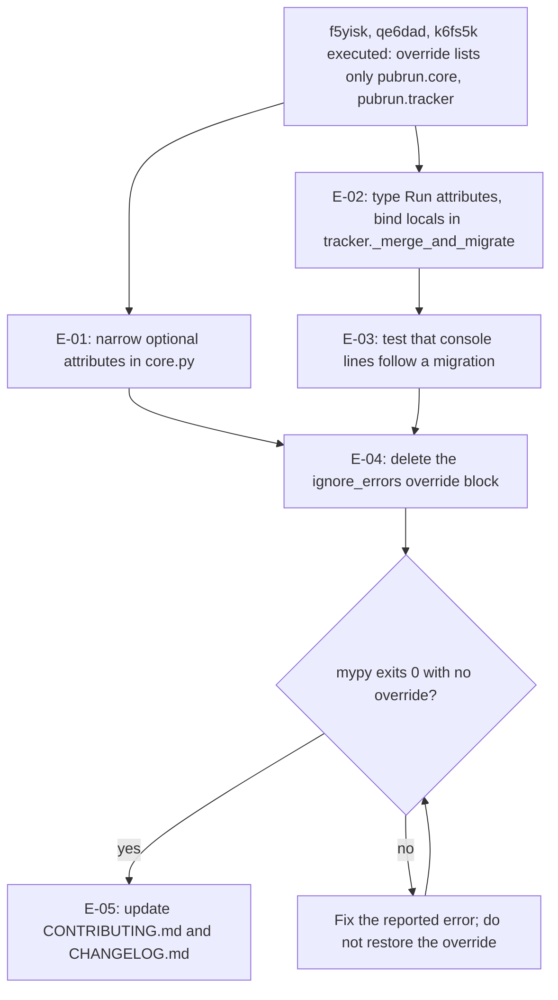

# IPD: Clear mypy errors in core and tracker and retire the ignore_errors override

- Date: 2026-11-24
- Kind: child
- Concern: Static type checking: `core.py` and `tracker.py`, the two central runtime modules, are the last entries on the `ignore_errors` override that plan `gzc672` adds, so a type error in the run lifecycle would not fail the CI `typecheck` job.
- Scope: `src/pubrun/core.py`, `src/pubrun/tracker.py`, a new `tests/test_tracker_console_migration.py`, the deletion of the then-empty `ignore_errors` override block in `pyproject.toml`, and the contributor documentation (`CONTRIBUTING.md`, `CHANGELOG.md`).
- Scope-Paths: src/pubrun/core.py, src/pubrun/tracker.py, tests/test_tracker_console_migration.py, pyproject.toml, CONTRIBUTING.md, CHANGELOG.md
- Item-Dependencies: executed:gzc672, executed:m66tfv, executed:f5yisk, executed:qe6dad, executed:k6fs5k
- Status: reviewed
- Readiness: go-pending-approval
- Review-Depth: standard
- Short-Description: Fix mypy errors in core.py and tracker.py, delete the empty ignore_errors override, and update contributor docs
- Work-Kind: chore
- Priority: low
- From-Backlog: qqwebg
- Set: rand-mypy
- Order: 5
- Highest E allocated: 05
- Author: uri/its_direct/pt3-claude-opus-5.5-1m-us
- Id: 0uxy76

> Write and proofread this plan per the technical writing standard, `.aw/system/workflows/technical-writing/technical-writing.md` (`.agents/workflows/technical-writing/technical-writing.md` in a legacy-layout install), including requirement 12 (diagrams).

## Workflow history

- 2026-11-25 /plan-review (Antigravity): APPROVE WITH REVISIONS APPLIED; PR-001, PR-002, PR-003, PR-004
- 2026-11-24 to-review (aw set): authored from backlog qqwebg
- 2026-11-24 draft (uri/its_direct/pt3-claude-opus-5.5-1m-us): created.

## Goal

Fix the 29 `mypy` errors in `core.py` (11) and `tracker.py` (18), then delete the `ignore_errors` override block from `pyproject.toml`, which is empty once children `f5yisk`, `qe6dad`, and `k6fs5k` and this plan have removed their modules. After this plan, `mypy` checks every module of the package on Linux. Add a behavioral test for the one edited path the suite does not cover (console tee re-pointing after an output-directory migration), and update the contributor documentation that `gzc672` wrote about the override.

`core.py` holds the public API (`annotate`, the `phase` context manager, profiling). `tracker.py` holds the `Run` object; its `_merge_and_migrate` method moves an active run's directory when a later `pubrun.start(output_dir=...)` call changes the output directory, and re-opens the event stream and the console log files in the new place.

### Ratchet completion

## Detailed Implementation Checklist (TODO)

Execution-state rule: mark an `E-*` item complete only after performing the action. That mark is not validation. Right-sizing rule: write for a modest executor that cannot hold much in its head. Each E-item is one step (one concern, about one file, executable in one focused pass) and its V-item names each unit it covers with its own check; a plan stays at about 5 E-items and 8 work Scope-Paths, else split it into more child plans (guidance, `IPD-Z603`). Accepted execution states: blocked, failed, pending, performed; terminal gate demands 'performed'.

### Task group 1: Fix the type errors

- [ ] E-01 In `src/pubrun/core.py`, make `mypy` see the narrowing that the code already performs at runtime:
  - `src/pubrun/core.py::annotate`: replace `if current_run and getattr(current_run, "event_stream", None):` with the two lines `event_stream = getattr(current_run, "event_stream", None) if current_run else None` and `if event_stream:`, and replace `current_run.event_stream.emit("annotation", name=message, payload=payload)` with `event_stream.emit("annotation", name=message, payload=payload)`.
  - `src/pubrun/core.py::phase`: add the class attribute `_yappi_active: bool = False` as the first statement after the class docstring, and change `self._profiler = None` in `__init__` to `self._profiler: Any = None`. The attribute holds a `cProfile.Profile`, the string `"yappi"`, or `None`. `getattr(phase, "_yappi_active", False)` in `__enter__` already treats a missing attribute as `False`, so declaring it changes no result.
  - `src/pubrun/core.py::phase.__enter__`: the same pattern as `annotate`: `event_stream = getattr(self.run_tracker, "event_stream", None) if self.run_tracker else None`, then `if event_stream:` and `event_stream.emit("phase_start", name=self.name)`.
  - `src/pubrun/core.py::phase.__exit__`: replace `import yappi as yappi_mod  # type: ignore[import-not-found]` with `import yappi as _yappi_imported  # type: ignore[import-not-found]` followed by `yappi_mod = _yappi_imported`; keep `yappi_mod.stop()` on the next line. The import rebound a name already declared `yappi_mod: Any = None` (`no-redef`). Then replace `if self.run_tracker and getattr(self.run_tracker, "event_stream", None):` with `end_stream = getattr(self.run_tracker, "event_stream", None) if self.run_tracker else None` and `if end_stream:`, and `self.run_tracker.event_stream.emit(` with `end_stream.emit(`.
  - `src/pubrun/core.py::phase._emit_profile_saved`: `event_stream = getattr(self.run_tracker, "event_stream", None)`, then `if event_stream:` and `event_stream.emit(`.
  - Depends on: none
  - Expected outcome: The diff of `core.py` contains only these changes. `python3 -m pytest tests/test_api.py tests/test_events.py tests/test_core_lifecycle_bugs.py tests/test_new_features.py tests/test_pause_resume.py tests/test_file_registration.py -q` passes.
  - Execution state: pending

- [ ] E-02 In `src/pubrun/tracker.py` (`ConsoleInterceptor` and `EventStream` are already imported at module top level alongside `ArtifactWriter`, so no `TYPE_CHECKING` import or block is needed):
  - `src/pubrun/tracker.py::Run.__init__`: `self.console_interceptor = None` becomes `self.console_interceptor: Optional[ConsoleInterceptor] = None`, and `self.event_stream = None` becomes `self.event_stream: Optional[EventStream] = None` (matching `self.writer: Optional[ArtifactWriter] = None`).
  - `src/pubrun/tracker.py::Run._merge_and_migrate`, in the block under the comment `# Close open files before moving the directory (required on Windows)`: bind `event_stream = self.event_stream` and `interceptor = self.console_interceptor` once, then use those locals for every later `self.event_stream` and `self.console_interceptor` reference in the close block and in the reopen block under `# Reopen or migrate the files to the active run_dir`. Replace each truthiness test `getattr(self, "event_stream", None)`, `getattr(self, "console_interceptor", None)`, `getattr(self.console_interceptor, "stdout_log", None)`, and `getattr(self.console_interceptor, "stderr_log", None)` with the matching `is not None` test on the local. Keep `getattr(event_stream, "_file", None)` unchanged (it reads a private attribute). Keep every assignment, including `interceptor.stdout_log = None`, `interceptor.stdout_tee.log_file = interceptor.stdout_log`, and the stderr pair.
  - Depends on: none
  - Expected outcome: The diff of `tracker.py` contains only these changes. `EventStream`, `ConsoleInterceptor`, and file objects define no `__bool__` or `__len__`, so `is not None` gives the same result as the old truthiness tests for every value these attributes take. `python3 -m pytest tests/test_tracker.py tests/test_events.py tests/test_core_lifecycle_bugs.py -q` passes.
  - Execution state: pending

- [ ] E-03 Create `tests/test_tracker_console_migration.py` with one test, `test_console_lines_after_migration_land_in_migrated_logs`, skipped on Windows with the reason used by `tests/test_tracker.py::TestMergeAndMigrate.test_migrate_moves_directory` (`"Open file handles prevent shutil.move on Windows"`). It writes `tmp_path / ".pubrun.toml"` containing `[console]` with `capture_mode = "basic"` and `non_tty_mode = "basic"`, and a child script that imports `pubrun`, prints `before-out` to stdout and `before-err` to stderr (both with `flush=True`), calls `pubrun.start(output_dir="moved")`, then prints `after-out` and `after-err` the same way. It runs the script with `subprocess.run([sys.executable, script], cwd=tmp_path, capture_output=True, text=True, timeout=60)` and an environment built like `tests/test_core_lifecycle_bugs.py::_child_env` (this checkout's `src` first on `PYTHONPATH`; `HOME`, `USERPROFILE`, `APPDATA`, and `XDG_CONFIG_HOME` under `tmp_path`; `PUBRUN_DISABLE`, `PUBRUN_AUTO_START`, `PUBRUN_IMPORT_MODE`, `PUBRUN_PROFILE`, and `PUBRUN_META_REF` removed). It asserts the exit code is 0, that exactly one run directory under `tmp_path / "moved"` holds a `stdout.log`, that its `stdout.log` contains both `before-out` and `after-out`, and that its `stderr.log` contains both `before-err` and `after-err`.
  - Depends on: E-02
  - Expected outcome: The test passes with and without E-02 (it characterizes the migration), and fails when either tee re-point line in `_merge_and_migrate` is replaced by `pass` (V-03).
  - Execution state: pending

### Task group 2: Retire the override

- [ ] E-04 In `pyproject.toml`, delete the whole `[[tool.mypy.overrides]]` block that sets `ignore_errors = true`, including its `module` list (which now holds only `pubrun.core` and `pubrun.tracker`) and the comment lines above it that say the list may only shrink and point at backlog items `qqwebg` and `z5xr49`. Keep `[tool.mypy]` and the `ignore_missing_imports` override for `IPython`, `yappi`, and `tomli`. Change nothing else.
  - Depends on: E-01, E-02
  - Expected outcome: `grep -n "ignore_errors" pyproject.toml` finds no match. `rm -rf .mypy_cache && mypy` prints `Success: no issues found in <N> source files` (`58` at review; re-derive at execution time if modules were added) and exits 0. Appending `_aw_mut: int = "x"` to `tracker.py`, which exited 0 under the override at `gzc672` review, now makes `mypy --no-incremental` exit 1.
  - Execution state: pending

- [ ] E-05 Update the contributor documentation that `gzc672` E-07 wrote:
  - `CONTRIBUTING.md#Development setup`: in the paragraph about `mypy`, replace the statement that CI fails on a type error "in any module not listed in the `ignore_errors` override in `pyproject.toml`" with a statement that CI fails on a type error in any module of the package. Remove any other sentence that refers to the override or to its module list.
  - `CHANGELOG.md` `## [Unreleased]`: add one `### Changed` entry (create the subsection if it does not exist) stating that `mypy` now checks every module of the package and that the per-module `ignore_errors` exemption list has been removed.
  - Follow `AGENTS.md#Agent execution contract`: no em or en dashes in the added prose.
  - Depends on: E-04
  - Expected outcome: `grep -n "ignore_errors" CONTRIBUTING.md` finds no match, and `CHANGELOG.md` `## [Unreleased]` has the new entry.
  - Execution state: pending

## Project conventions discovered (Step 0)

- Plan `gzc672` (now `executed`; `approved` at authoring) E-03 added the `ignore_errors` override with 21 legacy modules (the original 20 plus `pubrun.capture.subprocesses`, added during `gzc672` execution; comment cites backlog items `qqwebg` and `z5xr49`) and a comment that the list may only shrink; E-04 added the blocking Linux `typecheck` CI job; E-07 wrote the `CONTRIBUTING.md` paragraph and the `CHANGELOG.md` entry about the override. This plan edits all three results, hence `Item-Dependencies: executed:gzc672`.
- Children `f5yisk` (7 modules), `qe6dad` (6 modules), and `k6fs5k` (6 modules, including `pubrun.capture.subprocesses`) remove the other 19 modules from the list. This plan deletes the block, so it must run after all three. `k6fs5k` is also a type dependency: `tracker.py`'s 18 errors include `TextIOWrapper` assignments that stay errors until `k6fs5k` E-01 annotates `ConsoleInterceptor.stdout_log` and `stderr_log`. At authoring, applying this plan's `core.py` and `tracker.py` edits to `gzc672`'s tree without `k6fs5k`'s edits left `tracker.py` errors on the two lines that re-open `stdout.log` and `stderr.log` (`variable has type "None"`).
- `tests/test_core_lifecycle_bugs.py::_child_env` and `::_run_script` show the subprocess pattern for testing a whole run; `tests/test_tracker.py::TestMergeAndMigrate` holds the in-process migration tests and the Windows skip.
- `CHANGELOG.md` follows Keep a Changelog with an `## [Unreleased]` section. `AGENTS.md#Agent execution contract` forbids em and en dashes in user-facing prose such as `CONTRIBUTING.md` and `CHANGELOG.md`.

## Findings

| ID | Severity | Remediation Risk | Evidence | Finding |
|---|---|---|---|---|
| M-10 | Low | Low | `mypy` with no override on `gzc672`'s tree: `core.annotate`, `phase.__enter__`, `phase.__exit__`, `phase._emit_profile_saved`: `Item "None" of "Any \| None" has no attribute "emit"  [union-attr]` (5); `phase.__enter__`: `Incompatible types in assignment (expression has type "Profile", variable has type "None")`, `"None" has no attribute "enable"`, `"type[phase]" has no attribute "_yappi_active"`; `phase.__exit__`: `Name "yappi_mod" already defined` | 11 errors: `mypy` cannot follow a `getattr` truthiness test into the following attribute access, and two attributes are typed by their first `None` assignment. |
| M-11 | Low | Low | `tracker.Run._merge_and_migrate`: `Item "None" of "Any \| None" has no attribute "close"`, `"stdout_log"`, `"stderr_log"`, `"migrate_directory"`, `"emit"`, `"mode"`, `"stdout_tee"`, `"stderr_tee"` (18) | `console_interceptor` and `event_stream` are typed by their first `None` assignment and narrowed only by `getattr`. |
| M-12 | Medium | Low | Prototype with every edit in this Set applied: replacing both `interceptor.stdout_tee.log_file = interceptor.stdout_log` and the stderr line with `pass` left the full suite green (`2052 passed`) | No existing test checks that console output written after a migration reaches the migrated log files, so a broken E-02 refactor of those lines would pass CI. E-03 adds that test. |

Authoring measurements (lane HEAD `a4b7d12`, `mypy` 2.3.1, Python 3.14.6, Linux):

- A scratch tree with `gzc672`'s fixes, child `k6fs5k`'s six capture edits, and this plan's `core.py` and `tracker.py` edits, with `pubrun.core` and `pubrun.tracker` removed from the override: `Success: no issues found in 58 source files`. With every edit in this Set applied and no override block at all: `Success: no issues found in 58 source files` on Linux and with `--platform darwin`; `--platform win32` reports the errors child `juoqy2` fixes.
- E-03 prototype: passed against the edited `tracker.py` and against HEAD's `tracker.py`. Replacing the stdout re-point with `pass` failed it with `AssertionError: before-out` (the migrated `stdout.log` lacked `after-out`); replacing the stderr re-point failed it with `AssertionError: before-err`.
- Mutations the existing suite catches (prototype, `tests/test_api.py tests/test_events.py tests/test_core_lifecycle_bugs.py tests/test_new_features.py tests/test_pause_resume.py tests/test_file_registration.py`, 185 tests): disabling the `annotation` emit: `6 failed, 179 passed`; disabling the `phase_end` emit: `6 failed, 179 passed`; disabling the `profile_saved` emit: `2 failed, 183 passed`; dropping `yappi_mod.stop()`: `1 failed, 184 passed`; disabling the `phase_start` emit failed 3 tests. With `tests/test_tracker.py` added, disabling `event_stream.migrate_directory(new_dir)` failed `1 failed, 204 passed`.
- Disabling `event_stream.close()` in `_merge_and_migrate` left those 205 tests green. This is not a coverage gap on POSIX: `EventStream.migrate_directory` itself flushes and closes the open file before reopening, so on Linux the earlier `close()` has no observable effect. It matters on Windows, where `shutil.move` cannot move an open file, and the migration tests are skipped there. E-02 keeps the call unchanged.

## Proposed changes (ordered, validatable)

1. Bind the optional event stream to a local before use in `core.py`, declare `phase._yappi_active` and `phase._profiler`, and rename the `yappi` import (E-01; Remediation Risk: Low).
2. Type `Run.console_interceptor` and `Run.event_stream`, and bind them to locals in `_merge_and_migrate` (E-02; Remediation Risk: Low).
3. Add a subprocess test for console output after a migration (E-03; Remediation Risk: Low).
4. Delete the empty `ignore_errors` override (E-04; Remediation Risk: Low).
5. Update `CONTRIBUTING.md` and `CHANGELOG.md` (E-05; Remediation Risk: Low).

Rejected alternatives:

- Leaving an `ignore_errors` override with an empty `module` list: it documents nothing and invites re-adding modules, which the ratchet forbids.
- `assert self.event_stream is not None` before each use: it adds runtime checks (and would change behavior under `python -O`), where binding a local states the same narrowing without changing execution.

## Deferred / out of scope (with reason)

- Errors that appear only under `mypy --platform win32` and adding `--platform` runs to CI: owned by child `juoqy2`, which runs after this plan and edits `CONTRIBUTING.md` and `CHANGELOG.md` again for the platform runs.
  - Carrier: juoqy2
- Pinning the `mypy` version: deferred by `gzc672` for the reason recorded there (it would change the `dev` extra contract).
  - Carrier-Declined: Deliberate non-goal (changing the dev extra contract was deferred by gzc672).

## Scope check

- Over-scope: none. The new test file covers the one edited path no test reaches.
- Under-scope: none.

## Required tests / validation

- `rm -rf .mypy_cache && mypy; echo "exit=$?"`: `Success: no issues found in <N> source files` (`58` at review; re-derive at execution time if modules were added), `exit=0`.
- Mutation checks of the gate, each restored before the next: append `_aw_mut: int = "x"` to `src/pubrun/tracker.py`, then to `src/pubrun/core.py`; each `mypy --no-incremental; echo "exit=$?"` run prints an `error:` line for that file and `exit=1`.
- Mutation checks of E-03 (V-03).
- Full suite (`aw suite --no-cache`, or `python3 -m pytest -q` if `aw suite` is unavailable): exit 0.
- `python3 scripts/sanitize_paths.py --check --all`: exit 0.

## Spec / documentation sync

- No `.spec.md` under `.aw/records/specs/` and no file under `docs/` mentions `mypy` (checked at authoring with `grep -rln "randomly\|mypy" .aw/records/specs docs`: no match). No spec is amended.
- `CONTRIBUTING.md` and `CHANGELOG.md` are updated by E-05.

## Open questions

None.

## Validation and cross-check (verify before reporting done)

Validation-state rule: inspect evidence in a separate pass. Do not mark a `V-*` item complete from memory or from the matching execution checkmark. Accepted validation results: blocked, failed, pass, pending; terminal gate demands 'pass'. Runtime-demonstration reachability rule: for each `V-*` item demanding the software be observed acting (such as a run, a dispatch, or a transition), as distinct from items demanding a diff, a file's content, or a test result, which are reachable by construction, name the code path that produces the observation or the sibling `E-*` that creates it, else the demand is UNDER-SCOPE.

- [ ] V-01 validates E-01
  - Required evidence: (1) Pasted `git diff src/pubrun/core.py` showing only the changes listed in E-01. (2) The last line of `python3 -m pytest tests/test_api.py tests/test_events.py tests/test_core_lifecycle_bugs.py tests/test_new_features.py tests/test_pause_resume.py tests/test_file_registration.py -q` showing all passed. (3) Mutation: replace `event_stream.emit("annotation", name=message, payload=payload)` with `pass`, rerun that command, paste its last line showing at least one failure, restore, and paste `git diff --stat src/pubrun/core.py`.
  - Observed evidence:
  - Result: pending

- [ ] V-02 validates E-02
  - Required evidence: Pasted `git diff src/pubrun/tracker.py` showing only the two annotated attributes (`self.console_interceptor` and `self.event_stream`) and the `_merge_and_migrate` local bindings and `is not None` tests; and the last line of `python3 -m pytest tests/test_tracker.py tests/test_events.py tests/test_core_lifecycle_bugs.py -q` showing all passed.
  - Observed evidence:
  - Result: pending

- [ ] V-03 validates E-03
  - Required evidence: (1) Pasted content of `tests/test_tracker_console_migration.py`. (2) The last line of `python3 -m pytest tests/test_tracker_console_migration.py -q` showing `1 passed`. (3) For each of the two mutants, applied one at a time and restored before the next, replace `interceptor.stdout_tee.log_file = interceptor.stdout_log` (then `interceptor.stderr_tee.log_file = interceptor.stderr_log`) with `pass`, rerun the test, and paste the failing assertion and `1 failed`. (4) `git diff --stat src/pubrun/tracker.py` after the last restore, matching V-02.
  - Observed evidence:
  - Result: pending

- [ ] V-04 validates E-04
  - Required evidence: (1) Pasted `git diff pyproject.toml` showing only the deleted override block and its comment. (2) Pasted output of `grep -n "ignore_errors" pyproject.toml; echo "exit=$?"` showing `exit=1` (no match). (3) Pasted output of `rm -rf .mypy_cache && mypy; echo "exit=$?"` showing `Success: no issues found in <N> source files` (`58` at review; re-derive at execution time if modules were added) and `exit=0`. (4) Pasted output of the two `mypy --no-incremental; echo "exit=$?"` gate mutation checks, each with an `error:` line for the mutated file and `exit=1`, then `git diff --stat src/pubrun` showing only E-01 and E-02 files. (5) The last line of `aw suite --no-cache` (or `python3 -m pytest -q` if `aw suite` is unavailable) and `exit=0`. (6) `python3 scripts/sanitize_paths.py --check --all` exiting 0.
  - Observed evidence:
  - Result: pending

- [ ] V-05 validates E-05
  - Required evidence: Pasted `git diff CONTRIBUTING.md CHANGELOG.md`; pasted output of `grep -n "ignore_errors" CONTRIBUTING.md; echo "exit=$?"` showing `exit=1`; and pasted output of `python3 -c 'import subprocess; diff = subprocess.check_output(["git", "diff", "-U0", "--", "CONTRIBUTING.md", "CHANGELOG.md"], text=True); added = [l[1:] for l in diff.splitlines() if l.startswith("+") and not l.startswith("+++")]; assert added, "no added doc lines"; bad = [l for l in added if "\u2013" in l or "\u2014" in l]; assert not bad, bad; print(f"OK: {len(added)} added line(s), 0 en/em dashes")'` printing `OK: ... 0 en/em dashes` and exiting 0.
  - Observed evidence:
  - Result: pending

## Approval and execution gate

- Size assessment: standard
- Cohesion rationale: not required

Execution contract:
1. Precondition: wait for human approval (`- Status: approved`) with no unresolved `Blocking: yes` open question, and for plans `gzc672`, `m66tfv`, `f5yisk`, `qe6dad`, and `k6fs5k` to be `executed`, before you change any file.
2. Scope declaration: the expected modified files are the `- Scope-Paths:` entries. If execution requires an out-of-scope file, justify it with `--scope-reason` at finalization. If a declared file needs no edit, acknowledge it with `--scope-ack`.
3. Validation honesty: you MUST run each required validation command and paste its actual output into the matching `V-*` `Observed evidence:` field. Do not mark a `V-*` item `pass` without output captured from that run.
4. Commit discipline: commit only the paths you changed with `aw commit 0uxy76 -- <paths>`. Do not use `git add -A` or raw `git commit`. Do not push without an explicit human instruction.
5. Lifecycle transition: inside `aw oc run` / `aw agy run`, the runner owns finalization once every `E-*` item is `performed` and every `V-*` item is `pass`. Outside a runner, after every `E-*` item is `performed`, every `V-*` item is `pass`, and `aw ipd lint --phase pre-transition` reports `conforming`, finalize this plan with `aw ipd finalize 0uxy76` (never with a hand-written `git mv`).
