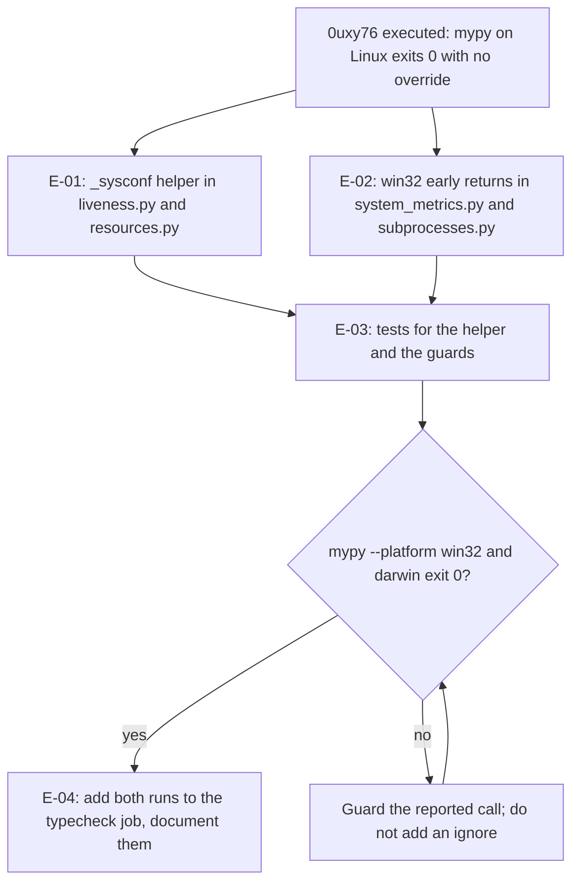

# IPD: Type-check Windows and macOS platform branches in CI

- Date: 2026-11-24
- Kind: child
- Concern: Static type checking: `mypy` checks one target platform per run, and plan `gzc672`'s `typecheck` job runs only the Linux check, so a type error inside a Windows-only or macOS-only branch never fails CI. Running `mypy --platform win32` today reports 10 errors, all calls to POSIX-only `os` functions.
- Scope: Platform guards in `src/pubrun/capture/liveness.py`, `resources.py`, `system_metrics.py`, and `subprocesses.py`; a new `tests/test_platform_type_guards.py`; two more `mypy` steps in the `typecheck` job of `.github/workflows/ci.yml`; and the contributor documentation (`CONTRIBUTING.md`, `CHANGELOG.md`).
- Scope-Paths: src/pubrun/capture/liveness.py, src/pubrun/capture/resources.py, src/pubrun/capture/system_metrics.py, src/pubrun/capture/subprocesses.py, tests/test_platform_type_guards.py, .github/workflows/ci.yml, CONTRIBUTING.md, CHANGELOG.md
- Item-Dependencies: executed:gzc672, executed:m66tfv, executed:k6fs5k, executed:0uxy76
- Status: approved
- Readiness: go-pending-approval
- Review-Depth: standard
- Short-Description: Fix POSIX-only mypy errors reported under --platform win32 and add win32 and darwin mypy runs to the typecheck job
- Work-Kind: chore
- Priority: low
- From-Backlog: qqwebg
- Set: rand-mypy
- Order: 6
- Highest E allocated: 04
- Author: uri/its_direct/pt3-claude-opus-5.5-1m-us
- Id: juoqy2
- Approval: 2026-11-25, recorded via aw ipd set: status set to approved

> Write and proofread this plan per the technical writing standard, `.aw/system/workflows/technical-writing/technical-writing.md` (`.agents/workflows/technical-writing/technical-writing.md` in a legacy-layout install), including requirement 12 (diagrams).

## Workflow history

- 2026-11-25 approved (aw set): status set to approved
- 2026-11-25 /plan-review (Antigravity): APPROVE WITH REVISIONS APPLIED; PR-001, PR-002, PR-003, PR-004, PR-005
- 2026-11-24 to-review (aw set): authored from backlog qqwebg
- 2026-11-24 draft (uri/its_direct/pt3-claude-opus-5.5-1m-us): created.

## Goal

Make `mypy --platform win32` and `mypy --platform darwin` exit 0 on the package, and add both runs to the blocking `typecheck` CI job, so type errors in Windows and macOS code paths fail CI the same way Linux ones do. Runtime behavior on every platform stays the same.

`mypy --platform <p>` type-checks the code as if it ran on platform `<p>`: it uses that platform's standard-library stubs (Windows has no `os.sysconf`, `os.getloadavg`, or `os.WIFEXITED`) and treats `if sys.platform == "<other>":` branches as unreachable. It runs on any host, so the CI job can stay on `ubuntu-latest`.

### Platform guards and CI runs



## Detailed Implementation Checklist (TODO)

Execution-state rule: mark an `E-*` item complete only after performing the action. That mark is not validation. Right-sizing rule: write for a modest executor that cannot hold much in its head. Each E-item is one step (one concern, about one file, executable in one focused pass) and its V-item names each unit it covers with its own check; a plan stays at about 5 E-items and 8 work Scope-Paths, else split it into more child plans (guidance, `IPD-Z603`). Accepted execution states: blocked, failed, pending, performed; terminal gate demands 'performed'.

### Task group 1: Fix the Windows-only errors

- [ ] E-01 Route the five `os.sysconf` calls through a module-level helper in `src/pubrun/capture/liveness.py` and `src/pubrun/capture/resources.py`. In each file, add this function after the module-level constants that follow the imports (`src/pubrun/capture/liveness.py::_PLATFORM` after `_PLATFORM = sys.platform`; `src/pubrun/capture/resources.py::logger` after `logger = logging.getLogger("pubrun")`):
  ```python
  def _sysconf(name: str) -> int:
      """Return ``os.sysconf(name)``; raises ``AttributeError`` where ``os.sysconf`` is absent (Windows)."""
      return int(getattr(os, "sysconf")(name))
  ```
  Then replace `os.sysconf(` with `_sysconf(` in `src/pubrun/capture/liveness.py::_get_start_time_linux`, `src/pubrun/capture/liveness.py::_get_cpu_linux`, `src/pubrun/capture/resources.py::_get_rss_linux`, `src/pubrun/capture/resources.py::_get_tree_rss_linux`, and `src/pubrun/capture/resources.py::ResourceWatcher.__init__` (the `self._clk_tck = os.sysconf("SC_CLK_TCK")` line). The three `resources.py` call sites already catch `AttributeError` or `Exception`, and the two `liveness.py` functions are dispatched only when `_PLATFORM == "linux"` (their `try` blocks catch `(OSError, IndexError, ValueError)` and `ZeroDivisionError`); where `os.sysconf` is absent, `getattr(os, "sysconf")` raises the same `AttributeError` that `os.sysconf` raised, so runtime behavior is unchanged at all five sites. The attribute is looked up at call time, so `tests/test_liveness.py::TestLivenessPlatformBranches.test_linux_start_time_nested_parens_and_missing_btime`'s `monkeypatch.setattr(liveness.os, "sysconf", ...)` keeps working.
  - Depends on: none
  - Expected outcome: `grep -n "os.sysconf" src/pubrun/capture/liveness.py src/pubrun/capture/resources.py` finds only the line inside each `_sysconf` docstring. `python3 -m pytest tests/test_liveness.py tests/test_resources.py -q` passes.
  - Execution state: pending

- [ ] E-02 Add early returns that `mypy` recognizes as platform checks:
  - `src/pubrun/capture/system_metrics.py::get_load_average`: insert `if sys.platform == "win32":` / `return None` as the first statement after the docstring. On Windows `os.getloadavg` does not exist, so the existing `except (OSError, AttributeError)` already returned `None`; the guard returns the same value without the failed call and its debug log line.
  - `src/pubrun/capture/subprocesses.py::_decode_wait_status`: insert `if sys.platform == "win32":` / `return status` immediately after the comment `# Python 3.8 fallback.` and before its `try:`. That point is reachable only when `os.name == "posix"`, which is never true on Windows, so the guard changes no result.
  - `sys` is already imported in both modules.
  - Depends on: none
  - Expected outcome: The diff of the two files is the two guards. `python3 -m pytest tests/test_env_capture.py tests/test_capture_engine_bugs.py tests/test_platform_capture_seams.py -q` passes.
  - Execution state: pending

- [ ] E-03 Create `tests/test_platform_type_guards.py` (using Python 3.8-compatible syntax) with these behavioral tests (7 test cases):
  - `test_get_load_average_is_none_on_windows_without_calling_getloadavg`: monkeypatches `sys.platform` to `"win32"` and `os.getloadavg` to a function that records each call and returns `(1.0, 2.0, 3.0)` (`raising=False`); asserts `system_metrics.get_load_average()` is `None` and the recorder saw no call.
  - `test_decode_wait_status_returns_raw_status_on_windows`: monkeypatches `sys.platform` to `"win32"` and deletes `os.waitstatus_to_exitcode` (`raising=False`) so the Python 3.8 fallback is reached on POSIX; asserts `subprocesses._decode_wait_status(256) == 256` (the fallback would decode it to `1`).
  - `test_sysconf_helper_raises_attribute_error_without_os_sysconf`, parametrized over `liveness` and `resources`: deletes `os.sysconf` (`raising=False`) and asserts `module._sysconf("SC_CLK_TCK")` raises `AttributeError` matching `"module 'os' has no attribute 'sysconf'"`.
  - `test_sysconf_helper_returns_int_from_os_sysconf`, parametrized over `liveness` and `resources`: monkeypatches `os.sysconf` to return `4096` for `"SC_PAGE_SIZE"` (`raising=False`) and asserts `module._sysconf("SC_PAGE_SIZE") == 4096`.
  - `test_resource_watcher_clock_ticks_zero_without_os_sysconf`: deletes `os.sysconf` (`raising=False`) and asserts `resources.ResourceWatcher(run_tracker=None, interval_seconds=1.0, system_metrics=False)._clk_tck == 0`.
  - Depends on: E-01, E-02
  - Expected outcome: All 7 pass on Linux, macOS, and Windows (each test sets the platform state it needs with `raising=False`), pass in 3 consecutive runs under `-p randomly`, and removing either guard of E-02 fails its test (V-03).
  - Execution state: pending

### Task group 2: Gate the platforms in CI

- [ ] E-04 Extend the `typecheck` job in `.github/workflows/ci.yml` (added by executed plan `gzc672` E-04): after its `Run mypy` step (`run: mypy`), add two steps, `mypy --platform win32` and `mypy --platform darwin`, each with a `name:` that states the platform (for example `Type-check (Windows platform)` and `Type-check (macOS platform)`). Add no `continue-on-error`. Change no other job. Then document them: in `CONTRIBUTING.md#Development setup`, in the `mypy` paragraph, add the two commands to the code block and update the Linux-only wording to say that CI runs all three platform checks (`mypy`, `mypy --platform win32`, and `mypy --platform darwin`). In `CHANGELOG.md` `## [Unreleased]`, extend the `### Changed` entry that child `0uxy76` added (or add one) to say that CI also type-checks the Windows and macOS code paths. Follow `AGENTS.md#Agent execution contract`: no em or en dashes in the added prose. Finally, ask the human to trigger `.github/workflows/ci.yml` by pushing to `main` or opening a pull request targeting `main` (per `AGENTS.md#Matrix-validation discipline` and the never-push rule); if no push or pull request is authorized yet (for example in an unattended runner lane), record all local evidence, mark E-04 and V-04 `blocked` with that reason, and leave the plan in `pending/`.
  - Depends on: E-03
  - Expected outcome: `python3 -c "import yaml; j=yaml.safe_load(open('.github/workflows/ci.yml'))['jobs']['typecheck']; print('continue-on-error:', j.get('continue-on-error'), [s.get('continue-on-error') for s in j['steps']]); print([s.get('run') for s in j['steps'] if 'run' in s])"` shows no `continue-on-error` and lists `mypy`, `mypy --platform win32`, and `mypy --platform darwin`; each of the three commands, run locally after deleting `.mypy_cache/` with `--no-incremental`, prints `Success: no issues found in <N> source files` (`58` at review; re-derive at execution time if modules were added) and exits 0.
  - Execution state: pending

## Project conventions discovered (Step 0)

- Plan `gzc672` (now `executed`; `approved` at authoring) E-04 added the `typecheck` job (`.github/workflows/ci.yml`, `ubuntu-latest`, Python 3.12, `pip install -e ".[dev,tui]"`, `mypy --version`, `mypy`) and recorded why it checks only Linux: at its review, `mypy --platform win32` reported 7 POSIX-only errors and `--platform darwin` none. `gzc672`'s "Deferred / out of scope" section assigns the platform guards to backlog `qqwebg` (this Set). This plan edits that job, hence `Item-Dependencies: executed:gzc672`.
- The Windows-only error count is 10 across the package once `k6fs5k` runs, not 7 (and at current `HEAD` before `k6fs5k`, `mypy --platform win32` reports only 3 because `gzc672` placed both `pubrun.capture.resources` and `pubrun.capture.subprocesses` on `pyproject.toml`'s `ignore_errors` list, hiding 3 `os.sysconf` errors in `resources.py` and 4 wait-status errors in `subprocesses.py`). Child `k6fs5k` removes all six `pubrun.capture.*` entries from `ignore_errors`; this plan must therefore run after it.
- Child `0uxy76` edits the same `CONTRIBUTING.md#Development setup` paragraph and `CHANGELOG.md` `## [Unreleased]` entry; this plan runs after it so the two edits apply in sequence.
- `mypy` treats `if sys.platform == "win32": return ...` as a platform check and skips the rest of the function only under `--platform win32`. It does not understand `getattr(os, "sysconf")`'s absence, which is why E-01 uses a helper rather than a guard.
- `tests/test_liveness.py::TestLivenessPlatformBranches.test_linux_start_time_nested_parens_and_missing_btime` monkeypatches `liveness.os.sysconf` with `raising=False` to simulate Linux on other hosts; the new tests follow the same pattern.
- `AGENTS.md#Matrix-validation discipline` requires validating cross-platform capture changes on the full CI matrix before moving an IPD to `executed/`, while `AGENTS.md#Agent execution contract` forbids pushing without an explicit human instruction.

## Findings

| ID | Severity | Remediation Risk | Evidence | Finding |
|---|---|---|---|---|
| M-13 | Low | Low | `mypy --platform win32` with every earlier edit in this Set applied: `src/pubrun/capture/liveness.py::_get_start_time_linux` and `::_get_cpu_linux`: `Module has no attribute "sysconf"  [attr-defined]`; `src/pubrun/capture/resources.py::_get_rss_linux`, `::_get_tree_rss_linux`, and `::ResourceWatcher.__init__`: the same (3); `src/pubrun/capture/system_metrics.py::get_load_average`: `Module has no attribute "getloadavg"`; `src/pubrun/capture/subprocesses.py::_decode_wait_status`: `Module has no attribute "WIFEXITED"`, `"WEXITSTATUS"`, `"WIFSIGNALED"`, `"WTERMSIG"`; total `Found 10 errors in 4 files` | Windows paths are not type-checked, and the Windows view of the package has 10 errors. |
| M-14 | Low | Low | `mypy --platform darwin` on the same tree: `Success: no issues found in 58 source files` | macOS is clean today but is not gated, so a later regression would go unnoticed. |

Authoring measurements (lane HEAD `a4b7d12`, `mypy` 2.3.1, Python 3.14.6, Linux host), on a scratch tree with `gzc672`'s fixes and every edit in this Set:

- Before this plan's edits: Linux and darwin `Success: no issues found in 58 source files`; win32 `Found 10 errors in 4 files`. After them: all three print `Success: no issues found in 58 source files`.
- E-03 prototype: 7 passed, also in 3 runs under `-p randomly`. On the tree without this plan's edits, 6 of the 7 failed (the four `_sysconf` cases because the helper does not exist; the load-average and wait-status cases because the call is made). The clock-ticks case passed there too, because `ResourceWatcher.__init__` already caught `AttributeError`; it pins that the helper keeps that behavior.
- `python3 -m pytest tests/test_liveness.py tests/test_resources.py tests/test_env_capture.py tests/test_platform_capture_seams.py tests/test_capture_engine_bugs.py -q` on the edited tree: `137 passed`.

## Proposed changes (ordered, validatable)

1. Add `_sysconf` helpers and use them at the five Linux-only call sites (E-01; Remediation Risk: Low).
2. Add Windows early returns in `get_load_average` and `_decode_wait_status` (E-02; Remediation Risk: Low).
3. Add tests for the helper and the guards (E-03; Remediation Risk: Low).
4. Add `--platform win32` and `--platform darwin` steps to the `typecheck` job and document them (E-04; Remediation Risk: Low).

Rejected alternatives:

- A Windows or macOS runner for the `typecheck` job: `--platform` gives the same check from the existing Linux runner without extra runner minutes.
- `# type: ignore[attr-defined]` on the 10 calls: it would also hide a misspelled `os` attribute on Linux, where the ignore applies too.
- `if sys.platform != "win32":` guards around each `os.sysconf` call: the callers are Linux-only functions (guarded by platform dispatch and, in `resources.py`, by `try`/`except` catching `AttributeError` or `Exception`), and five nested guards add indentation for no runtime effect; one helper per module is smaller.

## Deferred / out of scope (with reason)

- Pinning the `mypy` version in CI: deferred by `gzc672` (it would change the `dev` extra contract).
  - Carrier-Declined: Deliberate non-goal (changing the dev extra contract was deferred by gzc672).
- Type-checking with a target Python version other than the runner's: `mypy` 2.x refuses `--python-version` below 3.10, and the project supports 3.8 (`gzc672` Project conventions).
  - Carrier-Declined: External tool limitation (mypy 2.x refuses --python-version below 3.10).

## Scope check

- Over-scope: none. The new test file covers only the helper and the guards this plan adds.
- Under-scope: none. The CI change and Windows/macOS test matrix cannot be observed until a human authorizes a push to `main` or pull request targeting `main`; E-04 and V-04 record that as a human-authorized step.

## Required tests / validation

- `rm -rf .mypy_cache && for p in linux win32 darwin; do mypy --platform "$p" --no-incremental; echo "$p exit=$?"; done`: three `Success: no issues found in <N> source files` lines (`58` at review; re-derive at execution time if modules were added) and `exit=0` each.
- `for i in 1 2 3; do python3 -m pytest tests/test_platform_type_guards.py -q -p randomly && echo "run $i ok" || exit 1; done`: every iteration exits 0 and prints `7 passed`.
- Mutation checks, each restored before the next: delete the E-02 guard in `src/pubrun/capture/system_metrics.py::get_load_average`, then run `mypy --platform win32 --no-incremental; echo "exit=$?"` (expect an `error:` line for `src/pubrun/capture/system_metrics.py` and `exit=1`) and `python3 -m pytest tests/test_platform_type_guards.py -q` (expect `test_get_load_average_is_none_on_windows_without_calling_getloadavg` to fail). Repeat for the guard in `src/pubrun/capture/subprocesses.py::_decode_wait_status` (expect `src/pubrun/capture/subprocesses.py` errors with `exit=1` and `test_decode_wait_status_returns_raw_status_on_windows` to fail).
- `python3 -m pytest tests/test_platform_type_guards.py tests/test_liveness.py tests/test_resources.py tests/test_env_capture.py tests/test_platform_capture_seams.py tests/test_capture_engine_bugs.py -q`: exit 0.
- `python3 scripts/sanitize_paths.py --check --all`: exit 0.
- One GitHub Actions run of `.github/workflows/ci.yml` (triggered by a human-authorized push to `main` or pull request targeting `main`) where the `typecheck` job's three `mypy` steps each print `Success: no issues found in <N> source files` and the cross-platform `test` matrix concludes `success`.

## Spec / documentation sync

- No `.spec.md` under `.aw/records/specs/` and no file under `docs/` mentions `mypy` (checked at authoring and review with `grep -rln "randomly\|mypy" .aw/records/specs docs`: no match). No spec is amended.
- `CONTRIBUTING.md#Development setup` and `CHANGELOG.md` `## [Unreleased]` are updated by E-04.

## Open questions

None.

## Validation and cross-check (verify before reporting done)

Validation-state rule: inspect evidence in a separate pass. Do not mark a `V-*` item complete from memory or from the matching execution checkmark. Accepted validation results: blocked, failed, pass, pending; terminal gate demands 'pass'. Runtime-demonstration reachability rule: for each `V-*` item demanding the software be observed acting (such as a run, a dispatch, or a transition), as distinct from items demanding a diff, a file's content, or a test result, which are reachable by construction, name the code path that produces the observation or the sibling `E-*` that creates it, else the demand is UNDER-SCOPE.

- [ ] V-01 validates E-01
  - Required evidence: Pasted `git diff src/pubrun/capture/liveness.py src/pubrun/capture/resources.py` showing the two helpers and the five replaced calls and nothing else; pasted `grep -n "os.sysconf" src/pubrun/capture/liveness.py src/pubrun/capture/resources.py` showing only the docstring lines; and the last line of `python3 -m pytest tests/test_liveness.py tests/test_resources.py -q` showing all passed.
  - Observed evidence:
  - Result: pending

- [ ] V-02 validates E-02
  - Required evidence: Pasted `git diff src/pubrun/capture/system_metrics.py src/pubrun/capture/subprocesses.py` showing only the two guards; and the last line of `python3 -m pytest tests/test_env_capture.py tests/test_capture_engine_bugs.py tests/test_platform_capture_seams.py -q` showing all passed.
  - Observed evidence:
  - Result: pending

- [ ] V-03 validates E-03
  - Required evidence: (1) Pasted content of `tests/test_platform_type_guards.py`. (2) Pasted output of the 3-run `-p randomly` loop from "Required tests / validation", every iteration exiting 0 with `7 passed`. (3) Pasted output of the two mutation checks in "Required tests / validation", each showing the `mypy --platform win32 --no-incremental` `error:` line for the mutated file with `exit=1` and the named `FAILED` test, then `git diff --stat src/pubrun` after the last restore showing only E-01 and E-02 files.
  - Observed evidence:
  - Result: pending

- [ ] V-04 validates E-04
  - Required evidence: (1) Pasted `git diff .github/workflows/ci.yml CONTRIBUTING.md CHANGELOG.md`. (2) Pasted output of the `yaml.safe_load` command from E-04 confirming no `continue-on-error` and listing `mypy`, `mypy --platform win32`, and `mypy --platform darwin`. (3) Pasted output of the three-platform `mypy --no-incremental` loop from "Required tests / validation" with three `Success: no issues found in <N> source files` lines (`58` at review; re-derive at execution time) and `exit=0` each. (4) Pasted output of `python3 -c 'import subprocess, sys; res = [(p, len(a), sum("\u2013" in l or "\u2014" in l for l in a)) for p in ("CONTRIBUTING.md", "CHANGELOG.md") for a in [[l[1:] for l in subprocess.check_output(["git", "diff", "-U0", "--", p], text=True).splitlines() if l.startswith("+") and not l.startswith("+++")]]]; print(res); sys.exit(0 if all(n > 0 and d == 0 for _, n, d in res) else 1)'` exiting 0 with positive added-line counts and zero en/em dashes for both files. (5) Pasted last line and `exit=0` of the combined 6-file pytest command and `python3 scripts/sanitize_paths.py --check --all` exiting 0. (6) After a human-authorized push to `main` or pull request targeting `main`, the CI run URL, the `typecheck` job log lines for all three `mypy` steps showing `Success: no issues found in <N> source files`, and the cross-platform `test` matrix conclusion (`success`); if no push or pull request is authorized yet, mark E-04 and V-04 `blocked` with that reason and keep the plan in `pending/`. This observation is produced by the GitHub Actions run of the workflow E-04 edits.
  - Observed evidence:
  - Result: pending

## Approval and execution gate

- Size assessment: standard
- Cohesion rationale: not required

Execution contract:
1. Precondition: wait for human approval (`- Status: approved`) with no unresolved `Blocking: yes` open question, and for plans `gzc672`, `m66tfv`, `k6fs5k`, and `0uxy76` to be `executed`, before you change any file.
2. Scope declaration: the expected modified files are the `- Scope-Paths:` entries. If execution requires an out-of-scope file, justify it with `--scope-reason` at finalization. If a declared file needs no edit, acknowledge it with `--scope-ack`.
3. Validation honesty: you MUST run each required validation command and paste its actual output into the matching `V-*` `Observed evidence:` field. Do not mark a `V-*` item `pass` without output captured from that run. V-04 item (6) needs a GitHub Actions run of `.github/workflows/ci.yml` (triggered by a push to `main` or pull request targeting `main`), which needs an explicit human instruction; until then E-04 and V-04 stay `blocked` (or `pending`) and the plan stays in `pending/`.
4. Commit discipline: commit only the paths you changed with `aw commit juoqy2 -- <paths>`. Do not use `git add -A` or raw `git commit`. Do not push without an explicit human instruction.
5. Lifecycle transition: inside `aw oc run` / `aw agy run`, the runner owns finalization once every `E-*` item is `performed` and every `V-*` item is `pass`. Outside a runner, after every `E-*` item is `performed`, every `V-*` item is `pass`, and `aw ipd lint --phase pre-transition` reports `conforming`, finalize this plan with `aw ipd finalize juoqy2` (never with a hand-written `git mv`).
