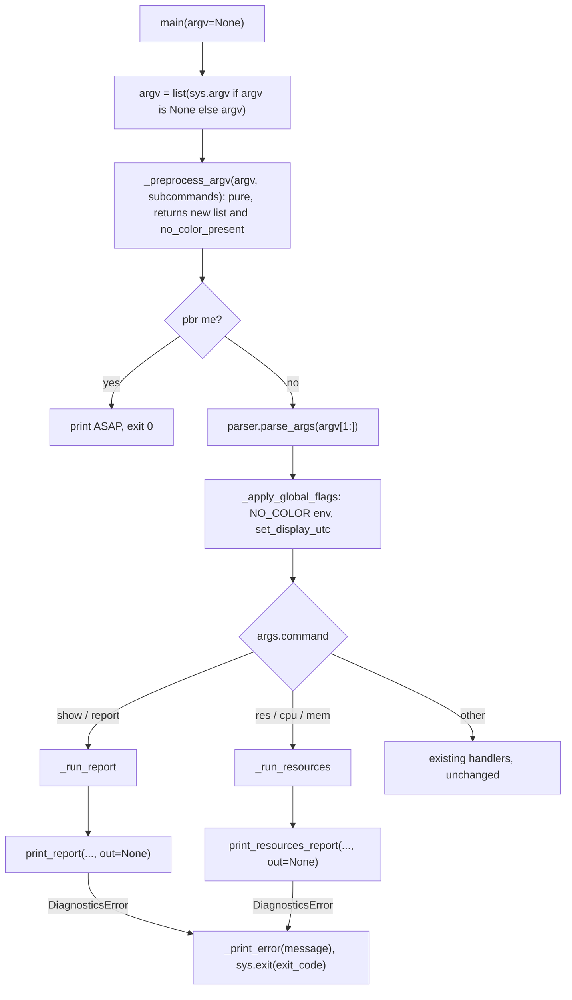

# IPD: CLI main() and diagnostics report testable seams

- Date: 2026-11-24
- Kind: child
- Concern: Testability of the CLI entry point and the diagnostics report renderers (injectable argv, output stream, and error channel)
- Scope: Refactor `src/pubrun/__main__.py::main` so it accepts an optional argv list and never rewrites `sys.argv`, with its argv preprocessing extracted into a pure function. Refactor `src/pubrun/report/diagnostics.py::print_report`, `::print_resources_report`, and their print helpers so they write to an optional output stream and raise a typed `DiagnosticsError` instead of calling `sys.exit(1)`. Keep every CLI output, error message, and exit code byte-identical. Add in-process seam tests in two new test files and one `CHANGELOG.md` entry.
- Scope-Paths: src/pubrun/__main__.py, src/pubrun/report/diagnostics.py, tests/test_cli_seams.py, tests/test_diagnostics_seams.py, CHANGELOG.md
- Item-Dependencies: executed:ic6z4s
- Status: reviewed
- Readiness: go-pending-approval
- Review-Depth: standard
- Short-Description: Let main() take an argv list and let the diagnostics reports take an output stream and raise a typed error, so tests can drive them in-process
- Work-Kind: chore
- Priority: low
- From-Backlog: riulkx
- Set: riulkx
- Order: 1
- Highest E allocated: 08
- Author: opencode
- Id: mvbbny

> Write and proofread this plan per the technical writing standard, `.aw/system/workflows/technical-writing/technical-writing.md` (`.agents/workflows/technical-writing/technical-writing.md` in a legacy-layout install), including requirement 12 (diagrams).

## Workflow history

- 2026-11-25 /plan-review (Antigravity): APPROVE WITH REVISIONS APPLIED; PR-001, PR-002, PR-003, PR-004, PR-005
- 2026-11-25 to-review (aw set): status set to to-review
- 2026-11-25 to-review (opencode): graduated from backlog item `riulkx` into a review-ready plan.
- 2026-11-25 draft (opencode): created.

## Goal

Today the CLI entry point and the two diagnostics reports can only be tested by changing process-wide state. `main()` reads and rewrites `sys.argv`, and `print_report` and `print_resources_report` write straight to `sys.stdout` and end the process with `sys.exit(1)`. A test therefore has to monkeypatch `sys.argv`, capture stdout, and catch `SystemExit`, or start a subprocess. After this plan:

1. A test calls `main(["pubrun", "status", "--dir", path])` and `main()` never assigns `sys.argv`. Calling `main()` with no argument still reads `sys.argv`, so the `pubrun` and `pbr` console scripts and every existing test keep working.
2. The argv rewriting that `main()` does before parsing (strip `--no-color`, move a leading run id after the subcommand, translate `help`) is a pure function, `_preprocess_argv`, that a test calls with a list and checks the returned list.
3. A test calls `print_report(path, out=buf)` or `print_resources_report(path, out=buf)` with an `io.StringIO` and reads the report from `buf`, with nothing written to `sys.stdout`. A missing or corrupt manifest, an unreadable log, or a bad `--last` value raises `DiagnosticsError` carrying the exact message text printed today, and the process does not exit.
4. Every `pubrun` command prints the same stdout and stderr and exits with the same code as before. A parity script run against `HEAD` and the changed tree proves this for 30 command lines.

## Detailed Implementation Checklist (TODO)

Execution-state rule: mark an `E-*` item complete only after performing the action. That mark is not validation. Right-sizing rule: write for a modest executor that cannot hold much in its head. Each E-item is one step (one concern, about one file, executable in one focused pass) and its V-item names each unit it covers with its own check; a plan stays at about 5 E-items and 8 work Scope-Paths, else split it into more child plans (guidance, `IPD-Z603`). Accepted execution states: blocked, failed, pending, performed; terminal gate demands 'performed'.

### Task group 1: CLI entry point

- [ ] E-01 In `src/pubrun/__main__.py`, add the module-level pure function `_preprocess_argv(argv, subcommands)` and make `main()` take an optional argv list that it copies and never assigns back to `sys.argv`.
  - Depends on: none
  - Expected outcome: (1) `_preprocess_argv(argv: List[str], subcommands: Set[str]) -> Tuple[List[str], bool]` returns a new list and whether `--no-color` was stripped, and does not mutate its input. Its body is the current block from the comment "Handle global --no-color flag regardless of position" through the `help` translation, moved unchanged except that it reads and writes a local list instead of `sys.argv`. (2) `main(argv: Optional[List[str]] = None) -> None` starts with `argv = list(sys.argv if argv is None else argv)`, derives `prog_name = Path(argv[0]).name if argv and argv[0] else "pubrun"` (handling empty `argv=[]` without `IndexError`), and calls `parser.parse_args(argv[1:])`. (3) `_SubcommandAwareArgumentParser.error` finds the subcommand by scanning the preprocessed argv (shared through a closure list populated before `parse_args`) instead of `sys.argv[1:]`. (4) The `pbr me` easter egg reads the preprocessed list. (5) No statement in `main()` assigns or mutates `sys.argv`. The `NO_COLOR` and `--utc` side effects are covered by E-02.
  - Execution state: pending

- [ ] E-02 In `src/pubrun/__main__.py`, move the two global side effects that `main()` applies after parsing into one helper, `_apply_global_flags(args, no_color_present)`, and call it from `main()` at the same point.
  - Depends on: E-01
  - Expected outcome: `_apply_global_flags` sets `args.no_color = True` when `no_color_present` is true, sets `os.environ["NO_COLOR"] = "1"` when `args.no_color` is true, and calls `src/pubrun/status.py::set_display_utc(True)` when `args.utc` is true, exactly as the inline code does now (the inline block starting `if no_color_present:` is removed). The `NO_COLOR` environment write stays, because the `run` subcommand passes `os.environ` to the child process and `src/pubrun/report/output.py::_use_color` and `src/pubrun/status.py` read `NO_COLOR` at print time.
  - Execution state: pending

### Task group 2: Diagnostics renderers

- [ ] E-03 In `src/pubrun/report/diagnostics.py`, add the exception class `DiagnosticsError(Exception)` and make `print_report` and `print_resources_report` raise it instead of printing an error and calling `sys.exit(1)`.
  - Depends on: none
  - Expected outcome: (1) `DiagnosticsError(message: str, exit_code: int = 1)` stores `message` and `exit_code` as attributes, and `str(err)` returns `message`. (2) Each of the seven `_print_error(...)` plus `sys.exit(1)` pairs in `print_report` (missing manifest, corrupt manifest, unreadable stdout log, unreadable stderr log) and `print_resources_report` (missing manifest, corrupt manifest, invalid `--last`) becomes `raise DiagnosticsError(<same message text>)`, raised from the original exception with `from`. (3) `src/pubrun/report/diagnostics.py` contains no `sys.exit` call. (4) The module helper `src/pubrun/report/diagnostics.py::_print_error` stays for backward compatibility (it is no longer called inside `diagnostics.py`; the CLI wrappers in E-05 call `src/pubrun/__main__.py::_print_error`, which uses the same `src/pubrun/report/output.py::error` path).
  - Execution state: pending

- [ ] E-04 In `src/pubrun/report/diagnostics.py`, add a keyword-only `out: Optional[TextIO] = None` parameter to `print_report`, `print_resources_report`, `draw_ascii_chart`, `_print_packages_block`, and `_print_data_files_block`, and route every report `print(...)` and every `_supports_unicode(sys.stdout)` call through that stream.
  - Depends on: E-03
  - Expected outcome: (1) Each of the five functions resolves `stream = out if out is not None else sys.stdout` at call time, not at definition time, so pytest's `capsys` (which swaps `sys.stdout` per test) keeps working for callers that pass nothing. (2) Every `print(...)` in those functions, including the nested `_print_ev` in `print_report`, passes `file=stream`. (3) Every `_supports_unicode(sys.stdout)` call becomes `_supports_unicode(stream)`, so a stream whose `encoding` is `ascii` gets the ASCII box and chart glyphs. (4) `print_report` and `print_resources_report` pass `out=stream` to the helpers they call. (5) The positional parameters and defaults of every function stay as they are, so the existing callers in `src/pubrun/__main__.py` and the tests in `tests/test_reports.py`, `tests/test_show_sections.py`, `tests/test_timing_consumers.py`, `tests/test_env_capture.py`, and `tests/test_edge_cases.py` work unchanged.
  - Execution state: pending

- [ ] E-05 In `src/pubrun/__main__.py`, make `_run_report` and `_run_resources` catch `DiagnosticsError`, print its message with `_print_error`, and exit with its `exit_code`.
  - Depends on: E-03
  - Expected outcome: Each wrapper places its lazy `from pubrun.report.diagnostics import DiagnosticsError, ...` import immediately before `try:` (keeping the import lazy while guaranteeing `DiagnosticsError` is bound before `except DiagnosticsError:` runs) and adds an `except DiagnosticsError as e: _print_error(e.message); sys.exit(e.exit_code)` clause placed before its generic `except Exception` clause. Without it, the generic clause would print "Failed to generate diagnostic report: ..." or "Failed to generate resources report: ..." in front of the message, which changes the stderr text that `tests/test_cli_negative_paths.py::TestDiagnosticsNegativePaths` checks. In `_run_report`, the clause is on the outer `try`, so it also covers `print_report` calls reached through the inner `try` that handles `RunInProgressOrCrashedError`.
  - Execution state: pending

### Task group 3: Seam tests and changelog

- [ ] E-06 Create `tests/test_cli_seams.py` with in-process tests that call `main(argv)` and `_preprocess_argv` directly, without setting `sys.argv`.
  - Depends on: E-01, E-02, E-05
  - Expected outcome: The file defines the classes and tests named in "Proposed changes" item 5. Every test asserts on return values, captured output, exit codes, or `sys.argv` identity and content; none reads source code. All tests pass.
  - Execution state: pending

- [ ] E-07 Create `tests/test_diagnostics_seams.py` with tests that pass an `io.StringIO` or an ASCII `io.TextIOWrapper` as `out`, and tests that assert `DiagnosticsError` is raised.
  - Depends on: E-03, E-04
  - Expected outcome: The file defines the classes and tests named in "Proposed changes" item 6. All tests pass.
  - Execution state: pending

- [ ] E-08 Add one entry to `CHANGELOG.md` under `## [Unreleased]` `### Changed` describing the new optional `argv` parameter of `main()`, the `out` parameter of the diagnostics reports, and `DiagnosticsError`.
  - Depends on: E-06, E-07
  - Expected outcome: One bullet, written for users with no em or en dashes, states that `pubrun.__main__.main()` now accepts an optional argument list, that `print_report` and `print_resources_report` in `pubrun.report.diagnostics` accept an `out` stream and raise `DiagnosticsError` instead of exiting, and that CLI output and exit codes are unchanged.
  - Execution state: pending

## Project conventions discovered (Step 0)

- Test outcomes, not code structure (`AGENTS.md#Agent execution contract`): tests call functions or drive the CLI and assert on output, exit codes, and side effects. They must not read production source with `inspect`, `ast`, regex, or substring search. V-items below may use `grep` on the diff as review evidence; that is not a test.
- `pyproject.toml` `[project.scripts]` maps `pubrun` and `pbr` to `pubrun.__main__:main`. A console script calls the target with no arguments, so `main` must keep working with no argument.
- `tests/conftest.py::pubrun_state_isolation` (autouse) snapshots and restores `os.environ`, `sys.exit`, `sys.stdout`, and `sys.stderr`, and resets `pubrun.status._DISPLAY_UTC` to `False` after every test. In-process tests that set `NO_COLOR` or `--utc` therefore do not leak into later tests.
- `tests/test_cli.py::run_pubrun` runs the CLI in a subprocess with this checkout's `src` on `PYTHONPATH`. In-process callers (for example `tests/test_cli_negative_paths.py::TestTopLevelCliInProcess`, `tests/test_cli_diff_bugs.py::_call_main`, and `tests/test_cli.py::TestCliResourcesAliases`) monkeypatch `sys.argv` and call `main()`. Both styles must keep passing unchanged.
- `pyproject.toml` `[tool.mypy]` keeps a ratchet list under the comment "Legacy type-check ratchet: this list may only shrink, never grow." `pubrun.report.diagnostics` is currently on it (4 known errors, measured at authoring by removing it from a scratch copy of the config; sibling pending plan `qe6dad` removes it). `pubrun.__main__` is not on it, so `mypy` checks `src/pubrun/__main__.py` strictly, and `mypy` currently reports "Success: no issues found in 58 source files". Keep all annotations added to `src/pubrun/report/diagnostics.py` mypy-clean so `mypy` also passes if `qe6dad` executes before this plan.
- `pyproject.toml` `[tool.pytest.ini_options]` sets `addopts = "-p no:randomly"`, and CI runs `pytest tests/ -v` plus a coverage job with `--cov-fail-under=78` (`.github/workflows/ci.yml`). Targeted local runs pass `--no-cov`.
- `src/pubrun/__main__.py` imports `List, NoReturn, Optional` from `typing`. `src/pubrun/report/diagnostics.py` starts with `from __future__ import annotations` and imports `Optional, Dict, Any, List, Tuple`. The code must run on Python 3.8 (`requires-python = ">=3.8"`), so use `typing.List`/`Tuple`/`Set`/`TextIO`, not built-in generics, in any annotation evaluated at runtime.
- `CHANGELOG.md` `## [Unreleased]` already has `### Added`, `### Changed`, and `### Fixed` subsections.
- Cite code by SYMBOL (`module.function`) or by a quoted content string, with a line number only appended to one of those and never alone: an offset expires before this plan executes (advisory `IPD-C801`).

## Findings

Behavior measured at authoring on Linux with Python 3.14.6, `HEAD` `b6b05ba`.

`main()` (from `def main() -> None:` to the end of `src/pubrun/__main__.py`) builds the parser, rewrites `sys.argv`, parses, applies two global flags, and dispatches through one `if/elif args.command` chain. The process-wide state it touches:

| Site in `main()` | What it does now | This plan |
|---|---|---|
| `prog_name = Path(sys.argv[0]).name ...` | Reads `sys.argv[0]` to choose `pubrun` or `pbr` | E-01 reads `argv[0]` |
| `_SubcommandAwareArgumentParser.error` | Scans `sys.argv[1:]` for a subcommand to pick the usage line | E-01 scans the preprocessed list |
| Block from "Handle global --no-color flag regardless of position" to the `help` translation | Assigns `sys.argv` up to five times: strips `--no-color` (but not after `run`), moves a leading run id after the subcommand, rewrites `help <cmd>` and `<cmd> help` to `--help` | E-01 moves it into `_preprocess_argv` on a local list |
| `args = parser.parse_args()` | Parses the rewritten `sys.argv` | E-01 passes `argv[1:]` |
| `if no_color_present: ...` | Sets `os.environ["NO_COLOR"] = "1"` | E-02 moves it into `_apply_global_flags` and keeps it |
| `if getattr(args, "utc", False): ...` | Calls `set_display_utc(True)`, a module global in `src/pubrun/status.py` | E-02 moves it into `_apply_global_flags` and keeps it |

The `NO_COLOR` write and the UTC flag stay process-wide on purpose. `pubrun run` builds the child environment from `os.environ` (`child_env = {**os.environ, ...}`), and the parity case `--no-color run -- python -c ...` shows the child sees `NO_COLOR=1`. The status renderers read `NO_COLOR` and `_DISPLAY_UTC` deep inside `src/pubrun/status.py`. Threading both values through every renderer would touch many more files and is deferred (see "Deferred / out of scope"). Collecting them in one helper makes them visible and testable, and the conftest fixture already resets both after each test.

A variable flow check at authoring found that the dispatch code after `parse_args` reads only `args`, `parser`, `prog_name`, and (inside one `for` loop) a fresh `idx`, so passing a local list instead of `sys.argv` does not change dispatch.

`src/pubrun/report/diagnostics.py` writes its reports with 131 bare `print(...)` calls, none with `file=`: 81 in `print_report`, 31 in `print_resources_report`, 11 in `_print_packages_block`, 5 in `draw_ascii_chart`, and 3 in `_print_data_files_block`. Seven `_supports_unicode(sys.stdout)` calls choose between box-drawing and ASCII glyphs. Seven `_print_error(...)` plus `sys.exit(1)` pairs end the process:

| Function | Condition | Message printed today (exact) |
|---|---|---|
| `print_report` | manifest missing | `Could not find manifest file at '<path>'.` |
| `print_report` | manifest is not JSON | `The manifest file at '<path>' is corrupt or contains invalid JSON.` |
| `print_report` (`section == "logs"`) | `stdout.log` read fails | `Failed to read stdout log: <error>` |
| `print_report` (`section == "logs"`) | `stderr.log` read fails | `Failed to read stderr log: <error>` |
| `print_resources_report` | manifest missing | `Could not find manifest file at '<path>'.` |
| `print_resources_report` | manifest is not JSON | `The manifest file at '<path>' is corrupt or contains invalid JSON.` |
| `print_resources_report` | `--last` does not parse | `Invalid duration for --last: <error>` |

The CLI wrappers `_run_report` and `_run_resources` call these functions inside `try` blocks whose last clause is `except Exception as e: _print_error(f"Failed to generate ... : {e}"); sys.exit(1)`. `SystemExit` is not an `Exception`, so today the inner message prints alone. A raised `DiagnosticsError` is an `Exception`, so E-05 must catch it first or the prefix "Failed to generate ..." appears. `tests/test_cli_negative_paths.py` asserts the substrings "is corrupt or contains invalid JSON." and "Invalid duration for --last: ..." on stderr.

The other functions in `src/pubrun/report/diagnostics.py` that `src/pubrun/__main__.py` or `src/pubrun/tui/` import (`format_redacted_rerun_advisory`, `read_resource_series`, `format_resource_digest`, `SHOW_SECTIONS`) return values and print nothing, so they are unaffected.



## Proposed changes (ordered, validatable)

1. **`_preprocess_argv` and `main(argv)` (E-01).** Move the preprocessing block out of `main()` into a module-level function directly above `main()`:

   ```python
   def _preprocess_argv(argv: List[str], subcommands: Set[str]) -> Tuple[List[str], bool]:
       """Return (rewritten argv, no_color_present) without mutating the input."""
       argv = list(argv)
       # existing body, with every `sys.argv` replaced by `argv`
       return argv, no_color_present
   ```

   In `main()`, derive `prog_name = Path(argv[0]).name if argv and argv[0] else "pubrun"` so an empty `argv=[]` does not raise `IndexError`, and replace the preprocessing block with `argv, no_color_present = _preprocess_argv(argv, subcommands)`. Before `parser.parse_args(argv[1:])`, store the preprocessed list where `_SubcommandAwareArgumentParser.error` can read it (for example a closure list `_argv_for_errors: List[str] = []` defined next to `_PRIMARY_COMMANDS` and populated with `_argv_for_errors[:] = argv` before parsing, so `error` scans `_argv_for_errors[1:]`). A subparser's `error` runs on the subparser instance, which is also built from `_SubcommandAwareArgumentParser` through `parser_class`, so the closure must be shared. Add `Set` and `Tuple` to the `typing` import. Update the `main` docstring to say what `argv` means: the full argument vector including the program name, defaulting to `sys.argv`.
2. **`_apply_global_flags` (E-02).** A module-level helper above `main()` that holds the current inline `no_color_present`, `NO_COLOR`, and `--utc` code. `main()` calls it immediately after `parse_args`, so the order relative to the `show config` interception and the dispatch chain does not change.
3. **`DiagnosticsError` (E-03).** Define it near `_print_error` in `src/pubrun/report/diagnostics.py`:

   ```python
   class DiagnosticsError(Exception):
       """A diagnostics report could not be produced; the CLI prints ``message`` and exits."""
       def __init__(self, message: str, exit_code: int = 1) -> None:
           super().__init__(message)
           self.message = message
           self.exit_code = exit_code
   ```

   Replace each pair in the "Findings" table with `raise DiagnosticsError(<same f-string>) from <caught exception>`. The message strings must be copied character for character.
4. **`out` stream (E-04) and the CLI catch (E-05).** In each of the five printing functions, add `*, out: Optional[TextIO] = None` after the existing parameters (for `draw_ascii_chart`, `_print_packages_block`, which already has a keyword-only `leading_newline`, and `_print_data_files_block`, add `out` to the keyword-only group), resolve `stream` at the top of the body, and add `file=stream` to every `print`. Import `TextIO` from `typing`. In `src/pubrun/__main__.py::_run_report` and `::_run_resources`, place the lazy `from pubrun.report.diagnostics import DiagnosticsError, ...` import immediately before `try:` (keeping the import lazy inside the wrapper while guaranteeing `DiagnosticsError` is bound before `except DiagnosticsError:` runs) and add the `except DiagnosticsError` clause before `except Exception`.
5. **`tests/test_cli_seams.py` (E-06).** No subprocess; every test calls functions in-process. Use `tmp_path`, `monkeypatch.chdir(tmp_path)`, and `monkeypatch.setenv("PUBRUN_AUTO_START", "false")`, and write manifests with a local helper shaped like `tests/test_cli_negative_paths.py::_good_manifest`.
   - `TestPreprocessArgv`, using `subcommands = {"status", "run", "show", "cpu"}`. Each case asserts the exact returned list and flag, and that the input list is unchanged afterwards:
     - `["pubrun", "--no-color", "status"]` gives `(["pubrun", "status"], True)`.
     - `["pubrun", "status", "--no-color"]` gives `(["pubrun", "status"], True)`.
     - `["pubrun", "--no-color", "run", "--", "python", "x.py", "--no-color"]` gives `(["pubrun", "run", "--", "python", "x.py", "--no-color"], True)`.
     - `["pubrun", "run", "--", "prog", "--no-color"]` gives `(["pubrun", "run", "--", "prog", "--no-color"], False)`.
     - `["pubrun", "abc", "cpu", "--last", "1m"]` gives `(["pubrun", "cpu", "abc", "--last", "1m"], False)`.
     - `["pubrun", "--no-color", "abc", "show"]` gives `(["pubrun", "show", "abc"], True)`.
     - `["pubrun", "help", "status"]` gives `(["pubrun", "status", "--help"], False)`; `["pubrun", "help", "bogus"]` and `["pubrun", "help"]` give `(["pubrun", "--help"], False)`; `["pubrun", "status", "help"]` gives `(["pubrun", "status", "--help"], False)`.
     - `["pubrun"]` gives `(["pubrun"], False)`.
   - `TestMainArgv`:
     - `test_main_argv_does_not_touch_sys_argv`: set `sys.argv` to a sentinel list with `monkeypatch`, call `main(["pubrun", "--no-color", "status", "--dir", str(runs)])`, and assert `sys.argv` is the same object with the same content, and the captured stdout contains the run id.
     - `test_main_without_argv_reads_sys_argv`: monkeypatch `sys.argv = ["pubrun", "--no-color", "status", "--dir", str(runs)]`, call `main()`, and assert the run id is in stdout and `sys.argv` is unchanged (including `--no-color` still present, proving the no-argument path copies `sys.argv` before preprocessing).
     - `test_main_argv_unknown_command_exits_2`: `main(["pubrun", "bogus"])` raises `SystemExit` with code 2 and stderr contains "unknown command 'bogus' (choose from: init,".
     - `test_main_argv_subcommand_error_uses_argv`: `main(["pubrun", "status", "--bogus"])` with `sys.argv` monkeypatched to `["pubrun"]` raises `SystemExit` code 2, and stderr contains "pubrun status: error: unrecognized arguments: --bogus". This proves `error` reads the passed list, not `sys.argv`.
     - `test_main_argv_prog_name_pbr`: `main(["/x/pbr", "--help"])` exits 0 and stdout starts with "usage: pbr ".
     - `test_main_argv_pbr_me`: `main(["/x/pbr", "me"])` exits 0 and stdout is "ASAP\n".
     - `test_main_argv_help_translation`: the stdout of `main(["pubrun", "help", "status"])` equals the stdout of `main(["pubrun", "status", "--help"])`, and both exit 0.
     - `test_main_argv_utc_flag`: `main(["pubrun", "status", "--dir", str(runs), "--utc"])` with a run started at epoch 1000.0 prints "1970-01-01 00:16Z", and afterwards `pubrun.status._DISPLAY_UTC` is `True`.
   - `TestApplyGlobalFlags`: call `_apply_global_flags(argparse.Namespace(no_color=False, utc=False), True)` with `NO_COLOR` deleted through `monkeypatch.delenv(..., raising=False)`, and assert `os.environ["NO_COLOR"] == "1"` and the namespace now has `no_color=True`. A second case with `utc=True` asserts `pubrun.status._DISPLAY_UTC` is `True`. A third case with both false asserts `NO_COLOR` is still unset.
   - `TestDiagnosticsErrorAtCli`: `main(["pubrun", "show", str(bad_dir)])` on a directory whose `manifest.json` is `{bad` raises `SystemExit` code 1, and stderr contains "is corrupt or contains invalid JSON." and does not contain "Failed to generate". The same check runs for `res` and for `res <good run> --last bogus`, which must print "Invalid duration for --last: ".
6. **`tests/test_diagnostics_seams.py` (E-07).** Build a manifest and a three-sample `events.jsonl` in `tmp_path` (the same shape as `tests/test_reports.py::test_print_resources_report_with_samples`).
   - `TestOutStream`:
     - `test_print_report_writes_only_to_out` (parametrized over `basic`, `standard`, `deep`): with `capsys`, call `print_report(path, depth, out=buf)` where `buf = io.StringIO()`. Assert "PUBRUN DIAGNOSTICS" and the run id are in `buf.getvalue()` and `capsys.readouterr().out == ""`.
     - `test_print_report_sections_write_to_out` (parametrized over `logs`, `env`, `packages`): with a `stdout.log` of "epoch 1\n" and one package record, the section text ("epoch 1", "[ Environment Variables ]", "[ Packages ]") is in `buf` and stdout is empty.
     - `test_print_resources_report_writes_only_to_out`: "RESOURCE MONITORING" and "CPU Utilization History" are in `buf`, and stdout is empty.
     - `test_out_default_is_current_stdout`: with `capsys`, `print_report(path, "basic")` with no `out` writes "PUBRUN DIAGNOSTICS" to `capsys.readouterr().out`. This guards the call-time resolution of `sys.stdout`.
     - `test_ascii_stream_gets_ascii_glyphs`: with `NO_COLOR` unset (`monkeypatch.delenv`), `out = io.TextIOWrapper(io.BytesIO(), encoding="ascii")`. `print_report(path, "basic", out=out)` and `print_resources_report(path, out=out)` complete without `UnicodeEncodeError`; after `out.flush()`, the bytes decode as ASCII and contain "+-------------------------------------------------+". A `utf-8` wrapper given the same calls contains "┌".
   - `TestDiagnosticsError`, one test per row of the "Findings" table: each passes `out=io.StringIO()` (so `print_resources_report(..., last="bogus", out=buf)`, which renders the header and summary before parsing `last`, writes nothing to `sys.stdout`), asserts `pytest.raises(DiagnosticsError)`, asserts `err.exit_code == 1`, and asserts both `capsys.readouterr().out == ""` and `capsys.readouterr().err == ""` (nothing written to `sys.stdout` or `sys.stderr`). The four manifest cases assert the exact `str(err)` text with the real path. The unreadable-log cases make `stdout.log` (or `stderr.log`) a directory, so `open` raises `IsADirectoryError` on POSIX or `PermissionError` on Windows, and assert the `"Failed to read stdout log: "` or `"Failed to read stderr log: "` prefix. The invalid `--last` case uses `last="bogus"` and asserts the `"Invalid duration for --last: "` prefix.
7. **`CHANGELOG.md` (E-08).** Example wording: "**Testable entry points.** `pubrun.__main__.main()` now accepts an optional argument list, and `print_report` and `print_resources_report` in `pubrun.report.diagnostics` accept an `out` stream and raise `DiagnosticsError` instead of exiting the process. Command-line output and exit codes are unchanged."

## Deferred / out of scope (with reason)

- Threading `NO_COLOR` and the UTC display choice through the status renderers in `src/pubrun/status.py` and `src/pubrun/report/output.py` as parameters, so `main()` sets no process-wide state at all. That touches every renderer and the `run` child environment, and the backlog item names only `main()` and the two diagnostics reports. E-02 isolates both writes in one helper, and `tests/conftest.py::pubrun_state_isolation` already resets them per test.
  - Carrier-Declined: the backlog item scopes the seam work to `main()` and `diagnostics.print_*`; no report shows a test-order failure from these two values, and a later item can be filed if one appears.
- Splitting the `if/elif args.command` dispatch chain in `main()` into one function per command, or a table. That is a larger restructuring with no test that needs it; the `main(argv)` seam already lets a test drive any command in-process.
  - Carrier-Declined: no test or user need requires it, and it would change many lines that this plan's byte-parity check would then have to cover.
- Removing `pubrun.report.diagnostics` from the `[tool.mypy]` ratchet list in `pyproject.toml`. Its four existing errors are legacy debt tracked by backlog item `qqwebg`.
  - Carrier: qqwebg
- Migrating existing tests that monkeypatch `sys.argv` (for example `tests/test_cli_negative_paths.py::TestTopLevelCliInProcess`) to `main(argv)`. They keep passing unchanged, and leaving them as they are is what proves the no-argument path still works.
  - Carrier-Declined: rewriting passing tests adds churn without new coverage.
- Running the new tests on the GitHub Actions matrix (3 OS x Python 3.8 to 3.14). `AGENTS.md#Matrix-validation discipline` applies to import and CLI entry paths, which this plan changes. A push needs an explicit human instruction, so this plan validates on Linux only and V-06 records which OS and Python version ran.
  - Carrier-Declined: a push needs explicit human authorization, so no plan can carry it; GitHub Actions runs the matrix automatically on the next push or pull request to `main`.

## Scope check

- Over-scope: none.
- Under-scope: none. The `NO_COLOR` and UTC writes are kept and isolated rather than removed, which the backlog item allows ("injectable testable seams"), and the reason is recorded in "Findings". No other module calls `print_report` or `print_resources_report` (only `src/pubrun/__main__.py::_run_report` and `::_run_resources` do), so no other caller needs the `DiagnosticsError` catch.

## Required tests / validation

- `python3 -m pytest tests/test_cli_seams.py tests/test_diagnostics_seams.py --no-cov -q -v` passes, including every test named in "Proposed changes" items 5 and 6.
- `python3 -m pytest tests/test_cli.py tests/test_cli_negative_paths.py tests/test_cli_diff_bugs.py tests/test_reports.py tests/test_show_sections.py tests/test_timing_consumers.py tests/test_env_capture.py tests/test_edge_cases.py tests/test_new_features.py --no-cov -q` passes. These suites call `main()` through `sys.argv` and call the diagnostics reports without `out`, so they prove the old call styles still work.
- The full suite (`aw suite --no-cache`) has no failure that also passes on unmodified `HEAD`.
- `mypy` (configured in `pyproject.toml`) exits 0 and prints `Success: no issues found in <N> source files` (`58` at review; re-derive at execution time), with `pyproject.toml` unchanged. Keep new annotations in `src/pubrun/report/diagnostics.py` mypy-clean so this passes even if sibling plan `qe6dad` has already removed `pubrun.report.diagnostics` from `[tool.mypy.overrides]`.
- CLI byte parity: the parity script below, run from the repository root, prints `IDENTICAL`. It runs 30 command lines against an exported copy of `HEAD` and against the working tree, and compares stdout, stderr, and exit code for each. It strips the work and source directory paths and the `size`/`mtime`/`ctime`/`sha256` lines of the `--info` script block, which differ between two source trees. At authoring, two runs against `HEAD` and one against an unchanged working tree were `IDENTICAL`, so any difference after the change is caused by the change.
- Mutation checks, each restored afterwards with `git diff --stat` matching the intended edit:
  - In `_run_report`, delete the `except DiagnosticsError` clause. `python3 -m pytest tests/test_cli_seams.py -k DiagnosticsErrorAtCli --no-cov -q` must fail, because stderr gains "Failed to generate".
  - In `print_report`, change `stream = out if out is not None else sys.stdout` to `stream = sys.stdout`. `python3 -m pytest tests/test_diagnostics_seams.py -k writes_only_to_out --no-cov -q` must fail.
  - In `main()`, change `parser.parse_args(argv[1:])` to `parser.parse_args()`. `python3 -m pytest tests/test_cli_seams.py -k TestMainArgv --no-cov -q` must fail.
- `git diff -U0 -- CHANGELOG.md | grep '^+[^+]' | grep -c '[—–]'` prints `0`.
- `python3 scripts/sanitize_paths.py --check --all` exits 0.

Parity script. Write it to `tmp/cli-seams-golden.sh` (`tmp/` is gitignored), and delete `tmp/cli-seams-golden.sh`, `tmp/cli-seams-golden/`, and `tmp/cli-parity-base/` after V-06:

```bash
#!/usr/bin/env bash
# Usage: bash tmp/cli-seams-golden.sh <label> <src-dir>   (run from the repository root)
set -u
root="$(pwd)"
work="$root/tmp/cli-seams-golden/work"
out="$root/tmp/cli-seams-golden/$1"
rm -rf "$work" "$out"
mkdir -p "$work/runs/pubrun-aaaa1111" "$work/bad" "$out"
cat > "$work/runs/pubrun-aaaa1111/manifest.json" <<'JSON'
{"schema_version": "1.0", "manifest_type": "pubrun-manifest", "run": {"run_id": "aaaa1111"}, "status": {"outcome": "completed"}, "invocation": {"argv": ["train.py"], "script": {"basename": "train.py"}}, "timing": {"started_at_utc": 1000.0, "ended_at_utc": 1060.0}, "signals": {"exit_code": 0}, "resources": {"peak_rss_bytes": 2097152, "peak_cpu_percent": 25.0}}
JSON
cat > "$work/runs/pubrun-aaaa1111/events.jsonl" <<'JSON'
{"type": "resource_sample", "timestamp_utc": 1000.0, "payload": {"rss_bytes": 1048576, "cpu_percent": 10.0}}
{"type": "resource_sample", "timestamp_utc": 1030.0, "payload": {"rss_bytes": 1572864, "cpu_percent": 25.0}}
{"type": "resource_sample", "timestamp_utc": 1060.0, "payload": {"rss_bytes": 2097152, "cpu_percent": 15.0}}
JSON
printf 'epoch 1\nepoch 2\n' > "$work/runs/pubrun-aaaa1111/stdout.log"
printf '{bad' > "$work/bad/manifest.json"
unset NO_COLOR
export PYTHONPATH="$2" PUBRUN_AUTO_START=false TZ=UTC COLUMNS=100
i=0
while IFS= read -r line; do
  i=$((i + 1))
  n=$(printf '%02d' "$i")
  printf '%s\n' "$line" > "$out/$n.cmd"
  (cd "$work" && eval "${PY:-python3} -m pubrun $line" > "$out/$n.out" 2> "$out/$n.err"; echo $? > "$out/$n.rc")
done <<'CMDS'
--help
--no-color --info
help status
status help
help bogus
bogus
abc status --bogus
cite --style bogus
status
--no-color status
status --utc
status aaaa1111
aaaa1111 status
show aaaa1111
--no-color show aaaa1111 --deep
show aaaa1111 --utc
show aaaa1111 logs
show aaaa1111 env
show aaaa1111 packages
show bad
show nonexistent-run
res aaaa1111
--no-color res aaaa1111 --average --width 60
cpu aaaa1111 --last 1m
mem aaaa1111
res aaaa1111 --last bogus
res bad
--no-color run -- python3 -c "import os,sys; print(sys.argv[1:], os.environ.get('NO_COLOR'))" --no-color
run -- python3 -c "import os; print(os.environ.get('NO_COLOR'))"
show config
CMDS
sed -i -E -e "s#$work#<WORK>#g" -e "s#$2#<SRC>#g" -e '/"(size|mtime|ctime|sha256)":/d' "$out"/*.out "$out"/*.err
```

Run it as:

```bash
rm -rf tmp/cli-parity-base && mkdir -p tmp/cli-parity-base && git archive HEAD src | tar -x -C tmp/cli-parity-base
bash tmp/cli-seams-golden.sh before "$PWD/tmp/cli-parity-base/src"
bash tmp/cli-seams-golden.sh after "$PWD/src"
diff -r tmp/cli-seams-golden/before tmp/cli-seams-golden/after && echo IDENTICAL
for f in tmp/cli-seams-golden/after/*.rc; do printf "%s=%s " "$(basename "$f" .rc)" "$(cat "$f")"; done; echo
```

At authoring the exit codes were `01=0 02=0 03=0 04=0 05=0 06=2 07=2 08=2 09=0 ... 20=1 21=1 ... 26=1 27=1 28=0 29=0 30=0` (all others 0). `git archive HEAD` must run before any edit is committed, or the baseline must be taken from the commit before the first change.

## Spec / documentation sync

- `CHANGELOG.md` (E-08) records the new optional parameters and the exception.
- `docs/cli.md` describes commands, flags, and output, none of which change, so it is not edited.
- `docs/api.md` documents the public `pubrun` Python API (`pubrun.start`, `pubrun.report`, and so on). It does not document `pubrun.__main__.main` or `pubrun.report.diagnostics`, so it is not edited.
- No `.spec.md` file exists under `.aw/records/specs/`, so none is touched.
- No manifest field, CLI option, or configuration key changes.

## Open questions

### OQ-01: Should `main()` stop writing `NO_COLOR` to `os.environ` and stop setting the UTC display global?

- Blocking: no
- Status: resolved
- Owner: plan author
- Resolution or deferral rationale: No. Keep both writes and isolate them in `_apply_global_flags` (E-02). `pubrun run` passes `os.environ` to the child (`child_env = {**os.environ, ...}`), and the authoring parity case `--no-color run -- python -c ...` printed `['--no-color'] 1`, so the child relies on `NO_COLOR` being set. The status renderers read both values internally, so removing the writes would change output unless every renderer gained a parameter, which "Deferred / out of scope" records.

### OQ-02: Should `DiagnosticsError` subclass `SystemExit` so uncaught raises still end the process with code 1?

- Blocking: no
- Status: resolved
- Owner: plan author
- Resolution or deferral rationale: No. A `SystemExit` subclass would keep the testability problem: test code that calls `print_report` would still need `pytest.raises(SystemExit)`. It would also bypass the `except Exception` clauses in the CLI wrappers in a way that hides intent. The only callers are `_run_report` and `_run_resources`, and E-05 catches it explicitly. A plain `Exception` subclass is the seam the backlog item asks for.

## Validation and cross-check (verify before reporting done)

Validation-state rule: inspect evidence in a separate pass. Do not mark a `V-*` item complete from memory or from the matching execution checkmark. Accepted validation results: blocked, failed, pass, pending; terminal gate demands 'pass'. Runtime-demonstration reachability rule: for each `V-*` item demanding the software be observed acting (such as a run, a dispatch, or a transition), as distinct from items demanding a diff, a file's content, or a test result, which are reachable by construction, name the code path that produces the observation or the sibling `E-*` that creates it, else the demand is UNDER-SCOPE.

- [ ] V-01 validates E-01
  - Required evidence: (1) Paste `git diff -- src/pubrun/__main__.py` restricted to `_preprocess_argv` and the start of `main()` (through `parse_args`), and name the lines that satisfy E-01 outcomes 1 to 5. (2) Paste the output of `sed -n '/^def main/,$p' src/pubrun/__main__.py | grep -n 'sys\.argv'`, showing only the initial fallback copy `argv = list(sys.argv if argv is None else argv)` (and docstring mention, if any), with zero assignments, zero `.pop`/`.insert` mutations, and zero reads inside `_SubcommandAwareArgumentParser.error`. (3) Paste the `TestPreprocessArgv` and `TestMainArgv` result lines from the V-06 run, each `PASSED`.
  - Observed evidence:
  - Result: pending

- [ ] V-02 validates E-02
  - Required evidence: (1) Paste `git diff -- src/pubrun/__main__.py` restricted to `_apply_global_flags` and its call site, showing the removed inline block that started `if no_color_present:`. (2) Paste the three `TestApplyGlobalFlags` result lines and `test_main_argv_utc_flag` from the V-06 run, each `PASSED`. (3) Paste `cat tmp/cli-seams-golden/after/28.out tmp/cli-seams-golden/after/29.out` from the V-06 parity run, which must print `['--no-color'] 1` and then `None`, showing the `run` child still receives `NO_COLOR` only when `--no-color` is given.
  - Observed evidence:
  - Result: pending

- [ ] V-03 validates E-03
  - Required evidence: (1) Paste `git diff -- src/pubrun/report/diagnostics.py` restricted to `DiagnosticsError` and the seven `raise` sites, and for each row of the "Findings" error table name the `raise` line that replaces it. (2) Paste the output of `grep -c 'sys.exit' src/pubrun/report/diagnostics.py`, which must print `0`. (3) Paste every `TestDiagnosticsError` result line from the V-07 run, each `PASSED`.
  - Observed evidence:
  - Result: pending

- [ ] V-04 validates E-04
  - Required evidence: (1) Paste the output of `grep -c '_supports_unicode(sys.stdout)' src/pubrun/report/diagnostics.py`, which must print `0`. (2) Paste the output of `grep -nE '(^|[^_.a-zA-Z])print\(' src/pubrun/report/diagnostics.py | grep -v 'file=stream'`; for each line it prints, paste the full multi-line `print(...)` call from the file and show that its closing line passes `file=stream`. (3) Paste the signature lines of the five changed functions (for example with `grep -n -A12 '^def print_report\|^def print_resources_report\|^def draw_ascii_chart\|^def _print_packages_block\|^def _print_data_files_block' src/pubrun/report/diagnostics.py`), showing `out` is keyword-only and the earlier parameters are unchanged. (4) Paste every `TestOutStream` result line from the V-07 run, each `PASSED`. (5) Paste the failing summary line of the `print_report` mutation check from "Required tests / validation", then `git diff --stat` after restoring.
  - Observed evidence:
  - Result: pending

- [ ] V-05 validates E-05
  - Required evidence: (1) Paste `git diff -- src/pubrun/__main__.py` restricted to `_run_report` and `_run_resources`, showing each `except DiagnosticsError` clause placed before `except Exception`. (2) Paste every `TestDiagnosticsErrorAtCli` result line from the V-06 run, each `PASSED`. (3) Paste `cat tmp/cli-seams-golden/after/20.err tmp/cli-seams-golden/after/26.err tmp/cli-seams-golden/after/27.err` from the V-06 parity run, which must print the corrupt-manifest and invalid `--last` messages with no "Failed to generate" prefix. (4) Paste the failing summary line of the `_run_report` mutation check, then `git diff --stat` after restoring.
  - Observed evidence:
  - Result: pending

- [ ] V-06 validates E-06
  - Required evidence: (1) Paste the `python3 -m pytest tests/test_cli_seams.py tests/test_diagnostics_seams.py --no-cov -q -v` result lines for every test named in "Proposed changes" items 5 and 6, each `PASSED`, and its summary line. (2) Paste the summary line of the nine-file related-suites run from "Required tests / validation". (3) Paste the full-suite (`aw suite --no-cache`) summary line, and for any failure paste the same test's result on unmodified `HEAD`. (4) Paste the `mypy; echo "exit=$?"` output showing `Success: no issues found in <N> source files` (`58` at review; re-derive at execution time) and `exit=0`, and `git diff --stat -- pyproject.toml`, which must be empty. (5) Paste the parity commands' output from "Required tests / validation": the `IDENTICAL` line and the exit-code list, which must match the authoring list. (6) Paste the failing summary line of the `parse_args()` mutation check, then `git diff --stat` after restoring. (7) State which OS and Python version ran the tests, and that the CI matrix was not run.
  - Observed evidence:
  - Result: pending

- [ ] V-07 validates E-07
  - Required evidence: (1) Paste the `tests/test_diagnostics_seams.py` result lines from the V-06 run, every one `PASSED`, including `test_ascii_stream_gets_ascii_glyphs` and `test_out_default_is_current_stdout`. (2) Paste the output of `python3 -m pytest tests/test_diagnostics_seams.py --no-cov -q -p no:cacheprovider` run a second time, with the same pass count, showing the file does not depend on test order or cache state.
  - Observed evidence:
  - Result: pending

- [ ] V-08 validates E-08
  - Required evidence: (1) Paste `git diff -- CHANGELOG.md`, showing one bullet under `## [Unreleased]` `### Changed`. (2) Paste the output of `git diff -U0 -- CHANGELOG.md | grep '^+[^+]' | grep -c '[—–]'`, which must print `0`. (3) Paste the output and exit code of `python3 scripts/sanitize_paths.py --check --all`, which must be 0. (4) Paste `git status --short`, showing only the five Scope-Paths changed and no `tmp/` content tracked.
  - Observed evidence:
  - Result: pending


## Approval and execution gate

- Size assessment: standard
- Cohesion rationale: 8 E-items exceed the 5 guidance (`IPD-Z603` advisory); the 5 Scope-Paths are within the guidance. The items stay in one plan because they deliver one invariant (every CLI output and exit code is byte-identical while both seams appear), checked once by the V-06 parity script. E-05 is correct only together with E-03, because a raised `DiagnosticsError` without the CLI catch changes stderr. E-08 is one changelog line. A split into two child plans (CLI seam E-01, E-02 and its tests; diagnostics seam E-03 to E-05 and its tests) would need both to edit `src/pubrun/__main__.py` and to repeat the parity check, which is recorded as a non-blocking alternative for review.

Execution contract:
1. Precondition: wait for human approval (`- Status: approved`) with no unresolved `Blocking: yes` open question before you change any file. Take the V-06 parity baseline (`git archive HEAD src`) before committing any change. This plan has no blocking open questions.
2. Scope declaration: the expected modified files are the `- Scope-Paths:` entries (`src/pubrun/__main__.py`, `src/pubrun/report/diagnostics.py`, `tests/test_cli_seams.py`, `tests/test_diagnostics_seams.py`, `CHANGELOG.md`). If execution requires an out-of-scope file, justify it with `--scope-reason` at finalization. If a declared file needs no edit, acknowledge it with `--scope-ack`. The mutation checks edit `src/pubrun/__main__.py` and `src/pubrun/report/diagnostics.py` only temporarily; restore them and do not commit the mutations. The parity script and its outputs live under gitignored `tmp/` and are deleted afterwards.
3. Validation honesty: you MUST run each required validation command and paste its actual output into the matching `V-*` `Observed evidence:` field. Do not mark a `V-*` item `pass` without output captured from that run.
4. Commit discipline: commit only the paths you changed with `aw commit mvbbny -- <paths>`. Do not use `git add -A` or raw `git commit`. Do not push without an explicit human instruction.
5. Lifecycle transition: inside a runner lane (`aw oc run` or `aw agy run`), the runner owns finalization once every `E-*` item is `performed` and every `V-*` item is `pass`. Outside a runner, after every `E-*` item is `performed`, every `V-*` item is `pass`, and `aw ipd lint --phase pre-transition` reports `conforming`, finalize this plan with `aw ipd finalize mvbbny` (never with a hand-written `git mv` to `.aw/records/plans/executed/`).
