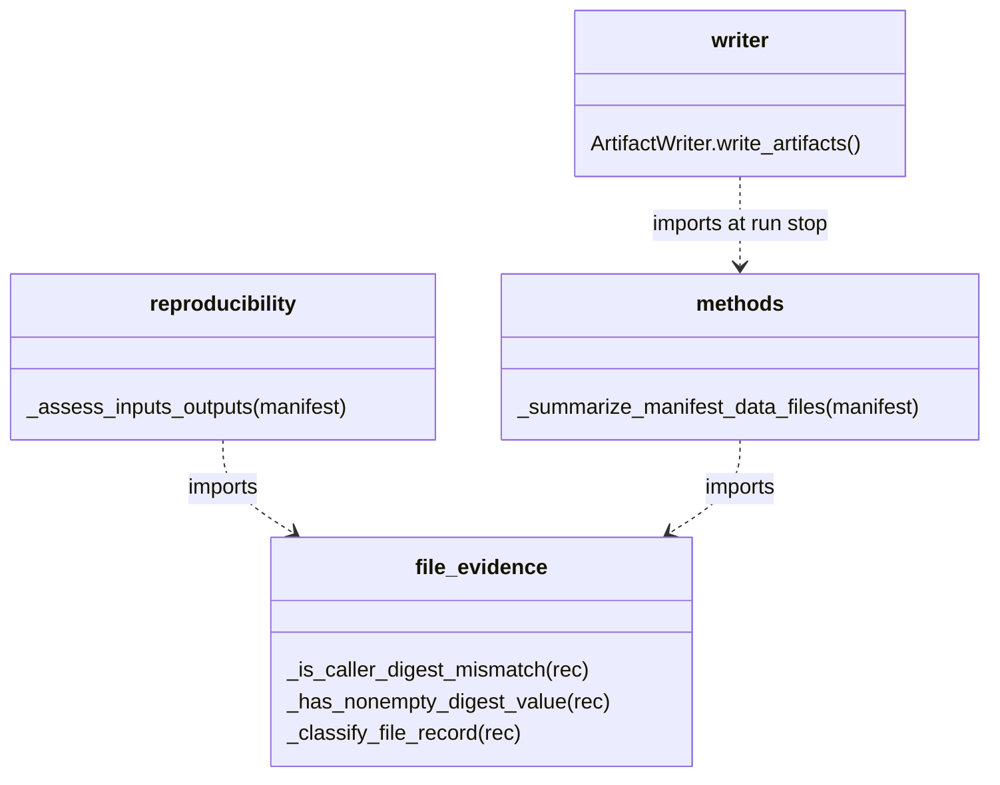
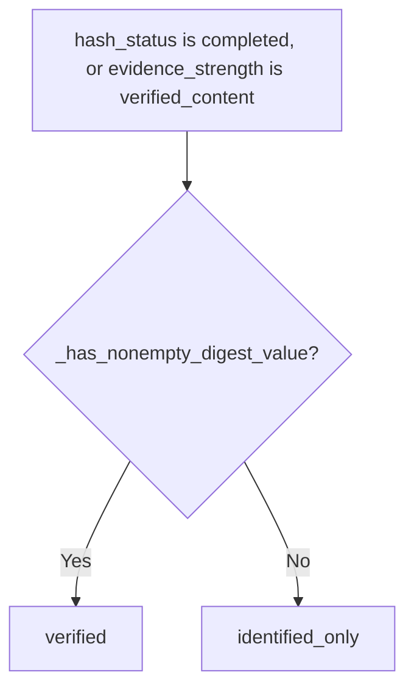

# IPD: Reuse the canonical file-record classifier in methods reports

- Date: 2026-11-24
- Kind: child
- Concern: `src/pubrun/report/methods.py::_classify_file_record` is an older copy of the canonical file-provenance classifier `src/pubrun/report/reproducibility.py::_classify_file_record`. The copy classifies a `data_files` record as `verified` when `hash_status` is `"completed"` or `evidence_strength` is `"verified_content"`, even when the record has no non-empty `digest.value`, `sha256`, or `md5` value. The methods paragraph then says such a record has an "independently verified content digest".
- Scope: Move the canonical classifier and its two helpers unchanged from `src/pubrun/report/reproducibility.py` into a new standard-library-only module `src/pubrun/report/file_evidence.py`. Make `reproducibility.py` and `methods.py` import the classifier from that module, and delete the copy in `methods.py`. Add behavior tests to `tests/test_reports.py` and a `CHANGELOG.md` entry. The `pubrun inspect` display badge in `src/pubrun/report/diagnostics.py` is out of scope (carrier `unf79v`).
- Scope-Paths: src/pubrun/report/file_evidence.py, src/pubrun/report/reproducibility.py, src/pubrun/report/methods.py, tests/test_reports.py, CHANGELOG.md
- Item-Dependencies: none
- Status: reviewed
- Readiness: go-pending-approval
- Review-Depth: standard
- Short-Description: Methods reports count a data-file record as content-verified only when it carries a non-empty digest
- Work-Kind: bug
- Priority: low
- From-Backlog: t55vh8
- Blocks-Release: next
- Set: t55vh8
- Order: 1
- Highest E allocated: 05
- Author: opencode
- Id: w24lw1

> Write and proofread this plan per the technical writing standard, `.aw/system/workflows/technical-writing/technical-writing.md` (`.agents/workflows/technical-writing/technical-writing.md` in a legacy-layout install), including requirement 12 (diagrams).

## Workflow history

- 2026-11-25 /plan-review (Antigravity): APPROVE WITH REVISIONS APPLIED; PR-001, PR-002, PR-003, PR-004
- 2026-11-25 to-review (aw set): graduated from backlog item t55vh8 into a review-ready plan
- 2026-11-25 draft (opencode): created.

## Goal

The file-provenance sentence of a methods report (`methods.md`, `methods.tex`, `pubrun methods`, and `pubrun methods --all`) counts a `data_files` record as having an "independently verified content digest" only when the record carries a non-empty digest value. After this plan, the methods report and the reproducibility assessment classify every record with one shared function, so the two can no longer disagree.

## Detailed Implementation Checklist (TODO)

Execution-state rule: mark an `E-*` item complete only after performing the action. That mark is not validation. Right-sizing rule: write for a modest executor that cannot hold much in its head. Each E-item is one step (one concern, about one file, executable in one focused pass) and its V-item names each unit it covers with its own check; a plan stays at about 5 E-items and 8 work Scope-Paths, else split it into more child plans (guidance, `IPD-Z603`). Accepted execution states: blocked, failed, pending, performed; terminal gate demands 'performed'.

### Task group 1: Shared classifier

- [ ] E-01 Create `src/pubrun/report/file_evidence.py` that contains the three functions `_is_caller_digest_mismatch`, `_has_nonempty_digest_value`, and `_classify_file_record`, copied from `src/pubrun/report/reproducibility.py` as described in "Proposed changes" item 1.
  - Depends on: none
  - Expected outcome: (1) The new file starts with a module docstring, then `from typing import Any, Dict`, then the three functions. (2) Each function body and docstring is identical to its current text in `reproducibility.py`. (3) The file imports nothing except `typing`, so importing it loads none of the report-only modules `pubrun.report.reproducibility`, `pubrun.report.utils`, and `pubrun.report.checks`.
  - Execution state: pending

- [ ] E-02 In `src/pubrun/report/reproducibility.py`, delete the definitions of `_is_caller_digest_mismatch`, `_has_nonempty_digest_value`, and `_classify_file_record`, and import `_classify_file_record` and `_is_caller_digest_mismatch` from `pubrun.report.file_evidence`.
  - Depends on: E-01
  - Expected outcome: (1) `reproducibility.py` contains `from pubrun.report.file_evidence import _classify_file_record, _is_caller_digest_mismatch`, placed after the existing `from pubrun.report.utils import ...` line. (2) No `def` of the three names remains in `reproducibility.py`. (3) The callers inside `reproducibility.py::_assess_inputs_outputs` are unchanged and resolve to the imported functions. (4) No other line of the file changes.
  - Execution state: pending

- [ ] E-03 In `src/pubrun/report/methods.py`, delete the local `_classify_file_record` function and import `_classify_file_record` from `pubrun.report.file_evidence`.
  - Depends on: E-01
  - Expected outcome: (1) `methods.py` contains `from pubrun.report.file_evidence import _classify_file_record` with the other `pubrun.report` imports at the top of the file. (2) The local `def _classify_file_record` is gone. (3) `_summarize_manifest_data_files` is unchanged and calls the imported function. (4) `methods.py` does not import `pubrun.report.reproducibility`.
  - Execution state: pending

### Task group 2: Tests and changelog

- [ ] E-04 Add the three behavior tests described in "Proposed changes" item 4 to the `TestMethodsFileProvenanceDistinction` class in `tests/test_reports.py`.
  - Depends on: E-03
  - Expected outcome: (1) `test_digestless_completed_records_are_not_counted_verified` asserts the exact file-provenance sentence of the single-run Markdown and LaTeX reports and of the `generate_report_multi` aggregate note. (2) `test_shared_classifier_requires_nonempty_digest` is parametrized over the 14 records of the "Findings" table and asserts the "canonical" column. (3) `test_run_stop_writes_verified_methods_without_loading_reproducibility` runs a child Python process and asserts its output. (4) The three tests pass with E-01 to E-03 applied. When the `methods.py` change of E-03 is reverted, the first test and the cases for rows 1, 2, 3, and 6 of the second test fail.
  - Execution state: pending

- [ ] E-05 Add one bullet to `CHANGELOG.md` under `## [Unreleased]`, `### Fixed`, with the wording in "Proposed changes" item 5.
  - Depends on: E-03
  - Expected outcome: (1) The bullet is the first entry under the `### Fixed` heading of `## [Unreleased]`. (2) It says that methods reports no longer count a record without a digest value as verified. (3) It contains no em or en dash.
  - Execution state: pending

## Project conventions discovered (Step 0)

- `src/pubrun/report/reproducibility.py` states in its module docstring: "this module is CLI/report-only and must never be imported by ``import pubrun`` or the runtime capture path." Two tests enforce the import half: `tests/test_reproducibility_assessment.py::TestReproducibilityFormattersAndIsolation::test_import_pubrun_does_not_import_reproducibility_or_checks` and `tests/test_report_subpackage_integrity.py::test_report_is_callable_and_subpackage_under_every_mode` (`_REPORT_ONLY_MODULES`).
- `methods.py` is on the runtime capture path. `src/pubrun/writer.py::ArtifactWriter.write_artifacts` imports `pubrun.report.methods.generate_report` and writes `methods.md` or `methods.tex` when a run stops. So `methods.py` must not import `reproducibility.py`, not even lazily inside a function. This is why the plan moves the shared helpers into a new module instead of importing them from `reproducibility.py`.
- The executed plan `.aw/records/plans/executed/20261123-bjgca2-01-nasg1q-unify-file-provenance-and-capture-error-finding-codes-across.ipd.md` (`nasg1q`) made `reproducibility.py::_classify_file_record` canonical and removed the copy in `checks.py`. It did not touch `methods.py`, and it filed backlog item `t55vh8` for that gap.
- `pyproject.toml` `[tool.mypy]` checks all of `src/pubrun`, and CI runs `mypy` (`.github/workflows/ci.yml`, step "Run mypy"). The legacy ignore list may only shrink, so the new module must type-check cleanly.
- `pyproject.toml` sets `requires-python = ">=3.8"`. The moved code uses only `typing.Dict` and `typing.Any`, which work on Python 3.8.
- `AGENTS.md#Agent execution contract` forbids tests that read source code or pin code structure. Every test in this plan calls functions or runs a child process and asserts on output.
- `AGENTS.md#Agent execution contract` forbids em and en dashes in user-facing prose such as `CHANGELOG.md`.
- Cite code by SYMBOL (`module.function`) or by a quoted content string, with a line number only appended to one of those and never alone: an offset expires before this plan executes (advisory `IPD-C801`).

## Findings

Measured at authoring on Linux, Python 3.14.6, at `HEAD` `08304c9`.

**The two classifiers differ.** The methods copy and the canonical classifier share the same order of checks. They differ in three ways:

1. In the `hash_status == "completed" or evidence_strength == "verified_content"` branch, the canonical function returns `"verified"` only when `_has_nonempty_digest_value(rec)` is true, and `"identified_only"` otherwise. The methods copy always returns `"verified"`.
2. For a legacy record with no `hash_status`, `evidence_strength`, or `evidence_source`, the canonical function also accepts a non-empty `md5`. The methods copy accepts only `digest.value` and `sha256`.
3. The methods copy inlines the caller-digest mismatch test. The canonical function calls `_is_caller_digest_mismatch`, which tests the same two conditions.

**Effect on each record shape.** A probe called both functions on 14 records. The "methods report today" column is the bucket that `methods.py::_summarize_manifest_data_files` counts the record in. The "canonical" column is the return value of `reproducibility.py::_classify_file_record`.

| # | Record | Methods report today | Canonical |
|---|---|---|---|
| 1 | `{"hash_status": "completed"}` | verified | identified_only |
| 2 | `{"evidence_strength": "verified_content", "sha256": ""}` | verified | identified_only |
| 3 | `{"hash_status": "completed", "digest": {"algorithm": "sha256", "value": "  "}}` | verified | identified_only |
| 4 | `{"hash_status": "completed", "sha256": "a" * 64}` | verified | verified |
| 5 | `{"hash_status": "completed", "sha256": None, "digest": {"algorithm": "sha512", "value": "a" * 128}}` | verified | verified |
| 6 | `{"md5": "e" * 32}` | identified_only | verified |
| 7 | `{}` | identified_only | identified_only |
| 8 | `{"hash_status": "asserted", "evidence_source": "asserted", "evidence_strength": "asserted_content"}` | asserted | asserted |
| 9 | `{"hash_status": "file_changed", "change_detected": True}` | changed | changed |
| 10 | `{"hash_status": "completed", "sha256": "a" * 64, "caller_digest": {"algorithm": "sha256", "value": "b" * 64, "verified": False}}` | failed_or_unavailable | failed |
| 11 | `{"hash_status": "over_budget"}` | over_budget | over_budget |
| 12 | `{"hash_status": "pending"}` | pending | pending |
| 13 | `{"hash_status": "disabled"}` | identified_only | identified_only |
| 14 | `{"hash_status": "unavailable"}` | failed_or_unavailable | unavailable |

Rows 1 to 3 are the defect. Row 6 changes from `identified_only` to `verified`, which matches the reproducibility assessment. In current pubrun only `invocation.inputs` records carry `md5` (`src/pubrun/capture/invocation.py`), and `data_files` records do not, so row 6 affects only hand-written or legacy manifests. Rows 10 and 14 show that `failed` and `unavailable` both land in the methods bucket `failed_or_unavailable`, so they are unchanged.

**Report text today.** This probe builds one manifest with four `data_files.inputs` records: three records shaped like rows 1, 2, and 3 of the table (each with a `path`, and the first also with `evidence_strength`), plus a record with a real `sha256`. Run from the repository root:

```sh
PYTHONPATH=src python3 - <<'EOF'
from pubrun.report.methods import generate_report, generate_report_multi
recs = [
    {"path": "data/no-digest.csv", "hash_status": "completed", "evidence_strength": "verified_content"},
    {"path": "data/empty-sha256.csv", "evidence_strength": "verified_content", "sha256": ""},
    {"path": "data/blank-digest.csv", "hash_status": "completed", "digest": {"algorithm": "sha256", "value": "  "}},
    {"path": "data/hashed.csv", "hash_status": "completed", "evidence_strength": "verified_content", "sha256": "a" * 64},
]
m = {"run": {"library_version": "1.5.0"}, "data_files": {"inputs": recs, "outputs": [], "mixed": []}}
for line in generate_report(m, "markdown").splitlines() + generate_report_multi([m, m], "latex").splitlines():
    if "file record" in line:
        print(line[line.lower().index("data file"):])
EOF
```

At `HEAD` it prints:

```text
Data file provenance tracked 4 file records (4 with independently verified content digests).
Data file provenance tracked 4 file records (4 with independently verified content digests).
data file provenance across 2 of 2 runs tracked 8 file records (8 with independently verified content digests).
```

With `methods._classify_file_record` replaced in memory by the canonical function, the same probe printed:

```text
Data file provenance tracked 4 file records (1 with independently verified content digest, 3 recorded by path or stat metadata only).
Data file provenance tracked 4 file records (1 with independently verified content digest, 3 recorded by path or stat metadata only).
data file provenance across 2 of 2 runs tracked 8 file records (2 with independently verified content digests, 6 recorded by path or stat metadata only).
```

**Import cost and isolation.** After `import pubrun.noauto` and `import pubrun.report.methods`, importing `pubrun.report.reproducibility` took about 2 ms and loaded `pubrun.report.reproducibility` and `pubrun.report.utils`. The cost is small, but the module contract in "Project conventions" forbids the import on the runtime capture path. A child process that ran `pubrun.start()`, `pubrun.register_input("in.csv", level="hash")`, and `pubrun.stop()` under `pubrun.noauto` loaded only `pubrun.report`, `pubrun.report.methods`, and `pubrun.report.templates`, and its `methods.md` contained "1 file record (1 with independently verified content digest)". E-04 turns this observation into a test.

**Existing tests are compatible.** With `methods._classify_file_record` replaced by the canonical function through a throwaway pytest plugin module (`t55patch`, which assigned `reproducibility._classify_file_record` to `methods._classify_file_record` at import), `python3 -m pytest -p t55patch --no-cov -q tests/test_reports.py tests/test_methods_multi.py tests/test_cli.py tests/test_edge_cases.py tests/test_templates.py` gave `198 passed`. Every existing methods test record that expects `verified` carries a non-empty digest. The full suite at `HEAD`, `python3 -m pytest -q`, gave `2138 passed in 537.76s`. Under Python 3.9.25 (`uv run --no-project --python 3.9 --with pytest --with tomli`), `tests/test_reports.py tests/test_report_subpackage_integrity.py tests/test_reproducibility_assessment.py tests/test_methods_multi.py` gave `103 passed`.

**Lint and type baselines.** `mypy` (whole package) printed `Success: no issues found in 58 source files`. `ruff check` reported 27 findings in `methods.py` and 248 in `reproducibility.py`, 275 in total. `ruff check --select F` on both files printed `All checks passed!`. A copy of the three functions in a file with only `from typing import Any, Dict` had 5 findings (3 `FA100`, 2 `SIM103`). These findings move with the code; they are not new.

**Other copies.** `src/pubrun/report/diagnostics.py::_classify_file_record_display` has the same defect in the `pubrun inspect` "Data Files" block: `_classify_file_record_display({"hash_status": "completed"})` returns `"verified"`. That function returns display badge names (`"over-budget"`, `"metadata-only"`, `"path-only"`) instead of classifier names, and two pending plans (`qe6dad`, `mvbbny`) edit `diagnostics.py`. This plan therefore leaves it alone and files backlog item `unf79v` for it.

The modules this plan changes, after the change:



The branch of `_classify_file_record` that this plan fixes for `methods.py`:



## Proposed changes (ordered, validatable)

1. **New module (E-01).** Create `src/pubrun/report/file_evidence.py`:

   Write this header:

   ```python
   """Classify recorded ``data_files`` records by evidence strength and hashing outcome.

   This module is the single definition shared by the reproducibility assessment and the
   methods report. It imports only the standard library, so the runtime capture path
   (which writes ``methods.md`` when a run stops) can use it.
   """

   from typing import Any, Dict
   ```

   After two blank lines, copy the three functions from `src/pubrun/report/reproducibility.py` in their current order: from `def _is_caller_digest_mismatch` through the final `return "identified_only"` of `_classify_file_record`, with two blank lines between functions. Do not apply `ruff` fixes to the moved code.

2. **Reproducibility module (E-02).** In `src/pubrun/report/reproducibility.py`, delete the three definitions and add this import directly after `from pubrun.report.utils import HYDRABLE_SECTIONS, HydrationReport`:

   ```python
   from pubrun.report.file_evidence import _classify_file_record, _is_caller_digest_mismatch
   ```

   Do not import `_has_nonempty_digest_value`: after the move only `_classify_file_record` calls it, and no file in `src/` or `tests/` imports it from `reproducibility.py`.

3. **Methods module (E-03).** In `src/pubrun/report/methods.py`, add `from pubrun.report.file_evidence import _classify_file_record` after the `from pubrun.report.templates import ...` line, and delete the local `def _classify_file_record` with its whole body. Leave `_summarize_manifest_data_files` and `_format_file_provenance_note` unchanged.

4. **Tests (E-04).** Add three tests to `TestMethodsFileProvenanceDistinction` in `tests/test_reports.py`. Use the class helper `self._base_manifest(data_files=...)` for manifests.

   - `test_digestless_completed_records_are_not_counted_verified`: import `generate_report_multi` from `pubrun.report.methods` (as `test_empty_or_malformed_data_files_is_byte_identical` does) and use the four records of the "Report text today" probe in `data_files.inputs`, with empty `outputs` and `mixed`. Assert that `generate_report(m, "markdown")` and `generate_report(m, "latex")` each contain `Data file provenance tracked 4 file records (1 with independently verified content digest, 3 recorded by path or stat metadata only).` Assert that `generate_report_multi([m, m], "markdown")` contains `across 2 of 2 runs tracked 8 file records (2 with independently verified content digests, 6 recorded by path or stat metadata only)`.
   - `test_shared_classifier_requires_nonempty_digest`: decorate with `@pytest.mark.parametrize("rec, expected", [...])` over the 14 rows of the "Findings" table, with `expected` taken from the "canonical" column. Import `_classify_file_record` from `pubrun.report.file_evidence` and assert `_classify_file_record(rec) == expected`. Also assert that `generate_report(self._base_manifest(data_files={"inputs": [rec], "outputs": [], "mixed": []}), "markdown")` contains `independently verified content digest` exactly when `expected == "verified"`.
   - `test_run_stop_writes_verified_methods_without_loading_reproducibility(self, tmp_path)`: run `subprocess.run([sys.executable, "-c", script], cwd=str(tmp_path), env={**os.environ, "XDG_CONFIG_HOME": str(tmp_path), "APPDATA": str(tmp_path)}, capture_output=True, text=True, timeout=60)` with the script below (isolating user-global config so a personal config cannot disable `methods.md`), then assert `returncode == 0` (include stdout and stderr in the failure message) and `stdout.strip() == "OK"`. Add `import os`, `import subprocess`, and `import sys` at the top of the test module.

     ```python
     import pathlib, sys
     import pubrun.noauto as pubrun
     pathlib.Path("in.csv").write_text("x\n")
     run = pubrun.start()
     pubrun.register_input("in.csv", level="hash")
     pubrun.stop()
     assert "pubrun.report.reproducibility" not in sys.modules, sorted(sys.modules)
     text = (pathlib.Path(run.run_dir) / "methods.md").read_text(encoding="utf-8")
     assert "1 file record (1 with independently verified content digest)" in text, text
     print("OK")
     ```

     The session fixture `tests/conftest.py::_subprocess_pythonpath` puts this checkout's `src` first on the child's `PYTHONPATH`.

5. **Changelog (E-05).** Add this bullet as the first entry under `### Fixed` in `## [Unreleased]`, wrapped at the width of the neighboring bullets:

   > **Methods reports no longer count a file record without a digest value as independently verified.** The file-provenance sentence in `methods.md`, `methods.tex`, and `pubrun methods` counted a `data_files` record as verified when its `hash_status` was `completed` or its `evidence_strength` was `verified_content`, even if the record held no digest value. The methods report now uses the same classifier as the `pubrun inspect` reproducibility findings: such a record is counted as recorded by path or stat metadata only, and a legacy record with only an `md5` value is counted as verified.

## Deferred / out of scope (with reason)

- The `pubrun inspect` "Data Files" block. `src/pubrun/report/diagnostics.py::_classify_file_record_display` shows a record without a digest value as `verified`. It returns display badge names and lives in a file that two pending plans edit, so a separate plan should fix it after this one creates the shared module.
  - Carrier: unf79v
- The truthiness-based digest test in `src/pubrun/report/reproducibility.py::_record_is_asserted`. It decides whether a caller digest is asserted, not whether content is verified, and no defect report names it.
  - Carrier-Declined: no observed misclassification; the backlog item covers only the verified classification.
- Fixing the `ruff` findings of the moved functions (`FA100`, `SIM103`). The repository does not gate on `ruff`, and rewriting the code while moving it would make the move harder to review.
  - Carrier-Declined: lint cleanup is not requested by any backlog item.
- Running the changes on the GitHub Actions CI matrix (3 operating systems x Python 3.8 to 3.14). The change adds a new import path inside `pubrun.report`, so `AGENTS.md#Matrix-validation discipline` may apply. A push needs an explicit human instruction, so this plan validates on Linux with the local Python interpreter (and Python 3.9 via `uv --offline` when cached), and V-04 records the interpreters used.
  - Carrier-Declined: a push needs explicit human authorization, so no plan can carry it; GitHub Actions runs the matrix on the next push or pull request to `main`.

## Scope check

- Over-scope: none. The new module is the smallest change that gives `methods.py` the canonical classifier without breaking the rule that `reproducibility.py` stays off the runtime capture path.
- Under-scope: none for `methods.py`. The same defect in `diagnostics.py` is deferred to `unf79v`. No document quotes the classifier's rules: `docs/cli.md` (section `pubrun methods`) says only that the breakdown "distinguishes independently verified content digests from caller-asserted digests", which stays true.

## Required tests / validation

- `git diff -- src/pubrun/report/reproducibility.py src/pubrun/report/methods.py` shows only the deleted definitions and the added imports. A comparison of the deleted `reproducibility.py` lines with the body of `src/pubrun/report/file_evidence.py` shows the three functions unchanged.
- `PYTHONPATH=src python3 -c "import sys, pubrun.report.file_evidence, pubrun.report.methods; print([m for m in ('pubrun.report.reproducibility', 'pubrun.report.utils', 'pubrun.report.checks') if m in sys.modules])"` prints `[]`. Importing a submodule first imports the `pubrun` package and its capture modules, so the check names the three report-only modules instead of listing every loaded module.
- The "Report text today" probe from "Findings" prints the three "after" lines exactly.
- `python3 -m pytest tests/test_reports.py --no-cov -q -k "digestless or shared_classifier or run_stop_writes"` passes 16 tests (1 + 14 + 1).
- Mutation check: run `mkdir -p tmp && git diff -- src/pubrun/report/methods.py > tmp/w24lw1-methods.patch`, run `git apply -R tmp/w24lw1-methods.patch`, run the same `pytest -k` command, then run `git apply tmp/w24lw1-methods.patch && rm -f tmp/w24lw1-methods.patch`. With the old `methods.py`, `test_digestless_completed_records_are_not_counted_verified` and the parametrized cases for rows 1, 2, 3, and 6 of `test_shared_classifier_requires_nonempty_digest` must fail. After the patch is re-applied, `git diff --stat -- src/pubrun/report/methods.py` must match the state before the check.
- `python3 -m pytest tests/test_reports.py tests/test_methods_multi.py tests/test_reproducibility_assessment.py tests/test_report_subpackage_integrity.py tests/test_report_checks_bugs.py tests/test_cli.py --no-cov -q` passes.
- Full suite (`aw suite --no-cache`, or `python3 -m pytest -q` if `aw suite` is unavailable) passes. For any failure, run the same test on unmodified `HEAD` and report both results.
- Older-Python compatibility check: when `uv` and cached Python 3.9 + wheels are available offline, run `uv run --offline --no-project --python 3.9 --with pytest --with tomli python -m pytest -p no:randomly -p no:cacheprovider -q tests/test_reports.py tests/test_report_subpackage_integrity.py tests/test_reproducibility_assessment.py tests/test_methods_multi.py`; if unavailable offline, record the reason in V-04 (8) and run `python3 -m py_compile src/pubrun/report/file_evidence.py` (confirming only Python 3.8 `typing.Any`/`Dict` syntax is used).
- `mypy; echo "exit=$?"` prints `Success: no issues found in <N> source files` (`59` at review; re-derive at execution time) and `exit=0`.
- `ruff check --select F src/pubrun/report/file_evidence.py src/pubrun/report/reproducibility.py src/pubrun/report/methods.py tests/test_reports.py` reports no new finding beyond the pre-existing `F401` on `pathlib.Path` in `tests/test_reports.py` (using `@pytest.mark.parametrize` in E-04 resolves the pre-existing `pytest` `F401`). The total of `ruff check` findings over `file_evidence.py`, `reproducibility.py`, and `methods.py` is at most 275.
- `python3 -c 'import subprocess; diff = subprocess.check_output(["git", "diff", "-U0", "--", "CHANGELOG.md"], text=True); added = [l[1:] for l in diff.splitlines() if l.startswith("+") and not l.startswith("+++")]; assert added, "no added CHANGELOG lines"; bad = [l for l in added if "\u2013" in l or "\u2014" in l]; assert not bad, bad; print(f"OK: {len(added)} added line(s), 0 en/em dashes")'` prints `OK: ... 0 en/em dashes` and exits 0.
- `python3 scripts/sanitize_paths.py --check --all` exits 0.

## Spec / documentation sync

- `CHANGELOG.md` (E-05) records the user-visible change to the methods sentence.
- `docs/cli.md`, `docs/manifest.md`, and `docs/api.md` do not describe the classifier's rules or name `methods.py` internals, so they are not edited.
- `.aw/records/specs/` contains no `.spec.md` file, so no spec is touched.

## Open questions

### OQ-01: Should `methods.py` import the classifier from `reproducibility.py`, as the backlog item first suggests, or from a new shared module?

- Blocking: no
- Status: resolved
- Owner: plan author
- Resolution or deferral rationale: Use a new shared module. The backlog item allows either sharing the canonical helper or requiring a non-empty digest. Importing from `reproducibility.py` would load that module whenever a run stops, because `src/pubrun/writer.py::ArtifactWriter.write_artifacts` calls `methods.generate_report`. The `reproducibility.py` module docstring forbids that ("must never be imported by ``import pubrun`` or the runtime capture path"). Duplicating the digest check in `methods.py` would keep two classifiers that can drift again, which is the cause of this defect. A small standard-library-only module keeps one definition and honors the import rule.

### OQ-02: Is it acceptable that a legacy record with only an `md5` value moves from "path or stat metadata only" to "verified" in methods reports?

- Blocking: no
- Status: resolved
- Owner: plan author
- Resolution or deferral rationale: Yes. The backlog item names `md5` as one of the accepted digest values ("no non-empty sha256/digest/md5 value"), and the reproducibility assessment already counts such a record as verified. Current pubrun writes no `md5` field in `data_files` records, so only hand-written or legacy manifests are affected. The changelog bullet in E-05 states the change.

## Validation and cross-check (verify before reporting done)

Validation-state rule: inspect evidence in a separate pass. Do not mark a `V-*` item complete from memory or from the matching execution checkmark. Accepted validation results: blocked, failed, pass, pending; terminal gate demands 'pass'. Runtime-demonstration reachability rule: for each `V-*` item demanding the software be observed acting (such as a run, a dispatch, or a transition), as distinct from items demanding a diff, a file's content, or a test result, which are reachable by construction, name the code path that produces the observation or the sibling `E-*` that creates it, else the demand is UNDER-SCOPE.

- [ ] V-01 validates E-01
  - Required evidence: (1) Paste `git status --short -- src/pubrun/report/file_evidence.py` showing the new file, and paste the file's first 10 lines. (2) Paste the output of `diff <(git show HEAD:src/pubrun/report/reproducibility.py | sed -n '/^def _is_caller_digest_mismatch/,/^    return "identified_only"$/p') <(sed -n '/^def _is_caller_digest_mismatch/,/^    return "identified_only"$/p' src/pubrun/report/file_evidence.py)`, which must be empty, and its exit status `0`. Run this before you commit, while `HEAD` still holds the original `reproducibility.py`; after a commit, replace `HEAD` with the parent of your first commit for this plan. (3) Paste the output of `PYTHONPATH=src python3 -c "import sys, pubrun.report.file_evidence, pubrun.report.methods; print([m for m in ('pubrun.report.reproducibility', 'pubrun.report.utils', 'pubrun.report.checks') if m in sys.modules])"`, which must be `[]`.
  - Observed evidence:
  - Result: pending

- [ ] V-02 validates E-02
  - Required evidence: (1) Paste `git diff -- src/pubrun/report/reproducibility.py`, showing only the added `from pubrun.report.file_evidence import ...` line and the deleted three definitions. (2) Paste the output of `grep -cE '^def (_is_caller_digest_mismatch|_has_nonempty_digest_value|_classify_file_record)\(' src/pubrun/report/reproducibility.py || true`, which must be `0`. (3) Paste the summary line of `python3 -m pytest tests/test_reproducibility_assessment.py tests/test_report_checks_bugs.py tests/test_report_subpackage_integrity.py --no-cov -q`, which must show no failures.
  - Observed evidence:
  - Result: pending

- [ ] V-03 validates E-03
  - Required evidence: (1) Paste `git diff -- src/pubrun/report/methods.py`, showing the added import and the deleted local function and nothing else. (2) Paste the output of `grep -c 'reproducibility' src/pubrun/report/methods.py`, which must equal the count at `HEAD` (`1`, a comment in `generate_report`), and of `grep -c '^def _classify_file_record' src/pubrun/report/methods.py || true`, which must be `0`. (3) Paste the three lines printed by the "Report text today" probe in "Findings", produced by `src/pubrun/report/methods.py::generate_report` and `::generate_report_multi` through `::_summarize_manifest_data_files`; they must equal the three "after" lines in "Findings".
  - Observed evidence:
  - Result: pending

- [ ] V-04 validates E-04
  - Required evidence: (1) Paste every result line and the summary of `python3 -m pytest tests/test_reports.py --no-cov -q -v -k "digestless or shared_classifier or run_stop_writes"`: 16 lines, each `PASSED`. The child-process test observes `methods.md` written by `src/pubrun/writer.py::ArtifactWriter.write_artifacts` during `pubrun.stop()` in the process that the test starts (E-04). (2) Paste the failing test names and the summary line of the mutation check in "Required tests / validation", then `git diff --stat -- src/pubrun/report/methods.py` after re-applying and deleting `tmp/w24lw1-methods.patch`. (3) Paste the summary line of `python3 -m pytest tests/test_reports.py tests/test_methods_multi.py tests/test_reproducibility_assessment.py tests/test_report_subpackage_integrity.py tests/test_report_checks_bugs.py tests/test_cli.py --no-cov -q`. (4) Paste the summary line of `aw suite --no-cache` (or `python3 -m pytest -q` if `aw suite` is unavailable); for any failure, paste the same test's result on unmodified `HEAD`. (5) Paste the summary line of the offline Python 3.9 `uv run` command in "Required tests / validation", or the reason it could not run offline plus `python3 -m py_compile src/pubrun/report/file_evidence.py` exiting 0. (6) Paste `mypy; echo "exit=$?"` output showing `Success: no issues found in <N> source files` (`59` at review; re-derive at execution time) and `exit=0`. (7) Paste the output of `ruff check --select F src/pubrun/report/file_evidence.py src/pubrun/report/reproducibility.py src/pubrun/report/methods.py tests/test_reports.py` (showing no new findings; at most the pre-existing `F401` on `pathlib.Path`), and the `Found N errors.` line of `ruff check src/pubrun/report/file_evidence.py src/pubrun/report/reproducibility.py src/pubrun/report/methods.py` with `N` at most 275. (8) State the operating system and the Python versions that ran the tests, and that the CI matrix was not run.
  - Observed evidence:
  - Result: pending

- [ ] V-05 validates E-05
  - Required evidence: (1) Paste `git diff -- CHANGELOG.md`, showing one added bullet as the first entry under `### Fixed` of `## [Unreleased]`. (2) Paste the output of the portable `python3 -c` dash check from "Required tests / validation", which must print `OK: ... 0 en/em dashes` and exit 0. (3) Paste the exit status of `python3 scripts/sanitize_paths.py --check --all`, which must be `0`.
  - Observed evidence:
  - Result: pending

## Approval and execution gate

- Size assessment: standard
- Cohesion rationale: not required

Execution contract:
1. Precondition: wait for human approval (`- Status: approved`) with no unresolved `Blocking: yes` open question before you change any file. This plan has no blocking open questions.
2. Scope declaration: the expected modified files are the `- Scope-Paths:` entries (`src/pubrun/report/file_evidence.py`, `src/pubrun/report/reproducibility.py`, `src/pubrun/report/methods.py`, `tests/test_reports.py`, `CHANGELOG.md`). If execution requires an out-of-scope file, justify it with `--scope-reason` at finalization. If a declared file needs no edit, acknowledge it with `--scope-ack`. The mutation check edits `src/pubrun/report/methods.py` only temporarily via gitignored `tmp/w24lw1-methods.patch`; re-apply the patch, delete `tmp/w24lw1-methods.patch`, and do not commit the reverted state.
3. Validation honesty: you MUST run each required validation command and paste its actual output into the matching `V-*` `Observed evidence:` field. Do not mark a `V-*` item `pass` without output captured from that run.
4. Commit discipline: commit only the paths you changed with `aw commit w24lw1 -- <paths>`. Do not use `git add -A` or raw `git commit`. Do not push without an explicit human instruction.
5. Lifecycle transition: inside a runner lane (`aw oc run` or `aw agy run`), the runner owns finalization once every `E-*` item is `performed` and every `V-*` item is `pass`. Outside a runner, after every `E-*` item is `performed`, every `V-*` item is `pass`, and `aw ipd lint --phase pre-transition` reports `conforming`, finalize this plan with `aw ipd finalize w24lw1` (never with a hand-written `git mv` to `.aw/records/plans/executed/`).
