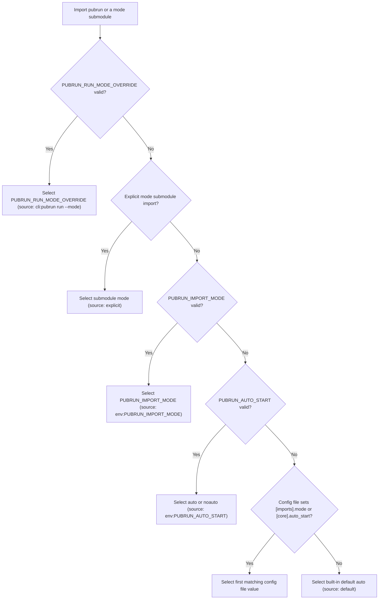

# IPD: Document PUBRUN_RUN_MODE_OVERRIDE in functional spec and configuration reference

- Date: 2026-11-25
- Kind: child
- Concern: Plan `lhwy0t` added the `PUBRUN_RUN_MODE_OVERRIDE` launch-time environment variable in `src/pubrun/__main__.py` and `src/pubrun/_bootstrap.py::select_mode`, and documented it in `docs/cli.md` and `docs/functional_spec.md` Section 11.13, but `docs/functional_spec.md` Sections 10.2 and 10.3 and `docs/configuration.md` (`## Environment Variables`) still omit it.
- Scope: Add `PUBRUN_RUN_MODE_OVERRIDE` to `docs/functional_spec.md` Sections 10.2 and 10.3 and to `docs/configuration.md` (`## Environment Variables`), and align the adjacent `PUBRUN_IMPORT_MODE` row in both tables so neither contradicts `PUBRUN_RUN_MODE_OVERRIDE` or explicit submodule import precedence. No other file, section, or code changes.
- Scope-Paths: docs/functional_spec.md, docs/configuration.md
- Item-Dependencies: none
- Status: approved
- Readiness: go-pending-approval
- Review-Depth: standard
- Short-Description: Document PUBRUN_RUN_MODE_OVERRIDE in docs/functional_spec.md sections 10.2 and 10.3 and docs/configuration.md
- Work-Kind: followup
- Priority: low
- From-Backlog: aqb2bu
- Set: aqb2bu
- Order: 1
- Highest E allocated: 02
- Author: Antigravity
- Id: 87qr8h
- Approval: 2026-11-26, recorded via aw ipd set: status set to approved

> Write and proofread this plan per the technical writing standard, `.aw/system/workflows/technical-writing/technical-writing.md` (`.agents/workflows/technical-writing/technical-writing.md` in a legacy-layout install), including requirement 12 (diagrams).

## Workflow history

- 2026-11-26 approved (aw set): status set to approved
- 2026-11-25 /plan-review (Antigravity): APPROVE WITH REVISIONS APPLIED; PR-001, PR-002, PR-003, PR-004; review record `.aw/records/reviews/20261125-aqb2bu-01-87qr8h-document-pubrun-run-mode-override-in-functional-spec-and-con.review.md`.
- 2026-11-25 to-review (aw set): graduated from backlog item aqb2bu into a review-ready plan.
- 2026-11-25 draft (Antigravity): created.

## Goal

Ensure every environment-variable reference in the functional specification and configuration reference lists `PUBRUN_RUN_MODE_OVERRIDE` accurately. After this plan executes, `docs/functional_spec.md` Sections 10.2 and 10.3 and `docs/configuration.md` (`## Environment Variables`) document `PUBRUN_RUN_MODE_OVERRIDE` with the exact precedence, conflict-suppression, manifest-provenance, and boot-sequence semantics implemented in `src/pubrun/__main__.py` and `src/pubrun/_bootstrap.py::select_mode`, without contradicting the adjacent `PUBRUN_IMPORT_MODE` rows.

## Detailed Implementation Checklist (TODO)

Execution-state rule: mark an `E-*` item complete only after performing the action. That mark is not validation. Right-sizing rule: write for a modest executor that cannot hold much in its head. Each E-item is one step (one concern, about one file, executable in one focused pass) and its V-item names each unit it covers with its own check; a plan stays at about 5 E-items and 8 work Scope-Paths, else split it into more child plans (guidance, `IPD-Z603`). Accepted execution states: blocked, failed, pending, performed; terminal gate demands 'performed'.

### Task group 1: Environment-variable reference updates

- [x] E-01 Update `docs/functional_spec.md` under headings `### 10.2 Configuration Discovery` and `### 10.3 Supported Environment Variables` using the exact text in "Proposed changes" items 1 and 2. If a concurrent plan (such as `wjsccu`) has already edited either section, replace the boot-variable paragraph in Section 10.2 and replace any existing `PUBRUN_RUN_MODE_OVERRIDE` row together with the `PUBRUN_IMPORT_MODE` row in Section 10.3 so they match items 1 and 2 verbatim while preserving unrelated rows (such as `NO_COLOR` or `PUBRUN_DEBUG`); if both sections already match items 1 and 2 verbatim, leave `docs/functional_spec.md` unchanged and acknowledge it with `--scope-ack` at finalization.
  - Depends on: none
  - Expected outcome: (1) Section 10.2 lists `PUBRUN_RUN_MODE_OVERRIDE`, `PUBRUN_IMPORT_MODE`, `PUBRUN_AUTO_START`, and `PUBRUN_IMPORT_CONFLICT` as boot-sequence variables excluded from `resolve_config()` and cites Sections 3.2, 3.3, and 3.4, matching "Proposed changes" item 1 verbatim. (2) Section 10.3 places the `PUBRUN_RUN_MODE_OVERRIDE` row immediately before `PUBRUN_IMPORT_MODE` with no duplicate `PUBRUN_RUN_MODE_OVERRIDE` row, and both rows match "Proposed changes" item 2 verbatim. (3) No other line in `docs/functional_spec.md` changes, and zero em dashes or en dashes appear in any target or added line.
  - Execution state: performed

- [x] E-02 Update `docs/configuration.md` under heading `## Environment Variables` using the exact text in "Proposed changes" item 3. If reviewed pending plan `pqcx6o` (which reuses item 3 verbatim) has already executed and both rows already match item 3 verbatim, leave `docs/configuration.md` unchanged and acknowledge it with `--scope-ack` at finalization; if a `PUBRUN_RUN_MODE_OVERRIDE` row already exists with different text, replace both rows to match item 3 verbatim while preserving unrelated rows (such as `PUBRUN_DEBUG` or `NO_COLOR`).
  - Depends on: E-01
  - Expected outcome: (1) The `## Environment Variables` table places the `PUBRUN_RUN_MODE_OVERRIDE` row immediately before `PUBRUN_IMPORT_MODE` with no duplicate `PUBRUN_RUN_MODE_OVERRIDE` row, both rows match "Proposed changes" item 3 verbatim, and `"Takes highest precedence"` does not appear anywhere in `## Environment Variables`. (2) No other line in `docs/configuration.md` changes, and zero em dashes or en dashes appear in any target or added line.
  - Execution state: performed

## Project conventions discovered (Step 0)

- Cite code by SYMBOL (`path::Name`) or by a quoted content string, with a line number only appended to one of those and never alone: an offset expires before this plan executes (advisory `IPD-C801`).
- `AGENTS.md` ("Agent execution contract") prohibits em dashes (`\u2014`) and en dashes (`\u2013`) in user-facing documentation. Because `docs/functional_spec.md` and `docs/configuration.md` are user-facing documents, all added or modified lines in both files must contain zero em dashes and zero en dashes.
- Executed plan `lhwy0t` (`.aw/records/plans/executed/20261124-oubh58-01-lhwy0t-implement-launch-time-pubrun-run-mode-override-over-in-code.ipd.md`) introduced `PUBRUN_RUN_MODE_OVERRIDE` and updated `CHANGELOG.md`, `docs/manifest.md`, `docs/cli.md`, and `docs/functional_spec.md` (`### 11.13 Import Mode Wrapper (run)`). Prior documentation-only followups (such as executed plan `wg2l7b`, which documented `sys_argv` in `docs/manifest.md`) added no new `CHANGELOG.md` entry because runtime behavior does not change.
- `docs/functional_spec.md` (`### 10.3 Supported Environment Variables`) uses a two-column Markdown table (`Variable`, `Effect`) and explicitly states for each variable whether it is consumed in the boot sequence or in `resolve_config()`.
- `docs/configuration.md` (`## Environment Variables`) uses a two-column Markdown table (`Variable`, `Description`). Earlier sections of `docs/configuration.md` (`### [imports]`, `mode` row and note) already state that an in-code `import pubrun.<mode>` overrides config and ordinary environment variables, and only `pubrun run --mode` overrides the in-code import.
- Reviewed pending plan `pqcx6o` (Set `doc-audit`, `docs/cli.md` and `docs/configuration.md`) reuses this plan's `## Proposed changes` item 3 verbatim in its `E-05` and verifies in `V-05` that both rows match item 3 and that `"Takes highest precedence"` is absent from `docs/configuration.md`. Pending plan `wjsccu` (Set `doc-audit`, `docs/functional_spec.md`, `docs/hpc.md`, and `docs/research-use.md`) also updates `docs/functional_spec.md` Sections 10.2 and 10.3. Making `E-01` and `E-02` idempotent ensures convergence in either execution order without cross-Set dependencies.

## Findings

Verified at authoring against `HEAD` `f7c0897`.

### Code behavior governing `PUBRUN_RUN_MODE_OVERRIDE`

| Role | Code location | Verified behavior |
|---|---|---|
| CLI wrapper | `src/pubrun/__main__.py::main` (`elif args.command == "run":`) | Spawns the child process with both `"PUBRUN_IMPORT_MODE": args.mode` and `"PUBRUN_RUN_MODE_OVERRIDE": args.mode` in `child_env`. |
| Boot mode selector | `src/pubrun/_bootstrap.py::select_mode` | When `_selected_mode is None`, reads `os.environ.get("PUBRUN_RUN_MODE_OVERRIDE", "").strip().lower()`. If that normalized value is a key of `pubrun._modes.MODES` (`auto`, `noauto`, `nopatch`, `noconsole`, `minimal`, `full`), it selects that mode ahead of the caller's requested mode (including explicit in-code `import pubrun.<mode>` imports) and sets `_selected_by` and `_selected_source` to `"cli:pubrun run --mode"`. It records any differing caller request with `conflict: False`, and subsequent `select_mode` calls under `_selected_source == "cli:pubrun run --mode"` also record `conflict: False` with no warning or error under `[imports].on_conflict` or `PUBRUN_IMPORT_CONFLICT`. Invalid or empty values are ignored. |
| Boot config resolver | `src/pubrun/_config_boot.py::resolve_import_mode` | Resolves fallback mode order when neither `PUBRUN_RUN_MODE_OVERRIDE` nor an explicit submodule import takes precedence: `PUBRUN_IMPORT_MODE`, then `PUBRUN_AUTO_START`, then `./.pubrun.toml`, `./.config/pubrun/config.toml`, user home `config.toml` (`[imports].mode` before `[core].auto_start` within a file), then built-in default `"auto"`. |
| Runtime config merge | `src/pubrun/config.py::_resolve_layers` and `resolve_config` | Reads only `PUBRUN_PROFILE` and `PUBRUN_META_REF` from the environment. Neither `PUBRUN_RUN_MODE_OVERRIDE` nor the other boot-time import variables enter `resolve_config()` or `config.resolved.json`. |

The boot-time import-mode selection flow across these components is:



### Current documentation gaps

1. **`docs/functional_spec.md` (`### 10.2 Configuration Discovery`):** The final paragraph reads:
   `` `PUBRUN_IMPORT_MODE`, `PUBRUN_AUTO_START`, and `PUBRUN_IMPORT_CONFLICT` are not part of this merge. The boot sequence reads them during import-mode resolution and conflict handling (Sections 3.2 and 3.3), so they do not change the values recorded in `config.resolved.json`. ``
   It omits `PUBRUN_RUN_MODE_OVERRIDE` and Section 3.4.
2. **`docs/functional_spec.md` (`### 10.3 Supported Environment Variables`):** The table lists `PUBRUN_IMPORT_MODE`, `PUBRUN_PROFILE`, `PUBRUN_AUTO_START`, `PUBRUN_META_REF`, `PUBRUN_IMPORT_CONFLICT`, `XDG_CONFIG_HOME`, and `APPDATA`, and omits `PUBRUN_RUN_MODE_OVERRIDE`. Its `PUBRUN_IMPORT_MODE` row notes only that a submodule import takes precedence over it and that `pubrun run --mode` sets it, without noting `PUBRUN_RUN_MODE_OVERRIDE`.
3. **`docs/configuration.md` (`## Environment Variables`):** The table lists `PUBRUN_IMPORT_MODE`, `PUBRUN_PROFILE`, `PUBRUN_AUTO_START`, `PUBRUN_META_REF`, and `PUBRUN_IMPORT_CONFLICT`, and omits `PUBRUN_RUN_MODE_OVERRIDE`. In addition, the existing `PUBRUN_IMPORT_MODE` row states `"Takes highest precedence."`, which contradicts both `PUBRUN_RUN_MODE_OVERRIDE` and explicit in-code `import pubrun.<mode>` imports (already documented in `docs/configuration.md` under `### [imports]`).

## Proposed changes (ordered, validatable)

1. **`docs/functional_spec.md`, Section 10.2 boot-variable paragraph (E-01).** Under heading `### 10.2 Configuration Discovery`, replace the paragraph beginning `` `PUBRUN_IMPORT_MODE`, `PUBRUN_AUTO_START`, and `PUBRUN_IMPORT_CONFLICT` are not part of this merge. `` with:

   ```markdown
   `PUBRUN_RUN_MODE_OVERRIDE`, `PUBRUN_IMPORT_MODE`, `PUBRUN_AUTO_START`, and `PUBRUN_IMPORT_CONFLICT` are not part of this merge. The boot sequence reads them during import-mode resolution, selection, and conflict handling (Sections 3.2, 3.3, and 3.4), so they do not change the values recorded in `config.resolved.json`.
   ```

2. **`docs/functional_spec.md`, Section 10.3 table (E-01).** Under heading `### 10.3 Supported Environment Variables`, replace the existing `PUBRUN_IMPORT_MODE` row (and any pre-existing `PUBRUN_RUN_MODE_OVERRIDE` row, preserving unrelated rows) with the following two rows (placing `PUBRUN_RUN_MODE_OVERRIDE` immediately before `PUBRUN_IMPORT_MODE`):

   ```markdown
   | `PUBRUN_RUN_MODE_OVERRIDE` | Launch-time import-mode override: `auto`, `noauto`, `nopatch`, `noconsole`, `minimal`, or `full`. Takes precedence over explicit in-code submodule imports (such as `import pubrun.full`), `PUBRUN_IMPORT_MODE`, `PUBRUN_AUTO_START`, and config files (`[imports].mode`, `[core].auto_start`). Records `"cli:pubrun run --mode"` as `selected_by` and `selected_source` in `manifest.json` and suppresses import-mode conflicts under `[imports].on_conflict` and `PUBRUN_IMPORT_CONFLICT` for overridden and subsequent imports. Matching ignores case and surrounding whitespace; any other value is ignored. `pubrun run --mode` sets it alongside `PUBRUN_IMPORT_MODE` in the child process (Section 11.13). Consumed in the boot sequence (`select_mode`, not in `resolve_config()`). |
   | `PUBRUN_IMPORT_MODE` | Selects the import mode: `auto`, `noauto`, `nopatch`, `noconsole`, `minimal`, or `full`. Overrides `PUBRUN_AUTO_START` and config files (`[imports].mode`, `[core].auto_start`). `PUBRUN_RUN_MODE_OVERRIDE` and explicit submodule imports such as `import pubrun.noauto` take precedence over it (Section 3.4). Matching ignores case and surrounding whitespace; any other value is ignored. `pubrun run --mode` sets it alongside `PUBRUN_RUN_MODE_OVERRIDE` in the child process (Section 11.13). Consumed in the boot sequence (not in `resolve_config()`). |
   ```

3. **`docs/configuration.md`, `## Environment Variables` table (E-02).** Under heading `## Environment Variables`, replace the existing `PUBRUN_IMPORT_MODE` row (and any pre-existing `PUBRUN_RUN_MODE_OVERRIDE` row, preserving unrelated rows) with the following two rows (placing `PUBRUN_RUN_MODE_OVERRIDE` immediately before `PUBRUN_IMPORT_MODE`):

   ```markdown
   | `PUBRUN_RUN_MODE_OVERRIDE` | Launch-time import-mode override: `auto`, `noauto`, `nopatch`, `noconsole`, `minimal`, or `full`. Takes precedence over explicit in-code `import pubrun.<mode>` imports, `PUBRUN_IMPORT_MODE`, `PUBRUN_AUTO_START`, and config files (`[imports].mode`, `[core].auto_start`). `pubrun run --mode` sets it alongside `PUBRUN_IMPORT_MODE` in the child process. It records `"cli:pubrun run --mode"` as manifest provenance and suppresses import-mode conflicts under `[imports].on_conflict` and `PUBRUN_IMPORT_CONFLICT`. Matching ignores case and surrounding whitespace; any other value is ignored. Consumed during the boot sequence (not in `resolve_config()`). |
   | `PUBRUN_IMPORT_MODE` | Canonical import mode: `auto`, `noauto`, `nopatch`, `noconsole`, `minimal`, or `full`. Overrides `PUBRUN_AUTO_START` and config files (`[imports].mode`, `[core].auto_start`). `PUBRUN_RUN_MODE_OVERRIDE` and explicit in-code `import pubrun.<mode>` imports take precedence over it. Matching ignores case and surrounding whitespace; any other value is ignored. Consumed during the boot sequence (not in `resolve_config()`). |
   ```

## Deferred / out of scope (with reason)

- Updating `src/pubrun/__main__.py` (`--info` display and `run` subcommand `description`), `src/pubrun/_config_boot.py` module docstring, or `docs/functional_spec.md` Section 3.3 / 3.4. None of those are requested by backlog item `aqb2bu`, and Sections 3.4 and 11.13 already document the launch-time `pubrun run --mode` override.
  - Carrier-Declined: Deliberate non-goal for backlog item aqb2bu; Sections 3.4 and 11.13 already document the override.
- Adding a `CHANGELOG.md` entry. Plan `lhwy0t` already added the `### Fixed` changelog entry for `PUBRUN_RUN_MODE_OVERRIDE`, and this followup changes only documentation reference tables with no runtime behavior change.
  - Carrier-Declined: Already covered by executed plan lhwy0t; no runtime behavior changes.
- Adding `PUBRUN_DEBUG` and `NO_COLOR` rows to `docs/configuration.md` (`## Environment Variables`). Those variables are outside the scope of backlog item `aqb2bu`.
  - Carrier: pqcx6o
- Adding `PUBRUN_DEBUG` and `NO_COLOR` rows to `docs/functional_spec.md` (`### 10.3 Supported Environment Variables`). Those variables are outside the scope of backlog item `aqb2bu`.
  - Carrier: wjsccu
- Adding `XDG_CONFIG_HOME` or `APPDATA` rows to `docs/configuration.md` (`## Environment Variables`). Both variables are outside the scope of backlog item `aqb2bu` and are already documented in `docs/configuration.md` (`## Configuration Discovery`) and `docs/functional_spec.md` (`### 10.3 Supported Environment Variables`).
  - Carrier-Declined: Deliberate non-goal for backlog item aqb2bu; already documented in docs/configuration.md (Configuration Discovery) and docs/functional_spec.md (Section 10.3).

## Scope check

- Over-scope: none. Only the three target locations in `docs/functional_spec.md` (Sections 10.2 and 10.3) and `docs/configuration.md` (`## Environment Variables`) are modified, plus the adjacent `PUBRUN_IMPORT_MODE` row in each of the two tables so neither contradicts `PUBRUN_RUN_MODE_OVERRIDE`.
- Under-scope: none. Every location named in backlog item `aqb2bu` is covered, and every stated behavior matches `src/pubrun/__main__.py`, `src/pubrun/_bootstrap.py`, `src/pubrun/_config_boot.py`, and `src/pubrun/config.py`.
- Cross-Set overlap: reviewed pending plan `pqcx6o` (Set `doc-audit`) writes the identical item 3 rows in `docs/configuration.md`, and pending plan `wjsccu` (Set `doc-audit`) also edits `docs/functional_spec.md` Sections 10.2 and 10.3. Both `E-01` and `E-02` are idempotent so the plans converge in either execution order.

## Required tests / validation

1. Run `git diff -- docs/functional_spec.md` and confirm that only the Section 10.2 paragraph and the `PUBRUN_RUN_MODE_OVERRIDE` / `PUBRUN_IMPORT_MODE` rows in Section 10.3 change, matching "Proposed changes" items 1 and 2 verbatim (or that the diff is empty because Sections 10.2 and 10.3 already match items 1 and 2 verbatim).
2. Run `git diff -- docs/configuration.md` and confirm that only the `PUBRUN_RUN_MODE_OVERRIDE` / `PUBRUN_IMPORT_MODE` rows in `## Environment Variables` change, matching "Proposed changes" item 3 verbatim (or that the diff is empty because `pqcx6o` already applied item 3 verbatim).
3. Before committing, run the content and dash validation check across both files (must exit `0`, verify exact verbatim presence, row adjacency, zero duplicate `PUBRUN_RUN_MODE_OVERRIDE` rows, absence of `"Takes highest precedence"` in `docs/configuration.md` `## Environment Variables`, and `dashes=0` across all target and added lines):

   ```sh
   python3 - <<'PY'
   import pathlib, re, subprocess, sys

   plan_matches = list(pathlib.Path(".aw/records/plans").glob("*/20261125-aqb2bu-01-87qr8h-*.ipd.md"))
   assert len(plan_matches) == 1, f"expected 1 plan file for 87qr8h, found {plan_matches}"
   plan_text = plan_matches[0].read_text(encoding="utf-8")

   def _fenced_lines(section_anchor):
       tail = plan_text.split(section_anchor, 1)[1]
       m = re.search(r"```markdown\n(.*?)\n\s*```", tail, flags=re.S)
       assert m is not None, f"missing markdown block after {section_anchor}"
       return [line.strip() for line in m.group(1).splitlines() if line.strip()]

   want_s102 = _fenced_lines("1. **`docs/functional_spec.md`, Section 10.2 boot-variable paragraph (E-01).**")[0]
   want_s103 = _fenced_lines("2. **`docs/functional_spec.md`, Section 10.3 table (E-01).**")
   want_cfg = _fenced_lines("3. **`docs/configuration.md`, `## Environment Variables` table (E-02).**")
   assert len(want_s103) == 2 and len(want_cfg) == 2, "expected 2 table rows per table"

   spec = pathlib.Path("docs/functional_spec.md").read_text(encoding="utf-8")
   s102 = [l.strip() for l in spec.split("### 10.2 Configuration Discovery", 1)[1].split("### 10.3 Supported Environment Variables", 1)[0].splitlines()]
   assert want_s102 in s102, "Section 10.2 paragraph does not match item 1 verbatim"
   s103 = [l.strip() for l in spec.split("### 10.3 Supported Environment Variables", 1)[1].split("### 10.4 Configuration Contents", 1)[0].splitlines()]
   assert s103.index(want_s103[0]) + 1 == s103.index(want_s103[1]), "Section 10.3 rows missing or out of order"
   assert sum(l.startswith("| `PUBRUN_RUN_MODE_OVERRIDE` |") for l in s103) == 1, "duplicate PUBRUN_RUN_MODE_OVERRIDE in Section 10.3"

   cfg = pathlib.Path("docs/configuration.md").read_text(encoding="utf-8")
   env_sec = cfg.split("## Environment Variables", 1)[1].split("\n---", 1)[0]
   env_lines = [l.strip() for l in env_sec.splitlines()]
   assert env_lines.index(want_cfg[0]) + 1 == env_lines.index(want_cfg[1]), "configuration.md rows missing or out of order"
   assert sum(l.startswith("| `PUBRUN_RUN_MODE_OVERRIDE` |") for l in env_lines) == 1, "duplicate PUBRUN_RUN_MODE_OVERRIDE in configuration.md"
   assert "Takes highest precedence" not in env_sec, "stale precedence claim in configuration.md Environment Variables"

   target_lines = [want_s102, *want_s103, *want_cfg]
   target_dashes = [l for l in target_lines if "\u2014" in l or "\u2013" in l]
   assert not target_dashes, f"em/en dash in target lines: {target_dashes}"

   for path in ("docs/functional_spec.md", "docs/configuration.md"):
       diff = subprocess.check_output(["git", "diff", "-U0", "--", path], text=True)
       added = [l for l in diff.splitlines() if l.startswith("+") and not l.startswith("+++")]
       bad = [l for l in added if "\u2014" in l or "\u2013" in l]
       print(f"{path}: verified=ok added_lines={len(added)} dashes={len(bad)}")
       if bad:
           sys.exit(1)
   PY
   ```

4. Run `python3 -m pytest tests/test_import_modes.py tests/test_config.py --no-cov -q` and confirm exit status `0` (verifying the documented `PUBRUN_RUN_MODE_OVERRIDE`, `PUBRUN_IMPORT_MODE`, and `resolve_config` behaviors pass without regression).
5. Run `python3 scripts/sanitize_paths.py --check --all` and confirm exit status `0`.

## Spec / documentation sync

- `docs/functional_spec.md` (Sections 10.2 and 10.3) and `docs/configuration.md` (`## Environment Variables`) are updated in E-01 and E-02.
- `docs/cli.md` (`### \`run\` — Import Mode Wrapper`), `docs/functional_spec.md` (`### 11.13 Import Mode Wrapper (run)`), and `CHANGELOG.md` (`## [Unreleased]` -> `### Fixed`) already document `PUBRUN_RUN_MODE_OVERRIDE` from executed plan `lhwy0t` and require no further edits.
- `docs/manifest.md` (``## `pubrun_imports` ``) already documents the `"cli:pubrun run --mode"` provenance values for `selected_by` and `selected_source` from executed plan `lhwy0t`, and `docs/functional_spec.md` (`### 3.4 Import Modes`) already documents that launch-time `pubrun run --mode <mode>` overrides explicit in-code imports; neither requires further edits.
- Reviewed pending plan `pqcx6o` (`docs/configuration.md`, Set `doc-audit`) converges verbatim on this plan's item 3 rows, and pending plan `wjsccu` (`docs/functional_spec.md`, Set `doc-audit`) also updates Sections 10.2 and 10.3.
- `.aw/records/specs/` contains no `.spec.md` file governing `PUBRUN_RUN_MODE_OVERRIDE`, so no spec record changes.

## Open questions

None.

## Validation and cross-check (verify before reporting done)

Validation-state rule: inspect evidence in a separate pass. Do not mark a `V-*` item complete from memory or from the matching execution checkmark. Accepted validation results: blocked, failed, pass, pending; terminal gate demands 'pass'. Runtime-demonstration reachability rule: for each `V-*` item demanding the software be observed acting (such as a run, a dispatch, or a transition), as distinct from items demanding a diff, a file's content, or a test result, which are reachable by construction, name the code path that produces the observation or the sibling `E-*` that creates it, else the demand is UNDER-SCOPE.

- [x] V-01 validates E-01
  - Required evidence: (1) Paste `git diff -- docs/functional_spec.md` showing only the updated Section 10.2 paragraph and the `PUBRUN_RUN_MODE_OVERRIDE` and `PUBRUN_IMPORT_MODE` rows in Section 10.3, matching "Proposed changes" items 1 and 2 verbatim (or, if `docs/functional_spec.md` already matched verbatim before execution, paste the empty diff, paste the matching Section 10.2 and 10.3 lines from the file, and record `--scope-ack` for finalization). (2) Paste the `docs/functional_spec.md` output line (`docs/functional_spec.md: verified=ok added_lines=<N> dashes=0`) and exit status `0` from the Python content and dash check in "Required tests / validation" item 3.
  - Observed evidence:
    (1) `git diff -- docs/functional_spec.md` (exit status `0`):
    ```diff
    diff --git a/docs/functional_spec.md b/docs/functional_spec.md
    index ac70e85..f51cfe1 100644
    --- a/docs/functional_spec.md
    +++ b/docs/functional_spec.md
    @@ -379,13 +379,14 @@ When both `.pubrun.toml` and `.config/pubrun/config.toml` exist in the same dire

     An empty or whitespace-only `XDG_CONFIG_HOME` or `APPDATA` is treated as unset. On Windows, when `APPDATA` is unset, the user home config follows the `XDG_CONFIG_HOME` rule. The boot resolver (Section 3.2) uses the same user home config path.

    -`PUBRUN_IMPORT_MODE`, `PUBRUN_AUTO_START`, and `PUBRUN_IMPORT_CONFLICT` are not part of this merge. The boot sequence reads them during import-mode resolution and conflict handling (Sections 3.2 and 3.3), so they do not change the values recorded in `config.resolved.json`.
    +`PUBRUN_RUN_MODE_OVERRIDE`, `PUBRUN_IMPORT_MODE`, `PUBRUN_AUTO_START`, and `PUBRUN_IMPORT_CONFLICT` are not part of this merge. The boot sequence reads them during import-mode resolution, selection, and conflict handling (Sections 3.2, 3.3, and 3.4), so they do not change the values recorded in `config.resolved.json`.

     ### 10.3 Supported Environment Variables

     | Variable | Effect |
     |---|---|
    -| `PUBRUN_IMPORT_MODE` | Selects the import mode: `auto`, `noauto`, `nopatch`, `noconsole`, `minimal`, or `full`. Overrides `PUBRUN_AUTO_START` and `[imports].mode`. A submodule import such as `import pubrun.noauto` takes precedence over it (Section 3.4). Matching ignores case and surrounding whitespace; any other value is ignored. `pubrun run --mode` sets it in the child process (Section 11.13). Consumed in the boot sequence (not in `resolve_config`). |
    +| `PUBRUN_RUN_MODE_OVERRIDE` | Launch-time import-mode override: `auto`, `noauto`, `nopatch`, `noconsole`, `minimal`, or `full`. Takes precedence over explicit in-code submodule imports (such as `import pubrun.full`), `PUBRUN_IMPORT_MODE`, `PUBRUN_AUTO_START`, and config files (`[imports].mode`, `[core].auto_start`). Records `"cli:pubrun run --mode"` as `selected_by` and `selected_source` in `manifest.json` and suppresses import-mode conflicts under `[imports].on_conflict` and `PUBRUN_IMPORT_CONFLICT` for overridden and subsequent imports. Matching ignores case and surrounding whitespace; any other value is ignored. `pubrun run --mode` sets it alongside `PUBRUN_IMPORT_MODE` in the child process (Section 11.13). Consumed in the boot sequence (`select_mode`, not in `resolve_config()`). |
    +| `PUBRUN_IMPORT_MODE` | Selects the import mode: `auto`, `noauto`, `nopatch`, `noconsole`, `minimal`, or `full`. Overrides `PUBRUN_AUTO_START` and config files (`[imports].mode`, `[core].auto_start`). `PUBRUN_RUN_MODE_OVERRIDE` and explicit submodule imports such as `import pubrun.noauto` take precedence over it (Section 3.4). Matching ignores case and surrounding whitespace; any other value is ignored. `pubrun run --mode` sets it alongside `PUBRUN_RUN_MODE_OVERRIDE` in the child process (Section 11.13). Consumed in the boot sequence (not in `resolve_config()`). |
     | `PUBRUN_PROFILE` | Overrides `[core].profile`. Consumed in `resolve_config()` between local config and API overrides. |
     | `PUBRUN_AUTO_START` | Overrides `[core].auto_start`. `"1"`, `"true"`, `"yes"`, and `"on"` select `auto` mode; `"0"`, `"false"`, `"no"`, and `"off"` select `noauto` mode (Section 3.3). Used only when `PUBRUN_IMPORT_MODE` is unset or invalid. Consumed in the boot sequence (not in `resolve_config`). |
     | `PUBRUN_META_REF` | Sets `[core].meta_ref`. Consumed in `resolve_config()` between local config and API overrides. |
    ```
    (2) Python content and dash check output line (exit status `0`):
    `docs/functional_spec.md: verified=ok added_lines=3 dashes=0`
  - Result: pass

- [x] V-02 validates E-02
  - Required evidence: (1) Paste `git diff -- docs/configuration.md` showing only the `PUBRUN_RUN_MODE_OVERRIDE` and `PUBRUN_IMPORT_MODE` rows in `## Environment Variables`, matching "Proposed changes" item 3 verbatim (or, if `pqcx6o` executed first and `docs/configuration.md` already matched verbatim, paste the empty diff, paste the matching `## Environment Variables` rows from the file, and record `--scope-ack` for finalization). (2) Paste the `docs/configuration.md` output line (`docs/configuration.md: verified=ok added_lines=<N> dashes=0`) and exit status `0` from the Python content and dash check in "Required tests / validation" item 3. (3) Paste the summary line and exit status `0` of `python3 -m pytest tests/test_import_modes.py tests/test_config.py --no-cov -q`. (4) Paste the exit status `0` of `python3 scripts/sanitize_paths.py --check --all`.
  - Observed evidence:
    (1) `git diff -- docs/configuration.md` (exit status `0`):
    ```diff
    diff --git a/docs/configuration.md b/docs/configuration.md
    index 929e83f..0c51acc 100644
    --- a/docs/configuration.md
    +++ b/docs/configuration.md
    @@ -358,7 +358,8 @@ long); override any of them in your `.pubrun.toml`.

     | Variable | Description |
     |---|---|
    -| `PUBRUN_IMPORT_MODE` | Canonical import mode: `auto`, `noauto`, `nopatch`, `noconsole`, `minimal`, or `full`. Takes highest precedence. |
    +| `PUBRUN_RUN_MODE_OVERRIDE` | Launch-time import-mode override: `auto`, `noauto`, `nopatch`, `noconsole`, `minimal`, or `full`. Takes precedence over explicit in-code `import pubrun.<mode>` imports, `PUBRUN_IMPORT_MODE`, `PUBRUN_AUTO_START`, and config files (`[imports].mode`, `[core].auto_start`). `pubrun run --mode` sets it alongside `PUBRUN_IMPORT_MODE` in the child process. It records `"cli:pubrun run --mode"` as manifest provenance and suppresses import-mode conflicts under `[imports].on_conflict` and `PUBRUN_IMPORT_CONFLICT`. Matching ignores case and surrounding whitespace; any other value is ignored. Consumed during the boot sequence (not in `resolve_config()`). |
    +| `PUBRUN_IMPORT_MODE` | Canonical import mode: `auto`, `noauto`, `nopatch`, `noconsole`, `minimal`, or `full`. Overrides `PUBRUN_AUTO_START` and config files (`[imports].mode`, `[core].auto_start`). `PUBRUN_RUN_MODE_OVERRIDE` and explicit in-code `import pubrun.<mode>` imports take precedence over it. Matching ignores case and surrounding whitespace; any other value is ignored. Consumed during the boot sequence (not in `resolve_config()`). |
     | `PUBRUN_PROFILE` | **Deprecated and inert.** Sets `[core].profile`, which has no effect on capture (see the `[core]` table). Use the `capture.*` keys instead. |
     | `PUBRUN_AUTO_START` | Legacy alias for import mode. `"1"`, `"true"`, `"yes"`, or `"on"` maps to `auto`; `"0"`, `"false"`, `"no"`, or `"off"` maps to `noauto` (case-insensitive). Other values are ignored. |
     | `PUBRUN_META_REF` | Path to a parent `meta.json` for HPC hydration. Child runs will reference this. |
    ```
    (2) Python content and dash check output line (exit status `0`):
    `docs/configuration.md: verified=ok added_lines=2 dashes=0`
    (3) `python3 -m pytest tests/test_import_modes.py tests/test_config.py --no-cov -q` (exit status `0`): `124 passed in 21.89s`.
    (4) `python3 scripts/sanitize_paths.py --check --all`: exit status `0`.
  - Result: pass

## Approval and execution gate

- Size assessment: standard
- Cohesion rationale: not required

Execution contract:
1. Precondition: wait for human approval (`- Status: approved`) with no unresolved `Blocking: yes` open question before changing any file. This plan has no open questions.
2. Scope declaration: `- Scope-Paths:` declares `docs/functional_spec.md` and `docs/configuration.md`. Do not expand scope; if execution requires an out-of-scope file, justify it with `--scope-reason` at finalization, and if a declared file needs no edit, acknowledge it with `--scope-ack`.
3. Validation honesty (HARD MUST): run every command in "Required tests / validation" after the final edit and paste its actual output into `V-01` and `V-02` `Observed evidence:`. Never mark a `V-*` item `pass` without captured output from that run.
4. Commit discipline: commit only the paths actually modified for this plan using `aw commit 87qr8h -- <modified-paths>` (for example `aw commit 87qr8h -- docs/functional_spec.md docs/configuration.md`, omitting any path left unchanged because a concurrent plan already applied the identical lines). Never use `git add -A`, `git commit -a`, or raw `git commit`, and never push without an explicit human instruction.
5. Lifecycle transition: when executed inside a runner lane (`aw oc run` or `aw agy run`), the runner owns the lifecycle move after the merge-and-revalidate gate. When executed standalone outside a runner, run `aw ipd finalize 87qr8h` after `E-01` and `E-02` are `performed`, `V-01` and `V-02` are `pass`, and `aw ipd lint --phase pre-transition` reports `conforming` (never perform a manual `git mv` to `.aw/records/plans/executed/`).
