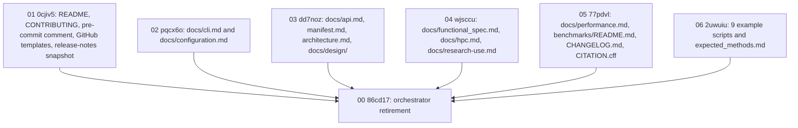

# IPD: Remediate repository documentation inaccuracies and drift

- Date: 2026-11-25
- Kind: orchestrator
- Concern: Documentation accuracy, completeness, and consistency across user-facing guides, CLI/API/configuration/manifest references, examples, benchmarks, changelog, pre-commit hook comment, and GitHub templates (surfaced by `/assess-documentation`).
- Scope: Coordination of six disjoint child plans (`0cjiv5`, `pqcx6o`, `dd7noz`, `wjsccu`, `77pdvl`, `2uwuiu`) covering all verified documentation-only fixes from `/assess-documentation` (including `.pre-commit-config.yaml` hook-comment sync in `0cjiv5`). This orchestrator modifies no product code, tests, docs, or templates.
- Scope-Paths: .aw/records/plans/pending/20261125-doc-audit-00-86cd17-remediate-repository-documentation-inaccuracies-and-drift.ipd.md
- Item-Dependencies: executed:0cjiv5, executed:pqcx6o, executed:dd7noz, executed:wjsccu, executed:77pdvl, executed:2uwuiu
- Status: reviewed
- Readiness: go-pending-approval
- Review-Depth: orchestrator
- Coverage: pass
- Coverage-Fingerprint: 18600a8f727e11340f329343e6315b9147327ea26533777a202fc8814386118f
- Coverage-Checked: 2026-11-26 by uri/its_direct/pt3-claude-opus-5.5-1m-us
- Short-Description: Coordinate six disjoint documentation remediation plans from /assess-documentation
- Work-Kind: chore
- Priority: medium
- Set: doc-audit
- Order: 0
- Highest E allocated: 06
- Author: Antigravity
- Id: 86cd17

> Write and proofread this plan per the technical writing standard, `.aw/system/workflows/technical-writing/technical-writing.md` (`.agents/workflows/technical-writing/technical-writing.md` in a legacy-layout install), including requirement 12 (diagrams).

## Workflow history

- 2026-11-26 coverage pass (aw oc run): fingerprint 18600a8f727e, model uri/its_direct/pt3-claude-opus-5.5-1m-us
- 2026-11-25 /plan-review (Antigravity): APPROVE WITH REVISIONS APPLIED; PR-001, PR-002, PR-003, PR-004
- 2026-11-25 to-review (aw set): Authored from /assess-documentation; 6 disjoint children
- 2026-11-25 coverage pass (aw oc run): fingerprint d14e8d5acb0d, model uri/its_direct/pt3-claude-opus-5.5-1m-us
- 2026-11-25 /assess documentation (Antigravity): assessed; proposed 6 disjoint child plans (25 execution items across 59 verified documentation findings)
- 2026-11-25 draft (Antigravity): created.

## Goal

Bring every user-facing documentation file, example script, benchmark guide, changelog entry, pre-commit hook comment, and GitHub template in `pubrun` into accurate agreement with the live codebase (audited at `/assess-documentation` baseline `f7c0897`, with `87qr8h` subsequently landed at `da1fbe7`). Six child plans divide the work along disjoint file boundaries so every child stays reviewable and safe to execute in parallel without merge conflicts.

### Set dependency architecture

## Detailed Implementation Checklist (TODO)

Execution-state rule: mark an `E-*` item complete only after performing the action. That mark is not validation. Right-sizing rule: write for a modest executor that cannot hold much in its head. Each E-item is one step (one concern, about one file, executable in one focused pass) and its V-item names each unit it covers with its own check; a plan stays at about 5 E-items and 8 work Scope-Paths, else split it into more child plans (guidance, `IPD-Z603`). Accepted execution states: blocked, failed, pending, performed; terminal gate demands 'performed'.

### Task group 1: Child plan execution confirmation

- [ ] E-01 CONFIRM 0cjiv5 REACHED executed
  - Depends on: none
  - Expected outcome: `.aw/records/plans/executed/20261125-doc-audit-01-0cjiv5-fix-readme-contributing-github-templates-and-release-notes-s.ipd.md` exists with `- Status: executed`, all `E-*` items `performed`, and all `V-*` items `pass`.
  - Execution state: pending

- [ ] E-02 CONFIRM pqcx6o REACHED executed
  - Depends on: none
  - Expected outcome: `.aw/records/plans/executed/20261125-doc-audit-02-pqcx6o-fix-cli-and-configuration-reference-inaccuracies-and-drift.ipd.md` exists with `- Status: executed`, all `E-*` items `performed`, and all `V-*` items `pass`.
  - Execution state: pending

- [ ] E-03 CONFIRM dd7noz REACHED executed
  - Depends on: none
  - Expected outcome: `.aw/records/plans/executed/20261125-doc-audit-03-dd7noz-fix-api-manifest-architecture-and-design-documentation-drift.ipd.md` exists with `- Status: executed`, all `E-*` items `performed`, and all `V-*` items `pass`.
  - Execution state: pending

- [ ] E-04 CONFIRM wjsccu REACHED executed
  - Depends on: none
  - Expected outcome: `.aw/records/plans/executed/20261125-doc-audit-04-wjsccu-fix-functional-specification-hpc-guide-and-research-use-guid.ipd.md` exists with `- Status: executed`, all `E-*` items `performed`, and all `V-*` items `pass`.
  - Execution state: pending

- [ ] E-05 CONFIRM 77pdvl REACHED executed
  - Depends on: none
  - Expected outcome: `.aw/records/plans/executed/20261125-doc-audit-05-77pdvl-fix-performance-benchmarks-and-changelog-documentation-drift.ipd.md` exists with `- Status: executed`, all `E-*` items `performed`, and all `V-*` items `pass`.
  - Execution state: pending

- [ ] E-06 CONFIRM 2uwuiu REACHED executed
  - Depends on: none
  - Expected outcome: `.aw/records/plans/executed/20261125-doc-audit-06-2uwuiu-update-example-scripts-and-expected-methods-output-to-match.ipd.md` exists with `- Status: executed`, all `E-*` items `performed`, and all `V-*` items `pass`.
  - Execution state: pending

## Child IPDs, sequence, and dependencies

| Order | Id | File | What it does | Depends on |
|---|---|---|---|---|
| 01 | `0cjiv5` | `20261125-doc-audit-01-0cjiv5-fix-readme-contributing-github-templates-and-release-notes-s.ipd.md` | Fixes broken local `file://` URI in `.github/pull_request_template.md`, removes duplicate legacy `.md` issue templates, updates `CONTRIBUTING.md` onboarding and `hatch_build.py` commit stamping (plus `.pre-commit-config.yaml` hook comment), fixes `README.md` CLI/HPC/examples/Windows/roadmap/sample-output/license drift, and adds an archival notice to `release-notes-v1.2.0.md`. | none |
| 02 | `pqcx6o` | `20261125-doc-audit-02-pqcx6o-fix-cli-and-configuration-reference-inaccuracies-and-drift.ipd.md` | Fixes `docs/cli.md` (`show`/`report` grammar and section extracts, `diff` depths/args, run-selector path rules, standard run filters, `--info`/`--no-color`/`help`/exit-codes/non-TTY scope) and `docs/configuration.md` (malformed `[diff]` table, `[capture.resources].scope`, `[methods].format`, inert/reserved keys, `[core].meta_ref` and `_CORE_SHORTCUTS`, env-var precedence and missing `PUBRUN_DEBUG`/`NO_COLOR` rows). | none |
| 03 | `dd7noz` | `20261125-doc-audit-03-dd7noz-fix-api-manifest-architecture-and-design-documentation-drift.ipd.md` | Fixes `docs/api.md` (deprecated `profile=` examples, false `inspect --json` vs `assess_run()` claim, `phase()`/`register_*()` inactive behavior, `stop()`/`tracked_run()`/`audit_run()`, `__all__`/`paused()`/`should_fail_strict`), `docs/manifest.md` (removes phantom `profiling`, fixes `redacted_value`, `virtual_env`, `status.outcome`, `console`, `invocation.script`, `Meta Snapshot`, `subprocesses[].cwd`, `gpus[]`), `docs/architecture.md`, and `docs/design/` banners/call sites. | none |
| 04 | `wjsccu` | `20261125-doc-audit-04-wjsccu-fix-functional-specification-hpc-guide-and-research-use-guid.ipd.md` | Fixes `docs/hpc.md` (working `PUBRUN_META_REF` + `[report].meta_ref_allowed_dirs` example, `host` section, `inspect` vs `res` attribution, `register_*()`, `pubrun bench` checkout and Slurm behavior), `docs/research-use.md` (input-file capture nuance and `00`-`12` examples), and `docs/functional_spec.md` (Section 11 CLI overhaul covering existing subsections plus 10 omitted primary subcommands and global CLI options, and Sections 1-10, 12, 14, 16, and 18 drift while leaving Section 17 Ghost Mode unchanged). | none |
| 05 | `77pdvl` | `20261125-doc-audit-05-77pdvl-fix-performance-benchmarks-and-changelog-documentation-drift.ipd.md` | Fixes `benchmarks/README.md` (redacted-only default output inversion, Slurm output path and pass count, `pubrun.open()` vs `patched open()`, `io_baseline`/`io_sink`, `.gitignore`, relative paths), `docs/performance.md` (already-fixed `uatvzh` bug and leaked internal IDs), `CHANGELOG.md` (`[Unreleased]` deduplication, stale intermediate claims, and `v1.0.1`-`v1.0.3` historical entries), and `CITATION.cff` release date and trailing comment cleanup. | none |
| 06 | `2uwuiu` | `20261125-doc-audit-06-2uwuiu-update-example-scripts-and-expected-methods-output-to-match.ipd.md` | Removes deprecated/inert `profile=` arguments from examples `01`-`05`, `08`, `09`, and `11`, switches `01`-`05` and `08`-`11` from legacy `PUBRUN_AUTO_START` to `import pubrun.noauto as pubrun` (dropping unused `import os` in `09`/`11`), updates `10_hardware_probe.py` and `11_cli_report.py` docstrings/CLI call, aligns `examples/minimal-research-workflow/expected_methods.md` with `MARKDOWN_TEMPLATE`, and validates with `examples/verify_all.py`, runtime zero-`profile_deprecated` manifest notice checks, and example smoke tests. | none |

All six children edit strictly disjoint files (verified pairwise across all 31 declared work Scope-Paths) and have no inter-child dependencies.

## Completion criteria (the whole Set is done only when)

- Root documentation (`README.md`, `CONTRIBUTING.md`), `.pre-commit-config.yaml` hook comment, GitHub templates (`.github/pull_request_template.md`, `.github/ISSUE_TEMPLATE/`), and `release-notes-v1.2.0.md` match the live repository with zero broken links or local URIs. Owner: `0cjiv5`.
- `docs/cli.md` and `docs/configuration.md` accurately describe every CLI subcommand, filter flag, config key, reserved key, and environment-variable precedence rule, with valid GFM tables. Owner: `pqcx6o`.
- `docs/api.md`, `docs/manifest.md`, `docs/architecture.md`, and `docs/design/` match `src/pubrun/` and `schemas/manifest.schema.json` with no phantom sections or deprecated primary examples. Owner: `dd7noz`.
- `docs/functional_spec.md`, `docs/hpc.md`, and `docs/research-use.md` match live HPC hydration, `inspect`/`res` division, input-capture mechanics, and the full current CLI. Owner: `wjsccu`.
- `docs/performance.md`, `benchmarks/README.md`, `CHANGELOG.md` (including `v1.0.1`-`v1.0.3` patch entries), and `CITATION.cff` accurately describe live benchmark behavior, resolved timing bugs, and consolidated `[Unreleased]` changes. Owner: `77pdvl`.
- The 9 targeted example scripts (`01`-`05`, `08`-`11`) and `examples/minimal-research-workflow/expected_methods.md` avoid deprecated `profile=` usage, switch to `pubrun.noauto`, match live template output, emit zero `profile_deprecated` manifest notices at runtime, and pass `examples/verify_all.py` and example tests. Owner: `2uwuiu`.

## Cross-IPD validation

- Every child plan edits only its own disjoint Scope-Paths and validates: (1) zero broken relative/anchor links across its edited Markdown files, (2) zero em or en dashes (`\u2013`, `\u2014`) introduced in added lines of user-facing Markdown per `AGENTS.md`, and (3) `python3 scripts/sanitize_paths.py --check --all` exiting 0. Owners: `0cjiv5`, `pqcx6o`, `dd7noz`, `wjsccu`, `77pdvl`, `2uwuiu`.
- Cross-document consistency on shared topics (`PUBRUN_META_REF` + `[report].meta_ref_allowed_dirs` + `host` hydration across `README.md`, `docs/cli.md`, `docs/manifest.md`, `docs/hpc.md`, `docs/functional_spec.md`; `pubrun show` single-run + filter syntax across `README.md`, `docs/cli.md`, `docs/functional_spec.md`; `PUBRUN_RUN_MODE_OVERRIDE` precedence across `docs/configuration.md` and `docs/functional_spec.md`, preserving the `PUBRUN_RUN_MODE_OVERRIDE` entries already landed by executed plan `87qr8h` for closed backlog `aqb2bu` while adding `PUBRUN_DEBUG` and `NO_COLOR`) is enforced by identical concrete specifications in each owning child plan. Owners: `0cjiv5`, `pqcx6o`, `dd7noz`, `wjsccu`.

## Deferred / out of scope (with reason)

- **Reconciling `redacted_value` hashed schema vs `src/pubrun/capture/redaction.py`** (`redaction.py` emits `hash_algorithm`/`hash_value`; `schemas/manifest.schema.json` `$defs.redacted_value` defines `hash: {algorithm, value}` with `additionalProperties: false`): Remediation Risk **Medium-High on Functionality** because changing either runtime payload or JSON Schema modifies a published data contract. Safe part handled in `dd7noz` (documenting live runtime output honestly and noting the schema mismatch).
  - Carrier-Declined: Runtime/schema contract decision outside documentation-only assessment scope; requires a dedicated bug or schema-alignment plan.
- **Adding `"crashed"` to `status.outcome` and `"sha256_skipped"` to `invocation.script` in `schemas/manifest.schema.json`**: Remediation Risk **Medium-High on Functionality** because modifying the published JSON Schema requires contract review and conformance-test updates. Safe part handled in `dd7noz` (documenting live emitted values in `docs/manifest.md`).
  - Carrier-Declined: Schema contract modification outside documentation-only scope; requires a dedicated schema plan.
- **Wiring `pubrun methods` CLI to honor `[methods].format` from config**: Remediation Risk **Medium-High on Functionality** because changing CLI default resolution alters runtime behavior for users with `[methods].format = "latex"` in `.pubrun.toml`. Safe part handled in `pqcx6o` and `wjsccu` (documenting current behavior accurately).
  - Carrier-Declined: Runtime CLI behavior change outside documentation-only scope; cross-referenced to bugs/self-documentation lenses.
- **Suppressing ANSI color/DIM automatically on non-TTY streams in `show`/`status`/`res`/`diff`**: Remediation Risk **Medium-High on Functionality** because changing renderer ANSI logic affects CLI output tests and color contracts. Safe part handled in `pqcx6o` (scoping the `docs/cli.md` claim accurately and recommending `--no-color`/`NO_COLOR=1`).
  - Carrier-Declined: Runtime CLI rendering change outside documentation-only scope; cross-referenced to accessibility/self-documentation lenses.
- **Updating `benchmarks/submit_bench_{pbs,lsf,sge}.sh` away from `--out ...json` to match redacted-only default**: Remediation Risk **Medium-High on Functionality** because altering HPC scheduler submission scripts affects cluster execution contracts outside documentation. Safe part handled in `77pdvl` (documenting current script behavior honestly in `benchmarks/README.md`).
  - Carrier-Declined: Runtime benchmark-script change outside documentation-only scope.
- **Repo-wide historical em/en-dash sweep across unedited paragraphs**: Already tracked in `TODO.md` (`### Full repo-wide em/en-dash sweep`). Children enforce zero new dashes in added/edited lines without churning untouched historical prose.
  - Carrier-Declined: Pre-existing repo-wide cleanup deferred separately to avoid noisy diffs across untouched sections.

## Scope check

- Over-scope: none. The orchestrator modifies no product code, tests, docs, or templates; every child edits only documentation, templates, the `.pre-commit-config.yaml` hook comment (`0cjiv5`), or example scripts (`2uwuiu`).
- Under-scope: none. Every verified documentation finding from `/assess-documentation` is assigned to one of the six children or explicitly deferred with its Remediation-Risk axis above. Executed plan `87qr8h` (commit `da1fbe7`) has already landed the `PUBRUN_RUN_MODE_OVERRIDE` rows in `docs/functional_spec.md` and `docs/configuration.md` and closed backlog `aqb2bu`; `pqcx6o` and `wjsccu` preserve those rows while adding `PUBRUN_DEBUG`, `NO_COLOR`, and the remaining document fixes.

## Required tests / validation

This orchestrator runs no product tests itself. Each child plan owns its own verification (diff inspection, link/anchor checks, zero-dash checks on added user-facing prose, and `python3 scripts/sanitize_paths.py --check --all`), and `2uwuiu` owns running `python3 examples/verify_all.py`, the runtime zero-`profile_deprecated` manifest notice check across the 9 edited example scripts, and `python3 -m pytest tests/test_examples_smoke.py tests/test_example_minimal_research_workflow.py -v --no-cov -p no:cacheprovider`.

## Open questions

None.

## Validation and cross-check (verify before reporting the Set complete)

Validation-state rule: inspect evidence in a separate pass. Do not mark a `V-*` item complete from memory or from the matching execution checkmark. Accepted validation results: blocked, failed, pass, pending; terminal gate demands 'pass'. Runtime-demonstration reachability rule: for each `V-*` item demanding the software be observed acting (such as a run, a dispatch, or a transition), as distinct from items demanding a diff, a file's content, or a test result, which are reachable by construction, name the code path that produces the observation or the sibling `E-*` that creates it, else the demand is UNDER-SCOPE.

- [ ] V-01 validates E-01
  - Required evidence: Confirm `.aw/records/plans/executed/20261125-doc-audit-01-0cjiv5-fix-readme-contributing-github-templates-and-release-notes-s.ipd.md` exists with `- Status: executed`, all `E-*` items `performed`, and all `V-*` items `pass`, and paste the output of `aw ipd lint --phase post-transition` on that file showing exit 0 and `conforming`.
  - Observed evidence:
  - Result: pending

- [ ] V-02 validates E-02
  - Required evidence: Confirm `.aw/records/plans/executed/20261125-doc-audit-02-pqcx6o-fix-cli-and-configuration-reference-inaccuracies-and-drift.ipd.md` exists with `- Status: executed`, all `E-*` items `performed`, and all `V-*` items `pass`, and paste the output of `aw ipd lint --phase post-transition` on that file showing exit 0 and `conforming`.
  - Observed evidence:
  - Result: pending

- [ ] V-03 validates E-03
  - Required evidence: Confirm `.aw/records/plans/executed/20261125-doc-audit-03-dd7noz-fix-api-manifest-architecture-and-design-documentation-drift.ipd.md` exists with `- Status: executed`, all `E-*` items `performed`, and all `V-*` items `pass`, and paste the output of `aw ipd lint --phase post-transition` on that file showing exit 0 and `conforming`.
  - Observed evidence:
  - Result: pending

- [ ] V-04 validates E-04
  - Required evidence: Confirm `.aw/records/plans/executed/20261125-doc-audit-04-wjsccu-fix-functional-specification-hpc-guide-and-research-use-guid.ipd.md` exists with `- Status: executed`, all `E-*` items `performed`, and all `V-*` items `pass`, and paste the output of `aw ipd lint --phase post-transition` on that file showing exit 0 and `conforming`.
  - Observed evidence:
  - Result: pending

- [ ] V-05 validates E-05
  - Required evidence: Confirm `.aw/records/plans/executed/20261125-doc-audit-05-77pdvl-fix-performance-benchmarks-and-changelog-documentation-drift.ipd.md` exists with `- Status: executed`, all `E-*` items `performed`, and all `V-*` items `pass`, and paste the output of `aw ipd lint --phase post-transition` on that file showing exit 0 and `conforming`.
  - Observed evidence:
  - Result: pending

- [ ] V-06 validates E-06
  - Required evidence: Confirm `.aw/records/plans/executed/20261125-doc-audit-06-2uwuiu-update-example-scripts-and-expected-methods-output-to-match.ipd.md` exists with `- Status: executed`, all `E-*` items `performed`, and all `V-*` items `pass`, and paste the output of `aw ipd lint --phase post-transition` on that file showing exit 0 and `conforming`.
  - Observed evidence:
  - Result: pending

## Approval and execution gate

- Size assessment: standard
- Cohesion rationale: not required

Execution begins only after a human approves this orchestrator and its six child plans (`- Status: approved`).

Execution contract:
1. Open-questions precondition: no blocking open question remains in this plan or in any child.
2. Scope declaration: this Order-0 orchestrator modifies no product code, tests, docs, or templates; its `- Scope-Paths:` covers only this file. Justify any out-of-scope edit with `--scope-reason` (and any declared-but-unmodified path with `--scope-ack`) at finalization.
3. Validation honesty (HARD MUST): every `V-*` claim must paste the actual `aw ipd lint --phase post-transition` output observed on disk. Never claim a child is executed without reading its executed file and pasting the linter output.
4. Commit discipline: commit only this orchestrator's retirement files through `aw commit 86cd17 -- <paths>` (or the runner's bookkeeping transaction). Never use `git add -A` or `-a`, and never push without an explicit human instruction.
5. Lifecycle transition: inside `aw oc run` / `aw agy run`, the runner retires this orchestrator once all six children (`0cjiv5`, `pqcx6o`, `dd7noz`, `wjsccu`, `77pdvl`, `2uwuiu`) are `executed`, spending no agent turn. Outside a runner, after all six are executed and `aw ipd lint --phase pre-transition` reports `conforming`, run `aw ipd finalize 86cd17` (never a hand-written `git mv`).
