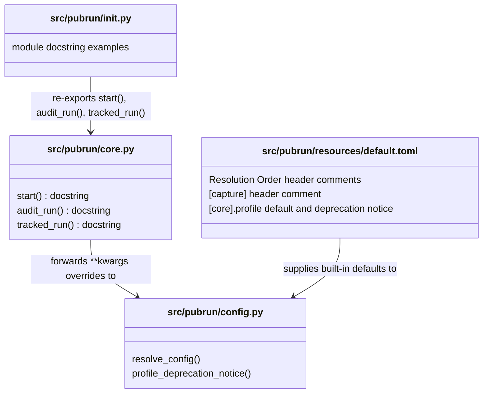

# IPD: Remove deprecated profile examples from src/pubrun

- Date: 2026-11-26
- Kind: child
- Concern: Public docstrings in `src/pubrun/__init__.py` and `src/pubrun/core.py` and header comments in `src/pubrun/resources/default.toml` still show deprecated, inert `profile=` and `PUBRUN_PROFILE=` examples and a stale "master profile" note even though `core.profile` is deprecated and triggers a `profile_deprecated` manifest notice via `src/pubrun/config.py::profile_deprecation_notice`.
- Scope: Public module docstring examples in `src/pubrun/__init__.py`, public API docstring examples (`start`, `audit_run`, `tracked_run`) in `src/pubrun/core.py`, and configuration header comments (`Resolution Order` and `[capture]` banner) in `src/pubrun/resources/default.toml`.
- Scope-Paths: src/pubrun/__init__.py, src/pubrun/core.py, src/pubrun/resources/default.toml
- Item-Dependencies: none
- Status: auto-approved
- Readiness: go-pending-approval
- Review-Depth: simple
- Short-Description: Replace deprecated profile= and PUBRUN_PROFILE examples in src/pubrun/__init__.py, src/pubrun/core.py, and src/pubrun/resources/default.toml with non-deprecated overrides
- Work-Kind: chore
- Priority: low
- From-Backlog: mz0erz
- Set: mz0erz
- Order: 1
- Highest E allocated: 04
- Author: Antigravity
- Id: ha769g

> Write and proofread this plan per the technical writing standard, `.aw/system/workflows/technical-writing/technical-writing.md` (`.agents/workflows/technical-writing/technical-writing.md` in a legacy-layout install), including requirement 12 (diagrams).

## Workflow history

- 2026-11-26 auto-approved (aw agy run --full-auto): auto-approved by --full-auto: review readiness cleared (not human approval)
- 2026-11-26 /plan-review (Antigravity): APPROVE WITH REVISIONS APPLIED; PR-001, PR-002; review record `.aw/records/reviews/20261126-mz0erz-01-ha769g-remove-deprecated-profile-examples-from-src-pubrun.review.md`.
- 2026-11-26 to-review (aw set): Authored review-ready plan from backlog item mz0erz
- 2026-11-26 draft (Antigravity): created.

## Goal

Update public docstrings in `src/pubrun/__init__.py` and `src/pubrun/core.py` and header comments in `src/pubrun/resources/default.toml` so they show current, non-deprecated `capture.*` Application Programming Interface (API) overrides and non-deprecated environment variables instead of `profile=` and `PUBRUN_PROFILE=`. Preserve backward-compatible runtime support for `core.profile`, its `[core]` default key, and its deprecation notice in `src/pubrun/config.py::profile_deprecation_notice`.



## Detailed Implementation Checklist (TODO)

Execution-state rule: mark an `E-*` item complete only after performing the action. That mark is not validation. Right-sizing rule: write for a modest executor that cannot hold much in its head. Each E-item is one step (one concern, about one file, executable in one focused pass) and its V-item names each unit it covers with its own check; a plan stays at about 5 E-items and 8 work Scope-Paths, else split it into more child plans (guidance, `IPD-Z603`). Accepted execution states: blocked, failed, pending, performed; terminal gate demands 'performed'.

### Task group 1: Replace deprecated `profile=` examples in Python docstrings

- [x] E-01 Update the module docstring examples in `src/pubrun/__init__.py`:
  - Under `2. Explicit control::`, replace `tracker = pubrun.start(profile="deep")` with `tracker = pubrun.start(capture={"hardware": {"depth": "deep"}})`.
  - Under `3. Decorator::`, replace `@pubrun.audit_run(profile="basic")` with `@pubrun.audit_run(capture={"hardware": {"depth": "basic"}})`.
  - Leave all other docstring text and all executable code in `src/pubrun/__init__.py` unchanged.
  - Depends on: none
  - Expected outcome: `src/pubrun/__init__.py` contains zero `profile=` examples, shows valid `capture.*` overrides in both usage blocks, and has zero runtime code changes.
  - Execution state: performed

- [x] E-02 Update the public API docstring examples in `src/pubrun/core.py`:
  - In `start()`'s `Example:` block, replace `>>> tracker = pubrun.start(profile="deep")` with `>>> tracker = pubrun.start(capture={"hardware": {"depth": "deep"}})`.
  - In `audit_run()`'s `Example:` block, replace `>>> @pubrun.audit_run(profile="deep")` with `>>> @pubrun.audit_run(capture={"hardware": {"depth": "deep"}})`.
  - In `tracked_run()`'s `Example:` block, replace `>>> with pubrun.tracked_run(profile="minimal"):` with `>>> with pubrun.tracked_run(capture={"packages": {"mode": "off"}}):`.
  - Leave `_inactive_policy()`'s docstring note about `PUBRUN_PROFILE` and `PUBRUN_META_REF` unchanged because it documents live cache-key behavior in `src/pubrun/config.py::_resolve_layers`.
  - Leave all executable code in `src/pubrun/core.py` unchanged.
  - Depends on: none
  - Expected outcome: `start()`, `audit_run()`, and `tracked_run()` in `src/pubrun/core.py` contain zero `profile=` examples, show valid `capture.*` overrides, and introduce zero executable code changes.
  - Execution state: performed

### Task group 2: Replace deprecated profile comments in `default.toml`

- [x] E-03 Update the configuration header comments in `src/pubrun/resources/default.toml`:
  - Under `# Resolution Order (highest to lowest precedence):`, replace `#   1. Explicit API arguments (e.g., pubrun.start(profile="deep"))` with `#   1. Explicit API arguments (e.g., pubrun.start(capture={"hardware": {"depth": "deep"}}))`.
  - Under `# Resolution Order (highest to lowest precedence):`, replace `#   2. Environment variables (e.g., PUBRUN_PROFILE="deep")` with `#   2. Environment variables (e.g., PUBRUN_IMPORT_MODE="noauto", PUBRUN_META_REF="path.json")`.
  - Under `[capture]`, replace `# Each category can override the master profile.` with `# Each category controls its own capture depth independently.` so the `[capture]` comment agrees with the `[core]` deprecation notice.
  - Keep the `[core]` key `profile = "default"` and its deprecation comment block unchanged so `src/pubrun/config.py::load_default_config`, `resolve_config`, and `profile_deprecation_notice` retain backward compatibility.
  - Depends on: none
  - Expected outcome: `src/pubrun/resources/default.toml` contains zero `profile=`, `PUBRUN_PROFILE=`, or `master profile` examples, parses to the exact same Tom's Obvious, Minimal Language (TOML) dictionary as before, and retains `[core].profile = "default"` with its deprecation notice.
  - Execution state: performed

### Task group 3: Verify examples, TOML resolution, tests, typing, and path hygiene

- [x] E-04 Run all verification checks listed in `## Required tests / validation`:
  - Run the negative `grep` check across `src/pubrun/__init__.py`, `src/pubrun/core.py`, and `src/pubrun/resources/default.toml` and confirm `profile = "default"` remains under `[core]` in `src/pubrun/resources/default.toml`.
  - Run the Python verification snippet that parses `src/pubrun/resources/default.toml` via `src/pubrun/config.py::load_default_config` and verifies that every `capture.*` override shown in the updated docstrings and comments resolves through `src/pubrun/config.py::resolve_config` with `profile_deprecation_notice(resolved) is None`.
  - Run the targeted `pytest` suite, `mypy` on `src/pubrun`, and `python3 scripts/sanitize_paths.py --check --all`.
  - Depends on: E-01, E-02, E-03
  - Expected outcome: All negative `grep` checks, TOML and override checks, targeted tests, `mypy`, and path-leak sanitization pass with exit code 0 (and exit code 1 for the negative `grep` check).
  - Execution state: performed

## Project conventions discovered (Step 0)

- `src/pubrun/config.py::profile_deprecation_notice` and `src/pubrun/resources/default.toml` (`[core]` section) deprecate `core.profile` as inert and record a `profile_deprecated` manifest notice whenever `core.profile` is set to any non-empty value other than `"default"`.
- `src/pubrun/config.py::_resolve_layers` accepts nested configuration dictionaries matching the `default.toml` section layout (for example `capture={"hardware": {"depth": "deep"}}`) and flattens only the four `[core]` shortcuts `profile`, `output_dir`, `auto_start`, and `meta_ref`.
- `src/pubrun/capture/hardware.py` reads `[capture.hardware].depth` (`"off"`, `"basic"`, `"standard"`, `"deep"`), and `src/pubrun/capture/packages.py` reads `[capture.packages].mode` (`"off"`, `"imported-only"`, `"imported-transitive"`, `"top-level-installed"`, `"full-environment"`).
- `src/pubrun/config.py::_resolve_layers` reads `PUBRUN_META_REF` (non-deprecated, setting `[core].meta_ref`) and `PUBRUN_PROFILE` (deprecated, setting `[core].profile`). `src/pubrun/_config_boot.py::resolve_import_mode` reads `PUBRUN_IMPORT_MODE` as the canonical non-deprecated import-mode environment variable. No `PUBRUN_*` environment variable exists for nested `capture.*` keys (also stated in `docs/configuration.md`).
- `tests/test_config.py` and `tests/test_profile_deprecation.py` assert that `load_default_config()["core"]["profile"] == "default"` and that non-default `core.profile` values remain accepted while emitting a `profile_deprecated` notice.
- `src/pubrun/__init__.py` re-exports `start`, `audit_run`, and `tracked_run` from `src/pubrun/core.py`.
- `pyproject.toml` configures `pytest` (`testpaths = ["tests"]`, `pythonpath = ["src"]`) and `mypy` (`files = ["src/pubrun"]`).

## Findings

| ID | Severity | Remediation Risk | Persona | Evidence | Finding |
|---|---|---|---|---|---|
| F-01 | Low | Low | New User / Evaluator | `src/pubrun/__init__.py` module docstring (`2. Explicit control::` and `3. Decorator::`) vs `src/pubrun/config.py::profile_deprecation_notice` | Module docstring examples pass `profile="deep"` and `profile="basic"`, which are inert and trigger `profile_deprecated` manifest notices. |
| F-02 | Low | Low | New User / Developer | `src/pubrun/core.py` (`start`, `audit_run`, `tracked_run` docstrings) vs `src/pubrun/config.py::profile_deprecation_notice` | Public API docstring examples pass `profile="deep"` and `profile="minimal"`, teaching deprecated inert usage instead of `capture.*` overrides. |
| F-03 | Low | Low | New User / Operator | `src/pubrun/resources/default.toml` (`Resolution Order` header comments and `[capture]` section header comment) vs `[core]` deprecation notice in the same file | Header comments show `pubrun.start(profile="deep")` and `PUBRUN_PROFILE="deep"` directly above the `[core].profile` deprecation notice, and `[capture]` still claims each category "can override the master profile". |

## Proposed changes (ordered, validatable)

1. Replace the two `profile=` calls in `src/pubrun/__init__.py`'s module docstring with `capture={"hardware": {"depth": "deep"}}` and `capture={"hardware": {"depth": "basic"}}` (E-01; Remediation Risk: Low).
2. Replace the three `profile=` calls in `src/pubrun/core.py`'s docstrings for `start()`, `audit_run()`, and `tracked_run()` with `capture={"hardware": {"depth": "deep"}}` and `capture={"packages": {"mode": "off"}}` (E-02; Remediation Risk: Low).
3. Replace the deprecated `profile=` and `PUBRUN_PROFILE=` examples in `src/pubrun/resources/default.toml`'s `Resolution Order` header comments with `capture={"hardware": {"depth": "deep"}}` and `PUBRUN_IMPORT_MODE="noauto", PUBRUN_META_REF="path.json"`, and replace the stale `[capture]` "override the master profile" comment with an accurate per-category statement while preserving `[core].profile = "default"` and its deprecation notice (E-03; Remediation Risk: Low).
4. Verify zero deprecated examples remain, confirm `default.toml` parses identically and every replacement override resolves without a `profile_deprecated` notice, and run targeted `pytest`, `mypy`, and `scripts/sanitize_paths.py --check --all` (E-04; Remediation Risk: Low).

## Deferred / out of scope (with reason)

- Runtime support for `core.profile`, `PUBRUN_PROFILE`, `_CORE_SHORTCUTS`, and `profile_deprecation_notice` in `src/pubrun/config.py`, `src/pubrun/tracker.py`, `src/pubrun/status.py`, `tests/test_config.py`, and `tests/test_profile_deprecation.py` is out of scope because `core.profile` remains deliberately accepted for backward compatibility per the Option-D deprecation decision.
  - Carrier-Declined: Retaining inert backward-compatible parsing and deprecation notices is intentional; no removal follow-up is requested by backlog item `mz0erz`.
- The internal implementation comment in `src/pubrun/config.py::_resolve_layers` (`# Convenience flattening: allow start(profile="deep", output_dir="./x")`), the precedence docstring in `src/pubrun/config.py::resolve_config` (`PUBRUN_PROFILE` / `PUBRUN_META_REF`), and the cache-signature docstring in `src/pubrun/core.py::_inactive_policy` are out of scope because they document active internal implementation behavior rather than recommending deprecated usage to callers.
  - Carrier-Declined: Accurate internal code comments do not teach deprecated APIs to end users; no follow-up is needed.
- `tests/test_cli.py` test fixtures that pass `pubrun.start(profile="standard", ...)` are out of scope because backlog item `mz0erz` targets `src/pubrun` docstrings and `default.toml` header comments only.
  - Carrier-Declined: Test fixtures are outside `src/pubrun` and outside backlog item `mz0erz`'s bounded scope.

## Scope check

- Over-scope: none. Only the three files named in backlog item `mz0erz` (`src/pubrun/__init__.py`, `src/pubrun/core.py`, `src/pubrun/resources/default.toml`) are modified, and no executable Python logic or TOML key values are changed.
- Under-scope: none. Every deprecated `profile=` and `PUBRUN_PROFILE=` example identified in backlog item `mz0erz` plus the directly adjacent `[capture]` "master profile" header comment in `src/pubrun/resources/default.toml` is covered.

## Required tests / validation

1. **Negative `grep` check on the three target files** (must exit `1`; pre-execution baseline verified as 8 matches, `exit=0`):

   ```sh
   grep -n -E 'profile=|PUBRUN_PROFILE=|master profile' src/pubrun/__init__.py src/pubrun/core.py src/pubrun/resources/default.toml; echo "exit=$?"
   ```

2. **Positive preservation check for `[core].profile = "default"`** in `src/pubrun/resources/default.toml` (must exit `0` and show `profile = "default"`):

   ```sh
   grep -n '^profile = "default"$' src/pubrun/resources/default.toml
   ```

3. **Runtime TOML parse and non-deprecated override resolution check** (isolated from ambient `PUBRUN_PROFILE` and host user/local config files; must exit `0` with `ok=True`):

   ```sh
   PUBRUN_PROFILE= PYTHONPATH=src python3 - <<'PY'
   import os
   import pubrun.config as cfg

   # Isolate ambient env and host user/local config files so they cannot inject core.profile.
   os.environ.pop("PUBRUN_PROFILE", None)
   cfg.load_user_config = lambda: None
   cfg.load_local_config = lambda start_dir=None: None

   defaults = cfg.load_default_config()
   assert defaults["core"]["profile"] == "default", defaults["core"]

   cases = [
       ({"capture": {"hardware": {"depth": "deep"}}}, ("capture", "hardware", "depth"), "deep"),
       ({"capture": {"hardware": {"depth": "basic"}}}, ("capture", "hardware", "depth"), "basic"),
       ({"capture": {"packages": {"mode": "off"}}}, ("capture", "packages", "mode"), "off"),
   ]
   for overrides, path, expected in cases:
       resolved = cfg.resolve_config(overrides)
       assert cfg.profile_deprecation_notice(resolved) is None, (overrides, resolved["core"])
       cur = resolved
       for key in path:
           cur = cur[key]
       assert cur == expected, (overrides, cur, expected)
   print("ok=True")
   PY
   ```

4. **Targeted `pytest` suite** (must exit `0`):

   ```sh
   python3 -m pytest tests/test_config.py tests/test_profile_deprecation.py tests/test_api.py tests/test_explicit_api.py tests/test_import_modes.py tests/test_show_config.py -v --no-cov -p no:cacheprovider
   ```

5. **Static type check** (must exit `0`):

   ```sh
   python3 -m mypy src/pubrun
   ```

6. **Path-leak sanitizer** (must exit `0`):

   ```sh
   python3 scripts/sanitize_paths.py --check --all
   ```

## Spec / documentation sync

- Updates in-code docstrings and `default.toml` comments only. No runtime behavior, schema, or external specification changes occur.
- `docs/api.md`, `docs/configuration.md`, and `examples/` already document `capture.*` overrides and the `core.profile` deprecation notice (completed in Set `doc-audit`, including plan `2uwuiu`).

## Open questions

None.

## Validation and cross-check (verify before reporting done)

Validation-state rule: inspect evidence in a separate pass. Do not mark a `V-*` item complete from memory or from the matching execution checkmark. Accepted validation results: blocked, failed, pass, pending; terminal gate demands 'pass'. Runtime-demonstration reachability rule: for each `V-*` item demanding the software be observed acting (such as a run, a dispatch, or a transition), as distinct from items demanding a diff, a file's content, or a test result, which are reachable by construction, name the code path that produces the observation or the sibling `E-*` that creates it, else the demand is UNDER-SCOPE.

- [x] V-01 validates E-01
  - Required evidence: Pasted `git diff -- src/pubrun/__init__.py` confirming that only the two module-docstring examples changed (`capture={"hardware": {"depth": "deep"}}` and `capture={"hardware": {"depth": "basic"}}`) and no executable code changed, plus pasted `grep -n 'profile=' src/pubrun/__init__.py; echo "exit=$?"` showing `exit=1`.
  - Observed evidence:
    ```diff
    diff --git a/src/pubrun/__init__.py b/src/pubrun/__init__.py
    index 4b36a2e..b3aa978 100644
    --- a/src/pubrun/__init__.py
    +++ b/src/pubrun/__init__.py
    @@ -11,7 +11,7 @@ Usage

         import pubrun

    -    tracker = pubrun.start(profile="deep")
    +    tracker = pubrun.start(capture={"hardware": {"depth": "deep"}})
         pubrun.annotate("loading_datasets", batches=400, mode="lazy")

         with pubrun.phase("gradient_descent"):
    @@ -21,7 +21,7 @@ Usage

     3. Decorator::

    -    @pubrun.audit_run(profile="basic")
    +    @pubrun.audit_run(capture={"hardware": {"depth": "basic"}})
         def evaluate_node():
             ...
    ```
    ```text
    $ grep -n 'profile=' src/pubrun/__init__.py; echo "exit=$?"
    exit=1
    ```
  - Result: pass

- [x] V-02 validates E-02
  - Required evidence: Pasted `git diff -- src/pubrun/core.py` confirming that only the `Example:` blocks in `start()`, `audit_run()`, and `tracked_run()` changed to `capture={"hardware": {"depth": "deep"}}` and `capture={"packages": {"mode": "off"}}`, `_inactive_policy()` remained unchanged, and no executable code changed, plus pasted `grep -n 'profile=' src/pubrun/core.py; echo "exit=$?"` showing `exit=1`.
  - Observed evidence:
    ```diff
    diff --git a/src/pubrun/core.py b/src/pubrun/core.py
    index 9634e4e..b9a2481 100644
    --- a/src/pubrun/core.py
    +++ b/src/pubrun/core.py
    @@ -199,7 +199,7 @@ def start(**kwargs: Any) -> Run:
             - ``run.started_at_utc`` (float): POSIX start timestamp.

         Example:
    -        >>> tracker = pubrun.start(profile="deep")
    +        >>> tracker = pubrun.start(capture={"hardware": {"depth": "deep"}})
             >>> tracker.stop()
         """
         is_ghost_or_inactive = False
    @@ -341,7 +341,7 @@ def audit_run(func: Optional[Callable] = None, **kwargs: Any) -> Callable:
             **kwargs: Configuration overrides forwarded to ``start()``.

         Example:
    -        >>> @pubrun.audit_run(profile="deep")
    +        >>> @pubrun.audit_run(capture={"hardware": {"depth": "deep"}})
             ... def train():
             ...     model.fit()
         """
    @@ -371,7 +371,7 @@ class tracked_run:
             **kwargs: Configuration overrides forwarded to ``start()``.

         Example:
    -        >>> with pubrun.tracked_run(profile="minimal"):
    +        >>> with pubrun.tracked_run(capture={"packages": {"mode": "off"}}):
             ...     model.train(epochs=5)
         """
         def __init__(self, **kwargs: Any) -> None:
    ```
    ```text
    $ grep -n 'profile=' src/pubrun/core.py; echo "exit=$?"
    exit=1
    ```
  - Result: pass

- [x] V-03 validates E-03
  - Required evidence: Pasted `git diff -- src/pubrun/resources/default.toml` confirming the updated `Resolution Order` lines (`pubrun.start(capture={"hardware": {"depth": "deep"}})` and `PUBRUN_IMPORT_MODE="noauto", PUBRUN_META_REF="path.json"`) and the updated `[capture]` banner comment, while preserving `[core]` `profile = "default"` and its deprecation notice, plus pasted `grep -n '^profile = "default"$' src/pubrun/resources/default.toml` showing the preserved key and exit 0.
  - Observed evidence:
    ```diff
    diff --git a/src/pubrun/resources/default.toml b/src/pubrun/resources/default.toml
    index 1a41e4d..4416184 100644
    --- a/src/pubrun/resources/default.toml
    +++ b/src/pubrun/resources/default.toml
    @@ -7,8 +7,8 @@
     # runs, pubrun looks for user and project config files that override these.
     #
     # Resolution Order (highest to lowest precedence):
    -#   1. Explicit API arguments (e.g., pubrun.start(profile="deep"))
    -#   2. Environment variables (e.g., PUBRUN_PROFILE="deep")
    +#   1. Explicit API arguments (e.g., pubrun.start(capture={"hardware": {"depth": "deep"}}))
    +#   2. Environment variables (e.g., PUBRUN_IMPORT_MODE="noauto", PUBRUN_META_REF="path.json")
     #   3. Local project override (./.pubrun.toml)
     #   4. User home defaults (~/.config/pubrun/config.toml)
     #   5. This default file.
    @@ -185,7 +185,7 @@ argv_enabled = true
     [capture]
     # -----------------------------------------------------------------------------
     # Per-category depth controls. Values: "off", "basic", "standard", "deep".
    -# Each category can override the master profile.
    +# Each category controls its own capture depth independently.
     # -----------------------------------------------------------------------------

     [capture.environment]
    ```
    ```text
    $ grep -n '^profile = "default"$' src/pubrun/resources/default.toml; echo "exit=$?"
    27:profile = "default"
    exit=0
    ```
  - Result: pass

- [x] V-04 validates E-04
  - Required evidence: Pasted outputs of all six checks in `## Required tests / validation`: (1) combined negative `grep` exiting `1`; (2) positive `grep` for `^profile = "default"$` exiting `0`; (3) runtime TOML parse and override resolution check printing `ok=True` and exiting `0` (executed via `src/pubrun/config.py::load_default_config`, `resolve_config`, and `profile_deprecation_notice`); (4) targeted `pytest` run exiting `0`; (5) `python3 -m mypy src/pubrun` exiting `0`; and (6) `python3 scripts/sanitize_paths.py --check --all` exiting `0`.
  - Observed evidence:
    ```text
    (1) Combined negative grep:
    $ grep -n -E 'profile=|PUBRUN_PROFILE=|master profile' src/pubrun/__init__.py src/pubrun/core.py src/pubrun/resources/default.toml; echo "exit=$?"
    exit=1

    (2) Positive preservation check:
    $ grep -n '^profile = "default"$' src/pubrun/resources/default.toml; echo "exit=$?"
    27:profile = "default"
    exit=0

    (3) Runtime TOML parse and override resolution check (via pubrun.config.load_default_config, resolve_config, profile_deprecation_notice):
    ok=True
    exit=0

    (4) Targeted pytest suite:
    $ python3 -m pytest tests/test_config.py tests/test_profile_deprecation.py tests/test_api.py tests/test_explicit_api.py tests/test_import_modes.py tests/test_show_config.py -v --no-cov -p no:cacheprovider
    collected 206 items
    tests/test_config.py::TestDeepMerge::test_basic_merge PASSED [  0%]
    ...
    tests/test_profile_deprecation.py::TestProfileDoesNotGateCapture::test_minimal_and_deep_profiles_capture_identically PASSED [ 17%]
    tests/test_profile_deprecation.py::TestProfileDeprecationNotice::test_notice_for_nondefault_profile PASSED [ 17%]
    tests/test_profile_deprecation.py::TestProfileDeprecationNotice::test_no_notice_for_default_or_unset PASSED [ 18%]
    tests/test_profile_deprecation.py::TestProfileDeprecationNotice::test_notice_shape PASSED [ 18%]
    tests/test_profile_deprecation.py::TestProfileNoticeRecordedAndSurfaced::test_manifest_records_notice PASSED [ 19%]
    tests/test_profile_deprecation.py::TestProfileNoticeRecordedAndSurfaced::test_default_profile_records_no_notice PASSED [ 19%]
    tests/test_profile_deprecation.py::TestProfileNoticeRecordedAndSurfaced::test_runinfo_and_status_surface_notice PASSED [ 20%]
    tests/test_profile_deprecation.py::TestProfileNoticeRecordedAndSurfaced::test_inspect_emits_notice_finding PASSED [ 20%]
    ...
    tests/test_show_config.py::TestShowConfigFlagDeprecation::test_show_config_flag_still_prints_defaults_with_notice PASSED [100%]
    ============================= 206 passed in 33.17s =============================
    exit=0

    (5) Static type check:
    $ python3 -m mypy src/pubrun
    Success: no issues found in 59 source files
    mypy_exit=0

    (6) Path-leak sanitizer:
    $ python3 scripts/sanitize_paths.py --check --all
    sanitize_exit=0
    ```
  - Result: pass

## Approval and execution gate

- Size assessment: standard
- Cohesion rationale: not required

Execution contract:
1. Precondition: wait for human approval (`- Status: approved`) with no unresolved `Blocking: yes` open question before changing any file. This plan has no blocking open questions.
2. Scope declaration: the expected modified files are the `- Scope-Paths:` entries (`src/pubrun/__init__.py`, `src/pubrun/core.py`, `src/pubrun/resources/default.toml`), plus updating this plan file's `E-*` and `V-*` records during execution. If execution requires an out-of-scope file, justify it with `--scope-reason` at finalization; if a declared file needs no edit, acknowledge it with `--scope-ack`. Do not modify the backlog item's requirements.
3. Validation honesty: run every command in `## Required tests / validation` and paste its actual runner output into the matching `V-*` `Observed evidence:` field. Do not mark any `V-*` item `pass` without captured output from that run.
4. Commit discipline: commit only the paths changed for this plan using `aw commit ha769g -- <paths>`. Do not use `git add -A` or raw `git commit`. Do not push or tag without an explicit human instruction.
5. Lifecycle transition: finalize this plan with `aw ipd finalize ha769g`, never with a manual `git mv` to `.aw/records/plans/executed/`. Inside a runner lane (`aw oc run` or `aw agy run`), the runner owns finalization after the turn. Outside a runner, run `aw ipd finalize ha769g` after all `E-*` items are `performed`, all `V-*` items are `pass`, and `aw ipd lint --phase pre-transition` reports `conforming`.
