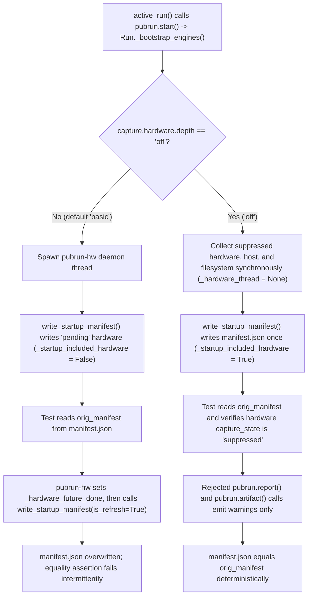

# IPD: Fix background pubrun-hw manifest refresh race in test_report_and_artifact_reject_blank_and_reserved_names_case_insensitively

- Date: 2026-11-27
- Kind: child
- Concern: Intermittent test failure in `tests/test_explicit_api.py::test_report_and_artifact_reject_blank_and_reserved_names_case_insensitively` (backlog item `7jd8g1`): calling `active_run()` leaves `capture.hardware.depth` at its default value (`"basic"`), which spawns the background `pubrun-hw` thread. That thread can call `ArtifactWriter.write_startup_manifest(is_refresh=True)` after the test snapshots `orig_manifest` and before the test asserts that `manifest.json` is unchanged.
- Scope: Update `tests/test_explicit_api.py::test_report_and_artifact_reject_blank_and_reserved_names_case_insensitively` to pass `capture={"hardware": {"depth": "off"}}` to `active_run(...)`, document the reason with a brief inline comment, and assert that `orig_manifest` records suppressed hardware capture before testing rejected report and artifact names. No production source files change.
- Scope-Paths: tests/test_explicit_api.py
- Item-Dependencies: none
- Status: to-review
- Short-Description: Pass capture.hardware.depth='off' in test_report_and_artifact_reject_blank_and_reserved_names_case_insensitively to prevent background pubrun-hw manifest refresh races
- Work-Kind: bug
- Priority: low
- From-Backlog: 7jd8g1
- Blocks-Release: next
- Set: 7jd8g1
- Order: 1
- Highest E allocated: 02
- Author: Antigravity
- Id: 8o6o83

> Write and proofread this plan per the technical writing standard, `.aw/system/workflows/technical-writing/technical-writing.md` (`.agents/workflows/technical-writing/technical-writing.md` in a legacy-layout install), including requirement 12 (diagrams).

## Workflow history

- 2026-11-27 to-review (Antigravity): Authored review-ready Implementation Plan Document (IPD) graduating backlog item 7jd8g1.
- 2026-11-27 draft (Antigravity): created.

## Goal

Eliminate the background `pubrun-hw` manifest refresh race in `tests/test_explicit_api.py::test_report_and_artifact_reject_blank_and_reserved_names_case_insensitively` so the test never flakes when asserting that rejected `pubrun.report()` and `pubrun.artifact()` calls leave `manifest.json` unchanged. Pass `capture={"hardware": {"depth": "off"}}` to `active_run(...)` so `Run._bootstrap_engines` collects hardware, host, and filesystem metadata synchronously, spawns no `pubrun-hw` thread, and writes startup `manifest.json` once.

### Startup hardware capture and manifest refresh flow



## Detailed Implementation Checklist (TODO)

Execution-state rule: mark an `E-*` item complete only after performing the action. That mark is not validation. Right-sizing rule: write for a modest executor that cannot hold much in its head. Each E-item is one step (one concern, about one file, executable in one focused pass) and its V-item names each unit it covers with its own check; a plan stays at about 5 E-items and 8 work Scope-Paths, else split it into more child plans (guidance, `IPD-Z603`). Accepted execution states: blocked, failed, pending, performed; terminal gate demands 'performed'.

### Task group 1: Disable background hardware refresh in the affected test

- [ ] E-01 Update `tests/test_explicit_api.py::test_report_and_artifact_reject_blank_and_reserved_names_case_insensitively` to disable background hardware capture before reading `orig_manifest`:
  - Change `tracker = active_run()` to `tracker = active_run(capture={"hardware": {"depth": "off"}})`.
  - Add a one-line comment directly above that call stating that disabling background `pubrun-hw` hardware capture prevents an asynchronous `write_startup_manifest(is_refresh=True)` overwrite of `manifest.json` before the equality check.
  - Immediately after reading `orig_manifest`, add `assert json.loads(orig_manifest)["hardware"]["capture_state"]["status"] == "suppressed"` to confirm through public manifest output that hardware capture was suppressed before the rejected `pubrun.report()` and `pubrun.artifact()` calls run.
  - Leave the `active_run` fixture, all other tests in `tests/test_explicit_api.py`, and all existing assertions in `test_report_and_artifact_reject_blank_and_reserved_names_case_insensitively` unchanged.
  - Depends on: none
  - Expected outcome: `test_report_and_artifact_reject_blank_and_reserved_names_case_insensitively` starts the run with `capture.hardware.depth == "off"`, confirms `"suppressed"` hardware status in `orig_manifest`, spawns no `pubrun-hw` thread, and never triggers `ArtifactWriter.write_startup_manifest(is_refresh=True)`.
  - Execution state: pending

### Task group 2: Validate race removal and test stability

- [ ] E-02 Run all commands listed in `## Required tests / validation` and capture their complete output:
  - Run the deterministic runtime probe confirming that `test_report_and_artifact_reject_blank_and_reserved_names_case_insensitively` exits `0`, spawns no `pubrun-hw` thread, and performs no `is_refresh=True` startup manifest write.
  - Run `tests/test_explicit_api.py` and `tests/test_startup_overhead_writes.py` with `pytest` in default order and with randomized order (`-p randomly`).
  - Depends on: E-01
  - Expected outcome: The runtime probe prints `NO_HW_RACE_OK` with exit `0`, and every `pytest` command passes with exit `0`.
  - Execution state: pending

## Project conventions discovered (Step 0)

- `tests/test_explicit_api.py::active_run` initializes `opts = {"console": {"capture_mode": "off"}}`, merges caller keyword arguments with `opts.update(kwargs)`, and delegates to `src/pubrun/core.py::start`. Passing `capture={"hardware": {"depth": "off"}}` flows directly into `Run` configuration without altering `active_run` for other tests.
- In `src/pubrun/tracker.py::Run._bootstrap_engines`, when `capture.hardware.depth != "off"` (the default `"basic"` from `src/pubrun/resources/default.toml`), `Run` spawns the daemon thread named `"pubrun-hw"` running `_collect_hardware`. Inside `_collect_hardware`, `self._hardware_future_done.set()` executes in the `finally` block *before* `_collect_hardware` acquires `_run_lock` and calls `writer.write_startup_manifest(is_refresh=True)`. Because `_hardware_future_done.set()` fires before the refresh write runs, waiting only on `_hardware_future_done` does not close the race window on `manifest.json`.
- By contrast, when `capture.hardware.depth == "off"`, `src/pubrun/tracker.py::Run._bootstrap_engines` runs `Run._collect_hardware_section` and `Run._collect_host_and_filesystem` synchronously, sets `self._hardware_thread = None`, sets `self._hardware_future_done`, and spawns no `"pubrun-hw"` thread. `src/pubrun/writer.py::ArtifactWriter.write_startup_manifest` then latches `hw_was_done = True`, writes `manifest.json` once with `hardware.capture_state.status == "suppressed"`, and sets `self._startup_included_hardware = True`.
- `tests/test_startup_overhead_writes.py::test_hardware_off_skips_thread_spawn_and_duplicate_startup_write` already verifies this contract for `capture={"hardware": {"depth": "off"}}`, and `tests/test_runtime_safety.py`, `tests/test_signals.py`, and `tests/test_package_lifecycle.py` already use `capture={"hardware": {"depth": "off"}}` to prevent background `pubrun-hw` interference in deterministic tests.
- `pyproject.toml` configures `addopts = "-p no:randomly"` for deterministic local runs and notes that continuous integration (CI) runs `pytest -p randomly`; running both orders verifies that test isolation holds under randomized execution.

## Findings

| ID | Concerns | Severity | Remediation Risk | Persona | Summary |
|---|---|---|---|---|---|
| `7J-01` | reliability; testing | Low | Low (`usability`) | Test Engineer | `tests/test_explicit_api.py::test_report_and_artifact_reject_blank_and_reserved_names_case_insensitively` calls `active_run()` with default `capture.hardware.depth = "basic"`, allowing the background `pubrun-hw` thread to overwrite `manifest.json` via `ArtifactWriter.write_startup_manifest(is_refresh=True)` between reading `orig_manifest` and asserting equality. |

## Proposed changes (ordered, validatable)

1. `E-01` (`tests/test_explicit_api.py`): Pass `capture={"hardware": {"depth": "off"}}` to `active_run(...)` inside `test_report_and_artifact_reject_blank_and_reserved_names_case_insensitively`, add a one-line explanatory comment, and assert `json.loads(orig_manifest)["hardware"]["capture_state"]["status"] == "suppressed"`.
2. `E-02` (validation): Execute the runtime spy probe and `pytest` commands (default and `-p randomly`) to verify that `pubrun-hw` never spawns, `write_startup_manifest(is_refresh=True)` never runs, and all targeted tests pass.

## Deferred / out of scope (with reason)

None. All requirements of backlog item `7jd8g1` are covered in this plan.

## Scope check

- Over-scope: none. Only `tests/test_explicit_api.py` is modified, and only `test_report_and_artifact_reject_blank_and_reserved_names_case_insensitively` is updated. Default options in `tests/test_explicit_api.py::active_run` and production code in `src/pubrun/tracker.py` and `src/pubrun/writer.py` remain unchanged: `active_run` uses a shallow `opts.update(kwargs)` merge whose callers pass `capture={"profiling": ...}`, and `capture.hardware.depth == "off"` already provides the synchronous single-write contract.
- Under-scope: none. Passing `capture={"hardware": {"depth": "off"}}` fully removes the `pubrun-hw` thread and its asynchronous `write_startup_manifest(is_refresh=True)` refresh before `orig_manifest` is snapshotted, which completely satisfies backlog item `7jd8g1`.

## Required tests / validation

1. Deterministic `pubrun-hw` and refresh-write probe:
   ```sh
   python3 -c 'import threading, pytest, pubrun.writer as writer_mod
   spawned, refreshes = [], []
   real_start = threading.Thread.start
   real_write = writer_mod.ArtifactWriter.write_startup_manifest
   def spy_start(self, *a, **kw):
       if self.name == "pubrun-hw":
           spawned.append(self.name)
       return real_start(self, *a, **kw)
   def spy_write(self, *a, is_refresh=False, **kw):
       if is_refresh:
           refreshes.append(True)
       return real_write(self, *a, is_refresh=is_refresh, **kw)
   threading.Thread.start = spy_start
   writer_mod.ArtifactWriter.write_startup_manifest = spy_write
   rc = pytest.main(["-q", "tests/test_explicit_api.py", "-k", "test_report_and_artifact_reject_blank_and_reserved_names_case_insensitively"])
   assert rc == 0, f"pytest exited {rc}"
   assert spawned == [], f"unexpected pubrun-hw spawn: {spawned}"
   assert refreshes == [], f"unexpected manifest refresh: {refreshes}"
   print("NO_HW_RACE_OK")'
   ```
2. Default-order targeted test run:
   ```sh
   python3 -m pytest tests/test_explicit_api.py tests/test_startup_overhead_writes.py -v
   ```
3. Randomized-order targeted test run (matching CI):
   ```sh
   python3 -m pytest -p randomly tests/test_explicit_api.py tests/test_startup_overhead_writes.py -v
   ```

## Spec / documentation sync

N/A. No user-facing command-line interface (CLI), public application programming interface (API), configuration key, or manifest schema changes.

## Open questions

None. Backlog item `7jd8g1` explicitly permits passing `hardware depth=off` before snapshotting `orig_manifest`. Inspection of `src/pubrun/tracker.py::Run._bootstrap_engines` confirms that waiting only on `_hardware_future_done` still leaves a race window because `_hardware_future_done.set()` runs before `writer.write_startup_manifest(is_refresh=True)`, whereas `capture={"hardware": {"depth": "off"}}` eliminates both the background thread and the refresh write.

## Validation and cross-check (verify before reporting done)

Validation-state rule: inspect evidence in a separate pass. Do not mark a `V-*` item complete from memory or from the matching execution checkmark. Accepted validation results: blocked, failed, pass, pending; terminal gate demands 'pass'. Runtime-demonstration reachability rule: for each `V-*` item demanding the software be observed acting (such as a run, a dispatch, or a transition), as distinct from items demanding a diff, a file's content, or a test result (which are reachable by construction), name the code path that produces the observation or the sibling `E-*` that creates it, else the demand is UNDER-SCOPE.

- [ ] V-01 validates E-01
  - Required evidence: Pasted output of `git diff -- tests/test_explicit_api.py` showing only the targeted edit in `test_report_and_artifact_reject_blank_and_reserved_names_case_insensitively` (`active_run(capture={"hardware": {"depth": "off"}})`, explanatory comment, and `hardware.capture_state.status == "suppressed"` assertion), plus pasted output of Command 1 from `## Required tests / validation` showing `1 passed` and `NO_HW_RACE_OK` with exit `0` (exercising `tests/test_explicit_api.py::test_report_and_artifact_reject_blank_and_reserved_names_case_insensitively` -> `src/pubrun/tracker.py::Run._bootstrap_engines` -> `src/pubrun/writer.py::ArtifactWriter.write_startup_manifest` updated in `E-01`).
  - Observed evidence:
  - Result: pending

- [ ] V-02 validates E-02
  - Required evidence: Pasted output of Command 2 (`python3 -m pytest tests/test_explicit_api.py tests/test_startup_overhead_writes.py -v`) and Command 3 (`python3 -m pytest -p randomly tests/test_explicit_api.py tests/test_startup_overhead_writes.py -v`), both exiting `0` and explicitly listing `test_report_and_artifact_reject_blank_and_reserved_names_case_insensitively` and `test_hardware_off_skips_thread_spawn_and_duplicate_startup_write` as `PASSED`.
  - Observed evidence:
  - Result: pending

## Approval and execution gate

- Size assessment: standard
- Cohesion rationale: not required

1. **Open questions and approval:** This plan is a proposal and must not be executed until all blocking open questions are resolved (none remain) and explicit human approval is recorded (`aw ipd set approved 8o6o83 --by-human`).
2. **Scope declaration:** `- Scope-Paths:` declares the exact file this plan modifies (`tests/test_explicit_api.py`). Do not expand scope; if execution appears to require touching an additional file, stop and report (or justify any approved delta at finalization with `--scope-reason` or `--scope-ack`).
3. **Validation honesty (hard requirement):** Every `V-*` item must paste actual runner output from this workspace confirming exit `0` and the required behavior; never claim passing tests that were not actually run.
4. **Commits and push policy:** Commit only files changed for this plan using `aw commit 8o6o83 -- tests/test_explicit_api.py` (never `git add -A`, bare `git add`, `git commit -a`, or raw `git commit`). Never push, tag, or publish.
5. **Lifecycle finalization:** On completion, finalize this plan to `.aw/records/plans/executed/` only after every `E-*` item is `performed` and every `V-*` item is `pass`. When run under `aw oc run` or `aw agy run`, the runner owns `aw ipd finalize 8o6o83`; when executed manually outside a runner, the executor runs `aw ipd finalize 8o6o83` (never hand-roll `git mv` to `executed/`).
