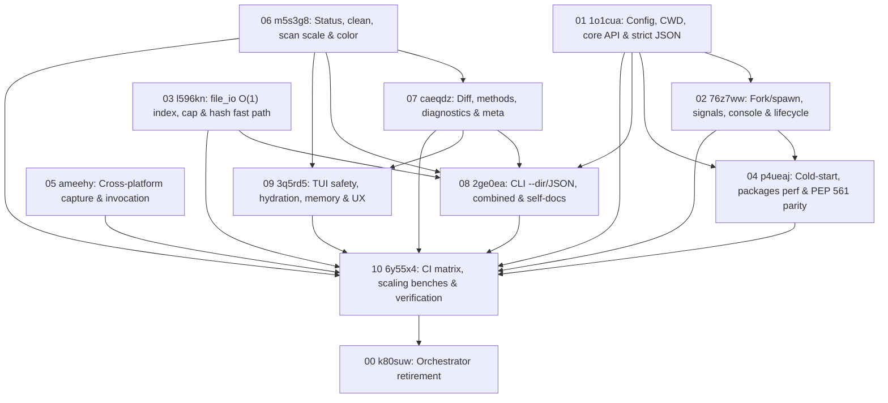

# IPD: Eight-lens cross-concern assessment rollup (UI/UX, self-docs, compat, edge-cases, functionality, perf, use-cases, memory)

- Date: 2026-11-27
- Kind: orchestrator
- Concern: Cross-concern `/assess-all` rollup across eight lenses (`ui-ux`, `self-documentation`, `compatibility`, `edge-cases`, `functionality`, `performance`, `use-cases`, `memory-resources`) on commit `2c87ae4` (post-v1.4.0 and post-`bej1qz`). The eight parallel audits surfaced 119 raw findings (de-duplicated to 37 actionable cross-concern items and 2 product-policy items routed to non-blocking open questions) covering host-script crash risks, POSIX `fork()` and `multiprocessing` `spawn` hazards, `O(N^2)` and unbounded growth in `file_io`, startup/package/run-scan performance bottlenecks, Windows/ARM64/ROCm/PEP 561 compatibility defects, `methods`/diff/diagnostics correctness bugs, CLI `--dir`/JSON/self-documentation gaps, and TUI safety/hydration/responsiveness defects.
- Scope: Coordination of ten right-sized child plans for Set `assess-8l`: `1o1cua` (config, CWD, artifact-write safety, strict JSON, core API ergonomics), `76z7ww` (fork/spawn, signal, console, subprocess, and lifecycle resource safety), `l596kn` (`file_io` O(1) indexing, record cap, and streaming-hash fast path), `p4ueaj` (cold-start import, package-capture optimization, and PEP 561 mode parity), `ameehy` (cross-platform hardware, liveness, invocation, environment, git, filesystem, and redaction compatibility), `m5s3g8` (status, clean, and run-scanning safety, scalability, and terminal output), `caeqdz` (diff, methods, diagnostics, and meta-snapshot correctness and streaming), `2ge0ea` (CLI ergonomics, `--dir`/`PUBRUN_OUTPUT_DIR`, `--json`, streaming `combined`, self-documenting help, and config defaults), `3q5rd5` (TUI safety, `meta_ref` hydration, memory/responsiveness, and usability), and `6y55x4` (CI matrix expansion, local scaling benchmarks, README sync, and whole-Set verification). This orchestrator modifies no product code, tests, docs, or CI files.
- Scope-Paths: .aw/records/plans/pending/20261127-assess-8l-00-k80suw-eight-lens-cross-concern-assessment-rollup-ui-ux-self-docs-c.ipd.md
- Item-Dependencies: executed:1o1cua, executed:76z7ww, executed:l596kn, executed:p4ueaj, executed:ameehy, executed:m5s3g8, executed:caeqdz, executed:2ge0ea, executed:3q5rd5, executed:6y55x4
- Status: to-review
- Coverage: pass
- Coverage-Fingerprint: cbd3dc0be8a12e3b879eb6a0ad58108a86d1a6241776c6e7796f94234f220f82
- Coverage-Checked: 2026-11-27 by uri/its_direct/pt3-claude-opus-5.5-1m-us
- Review-Depth: orchestrator
- Short-Description: Orchestrate the 10-child cross-concern hardening and performance IPD Set from the 8-lens /assess-all rollup
- Work-Kind: bug
- Priority: high
- Set: assess-8l
- Order: 0
- Highest E allocated: 10
- Author: Antigravity
- Id: k80suw

> Write and proofread this plan per the technical writing standard, `.aw/system/workflows/technical-writing/technical-writing.md`, including requirement 12 (diagrams).

## Workflow history

- 2026-11-27 coverage pass (aw oc run): fingerprint cbd3dc0be8a1, model uri/its_direct/pt3-claude-opus-5.5-1m-us
- 2026-11-27 /assess-all (Antigravity): rolled up ui-ux, self-documentation, compatibility, edge-cases, functionality, performance, use-cases, memory-resources; proposed 37 de-duplicated changes across 10 right-sized child plans (Set assess-8l; rollup record `.aw/workflow-artifacts/assess-all/20261127-092500/`).

## Goal

Deliver all 37 actionable, de-duplicated findings from the eight-lens `/assess-all` rollup (`ui-ux`, `self-documentation`, `compatibility`, `edge-cases`, `functionality`, `performance`, `use-cases`, `memory-resources`) through ten bounded, independently testable child plans with explicit dependency edges and serialized shared file scopes.

### Set dependency architecture

## Detailed Implementation Checklist (TODO)

Execution-state rule: mark an `E-*` item complete only after performing the action. That mark is not validation. Right-sizing rule: each child plan stays bounded around 4 to 5 E-items and cohesive Scope-Paths. Accepted execution states: blocked, failed, pending, performed; terminal gate demands `performed`.

### Task group 1: Child plan execution confirmation

- [ ] E-01 CONFIRM 1o1cua REACHED executed
  - Depends on: none
  - Expected outcome: `.aw/records/plans/executed/20261127-assess-8l-01-1o1cua-config-cwd-artifact-write-safety-strict-json-and-core-api-er.ipd.md` exists with `- Status: executed`, all `E-*` performed, and all `V-*` passed.
  - Execution state: pending

- [ ] E-02 CONFIRM 76z7ww REACHED executed
  - Depends on: E-01
  - Expected outcome: `.aw/records/plans/executed/20261127-assess-8l-02-76z7ww-fork-spawn-signal-console-subprocess-and-lifecycle-resource.ipd.md` exists with `- Status: executed`, all `E-*` performed, and all `V-*` passed.
  - Execution state: pending

- [ ] E-03 CONFIRM l596kn REACHED executed
  - Depends on: none
  - Expected outcome: `.aw/records/plans/executed/20261127-assess-8l-03-l596kn-file-i-o-o-1-indexing-record-cap-and-streaming-hash-fast-pat.ipd.md` exists with `- Status: executed`, all `E-*` performed, and all `V-*` passed.
  - Execution state: pending

- [ ] E-04 CONFIRM p4ueaj REACHED executed
  - Depends on: E-01, E-02
  - Expected outcome: `.aw/records/plans/executed/20261127-assess-8l-04-p4ueaj-cold-start-import-package-capture-optimization-and-pep-561-m.ipd.md` exists with `- Status: executed`, all `E-*` performed, and all `V-*` passed.
  - Execution state: pending

- [ ] E-05 CONFIRM ameehy REACHED executed
  - Depends on: none
  - Expected outcome: `.aw/records/plans/executed/20261127-assess-8l-05-ameehy-cross-platform-hardware-liveness-invocation-environment-git.ipd.md` exists with `- Status: executed`, all `E-*` performed, and all `V-*` passed.
  - Execution state: pending

- [ ] E-06 CONFIRM m5s3g8 REACHED executed
  - Depends on: none
  - Expected outcome: `.aw/records/plans/executed/20261127-assess-8l-06-m5s3g8-status-clean-and-run-scanning-safety-scalability-and-termina.ipd.md` exists with `- Status: executed`, all `E-*` performed, and all `V-*` passed.
  - Execution state: pending

- [ ] E-07 CONFIRM caeqdz REACHED executed
  - Depends on: E-06
  - Expected outcome: `.aw/records/plans/executed/20261127-assess-8l-07-caeqdz-diff-methods-diagnostics-and-meta-snapshot-correctness-and-s.ipd.md` exists with `- Status: executed`, all `E-*` performed, and all `V-*` passed.
  - Execution state: pending

- [ ] E-08 CONFIRM 2ge0ea REACHED executed
  - Depends on: E-01, E-03, E-06, E-07
  - Expected outcome: `.aw/records/plans/executed/20261127-assess-8l-08-2ge0ea-cli-ergonomics-dir-pubrun-output-dir-json-output-streaming-c.ipd.md` exists with `- Status: executed`, all `E-*` performed, and all `V-*` passed.
  - Execution state: pending

- [ ] E-09 CONFIRM 3q5rd5 REACHED executed
  - Depends on: E-06, E-07
  - Expected outcome: `.aw/records/plans/executed/20261127-assess-8l-09-3q5rd5-tui-safety-meta-ref-hydration-memory-responsiveness-and-usab.ipd.md` exists with `- Status: executed`, all `E-*` performed, and all `V-*` passed.
  - Execution state: pending

- [ ] E-10 CONFIRM 6y55x4 REACHED executed
  - Depends on: E-01, E-02, E-03, E-04, E-05, E-06, E-07, E-08, E-09
  - Expected outcome: `.aw/records/plans/executed/20261127-assess-8l-10-6y55x4-ci-compatibility-matrix-scaling-benchmarks-and-whole-set-ver.ipd.md` exists with `- Status: executed`, all `E-*` performed, and all `V-*` passed.
  - Execution state: pending

## Child IPDs, sequence, and dependencies

| Order | Id | File | What it does | Depends on |
|---|---|---|---|---|
| 01 | `1o1cua` | `20261127-assess-8l-01-1o1cua-config-cwd-artifact-write-safety-strict-json-and-core-api-er.ipd.md` | Harden deleted-CWD, non-UTF-8/malformed TOML, reserved artifact writes, strict JSON (`NaN`/`Inf`), manual subprocess wrappers, `phase` profiling/filenames, `_inactive_policy` TTL, cached `pubrun.print()` handle, `_config_version` caching, `CallableModule` docs, and `tracked_run` properties. | none |
| 02 | `76z7ww` | `20261127-assess-8l-02-76z7ww-fork-spawn-signal-console-subprocess-and-lifecycle-resource.ipd.md` | Fix POSIX `fork()` FD flush/lock/`SubprocessSpy` hazards, `multiprocessing` `spawn`/`forkserver` run storms, `_merge_and_migrate` self-move and lock races, `TqdmSafeTee` `writelines`/perf/cleanup lock, lethal `SIGUSR1`/`SIGUSR2`, `signal.raise_signal`, `_signals_received` cap, Windows `shlex`, `ResourceWatcher` bounds, and `pubrun-hw` thread bound. | 01 |
| 03 | `l596kn` | `20261127-assess-8l-03-l596kn-file-i-o-o-1-indexing-record-cap-and-streaming-hash-fast-pat.ipd.md` | Replace `O(N^2)` linear scans in `capture/file_io.py` with `O(1)` indexes, add `[capture.file_io].max_tracked_files` cap (default `5000`) with `records_truncated` accounting, optimize zero-cap streaming hash fast path, and bound `_warned_invalid_algorithms`. | none |
| 04 | `p4ueaj` | `20261127-assess-8l-04-p4ueaj-cold-start-import-package-capture-optimization-and-pep-561-m.ipd.md` | Defer `__version__` via PEP 562 `__getattr__`, lazy-import `tracker` and capture engines, eliminate 3x `METADATA` reads and eager `RECORD` parsing in `packages.py`, fix PEP 561 `__all__`/`__commit__` parity across all 6 mode modules, fix `nopatch.py` docstring, and close pipes in `_resolve_checkout_commit`. | 01, 02 |
| 05 | `ameehy` | `20261127-assess-8l-05-ameehy-cross-platform-hardware-liveness-invocation-environment-git.ipd.md` | Replace Windows `wmic` with `ctypes`/`winreg` in `hardware.py`, add ARM64 CPU and AMD ROCm GPU fallbacks, parse macOS VRAM, cache Windows `WinDLL`/`Structure` and add `LC_ALL=C` in `liveness.py`, fix `invocation.py` (`sys.executable`, `-m`, `--flag=path`, Jupyter `notebook`, `compute_md5` cap), harden `environment.py`, `git.py`, `filesystem.py`, and iterative `redaction.py`. | none |
| 06 | `m5s3g8` | `20261127-assess-8l-06-m5s3g8-status-clean-and-run-scanning-safety-scalability-and-termina.ipd.md` | Fail closed on `limit <= 0` in `filter_runs`, add `--force-remote-locks` and shared safe-delete helper, validate `--status`/`-S`, fix completed-run event/log stats and onboarding copy, adopt `os.scandir()` + `keep_manifest=False` + `#1000+` alignment, and centralize TTY-aware `use_color` without `DIM` plus ASCII fallbacks. | none |
| 07 | `caeqdz` | `20261127-assess-8l-07-caeqdz-diff-methods-diagnostics-and-meta-snapshot-correctness-and-s.ipd.md` | Fix `methods.py` GPUs, non-highlighted packages, Zenodo DOI, and 10-char LaTeX escaping; fix cross-OS diff, compiled ignores, `O(N)` `_format_array_diff`, `NaN`/multiset, inline `(no differences)` & `-/+`; stream `show logs`, O(1) timeline & chart/duration guards, unknown section error; write `meta.json` atomically with setup instructions. | 06 |
| 08 | `2ge0ea` | `20261127-assess-8l-08-2ge0ea-cli-ergonomics-dir-pubrun-output-dir-json-output-streaming-c.ipd.md` | Add `--dir` across all run-reading subcommands + `PUBRUN_OUTPUT_DIR` + `$VAR`/`~` expansion, add `status --json`/`diff --json`, wire `[methods].format` + stderr banners, stream `_run_combined` with `heapq.merge` + `AmbiguousRunSelectorError` handling, fix `bench` tips/groups/bounds, sync `default.toml` comments, unify `RUN` help & bare-`pubrun` quick start, warn on future `schema_version`, and pass UTF-8 to `git`/`gh`. | 01, 03, 06, 07 |
| 09 | `3q5rd5` | `20261127-assess-8l-09-3q5rd5-tui-safety-meta-ref-hydration-memory-responsiveness-and-usab.ipd.md` | Add confirmation modal and stderr capture on TUI `Execute Prune`, guard single-run delete with shared safe-delete helper, hydrate `meta_ref` across all detail panes, switch sidebar search to in-memory filtering, fix `LogViewer` double-read/unbounded-read/`Wrap Text`, make `ConfigPanel` atomic with regex check and clear labels, fix `DiffView` defaults/rendering, and fix 80x24 layout and keybindings. | 06, 07 |
| 10 | `6y55x4` | `20261127-assess-8l-10-6y55x4-ci-compatibility-matrix-scaling-benchmarks-and-whole-set-ver.ipd.md` | Expand CI for `<3.11` `no-tui`/`tomli`, Windows packaging wheel smoke, `[bench]` extra, downstream `mypy --strict` mode-module check, and `tomli`/`[tui]` audit; add stdlib local scaling benchmark script; fix `README.md` Windows RSS note and `docs/cli.md` `pubrun run` wording; run whole-Set verification. | 01, 02, 03, 04, 05, 06, 07, 08, 09 |

## Completion criteria (the whole Set is done only when)

- Config, CWD, artifact-write safety, strict JSON, subprocess wrapper guards, `phase` profiling safety, `_inactive_policy` TTL, `_config_version` caching, `CallableModule` docs, and `tracked_run` properties are implemented and tested. Owner: `1o1cua`.
- POSIX `fork()`, `multiprocessing` `spawn`/`forkserver`, `_merge_and_migrate`, `TqdmSafeTee`, lethal signals (`SIGUSR1`/`SIGUSR2`/`raise_signal`), Windows `shlex`, `ResourceWatcher` bounds, and `pubrun-hw` concurrency bounds are implemented and tested. Owner: `76z7ww`.
- `file_io` uses `O(1)` dedup/pending indexes, enforces `[capture.file_io].max_tracked_files` with truncation accounting, and fast-paths uncapped streaming hashes. Owner: `l596kn`.
- Cold-start `import pubrun.minimal`, package capture `METADATA`/`RECORD` reads, PEP 561 mode-submodule exports (`mypy --strict`), `nopatch.py` docstring, and `_resolve_checkout_commit` pipe cleanup are implemented and verified. Owner: `p4ueaj`.
- Cross-platform capture (`hardware`, `liveness`, `invocation` including Jupyter and `-m`, `environment`, `git`, `filesystem`, `redaction`) works without Windows `wmic`, supports ARM64 CPU and ROCm GPU fallbacks, and handles non-UTF-8 locales and deeply nested JSON. Owner: `ameehy`.
- `status.py` and `report/output.py` enforce fail-closed `limit <= 0`, remote-lock clean safety with `--force-remote-locks`, `VALID_STATUSES`, completed-run event/log counts, `os.scandir()`/`keep_manifest=False`, `#1000+` consistency, TTY-aware color without `DIM`, and ASCII fallbacks. Owner: `m5s3g8`.
- `diff.py`, `render.py`, `methods.py`, `diagnostics.py`, `meta_snapshot.py`, and `report/utils.py` fix GPUs/stdlib/DOI/LaTeX in methods, cross-OS and `O(N)` diffing, streaming logs and O(1) timelines, numeric chart/duration guards, and atomic `meta.json` with setup guidance. Owner: `caeqdz`.
- CLI (`__main__.py`, `config.py`, `default.toml`, `reproducibility.py`, `_bench/harness.py`) delivers consistent `--dir`/`PUBRUN_OUTPUT_DIR`, `status`/`diff` `--json`, streaming `combined`, fixed `bench` tips/validation, synced `default.toml` comments, self-documenting help/errors, and future `schema_version` warnings. Owner: `2ge0ea`.
- TUI delivers confirmed bulk prune, guarded single-run delete, hydrated `meta_ref` across all views, in-memory search, single bounded log reads with working wrap toggle, atomic validated `ConfigPanel`, standard `DiffView`, and responsive 80x24 layout. Owner: `3q5rd5`.
- CI matrix, local scaling benchmarks, `README.md`/`docs/cli.md` accuracy updates, full `pytest` with coverage, three-platform `mypy`, downstream `mypy --strict` mode check, wheel build + `twine check --strict`, and `sanitize_paths.py` all pass. Owner: `6y55x4`.

## Cross-IPD validation

- Shared Scope-Paths are strictly serialized across dependency edges: `config.py` (`1o1cua` -> `2ge0ea`), `default.toml` (`l596kn` -> `2ge0ea`), `report/output.py` & `status.py` (`m5s3g8` -> `caeqdz`, `2ge0ea`, `3q5rd5`), `core.py` -> `tracker.py` (`1o1cua` -> `76z7ww` -> `p4ueaj`).
- Child `6y55x4` (Order 10) runs the full repository test suite, three-platform `mypy`, downstream PEP 561 `mypy --strict`, wheel/sdist build + `twine check --strict`, local scaling benchmarks, and `scripts/sanitize_paths.py --check --all` on the combined state of children 01 through 09.

## Deferred / out of scope (with reason)

- Changing default `[core].artifact_durability` from `"fsync"` to `"finalize"` (`PERF-8` / `ROLL-38`) carries Medium-High usability/durability-expectation risk; `_config_version` caching ships in `1o1cua` while the default durability switch awaits maintainer decision (OQ-2).
  - Carrier-Declined: Product policy decision (OQ-2); no autonomous change authorized without explicit maintainer choice.
- Additive v1.5.0 feature expansions (`ROLL-39`: zero-touch `sitecustomize.py` injection in `pubrun run`, CLI `pubrun export`/`archive --redacted`/`--requirements`, `--newer-than`/`--commit`/run tagging, structured Slurm/PBS/LSF/SGE job fields & `PUBRUN_RANK_ZERO_ONLY`, Jupyter `%%pubrun` cell magics, optional `git diff` capture, container cgroup quotas) carry Medium-High usability/scope risk and await maintainer scope selection (OQ-1, OQ-5).
  - Carrier-Declined: Product scope decision (OQ-1, OQ-5); maintainer will file targeted backlog items only for selected features.

## Scope check

- Over-scope: none. Every child plan maps directly to concrete, evidence-verified findings in `.aw/workflow-artifacts/assess-all/20261127-092500/findings.csv`, and all product-policy choices are routed to Open Questions rather than assumed.
- Under-scope: none. Every one of the 37 actionable cross-concern items (`ROLL-01`..`ROLL-37`) is assigned to an explicit child plan in `## Child IPDs, sequence, and dependencies`.

## Required tests / validation

This orchestrator executes no commands directly. Children `1o1cua` through `3q5rd5` run their targeted tests and `mypy`, and child `6y55x4` runs the whole-Set verification suite (`pytest tests/ -p randomly --cov=src --cov-fail-under=78`, `mypy` across Linux/`win32`/`darwin`, downstream `mypy --strict`, wheel/sdist build + `twine check --strict`, local scaling benchmarks, and `scripts/sanitize_paths.py --check --all`).

## Open questions

1. Should `pubrun run -- python script.py` inject `pubrun` into scripts lacking `import pubrun` via a temporary chaining `sitecustomize.py`, or stay strictly an import-mode override wrapper?
   - Blocking: no
   - Default in Set `assess-8l`: Fix misleading onboarding copy and help text now (`m5s3g8`, `2ge0ea`, `6y55x4`); do not add injection unless approved.
2. Should default `[core].artifact_durability` switch from `"fsync"` (4 fsyncs/run) to `"finalize"` (1-2 fsyncs/run)?
   - Blocking: no
   - Default in Set `assess-8l`: Keep `"fsync"` default; ship `_config_version` caching in `1o1cua`.
3. Should `_is_meta_ref_allowed()` trust `manifest_dir.parent / "meta.json"` automatically, or keep strict `manifest_dir`-only confinement?
   - Blocking: no
   - Default in Set `assess-8l`: Keep strict security confinement and print exact `PUBRUN_META_REF` and `[report]` instructions in `caeqdz`.
4. Should `[core].auto_start` be deprecated in favor of `[imports].mode` and roadmap-removed/reserved keys dropped from `default.toml`?
   - Blocking: no
   - Default in Set `assess-8l`: Clarify precedence and mark reserved keys accurately in `default.toml` (`2ge0ea`) without breaking existing configs.
5. Which additive v1.5.0 features (`pubrun export --redacted`/`--requirements`, `--newer-than`/`--commit`/tags, `PUBRUN_RANK_ZERO_ONLY`/scheduler fields, Jupyter `%%pubrun`, `[capture.git].capture_diff`, container cgroup quotas) should be filed as follow-up backlog items?
   - Blocking: no
   - Default in Set `assess-8l`: Excluded from this hardening Set pending maintainer selection.
6. Keep `requires-python = ">=3.8"` across `1.x` and add major-version upper bounds on `[tui]` (`textual<9`, `rich<16`)?
   - Blocking: no
   - Default in Set `assess-8l`: Keep `>=3.8`, document `[tui]` `>=3.8.1` floor, and verify CI matrix in `6y55x4`.
7. Retain `[Y/n]` on `pubrun bench` GitHub contribution prompt (2026-07-22 decision) or flip to `[y/N]`?
   - Blocking: no
   - Default in Set `assess-8l`: Retain `[Y/n]` per recorded maintainer decision.

## Validation and cross-check (verify before reporting the Set complete)

Validation-state rule: inspect evidence in a separate pass. Accepted validation results: blocked, failed, pass, pending; terminal gate demands `pass`.

- [ ] V-01 validates E-01
  - Required evidence: Pasted confirmation that `.aw/records/plans/executed/20261127-assess-8l-01-1o1cua-config-cwd-artifact-write-safety-strict-json-and-core-api-er.ipd.md` exists with `- Status: executed`, all `E-*` performed, all `V-*` passed, and `aw ipd lint --phase post-transition` passing.
  - Observed evidence:
  - Result: pending

- [ ] V-02 validates E-02
  - Required evidence: Pasted confirmation that `.aw/records/plans/executed/20261127-assess-8l-02-76z7ww-fork-spawn-signal-console-subprocess-and-lifecycle-resource.ipd.md` exists with `- Status: executed`, all `E-*` performed, all `V-*` passed, and `aw ipd lint --phase post-transition` passing.
  - Observed evidence:
  - Result: pending

- [ ] V-03 validates E-03
  - Required evidence: Pasted confirmation that `.aw/records/plans/executed/20261127-assess-8l-03-l596kn-file-i-o-o-1-indexing-record-cap-and-streaming-hash-fast-pat.ipd.md` exists with `- Status: executed`, all `E-*` performed, all `V-*` passed, and `aw ipd lint --phase post-transition` passing.
  - Observed evidence:
  - Result: pending

- [ ] V-04 validates E-04
  - Required evidence: Pasted confirmation that `.aw/records/plans/executed/20261127-assess-8l-04-p4ueaj-cold-start-import-package-capture-optimization-and-pep-561-m.ipd.md` exists with `- Status: executed`, all `E-*` performed, all `V-*` passed, and `aw ipd lint --phase post-transition` passing.
  - Observed evidence:
  - Result: pending

- [ ] V-05 validates E-05
  - Required evidence: Pasted confirmation that `.aw/records/plans/executed/20261127-assess-8l-05-ameehy-cross-platform-hardware-liveness-invocation-environment-git.ipd.md` exists with `- Status: executed`, all `E-*` performed, all `V-*` passed, and `aw ipd lint --phase post-transition` passing.
  - Observed evidence:
  - Result: pending

- [ ] V-06 validates E-06
  - Required evidence: Pasted confirmation that `.aw/records/plans/executed/20261127-assess-8l-06-m5s3g8-status-clean-and-run-scanning-safety-scalability-and-termina.ipd.md` exists with `- Status: executed`, all `E-*` performed, all `V-*` passed, and `aw ipd lint --phase post-transition` passing.
  - Observed evidence:
  - Result: pending

- [ ] V-07 validates E-07
  - Required evidence: Pasted confirmation that `.aw/records/plans/executed/20261127-assess-8l-07-caeqdz-diff-methods-diagnostics-and-meta-snapshot-correctness-and-s.ipd.md` exists with `- Status: executed`, all `E-*` performed, all `V-*` passed, and `aw ipd lint --phase post-transition` passing.
  - Observed evidence:
  - Result: pending

- [ ] V-08 validates E-08
  - Required evidence: Pasted confirmation that `.aw/records/plans/executed/20261127-assess-8l-08-2ge0ea-cli-ergonomics-dir-pubrun-output-dir-json-output-streaming-c.ipd.md` exists with `- Status: executed`, all `E-*` performed, all `V-*` passed, and `aw ipd lint --phase post-transition` passing.
  - Observed evidence:
  - Result: pending

- [ ] V-09 validates E-09
  - Required evidence: Pasted confirmation that `.aw/records/plans/executed/20261127-assess-8l-09-3q5rd5-tui-safety-meta-ref-hydration-memory-responsiveness-and-usab.ipd.md` exists with `- Status: executed`, all `E-*` performed, all `V-*` passed, and `aw ipd lint --phase post-transition` passing.
  - Observed evidence:
  - Result: pending

- [ ] V-10 validates E-10
  - Required evidence: Pasted confirmation that `.aw/records/plans/executed/20261127-assess-8l-10-6y55x4-ci-compatibility-matrix-scaling-benchmarks-and-whole-set-ver.ipd.md` exists with `- Status: executed`, all `E-*` performed, all `V-*` passed, and `aw ipd lint --phase post-transition` passing.
  - Observed evidence:
  - Result: pending

## Approval and execution gate

This orchestrator and its ten child plans are proposals created by `/assess-all`. None of the plans execute automatically: each plan must be reviewed (`/plan-review` or `aw agy review`) and explicitly approved by a human (`aw set plan approved ... --by-human`) before execution. On completion, the runner retires this orchestrator to `.aw/records/plans/executed/` once all ten children reach `executed`.
