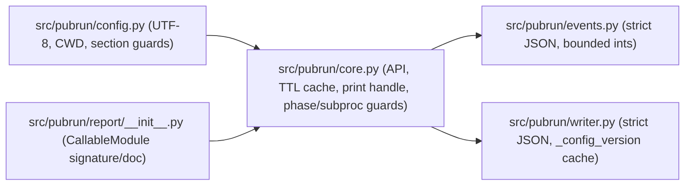

# IPD: Config, CWD, artifact-write safety, strict JSON, and core API ergonomics

- Date: 2026-11-27
- Kind: child
- Concern: Eight-lens rollup findings `ROLL-03`, `ROLL-04` (config/events), `ROLL-07`, `ROLL-12` (`CallableModule`), `ROLL-29` (`pubrun.print` handle), `ROLL-33` (manual subprocess & `phase` profiling/filenames), and `ROLL-36` (`tracked_run`, unknown `start()` kwargs, `pubrun.diff` parity, `_inactive_policy` TTL, `_config_version` caching, API docstrings), surfaced by `edge-cases`, `memory-resources`, `performance`, `ui-ux`, and `self-documentation`.
- Scope: Harden `src/pubrun/config.py`, `src/pubrun/core.py`, `src/pubrun/events.py`, `src/pubrun/writer.py`, and `src/pubrun/report/__init__.py` against deleted CWD, non-UTF-8/malformed TOML, reserved artifact overwrites, non-finite JSON, unguarded subprocess wrappers, `phase` profiling races/collisions, syscall churn on inactive API calls, and API ergonomics/docstring gaps, with regression tests in `tests/test_edge_cases.py` and `tests/test_explicit_api.py`.
- Scope-Paths: src/pubrun/config.py, src/pubrun/core.py, src/pubrun/events.py, src/pubrun/writer.py, src/pubrun/report/__init__.py, tests/test_edge_cases.py, tests/test_explicit_api.py
- Item-Dependencies: none
- Status: to-review
- Review-Depth: complex
- Short-Description: Harden deleted-CWD, non-UTF-8/malformed TOML, reserved artifact writes, NaN/Inf JSON, subprocess wrappers, yappi locks, inactive-policy TTL, and core API ergonomics
- Work-Kind: bug
- Priority: high
- Set: assess-8l
- Order: 1
- Highest E allocated: 05
- Author: Antigravity
- Id: 1o1cua

> Write and proofread this plan per the technical writing standard, `.aw/system/workflows/technical-writing/technical-writing.md`, including requirement 12 (diagrams).

## Workflow history

- 2026-11-27 /assess-all (Antigravity): created Child 01 of Set `assess-8l` covering config/CWD/core-API/JSON/writer hardening (`ROLL-03`, `ROLL-04`, `ROLL-07`, `ROLL-12`, `ROLL-29`, `ROLL-33`, `ROLL-36`).

## Goal

Ensure configuration loading, `events.py`, `writer.py`, and public `pubrun.core` APIs never crash host code on deleted working directories, non-UTF-8 or malformed TOML files, non-finite floats, or concurrent `phase`/subprocess calls, while protecting core run artifacts from overwrite, reducing redundant I/O and config serialization, and restoring accurate API signatures and docstrings.

### Component interaction overview

## Detailed Implementation Checklist (TODO)

Execution-state rule: mark an `E-*` item complete only after performing the action. Accepted execution states: blocked, failed, pending, performed; terminal gate demands `performed`.

### Task group 1: Config and strict JSON hardening

- [ ] E-01 Harden `src/pubrun/config.py` for deleted CWD, non-UTF-8 TOML, and malformed section types:
  - In `_safe_load_toml()`, catch `(tomllib.TOMLDecodeError, UnicodeDecodeError)` in addition to `OSError`, logging a warning and returning `None` instead of crashing.
  - In `load_local_config()`, wrap `Path.cwd()` in `try/except OSError` and return `None` when CWD is unavailable.
  - Add a shared `_section(cfg, key) -> dict` helper (returning `{}` when `cfg.get(key)` is not a `dict`) and apply it in `_resolve_layers()` (including `core = overrides.get("core")` before `.update(flat_core)`), `profile_deprecation_notice()`, and config lookups.
  - Depends on: none
  - Expected outcome: Deleted CWD, UTF-16 BOM/corrupt `.pubrun.toml`, and scalar TOML sections (`core = "bad"`, `events = false`) degrade safely to defaults with warnings.
  - Execution state: pending

- [ ] E-02 Harden `src/pubrun/events.py` and `src/pubrun/writer.py` for strict RFC 8259 JSON, validated event bounds, and `_config_version` caching:
  - Add a shared finite-float sanitizer helper (converting `NaN`/`Inf`/`-Inf` to `None`) and serialize with `allow_nan=False` in `events.py::EventStream.emit()`, `writer.py::_atomic_json_write()`, and `writer.py::_serialize_config_and_digest()`.
  - Validate `max_tracked_events` (non-negative `int`, excluding `bool`) and `flush_interval_events` (`int >= 1`, excluding `bool`) in `EventStream.__init__()`, falling back to defaults on malformed values.
  - Track a `_config_version` counter (or cached config identity) in `writer.py::_write_config_if_needed()` so unchanged `run.config` is not re-serialized and SHA-256 hashed 3 times per run.
  - Cap `_warned_invalid_durability` in `writer.py` at 256 entries.
  - Depends on: E-01
  - Expected outcome: Non-finite floats never emit invalid JSON; bad event config bounds fall back safely; unchanged config serializes once per run.
  - Execution state: pending

### Task group 2: Core API safety, performance, and ergonomics

- [ ] E-03 Protect reserved core artifacts, guard manual subprocess wrappers, and harden `phase` profiling and filenames in `src/pubrun/core.py`:
  - In `report()` and `artifact()`, reject empty/whitespace names and any resolved path matching reserved top-level run files (`manifest.json`, `config.resolved.json`, `.pubrun.lock`, `events.jsonl`, `stdout.log`, `stderr.log`), logging a warning without raising. Serialize `report()` JSON through the finite-float sanitizer with `allow_nan=False, default=str`.
  - Wrap provenance-recording calls in `_PubrunSubprocessNamespace.run()`, `Popen`, and `popen()` in `try/except Exception` so host return values and exceptions are never altered; guard `manual_subprocess_records` with a lock and enforce `max_tracked_commands == 0` as "record 0" (matching `SubprocessSpy`).
  - Guard `phase._yappi_active` and `run._active_profilers` with locks, assign `self._profiler = prof` only after `prof.enable()` succeeds, record yappi ownership for rollback cleanup, cap `_safe_phase_filename()` to 80 chars plus short hash when truncated, and disambiguate colliding `.prof` filenames (`profile-<name>-2.prof`, etc.).
  - Depends on: E-01, E-02
  - Expected outcome: Core artifacts cannot be clobbered by user `report()`/`artifact()` calls; subprocess wrappers never replace host exceptions; concurrent/nested/repeated `phase` profiling is race-free and collision-free.
  - Execution state: pending

- [ ] E-04 Optimize `_inactive_policy()` and `pubrun.print()`, and improve core API ergonomics and docstrings in `src/pubrun/core.py` and `src/pubrun/report/__init__.py`:
  - Guard `Path.cwd()` with `OSError` in `_inactive_policy()`, handle non-dict `[events]` sections, and cache the filesystem stat signature with a short monotonic TTL (1.0 s) invalidated on `start()`/`stop()` while preserving monkeypatch detection in memory.
  - Cache a lazily opened locked append handle on `Run` for `pubrun.print()` when console tee is `"off"`, instead of opening and closing `stdout.log` on every call.
  - Add pass-through properties (`run_dir`, `run_id`, `config`, `is_active`, `started_at_utc`) on `tracked_run` delegating to `self.run_tracker`.
  - Emit a `logging.getLogger("pubrun").warning(...)` on unrecognized top-level override keys passed to `start(**kwargs)`; add `depth="standard"` and `show_same=False` parameters to `pubrun.diff()` and align its default with `compare_manifests(..., depth=depth)`.
  - Restore accurate docstring and explicit `(self, name: str, data: Any) -> None` signature on `src/pubrun/report/__init__.py::CallableModule`; update stale `pubrun report` references to `pubrun show`; add concise `Args:`/`Returns:`/`Example:` docstrings to `start`, `subprocess.run`, `subprocess.Popen`, `popen`, `open`, `report`, `artifact`, `register_file`, `register_input`, `register_output`, and improve actionable error hints in `_handle_inactive`, `diff`, and `phase.__enter__`.
  - Depends on: E-03
  - Expected outcome: Inactive `annotate()` syscall count drops by >99% in loops; `pubrun.print()` reuses one handle; `help(pubrun.report)` and `inspect.signature(pubrun.report)` are accurate; `tracked_run`, `start`, and `diff` ergonomics are consistent.
  - Execution state: pending

### Task group 3: Regression tests

- [ ] E-05 Add comprehensive unit and concurrency tests in `tests/test_edge_cases.py` and `tests/test_explicit_api.py`:
  - Cover deleted CWD (`resolve_config`, inactive `annotate`), UTF-16/corrupt `.pubrun.toml`, scalar TOML sections, malformed `EventStream` bounds, `NaN`/`Inf` sanitization in `events.py`/`writer.py`/`report()`, reserved filename rejection in `report()`/`artifact()`, manual subprocess wrapper error isolation and `cap=0`, nested/concurrent/repeated `phase` profiling and long phase names, `CallableModule` signature/docstring, `tracked_run` properties, unknown `start()` kwarg warning, `pubrun.diff(..., depth="standard")`, and cached `pubrun.print()` handle.
  - Depends on: E-04
  - Expected outcome: All new and existing tests pass and `mypy` is clean on all three platforms.
  - Execution state: pending

## Project conventions discovered (Step 0)

- Python 3.8 through 3.14 support, zero third-party runtime dependencies on Python 3.11+ (`tomli` on `<3.11`), and strict "never crash the host script" runtime contract.
- Plans live under `.aw/records/plans/pending/` and move to `.aw/records/plans/executed/` through `aw` lifecycle transitions; validation uses `pytest` and three-platform `mypy` (`linux`, `win32`, `darwin`).

## Findings

| ID | Concerns | Severity | Remediation Risk | Persona | Summary |
|---|---|---|---|---|---|
| `ROLL-03` | edge-cases | High | Low (`functionality`) | QA / Software engineer | Deleted CWD crashes `config.load_local_config()` and `core._inactive_policy()`. |
| `ROLL-04` | edge-cases | High | Low (`functionality`) | QA engineer | Non-UTF-8 `.pubrun.toml` raises uncaught `UnicodeDecodeError`; scalar TOML tables and bad event bounds crash APIs. |
| `ROLL-07` | edge-cases | High | Low (`functionality`) | QA / Security | `pubrun.report()` and `pubrun.artifact()` can overwrite `manifest.json`, `.pubrun.lock`, `events.jsonl`, `stdout.log`, `stderr.log`, and `config.resolved.json`. |
| `ROLL-12` | self-documentation | High | Low (`usability`) | Novice / Power user | `pubrun.report` loses its docstring and call signature through `CallableModule`. |
| `ROLL-29` | performance | Medium | Low (`complexity`) | Software engineer | `pubrun.print()` opens and closes `stdout.log` on every call when console capture is off. |
| `ROLL-33` | edge-cases; memory-resources | Medium | Low (`functionality`) | Software engineer | Manual subprocess wrappers lack provenance `try/except` guards and lock (`cap=0` bypass); `phase` yappi lacks lock and `cProfile` assigns before `enable()`; long/duplicate phase names fail or collide. |
| `ROLL-36` | ui-ux; self-documentation; performance | Medium | Low (`usability`) | Novice / Power user | `tracked_run` lacks `Run` properties; `start(**kwargs)` silently ignores typos; `pubrun.diff()` lacks `depth`/`show_same`; inactive `annotate()` does 4 syscalls/call; `writer` re-serializes unchanged config 3x; API docstrings omit examples. |

## Proposed changes (ordered, validatable)

1. `E-01` (`src/pubrun/config.py`): Catch `UnicodeDecodeError`, guard `Path.cwd()` with `OSError`, and add `_section()` dict guards.
2. `E-02` (`src/pubrun/events.py`, `src/pubrun/writer.py`): Sanitize non-finite floats with `allow_nan=False`, validate `EventStream` ints, add `_config_version` caching, and cap `_warned_invalid_durability`.
3. `E-03` (`src/pubrun/core.py`): Protect reserved core run files in `report()`/`artifact()`, guard and lock manual subprocess wrappers (`cap == 0`), lock/order `phase` profilers, and cap/disambiguate `.prof` filenames.
4. `E-04` (`src/pubrun/core.py`, `src/pubrun/report/__init__.py`): Add `_inactive_policy()` TTL cache, cached `pubrun.print()` handle, `tracked_run` properties, unknown `start()` kwarg warnings, `pubrun.diff` `depth`/`show_same`, `CallableModule` signature/docstring, and API docstrings/error hints.
5. `E-05` (`tests/test_edge_cases.py`, `tests/test_explicit_api.py`): Add regression tests for every change above.

## Deferred / out of scope (with reason)

- `Run.__init__` deleted-CWD Ghost Mode guard, `Run._merge_and_migrate` lock/path fixes, and `Run._rollback_owned_hooks` yappi/print-handle teardown live in `src/pubrun/tracker.py` and are owned by child `76z7ww` (Order 02).
  - Carrier: 76z7ww
- `PUBRUN_OUTPUT_DIR` and `$VAR`/`~` expansion in `src/pubrun/config.py` are owned by child `2ge0ea` (Order 08) alongside the CLI `--dir` plumbing.
  - Carrier: 2ge0ea

## Scope check

- Over-scope: none. Every change maps directly to verified findings in `ROLL-03`, `ROLL-04`, `ROLL-07`, `ROLL-12`, `ROLL-29`, `ROLL-33`, and `ROLL-36`.
- Under-scope: none. All `config.py`, `core.py`, `events.py`, `writer.py`, and `report/__init__.py` items in this slice are covered.

## Required tests / validation

1. `pytest tests/test_edge_cases.py tests/test_explicit_api.py tests/test_api.py tests/test_config.py tests/test_core_lifecycle_bugs.py -v`
2. `mypy && mypy --platform win32 && mypy --platform darwin`

## Spec / documentation sync

No external doc edits are needed in this child; in-code API docstrings (`src/pubrun/core.py`, `src/pubrun/report/__init__.py`) are updated in `E-04`, and external doc sync for Set `assess-8l` is handled in child `6y55x4` (Order 10).

## Open questions

None. All fixes follow conservative non-breaking defaults (finite floats serialized as `null` per RFC 8259; `tracked_run` keeps `.run_tracker` alongside pass-through properties).

## Validation and cross-check (verify before reporting done)

Validation-state rule: inspect evidence in a separate pass. Accepted validation results: blocked, failed, pass, pending; terminal gate demands `pass`.

- [ ] V-01 validates E-01
  - Required evidence: Pasted `pytest` output confirming deleted-CWD, UTF-16/corrupt `.pubrun.toml`, and scalar-section config tests pass.
  - Observed evidence:
  - Result: pending

- [ ] V-02 validates E-02
  - Required evidence: Pasted `pytest` output for `events.py` (`EventStream.emit` strict JSON + bound validation) and `writer.py` (`_atomic_json_write`, `_write_config_if_needed` single serialization, `_warned_invalid_durability` cap).
  - Observed evidence:
  - Result: pending

- [ ] V-03 validates E-03
  - Required evidence: Pasted `pytest` output for `core.py` (`report()`/`artifact()` reserved filename protection, `_PubrunSubprocessNamespace` exception isolation + `cap=0`, `phase` yappi lock/cProfile enable ordering/filename cap & disambiguation).
  - Observed evidence:
  - Result: pending

- [ ] V-04 validates E-04
  - Required evidence: Pasted `pytest` output confirming `report/__init__.py::CallableModule` docstring and `inspect.signature(pubrun.report)`, `tracked_run` properties, unknown `start()` kwarg warning, `pubrun.diff` `depth`/`show_same`, cached `pubrun.print()` handle, and reduced `_inactive_policy` syscall count.
  - Observed evidence:
  - Result: pending

- [ ] V-05 validates E-05
  - Required evidence: Pasted output of `pytest tests/test_edge_cases.py tests/test_explicit_api.py tests/test_api.py tests/test_config.py tests/test_core_lifecycle_bugs.py` and three-platform `mypy` exiting `0`.
  - Observed evidence:
  - Result: pending

## Approval and execution gate

Proposal only; requires review and explicit human approval before execution (`aw set plan approved 1o1cua --by-human`). Not auto-executed. On completion, finalize to `.aw/records/plans/executed/`.
