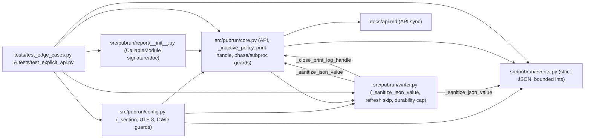

# IPD: Config, CWD, artifact-write safety, strict JSON, and core API ergonomics

- Date: 2026-11-27
- Kind: child
- Concern: Eight-lens rollup findings `ROLL-03`, `ROLL-04` (config/events), `ROLL-07`, `ROLL-12` (`CallableModule`), `ROLL-29` (`pubrun.print` handle), `ROLL-33` (manual subprocess and `phase` profiling/filenames), and `ROLL-36` (`tracked_run`, unknown `start()` kwargs, `pubrun.diff` parity, `_inactive_policy` TTL, `_config_version` caching, API docstrings), surfaced by `edge-cases`, `memory-resources`, `performance`, `ui-ux`, and `self-documentation`.
- Scope: Harden `src/pubrun/config.py`, `src/pubrun/core.py`, `src/pubrun/events.py`, `src/pubrun/writer.py`, and `src/pubrun/report/__init__.py` against deleted current working directories (CWD), non-UTF-8 or malformed Tom's Obvious Minimal Language (TOML) files, reserved artifact overwrites, non-finite JavaScript Object Notation (JSON) numbers, unguarded subprocess wrappers, `phase` profiling races and filename collisions, repeated `pubrun.print()` handle churn, and application programming interface (API) ergonomics and docstring gaps; synchronize `docs/api.md`; add regression tests in `tests/test_edge_cases.py` and `tests/test_explicit_api.py`.
- Scope-Paths: src/pubrun/config.py, src/pubrun/core.py, src/pubrun/events.py, src/pubrun/writer.py, src/pubrun/report/__init__.py, tests/test_edge_cases.py, tests/test_explicit_api.py, docs/api.md
- Item-Dependencies: none
- Status: reviewed
- Readiness: no-go
- Review-Depth: complex
- Short-Description: Harden deleted-CWD, non-UTF-8/malformed TOML, reserved artifact writes, NaN/Inf JSON, subprocess wrappers, yappi locks, cached print handle, and core API ergonomics
- Work-Kind: bug
- Priority: high
- Set: assess-8l
- Order: 1
- Highest E allocated: 05
- Author: Antigravity
- Id: 1o1cua

> Write and proofread this plan per the technical writing standard, `.aw/system/workflows/technical-writing/technical-writing.md`, including requirement 12 (diagrams).

## Workflow history

- 2026-11-27 /plan-review (Antigravity): REVIEWED - OPEN QUESTIONS; PR-001, PR-002, PR-003, PR-004, PR-005, PR-006
- 2026-11-27 /assess-all (Antigravity): created Child 01 of Set `assess-8l` covering config/CWD/core-API/JSON/writer hardening (`ROLL-03`, `ROLL-04`, `ROLL-07`, `ROLL-12`, `ROLL-29`, `ROLL-33`, `ROLL-36`).

## Goal

Ensure configuration loading (`src/pubrun/config.py`), event streaming (`src/pubrun/events.py`), artifact writing (`src/pubrun/writer.py`), and public `pubrun.core` and `pubrun.report` APIs never crash host code on deleted working directories, non-UTF-8 or malformed TOML files, non-finite floating-point numbers, or concurrent `phase` and subprocess calls. Protect core run artifacts from overwrite, remove redundant refresh config serialization and per-call `pubrun.print()` file opens, restore accurate API signatures and docstrings, and keep `docs/api.md` synchronized with all public API changes.

### Component interaction overview

## Detailed Implementation Checklist (TODO)

Execution-state rule: mark an `E-*` item complete only after performing the action. Accepted execution states: blocked, failed, pending, performed; terminal gate demands `performed`.

### Task group 1: Config and strict JSON hardening

- [ ] E-01 Harden `src/pubrun/config.py` for deleted CWD, non-UTF-8 TOML, and malformed section types:
  - In `src/pubrun/config.py::_safe_load_toml`, catch `(tomllib.TOMLDecodeError, UnicodeDecodeError)` in addition to `OSError`, log a warning, and return `None`.
  - In `src/pubrun/config.py::load_local_config`, wrap `Path.cwd()` in `try/except OSError` and return `None` when the CWD is unavailable.
  - Add a shared `src/pubrun/config.py::_section(cfg: Any, key: str) -> Dict[str, Any]` helper that returns `{}` when `cfg` is not a `dict` or `cfg.get(key)` is not a `dict`.
  - Apply `_section` in `src/pubrun/config.py::_resolve_layers` (building `core = dict(_section(overrides, "core"))`, calling `core.update(flat_core)`, and assigning `overrides["core"] = core`) and in `src/pubrun/config.py::profile_deprecation_notice`.
  - Depends on: none
  - Expected outcome: A deleted CWD, a UTF-16 byte-order mark (BOM) or invalid-UTF-8 `.pubrun.toml`, and scalar TOML sections (`core = "bad"`, `events = false`) degrade to defaults with warnings and zero uncaught exceptions.
  - Execution state: pending

- [ ] E-02 Harden `src/pubrun/events.py` and `src/pubrun/writer.py` for strict RFC 8259 JSON, validated event bounds, refresh config-write avoidance, durability warning cap, and print-handle teardown:
  - Add a shared cycle-safe `src/pubrun/writer.py::_sanitize_json_value(value: Any) -> Any` helper that replaces any `float` where `not math.isfinite(value)` (`NaN`, `Inf`, `-Inf`) with `None`, traverses `dict`, `list`, and `tuple` while tracking active container `id()`s (raising `ValueError("Circular reference detected")` on cycles), and returns all other objects untouched so `events.py::EventStream.emit` still raises `TypeError` on non-serializable payloads (`BUG-05`) while `writer.py` and `core.py::report` still stringify them via `default=str`.
  - Pass sanitized structures with `allow_nan=False` to `json.dumps`/`json.dump` in `src/pubrun/events.py::EventStream.emit`, `src/pubrun/writer.py::_atomic_json_write` (when `pre_serialized is None`), and `src/pubrun/writer.py::_serialize_config_and_digest`.
  - In `src/pubrun/events.py::EventStream.__init__`, read the `[events]` table via `pubrun.config._section(config, "events")`, validate `max_tracked_events` (`isinstance(v, int) and not isinstance(v, bool) and v >= 0`, fallback `1_000_000`) and `flush_interval_events` (`isinstance(v, int) and not isinstance(v, bool) and v >= 1`, fallback `100`), logging a warning on invalid values.
  - In `src/pubrun/writer.py::ArtifactWriter._write_config_if_needed`, when `stage == "refresh"`, `self._last_config_target == config_path`, `self._last_config_digest is not None`, `config_path.exists()`, and `_DURABILITY_RANK.get(self._last_config_durability or "", -1) >= _DURABILITY_RANK[effective_durability]`, return `False` without calling `_serialize_config_and_digest()`. Retain canonical digest hashing on `stage == "startup"`, `sync_config_if_changed()`, and `stage == "finalize"` so direct in-place `run.config` mutations tested in `tests/test_timing_accuracy.py` and `tests/test_startup_overhead_writes.py`, as well as reordered dicts in `tests/test_writer.py`, remain accurately detected.
  - In `src/pubrun/writer.py::_resolve_durability`, cap `_warned_invalid_durability` at 256 entries while keeping it a `set` (preserving `.discard()` calls in `tests/test_writer.py`). In `src/pubrun/writer.py::ArtifactWriter.write_artifacts`, read `[methods]` via `_section(cfg, "methods")` and call `pubrun.core._close_print_log_handle(self.run)` (from E-03) after `self.run._finalize_state()` so cached `pubrun.print()` file descriptors (FDs) close on every `tracker.stop()` and `atexit` even before Child 02 (`76z7ww`) lands.
  - Depends on: E-01
  - Expected outcome: Non-finite floats serialize as `null` under `allow_nan=False` in `events.py` and `writer.py`, circular references fail cleanly without `RecursionError`, malformed event bounds fall back safely, background hardware refresh skips redundant config serialization/hashing while startup/sync/finalize detect in-place `run.config` edits, `_warned_invalid_durability` stays a `set` capped at 256 entries, and `write_artifacts()` closes any cached print handle.
  - Execution state: pending

### Task group 2: Core runtime safety, handle reuse, ergonomics, and `docs/api.md` sync

- [ ] E-03 Harden core runtime safety, `_inactive_policy()`, and cached `pubrun.print()` handle in `src/pubrun/core.py`:
  - In `src/pubrun/core.py::report` and `src/pubrun/core.py::artifact` (and `_resolve_within_run_dir`), reject empty or whitespace-only names before appending `.json`/`.txt`, and reject any resolved destination whose relative path to `run_dir` is a single component matching (case-insensitively) a reserved top-level run file (`manifest.json`, `config.resolved.json`, `.pubrun.lock`, `events.jsonl`, `stdout.log`, `stderr.log`). Log a warning without raising and preserve `"pubrun: failed to write report '{name}': {e}"` / `"pubrun: failed to write artifact '{filename}': {e}"` checked by `tests/test_explicit_api.py`. Serialize `report()` JSON via `pubrun.writer._sanitize_json_value` with `allow_nan=False, default=str`, and pass a JSON-safe summary (`json.loads(content)` for `dict`, `{"items": len(data)}` for `list`) to `annotate()`.
  - Wrap all provenance-recording blocks in `src/pubrun/core.py::_PubrunSubprocessNamespace.run` (exception and return paths), `_PubrunSubprocessNamespace.Popen.__init__` (exception path), `_PubrunSubprocessNamespace.Popen._log_pubrun_record`, `popen` (exception path), and `_PopenPipeProxy.close` (after `self._pipe_obj.close()`) in `try/except Exception` so host return values and exceptions are never replaced. Guard `src/pubrun/core.py::_append_manual_subprocess_record` with a lock, reject `bool` cap values (falling back to `5000`), and enforce `cap <= 0` as "record 0" (matching `src/pubrun/capture/subprocesses.py::SubprocessSpy`).
  - In `src/pubrun/core.py::phase`, read `[capture]`/`[profiling]` through `_section()`, add class-level `_yappi_lock = threading.Lock()` (preserving `phase._yappi_active: bool = False`) and module-level `_profilers_lock = threading.Lock()` (preserving `run._active_profilers` as a `list`), assign `self._profiler = prof` and append to `run._active_profilers` only after `prof.enable()` succeeds (disabling `prof` on append failure), and set `self.run_tracker._yappi_owned = True` when starting yappi under `phase._yappi_lock`. Expose `src/pubrun/core.py::phase._release_yappi_for_run(run)` (shared contract with Child 02 `76z7ww`'s `Run._rollback_owned_hooks`) and check `phase._yappi_active` under `phase._yappi_lock` in `phase.__exit__` before calling `yappi.stop()` (atomically clearing `phase._yappi_active = False` and `run._yappi_owned = False`) so `yappi.stop()` runs at most once even when `run.stop()` executes inside a `phase` block. Cap `src/pubrun/core.py::_safe_phase_filename` to 80 characters (when longer, truncate to 71 chars plus `"-"` and an 8-hex-char SHA-256 hash of `str(name)`), and allocate `.prof` filenames through a lock-guarded `_allocate_profile_filename` helper (`profile-<name>.prof`, `profile-<name>-2.prof`, ...), emitting the allocated filename in `_emit_profile_saved`.
  - In `src/pubrun/core.py::_inactive_policy`, wrap `Path.cwd()` in `try/except OSError` (treating unavailable CWD as `None` and skipping local file probes) and read `[events]` via `pubrun.config._section(resolver(), "events")` (falling back to `"ignore"` if non-string). **[Unresolved: OQ-01]** Do not add a 1.0-second monotonic time-to-live (TTL) cache to `_inactive_policy()` until the maintainer resolves `OQ-01` (adding a 1.0 s TTL contradicts executed plan `68iw9a`, `docs/performance.md`, and `tests/test_api.py::TestInactivePolicyCache`).
  - In `src/pubrun/core.py::print`, cache a lazily opened, lock-guarded append handle on the active `Run` (`run._print_log_lock`, `run._print_log_file`, `run._print_log_path`, initializing `_print_log_lock` under a module-level `_print_handle_init_lock`) when console tee is `"off"`: skip logging if `os.getpid() != getattr(run, "pid", os.getpid())`, read `[console]` via `_section()`, re-check `run.is_active` under `run._print_log_lock`, close and reopen if `run._print_log_path != log_path` (directory migration safety), call `f.flush()` after each write, and close/clear the handle on any write error. Expose `src/pubrun/core.py::_close_print_log_handle(run)` called from `core.py::stop` and `writer.py::ArtifactWriter.write_artifacts` (E-02) and documented as the teardown contract for Child 02 (`76z7ww`).
  - Depends on: E-01, E-02
  - Expected outcome: Reserved top-level run files cannot be clobbered on case-sensitive or case-insensitive filesystems; manual subprocess wrappers never mask host exceptions and honor `cap == 0`; `phase` profiling is race-free, double-stop-free, and collision-free; `_inactive_policy()` survives deleted CWD and scalar `[events]` (TTL gated on `OQ-01`); `pubrun.print()` reuses one flushed handle with zero FD leaks.
  - Execution state: pending

- [ ] E-04 Improve core API ergonomics, `CallableModule`, docstrings, error hints, and `docs/api.md` in `src/pubrun/core.py`, `src/pubrun/report/__init__.py`, and `docs/api.md`:
  - Add pass-through properties (`run_dir`, `run_id`, `config`, `is_active`, `started_at_utc`) on `src/pubrun/core.py::tracked_run` delegating to `self.run_tracker` (returning `None` before `__enter__`, except `is_active` returning `False`), keeping `.run_tracker` intact.
  - In `src/pubrun/core.py::start`, when `kwargs` is non-empty, check top-level keys against the cached union of `pubrun.config.load_default_config().keys()` and `pubrun.config._CORE_SHORTCUTS`; log a `logging.getLogger("pubrun").warning(...)` for each unrecognized key (with a `difflib.get_close_matches` suggestion when available) without raising or dropping the key so existing callers such as `tests/test_core_lifecycle_bugs.py::TestWriterSerialization::test_path_and_date_config_values_write_all_artifacts` remain backward-compatible.
  - In `src/pubrun/core.py::diff`, add keyword parameters `depth: str = "standard"` and `show_same: bool = False`: validate `depth in ("basic", "standard", "deep")` (raising `ValueError` otherwise), read `diff_conf = _section(resolve_config(), "diff")`, select `ignore_{depth}` when `ignores is None` (falling back to legacy `ignore` for `"standard"`), and pass `show_same=show_same, depth=depth` to `src/pubrun/analysis/diff.py::compare_manifests`.
  - In `src/pubrun/report/__init__.py`, add a proper module docstring (replacing the leading `#` comment) and define `CallableModule.__call__(self, name: str, data: Any) -> None` with a matching docstring while keeping `from pubrun.core import report as real_report` lazy so `tests/test_report_subpackage_integrity.py` stays green.
  - In `src/pubrun/core.py`, update stale `pubrun report` references in `report()` and `artifact()` to `pubrun show`; add concise `Args:`/`Returns:`/`Example:` docstrings to `start`, `subprocess.run`, `subprocess.Popen`, `popen`, `open`, `report`, `artifact`, `register_file`, `register_input`, and `register_output`; add actionable hints in `_handle_inactive` (preserving `"no run is active"` and `"dropped: No active run"`), `diff` (preserving `FileNotFoundError`), and `phase.__enter__` (listing valid backends `'cprofile'` and `'yappi'` while preserving `"pubrun: profiling backend '...' unavailable:"`).
  - Synchronize `docs/api.md` (with zero em or en dashes in edited/added lines) to document `tracked_run` pass-through properties, `start()` unknown-key warnings, `pubrun.diff(run_dir_a, run_dir_b, ignores=None, *, depth="standard", show_same=False)`, and `report()`/`artifact()` reserved filename protection.
  - Depends on: E-03
  - Expected outcome: `help(pubrun.report)` and `inspect.signature(pubrun.report)` are accurate without eager core imports; `tracked_run`, `start`, and `diff` ergonomics and hints are consistent; `docs/api.md` matches the updated public API with zero added em or en dashes.
  - Execution state: pending

### Task group 3: Regression tests and validation

- [ ] E-05 Add behavioral unit and concurrency regression tests in `tests/test_edge_cases.py` and `tests/test_explicit_api.py`, and run all required validation checks:
  - In `tests/test_edge_cases.py` and `tests/test_explicit_api.py`, add behavioral tests covering: deleted CWD (`resolve_config`, inactive `annotate`), UTF-16 BOM and invalid-UTF-8 `.pubrun.toml`, scalar TOML sections across `config.py`/`events.py`/`writer.py`/`core.py`, malformed `EventStream` bounds (including `bool`, `0`, negative, string), `NaN`/`Inf`/`-Inf` sanitization and circular-reference handling in `events.py`/`writer.py`/`report()`, `writer.py` refresh config-write skip plus `_warned_invalid_durability` 256-entry `set` cap, case-insensitive reserved filename and blank-name rejection in `report()`/`artifact()`, manual subprocess wrapper exception isolation and `max_tracked_commands == 0` plus concurrency, concurrent/nested/repeated `phase` profiling (`cProfile` enable failure, yappi lock and single-stop guard, >80-char phase name hash cap, `.prof` collision disambiguation), cached `pubrun.print()` handle reuse/flush/close (with zero `ResourceWarning`) and migration reopen, `CallableModule` docstring and `inspect.signature(pubrun.report)`, `tracked_run` properties (pre-enter and active), unknown `start()` kwarg warning, and `pubrun.diff(..., depth=..., show_same=...)`.
  - Update `tests/test_explicit_api.py::test_unknown_backend_warns_and_skips` to match the improved valid-backends hint from E-04.
  - Run the targeted `pytest` command, three-platform `mypy`, and the `docs/api.md` em/en dash check from `## Required tests / validation`.
  - Depends on: E-04
  - Expected outcome: All new and existing targeted tests pass, three-platform `mypy` exits `0`, and `docs/api.md` diff contains zero em or en dashes.
  - Execution state: pending

## Project conventions discovered (Step 0)

- Python 3.8 through 3.14 support, zero third-party runtime dependencies on Python 3.11+ (`tomli` on `<3.11`), and strict "never crash the host script" runtime contract.
- Plans live under `.aw/records/plans/pending/` and move to `.aw/records/plans/executed/` through `aw` lifecycle transitions; validation uses `pytest` (`pyproject.toml` sets `addopts = "-p no:randomly"`) and three-platform `mypy` (`linux`, `win32`, `darwin`).
- Executed plan `68iw9a` (2026-11-23, commit `bb725f2`) established immediate stat-based file-change detection in `src/pubrun/core.py::_inactive_policy`, tested by `tests/test_api.py::TestInactivePolicyCache` and documented in `docs/performance.md`.
- `tests/test_timing_accuracy.py` and `tests/test_startup_overhead_writes.py` mutate `run.config` in place and assert `config.resolved.json` is rewritten on `stop()` / `sync_config_if_changed()`; `tests/test_writer.py` calls `.discard()` on `_warned_invalid_durability`.
- `docs/api.md` is user-facing prose and must contain zero em or en dashes in added or edited lines.

## Findings

| ID | Concerns | Severity | Remediation Risk | Persona | Summary |
|---|---|---|---|---|---|
| `ROLL-03` | edge-cases | High | Low (`functionality`) | QA / Software engineer | Deleted CWD crashes `src/pubrun/config.py::load_local_config` and `src/pubrun/core.py::_inactive_policy`. |
| `ROLL-04` | edge-cases | High | Low (`functionality`) | QA engineer | Non-UTF-8 `.pubrun.toml` raises uncaught `UnicodeDecodeError`; scalar TOML tables and bad `EventStream` bounds crash APIs. |
| `ROLL-07` | edge-cases | High | Low (`functionality`) | QA / Security | `pubrun.report()` and `pubrun.artifact()` can overwrite `manifest.json`, `.pubrun.lock`, `events.jsonl`, `stdout.log`, `stderr.log`, and `config.resolved.json`. |
| `ROLL-12` | self-documentation | High | Low (`usability`) | Novice / Power user | `pubrun.report` loses its docstring and call signature through `src/pubrun/report/__init__.py::CallableModule`. |
| `ROLL-29` | performance | Medium | Low (`complexity`) | Software engineer | `pubrun.print()` opens and closes `stdout.log` on every call when console capture is off. |
| `ROLL-33` | edge-cases; memory-resources | Medium | Low (`functionality`) | Software engineer | Manual subprocess wrappers lack provenance `try/except` guards and lock (`cap == 0` bypass); `phase` yappi lacks lock and `cProfile` assigns before `enable()`; long or duplicate phase names fail or collide. |
| `ROLL-36` | ui-ux; self-documentation; performance | Medium | Low (`usability`) | Novice / Power user | `tracked_run` lacks `Run` properties; `start(**kwargs)` silently ignores typos; `pubrun.diff()` lacks `depth`/`show_same`; inactive `annotate()` does 4 syscalls/call (routed to `OQ-01`); `writer` re-serializes unchanged config on refresh; API docstrings omit examples. |

## Proposed changes (ordered, validatable)

1. `E-01` (`src/pubrun/config.py`): Catch `UnicodeDecodeError`, guard `Path.cwd()` with `OSError`, and add `_section()` dict guards.
2. `E-02` (`src/pubrun/events.py`, `src/pubrun/writer.py`): Add shared cycle-safe `_sanitize_json_value` with `allow_nan=False`, validate `EventStream` bounds, skip redundant config serialization on hardware `refresh`, cap `_warned_invalid_durability` `set` at 256, and close cached print handles in `write_artifacts()`.
3. `E-03` (`src/pubrun/core.py`): Protect reserved top-level run files (case-insensitively) and sanitize JSON/summary in `report()`/`artifact()`, guard and lock manual subprocess wrappers (`cap <= 0`), lock/order `phase` profilers with single-stop yappi contract for `76z7ww`, cap/disambiguate `.prof` filenames, guard `_inactive_policy()` against deleted CWD and scalar `[events]` (TTL gated on `OQ-01`), and cache a flushed, locked, migration-safe `pubrun.print()` append handle with `_close_print_log_handle(run)`.
4. `E-04` (`src/pubrun/core.py`, `src/pubrun/report/__init__.py`, `docs/api.md`): Add `tracked_run` pass-through properties, unknown `start()` kwarg warnings, `pubrun.diff` `depth`/`show_same`, `CallableModule` module docstring and signature, API docstrings/hints, and `docs/api.md` sync.
5. `E-05` (`tests/test_edge_cases.py`, `tests/test_explicit_api.py`): Add regression and concurrency tests for every change above and run full targeted validation plus three-platform `mypy`.

## Deferred / out of scope (with reason)

- `Run.__init__` deleted-CWD Ghost Mode guard, `Run._merge_and_migrate` lock/path/print-handle migration fixes, `Run._after_fork_in_child` raw FD closes, and `Run._rollback_owned_hooks` yappi (`phase._release_yappi_for_run`) and print-handle (`core._close_print_log_handle`) teardown live in `src/pubrun/tracker.py` and are owned by Child 02 (`76z7ww`).
  - Carrier: 76z7ww
- `PUBRUN_OUTPUT_DIR` and `$VAR`/`~` expansion in `src/pubrun/config.py` are owned by Child 08 (`2ge0ea`) alongside the CLI `--dir` plumbing.
  - Carrier: 2ge0ea

## Scope check

- Over-scope: none. Every change maps directly to verified findings in `ROLL-03`, `ROLL-04`, `ROLL-07`, `ROLL-12`, `ROLL-29`, `ROLL-33`, and `ROLL-36`, plus required `docs/api.md` synchronization for public API additions.
- Under-scope: none after `E-01..E-05` revisions; the `_inactive_policy()` TTL trade-off is surfaced explicitly in `OQ-01` rather than silently assumed.

## Required tests / validation

1. `pytest tests/test_edge_cases.py tests/test_explicit_api.py tests/test_api.py tests/test_config.py tests/test_core_lifecycle_bugs.py tests/test_writer.py tests/test_events.py tests/test_timing_accuracy.py tests/test_startup_overhead_writes.py tests/test_report_subpackage_integrity.py tests/test_file_registration.py tests/test_capture_isolation.py tests/test_new_features.py -v`
2. `mypy && mypy --platform win32 && mypy --platform darwin`
3. `git diff -U0 -- docs/api.md | grep '^+' | grep -c $'\u2014\|\u2013' || true` (must print `0`)

## Spec / documentation sync

- In-code API docstrings in `src/pubrun/core.py` and `src/pubrun/report/__init__.py`, plus public API documentation in `docs/api.md`, are updated in `E-04` (with zero em or en dashes in `docs/api.md`).
- If `OQ-01` resolves in favor of a 1.0 s monotonic TTL in `_inactive_policy()`, `docs/performance.md` and `tests/test_api.py` must also be added to `- Scope-Paths:` and updated before approval.
- `README.md` and `docs/cli.md` sync for Set `assess-8l` is handled in Child 10 (`6y55x4`).

## Open questions

### OQ-01: Should `_inactive_policy()` keep immediate config-file change detection (`68iw9a`) or adopt a 1.0-second monotonic TTL?

- Blocking: yes
- Status: open
- Owner: maintainer
- Finding: PR-001
- Carrier: k80suw
- Resolution or deferral rationale: Pending maintainer decision. Executed plan `68iw9a` (2026-11-23, commit `bb725f2`) explicitly established next-call file-change detection in `src/pubrun/core.py::_inactive_policy`, pinned by five tests in `tests/test_api.py::TestInactivePolicyCache` and documented in `docs/performance.md`. Adopting the proposed 1.0 s monotonic TTL cuts syscalls in tight inactive loops (helpful on NFS/Lustre) but breaks three tests in `TestInactivePolicyCache` and relaxes the documented next-call guarantee, requiring `tests/test_api.py` and `docs/performance.md` to be updated. Recommended answer (recommendation strength: `medium`): Keep immediate file-change detection from `68iw9a` (drop the 1.0 s TTL from `1o1cua` while retaining the deleted-CWD `OSError` and scalar-`[events]` crash fixes), unless tight inactive loops on network filesystems are a priority that justifies a 1.0 s config-edit staleness window.

## Validation and cross-check (verify before reporting done)

Validation-state rule: inspect evidence in a separate pass. Accepted validation results: blocked, failed, pass, pending; terminal gate demands `pass`.

- [ ] V-01 validates E-01
  - Required evidence: Pasted `pytest` output confirming `src/pubrun/config.py::load_local_config`, `src/pubrun/config.py::_safe_load_toml`, `src/pubrun/config.py::_resolve_layers`, `src/pubrun/config.py::profile_deprecation_notice`, and `src/pubrun/config.py::_section` pass deleted-CWD, UTF-16 BOM / invalid-UTF-8 `.pubrun.toml`, and scalar-section (`core = "bad"`, `events = false`) tests in `tests/test_edge_cases.py` and `tests/test_config.py`.
  - Observed evidence:
  - Result: pending

- [ ] V-02 validates E-02
  - Required evidence: Pasted `pytest` output confirming `src/pubrun/events.py::EventStream` (`emit` strict RFC 8259 JSON, circular-reference handling, non-serializable `TypeError` retention, and bound validation including `bool`/negative/string) and `src/pubrun/writer.py::ArtifactWriter` (`_sanitize_json_value`, `_atomic_json_write`, `_write_config_if_needed` refresh skip while `tests/test_timing_accuracy.py` and `tests/test_startup_overhead_writes.py` still detect in-place `run.config` edits, `_warned_invalid_durability` 256-entry `set` cap, and `write_artifacts()` print-handle close) pass.
  - Observed evidence:
  - Result: pending

- [ ] V-03 validates E-03
  - Required evidence: Pasted `pytest` output confirming `src/pubrun/core.py` units pass: `report()`/`artifact()`/`_resolve_within_run_dir()` (case-insensitive reserved top-level filename rejection, blank-name rejection, JSON-safe `annotate` summary), `_PubrunSubprocessNamespace`/`popen()`/`_append_manual_subprocess_record()` (exception isolation, lock safety, `max_tracked_commands == 0`), `phase`/`_safe_phase_filename`/`_allocate_profile_filename` (yappi lock, `_release_yappi_for_run` single-stop guard, `cProfile` enable ordering, >80-char hash cap, `.prof` collision disambiguation), `_inactive_policy()` (deleted CWD and scalar `[events]`, plus `OQ-01` outcome), and `print()`/`_close_print_log_handle()` (handle reuse, immediate flush, migration reopen, fork PID guard, zero `ResourceWarning` on `tracker.stop()` and `pubrun.stop()`).
  - Observed evidence:
  - Result: pending

- [ ] V-04 validates E-04
  - Required evidence: Pasted `pytest` output confirming `src/pubrun/report/__init__.py::CallableModule` (module docstring, `inspect.signature(pubrun.report)`, and `tests/test_report_subpackage_integrity.py`), `src/pubrun/core.py::tracked_run` (pre-enter and active properties), `src/pubrun/core.py::start` (unknown kwarg warning with `notes=` backward compatibility), `src/pubrun/core.py::diff` (`depth` `basic`/`standard`/`deep`/invalid and `show_same`), and updated `_handle_inactive`/`diff`/`phase.__enter__` hints pass, plus `git diff -U0 -- docs/api.md | grep '^+' | grep -c $'\u2014\|\u2013'` printing `0`.
  - Observed evidence:
  - Result: pending

- [ ] V-05 validates E-05
  - Required evidence: Pasted output of `pytest` across all 13 suites in `## Required tests / validation` (verifying new tests in `tests/test_edge_cases.py` and `tests/test_explicit_api.py`, including updated `test_unknown_backend_warns_and_skips`) and `mypy && mypy --platform win32 && mypy --platform darwin` all exiting `0`.
  - Observed evidence:
  - Result: pending

## Approval and execution gate

1. **Open questions and approval:** This plan is a proposal and MUST NOT be executed until every `- Blocking: yes` open question (`OQ-01`) is resolved, any resulting plan edits are re-reviewed, and explicit human approval is recorded (`aw set plan approved 1o1cua --by-human`).
2. **Scope declaration:** `- Scope-Paths:` declares the expected files this plan modifies (`src/pubrun/config.py`, `src/pubrun/core.py`, `src/pubrun/events.py`, `src/pubrun/writer.py`, `src/pubrun/report/__init__.py`, `tests/test_edge_cases.py`, `tests/test_explicit_api.py`, `docs/api.md`). If execution requires touching an additional file or leaving a declared file untouched, justify each delta at finalization with `--scope-reason` or `--scope-ack`.
3. **Validation honesty (hard MUST):** Every `V-*` item MUST paste actual runner output from this workspace confirming exit `0` and the required behavior; never claim passing tests, `mypy`, or checks that were not actually run.
4. **Commits and push policy:** Commit ONLY files changed for this plan using `aw commit 1o1cua -- <paths>` (never `git add -A`, bare `git add`, `git commit -a`, or raw `git commit`). Never push, tag, or publish.
5. **Lifecycle finalization:** On completion, this plan MUST be finalized to `.aw/records/plans/executed/` only after all `E-*` items are `performed` and all `V-*` items are `pass`. When run under `aw oc run` or `aw agy run`, the runner owns `aw ipd finalize 1o1cua`; when executed manually outside a runner, the executor runs `aw ipd finalize 1o1cua` (never hand-roll `git mv` to `executed/`).
