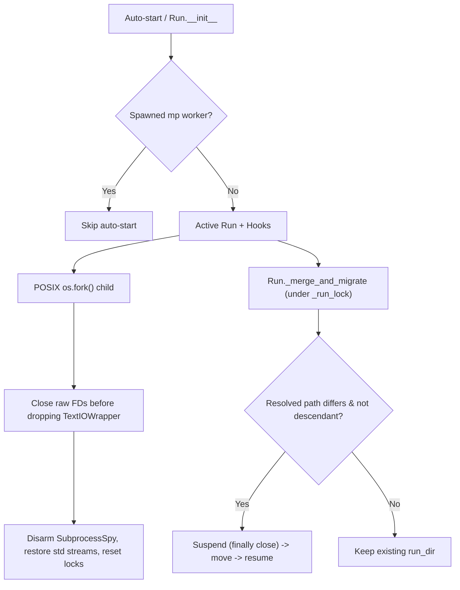

# IPD: Fork/spawn, signal, console, subprocess, and lifecycle resource safety

- Date: 2026-11-27
- Kind: child
- Concern: Eight-lens rollup findings `ROLL-01` (POSIX `fork()` buffer duplication, inherited locks, armed `SubprocessSpy`), `ROLL-02` (`multiprocessing` `spawn`/`forkserver` run storms), `ROLL-04` (`ResourceWatcher` 100% CPU spin on `<= 0`/non-finite interval), `ROLL-08` (`_merge_and_migrate` self-move and `stop()` race; `suspend_for_migration` FD leak), `ROLL-14` (`_safe_shlex_split` stripping Windows backslashes), `ROLL-26` (caught `sys.exit` misclassification), `ROLL-28` (`SIGUSR1`/`SIGUSR2` lethal finalization, `signal.raise_signal`, `_signals_received` cap), `ROLL-29` (`TqdmSafeTee.writelines()`, fast path, `_cleanup_resources` tee lock, lightweight `finalization_lock`), `ROLL-31` (Windows `ctypes` `_PROCESS_MEMORY_COUNTERS` cache and Linux `/proc` `rparen == -1`), and `ROLL-33` (`script_name` cap, `pubrun-hw` semaphore, `SubprocessSpy._drain` reap, yappi/print-handle rollback).
- Scope: Harden `src/pubrun/tracker.py`, `src/pubrun/capture/console.py`, `src/pubrun/capture/subprocesses.py`, `src/pubrun/capture/signals.py`, and `src/pubrun/capture/resources.py` with targeted tests in `tests/test_runtime_safety.py` and `tests/test_signals.py`.
- Scope-Paths: src/pubrun/tracker.py, src/pubrun/capture/console.py, src/pubrun/capture/subprocesses.py, src/pubrun/capture/signals.py, src/pubrun/capture/resources.py, tests/test_runtime_safety.py, tests/test_signals.py
- Item-Dependencies: executed:1o1cua
- Status: to-review
- Review-Depth: complex
- Short-Description: Fix POSIX fork buffer/lock/SubprocessSpy hazards, multiprocessing spawn storms, migration races, TqdmSafeTee writelines/perf, lethal SIGUSR1/2, Windows shlex, and ResourceWatcher bounds
- Work-Kind: bug
- Priority: high
- Set: assess-8l
- Order: 2
- Highest E allocated: 05
- Author: Antigravity
- Id: 76z7ww

> Write and proofread this plan per the technical writing standard, `.aw/system/workflows/technical-writing/technical-writing.md`, including requirement 12 (diagrams).

## Workflow history

- 2026-11-27 /assess-all (Antigravity): created Child 02 of Set `assess-8l` covering fork/spawn, migration, signals, console, subprocess, and resource-watcher lifecycle safety (`ROLL-01`, `ROLL-02`, `ROLL-04`, `ROLL-08`, `ROLL-14`, `ROLL-26`, `ROLL-28`, `ROLL-29`, `ROLL-31`, `ROLL-33`).

## Goal

Eliminate POSIX `fork()` log duplication and inherited-lock deadlocks, prevent `multiprocessing` `spawn`/`forkserver` worker run storms, make run migration and teardown race-free and leak-free, fix Windows subprocess splitting and `ctypes` leaks, and harden signal and console capture hot paths.

### Fork, spawn, and lifecycle safety flow

## Detailed Implementation Checklist (TODO)

Execution-state rule: mark an `E-*` item complete only after performing the action. Accepted execution states: blocked, failed, pending, performed; terminal gate demands `performed`.

### Task group 1: Fork, spawn, migration, and Run lifecycle safety

- [ ] E-01 Harden `src/pubrun/tracker.py` for deleted CWD, `script_name` bounds, `pubrun-hw` concurrency bound, `_merge_and_migrate()` safety, and rollback cleanup:
  - Move `base_dir` resolution (`Path.cwd() / "runs"`) inside the Ghost Mode `try/except` in `Run.__init__()` so a deleted CWD degrades to Ghost Mode instead of crashing; normalize empty/dot-only `script_name` to `"interactive"` and cap `script_name` to 80 chars plus short hash when truncated; make Ghost Mode warning suggest setting `[core].output_dir` to a writable path.
  - Bound concurrent `pubrun-hw` threads with a module-level `BoundedSemaphore` (max 4, skipping gracefully when saturated).
  - In `Run._merge_and_migrate()`: compare `self.run_dir.resolve() != new_dir.resolve()`, reject targets inside `self.run_dir.resolve()` (`is_relative_to`), and synchronize migration under `_run_lock` (and `writer._write_lock` around directory move/reopen), re-checking `self.is_active and not self._finalized` before reopening handles.
  - In `Run._rollback_owned_hooks()`, close any cached `pubrun.print()` file handle and stop/reset any orphaned `yappi` profiler owned by this `Run`.
  - Detect `multiprocessing` `spawn`/`forkserver` worker processes (e.g. `multiprocessing.parent_process() is not None` when `multiprocessing` is imported, plus inherited `PUBRUN_PARENT_PID` guard while a parent run is active) so spawned workers do not auto-start duplicate run storms.
  - Depends on: none
  - Expected outcome: Deleted CWD, long script names, concurrent migrations, orphaned yappi/print handles, and spawned multiprocessing workers are handled safely without crashes, leaks, or run storms.
  - Execution state: pending

- [ ] E-02 Fix POSIX `fork()` child cleanup in `src/pubrun/tracker.py::_after_fork_in_child()` and `src/pubrun/capture/subprocesses.py`:
  - In `_after_fork_in_child()`: close each inherited log/event file's raw OS file descriptor (`os.close(fd)`) *before* dropping Python `TextIOWrapper` references so `TextIOWrapper.__del__()` cannot flush duplicate copies of the parent's buffered lines into parent files.
  - Restore `sys.stdout`/`sys.stderr` to `interceptor.original_stdout`/`original_stderr` when still pointing to tees, reinitialize tee/event/signal/module locks in the child, and call a new `SubprocessSpy._disarm_in_child()` that sets `state["active"] = False`, restores original `Popen`/`os.system`, clears inherited records/refs, and replaces `SubprocessSpy._lock`.
  - In `SubprocessSpy._safe_shlex_split()`, pass `posix=(sys.platform != "win32")` with Windows-aware quote stripping so Windows path backslashes are never stripped.
  - In `SubprocessSpy._drain()`, call `prev_poll(proc)` on resurrected `pending_running` items so exited unwaited `Popen` objects are reaped and released promptly.
  - Depends on: E-01
  - Expected outcome: Forked children never duplicate parent log buffers, never deadlock on inherited locks, disarm `SubprocessSpy`, preserve Windows backslashes in `argv`, and reap exited unwaited children.
  - Execution state: pending

### Task group 2: Console, signals, and ResourceWatcher hardening

- [ ] E-03 Harden and speed up `src/pubrun/capture/console.py`:
  - Implement `TqdmSafeTee.writelines(self, lines)` delegating to `self.write(line)`.
  - In `TqdmSafeTee.flush()`, check `if not self.log_file or getattr(self.log_file, "closed", False): return` *before* acquiring `self._lock`.
  - In `TqdmSafeTee.write()`, hoist `datetime`/`timezone` imports to module level, compute timestamps lazily only when writing a line, and add a fast path when `'\r' not in data and not self._pending_cr`.
  - In `ConsoleInterceptor.suspend_for_migration()`, put `log_handle.close()` inside a `finally:` block independent of `flush()`; in `_cleanup_resources()`, acquire `finalization_lock(tee._lock, 0.25)` before detaching `tee.log_file` and closing handles.
  - Depends on: E-02
  - Expected outcome: `sys.stdout.writelines()` is captured, `flush()` cannot deadlock on disarmed tees, `suspend_for_migration()` never leaks FDs, `_cleanup_resources()` does not race active writers, and `TqdmSafeTee` hot-path overhead drops sharply.
  - Execution state: pending

- [ ] E-04 Harden `src/pubrun/capture/signals.py` and `src/pubrun/capture/resources.py`:
  - In `signals.py`: replace `@contextmanager finalization_lock` with a lightweight `__slots__` context manager (avoiding generator allocation on hot paths); add `SIGUSR1` and `SIGUSR2` (when defined) to `_LETHAL_SIGNALS` and `interruption_signals` on `SIG_DFL` termination; replace `os.kill(os.getpid(), sig)` with `signal.raise_signal(sig)`; cap `_signals_received` at `MAX_SIGNALS_RECORDED = 1000` with a `signals_truncated` counter; clear a stale `_sys_exit` failure state when `Run.stop()` is called explicitly (without an active exception) or after subsequent user API recovery activity.
  - In `resources.py`: validate `interval_seconds` (finite float, clamped to `>= 0.05` on invalid/`<= 0`/`NaN`/`Inf`), `max_failures` (`int >= 1`), and `set_poll_timeout` (positive finite float); return cleanly when `rparen == -1` in `_get_linux_tree_cpu_jiffies()`; define Windows `_PROCESS_MEMORY_COUNTERS` once at module level and cache private `WinDLL` handles instead of mutating `ctypes.windll` or leaking types into `ctypes._pointer_type_cache`.
  - Depends on: E-03
  - Expected outcome: `SIGUSR1`/`SIGUSR2` finalize manifests cleanly, Windows re-raise uses `signal.raise_signal`, `_signals_received` is bounded, caught `sys.exit` followed by recovery does not misclassify as failed, `ResourceWatcher` never spins at 100% CPU, and Windows RSS polling does not leak `ctypes` types.
  - Execution state: pending

### Task group 3: Regression tests

- [ ] E-05 Add targeted safety, fork/spawn, signal, console, and resource tests in `tests/test_runtime_safety.py` and `tests/test_signals.py`:
  - Test POSIX `fork()` with unflushed parent logs (asserting zero duplicate lines) and parent-held `TqdmSafeTee._lock`/`SubprocessSpy._lock` (asserting child completes without deadlock); test `multiprocessing.get_context("spawn").Pool(2)` creating exactly 1 run directory; test `_merge_and_migrate` with same resolved path, descendant path, and concurrent `stop()`; test `TqdmSafeTee.writelines()` and `suspend_for_migration()` `flush()` failure; test `SIGUSR1` `SIG_DFL` finalization, `_signals_received` cap, and caught `sys.exit(5)` recovery; test Windows `_safe_shlex_split` backslashes, `ResourceWatcher` `interval=0`/`nan`, and `rparen == -1`.
  - Depends on: E-04
  - Expected outcome: All new and existing tests pass cleanly and three-platform `mypy` exits `0`.
  - Execution state: pending

## Project conventions discovered (Step 0)

- Python 3.8 through 3.14 support across Linux, macOS, and Windows with zero third-party runtime dependencies on Python 3.11+.
- `pubrun` must never crash, hang, or corrupt host scripts across POSIX `fork()`, `multiprocessing` `spawn`, lethal signals, or multithreaded writes.

## Findings

| ID | Concerns | Severity | Remediation Risk | Persona | Summary |
|---|---|---|---|---|---|
| `ROLL-01` | edge-cases; memory-resources | High | Medium (`functionality`) | Operator / Software engineer | POSIX `fork()` child drops `TextIOWrapper` refs flushing duplicate parent log lines, inherits locked mutexes, and leaves `SubprocessSpy` armed. |
| `ROLL-02` | use-cases | High | Medium (`functionality`) | ML / Power user | `multiprocessing` `spawn`/`forkserver` re-executes top-level `import pubrun` per worker, creating run storms. |
| `ROLL-04` | edge-cases | High | Low (`functionality`) | QA engineer | `ResourceWatcher` spins at 100% CPU when `sample_interval_seconds <= 0` or fails on `NaN`/`Inf`. |
| `ROLL-08` | edge-cases; memory-resources | High | Medium (`functionality`) | Software engineer | `_merge_and_migrate()` compares unresolved paths without lock synchronization; `suspend_for_migration()` leaks FD on `flush()` error. |
| `ROLL-14` | compatibility | High | Low (`functionality`) | Power user | `SubprocessSpy._safe_shlex_split()` uses `posix=True`, stripping Windows path backslashes. |
| `ROLL-26` | edge-cases | High | Medium (`functionality`) | QA engineer | Caught `sys.exit(non_zero)` followed by normal completion misclassifies succeeded run as failed. |
| `ROLL-28` | use-cases; compatibility; memory-resources; edge-cases | Medium | Low (`functionality`) | Operator | `SIGUSR1`/`SIGUSR2` missing from `_LETHAL_SIGNALS`; `os.kill` used instead of `signal.raise_signal`; `_signals_received` uncapped. |
| `ROLL-29` | performance; edge-cases; memory-resources | Medium | Low (`complexity`) | Software engineer | `TqdmSafeTee` omits `writelines()`, lacks `_cleanup_resources` tee lock, and incurs high timestamp/`finalization_lock` generator overhead. |
| `ROLL-31` | memory-resources; edge-cases | Medium | Low (`functionality`) | Software engineer | Windows `_PROCESS_MEMORY_COUNTERS` leaks in `ctypes._pointer_type_cache`; Linux `/proc` `rparen == -1` shifts fields. |
| `ROLL-33` | edge-cases; memory-resources | Medium | Low (`functionality`) | Operator | Unbounded `script_name`, unbounded `pubrun-hw` threads, and un-reaped `SubprocessSpy._pending_running`. |

## Proposed changes (ordered, validatable)

1. `E-01` (`src/pubrun/tracker.py`): Deleted-CWD Ghost Mode guard, `script_name` cap, `pubrun-hw` semaphore, locked resolved-path `_merge_and_migrate()`, rollback cleanup for yappi/print handle, and `spawn`/`forkserver` worker detection.
2. `E-02` (`src/pubrun/tracker.py`, `src/pubrun/capture/subprocesses.py`): Raw FD close before ref-drop in `_after_fork_in_child()`, child `SubprocessSpy` disarm and lock reset, Windows-safe `_safe_shlex_split()`, and `_drain()` reaping.
3. `E-03` (`src/pubrun/capture/console.py`): `TqdmSafeTee.writelines()`, lock-free closed check in `flush()`, hoisted datetime/no-CR fast path in `write()`, `finally` FD close in `suspend_for_migration()`, and tee lock in `_cleanup_resources()`.
4. `E-04` (`src/pubrun/capture/signals.py`, `src/pubrun/capture/resources.py`): Lightweight `__slots__` `finalization_lock`, lethal `SIGUSR1`/`SIGUSR2`, `signal.raise_signal`, `_signals_received` cap, caught `sys.exit` reset on recovery, `ResourceWatcher` numeric clamping, `/proc` `rparen == -1`, and cached Windows `ctypes` structures.
5. `E-05` (`tests/test_runtime_safety.py`, `tests/test_signals.py`): Regression and concurrency tests for all fixes.

## Deferred / out of scope (with reason)

- Windows `liveness.py` `WinDLL`/`Structure` caching lives in `src/pubrun/capture/liveness.py` and is owned by child `ameehy` (Order 05).
  - Carrier: ameehy

## Scope check

- Over-scope: none. Every change maps directly to verified findings in `ROLL-01`, `ROLL-02`, `ROLL-04`, `ROLL-08`, `ROLL-14`, `ROLL-26`, `ROLL-28`, `ROLL-29`, `ROLL-31`, and `ROLL-33`.
- Under-scope: none. All `tracker.py`, `console.py`, `subprocesses.py`, `signals.py`, and `resources.py` runtime safety items are covered.

## Required tests / validation

1. `pytest tests/test_runtime_safety.py tests/test_signals.py tests/test_tracker.py tests/test_console.py tests/test_subprocesses.py tests/test_resources.py -v`
2. `mypy && mypy --platform win32 && mypy --platform darwin`

## Spec / documentation sync

Runtime behavior matches documented invariants; no external documentation changes are required in this child.

## Open questions

None. All fixes follow conservative, backward-compatible defaults.

## Validation and cross-check (verify before reporting done)

Validation-state rule: inspect evidence in a separate pass. Accepted validation results: blocked, failed, pass, pending; terminal gate demands `pass`.

- [ ] V-01 validates E-01
  - Required evidence: Pasted `pytest` output for `tracker.py` (`Run.__init__` deleted-CWD Ghost Mode and `script_name` cap, `pubrun-hw` semaphore bound, `_merge_and_migrate` resolved-path/locked migration, `_rollback_owned_hooks`, and `multiprocessing` `spawn` single-run test).
  - Observed evidence:
  - Result: pending

- [ ] V-02 validates E-02
  - Required evidence: Pasted `pytest` output for `tracker.py::_after_fork_in_child` (zero duplicate parent log lines and zero lock deadlock across `os.fork()`) and `subprocesses.py` (`SubprocessSpy._disarm_in_child`, `_safe_shlex_split` Windows backslash test, `_drain` reaping).
  - Observed evidence:
  - Result: pending

- [ ] V-03 validates E-03
  - Required evidence: Pasted `pytest` output for `console.py` (`TqdmSafeTee.writelines`, `suspend_for_migration` `flush()`-error FD close, `_cleanup_resources` concurrent write/stop test, and 50k-line `TqdmSafeTee` timing).
  - Observed evidence:
  - Result: pending

- [ ] V-04 validates E-04
  - Required evidence: Pasted `pytest` output for `signals.py` (`SIGUSR1` `SIG_DFL` finalization, `_signals_received` cap, caught `sys.exit` recovery, `signal.raise_signal`) and `resources.py` (`ResourceWatcher` `interval=0`/`nan` clamping, `/proc` `rparen == -1`, cached Windows `ctypes` structure reuse).
  - Observed evidence:
  - Result: pending

- [ ] V-05 validates E-05
  - Required evidence: Pasted output of `pytest tests/test_runtime_safety.py tests/test_signals.py tests/test_tracker.py tests/test_console.py tests/test_subprocesses.py tests/test_resources.py` and three-platform `mypy` exiting `0`.
  - Observed evidence:
  - Result: pending

## Approval and execution gate

Proposal only; requires review and explicit human approval before execution (`aw set plan approved 76z7ww --by-human`). Not auto-executed. On completion, finalize to `.aw/records/plans/executed/`.
