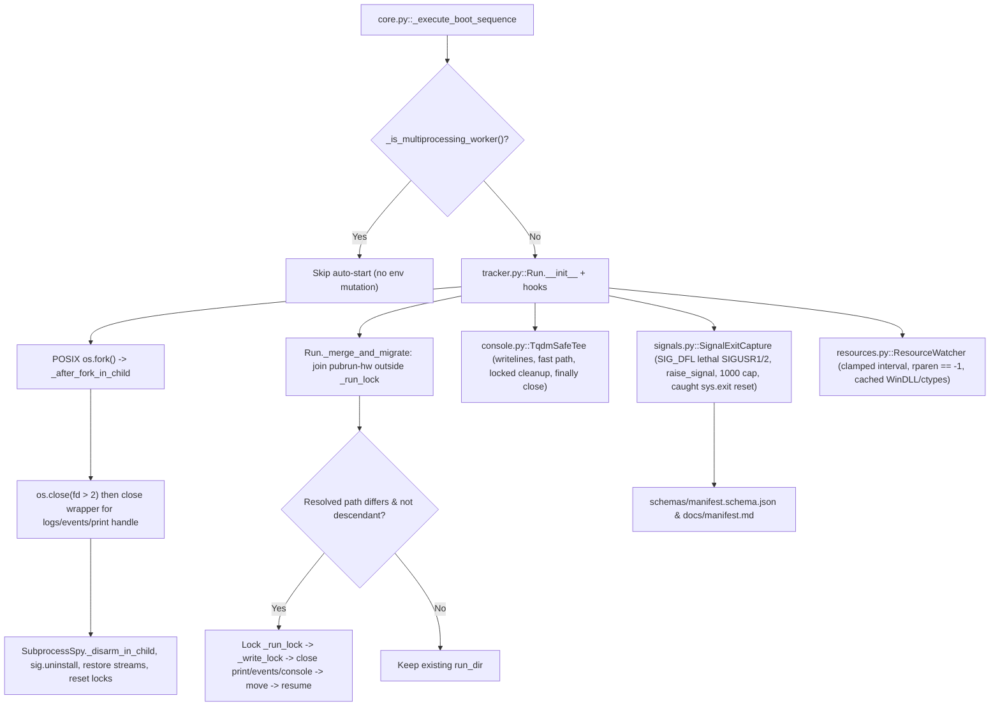

# IPD: Fork/spawn, signal, console, subprocess, and lifecycle resource safety

- Date: 2026-11-27
- Kind: child
- Concern: Eight-lens rollup findings `ROLL-01` (Portable Operating System Interface (POSIX) `fork()` buffer duplication, inherited locks, armed `SubprocessSpy`), `ROLL-02` (`multiprocessing` `spawn`/`forkserver` run storms), `ROLL-04` (`ResourceWatcher` 100% central processing unit (CPU) spin on `<= 0` or non-finite interval), `ROLL-08` (`_merge_and_migrate` self-move, `stop()`/`pubrun-hw` lock races, and `suspend_for_migration` file descriptor (FD) leak), `ROLL-14` (`_safe_shlex_split` stripping Windows backslashes), `ROLL-26` (caught `sys.exit` misclassification), `ROLL-28` (`SIGUSR1`/`SIGUSR2` `SIG_DFL` lethal finalization, `signal.raise_signal`, `_signals_received` cap), `ROLL-29` (`TqdmSafeTee.writelines()`, fast path, `_cleanup_resources` tee lock, lightweight `finalization_lock`), `ROLL-31` (Windows `ctypes` `_PROCESS_MEMORY_COUNTERS` cache and Linux `/proc` `rparen == -1`), and `ROLL-33` (`script_name` cap, `pubrun-hw` semaphore, `SubprocessSpy._drain` reap, yappi and print-handle rollback).
- Scope: Harden `src/pubrun/tracker.py`, `src/pubrun/core.py`, `src/pubrun/capture/console.py`, `src/pubrun/capture/subprocesses.py`, `src/pubrun/capture/signals.py`, and `src/pubrun/capture/resources.py`; extend `schemas/manifest.schema.json` and synchronize `docs/manifest.md` for optional `signals.signals_truncated`; add targeted behavioral regression tests in `tests/test_runtime_safety.py` and `tests/test_signals.py`.
- Scope-Paths: src/pubrun/tracker.py, src/pubrun/core.py, src/pubrun/capture/console.py, src/pubrun/capture/subprocesses.py, src/pubrun/capture/signals.py, src/pubrun/capture/resources.py, schemas/manifest.schema.json, docs/manifest.md, tests/test_runtime_safety.py, tests/test_signals.py
- Item-Dependencies: executed:1o1cua
- Status: approved
- Readiness: go-pending-approval
- Review-Depth: complex
- Short-Description: Fix POSIX fork buffer/lock/SubprocessSpy hazards, multiprocessing spawn storms, migration races, TqdmSafeTee writelines/perf, lethal SIGUSR1/2, Windows shlex, and ResourceWatcher bounds
- Work-Kind: bug
- Priority: high
- Set: assess-8l
- Order: 2
- Highest E allocated: 05
- Author: Antigravity
- Id: 76z7ww
- Approval: 2026-11-27, recorded via aw ipd set: status set to approved

> Write and proofread this plan per the technical writing standard, `.aw/system/workflows/technical-writing/technical-writing.md`, including requirement 12 (diagrams).

## Workflow history

- 2026-11-27 approved (aw set): status set to approved
- 2026-11-27 /plan-review (Antigravity): APPROVE WITH REVISIONS APPLIED; PR-001, PR-002, PR-003, PR-004, PR-005, PR-006
- 2026-11-27 /assess-all (Antigravity): created Child 02 of Set `assess-8l` covering fork/spawn, migration, signals, console, subprocess, and resource-watcher lifecycle safety (`ROLL-01`, `ROLL-02`, `ROLL-04`, `ROLL-08`, `ROLL-14`, `ROLL-26`, `ROLL-28`, `ROLL-29`, `ROLL-31`, `ROLL-33`).

## Goal

Eliminate POSIX `fork()` log buffer duplication and inherited-lock deadlocks, prevent `multiprocessing` `spawn` and `forkserver` worker run storms without polluting process environment variables, make run migration and teardown race-free and leak-free across Python 3.8 through 3.14, fix Windows subprocess argument splitting and `ctypes` type-cache leaks, harden signal and console capture hot paths, and keep the JavaScript Object Notation (JSON) manifest schema and manifest documentation synchronized.

### Fork, spawn, migration, and capture safety flow

## Detailed Implementation Checklist (TODO)

Execution-state rule: mark an `E-*` item complete only after performing the action. Accepted execution states: blocked, failed, pending, performed; terminal gate demands `performed`.

### Task group 1: Fork, spawn, migration, and Run lifecycle safety

- [ ] E-01 Harden `src/pubrun/tracker.py` and `src/pubrun/core.py` for deleted current working directory (CWD), `script_name` bounds, `pubrun-hw` concurrency bound, `_merge_and_migrate()` safety, rollback cleanup, and `multiprocessing` worker auto-start suppression:
  - In `src/pubrun/tracker.py::Run.__init__`: normalize empty or dot/punctuation-only `script_name` to `"interactive"`; keep the unhashed sanitized stem on `self._lock_script_name` for `src/pubrun/tracker.py::Run._write_lock_file` so `src/pubrun/capture/liveness.py::_match_script_in_tokens` still matches live scripts whose names exceed 80 characters; cap `self.script_name` (used in `dir_name`) to 80 characters by truncating to 71 characters plus `"-"` and an 8-hex-char Secure Hash Algorithm 256-bit (SHA-256) digest of `raw_script`. Initialize fallback `self.output_base_dir = Path("runs")` and `self.run_dir = self.output_base_dir / dir_name` before the Ghost Mode `try/except`, move `base_dir` resolution (`Path.cwd() / "runs"`) inside that `try/except` (reading `[core]` via `pubrun.config._section`), guard `Path.cwd()` with `try/except OSError` (falling back to `""`) in `Run._write_lock_file()`, and update `Run._enter_ghost_mode()`'s stderr warning (preserving `"Ghost Mode"`) to suggest setting `[core].output_dir` (or passing `output_dir=` to `pubrun.start()`) to a writable path.
  - In `src/pubrun/tracker.py::_bootstrap_engines`: guard concurrent `pubrun-hw` threads with a module-level `_HARDWARE_SEMAPHORE = threading.BoundedSemaphore(4)` acquired non-blocking (`acquire(blocking=False)`) before starting the thread. When saturated, skip thread creation, set `hardware_data`, `host_data`, and `filesystem_data` to `{"capture_state": {"status": "unavailable", "detail": "hardware capture skipped: concurrent thread limit reached"}}`, set `self._background_hardware_seconds = 0.0`, `self._hardware_thread = None`, and `self._hardware_future_done.set()`. Release `_HARDWARE_SEMAPHORE` in `_collect_hardware()`'s `finally:` block and whenever `self._hardware_thread.start()` raises.
  - In `src/pubrun/tracker.py::Run._merge_and_migrate`: compute `src_resolved = self.run_dir.resolve()` and `dst_resolved = new_dir.resolve()` (handling `OSError` safely), treat `src_resolved == dst_resolved` as a no-op, and reject targets inside `src_resolved` using Python 3.8-compatible `try: dst_resolved.relative_to(src_resolved)` (never `Path.is_relative_to`, which is Python 3.9+). Join `self._hardware_thread` / wait `self._hardware_future_done` **outside** `_run_lock` (joining while holding `_run_lock` deadlocks against `pubrun-hw`'s `with _run_lock:` writes), then acquire `_run_lock`, re-check `self.is_active and not self._finalized`, acquire `writer._write_lock` when `writer is not None` (preserving `_run_lock` -> `_write_lock` lock order), call `pubrun.core._close_print_log_handle(self)` (from `1o1cua`) before closing `event_stream` and suspending `console_interceptor`, move the directory, and re-check `self.is_active and not self._finalized` before reopening handles.
  - In `src/pubrun/tracker.py::Run._rollback_owned_hooks`: call `pubrun.core._close_print_log_handle(self)` and `pubrun.core.phase._release_yappi_for_run(self)` (the exact contracts introduced by `1o1cua` E-03 so `yappi.stop()` runs at most once), and snapshot/clear `self._active_profilers` under `finalization_lock(pubrun.core._profilers_lock, 0.25)` when available.
  - In `src/pubrun/core.py`: add `_is_multiprocessing_worker() -> bool` that checks `mp = sys.modules.get("multiprocessing")` (never eagerly importing `multiprocessing`) and returns `True` when `callable(getattr(mp, "parent_process", None)) and mp.parent_process() is not None`. Call `_is_multiprocessing_worker()` in `src/pubrun/core.py::_execute_boot_sequence` alongside `_is_pubrun_cli_invocation()` to skip auto-start cleanly in `spawn` and `forkserver` workers without mutating `os.environ` (avoiding `PUBRUN_PARENT_PID`, which would pollute environment capture and suppress auto-start in legitimate `subprocess.run([sys.executable, ...])` child scripts) while keeping explicit `pubrun.start()` working.
  - Depends on: none
  - Expected outcome: Deleted CWD degrades cleanly to Ghost Mode with valid `to_manifest_dict()`, >80-char script names cap directory paths without breaking `liveness.py` matching, `pubrun-hw` concurrency is bounded to 4 without semaphore leaks, `_merge_and_migrate()` is deadlock-free and Python 3.8-compatible and closes cached print handles before moving, `_rollback_owned_hooks()` tears down print handles and yappi cleanly once, and `multiprocessing` `spawn`/`forkserver` workers skip auto-start without breaking `subprocess.run` child scripts.
  - Execution state: pending

- [ ] E-02 Fix POSIX `fork()` child cleanup in `src/pubrun/tracker.py::_after_fork_in_child` and harden `src/pubrun/capture/subprocesses.py`:
  - In `src/pubrun/tracker.py::_after_fork_in_child`: add a helper `_close_inherited_fd_without_flush(f, closed_fds)` that extracts `fd = f.fileno()`, skips non-integer or standard FDs (`fd <= 2`) and already-closed FDs in `closed_fds`, calls `os.close(fd)` **first** so the parent's buffered bytes cannot be flushed to the parent's file, and immediately calls `f.close()` inside `try/except Exception: pass` while `fd` cannot yet have been reused by child code so `f.closed` becomes `True` and later garbage collection cannot flush into or close a reused FD. Apply this helper to `event_stream._file`, `console_interceptor.stdout_log`, `console_interceptor.stderr_log`, `stdout_tee.log_file`, `stderr_tee.log_file`, and `run._print_log_file` (from `1o1cua`), clearing all handle references afterward.
  - In `src/pubrun/tracker.py::_after_fork_in_child`: restore `sys.stdout` and `sys.stderr` to `interceptor.original_stdout` and `interceptor.original_stderr` when still pointing to our tees; call lock-free `sig.uninstall()` after setting `sig._active = False` so a child that calls `pubrun.start()` does not stack duplicate signal/exit shims; reset module and instance locks in the child (`core._run_lock`, `core._start_lock`, `core._profilers_lock`, `core._print_handle_init_lock`, `core.phase._yappi_lock`, `tracker._HARDWARE_SEMAPHORE`, `run._errors_lock`, `run._data_files_lock`, `run._print_log_lock`, `writer._write_lock`, `stdout_tee._lock`, `stderr_tee._lock`, `ev._lock`, `sig._lock`, and reset `signals._finalizing_active_run = False` and `signals._timed_out_locks.clear()`); call `SubprocessSpy._disarm_in_child()`.
  - In `src/pubrun/capture/subprocesses.py`: add `@classmethod def _disarm_in_child(cls) -> None` that **never** acquires the potentially deadlocked inherited `cls._lock`, replaces `cls._lock = threading.Lock()`, sets `state["active"] = False`, clears `pending_exits`/`pending_running`, identity-guardedly restores `subprocess.Popen.{__init__,wait,poll,__del__}` and `os.system`, and resets all class-level tracking state.
  - In `src/pubrun/capture/subprocesses.py::SubprocessSpy._safe_shlex_split`: accept optional `posix: Optional[bool] = None` (defaulting to `sys.platform != "win32"`); when `posix` is `False`, split with `shlex.split(args, posix=False)` and strip one matched outer pair of double or single quotes from each token so Windows path backslashes (e.g. `C:\work\app.exe`, `"C:\my dir\file.txt"`) are preserved intact.
  - In `src/pubrun/capture/subprocesses.py::SubprocessSpy._drain`: when a resurrected `pending_running` `Popen` still has `returncode is None`, call `prev_poll(proc)` inside `try/except Exception: rc = None`, and when `isinstance(rc, int) and not isinstance(rc, bool)`, call `_complete_record(proc_rec, rc, time.time(), time.perf_counter())` so exited unwaited children are reaped and released promptly.
  - Depends on: E-01
  - Expected outcome: Forked children never duplicate unflushed parent logs, never flush into reused FDs on garbage collection, never deadlock on inherited locks, disarm `SubprocessSpy` without acquiring its inherited lock, preserve Windows backslashes in `argv`, and reap exited unwaited `Popen` objects during `_drain()`.
  - Execution state: pending

### Task group 2: Console, signals, manifest schema, and ResourceWatcher hardening

- [ ] E-03 Harden and optimize `src/pubrun/capture/console.py`:
  - Implement `src/pubrun/capture/console.py::TqdmSafeTee.writelines(self, lines: Iterable[str]) -> None` iterating over `lines` and calling `self.write(line)`.
  - Hoist `from datetime import datetime, timezone` to module level in `src/pubrun/capture/console.py`.
  - In `src/pubrun/capture/console.py::TqdmSafeTee.flush`: check `log_file = self.log_file; if not log_file or getattr(log_file, "closed", False): return` **before** acquiring `self._lock` (re-checking inside the lock as today).
  - In `src/pubrun/capture/console.py::TqdmSafeTee.write`: compute timestamps lazily only when at least one line is actually written, and add a fast path when `'\r' not in data and not self._pending_cr` (short-circuiting pure partial chunks with `'\n' not in data` directly onto `self._current_buffer` with `_MAX_BUFFER_CHARS` enforcement, and splitting directly on `'\n'` otherwise) while preserving full carriage-return/line-feed (CRLF), split-CR, bare-CR squashing, and `line_count` semantics.
  - In `src/pubrun/capture/console.py::ConsoleInterceptor.suspend_for_migration`: place `log_handle.close()` and `setattr(self, log_attr, None)` in a `finally:` block independent of `log_handle.flush()` so a flush failure never leaks an OS file descriptor.
  - In `src/pubrun/capture/console.py::ConsoleInterceptor._cleanup_resources`: acquire `finalization_lock(tee._lock, 0.25)` around flushing each tee, reading `line_count`/`_log_write_failed`, and detaching `tee.log_file = None` (skipping only `tee.flush()` if `acquired` is `False` during lethal-signal finalization, matching `suspend_for_migration()`).
  - Depends on: E-02
  - Expected outcome: `sys.stdout.writelines()` is captured, `flush()` skips locking on disarmed tees, `suspend_for_migration()` closes handles even when `flush()` raises, `_cleanup_resources()` synchronizes with concurrent writers without deadlocking during lethal-signal finalization, and `TqdmSafeTee.write()` eliminates per-call imports, redundant splits, and unused timestamp formatting.
  - Execution state: pending

- [ ] E-04 Harden `src/pubrun/capture/signals.py`, `src/pubrun/capture/resources.py`, `src/pubrun/tracker.py`, `src/pubrun/core.py`, `schemas/manifest.schema.json`, and `docs/manifest.md`:
  - In `src/pubrun/capture/signals.py`:
    - Replace `@contextmanager def finalization_lock` with a lightweight `__slots__ = ("_lock", "_timeout", "_acquired")` context manager class `finalization_lock` preserving exact blocking, bounded-timeout, and `_timed_out_locks` semantics without generator allocation; update the lock inventory comment for `TqdmSafeTee._lock` to reflect `ConsoleInterceptor._cleanup_resources()` taking `finalization_lock(tee._lock, 0.25)`.
    - Add `"SIGUSR1"` and `"SIGUSR2"` (when defined on `signal`) to `_LETHAL_SIGNALS`; record `self._fatal_signal: Optional[str] = sig_name` (exposed via `fatal_signal_name() -> Optional[str]`) **only** when `previous_handler is signal.SIG_DFL` and `sig in _LETHAL_SIGNALS`, before calling `_finalize_active_run()`. In `src/pubrun/tracker.py::Run._finalize_state`, upgrade `self._outcome` from `"completed"` to `"interrupted"` when `sig_cap.fatal_signal_name() is not None` in addition to `interruption_signals = {"SIGINT", "SIGTERM", "SIGHUP"}`, so user-handled or `SIG_IGN` `SIGUSR1`/`SIGUSR2` runs still finish `"completed"` while `SIG_DFL` `SIGUSR1`/`SIGUSR2` kills finalize as `"interrupted"`.
    - Replace `os.kill(os.getpid(), sig)` with `signal.raise_signal(sig)` in both the passive-passthrough and active `SIG_DFL` re-raise paths (Python 3.8+ standard library, cross-platform including Windows).
    - Define `MAX_SIGNALS_RECORDED = 1000`, track `self._signals_truncated: int = 0`, cap `_signals_received` appends at `MAX_SIGNALS_RECORDED`, and in `_snapshot_records()` include `"signals_truncated": self._signals_truncated` only when `> 0` (also setting `capture_state` to `{"status": "partial", "detail": f"{self._signals_truncated} additional signal(s) omitted"}` when not already failed or unavailable).
    - Track `self._exit_from_sys_exit: bool = False` on `SignalExitCapture` (set `True` only by `_sys_exit`, `False` by `_excepthook` and `_stop_for_exit`) and add `clear_stale_sys_exit(self) -> None` clearing `_exit_code`, `_exit_exception`, `_exit_exception_type`, and `_exit_from_sys_exit` when `_exit_from_sys_exit` is `True` and `_exit_code not in (None, 0)`. Invoke `clear_stale_sys_exit()` from `src/pubrun/tracker.py::Run.stop` when `outcome == "completed"` and `sys.exc_info()[0] is None`, and via a fast-path helper `src/pubrun/core.py::_mark_run_activity(run)` on active-run user API calls (`annotate`, `phase.__enter__`, `report`, `artifact`, `print`, `open`, `register_file`, `register_input`, `register_output`, manual `subprocess`/`popen`).
  - In `schemas/manifest.schema.json` and `docs/manifest.md`: add optional `"signals_truncated": {"type": "integer", "minimum": 0}` to `$defs.signals_section.properties` (`schemas/manifest.schema.json` sets `"additionalProperties": false` on `signals_section`), and document optional `signals_truncated` in `docs/manifest.md` (`## signals`) with zero em or en dashes in added or edited lines.
  - In `src/pubrun/capture/resources.py`:
    - Validate `interval_seconds` in `ResourceWatcher.__init__`: reject `bool`, non-numeric, and non-finite (`NaN`/`Inf`/`-Inf`) values (falling back to `_DEFAULT_INTERVAL = 15.0` with a warning), and clamp finite values `< _MIN_INTERVAL` (`0.05`, including `<= 0`) to `0.05`. Validate `max_failures` (reject `bool`/non-int or `< 1`, falling back to `3`) and `set_poll_timeout(seconds)` (reject `bool`/non-numeric/non-finite/`<= 0`, falling back to `_DEFAULT_POLL_TIMEOUT = 3.0`).
    - In `src/pubrun/capture/resources.py::_get_tree_cpu_jiffies_linux`: when `rparen == -1`, `continue` cleanly instead of falling back to `data.split()` with shifted field indexes.
    - Define `_PROCESS_MEMORY_COUNTERS(ctypes.Structure)` once at module level and cache private `ctypes.WinDLL("kernel32", use_last_error=True)` / `ctypes.WinDLL("psapi", use_last_error=True)` handles lazily under a lock in `_get_rss_windows()` instead of redefining the class per poll or mutating global `ctypes.windll`, keeping three-platform `mypy` (`linux`, `win32`, `darwin`) clean.
  - Depends on: E-03
  - Expected outcome: `SIGUSR1`/`SIGUSR2` `SIG_DFL` termination finalizes as `"interrupted"` while user-handled `SIGUSR1`/`SIGUSR2` stays `"completed"`, re-raising uses `signal.raise_signal`, `_signals_received` is bounded at 1,000 with schema-valid `signals_truncated` and synced `docs/manifest.md`, caught `sys.exit(non_zero)` followed by `stop()` or active-run API activity recovers cleanly without breaking uncaught `sys.exit`, `ResourceWatcher` never spins at 100% CPU, `/proc` `rparen == -1` does not shift fields, and Windows Resident Set Size (RSS) polling leaks zero `ctypes` types.
  - Execution state: pending

### Task group 3: Regression tests and validation

- [ ] E-05 Add targeted behavioral safety, fork/spawn, migration, console, signal, subprocess, schema, and resource tests in `tests/test_runtime_safety.py` and `tests/test_signals.py`, and run all required validation checks:
  - In `tests/test_runtime_safety.py`: test deleted-CWD Ghost Mode (including `to_manifest_dict()` and warning hint), >80-char and dot-only `script_name` normalization (plus unhashed `lock_data["script"]` preservation), `pubrun-hw` 4-thread semaphore saturation and start-failure release, `_merge_and_migrate()` with identical resolved paths, descendant target rejection (Python 3.8-safe), print-handle close before move, and concurrent `stop()` / running `pubrun-hw` without deadlock, `_rollback_owned_hooks()` calling `_close_print_log_handle` and single-stop `_release_yappi_for_run`, `multiprocessing.get_context("spawn").Pool(2)` creating exactly 1 run directory while `subprocess.run([sys.executable, ...])` from a tracked parent still auto-starts, POSIX `fork()` with unflushed parent log/event/print buffers (zero duplicate lines and zero reused-FD corruption) and parent-held `TqdmSafeTee._lock`/`SubprocessSpy._lock`/`_run_lock` (child completes without deadlock), `SubprocessSpy._safe_shlex_split(..., posix=False)` preserving Windows backslashes and stripping quotes, `SubprocessSpy._drain()` reaping exited unwaited children, `TqdmSafeTee.writelines()`, `flush()` skipping lock when closed, `suspend_for_migration()` closing FD when `flush()` raises, `_cleanup_resources()` under concurrent writes, `ResourceWatcher` `interval=0`/`-1`/`nan`/`inf`/`bool`, `max_failures=0`/`bool`, `set_poll_timeout(0/nan)`, `_get_tree_cpu_jiffies_linux()` `rparen == -1`, and Windows `_PROCESS_MEMORY_COUNTERS` single-class reuse.
  - In `tests/test_signals.py`: test `finalization_lock` `__slots__` class blocking/timeout/timed-out-skip parity, `SIGUSR1` `SIG_DFL` subprocess finalization (`outcome == "interrupted"`) vs user-handled `SIGUSR1` (`outcome == "completed"`), `signal.raise_signal` usage, `MAX_SIGNALS_RECORDED = 1000` cap with `signals_truncated` validating against `schemas/manifest.schema.json`, and caught `sys.exit(5)` recovery via both explicit `pubrun.stop()` and `pubrun.annotate()` + `atexit` exit (while uncaught `sys.exit(5)` still records `"failed"` and `exit_code == 5`).
  - Run all commands in `## Required tests / validation` (all 11 pytest suites, three-platform `mypy`, standalone 50k-line `TqdmSafeTee` timing measurement, and the `docs/manifest.md` em/en dash check).
  - Depends on: E-04
  - Expected outcome: All new and existing targeted tests pass without flaky wall-clock assertions inside `pytest`, standalone `TqdmSafeTee` timing confirms hot-path speedup, three-platform `mypy` exits `0`, and `docs/manifest.md` diff contains zero em or en dashes.
  - Execution state: pending

## Project conventions discovered (Step 0)

- Python 3.8 through 3.14 support across Linux, macOS, and Windows with zero third-party runtime dependencies on Python 3.11+ (`Path.is_relative_to()` is Python 3.9+ only and must not be used; `signal.raise_signal()` and `multiprocessing.parent_process()` are Python 3.8+).
- `pubrun` must never crash, hang, or corrupt host scripts across POSIX `fork()`, `multiprocessing` `spawn`/`forkserver`, lethal signals, or multithreaded writes.
- Strict lock ordering across `tracker.py`, `core.py`, and `writer.py`: always acquire `core._run_lock` before `writer._write_lock`, and never join `pubrun-hw` while holding `core._run_lock`.
- `schemas/manifest.schema.json` enforces `"additionalProperties": false` on `$defs.signals_section` and its `signals_received[]` items; optional `signals_truncated` must be added to the schema and omitted when `0`.
- `1o1cua` (prerequisite `executed:1o1cua`) introduces `pubrun.config._section`, `pubrun.core._close_print_log_handle(run)`, `pubrun.core._profilers_lock`, and `pubrun.core.phase._release_yappi_for_run(run)` specifically for `76z7ww` to consume.
- `docs/manifest.md` is user-facing prose and must contain zero em or en dashes in added or edited lines.

## Findings

| ID | Concerns | Severity | Remediation Risk | Persona | Summary |
|---|---|---|---|---|---|
| `ROLL-01` | edge-cases; memory-resources | High | Medium (`functionality`) | Operator / Software engineer | POSIX `fork()` child drops `TextIOWrapper` refs flushing duplicate parent log lines, inherits locked mutexes, and leaves `SubprocessSpy` armed. |
| `ROLL-02` | use-cases | High | Medium (`functionality`) | ML / Power user | `multiprocessing` `spawn`/`forkserver` re-executes top-level `import pubrun` per worker, creating run storms. |
| `ROLL-04` | edge-cases | High | Low (`functionality`) | QA engineer | `ResourceWatcher` spins at 100% CPU when `sample_interval_seconds <= 0` or fails on `NaN`/`Inf`. |
| `ROLL-08` | edge-cases; memory-resources | High | Medium (`functionality`) | Software engineer | `_merge_and_migrate()` compares unresolved paths without lock synchronization; `suspend_for_migration()` leaks FD on `flush()` error. |
| `ROLL-14` | compatibility | High | Low (`functionality`) | Power user | `SubprocessSpy._safe_shlex_split()` uses `posix=True`, stripping Windows path backslashes. |
| `ROLL-26` | edge-cases | High | Medium (`functionality`) | QA engineer | Caught `sys.exit(non_zero)` followed by recovery and normal completion misclassifies succeeded run as failed. |
| `ROLL-28` | use-cases; compatibility; memory-resources; edge-cases | Medium | Low (`functionality`) | Operator | `SIGUSR1`/`SIGUSR2` missing from `_LETHAL_SIGNALS`; `os.kill` used instead of `signal.raise_signal`; `_signals_received` uncapped. |
| `ROLL-29` | performance; edge-cases; memory-resources | Medium | Low (`complexity`) | Software engineer | `TqdmSafeTee` omits `writelines()`, lacks `_cleanup_resources` tee lock, and incurs high timestamp/`finalization_lock` generator overhead. |
| `ROLL-31` | memory-resources; edge-cases | Medium | Low (`functionality`) | Software engineer | Windows `_PROCESS_MEMORY_COUNTERS` leaks in `ctypes._pointer_type_cache`; Linux `/proc` `rparen == -1` shifts fields in `_get_tree_cpu_jiffies_linux()`. |
| `ROLL-33` | edge-cases; memory-resources | Medium | Low (`functionality`) | Operator | Unbounded `script_name`, unbounded `pubrun-hw` threads, un-reaped `SubprocessSpy._pending_running`, and orphaned yappi/print-handle rollback. |

## Proposed changes (ordered, validatable)

1. `E-01` (`src/pubrun/tracker.py`, `src/pubrun/core.py`): Deleted-CWD Ghost Mode guard with `to_manifest_dict()`/`_write_lock_file()` safety, 80-char `script_name` cap preserving unhashed lock matching, `pubrun-hw` 4-thread semaphore with leak-safe release, deadlock-free Python 3.8-safe locked `_merge_and_migrate()` closing print handles, `_rollback_owned_hooks()` wired to `1o1cua`'s `_close_print_log_handle`/`_release_yappi_for_run`/`_profilers_lock`, and `core.py::_is_multiprocessing_worker()` in `_execute_boot_sequence()`.
2. `E-02` (`src/pubrun/tracker.py`, `src/pubrun/capture/subprocesses.py`): Raw `os.close(fd > 2)` + immediate wrapper `close()` in `_after_fork_in_child()` across logs/events/print handle, child stream restore, lock-free `sig.uninstall()`, module/instance lock resets, lock-free `SubprocessSpy._disarm_in_child()`, Windows-safe `_safe_shlex_split()`, and `_drain()` reaping.
3. `E-03` (`src/pubrun/capture/console.py`): `TqdmSafeTee.writelines()`, hoisted datetime imports, lock-free closed check in `flush()`, lazy timestamp + no-CR fast path in `write()`, `finally` FD close in `suspend_for_migration()`, and bounded tee lock in `_cleanup_resources()`.
4. `E-04` (`src/pubrun/capture/signals.py`, `src/pubrun/capture/resources.py`, `src/pubrun/tracker.py`, `src/pubrun/core.py`, `schemas/manifest.schema.json`, `docs/manifest.md`): `__slots__` `finalization_lock`, `SIG_DFL`-scoped lethal `SIGUSR1`/`SIGUSR2`, `signal.raise_signal`, `MAX_SIGNALS_RECORDED = 1000` with optional `signals_truncated` in schema and docs, caught `sys.exit` recovery on `Run.stop(outcome="completed")` and `core.py` active-run APIs, `ResourceWatcher` numeric bounds, `/proc` `rparen == -1` guard in `_get_tree_cpu_jiffies_linux()`, and cached Windows `ctypes` structures/private `WinDLL`.
5. `E-05` (`tests/test_runtime_safety.py`, `tests/test_signals.py`): Behavioral regression, concurrency, fork/spawn, and schema tests for all fixes plus validation runs.

## Deferred / out of scope (with reason)

- Windows `liveness.py` `WinDLL`/`Structure` caching lives in `src/pubrun/capture/liveness.py` and is owned by child `ameehy` (Order 05).
  - Carrier: ameehy

## Scope check

- Over-scope: none. Every change maps directly to verified findings in `ROLL-01`, `ROLL-02`, `ROLL-04`, `ROLL-08`, `ROLL-14`, `ROLL-26`, `ROLL-28`, `ROLL-29`, `ROLL-31`, and `ROLL-33`, plus required `schemas/manifest.schema.json` and `docs/manifest.md` synchronization for `signals_truncated`.
- Under-scope: none. `src/pubrun/core.py` (for `_execute_boot_sequence` worker detection and active-run `_mark_run_activity`), `schemas/manifest.schema.json`, and `docs/manifest.md` are now in `- Scope-Paths:` and strictly serialized across `1o1cua` -> `76z7ww` -> `l596kn`.

## Required tests / validation

1. `pytest tests/test_runtime_safety.py tests/test_signals.py tests/test_tracker.py tests/test_tracker_console_migration.py tests/test_capture.py tests/test_capture_engine_bugs.py tests/test_core_lifecycle_bugs.py tests/test_hook_ownership_rollback.py tests/test_resources.py tests/test_pause_resume.py tests/test_manifest_schema.py -v`
2. `mypy && mypy --platform win32 && mypy --platform darwin`
3. Standalone non-flaky timing check: run a short Python one-liner measuring 50,000 `TqdmSafeTee.write("line\n")` calls (both `timestamped=False` and `timestamped=True`) against `io.StringIO`, confirming hot-path throughput without putting wall-clock assertions inside `pytest`.
4. `git diff -U0 -- docs/manifest.md | grep '^+' | grep -c $'\u2014\|\u2013' || true` (must print `0`)

## Spec / documentation sync

- `schemas/manifest.schema.json` (`$defs.signals_section`) adds optional `"signals_truncated": {"type": "integer", "minimum": 0}` in `E-04` (strictly additive v1.0 extension, emitted only when `> 0`).
- `docs/manifest.md` (`## signals` table) is synchronized in `E-04` to document optional `signals_truncated`, with zero em or en dashes in added or edited lines.
- `src/pubrun/capture/signals.py` lock inventory comment is updated in `E-04` for `TqdmSafeTee._lock` acquisition in `ConsoleInterceptor._cleanup_resources()`.

## Open questions

None. All fixes follow conservative, backward-compatible defaults aligned with `1o1cua` and `l596kn`.

## Validation and cross-check (verify before reporting done)

Validation-state rule: inspect evidence in a separate pass. Accepted validation results: blocked, failed, pass, pending; terminal gate demands `pass`.

- [ ] V-01 validates E-01
  - Required evidence: Pasted `pytest` output confirming `src/pubrun/tracker.py` (`Run.__init__` deleted-CWD Ghost Mode and `to_manifest_dict()`, 80-char `script_name` cap + unhashed `_lock_script_name`, `_HARDWARE_SEMAPHORE` 4-thread cap and start-failure release, deadlock-free Python 3.8-safe `_merge_and_migrate` with print-handle close and concurrent `stop()`, `_rollback_owned_hooks` calling `_close_print_log_handle` and single-stop `_release_yappi_for_run`) and `src/pubrun/core.py::_is_multiprocessing_worker` / `_execute_boot_sequence` (`multiprocessing` `spawn` single-run test plus `subprocess.run([sys.executable, ...])` child still auto-starting) pass.
  - Observed evidence:
  - Result: pending

- [ ] V-02 validates E-02
  - Required evidence: Pasted `pytest` output confirming `src/pubrun/tracker.py::_after_fork_in_child` (zero duplicate parent log/event/print lines across `os.fork()`, zero reused-FD corruption on GC, and zero deadlock with parent-held `TqdmSafeTee._lock`/`SubprocessSpy._lock`/`_run_lock`) and `src/pubrun/capture/subprocesses.py` (`SubprocessSpy._disarm_in_child`, `_safe_shlex_split(..., posix=False)` Windows backslash + quote stripping, `_drain` reaping exited unwaited `Popen`) pass.
  - Observed evidence:
  - Result: pending

- [ ] V-03 validates E-03
  - Required evidence: Pasted `pytest` output confirming `src/pubrun/capture/console.py` (`TqdmSafeTee.writelines`, `flush` closed check before lock, `write` no-CR fast path and CRLF/CR parity, `ConsoleInterceptor.suspend_for_migration` `flush()`-error FD close, `_cleanup_resources` concurrent write/stop safety) pass, plus pasted standalone 50,000-line `TqdmSafeTee` timing output.
  - Observed evidence:
  - Result: pending

- [ ] V-04 validates E-04
  - Required evidence: Pasted `pytest` output confirming `src/pubrun/capture/signals.py` (`__slots__` `finalization_lock`, `SIGUSR1` `SIG_DFL` finalization as `"interrupted"` vs user-handled `SIGUSR1` as `"completed"`, `signal.raise_signal`, `MAX_SIGNALS_RECORDED = 1000` + `signals_truncated` validating against `schemas/manifest.schema.json`, caught `sys.exit(5)` recovery via `stop()` and `annotate()` + `atexit` while uncaught `sys.exit(5)` stays `"failed"`) and `src/pubrun/capture/resources.py` (`ResourceWatcher` `interval=0`/`-1`/`nan`/`inf`/`bool` and `max_failures`/`set_poll_timeout` bounds, `_get_tree_cpu_jiffies_linux` `rparen == -1`, cached Windows `_PROCESS_MEMORY_COUNTERS`/`WinDLL`) pass, plus `git diff -U0 -- docs/manifest.md | grep '^+' | grep -c $'\u2014\|\u2013'` printing `0`.
  - Observed evidence:
  - Result: pending

- [ ] V-05 validates E-05
  - Required evidence: Pasted output of `pytest` across all 11 test suites in `## Required tests / validation` and `mypy && mypy --platform win32 && mypy --platform darwin` all exiting `0`.
  - Observed evidence:
  - Result: pending

## Approval and execution gate

1. **Open questions and approval:** This plan is a proposal with no open questions and MUST NOT be executed until explicit human approval is recorded (`aw set plan approved 76z7ww --by-human`).
2. **Scope declaration:** `- Scope-Paths:` declares the expected files this plan modifies (`src/pubrun/tracker.py`, `src/pubrun/core.py`, `src/pubrun/capture/console.py`, `src/pubrun/capture/subprocesses.py`, `src/pubrun/capture/signals.py`, `src/pubrun/capture/resources.py`, `schemas/manifest.schema.json`, `docs/manifest.md`, `tests/test_runtime_safety.py`, `tests/test_signals.py`). If execution requires touching an additional file or leaving a declared file untouched, justify each delta at finalization with `--scope-reason` or `--scope-ack`.
3. **Validation honesty (hard MUST):** Every `V-*` item MUST paste actual runner output from this workspace confirming exit `0` and the required behavior; never claim passing tests, `mypy`, or checks that were not actually run.
4. **Commits and push policy:** Commit ONLY files changed for this plan using `aw commit 76z7ww -- <paths>` (never `git add -A`, bare `git add`, `git commit -a`, or raw `git commit`). Never push, tag, or publish.
5. **Lifecycle finalization:** On completion, this plan MUST be finalized to `.aw/records/plans/executed/` only after all `E-*` items are `performed` and all `V-*` items are `pass`. When run under `aw oc run` or `aw agy run`, the runner owns `aw ipd finalize 76z7ww`; when executed manually outside a runner, the executor runs `aw ipd finalize 76z7ww` (never hand-roll `git mv` to `executed/`).
