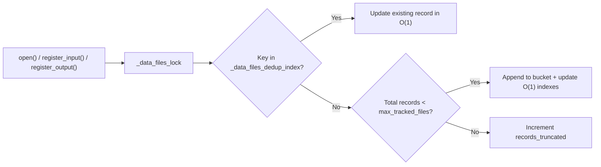

# IPD: File I/O O(1) indexing, record cap, and streaming-hash fast path

- Date: 2026-11-27
- Kind: child
- Concern: Eight-lens rollup findings `ROLL-09` (`PERF-1` / `MEM-1`: `O(N^2)` linear scans under `_data_files_lock` measured at 1,111 ms for N=2,000 and unbounded growth in `Run.data_files` and `_pending_file_registrations`), `ROLL-30` (`PERF-7`: streaming file hashing 8.2x slower than `stat` due to per-chunk `monotonic()`, lock, and 3-level `memoryview` wrappers even when caps are 0), and `MEM-9` (uncapped `_warned_invalid_algorithms`), surfaced by `performance` and `memory-resources`.
- Scope: Replace linear scans in `src/pubrun/capture/file_io.py` with `O(1)` lookup indexes, add configurable `[capture.file_io].max_tracked_files` (default `5000`) with `records_truncated` accounting in `default.toml` and `schemas/manifest.schema.json`, fast-path uncapped streaming hashes and exact `bytes`/`bytearray` writes, cap `_warned_invalid_algorithms`, and add scaling/bound regression tests in `tests/test_file_io_provenance.py`.
- Scope-Paths: src/pubrun/capture/file_io.py, src/pubrun/resources/default.toml, schemas/manifest.schema.json, tests/test_file_io_provenance.py
- Item-Dependencies: none
- Status: to-review
- Review-Depth: complex
- Short-Description: Eliminate O(N^2) scans and unbounded growth in capture/file_io.py with O(1) indexes, configurable max_tracked_files cap, and zero-cap streaming hash fast path
- Work-Kind: bug
- Priority: high
- Set: assess-8l
- Order: 3
- Highest E allocated: 04
- Author: Antigravity
- Id: l596kn

> Write and proofread this plan per the technical writing standard, `.aw/system/workflows/technical-writing/technical-writing.md`, including requirement 12 (diagrams).

## Workflow history

- 2026-11-27 /assess-all (Antigravity): created Child 03 of Set `assess-8l` covering `file_io` O(1) indexing, record cap, and streaming-hash fast path (`ROLL-09`, `ROLL-30`, `MEM-9`).

## Goal

Make `pubrun.open()` and `pubrun.register_input()`/`register_output()` scale linearly (`O(1)` per file) with bounded memory and manifest size on high-I/O workloads, while removing unnecessary per-chunk lock, timing, and `memoryview` overhead on streaming hashes when no hash caps are active.

### Indexed and bounded file provenance flow

## Detailed Implementation Checklist (TODO)

Execution-state rule: mark an `E-*` item complete only after performing the action. Accepted execution states: blocked, failed, pending, performed; terminal gate demands `performed`.

### Task group 1: O(1) indexing and record cap

- [ ] E-01 Replace linear scans with `O(1)` lookup indexes in `src/pubrun/capture/file_io.py`:
  - Maintain per-run indexes lazily attached to the `Run` instance (guarded by `_data_files_lock`):
    - `_data_files_dedup_index`: `Dict[str, Dict[Tuple, Dict[str, Any]]]` mapping `(bucket_name, _record_dedup_key(record)) -> existing_record` for `append_or_deduplicate_record()`.
    - `_completed_hash_index`: `Dict[str, Dict[Tuple, List[Dict[str, Any]]]]` keyed by `(path, role, label, alg)` for `_find_unchanged_completed_record()`.
    - `_pending_file_index`: `Dict[Tuple, Any]` keyed by `(normalized_path, role, label)` for `_upgrade_pending_or_append()` and `register_file_provenance()`.
  - Keep `data_files["inputs"|"outputs"|"mixed"]` list insertion order and deduplication semantics identical to existing behavior; handle fallback when a caller mutates `data_files` directly in tests (e.g. rebuilding index if lengths diverge).
  - Cap `_warned_invalid_algorithms` at 256 entries.
  - Depends on: none
  - Expected outcome: Deduplicating and registering 2,000 distinct files runs in linear time (`<= 25 ms`, down from `1,111 ms`) with identical manifest output.
  - Execution state: pending

- [ ] E-02 Add configurable `[capture.file_io].max_tracked_files` record cap in `src/pubrun/capture/file_io.py`, `src/pubrun/resources/default.toml`, and `schemas/manifest.schema.json`:
  - Add `max_tracked_files = 5000` under `[capture.file_io]` in `src/pubrun/resources/default.toml` (documenting `0` disables tracking and matches `[capture.subprocesses].max_tracked_commands`).
  - Enforce `max_tracked_files` across `data_files["inputs"|"outputs"|"mixed"]` and `_pending_file_registrations` in `file_io.py`: deduplication updates to already-tracked records still succeed, while new records past the cap increment `data_files["records_truncated"]` (or summary counter) without appending.
  - Add the optional `records_truncated` integer property to `data_files` in `schemas/manifest.schema.json` (strictly additive v1.0 schema extension).
  - Depends on: E-01
  - Expected outcome: Opening or registering 20,000 unique files bounds stored records to `max_tracked_files`, records the exact truncation count, and validates against `schemas/manifest.schema.json`.
  - Execution state: pending

### Task group 2: Streaming-hash fast path and tests

- [ ] E-03 Optimize `ProvenanceFileProxy` and `FileIoBudgetTracker` in `src/pubrun/capture/file_io.py`:
  - Cache `self._has_caps: bool = (max_hash_bytes > 0 or max_total_hash_bytes > 0 or max_total_hash_seconds > 0.0)` on `FileIoBudgetTracker`.
  - When `not self._has_caps`, skip per-chunk `check_stream_progress()`, `time.monotonic()`, and lock acquisition inside `ProvenanceFileProxy._update_stream_hash()`. When caps are enabled, check caps at `>= 64 KiB` byte intervals instead of on every small write.
  - In `ProvenanceFileProxy.write()`, bypass the 3-level `memoryview(data)` -> `mv.cast("B")` -> `bv[:n]` wrapper when `isinstance(data, (bytes, bytearray)) and n == len(data)` and call `hasher.update(data)` directly.
  - Depends on: E-02
  - Expected outcome: 10,000 x 256-byte binary writes at `level="hash"` drop from `~76.8 ms` to `<= 15 ms` while preserving byte-identical SHA-256 digests and cap enforcement when caps are set.
  - Execution state: pending

- [ ] E-04 Add scaling, cap/truncation, schema, and streaming-hash tests in `tests/test_file_io_provenance.py`:
  - Test linear scaling and deduplication parity across 2,000 distinct records.
  - Test `max_tracked_files=100` across `pubrun.open()`, `register_input()`, and `register_output(defer=True)` asserting stored count `<= 100`, accurate `records_truncated`, deduplication updates still work, and manifest validates against `schemas/manifest.schema.json`.
  - Test streaming SHA-256 digest accuracy for `bytes`, `bytearray`, `memoryview`, partial writes, and both uncapped (`0`) and capped budget paths.
  - Depends on: E-03
  - Expected outcome: All new and existing `file_io` and manifest-schema tests pass and three-platform `mypy` exits `0`.
  - Execution state: pending

## Project conventions discovered (Step 0)

- `schemas/manifest.schema.json` enforces Draft 2020-12 v1.0 manifest structure; additions must remain backward-compatible and optional.
- `[capture.subprocesses].max_tracked_commands = 5000` establishes the repo convention for bounding tracked record lists.

## Findings

| ID | Concerns | Severity | Remediation Risk | Persona | Summary |
|---|---|---|---|---|---|
| `ROLL-09` | performance; memory-resources | High | Low (`complexity`) | Software engineer / Operator | `file_io.py` linearly scans `data_files` buckets and `_pending_file_registrations` under `_data_files_lock` (1,111 ms at N=2,000) with no record cap. |
| `ROLL-30` | performance | Medium | Low (`complexity`) | Software engineer | `ProvenanceFileProxy` allocates 3 `memoryview` contexts, calls `monotonic()` twice, and locks on every write even when hash caps are 0 (76.8 ms vs 9.4 ms `stat`). |
| `MEM-9` | memory-resources | Low | Low (`functionality`) | Operator | `_warned_invalid_algorithms` set is uncapped. |

## Proposed changes (ordered, validatable)

1. `E-01` (`src/pubrun/capture/file_io.py`): Add `O(1)` lookup indexes alongside bucket and pending lists, and cap `_warned_invalid_algorithms`.
2. `E-02` (`src/pubrun/capture/file_io.py`, `src/pubrun/resources/default.toml`, `schemas/manifest.schema.json`): Add `[capture.file_io].max_tracked_files = 5000` and additive `records_truncated` counter.
3. `E-03` (`src/pubrun/capture/file_io.py`): Add `_has_caps` fast path and exact `bytes`/`bytearray` direct hash update in `ProvenanceFileProxy`.
4. `E-04` (`tests/test_file_io_provenance.py`): Add scaling, cap/truncation, schema, and streaming-hash regression tests.

## Deferred / out of scope (with reason)

- Standalone scaling benchmark script exercising 1,000+ file operations lives in `benchmarks/` and is owned by child `6y55x4` (Order 10).
  - Carrier: 6y55x4

## Scope check

- Over-scope: none. Every change targets `ROLL-09`, `ROLL-30`, and `MEM-9` within `file_io.py`, `default.toml`, and `manifest.schema.json`.
- Under-scope: none. Indexing, capping, schema alignment, and streaming-hash fast paths are all included.

## Required tests / validation

1. `pytest tests/test_file_io_provenance.py tests/test_file_registration.py tests/test_manifest_schema.py -v`
2. `mypy && mypy --platform win32 && mypy --platform darwin`

## Spec / documentation sync

`src/pubrun/resources/default.toml` documents `[capture.file_io].max_tracked_files` and `schemas/manifest.schema.json` adds the optional `records_truncated` property in `E-02`.

## Open questions

None. `max_tracked_files = 5000` matches `[capture.subprocesses].max_tracked_commands = 5000`, and `records_truncated` is an additive optional property on v1.0 manifests.

## Validation and cross-check (verify before reporting done)

Validation-state rule: inspect evidence in a separate pass. Accepted validation results: blocked, failed, pass, pending; terminal gate demands `pass`.

- [ ] V-01 validates E-01
  - Required evidence: Pasted benchmark/test output confirming 2,000 distinct file records complete in `<= 25 ms` with identical deduplication results.
  - Observed evidence:
  - Result: pending

- [ ] V-02 validates E-02
  - Required evidence: Pasted `pytest` output confirming `max_tracked_files` caps stored records and `_pending_file_registrations`, sets `records_truncated`, and validates against `schemas/manifest.schema.json`.
  - Observed evidence:
  - Result: pending

- [ ] V-03 validates E-03
  - Required evidence: Pasted benchmark/test output confirming 10,000 x 256B binary writes at `level="hash"` complete in `<= 15 ms` with exact SHA-256 digests and intact cap enforcement when caps > 0.
  - Observed evidence:
  - Result: pending

- [ ] V-04 validates E-04
  - Required evidence: Pasted output of `pytest tests/test_file_io_provenance.py tests/test_file_registration.py tests/test_manifest_schema.py` and three-platform `mypy` exiting `0`.
  - Observed evidence:
  - Result: pending

## Approval and execution gate

Proposal only; requires review and explicit human approval before execution (`aw set plan approved l596kn --by-human`). Not auto-executed. On completion, finalize to `.aw/records/plans/executed/`.
