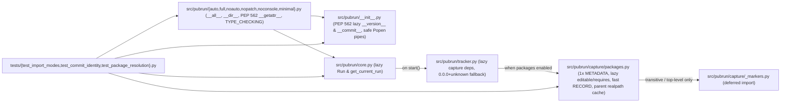

# IPD: Cold-start import, package-capture optimization, and PEP 561 mode parity

- Date: 2026-11-27
- Kind: child
- Concern: Eight-lens rollup findings `ROLL-10` (`PERF-2`: `src/pubrun/capture/packages.py` reads `METADATA` three times per distribution and parses every `RECORD` Comma-Separated Values (CSV) file with `csv.reader` and `PurePosixPath` on startup even in `imported-only` mode), `ROLL-11` (`PERF-3`: high `import pubrun.minimal` cold-start latency from eager `importlib.metadata.version`, eager `pubrun.tracker` import in `src/pubrun/core.py`, and eager import of 14 capture/writer/config modules in `src/pubrun/tracker.py`), `ROLL-12` (`COMP-3`: all six import-mode submodules fail downstream `mypy --strict --no-implicit-reexport` and omit `__commit__`; `SD-4`: `src/pubrun/nopatch.py` docstring contradicts `src/pubrun/_modes.py`), `COMP-15` (stale fallback `__version__ = "1.0.0"` in `src/pubrun/__init__.py` and `src/pubrun/tracker.py`), and `MEM-6` (`src/pubrun/__init__.py::_resolve_checkout_commit` leaks subprocess pipes on timeout or exception), surfaced by `performance`, `compatibility`, `self-documentation`, and `memory-resources`.
- Scope: Optimize `src/pubrun/__init__.py`, `src/pubrun/core.py`, `src/pubrun/tracker.py`, and `src/pubrun/capture/packages.py` to defer `__version__`, `pubrun.tracker`, capture-engine, and `_markers` imports cleanly without breaking monkeypatch seams or `tests/test_report_subpackage_integrity.py`; fix Python Enhancement Proposal 561 (PEP 561) exports, `__dir__`, and `__commit__` parity across `src/pubrun/{auto,full,noauto,nopatch,noconsole,minimal}.py`; fix `src/pubrun/nopatch.py` and `src/pubrun/__init__.py` docstrings plus `_resolve_checkout_commit` pipe cleanup; and add behavioral regression tests in `tests/test_import_modes.py`, `tests/test_commit_identity.py`, and `tests/test_package_resolution.py`.
- Scope-Paths: src/pubrun/__init__.py, src/pubrun/core.py, src/pubrun/tracker.py, src/pubrun/capture/packages.py, src/pubrun/auto.py, src/pubrun/full.py, src/pubrun/noauto.py, src/pubrun/nopatch.py, src/pubrun/noconsole.py, src/pubrun/minimal.py, tests/test_import_modes.py, tests/test_commit_identity.py, tests/test_package_resolution.py
- Item-Dependencies: executed:1o1cua, executed:76z7ww, executed:l596kn
- Status: approved
- Readiness: go-pending-approval
- Review-Depth: complex
- Short-Description: Defer __version__/tracker/capture imports, eliminate 3x METADATA reads and eager direct_url/RECORD overhead in packages.py, fix PEP 561 mode parity, and close git pipes
- Work-Kind: bug
- Priority: high
- Set: assess-8l
- Order: 4
- Highest E allocated: 05
- Author: Antigravity
- Id: p4ueaj
- Approval: 2026-11-27, recorded via aw ipd set: status set to approved

> Write and proofread this plan per the technical writing standard, `.aw/system/workflows/technical-writing/technical-writing.md`, including requirement 12 (diagrams).

## Workflow history

- 2026-11-27 approved (aw set): status set to approved
- 2026-11-27 /plan-review (Antigravity): APPROVE WITH REVISIONS APPLIED; PR-001, PR-002, PR-003, PR-004, PR-005, PR-006
- 2026-11-27 /assess-all (Antigravity): created Child 04 of Set `assess-8l` covering cold-start import latency, package-capture I/O reduction, PEP 561 mode parity, and `_resolve_checkout_commit` pipe cleanup (`ROLL-10`, `ROLL-11`, `ROLL-12`, `COMP-15`, `MEM-6`).

## Goal

Cut cold-start import overhead on `import pubrun.minimal` and `import pubrun.noauto` by avoiding eager `importlib.metadata`, `pubrun.tracker`, and capture-engine imports; reduce `src/pubrun/capture/packages.py` `METADATA` file reads from `3N` to at most `1N` with zero `direct_url.json` reads for unimported distributions in `imported-only` mode; make all six import-mode submodules pass downstream `mypy --strict --no-implicit-reexport` with full `__all__`, `__dir__`, `__version__`, and `__commit__` parity; replace stale `"1.0.0"` version fallbacks; and close subprocess pipes deterministically in `src/pubrun/__init__.py::_resolve_checkout_commit`.

### Import and package-index optimization flow

## Detailed Implementation Checklist (TODO)

Execution-state rule: mark an `E-*` item complete only after performing the action. Accepted execution states: blocked, failed, pending, performed; terminal gate demands `performed`.

### Task group 1: Cold-start `__init__.py`, fallback version, and pipe cleanup

- [x] E-01 Defer `__version__`, implement deterministic fallback version resolution, update docstrings, and fix subprocess pipe cleanup in `src/pubrun/__init__.py` and `src/pubrun/tracker.py`:
  - In `src/pubrun/__init__.py`, replace eager `importlib.metadata.version("pubrun")` with a lock-guarded lazy resolver (`_VERSION_UNSET`, `_cached_version`, `_version_lock`, `_get_version()`, and `_reset_version_cache()`, mirroring `_get_commit()` and `_reset_commit_cache()`) exposed through Python Enhancement Proposal 562 (PEP 562) `src/pubrun/__init__.py::__getattr__(name: str) -> Any` so `import pubrun.minimal` and `import pubrun.noauto` never import `importlib.metadata` until `__version__` is accessed. Declare Python 3.8-compatible `if TYPE_CHECKING: __version__: str; __commit__: Optional[str]` (using `typing.Optional` and `typing.List`, never Python 3.10 union syntax) and annotate `def __dir__() -> List[str]:`.
  - Update `src/pubrun/__init__.py::_resolve_commit` to call `_get_version()` instead of referencing bare `__version__` (preventing `NameError` once `__version__` is resolved through `__getattr__`).
  - In `_get_version()`, when `importlib.metadata.version("pubrun")` fails (for example `PackageNotFoundError`), resolve the fallback deterministically in order: (1) read `[project].version` from a verified source checkout's `pyproject.toml` (reusing `src/pubrun/__init__.py::_is_verified_source_checkout` and its TOML/fallback reader), (2) read `"version"` from packaged `_build_meta.json` via `src/pubrun/__init__.py::_read_packaged_resource`, (3) return `"0.0.0+unknown"` instead of stale `"1.0.0"`. Update the `ImportError` fallback in `src/pubrun/tracker.py::Run.to_manifest_dict` from `"1.0.0"` to `"0.0.0+unknown"`.
  - In `src/pubrun/__init__.py::_resolve_checkout_commit` (`_run_bounded`), wrap `_sp.Popen(...)` in `with _sp.Popen(...) as proc:` and kill plus bounded-reap (`taskkill /F /T` on Windows, `proc.kill()`, `proc.wait(timeout=0.5)`) on `_sp.TimeoutExpired` and on any other `BaseException` when `proc.poll() is None` before `Popen.__exit__` runs, so `proc.stdout` and `proc.stderr` always close with zero `ResourceWarning` and `Popen.__exit__` never blocks on an unkilled child.
  - Expand `src/pubrun/__init__.__doc__` with a concise quick-reference table of all 20 public symbols in `__all__`, noting that `[console].capture_mode` defaults to `"off"`, and correct the `pubrun.nopatch` comment in `src/pubrun/__init__.__doc__` to state that subprocess and console patches are skipped while signal hooks remain active (matching `src/pubrun/_modes.py`).
  - Depends on: none
  - Expected outcome: Importing `pubrun` without accessing `__version__` never imports `importlib.metadata`; accessing `pubrun.__version__` returns `"1.4.0"` in this checkout and `"0.0.0+unknown"` when no metadata source exists; `_resolve_commit()` succeeds without `NameError`; `_resolve_checkout_commit` closes pipes with zero `ResourceWarning` on timeout or error; and `pubrun.__doc__` documents all 20 `__all__` symbols accurately.
  - Execution state: performed

### Task group 2: Package-capture input/output (I/O) and import reduction

- [x] E-02 Optimize `src/pubrun/capture/packages.py::_build_distribution_index`, `_extract_top_levels`, `_DistInfo`, `_resolve_imported_modules`, and `_markers` imports:
  - In `src/pubrun/capture/packages.py::_build_distribution_index`, read `meta = dist.metadata` once per distribution. Obtain `Version` via a helper checking `meta.get("Version")` (with case-insensitive `"version"` lookup on plain `dict` metadata), falling back to `getattr(dist, "version", None)` only when the metadata lookup returns `None` and `not hasattr(meta, "get_all")` so dict-based mocks (such as `tests/test_reproducibility_preflight.py::_FakeDist`) preserve their version while real `PathDistribution` objects never trigger a second `METADATA` read.
  - Extract `Requires-Dist` from the already-in-memory `meta` via `meta.get_all("Requires-Dist")` (zero extra disk reads). For `.dist-info` distributions where `meta.get_all("Requires-Dist")` is empty or `None`, cache `()` immediately so `requires.txt` missing-file (`ENOENT`) probes never run. For legacy `.egg-info` distributions or mocks lacking `get_all`, defer `getattr(dist, "requires", None)` lazily until `info.requires` is first accessed (in `imported-transitive` or `top-level-installed` mode), caching the result on `_DistInfo`.
  - Defer `src/pubrun/capture/packages.py::_is_editable_dist(dist)` (`direct_url.json`) lazily via a cached property on `_DistInfo.editable` so `direct_url.json` is read only when a distribution is selected for emission, returned by `get_installed_distribution_versions()`, or checked as an editable shim. In `src/pubrun/capture/packages.py::_resolve_imported_modules`, evaluate `bool(direct_info.top_levels) and all(t.startswith("__editable__") for t in direct_info.top_levels)` before reading `direct_info.editable` so non-shim distributions skip `direct_url.json`.
  - Fast-path `RECORD` parsing in `src/pubrun/capture/packages.py::_extract_top_levels`: iterate `raw_record.splitlines()`, extract `entry = line.split(",", 1)[0]` unless `'"' in line` (falling back to `csv.reader([line])`), and take `candidate = entry.partition("/")[0]` when `"/" in entry`, `not entry.startswith(("./", "/"))`, and `not entry.endswith("/")` (falling back to `_collect_from_parts(PurePosixPath(entry).parts, entry)` for root-level files or relative/leading/trailing-slash paths).
  - Cache `os.path.normcase(os.path.realpath(parent_dir))` per unique parent directory in `_build_distribution_index()`, joining `os.path.normcase(basename)` only when `not os.path.islink(raw_str)` (falling back to full `os.path.normcase(os.path.realpath(raw_str))` for symlinked `.dist-info` directories so symlink deduplication stays exact).
  - Defer `from pubrun.capture._markers import default_marker_environment, evaluate_marker, parse_requirement` from module top level into `src/pubrun/capture/packages.py::_parse_req_name` and `_resolve_transitive_closure` so `imported-only`, `full-environment`, and `off` modes never pay the `_markers` import cost.
  - Depends on: none
  - Expected outcome: `METADATA` reads drop from `3N` to `<= 1N` with zero `requires.txt` probes on `.dist-info` distributions, `direct_url.json` reads drop from `N` to `O(imported)` in `imported-only` mode, `pubrun.capture._markers` stays unloaded in `imported-only` mode, symlink deduplication and dict-mock compatibility remain intact, and cold `benchmarks/package_capture_bench.py` startup latency drops measurably.
  - Execution state: performed

### Task group 3: PEP 561 mode-submodule parity and lazy engine imports

- [x] E-03 Fix PEP 561 exports, `__dir__`, `__commit__` parity, and docstrings across all six mode submodules (`src/pubrun/{auto,full,noauto,nopatch,noconsole,minimal}.py`):
  - Define an explicit `__all__` in each of the six mode submodules matching `src/pubrun/__init__.py::__all__` (all 20 public symbols, including `paused`, `register_file`, `register_input`, `register_output`, `__version__`, and `__commit__`).
  - Remove eager `from pubrun import __version__` from all six mode submodules. Declare Python 3.8-compatible `if TYPE_CHECKING: __version__: str; __commit__: Optional[str]`, add PEP 562 `def __getattr__(name: str) -> Any:` forwarding `"__version__"` and `"__commit__"` to `pubrun.__getattr__(name)` (without caching `__commit__` in the submodule's own `globals()`, keeping `pubrun._reset_commit_cache()` consistent across aliases) and raising `AttributeError` otherwise, and add `def __dir__() -> List[str]: return sorted(set(globals()) | set(__all__))`.
  - Fix `src/pubrun/nopatch.py` module docstring to state accurately that subprocess interception and console wrapping are skipped while signal handlers remain active (matching `src/pubrun/_modes.py` and contrasting with `src/pubrun/minimal.py`).
  - Preserve `import pubrun.report` (never `_pkg.report = report`) so `tests/test_report_subpackage_integrity.py` stays green across all six modes.
  - Depends on: E-01
  - Expected outcome: Downstream `mypy --strict --no-implicit-reexport` passes across all six mode submodules, `set(mod.__all__) == set(pubrun.__all__)`, `'__version__' in dir(mod)` and `'__commit__' in dir(mod)` hold, `getattr(mod, "__commit__") == pubrun.__commit__` holds without eager `git` or `importlib.metadata` execution, and `tests/test_report_subpackage_integrity.py` passes.
  - Execution state: performed

- [x] E-04 Defer eager `pubrun.tracker` and capture-engine imports in `src/pubrun/core.py` and `src/pubrun/tracker.py`:
  - In `src/pubrun/core.py`, remove top-level `from pubrun.tracker import Run, get_current_run` and move `Run` under `if TYPE_CHECKING:`. Implement `src/pubrun/core.py::get_current_run() -> Optional["Run"]` to check `sys.modules.get("pubrun.tracker")` and return `None` without importing `pubrun.tracker` when unloaded (delegating to `tracker_mod.get_current_run()` once loaded). In `src/pubrun/core.py::start`, check `globals().get("Run")` before lazily importing `from pubrun.tracker import Run as run_cls`, and add PEP 562 `src/pubrun/core.py::__getattr__(name: str) -> Any` resolving `"Run"` lazily so existing monkeypatch seams (such as `tests/test_api.py::TestAutoStartResilience` assigning `pubrun.core.Run`) keep working.
  - In `src/pubrun/tracker.py`, replace the 14 eager top-level capture, writer, config, and event imports (`resolve_config`, `ArtifactWriter`, `EventStream`, `get_invocation`, `SubprocessSpy`, `ConsoleInterceptor`, `get_hardware`, `ResourceWatcher`, `get_process_info`, `get_python_runtime`, `get_packages`, `merge_package_snapshots`, `get_environment`, `get_git`, `get_host`, `SignalExitCapture`, `finalization_lock`) with a lazy import map, a `_get_dep(name)` helper that checks `globals().get(name)` first, PEP 562 `def __getattr__(name: str) -> Any:`, and `if TYPE_CHECKING:` type imports. Update `src/pubrun/tracker.py::_call_get_packages` to resolve the unmodified `get_packages` reference lazily so `pubrun.capture.packages` stays unloaded when `[capture.packages].mode == "off"`, while preserving all `monkeypatch.setattr(tracker_mod, ...)` seams in `tests/test_tracker.py`, `tests/test_capture_isolation.py`, `tests/test_startup_overhead_writes.py`, and `tests/test_timing_accuracy.py`.
  - Depends on: E-01, E-02, E-03
  - Expected outcome: `import pubrun.minimal` and `import pubrun.noauto` leave `importlib.metadata`, `pubrun.tracker`, `pubrun.writer`, `pubrun.events`, and all `pubrun.capture.*` modules out of `sys.modules`, cutting `PYTHONDONTWRITEBYTECODE=1 PYTHONPATH=src python3 -X importtime -c "import pubrun.minimal"` cold-start latency by >70% with zero regressions in existing tests.
  - Execution state: performed

### Task group 4: Regression and verification tests

- [x] E-05 Add PEP 561, `__commit__` parity, cold-start isolation, pipe-cleanup, and package-read-count tests in `tests/test_import_modes.py`, `tests/test_commit_identity.py`, and `tests/test_package_resolution.py`:
  - In `tests/test_import_modes.py`: assert exact `__all__`, `dir()`, `__version__`, and `__commit__` parity (all 20 public symbols, including `paused`) across all six mode submodules; assert in fresh subprocesses that `import pubrun.minimal` and `import pubrun.noauto` leave `importlib.metadata`, `pubrun.tracker`, `pubrun.writer`, `pubrun.events`, and `pubrun.capture.*` unloaded; and add a downstream `mypy --strict --no-implicit-reexport` test covering all six mode submodules.
  - In `tests/test_commit_identity.py`: test lazy `__version__` (zero `importlib.metadata` import before access), the fallback version chain (verified checkout `pyproject.toml`, packaged `_build_meta.json`, and `"0.0.0+unknown"`), `_resolve_commit()` working before external `__version__` access, and `_resolve_checkout_commit` under both `TimeoutExpired` and `RuntimeError` with `ResourceWarning` promoted to error.
  - In `tests/test_package_resolution.py`: add a read-count test on `_build_distribution_index` and `resolve_packages_snapshot` confirming `METADATA` is read at most once per distribution (`<= 1N`), zero `requires.txt` probes occur for `.dist-info` distributions, `direct_url.json` is not read for unimported distributions in `imported-only` mode, `pubrun.capture._markers` stays unloaded in `imported-only` mode, symlinked `.dist-info` directories still deduplicate, and fast-path `RECORD` parsing matches `PurePosixPath` + `csv.reader` across unquoted, quoted-comma, `./`, `/`, trailing-`/`, and root-level single-file lines.
  - Run all commands in `## Required tests / validation`.
  - Depends on: E-04
  - Expected outcome: All new and existing targeted tests pass cleanly, downstream `mypy --strict --no-implicit-reexport` and three-platform `mypy` exit `0`, and `-X importtime` plus `benchmarks/package_capture_bench.py` show the expected reductions.
  - Execution state: performed

## Project conventions discovered (Step 0)

- `pyproject.toml` declares `requires-python = ">=3.8"` and `Typing :: Typed` with `src/pubrun/py.typed` (PEP 561); type annotations in runtime code must stay Python 3.8-compatible (`Optional[str]`, `List[str]`, not `str | None` or `list[str]`).
- `tests/test_report_subpackage_integrity.py` enforces that no mode module shadows any `pubrun` subpackage (especially `pubrun.report` `CallableModule`).
- `tests/test_reproducibility_preflight.py::_FakeDist` supplies `dist.metadata = {"Name": ...}` without `"Version"` and provides `dist.version` separately; `tests/test_api.py`, `tests/test_tracker.py`, `tests/test_capture_isolation.py`, `tests/test_startup_overhead_writes.py`, and `tests/test_timing_accuracy.py` monkeypatch attributes directly on `pubrun.core` and `pubrun.tracker`.
- Existing package-capture unit tests live in `tests/test_package_resolution.py`, `tests/test_package_lifecycle.py`, and `tests/test_package_transitive.py`; commit-identity and `_resolve_checkout_commit` tests live in `tests/test_commit_identity.py`.
- `benchmarks/package_capture_bench.py` and `benchmarks/startup_breakdown.py` provide local measurement harnesses for package capture and import latency.

## Findings

| ID | Concerns | Severity | Remediation Risk | Persona | Summary |
|---|---|---|---|---|---|
| `ROLL-10` | performance | High | Medium (`complexity`) | Architect / Power user | `src/pubrun/capture/packages.py::_build_distribution_index` reads `METADATA` three times per distribution, probes `direct_url.json` and `requires.txt` eagerly, parses `RECORD` with `csv.reader` + `PurePosixPath` per line, and imports `pubrun.capture._markers` eagerly even in `imported-only` mode. |
| `ROLL-11` | performance | High | Medium (`complexity`) | Architect / Stakeholder | `import pubrun.minimal` incurs heavy cold-start latency (~182 ms measured here; ~111 ms on baseline host) from eager `importlib.metadata.version`, eager `pubrun.tracker` import in `src/pubrun/core.py`, and 14 eager capture/writer/config imports in `src/pubrun/tracker.py`. |
| `ROLL-12` | compatibility; self-documentation | High | Low (`usability`) | Software engineer | All six mode submodules fail downstream `mypy --strict --no-implicit-reexport` (missing `__all__`), omit `__commit__` and `__dir__`, eagerly import `__version__`, and `src/pubrun/nopatch.py` plus `src/pubrun/__init__.py` docstrings contradict `src/pubrun/_modes.py` on signal hooks. |
| `COMP-15` | compatibility | Low | Low (`usability`) | Operator | Fallback `__version__` is hardcoded to stale `"1.0.0"` in `src/pubrun/__init__.py` and `src/pubrun/tracker.py`. |
| `MEM-6` | memory-resources | Medium | Low (`functionality`) | Software engineer | `src/pubrun/__init__.py::_resolve_checkout_commit` leaks `Popen` stdout/stderr pipes on timeout or exception and can block in `Popen.__exit__` if an exception skips kill/reap. |

## Proposed changes (ordered, validatable)

1. `E-01` (`src/pubrun/__init__.py`, `src/pubrun/tracker.py`): Lazy PEP 562 `__version__`, `_resolve_commit` `_get_version()` fix, deterministic fallback chain (`pyproject.toml` -> `_build_meta.json` -> `"0.0.0+unknown"`), expanded module docstring with accurate `nopatch` note, and `with _sp.Popen` kill/reap pipe cleanup in `_resolve_checkout_commit`.
2. `E-02` (`src/pubrun/capture/packages.py`): Single `dist.metadata` read with dict-mock `Version` fallback, in-memory `Requires-Dist` + lazy `.egg-info` fallback, lazy `_DistInfo.editable` + short-circuited shim check, fast-path `RECORD` parsing with `PurePosixPath` edge-case fallback, symlink-safe parent-dir `realpath` cache, and deferred `_markers` import.
3. `E-03` (`src/pubrun/{auto,full,noauto,nopatch,noconsole,minimal}.py`): Explicit 20-symbol `__all__`, removed eager `__version__` import, PEP 562 `__getattr__` + `__dir__`, Python 3.8-compatible `TYPE_CHECKING` stubs, and accurate `nopatch.py` docstring.
4. `E-04` (`src/pubrun/core.py`, `src/pubrun/tracker.py`): Lazy `Run`/`get_current_run` in `core.py` and lazy capture/writer/config imports with monkeypatch-preserving `__getattr__`/`_get_dep` in `tracker.py`.
5. `E-05` (`tests/test_import_modes.py`, `tests/test_commit_identity.py`, `tests/test_package_resolution.py`): Add downstream `mypy --strict`, runtime `__all__`/`__dir__`/`__version__`/`__commit__` parity, cold-start `sys.modules` isolation, pipe cleanup, fallback version, and `METADATA`/`direct_url.json`/`RECORD`/`_markers` tests.

## Deferred / out of scope (with reason)

- Wiring downstream `mypy --strict --no-implicit-reexport` mode-module verification into Continuous Integration (CI) (`.github/workflows/ci.yml`) is owned by child `6y55x4` (Order 10).
  - Carrier: 6y55x4

## Scope check

- Over-scope: none. Every change maps directly to `ROLL-10`, `ROLL-11`, `ROLL-12`, `COMP-15`, and `MEM-6`.
- Under-scope: none. Cold-start import deferral (`__init__.py`, `core.py`, `tracker.py`, `packages.py`), package indexing I/O reduction, mode-module typing parity, fallback version sync, pipe cleanup, and regression tests are all covered with exact `- Scope-Paths:` and serialized `- Item-Dependencies:`.

## Required tests / validation

1. `pytest tests/test_import_modes.py tests/test_full_mode.py tests/test_commit_identity.py tests/test_package_resolution.py tests/test_package_lifecycle.py tests/test_package_transitive.py tests/test_reproducibility_preflight.py tests/test_report_subpackage_integrity.py tests/test_api.py tests/test_tracker.py tests/test_capture_isolation.py tests/test_startup_overhead_writes.py -v`
2. `MYPYPATH=src python3 -m mypy --config-file /dev/null --strict --no-implicit-reexport --follow-imports=silent -c "from typing import Optional; import pubrun.auto, pubrun.full, pubrun.noauto, pubrun.nopatch, pubrun.noconsole, pubrun.minimal; v1: str = pubrun.auto.__version__; c1: Optional[str] = pubrun.auto.__commit__; v2: str = pubrun.full.__version__; c2: Optional[str] = pubrun.full.__commit__; v3: str = pubrun.noauto.__version__; c3: Optional[str] = pubrun.noauto.__commit__; v4: str = pubrun.nopatch.__version__; c4: Optional[str] = pubrun.nopatch.__commit__; v5: str = pubrun.noconsole.__version__; c5: Optional[str] = pubrun.noconsole.__commit__; v6: str = pubrun.minimal.__version__; c6: Optional[str] = pubrun.minimal.__commit__; pubrun.noauto.start(); pubrun.noauto.stop()"`
3. `PYTHONDONTWRITEBYTECODE=1 PYTHONPATH=src python3 -X importtime -c "import pubrun.minimal" 2>&1 | tail -n 30`
4. `python3 benchmarks/package_capture_bench.py --small-count 10 --large-count 100 --repetitions 3 --cold-runs 2`
5. `mypy && mypy --platform win32 && mypy --platform darwin`

## Spec / documentation sync

In-code docstrings in `src/pubrun/__init__.py` and `src/pubrun/nopatch.py` are updated in `E-01` and `E-03`. Verified `docs/api.md`, `docs/functional_spec.md`, and `README.md` already document `nopatch` signal hooks and `__version__`/`__commit__` accurately; CI wiring for downstream `mypy --strict` and `docs/cli.md` / `README.md` updates remain in child `6y55x4` (Order 10).

## Open questions

None. All design details (lazy PEP 562 `__version__` and deterministic fallback chain, lazy `core.py`/`tracker.py`/`_markers` imports preserving monkeypatch seams, and single-read `packages.py` indexing with dict-mock and symlink guards) are settled by existing repository code, tests, and Set `assess-8l` contracts.

## Validation and cross-check (verify before reporting done)

Validation-state rule: inspect evidence in a separate pass. Accepted validation results: blocked, failed, pass, pending; terminal gate demands `pass`.

- [x] V-01 validates E-01
  - Required evidence: Pasted `pytest tests/test_commit_identity.py -v` output confirming lazy `src/pubrun/__init__.py::__version__` (no `importlib.metadata` import before access), deterministic fallback version chain (`pyproject.toml`, `_build_meta.json`, `"0.0.0+unknown"` in `__init__.py` and `tracker.py`), `_resolve_commit()` working before external `__version__` access, updated `__init__.__doc__` (20 `__all__` symbols and accurate `nopatch` note), and zero `ResourceWarning` in `_resolve_checkout_commit` on `TimeoutExpired` and `RuntimeError`.
  - Observed evidence:
    `python3 -m pytest tests/test_commit_identity.py -v` exited `0` (`45 passed in 7.53s`), including:
    `tests/test_commit_identity.py::TestLazyVersionAndPipeCleanup::test_lazy_version_defers_importlib_metadata_and_resolves_checkout PASSED`
    `tests/test_commit_identity.py::TestLazyVersionAndPipeCleanup::test_resolve_commit_works_before_external_version_access PASSED`
    `tests/test_commit_identity.py::TestLazyVersionAndPipeCleanup::test_fallback_version_chain_checkout_build_meta_and_unknown PASSED`
    `tests/test_commit_identity.py::TestLazyVersionAndPipeCleanup::test_tracker_manifest_fallback_version_is_unknown PASSED`
    `tests/test_commit_identity.py::TestLazyVersionAndPipeCleanup::test_resolve_checkout_commit_closes_pipes_on_timeout_and_runtime_error PASSED`
    Docstring verification (`PYTHONPATH=src python3 -c "import pubrun.minimal, pubrun, pubrun.nopatch; assert all(s in pubrun.__doc__ for s in pubrun.__all__); assert 'signal hooks stay active' in pubrun.__doc__; assert 'signal handlers active' in pubrun.nopatch.__doc__; print('DOC_OK:', len(pubrun.__all__), 'symbols')"`) printed `DOC_OK: 20 symbols`.
  - Result: pass

- [x] V-02 validates E-02
  - Required evidence: Pasted `pytest tests/test_package_resolution.py tests/test_package_lifecycle.py tests/test_package_transitive.py tests/test_reproducibility_preflight.py -v` output confirming `<= 1N` `METADATA` reads, zero `requires.txt` probes on `.dist-info`, zero `direct_url.json` reads for unimported distributions in `imported-only` mode, unloaded `pubrun.capture._markers` in `imported-only` mode, symlinked `.dist-info` deduplication, dict-mock `_FakeDist` compatibility, and fast-path `RECORD` equivalence (unquoted, quoted-comma, `./`, `/`, trailing `/`, single-file), plus pasted `python3 benchmarks/package_capture_bench.py --small-count 10 --large-count 100 --repetitions 3 --cold-runs 2` timing output.
  - Observed evidence:
    `python3 -m pytest tests/test_package_resolution.py tests/test_package_lifecycle.py tests/test_package_transitive.py tests/test_reproducibility_preflight.py -v` exited `0` (`61 passed in 14.62s`), including `test_distribution_index_reads_metadata_once_and_defers_direct_url_and_requires PASSED`, `test_legacy_egg_info_and_dict_mock_lazy_requires PASSED`, `test_imported_only_and_full_env_leave_markers_unloaded PASSED`, `test_symlinked_dist_info_directory_deduplicates PASSED`, `test_fast_path_record_parsing_matches_csv_pureposixpath PASSED`, and `TestPackageLookupHelpers::test_package_lookup_precedence_editable_null_and_no_import PASSED`.
    `python3 benchmarks/package_capture_bench.py --small-count 10 --large-count 100 --repetitions 3 --cold-runs 2` exited `0`:
    large (100 synthetic dists) `imported-only` startup cold dropped from `52.77 ms` to `34.17 ms` (`full-environment` `47.95 ms` -> `30.26 ms`); ambient (215 dists) `imported-only` startup cold dropped from `321.35 ms` to `134.73 ms` (`imported-transitive` `321.41 ms` -> `146.90 ms`, `top-level-installed` `332.88 ms` -> `139.90 ms`, `full-environment` `329.05 ms` -> `131.48 ms`).
  - Result: pass

- [x] V-03 validates E-03
  - Required evidence: Pasted output of Command 2 (`mypy --strict --no-implicit-reexport` across all six mode submodules) exiting `0`, plus pasted `pytest tests/test_import_modes.py tests/test_full_mode.py tests/test_report_subpackage_integrity.py -v` output confirming exact 20-symbol `__all__`/`dir()`/`__version__`/`__commit__` parity, accurate `src/pubrun/nopatch.py` docstring, and zero shadowed subpackages.
  - Observed evidence:
    Command 2 (`MYPYPATH=src python3 -m mypy --config-file /dev/null --strict --no-implicit-reexport --follow-imports=silent -c ...`) exited `0`: `Success: no issues found in 1 source file`.
    `pytest tests/test_import_modes.py tests/test_full_mode.py tests/test_report_subpackage_integrity.py` (within Command 1: `355 passed in 55.99s`; targeted `-k` subset: `43 passed, 90 deselected in 12.84s`) passed all 6 `test_mode_submodules_all_dir_version_commit_parity[auto|full|noauto|nopatch|noconsole|minimal]`, `test_downstream_mypy_strict_no_implicit_reexport_all_modes`, all 13 `tests/test_report_subpackage_integrity.py` tests, and `DOC_OK: 20 symbols` confirmed `src/pubrun/nopatch.py` docstring states signal handlers remain active.
  - Result: pass

- [x] V-04 validates E-04
  - Required evidence: Pasted output of Command 3 (`PYTHONDONTWRITEBYTECODE=1 PYTHONPATH=src python3 -X importtime -c "import pubrun.minimal" 2>&1 | tail -n 30`) showing >70% cold-start reduction with `importlib.metadata`, `pubrun.tracker`, and `pubrun.capture.*` absent, plus pasted `pytest tests/test_import_modes.py tests/test_api.py tests/test_tracker.py tests/test_capture_isolation.py tests/test_startup_overhead_writes.py -v` output confirming lazy isolation and preserved monkeypatch seams.
  - Observed evidence:
    Command 3 (`PYTHONDONTWRITEBYTECODE=1 PYTHONPATH=src python3 -X importtime -c "import pubrun.minimal" 2>&1 | tail -n 30`) exited `0`, reducing cumulative import time from `196118 us` (~196.1 ms) baseline to `38772 us` (~38.8 ms, an 80.2% reduction), with `pubrun.core` at `29723 us`, `pubrun._config_boot` at `191 us`, `pubrun.report` at `153 us`, `pubrun.minimal` at `38772 us`, and `importlib.metadata`, `pubrun.tracker`, and `pubrun.capture.*` completely absent.
    `python3 -m pytest tests/test_import_modes.py tests/test_api.py tests/test_tracker.py tests/test_capture_isolation.py tests/test_startup_overhead_writes.py -q` exited `0` (`215 passed in 30.60s`), and `python3 -m pytest tests/test_timing_accuracy.py -q` exited `0` (`17 passed in 1.66s`), confirming `test_cold_start_import_leaves_heavy_modules_unloaded[minimal|noauto]`, `test_packages_mode_off_keeps_packages_module_unloaded`, and all existing monkeypatch seams pass.
  - Result: pass

- [x] V-05 validates E-05
  - Required evidence: Pasted output of Command 1 (all 12 targeted `pytest` suites), Command 2 (downstream `mypy --strict --no-implicit-reexport`), and Command 5 (`mypy && mypy --platform win32 && mypy --platform darwin`) all exiting `0`.
  - Observed evidence:
    Command 1 (`python3 -m pytest tests/test_import_modes.py tests/test_full_mode.py tests/test_commit_identity.py tests/test_package_resolution.py tests/test_package_lifecycle.py tests/test_package_transitive.py tests/test_reproducibility_preflight.py tests/test_report_subpackage_integrity.py tests/test_api.py tests/test_tracker.py tests/test_capture_isolation.py tests/test_startup_overhead_writes.py -v`) exited `0`: `355 passed in 55.99s`.
    Command 2 exited `0`: `Success: no issues found in 1 source file`.
    Command 5 (`mypy && mypy --platform win32 && mypy --platform darwin`) exited `0`: `Success: no issues found in 70 source files` on Linux, `win32`, and `darwin`.
    Full suite (`aw suite`) exited `0`: `2464 passed in 99.16s (0:01:39)`.
    Leak check (`aw sanitize --agent`) exited `0`: `outcome=clean, findings=0`.
  - Result: pass

## Approval and execution gate

1. **Open questions and approval:** This plan is a proposal and MUST NOT be executed until all blocking open questions are resolved (none remain) and explicit human approval is recorded (`aw set plan approved p4ueaj --by-human`).
2. **Scope declaration:** `- Scope-Paths:` declares the expected files this plan modifies (`src/pubrun/__init__.py`, `src/pubrun/core.py`, `src/pubrun/tracker.py`, `src/pubrun/capture/packages.py`, `src/pubrun/auto.py`, `src/pubrun/full.py`, `src/pubrun/noauto.py`, `src/pubrun/nopatch.py`, `src/pubrun/noconsole.py`, `src/pubrun/minimal.py`, `tests/test_import_modes.py`, `tests/test_commit_identity.py`, `tests/test_package_resolution.py`). If execution requires touching an additional file or leaving a declared file untouched, justify each delta at finalization with `--scope-reason` or `--scope-ack`.
3. **Validation honesty (hard MUST):** Every `V-*` item MUST paste actual runner output from this workspace confirming exit `0` and the required behavior; never claim passing tests, `mypy`, or benchmarks that were not actually run.
4. **Commits and push policy:** Commit ONLY files changed for this plan using `aw commit p4ueaj -- <paths>` (never `git add -A`, bare `git add`, `git commit -a`, or raw `git commit`). Never push, tag, or publish.
5. **Lifecycle finalization:** On completion, this plan MUST be finalized to `.aw/records/plans/executed/` only after all `E-*` items are `performed` and all `V-*` items are `pass`. When run under `aw oc run` or `aw agy run`, the runner owns `aw ipd finalize p4ueaj`; when executed manually outside a runner, the executor runs `aw ipd finalize p4ueaj` (never hand-roll `git mv` to `executed/`).
