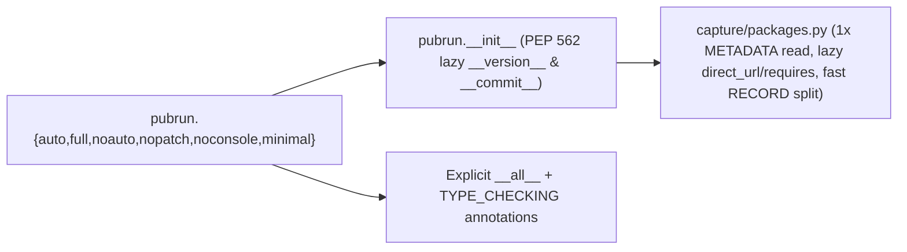

# IPD: Cold-start import, package-capture optimization, and PEP 561 mode parity

- Date: 2026-11-27
- Kind: child
- Concern: Eight-lens rollup findings `ROLL-10` (`PERF-2`: `packages.py` reads `METADATA` 3x per distribution and eagerly parses all `RECORD` CSVs on startup even in `imported-only` mode), `ROLL-11` (`PERF-3`: ~111 ms `import pubrun.minimal` cold start from eager `importlib.metadata.version` and eager import of 14 capture modules), `ROLL-12` (`COMP-3`: all 6 mode submodules fail downstream `mypy --strict` and omit `__commit__`; `SD-4`: `nopatch.py` docstring contradicts `_modes.py`), `COMP-15` (stale fallback `__version__ = "1.0.0"`), and `MEM-6` (`_resolve_checkout_commit` leaks subprocess pipes on timeout/error), surfaced by `performance`, `compatibility`, `self-documentation`, and `memory-resources`.
- Scope: Optimize `src/pubrun/__init__.py` and `src/pubrun/capture/packages.py`, defer `tracker`/capture-engine imports cleanly without breaking `test_report_subpackage_integrity.py`, fix PEP 561 exports and `__commit__` parity across `src/pubrun/{auto,full,noauto,nopatch,noconsole,minimal}.py`, fix `nopatch.py` docstring and `_resolve_checkout_commit` pipe cleanup, and add tests in `tests/test_import_modes.py` and `tests/test_package_capture.py`.
- Scope-Paths: src/pubrun/__init__.py, src/pubrun/capture/packages.py, src/pubrun/auto.py, src/pubrun/full.py, src/pubrun/noauto.py, src/pubrun/nopatch.py, src/pubrun/noconsole.py, src/pubrun/minimal.py, tests/test_import_modes.py, tests/test_package_capture.py
- Item-Dependencies: executed:1o1cua, executed:76z7ww
- Status: to-review
- Review-Depth: complex
- Short-Description: Cut import overhead via lazy __version__/engine imports, eliminate 3x METADATA reads and eager RECORD parsing in packages.py, and fix PEP 561 __all__/__commit__ parity across mode modules
- Work-Kind: bug
- Priority: high
- Set: assess-8l
- Order: 4
- Highest E allocated: 05
- Author: Antigravity
- Id: p4ueaj

> Write and proofread this plan per the technical writing standard, `.aw/system/workflows/technical-writing/technical-writing.md`, including requirement 12 (diagrams).

## Workflow history

- 2026-11-27 /assess-all (Antigravity): created Child 04 of Set `assess-8l` covering cold-start import latency, package-capture I/O reduction, PEP 561 mode parity, and `_resolve_checkout_commit` pipe cleanup (`ROLL-10`, `ROLL-11`, `ROLL-12`, `COMP-15`, `MEM-6`).

## Goal

Cut cold-start overhead on `import pubrun.minimal` / `import pubrun.noauto` by >70%, cut `packages.py` metadata file opens by >60% in `imported-only` mode, make all six import-mode submodules pass downstream `mypy --strict` with `__commit__` parity, and close subprocess pipes deterministically in `_resolve_checkout_commit()`.

### Import and package-index optimization flow

## Detailed Implementation Checklist (TODO)

Execution-state rule: mark an `E-*` item complete only after performing the action. Accepted execution states: blocked, failed, pending, performed; terminal gate demands `performed`.

### Task group 1: Cold-start `__init__.py` and pipe cleanup

- [ ] E-01 Defer `__version__`, update fallback version, enrich module docstring, and fix pipe cleanup in `src/pubrun/__init__.py`:
  - Resolve `__version__` lazily via PEP 562 `__getattr__` (matching `__commit__`), caching the resolved string in module globals so `import pubrun.minimal` never triggers `importlib.metadata` unless `__version__` is accessed. Declare `if TYPE_CHECKING: __version__: str; __commit__: Optional[str]`.
  - Sync the `PackageNotFoundError` fallback version with `pyproject.toml` (or read static `_build_meta.json` / `"0.0.0+unknown"` rather than stale `"1.0.0"`).
  - In `_resolve_checkout_commit()` (`_run_bounded`), wrap `_sp.Popen(...)` in `with _sp.Popen(...) as proc:` and kill/reap inside `try/finally` on `TimeoutExpired` or any `BaseException` so `proc.stdout` and `proc.stderr` pipes always close with zero `ResourceWarning`.
  - Expand `src/pubrun/__init__.__doc__` with a concise quick-reference table of all public symbols in `__all__`, noting that `[console].capture_mode` defaults to `"off"`.
  - Depends on: none
  - Expected outcome: `import pubrun.minimal` avoids importing `importlib.metadata`; accessing `pubrun.__version__` still returns `"1.4.0"`; `_resolve_checkout_commit` closes pipes on timeout/error.
  - Execution state: pending

### Task group 2: Package-capture I/O reduction

- [ ] E-02 Optimize `src/pubrun/capture/packages.py::_build_distribution_index()` and `_extract_top_levels()`:
  - Read `meta = dist.metadata` once per distribution; obtain `Version` via `meta.get("Version")` and `Requires-Dist` via `meta.get_all("Requires-Dist")` (falling back to `dist.requires` only for legacy `.egg-info` or mocks lacking `get_all`), eliminating 2/3 of `METADATA` reads and `requires.txt` ENOENT probes.
  - Defer `_is_editable_dist(dist)` (`direct_url.json`) and dependency-graph `requires` extraction lazily until a distribution is actually selected for emission or traversal.
  - Fast-path `_extract_top_levels()` `RECORD` parsing with `line.split(",", 1)[0]` and `partition("/")` for unquoted lines, falling back to `csv.reader` only when `'"'` appears in `line`.
  - Cache `os.path.realpath` per unique parent directory (e.g. `site-packages`) and join `basename` instead of calling `realpath` on every `.dist-info` path.
  - Depends on: none
  - Expected outcome: `METADATA` reads drop from `3N` to `<= 1N`, `direct_url.json` reads drop from `N` to `O(imported)` in `imported-only` mode, and cold `_build_distribution_index` latency drops by >=55%.
  - Execution state: pending

### Task group 3: PEP 561 mode-submodule parity and lazy engine imports

- [ ] E-03 Fix PEP 561 exports, `__commit__` parity, and docstrings across all six mode submodules (`src/pubrun/{auto,full,noauto,nopatch,noconsole,minimal}.py`):
  - Define an explicit `__all__` in each of the six mode submodules matching `pubrun.__all__` (or explicit `as` re-exports) and `if TYPE_CHECKING: __version__: str; __commit__: Optional[str]`.
  - Add PEP 562 `def __getattr__(name: str) -> Any` in each mode submodule forwarding `"__version__"` and `"__commit__"` to `pubrun.__getattr__(name)` so `import pubrun.minimal as pubrun; pubrun.__commit__` works without eager `git` or `importlib.metadata` execution.
  - Fix `src/pubrun/nopatch.py` module docstring to state accurately that signal handlers remain active (matching `src/pubrun/_modes.py` and contrasting with `pubrun.minimal`).
  - Verify `tests/test_report_subpackage_integrity.py` remains green (no mode module shadows any subpackage).
  - Depends on: E-01
  - Expected outcome: Downstream `mypy --strict --no-implicit-reexport` passes on all six mode submodules, and `getattr(mod, "__commit__") == pubrun.__commit__` holds for all six.
  - Execution state: pending

- [ ] E-04 Defer eager capture-engine imports where safe during `import pubrun.minimal` / `import pubrun.noauto`:
  - Ensure `pubrun.minimal` and `pubrun.noauto` avoid importing heavy unused modules (`importlib.metadata`, `pubrun.capture.packages._markers`, etc.) until `start()` or the corresponding capture engine is actually enabled, while preserving existing public monkeypatch seams tested across `tests/`.
  - Depends on: E-01, E-02, E-03
  - Expected outcome: `PYTHONDONTWRITEBYTECODE=1 python3 -X importtime -c "import pubrun.minimal"` drops substantially (target `<= 35 ms`, down from `111 ms`) with zero regressions in existing tests.
  - Execution state: pending

### Task group 4: Regression and verification tests

- [ ] E-05 Add PEP 561, `__commit__` parity, pipe-cleanup, and package-read-count tests in `tests/test_import_modes.py` and `tests/test_package_capture.py`:
  - Assert runtime export parity (`__all__`, `__version__`, `__commit__`) across all 6 mode modules and verify downstream `mypy --strict --no-implicit-reexport` passes on a snippet importing each mode module.
  - Test `_resolve_checkout_commit` under `TimeoutExpired` and `RuntimeError` with `ResourceWarning` turned into an error.
  - Add a read-count test on `_build_distribution_index` confirming `METADATA` is read at most once per distribution and `direct_url.json` is not read for unimported distributions in `imported-only` mode, plus fast-path `RECORD` parsing equivalence (quoted and unquoted lines).
  - Depends on: E-04
  - Expected outcome: All new and existing tests pass cleanly and three-platform `mypy` exits `0`.
  - Execution state: pending

## Project conventions discovered (Step 0)

- `pyproject.toml` declares `Typing :: Typed` with `src/pubrun/py.typed` (PEP 561), and `tests/test_report_subpackage_integrity.py` enforces that no mode module shadows any `pubrun` subpackage.
- `benchmarks/package_capture_bench.py` and `benchmarks/startup_breakdown.py` provide local measurement harnesses for package capture and import latency.

## Findings

| ID | Concerns | Severity | Remediation Risk | Persona | Summary |
|---|---|---|---|---|---|
| `ROLL-10` | performance | High | Medium (`complexity`) | Architect / Power user | `packages.py::_build_distribution_index` reads `METADATA` 3x per dist (651 reads / 330 ms on 215 dists) and parses all `RECORD` CSVs eagerly even in `imported-only` mode. |
| `ROLL-11` | performance | High | Medium (`complexity`) | Architect / Stakeholder | `import pubrun.minimal` takes ~111 ms due to eager `importlib.metadata.version` (67 ms) and eager import of 14 capture modules (43 ms). |
| `ROLL-12` | compatibility; self-documentation | High | Low (`usability`) | Software engineer | All 6 mode submodules fail downstream `mypy --strict` (missing `__all__`), omit `__commit__`, and `nopatch.py` docstring contradicts `_modes.py`. |
| `COMP-15` | compatibility | Low | Low (`usability`) | Operator | Fallback `__version__` is hardcoded to stale `"1.0.0"`. |
| `MEM-6` | memory-resources | Medium | Low (`functionality`) | Software engineer | `__init__._resolve_checkout_commit` leaks `Popen` stdout/stderr pipes on timeout/error. |

## Proposed changes (ordered, validatable)

1. `E-01` (`src/pubrun/__init__.py`): Lazy PEP 562 `__version__`, synced fallback version, expanded module docstring, and `with _sp.Popen` pipe cleanup in `_resolve_checkout_commit`.
2. `E-02` (`src/pubrun/capture/packages.py`): Single `dist.metadata` read, lazy `direct_url.json`/`requires`, fast-path unquoted `RECORD` parsing, and parent-dir `realpath` cache.
3. `E-03` (`src/pubrun/{auto,full,noauto,nopatch,noconsole,minimal}.py`): Explicit `__all__`, PEP 562 `__getattr__` for `__version__`/`__commit__`, `TYPE_CHECKING` stubs, and accurate `nopatch.py` docstring.
4. `E-04` (`src/pubrun/__init__.py`, mode modules): Avoid eager heavy imports on `import pubrun.minimal` / `import pubrun.noauto`.
5. `E-05` (`tests/test_import_modes.py`, `tests/test_package_capture.py`): Add downstream `mypy --strict`, runtime `__commit__` parity, pipe cleanup, and `METADATA` read-count tests.

## Deferred / out of scope (with reason)

- Wiring downstream `mypy --strict` mode-module verification into `.github/workflows/ci.yml` is owned by child `6y55x4` (Order 10).
  - Carrier: 6y55x4

## Scope check

- Over-scope: none. Every change maps directly to `ROLL-10`, `ROLL-11`, `ROLL-12`, `COMP-15`, and `MEM-6`.
- Under-scope: none. Cold-start import, package indexing, mode-module typing parity, and pipe cleanup are all covered.

## Required tests / validation

1. `pytest tests/test_import_modes.py tests/test_full_mode.py tests/test_package_capture.py tests/test_report_subpackage_integrity.py -v`
2. `MYPYPATH=src python3 -m mypy --config-file /dev/null --strict --follow-imports=silent -c "import pubrun.auto, pubrun.full, pubrun.noauto, pubrun.nopatch, pubrun.noconsole, pubrun.minimal; pubrun.noauto.start(); pubrun.noauto.stop()"`
3. `PYTHONDONTWRITEBYTECODE=1 python3 -X importtime -c "import pubrun.minimal"`
4. `mypy && mypy --platform win32 && mypy --platform darwin`

## Spec / documentation sync

`src/pubrun/__init__.py` and `src/pubrun/nopatch.py` docstrings are updated in `E-01` and `E-03`; CI wiring for downstream `mypy --strict` is in child `6y55x4` (Order 10).

## Open questions

None. Using PEP 562 `__getattr__` for `__version__` matches `__commit__` and requires no build-time file changes.

## Validation and cross-check (verify before reporting done)

Validation-state rule: inspect evidence in a separate pass. Accepted validation results: blocked, failed, pass, pending; terminal gate demands `pass`.

- [ ] V-01 validates E-01
  - Required evidence: Pasted test output confirming lazy `__version__`, synced fallback version, expanded `__init__.__doc__`, and zero `ResourceWarning` on `_resolve_checkout_commit` timeout/error.
  - Observed evidence:
  - Result: pending

- [ ] V-02 validates E-02
  - Required evidence: Pasted read-count test and `benchmarks/package_capture_bench.py` output confirming `<= 1N` `METADATA` reads, lazy `direct_url.json`, and >=55% reduction in `_build_distribution_index` latency.
  - Observed evidence:
  - Result: pending

- [ ] V-03 validates E-03
  - Required evidence: Pasted output of `mypy --strict --no-implicit-reexport` across all 6 mode modules and runtime `__commit__`/`__all__` parity tests exiting `0`.
  - Observed evidence:
  - Result: pending

- [ ] V-04 validates E-04
  - Required evidence: Pasted `python3 -X importtime -c "import pubrun.minimal"` timing showing cold-start import reduction and `tests/test_report_subpackage_integrity.py` passing.
  - Observed evidence:
  - Result: pending

- [ ] V-05 validates E-05
  - Required evidence: Pasted output of `pytest tests/test_import_modes.py tests/test_full_mode.py tests/test_package_capture.py tests/test_report_subpackage_integrity.py` and three-platform `mypy` exiting `0`.
  - Observed evidence:
  - Result: pending

## Approval and execution gate

Proposal only; requires review and explicit human approval before execution (`aw set plan approved p4ueaj --by-human`). Not auto-executed. On completion, finalize to `.aw/records/plans/executed/`.
