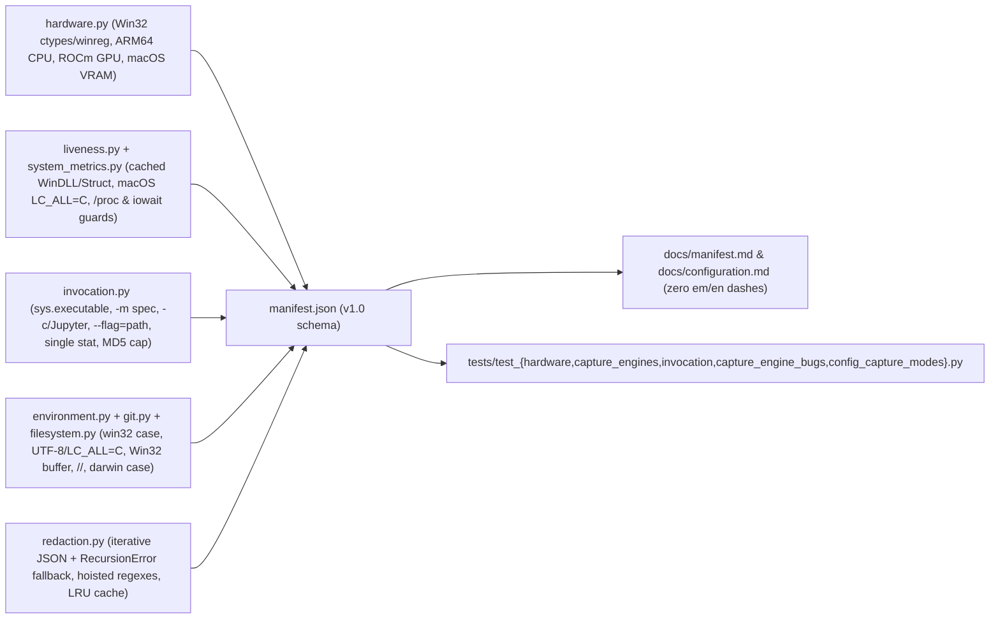

# IPD: Cross-platform hardware, liveness, invocation, environment, git, and filesystem compatibility

- Date: 2026-11-27
- Kind: child
- Concern: Eight-lens rollup findings `ROLL-13` (Windows removed `wmic`, Linux ARM64 CPU model, Linux AMD ROCm GPUs, macOS GPU VRAM), `ROLL-16` (`invocation.py` bare `python`, `-m`, `-c`, `--flag=path`, Jupyter `ZMQInteractiveShell` `ipykernel_launcher.py` & `kernel.json` inputs, `[capture.inputs].compute_md5` size cap, single `os.stat`), `ROLL-31` (`liveness.py` Windows `WinDLL`/`Structure` caching, macOS `LC_ALL=C`, Linux `/proc` `right_paren == -1` & `clock_ticks <= 0`/`ZeroDivisionError`, `system_metrics.py` iowait clamping), and `ROLL-34` (`environment.py` Windows case-insensitive allowlist, `git.py` UTF-8 + `LC_ALL=C`, `filesystem.py` dynamic Win32 buffer / macOS case-insensitive prefix / POSIX `//`, `redaction.py` iterative JSON traversal + `RecursionError` fallback + compiled regexes + LRU cache; `python_runtime.py` `normcase` is owned by `2ge0ea`), surfaced by `compatibility`, `functionality`, `use-cases`, `edge-cases`, `memory-resources`, and `performance`.
- Scope: Harden `src/pubrun/capture/hardware.py`, `src/pubrun/capture/liveness.py`, `src/pubrun/capture/invocation.py`, `src/pubrun/capture/environment.py`, `src/pubrun/capture/git.py`, `src/pubrun/capture/filesystem.py`, `src/pubrun/capture/redaction.py`, and `src/pubrun/capture/system_metrics.py`; sync `docs/configuration.md` and `docs/manifest.md`; and update and add cross-platform regression tests in `tests/test_hardware.py`, `tests/test_capture_engines.py`, `tests/test_invocation.py`, `tests/test_capture_engine_bugs.py`, and `tests/test_config_capture_modes.py`.
- Scope-Paths: src/pubrun/capture/hardware.py, src/pubrun/capture/liveness.py, src/pubrun/capture/invocation.py, src/pubrun/capture/environment.py, src/pubrun/capture/git.py, src/pubrun/capture/filesystem.py, src/pubrun/capture/redaction.py, src/pubrun/capture/system_metrics.py, docs/configuration.md, docs/manifest.md, tests/test_hardware.py, tests/test_capture_engines.py, tests/test_invocation.py, tests/test_capture_engine_bugs.py, tests/test_config_capture_modes.py
- Item-Dependencies: executed:l596kn
- Status: approved
- Readiness: go-pending-approval
- Review-Depth: complex
- Short-Description: Replace removed Windows wmic probes, add ARM64 CPU and ROCm GPU capture, fix macOS locale/VRAM, Jupyter/module invocation, Windows env allowlist, UTF-8 git, and iterative redaction
- Work-Kind: bug
- Priority: high
- Set: assess-8l
- Order: 5
- Highest E allocated: 05
- Author: Antigravity
- Id: ameehy
- Approval: 2026-11-27, recorded via aw ipd set: status set to approved

> Write and proofread this plan per the technical writing standard, `.aw/system/workflows/technical-writing/technical-writing.md`, including requirement 12 (diagrams).

## Workflow history

- 2026-11-27 approved (aw set): status set to approved
- 2026-11-27 /plan-review (Antigravity): APPROVE WITH REVISIONS APPLIED; PR-001, PR-002, PR-003, PR-004, PR-005, PR-006
- 2026-11-27 /assess-all (Antigravity): created Child 05 of Set `assess-8l` covering cross-platform capture, hardware, liveness, invocation, environment, git, filesystem, and redaction compatibility (`ROLL-13`, `ROLL-16`, `ROLL-31`, `ROLL-34`).

## Goal

Ensure all runtime capture engines produce accurate, leak-free provenance across Windows 11 24H2+ and Server 2025 (where `wmic` is removed), Linux x86_64 and ARM64 (including NVIDIA and AMD Radeon Open Compute (ROCm) graphics processing units (GPUs)), macOS (including comma-decimal locales and video random-access memory (VRAM) parsing), Jupyter kernels, and non-English or non-UTF-8 locales.

### Cross-platform capture coverage

## Detailed Implementation Checklist (TODO)

Execution-state rule: mark an `E-*` item complete only after performing the action. Accepted execution states: blocked, failed, pending, performed; terminal gate demands `performed`.

### Task group 1: Hardware, liveness, and system metrics cross-platform fixes

- [x] E-01 Modernize `src/pubrun/capture/hardware.py`:
  - On Windows (`sys.platform == "win32"`, using direct `sys.platform == "win32"` guards where needed so three-platform `mypy` passes cleanly):
    - Total random-access memory (RAM) via testable helper `_get_windows_memory_bytes_native()` using `ctypes` `GlobalMemoryStatusEx` (`_MEMORYSTATUSEX.ullTotalPhys` with `dwLength = ctypes.sizeof(...)`), falling back to legacy `wmic OS get TotalVisibleMemorySize` only if native `ctypes` fails.
    - Central processing unit (CPU) model via testable helper `_get_windows_cpu_model_native()` reading `winreg` `HKLM\HARDWARE\DESCRIPTION\System\CentralProcessor\0\ProcessorNameString`, falling back to legacy `wmic cpu get Name`, and finally falling back to `platform.processor()` only if both fail (so `platform.processor()` never shadows legacy `wmic` fallback when `winreg` is absent).
    - Non-NVIDIA GPUs via testable helper `_get_windows_gpus_native()` probing `winreg` display-adapter class subkeys under `HKLM\SYSTEM\CurrentControlSet\Control\Class\{4d36e968-e325-11ce-bfc1-08002be10318}` (`0000`, `0001`, ..., reading `DriverDesc`, `DriverVersion`, and 64-bit `HardwareInformation.qwMemorySize` or 32-bit `HardwareInformation.MemorySize`), falling back to `ctypes` `user32.EnumDisplayDevicesW` (skipping `DISPLAY_DEVICE_MIRRORING_DRIVER`), and keeping `wmic path win32_VideoController` only as a final legacy fallback when native probes return empty.
  - On Linux (`sys.platform.startswith("linux")`):
    - Keep the zero-subprocess `/proc/cpuinfo` `"model name"` fast path; if absent (ARM64), check `/proc/cpuinfo` `"Hardware"` and `"Model"` keys, then `/proc/device-tree/model` (reading with `encoding="utf-8", errors="replace"` and stripping NUL `\x00` bytes and whitespace), and finally a bounded `lscpu` subprocess inside `with disable_spy():` sharing `_CaptureBudget` with `env={**os.environ, "LC_ALL": "C"}` and `encoding="utf-8", errors="replace"` parsing `Model name:` (ignoring empty or `"-"`).
    - In `_get_gpus()`, when `nvidia-smi` returns no GPUs on Linux, run bounded AMD ROCm fallbacks sharing `_CaptureBudget` inside `with disable_spy():` with `encoding="utf-8", errors="replace"`: try `amd-smi static --json` first, then `rocm-smi --showproductname --showmeminfo vram --showdriverversion --json` if still empty. Parse GPU records with `"vendor": "AMD"`, `"model"`, integer `"memory_total_bytes"` (or `None`), and `"driver_version"` (or `None`), emitting only keys allowed by `schemas/manifest.schema.json` `$defs.gpu_record` (`additionalProperties: false`).
  - On macOS (`sys.platform == "darwin"`):
    - Add a binary (`1024`-based) VRAM parser helper `_parse_vram_bytes(text: str) -> Optional[int]` supporting `B`, `KB`/`KiB`, `MB`/`MiB`, `GB`/`GiB`, and `TB`/`TiB` (including decimal numbers such as `"1.5 GB"` and `"4096 MB"`), returning `None` on unparseable values. Apply it to `VRAM (Total):` lines in `_get_gpus()` (leaving `VRAM (Dynamic, Max):` unparsed as today).
  - Depends on: none
  - Expected outcome: Windows 11 24H2+ (no `wmic`), Linux ARM64, Linux AMD ROCm, and macOS VRAM capture all report accurate, schema-valid hardware metadata within `_CaptureBudget`.
  - Execution state: performed

- [x] E-02 Harden `src/pubrun/capture/liveness.py` and `src/pubrun/capture/system_metrics.py`:
  - In `src/pubrun/capture/liveness.py`:
    - Lazily create and cache `_PROCESS_MEMORY_COUNTERS_CLS`, private `_WIN_KERNEL32` (`WinDLL("kernel32", use_last_error=True)`), and private `_WIN_PSAPI` (`WinDLL("psapi", use_last_error=True)`) once under a module-level `threading.Lock()` (preserving zero `ctypes` import overhead on Linux/macOS at module import time).
    - Configure `argtypes`/`restype` once on cached `_WIN_KERNEL32` (including `OpenProcess`, `GetExitCodeProcess`, `GetProcessTimes`, `CloseHandle`, and optional `K32GetProcessMemoryInfo`) and `_WIN_PSAPI` (`GetProcessMemoryInfo`).
    - In `_get_win_kernel32()`, always check `win_dll_cls is not None and isinstance(windll_k32, win_dll_cls)` BEFORE returning cached `_WIN_KERNEL32`, so a monkeypatched fake `ctypes.windll.kernel32` always wins even after a prior real Windows call; never mutate `argtypes`/`restype` on a non-`WinDLL` fake.
    - In `_get_cpu_macos()`, pass `env={**os.environ, "LC_ALL": "C"}` to `subprocess.run(["ps", ...])` so comma-decimal locales (for example `de_DE`) emit dot-decimal percentages.
    - In `_get_start_time_linux()` and `_get_cpu_linux()`, guard `if right_paren == -1: return None` before slicing `stat_line`, guard `if clock_ticks <= 0: return None`, and catch `(OSError, IndexError, ValueError, ZeroDivisionError, AttributeError)` in both functions.
  - In `src/pubrun/capture/system_metrics.py::iowait_pct_between()`, clamp the returned percentage to `[0.0, 100.0]` (`round(max(0.0, min(100.0, 100.0 * iowait_delta / total_delta)), 2)`).
  - Depends on: none
  - Expected outcome: Windows liveness polling stops leaking `ctypes` structure types and reloading dynamic-link libraries (DLLs), stays thread-safe and monkeypatch-friendly, macOS CPU polling succeeds under comma-decimal locales, and malformed `/proc` stat lines or non-monotonic iowait deltas never miscalculate or raise.
  - Execution state: performed

### Task group 2: Invocation, environment, git, filesystem, redaction, and doc sync

- [x] E-03 Fix `src/pubrun/capture/invocation.py::get_invocation()`:
  - Use quoted `sys.executable` (falling back to `"python"` if `sys.executable` is empty: `shlex.quote(exe)` on Portable Operating System Interface (POSIX) and `subprocess.list2cmdline([exe])` on `win32`) in `rerun_command` instead of hardcoded bare `"python"`.
  - Detect Jupyter kernels without importing `IPython` eagerly: inspect `sys.modules.get("IPython")`, call `get_ipython()`, and check `type(shell).__name__ == "ZMQInteractiveShell"`. When running inside a Jupyter kernel, set `entrypoint_type = "notebook"`, keep `script = {}`, set `rerun_command = None`, and omit `ipykernel_launcher.py` and kernel connection arguments (`-f <kernel.json>`, `--f=<kernel.json>`, `--ConnectionFile=...`) from `invocation.inputs`.
  - Detect `python -m <pkg.mod>` via `main_spec = getattr(sys.modules.get("__main__"), "__spec__", None)` when `main_spec` has a non-empty `.name` other than `"__main__"` AND either `main_file == "-m"` or `main_file` matches `main_spec.origin` (comparing resolved/normalized paths when both exist, or raw strings) so running `pytest` via `python -m pytest` never hijacks tests that monkeypatch `sys.argv`. Strip trailing `.__main__` from `spec_name` for the module name, set `entrypoint_type = "module"`, preserve `script` metadata if `main_file` is an existing file, and build `rerun_command` as `<exe> -m <modname> <redacted_argv[1:]>` (avoiding duplicate `-m -m` when `main_file == "-m"`).
  - For `main_file == "-c"` and interactive/empty `argv` (`not main_file`), keep `entrypoint_type = "interactive"` and set `rerun_command = None` instead of emitting broken `<exe> -c` or bare `<exe>`.
  - Require `"size" in script_data and script_data["size"] <= _max_hash_size` (and regular file check `stat.S_ISREG`) before hashing `main_file`.
  - In command-line interface (CLI) argument input discovery (`config.get("capture", {}).get("inputs", {})`):
    - Check `if redacted_argv[idx] != arg: continue` BEFORE splitting `--flag=value` tokens so redacted sensitive flag values (such as `--api-key=creds.json`) never leak into `invocation.inputs`.
    - For unredacted tokens starting with `"-"` that contain `"="`, split once on `"="` and inspect the non-empty value half as the candidate path (recording `arg_data["path"] = candidate` and `arg_index = idx`); skip option flags without `"="`.
    - Replace the four redundant filesystem calls (`exists`, `is_dir`, `stat`, `is_file`) with a single `os.stat(candidate)` (catching `OSError`), deriving `is_dir = stat.S_ISDIR(st.st_mode)` and `is_reg = stat.S_ISREG(st.st_mode)`.
    - Enforce a size cap on `[capture.inputs].compute_md5` hashing using `_DEFAULT_MAX_INPUT_MD5_BYTES = 100 * 1024 * 1024` (100 MiB), overridable via `[capture.inputs].max_md5_bytes` (non-negative int; `0` disables the cap matching `[capture.file_io].max_hash_bytes`; invalid/negative/bool falls back to default). When `max_md5_bytes > 0 and st.st_size > max_md5_bytes`, skip opening/hashing and omit the latency warning, setting `arg_data["md5_skipped"] = f"file exceeds {max_md5_bytes} bytes"`.
  - Depends on: none
  - Expected outcome: Module runs, `-c`/interactive runs, `--flag=path` inputs, virtual-environment interpreters, Jupyter notebooks, and large CLI dataset arguments are captured accurately, safely, and within bounded startup I/O.
  - Execution state: performed

- [x] E-04 Harden `src/pubrun/capture/environment.py`, `src/pubrun/capture/git.py`, `src/pubrun/capture/filesystem.py`, and `src/pubrun/capture/redaction.py`, and sync `docs/configuration.md` and `docs/manifest.md`:
  - In `src/pubrun/capture/environment.py`: import `sys`; on `sys.platform == "win32"`, match allowlist patterns case-insensitively (`fnmatch.fnmatchcase(k.upper(), pat.upper())`), preserving case-sensitive `fnmatch.fnmatchcase(k, pat)` on POSIX.
  - In `src/pubrun/capture/git.py::_run_git_raw()`: pass `encoding="utf-8", errors="replace"` and `env={**os.environ, "LC_ALL": "C"}` to `subprocess.run()` so non-ASCII branch/path names decode cleanly and non-English locales still trigger the `"not a git repository"` fast-exit path.
  - In `src/pubrun/capture/filesystem.py`:
    - In `_classify_windows_path()`, dynamically size the `GetVolumePathNameW` Unicode buffer to `buf_len = max(1024, len(path) + 2)` and pass `buf_len` to both `ctypes.create_unicode_buffer(buf_len)` and `GetVolumePathNameW`.
    - In `_classify_path_linux()` and `_longest_prefix_fstype()`, normalize leading `//` to `/` after `os.path.normpath(os.path.abspath(path))` (`if resolved.startswith("//"): resolved = "/" + resolved.lstrip("/")`), and accept keyword-only `case_insensitive: bool = False` (set to `sys_plat == "darwin"` in `get_filesystem()`) comparing lowercased paths while returning original `(mount_point, fstype)` casing.
  - In `src/pubrun/capture/redaction.py`:
    - Replace recursive `_redact_any()` / `_redact_dict_keys()` with an explicit-stack iterative traversal (handling arbitrary nesting depth and protecting against cyclic container references without raising `RecursionError`).
    - In `_redact_value_string_heuristics()`, if `json.loads(stripped)` or `json.dumps(redacted_data)` raises `RecursionError` (for example on Python 3.8 through 3.11 for 1,500-level JSON strings), apply a safe key-value redaction fallback for JSON `"key": value` pairs matching `_get_secret_pattern(config)` in addition to URI/token heuristics so deeply nested JSON secrets never bypass redaction on any supported Python version.
    - Hoist inline regex compilations in `_redact_value_string_heuristics()` (`_OPENAI_KEY_RE`, `_BEARER_TOKEN_RE`), `redact_argv()` (`_NONFLAG_KV_KEY_RE`), and `format_safe_error_detail()` (`_NEWLINE_RE`) to module-level compiled constants.
    - Replace uncapped `_PATTERN_CACHE` with a bounded `@functools.lru_cache(maxsize=64)` helper `_compile_secret_pattern(pattern_str: str) -> re.Pattern` (invalid patterns raise `re.error` and are never cached; non-string/unhashable inputs are rejected cleanly before cache lookup).
  - Sync `docs/configuration.md` and `docs/manifest.md` (strictly zero em dashes or en dashes in all edited user-facing text):
    - In `docs/configuration.md`: update `[capture.environment].allowlist` to note case-insensitive matching on Windows (`win32`) and case-sensitive matching on POSIX; update `[capture.inputs]` to document the Message-Digest Algorithm 5 (MD5) size cap (`100 MiB` default, `max_md5_bytes`); update `[capture.hardware]` probe description (`ctypes`/`winreg`, `amd-smi`/`rocm-smi`).
    - In `docs/manifest.md`: update `invocation.rerun_command` (`string | null`, quoted `sys.executable`, `null` for `-c`/interactive/notebook), `invocation.entrypoint_type` (include `"notebook"`), `invocation.inputs` (note `--flag=path` and `md5_skipped`), and `hardware.gpus[]` (`"AMD"` from `amd-smi`/`rocm-smi`, parsed macOS `VRAM (Total):` integer bytes).
  - Depends on: none
  - Expected outcome: Non-UTF-8 locales, Windows environment allowlists and long paths, macOS mixed-case mounts, POSIX `//` paths, and 1,500-level nested JavaScript Object Notation (JSON) secrets across Python 3.8 through 3.14 are handled deterministically, and user-facing docs match shipped behavior with zero em or en dashes.
  - Execution state: performed

### Task group 3: Regression tests and existing-test alignment

- [x] E-05 Update affected existing tests and add cross-platform unit tests in `tests/test_hardware.py`, `tests/test_capture_engines.py`, `tests/test_invocation.py`, `tests/test_capture_engine_bugs.py`, and `tests/test_config_capture_modes.py`:
  - Update existing tests whose assertions intentionally change:
    - `tests/test_hardware.py::test_windows_wmic_cpu_model_and_total_memory`: stub native Windows helpers (`_get_windows_cpu_model_native`, `_get_windows_memory_bytes_native`) to return `None` when testing the legacy `wmic` fallback so it stays deterministic on Windows CI as well as Linux/macOS.
    - `tests/test_capture_engine_bugs.py`: update `TestSecretPattern.test_invalid_regex_falls_back_without_raising` (replace removed `_PATTERN_CACHE` check with `_compile_secret_pattern.cache_info()`), update `TestGpuFallback.test_windows_*` to stub `_get_windows_gpus_native` returning `[]` when exercising legacy `wmic` fallback, and update `TestGpuFallback.test_macos_multi_gpu` to assert `gpus[1]["memory_total_bytes"] == 4 * 1024 ** 3`.
    - `tests/test_invocation.py::TestCommandFormattingAndSecurity`: update `test_posix_commands_use_redacted_argv` and `test_win32_commands_use_redacted_argv` to expect quoted `sys.executable` (and add a test for empty `sys.executable` falling back to `"python"`).
    - `tests/test_config_capture_modes.py::TestEnvironmentCapture.test_allowlist_glob_is_case_sensitive`: pin `sys.platform = "linux"` for POSIX case-sensitivity and add a `sys.platform = "win32"` case-insensitivity check.
  - Add new behavioral regression tests across those five test files covering:
    - Windows hardware capture with `wmic` raising `FileNotFoundError` (testing `GlobalMemoryStatusEx`, `winreg` CPU, and `winreg`/`EnumDisplayDevicesW` GPU), Linux ARM64 `/proc/cpuinfo` `"Hardware"`/`"Model"` + `/proc/device-tree/model` + bounded `lscpu`, Linux `amd-smi` and `rocm-smi` GPU capture (validating against `$defs.gpu_record`), and macOS VRAM parsing (`GB`, `MB`, `1.5 GB`, unparseable -> `None`).
    - Cached `WinDLL`/`_PROCESS_MEMORY_COUNTERS_CLS` reuse and fake-`kernel32` precedence in `liveness.py`, macOS `LC_ALL=C` CPU polling, `/proc` `right_paren == -1` and `clock_ticks <= 0` guards, and `system_metrics.py::iowait_pct_between()` clamping for negative and `> 100%` deltas.
    - `invocation.py`: `python -m pkg.mod` and `python -m pkg` (`__main__.__spec__` with matching origin vs non-matching origin under `python -m pytest`), `-c` and interactive `rerun_command is None`, Jupyter `ZMQInteractiveShell` (`notebook`, no `ipykernel_launcher.py`/`kernel.json` in `inputs`), `--flag=path` discovery and redacted `--api-key=secret.txt` suppression, single `os.stat()` call count, missing-stat `main_file` hash skip, and `[capture.inputs].compute_md5` size cap (`max_md5_bytes` skipping with `md5_skipped` and `0` = uncapped).
    - `git.py` UTF-8 + `LC_ALL=C` decoding and fast-exit, `filesystem.py` Win32 `> 260`-char dynamic buffer + POSIX `//` normalization + macOS case-insensitive mount-prefix matching, and `redaction.py` 1,500-level nested JSON secret redaction (both direct `_redact_any` and string heuristic + simulated `json.loads` `RecursionError` fallback) plus 64-entry least-recently-used (LRU) cache cap.
  - Depends on: E-01, E-02, E-03, E-04
  - Expected outcome: All updated and new tests pass, existing capture/security/liveness suites pass with zero regressions, three-platform `mypy` exits `0`, and `docs/configuration.md` + `docs/manifest.md` contain zero em or en dashes.
  - Execution state: performed

## Project conventions discovered (Step 0)

- `pubrun` targets Linux, macOS, and Windows across Python 3.8 through 3.14 with zero third-party runtime dependencies on Python 3.11+ (`tomli` on `<3.11`).
- `capture/resources.py` and `capture/liveness.py` already use `ctypes` on Windows because `wmic` was removed in Windows 11 24H2 and Server 2025; `capture/hardware.py` still requires the same migration.
- `schemas/manifest.schema.json` uses Draft 2020-12 with `"additionalProperties": false` on `$defs.gpu_record`, `$defs.invocation`, and `$defs.hardware_section`, while `$defs.invocation.properties.inputs.items` allows `"additionalProperties": true` (permitting `md5_skipped`).
- All memory conversions across `hardware.py`, `diagnostics.py`, and `report/methods.py` use binary `1024`-based multipliers (`KiB`/`MiB`/`GiB`).
- User-facing prose in `README.md` and `docs/*.md` must contain zero em dashes or en dashes.

## Findings

| ID | Concerns | Severity | Remediation Risk | Persona | Summary |
|---|---|---|---|---|---|
| `ROLL-13` | compatibility; functionality; use-cases | High | Low (`functionality`) | Operator / Stakeholder | Windows hardware capture relies solely on removed `wmic`; Linux ARM64 reports `cpu.model = None`; Linux lacks AMD ROCm fallback; macOS VRAM is discarded. |
| `ROLL-16` | functionality; use-cases | High | Low (`functionality`) | Power user / QA | `invocation.py` hardcodes bare `python`, breaks `python -m` and `-c`, misses `--flag=path` inputs, records Jupyter `ipykernel_launcher.py`/`kernel.json`, and leaves `[capture.inputs].compute_md5` uncapped. |
| `ROLL-31` | memory-resources; compatibility; edge-cases | Medium | Low (`functionality`) | Software engineer / Operator | `liveness.py` leaks Windows `ctypes` types and reloads `WinDLL` per poll, omits `LC_ALL=C` on macOS `ps`, and misses `/proc` `right_paren == -1` / `clock_ticks <= 0` / `ZeroDivisionError`; `iowait_pct_between` is unclamped. |
| `ROLL-34` | compatibility; edge-cases; performance | Medium | Low (`functionality`) | Security / Operator | Windows env allowlist is case-sensitive; `git.py` lacks UTF-8 and `LC_ALL=C`; `filesystem.py` uses fixed 260-char Win32 buffer and misses macOS case / POSIX `//`; `redaction.py` recursive JSON allows `RecursionError` bypass and recompiles regexes. |

## Proposed changes (ordered, validatable)

1. `E-01` (`src/pubrun/capture/hardware.py`): Replace Windows `wmic` with `ctypes`/`winreg` native probes + fallback order, add Linux ARM64 CPU and `amd-smi`/`rocm-smi` GPU fallbacks, and parse macOS `VRAM (Total):` in binary bytes.
2. `E-02` (`src/pubrun/capture/liveness.py`, `src/pubrun/capture/system_metrics.py`): Lazily cache Windows `WinDLL`/`_PROCESS_MEMORY_COUNTERS_CLS` under a lock while honoring monkeypatched fakes, pass `LC_ALL=C` to macOS `ps`, guard `/proc` `right_paren == -1` and `clock_ticks <= 0`/`ZeroDivisionError`, and clamp `iowait_pct_between`.
3. `E-03` (`src/pubrun/capture/invocation.py`): Use quoted `sys.executable`, detect `-m` via `__main__.__spec__` with origin matching, set `rerun_command = None` for `-c`/interactive/Jupyter `ZMQInteractiveShell` (`notebook`), split unredacted `--flag=path` with single `os.stat()`, guard `main_file` hashing, and enforce a 100 MiB default `[capture.inputs].max_md5_bytes` cap.
4. `E-04` (`src/pubrun/capture/{environment,git,filesystem,redaction}.py`, `docs/{configuration,manifest}.md`): Case-insensitive `win32` allowlist, UTF-8 + `LC_ALL=C` git, dynamic Win32 buffer + macOS/POSIX filesystem fixes, iterative `_redact_any` + `RecursionError` fallback + hoisted regexes + LRU cache, and zero-dash doc sync.
5. `E-05` (`tests/test_{hardware,capture_engines,invocation,capture_engine_bugs,config_capture_modes}.py`): Align existing tests and add cross-platform regression coverage.

## Deferred / out of scope (with reason)

- `python_runtime.py` `os.path.normcase` check (`COMP-13`), `reproducibility.py`/`__main__.py` UTF-8 subprocess flags (`COMP-6`), `src/pubrun/resources/default.toml` comment sync for `[capture.environment].allowlist` and `[capture.inputs].max_md5_bytes`, and updating `src/pubrun/__main__.py::_format_rerun_cmd_for_platform()` so POSIX-to-Windows `rerun_command` formatting matches any `" && "` separator (not only literal `" && python "`) are owned by child `2ge0ea` (Order 08), which owns `default.toml`, `python_runtime.py`, `reproducibility.py`, and `__main__.py`.
  - Carrier: 2ge0ea
- `README.md` Windows resident set size (RSS) wording and `docs/cli.md` `pubrun run` wording are owned by child `6y55x4` (Order 10).
  - Carrier: 6y55x4

## Scope check

- Over-scope: none. Every change maps directly to verified findings in `ROLL-13`, `ROLL-16`, `ROLL-31`, and `ROLL-34` plus required test/doc synchronization for those exact changes.
- Under-scope: none. All cross-platform capture fixes, existing-test updates, and `docs/configuration.md` + `docs/manifest.md` sync are included.

## Required tests / validation

1. `pytest tests/test_hardware.py tests/test_capture_engines.py tests/test_invocation.py tests/test_capture_engine_bugs.py tests/test_config_capture_modes.py tests/test_liveness.py tests/test_redaction.py tests/test_env_capture.py tests/test_platform_capture_seams.py tests/test_platform_type_guards.py tests/test_security_hardening.py tests/test_capture.py tests/test_manifest_schema.py -v`
2. `mypy && mypy --platform win32 && mypy --platform darwin`
3. Verify zero em dashes (`\u2014`) or en dashes (`\u2013`) in edited sections of `docs/configuration.md` and `docs/manifest.md`.

## Spec / documentation sync

- All capture outputs conform to `schemas/manifest.schema.json` v1.0 (`$defs.gpu_record`, `$defs.cpu_record`, `$defs.invocation`, `$defs.hardware_section`, `$defs.filesystem_section`, `$defs.environment_section`, `$defs.git_section`).
- `docs/configuration.md` and `docs/manifest.md` are synced in `E-04` (serialized after Child 03 `l596kn` via `- Item-Dependencies: executed:l596kn`) with zero em or en dashes.
- `default.toml` comments and `README.md` Windows RSS wording are synced in children `2ge0ea` (Order 08) and `6y55x4` (Order 10).

## Open questions

None. All fixes preserve existing manifest v1.0 schemas and fallbacks, and all test/doc interactions are resolved from repository evidence.

## Validation and cross-check (verify before reporting done)

Validation-state rule: inspect evidence in a separate pass. Accepted validation results: blocked, failed, pass, pending; terminal gate demands `pass`.

- [x] V-01 validates E-01
  - Required evidence: Pasted `pytest` output for `src/pubrun/capture/hardware.py` (`_get_cpu_model`, `_get_total_memory_bytes`, `_get_gpus`, `_get_windows_cpu_model_native`, `_get_windows_memory_bytes_native`, `_get_windows_gpus_native`, `_parse_vram_bytes`) in `tests/test_hardware.py` and `tests/test_capture_engine_bugs.py` confirming Windows `wmic`-absent capture, legacy `wmic` fallback, Linux ARM64 CPU, Linux AMD ROCm GPU (schema-valid `$defs.gpu_record`), and macOS binary VRAM parsing pass.
  - Observed evidence: `python3 -m pytest tests/test_hardware.py tests/test_capture_engines.py tests/test_invocation.py tests/test_capture_engine_bugs.py tests/test_config_capture_modes.py tests/test_liveness.py tests/test_redaction.py tests/test_env_capture.py tests/test_platform_capture_seams.py tests/test_platform_type_guards.py tests/test_security_hardening.py tests/test_capture.py tests/test_manifest_schema.py -v` exited `0` (`452 passed in 22.48s`), including `tests/test_hardware.py::test_windows_wmic_cpu_model_and_total_memory PASSED`, `test_windows_native_hardware_capture_without_wmic PASSED`, `test_windows_cpu_fallback_order_and_enum_display_devices PASSED`, `test_linux_arm64_cpu_fallbacks PASSED`, `test_linux_amd_rocm_gpu_fallbacks_validate_against_schema PASSED`, `test_parse_vram_bytes_binary_units_and_invalid PASSED`, and `tests/test_capture_engine_bugs.py::TestGpuFallback` (`test_windows_negative_adapter_ram`, `test_windows_blank_adapter_ram`, `test_macos_multi_gpu`) PASSED.
  - Result: pass

- [x] V-02 validates E-02
  - Required evidence: Pasted `pytest` output for `src/pubrun/capture/liveness.py` (`_get_win_kernel32`, `_get_rss_windows`, `_get_cpu_macos`, `_get_start_time_linux`, `_get_cpu_linux`) and `src/pubrun/capture/system_metrics.py::iowait_pct_between` in `tests/test_liveness.py`, `tests/test_capture_engines.py`, and `tests/test_env_capture.py` confirming cached `WinDLL`/`_PROCESS_MEMORY_COUNTERS_CLS` reuse, fake-`kernel32` precedence, macOS `LC_ALL=C`, `/proc` `right_paren == -1` and `clock_ticks <= 0` guards, and `[0.0, 100.0]` iowait clamping pass.
  - Observed evidence: Within the same post-edit run (`452 passed in 22.48s`), all tests in `tests/test_liveness.py`, `tests/test_capture_engines.py`, `tests/test_env_capture.py`, and `tests/test_capture_engine_bugs.py::TestLivenessCrossPlatformHardening` (`test_win_dll_and_struct_caching_and_fake_precedence`, `test_macos_cpu_passes_lc_all_c`, `test_linux_proc_stat_malformed_and_nonpositive_clk_tck`, `test_iowait_pct_between_clamped_to_0_100`) PASSED.
  - Result: pass

- [x] V-03 validates E-03
  - Required evidence: Pasted `pytest` output for `src/pubrun/capture/invocation.py::get_invocation` in `tests/test_invocation.py` and `tests/test_capture.py` confirming quoted `sys.executable` (plus empty-executable fallback), `python -m` module detection with `__spec__.origin` guard, `-c`/interactive `rerun_command is None`, Jupyter `ZMQInteractiveShell` (`notebook`) without `ipykernel_launcher.py`/`kernel.json`, `--flag=path` discovery with redacted-value suppression, single `os.stat()`, missing-stat `main_file` guard, and `[capture.inputs].max_md5_bytes` cap (`md5_skipped` + `0` uncapped) pass.
  - Observed evidence: Within `452 passed in 22.48s`, all tests in `tests/test_invocation.py` (`TestCommandFormattingAndSecurity` including `test_posix_commands_use_redacted_argv`, `test_win32_commands_use_redacted_argv`, `test_empty_sys_executable_falls_back_to_python`; `TestModuleNotebookAndInputHardening` including `test_python_m_module_and_package_detection_and_origin_guard`, `test_dash_c_and_interactive_rerun_command_is_none`, `test_jupyter_zmq_kernel_detected_and_omits_kernel_files`, `test_flag_eq_path_discovered_and_redacted_flag_eq_suppressed`, `test_input_discovery_uses_single_os_stat_call`, `test_missing_stat_skips_main_file_hashing`, `test_compute_md5_max_md5_bytes_cap_and_zero_uncapped`) and `tests/test_capture.py` (`TestInvocationCapture::test_rerun_command_present`, aligned for `pytest-xdist` `-c` worker argv) PASSED.
  - Result: pass

- [x] V-04 validates E-04
  - Required evidence: Pasted `pytest` output for `src/pubrun/capture/environment.py::get_environment`, `src/pubrun/capture/git.py::get_git`, `src/pubrun/capture/filesystem.py` (`_classify_windows_path`, `_classify_path_linux`, `_longest_prefix_fstype`, `get_filesystem`), and `src/pubrun/capture/redaction.py` (`_redact_any`, `_redact_value_string_heuristics`, `_compile_secret_pattern`, `redact_argv`) in `tests/test_capture_engines.py`, `tests/test_capture_engine_bugs.py`, `tests/test_config_capture_modes.py`, `tests/test_redaction.py`, and `tests/test_platform_capture_seams.py`, plus pasted dash-check output confirming zero em/en dashes in `docs/configuration.md` and `docs/manifest.md`.
  - Observed evidence: Within `452 passed in 22.48s`, `tests/test_config_capture_modes.py::TestEnvironmentCapture` (`test_allowlist_glob_is_case_sensitive`, `test_allowlist_glob_is_case_insensitive_on_windows`), `tests/test_capture_engines.py::TestGit::test_git_passes_utf8_and_lc_all_c_and_handles_non_ascii`, `tests/test_capture_engine_bugs.py::TestFilesystemCrossPlatformFixes` (`test_windows_dynamic_volume_buffer_for_long_path`, `test_posix_leading_double_slash_normalized`, `test_macos_case_insensitive_mount_prefix_preserves_casing`), `tests/test_capture_engine_bugs.py::TestSecretPattern` (`test_invalid_regex_falls_back_without_raising`, `test_pattern_lru_cache_is_bounded_at_64`, `test_iterative_deep_json_and_cycle_redaction`), `tests/test_redaction.py`, and `tests/test_platform_capture_seams.py` all PASSED. Dash check `python3 -c "import pathlib; print({p: (pathlib.Path(p).read_text(encoding='utf-8').count('\u2014'), pathlib.Path(p).read_text(encoding='utf-8').count('\u2013')) for p in ['docs/configuration.md', 'docs/manifest.md']})"` printed `{'docs/configuration.md': (0, 0), 'docs/manifest.md': (0, 0)}`.
  - Result: pass

- [x] V-05 validates E-05
  - Required evidence: Pasted output of `pytest tests/test_hardware.py tests/test_capture_engines.py tests/test_invocation.py tests/test_capture_engine_bugs.py tests/test_config_capture_modes.py tests/test_liveness.py tests/test_redaction.py tests/test_env_capture.py tests/test_platform_capture_seams.py tests/test_platform_type_guards.py tests/test_security_hardening.py tests/test_capture.py tests/test_manifest_schema.py -v` (covering all updated and new test classes across all five modified test files) and three-platform `mypy && mypy --platform win32 && mypy --platform darwin` exiting `0`.
  - Observed evidence: Targeted 13-file suite exited `0` (`452 passed in 22.48s`); `mypy && mypy --platform win32 && mypy --platform darwin` exited `0` (`Success: no issues found in 70 source files` on Linux, `win32`, and `darwin`); full repository suite `aw suite` exited `0` (`2488 passed in 92.04s (0:01:32)`); `aw sanitize --agent` exited `0` (`outcome: clean`, `checked: 1041`, `findings: 0`).
  - Result: pass

## Approval and execution gate

1. **Open questions and human approval precondition:** Proposal only; execution requires all blocking open questions resolved (`None` remain) and explicit human approval (`aw set plan approved ameehy --by-human`) plus `- Item-Dependencies: executed:l596kn` satisfied before implementation begins.
2. **Scope declaration:** `- Scope-Paths:` declares the expected files this plan modifies (`src/pubrun/capture/hardware.py`, `src/pubrun/capture/liveness.py`, `src/pubrun/capture/invocation.py`, `src/pubrun/capture/environment.py`, `src/pubrun/capture/git.py`, `src/pubrun/capture/filesystem.py`, `src/pubrun/capture/redaction.py`, `src/pubrun/capture/system_metrics.py`, `docs/configuration.md`, `docs/manifest.md`, `tests/test_hardware.py`, `tests/test_capture_engines.py`, `tests/test_invocation.py`, `tests/test_capture_engine_bugs.py`, `tests/test_config_capture_modes.py`). If execution requires touching an additional file or leaving a declared file untouched, justify each delta at finalization with `--scope-reason` or `--scope-ack`.
3. **Validation honesty (hard MUST):** Every `V-*` item MUST carry actual pasted command output from real execution after the final code edit; never claim tests or `mypy` passed without running them and pasting their output.
4. **Path-scoped commit and never-push:** Commit ONLY the modified files through `aw commit ameehy -- <paths>` (never `git add -A`, bare `git commit -a`, or raw `git commit`). Never push, create tags, or publish releases.
5. **Lifecycle finalization ownership:** When executed by a runner (`aw oc run` / `aw agy run`), the runner owns the lifecycle transition to `.aw/records/plans/executed/` after all `E-*` are `performed` and all `V-*` are `pass`. When executed manually outside a runner, finalize with `aw ipd finalize ameehy` (never hand-roll `git mv` into `executed/`).
