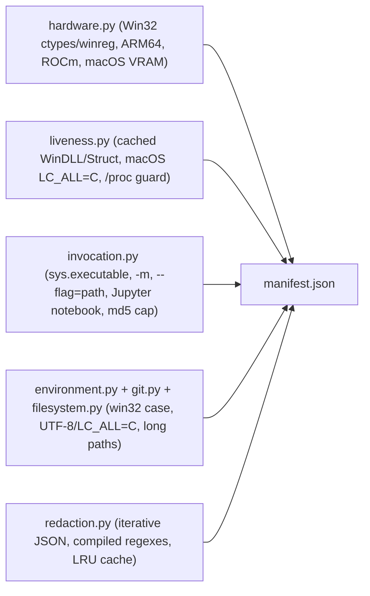

# IPD: Cross-platform hardware, liveness, invocation, environment, git, and filesystem compatibility

- Date: 2026-11-27
- Kind: child
- Concern: Eight-lens rollup findings `ROLL-13` (Windows removed `wmic`, Linux ARM64 CPU model, Linux AMD ROCm GPUs, macOS GPU VRAM), `ROLL-16` (`invocation.py` bare `python`, `-m`, `-c`, `--flag=path`, Jupyter `ZMQInteractiveShell` `ipykernel_launcher.py` & `kernel.json` inputs, `compute_md5` size cap, single `os.stat`), `ROLL-31` (`liveness.py` Windows `WinDLL`/`Structure` caching, macOS `LC_ALL=C`, Linux `/proc` `rparen == -1` & `ZeroDivisionError`), and `ROLL-34` (`environment.py` Windows case-insensitive allowlist, `git.py` UTF-8 + `LC_ALL=C`, `filesystem.py` dynamic Win32 buffer / macOS case-insensitive prefix / POSIX `//`, `redaction.py` iterative/depth-capped JSON traversal + compiled regexes + LRU cache, `python_runtime.py` `normcase`, `system_metrics.py` iowait clamping), surfaced by `compatibility`, `functionality`, `use-cases`, `edge-cases`, `memory-resources`, and `performance`.
- Scope: Harden `src/pubrun/capture/hardware.py`, `src/pubrun/capture/liveness.py`, `src/pubrun/capture/invocation.py`, `src/pubrun/capture/environment.py`, `src/pubrun/capture/git.py`, `src/pubrun/capture/filesystem.py`, `src/pubrun/capture/redaction.py`, and `src/pubrun/capture/system_metrics.py` with tests in `tests/test_hardware.py` and `tests/test_capture_engines.py`.
- Scope-Paths: src/pubrun/capture/hardware.py, src/pubrun/capture/liveness.py, src/pubrun/capture/invocation.py, src/pubrun/capture/environment.py, src/pubrun/capture/git.py, src/pubrun/capture/filesystem.py, src/pubrun/capture/redaction.py, src/pubrun/capture/system_metrics.py, tests/test_hardware.py, tests/test_capture_engines.py
- Item-Dependencies: none
- Status: to-review
- Review-Depth: complex
- Short-Description: Replace removed Windows wmic probes, add ARM64 CPU and ROCm GPU capture, fix macOS locale/VRAM, Jupyter/module invocation, Windows env allowlist, UTF-8 git, and iterative redaction
- Work-Kind: bug
- Priority: high
- Set: assess-8l
- Order: 5
- Highest E allocated: 05
- Author: Antigravity
- Id: ameehy

> Write and proofread this plan per the technical writing standard, `.aw/system/workflows/technical-writing/technical-writing.md`, including requirement 12 (diagrams).

## Workflow history

- 2026-11-27 /assess-all (Antigravity): created Child 05 of Set `assess-8l` covering cross-platform capture, hardware, liveness, invocation, environment, git, filesystem, and redaction compatibility (`ROLL-13`, `ROLL-16`, `ROLL-31`, `ROLL-34`).

## Goal

Ensure all runtime capture engines produce accurate, leak-free provenance across Windows 11 24H2+/Server 2025 (without `wmic`), Linux x86_64 and ARM64 (including NVIDIA and AMD ROCm GPUs), macOS (including comma-decimal locales and VRAM parsing), Jupyter kernels, and non-English/non-UTF-8 locales.

### Cross-platform capture coverage

## Detailed Implementation Checklist (TODO)

Execution-state rule: mark an `E-*` item complete only after performing the action. Accepted execution states: blocked, failed, pending, performed; terminal gate demands `performed`.

### Task group 1: Hardware and liveness cross-platform fixes

- [ ] E-01 Modernize `src/pubrun/capture/hardware.py`:
  - On Windows (`win32`): read total RAM via `ctypes` `GlobalMemoryStatusEx` (`ullTotalPhys`), read CPU model via `winreg` (`HKLM\HARDWARE\DESCRIPTION\System\CentralProcessor\0\ProcessorNameString`, falling back to `platform.processor()`), and probe non-NVIDIA GPUs via `winreg` / `EnumDisplayDevicesW` (keeping `wmic` only as optional legacy fallback).
  - On Linux: keep `/proc/cpuinfo` `"model name"` fast path and add ARM64 fallbacks (`/proc/cpuinfo` `"Hardware"`/`"Model"`, `/proc/device-tree/model` stripping NULs, bounded `lscpu` with `LC_ALL=C`); add a bounded `amd-smi` / `rocm-smi` GPU fallback inside `_get_gpus()` sharing `_CaptureBudget`.
  - On macOS: parse `VRAM (Total):` strings (e.g. `"16 GB"`, `"4096 MB"`) into integer `memory_total_bytes` instead of discarding to `None`.
  - Depends on: none
  - Expected outcome: Windows 11 24H2+ (no `wmic`), Linux ARM64, Linux AMD ROCm, and macOS VRAM capture all report accurate hardware metadata.
  - Execution state: pending

- [ ] E-02 Harden `src/pubrun/capture/liveness.py` and `src/pubrun/capture/system_metrics.py`:
  - In `liveness.py`: define `_PROCESS_MEMORY_COUNTERS` once at module level and cache private `WinDLL("kernel32", use_last_error=True)` and `WinDLL("psapi", use_last_error=True)` handles with `argtypes`/`restype` configured once (preserving monkeypatch detection when `ctypes.windll.kernel32` is a fake); pass `env={**os.environ, "LC_ALL": "C"}` in `_get_cpu_macos()`; guard `rparen == -1` in `_get_start_time_linux()` and `_get_cpu_linux()` and guard `clock_ticks <= 0` / `ZeroDivisionError` in `_get_start_time_linux()`.
  - In `system_metrics.py::iowait_pct_between()`, clamp the returned percentage to `[0.0, 100.0]`.
  - Depends on: none
  - Expected outcome: Windows liveness polling stops leaking `ctypes` types and reloading DLLs; macOS CPU polling succeeds under comma-decimal locales; malformed `/proc` stat lines and negative deltas never miscalculate or raise.
  - Execution state: pending

### Task group 2: Invocation, environment, git, filesystem, and redaction

- [ ] E-03 Fix `src/pubrun/capture/invocation.py::get_invocation()`:
  - Use quoted `sys.executable` (instead of hardcoded bare `"python"`) in `rerun_command`.
  - Detect `python -m <pkg.mod>` via `getattr(getattr(sys.modules.get("__main__"), "__spec__", None), "name", None)` (excluding bare `__main__`) so `entrypoint_type = "module"` and `rerun_command` uses `-m <modname>`; handle `-c` honestly without emitting broken `python -c`.
  - Detect Jupyter (`ZMQInteractiveShell`) so `entrypoint_type = "notebook"`, omitting `ipykernel_launcher.py` and `-f <kernel.json>` from `invocation.inputs` and setting `rerun_command = None`.
  - Split `--flag=value` tokens (after redaction check) when scanning `invocation.inputs`, use a single `os.stat()` per candidate path, require `"size"` present and `<= _max_hash_size` before hashing `main_file`, and enforce a size cap on `[capture.invocation].compute_md5` argument hashing.
  - Depends on: none
  - Expected outcome: Module runs, `--flag=path` inputs, venv interpreters, Jupyter notebooks, and large CLI dataset arguments are captured accurately and safely.
  - Execution state: pending

- [ ] E-04 Harden `src/pubrun/capture/environment.py`, `src/pubrun/capture/git.py`, `src/pubrun/capture/filesystem.py`, and `src/pubrun/capture/redaction.py`:
  - In `environment.py`: match allowlist patterns case-insensitively (`k.upper()` vs `pat.upper()`) on `sys.platform == "win32"`, preserving case sensitivity on POSIX.
  - In `git.py`: pass `encoding="utf-8", errors="replace"` and `LC_ALL=C` in subprocess calls so non-ASCII branch/path names and non-English locales never break git capture or miss fast-exit.
  - In `filesystem.py`: dynamically size the Win32 `GetVolumePathNameW` buffer (`max(1024, len(path) + 2)`), apply case-insensitive mount-prefix matching on macOS (`darwin`), and normalize leading `//` to `/` before Linux mount-prefix matching.
  - In `redaction.py`: replace recursive `_redact_any()` with iterative / depth-capped traversal (preventing `RecursionError` redaction bypass), hoist inline regex compilations in `_redact_value_string_heuristics` and `redact_argv` to module-level constants, and replace uncapped `_PATTERN_CACHE` with a bounded `functools.lru_cache(maxsize=64)` helper.
  - Depends on: none
  - Expected outcome: Non-UTF-8 locales, Windows env allowlists/long paths, macOS mixed-case mounts, POSIX `//` paths, and 1,500-level nested JSON secrets are handled cleanly and deterministically.
  - Execution state: pending

### Task group 3: Regression tests

- [ ] E-05 Add cross-platform unit tests in `tests/test_hardware.py` and `tests/test_capture_engines.py`:
  - Cover Windows hardware capture with `wmic` raising `FileNotFoundError`, Linux ARM64 `/proc/cpuinfo` + device-tree/`lscpu`, Linux `amd-smi`/`rocm-smi`, macOS VRAM parsing, cached `WinDLL`/`Structure` in `liveness.py`, macOS `LC_ALL=C` CPU polling, `/proc` `rparen == -1`, `python -m` / `--flag=path` / Jupyter `ZMQInteractiveShell` / `compute_md5` cap in `invocation.py`, Windows env allowlist casing, `git.py` UTF-8/`LC_ALL=C`, `filesystem.py` long paths/`//`/macOS case, and 1,500-level nested JSON redaction + LRU cap.
  - Depends on: E-01, E-02, E-03, E-04
  - Expected outcome: All new and existing capture tests pass and three-platform `mypy` exits `0`.
  - Execution state: pending

## Project conventions discovered (Step 0)

- `pubrun` targets Linux, macOS, and Windows across Python 3.8 through 3.14 with zero third-party runtime dependencies on Python 3.11+.
- `capture/resources.py` and `capture/liveness.py` already use `ctypes` on Windows because `wmic` was removed in Windows 11 24H2 / Server 2025; `capture/hardware.py` still requires the same migration.

## Findings

| ID | Concerns | Severity | Remediation Risk | Persona | Summary |
|---|---|---|---|---|---|
| `ROLL-13` | compatibility; functionality; use-cases | High | Low (`functionality`) | Operator / Stakeholder | Windows hardware capture relies solely on removed `wmic`; Linux ARM64 reports `cpu.model = None`; Linux lacks AMD ROCm fallback; macOS VRAM is discarded. |
| `ROLL-16` | functionality; use-cases | High | Low (`functionality`) | Power user / QA | `invocation.py` hardcodes bare `python`, breaks `python -m` and `-c`, misses `--flag=path` inputs, records Jupyter `ipykernel_launcher.py`/`kernel.json`, and leaves `compute_md5` uncapped. |
| `ROLL-31` | memory-resources; compatibility; edge-cases | Medium | Low (`functionality`) | Software engineer / Operator | `liveness.py` leaks Windows `ctypes` types and reloads `WinDLL` per poll, omits `LC_ALL=C` on macOS `ps`, and misses `/proc` `rparen == -1` / `ZeroDivisionError`; `iowait_pct_between` unclamped. |
| `ROLL-34` | compatibility; edge-cases; performance | Medium | Low (`functionality`) | Security / Operator | Windows env allowlist is case-sensitive; `git.py` lacks UTF-8 and `LC_ALL=C`; `filesystem.py` uses fixed 260-char Win32 buffer and misses macOS case / POSIX `//`; `redaction.py` recursive JSON allows `RecursionError` bypass and recompiles regexes. |

## Proposed changes (ordered, validatable)

1. `E-01` (`src/pubrun/capture/hardware.py`): Replace Windows `wmic` with `ctypes`/`winreg`, add Linux ARM64 CPU and `amd-smi`/`rocm-smi` GPU fallbacks, and parse macOS VRAM.
2. `E-02` (`src/pubrun/capture/liveness.py`, `src/pubrun/capture/system_metrics.py`): Cache Windows `WinDLL`/`Structure`, pass `LC_ALL=C` to macOS `ps`, guard `/proc` `rparen == -1` and `ZeroDivisionError`, and clamp `iowait_pct_between`.
3. `E-03` (`src/pubrun/capture/invocation.py`): Use `sys.executable`, detect `-m` via `__main__.__spec__`, handle `-c` and Jupyter `ZMQInteractiveShell` (`notebook`), split `--flag=path`, single `os.stat`, and cap `compute_md5`.
4. `E-04` (`src/pubrun/capture/{environment,git,filesystem,redaction}.py`): Case-insensitive `win32` allowlist, UTF-8 + `LC_ALL=C` git, dynamic Win32 buffer + macOS/POSIX filesystem fixes, iterative/capped `_redact_any`, compiled regexes, and LRU `_PATTERN_CACHE`.
5. `E-05` (`tests/test_hardware.py`, `tests/test_capture_engines.py`): Add cross-platform regression tests.

## Deferred / out of scope (with reason)

- `python_runtime.py` `os.path.normcase` check (`COMP-13`) and `reproducibility.py`/`__main__.py` UTF-8 subprocess flags (`COMP-6`) are owned by child `2ge0ea` (Order 08) and child `6y55x4` (Order 10).
  - Carrier: 2ge0ea

## Scope check

- Over-scope: none. Every change maps directly to verified findings in `ROLL-13`, `ROLL-16`, `ROLL-31`, and `ROLL-34`.
- Under-scope: none. All cross-platform capture engine fixes are covered.

## Required tests / validation

1. `pytest tests/test_hardware.py tests/test_capture_engines.py tests/test_security_hardening.py tests/test_liveness.py -v`
2. `mypy && mypy --platform win32 && mypy --platform darwin`

## Spec / documentation sync

All capture outputs conform to `schemas/manifest.schema.json` v1.0; `README.md` Windows RSS wording is synced in child `6y55x4` (Order 10).

## Open questions

None. All fixes preserve existing manifest v1.0 schemas and fallbacks.

## Validation and cross-check (verify before reporting done)

Validation-state rule: inspect evidence in a separate pass. Accepted validation results: blocked, failed, pass, pending; terminal gate demands `pass`.

- [ ] V-01 validates E-01
  - Required evidence: Pasted `pytest` output for `hardware.py` (`_get_cpu_model`, `_get_total_memory_bytes`, `_get_gpus`) confirming Windows `wmic`-absent capture, ARM64 CPU, ROCm GPU, and macOS VRAM parsing pass.
  - Observed evidence:
  - Result: pending

- [ ] V-02 validates E-02
  - Required evidence: Pasted `pytest` output for `liveness.py` (`_get_win_kernel32`, `_get_rss_windows`, `_get_cpu_macos`, `_get_start_time_linux`) and `system_metrics.py::iowait_pct_between`.
  - Observed evidence:
  - Result: pending

- [ ] V-03 validates E-03
  - Required evidence: Pasted `pytest` output for `invocation.py::get_invocation` confirming `python -m` module detection, `sys.executable` rerun command, `--flag=path` input detection, Jupyter `notebook` classification without `kernel.json`, and `compute_md5` size cap pass.
  - Observed evidence:
  - Result: pending

- [ ] V-04 validates E-04
  - Required evidence: Pasted `pytest` output for `environment.py`, `git.py`, `filesystem.py`, and `redaction.py` confirming Windows env allowlist casing, UTF-8/`LC_ALL=C` git, long-path/`//`/macOS-case filesystem, and 1,500-level nested JSON redaction + LRU cap pass.
  - Observed evidence:
  - Result: pending

- [ ] V-05 validates E-05
  - Required evidence: Pasted output of `pytest tests/test_hardware.py tests/test_capture_engines.py tests/test_security_hardening.py tests/test_liveness.py` and three-platform `mypy` exiting `0`.
  - Observed evidence:
  - Result: pending

## Approval and execution gate

Proposal only; requires review and explicit human approval before execution (`aw set plan approved ameehy --by-human`). Not auto-executed. On completion, finalize to `.aw/records/plans/executed/`.
