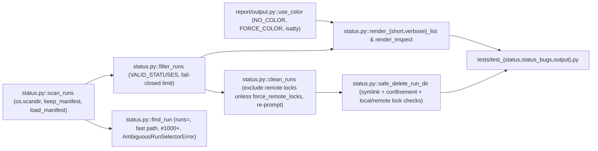

# IPD: Status, clean, and run-scanning safety, scalability, and terminal output

- Date: 2026-11-27
- Kind: child
- Concern: Eight-lens rollup findings `ROLL-05` (`EC-5`: `filter_runs` silently ignores `limit <= 0`, causing `pubrun clean --yes --limit 0` to delete all matching runs), `ROLL-18` (`PERF-4` / `MEM-7` / `UC-8`: `scan_runs()` retains every full `manifest.json` dict in RAM and `#1000+` recency index mismatches `_MAX_RECENCY_INDEX = 999`), `ROLL-21` (`SD-1` / `FUNC-2` / `UC-1`: empty `render_short_list` recommends `pubrun run -- python your_script.py` without `import pubrun`), `ROLL-24` (`UC-5`: remote-host crashed runs listed as clean candidates then unconditionally skipped with no `--force-remote-locks`), `ROLL-25` (`UX-8` / `SD-5`: invalid `--status` silently returns 0 runs and shows novice onboarding when runs exist), and `ROLL-35` (`FUNC-7`: dead `console.log` check and missing completed-run event/log stats; `UX-9`/`COMP-14`/`UX-16`: non-TTY ANSI leak, `DIM` styling, ASCII ellipsis fallback, dynamic `#` width, narrow terminal layout, `clean` re-prompting, and `find_run` prefix ambiguity), surfaced by `edge-cases`, `use-cases`, `performance`, `memory-resources`, `functionality`, `ui-ux`, `self-documentation`, and `compatibility`.
- Scope: Harden and optimize `src/pubrun/status.py` and `src/pubrun/report/output.py` (including a shared safe-delete helper and centralized TTY-aware `use_color`), with regression tests in `tests/test_status.py`, `tests/test_status_bugs.py`, and `tests/test_output.py`.
- Scope-Paths: src/pubrun/status.py, src/pubrun/report/output.py, tests/test_status.py, tests/test_status_bugs.py, tests/test_output.py
- Item-Dependencies: none
- Status: reviewed
- Readiness: go-pending-approval
- Review-Depth: complex
- Short-Description: Fix fail-closed limit<=0 in filter_runs, remote-lock clean safety with --force-remote-locks, status validation, completed-run event/log stats, scandir/non-retaining scans, and TTY-aware color
- Work-Kind: bug
- Priority: high
- Set: assess-8l
- Order: 6
- Highest E allocated: 05
- Author: Antigravity
- Id: m5s3g8

> Write and proofread this plan per the technical writing standard, `.aw/system/workflows/technical-writing/technical-writing.md`, including requirement 12 (diagrams).

## Workflow history

- 2026-11-27 /plan-review (Antigravity): APPROVE WITH REVISIONS APPLIED; PR-001, PR-002, PR-003, PR-004, PR-005, PR-006
- 2026-11-27 /assess-all (Antigravity): created Child 06 of Set `assess-8l` covering status, clean, run-scanning safety/scalability, and terminal color/ASCII handling (`ROLL-05`, `ROLL-18`, `ROLL-21`, `ROLL-24`, `ROLL-25`, `ROLL-35`).

## Goal

Make `src/pubrun/status.py` fail closed on invalid limits and statuses, safely handle remote-host locks in `clean_runs()`, report accurate completed-run log and event sizes plus empty-versus-filtered diagnostics, scale to 1,000+ runs via `os.scandir()` and opt-in non-retaining scans (`keep_manifest=False` with on-demand `RunInfo.load_manifest()`), and centralize teletypewriter (TTY)-aware color and American Standard Code for Information Interchange (ASCII)-safe rendering in `src/pubrun/report/output.py`.

### Status scanning, color policy, and safe-delete architecture

## Detailed Implementation Checklist (TODO)

Execution-state rule: mark an `E-*` item complete only after performing the action. Accepted execution states: blocked, failed, pending, performed; terminal gate demands `performed`.

### Task group 1: Fail-closed filtering, safe deletion, and remote-lock handling

- [ ] E-01 Harden `filter_runs()`, `clean_runs()`, and `safe_delete_run_dir()` in `src/pubrun/status.py`:
  - Define canonical `VALID_STATUSES = (STATUS_COMPLETED, STATUS_FAILED, STATUS_INTERRUPTED, STATUS_BROKEN_PIPE, STATUS_RUNNING, STATUS_CRASHED, STATUS_GHOST)` and validate non-empty tokens in `status_filter` and `not_status_filter` inside `filter_runs()`, raising `ValueError` naming the unknown status token(s) and listing all seven valid statuses.
  - Fix `limit` handling in `filter_runs()`: reject `bool`, non-`int`, or `limit < 0` with `ValueError("limit must be a non-negative integer")` (even when `runs` is empty), and return `[]` when `limit == 0` (never silently dropping the limit).
  - Extract a reusable `safe_delete_run_dir(run_dir: Path, base_dir: Path, force_remote_locks: bool = False) -> Tuple[bool, Optional[str]]` helper (returning `(True, None)` on successful `shutil.rmtree(run_dir)` or `(False, reason)` when skipped or when `OSError` occurs). Enforce: (1) symlink rejection (`run_dir.is_symlink() or not run_dir.is_dir()`), (2) parent-directory confinement (`run_dir.resolve().parent != base_dir.resolve()`), (3) active local process identifier (PID) lock refusal and unreadable/corrupt/symlinked lock refusal (NEVER bypassed by `force_remote_locks`), and (4) remote-host lock refusal (readable JSON lock whose `hostname` is non-empty and differs from `get_hostname()`) bypassed ONLY when `force_remote_locks=True`.
  - In `clean_runs()`:
    - Accept `force_remote_locks: bool = False`.
    - Validate `limit` (`bool`, non-`int`, `< 0` -> `ValueError`) and non-empty `status_filter` / `not_status_filter` tokens against `VALID_STATUSES` BEFORE stripping `"running"`, while preserving empty/whitespace/`"running"`-only filters returning `0` with `"Nothing to clean"` (keeping `tests/test_status_bugs.py::TestBug01EmptyStatusFilter` green).
    - Scan with `keep_manifest=False`, filter runs without slicing `limit` first, exclude `STATUS_RUNNING` and (unless `force_remote_locks=True`) runs with an unverified remote-host lock (printing a clear notice with the skipped remote-lock count and explaining `--force-remote-locks`), and then apply `limit` (returning `0` immediately when `limit == 0`).
    - Route deletion through `safe_delete_run_dir()` while preserving the `"  Failed to remove <name>: <err>"` stderr format when `shutil.rmtree` raises `OSError` (required by `tests/test_status.py::TestFilterFindAndCleanEdgeCases.test_clean_runs_removal_failure`).
    - Keep `_parse_selection(response, candidates) -> List[Any]` backward-compatible for direct callers; add `_parse_selection_detailed(response, candidates) -> Tuple[List[Any], List[str]]` returning `(selected, ignored_tokens)` so `clean_runs()` reports ignored invalid tokens and re-prompts once in interactive mode on an invalid selection (cancelling cleanly on empty input, `n`/`no`/`none`, `EOFError`/`KeyboardInterrupt`, or a second invalid selection).
  - Depends on: none
  - Expected outcome: `pubrun clean --yes --limit 0` deletes 0 runs; negative/bool limits or unknown statuses fail closed with clear `ValueError` messages; remote-locked runs are excluded from candidate tables up front with an opt-in `force_remote_locks=True` escape hatch that never bypasses symlink, confinement, unreadable-lock, or active-local-PID guards.
  - Execution state: pending

### Task group 2: Scalable run scanning, completed-run stats, and selector consistency

- [ ] E-02 Optimize `scan_runs()`, `RunInfo`, and `find_run()` in `src/pubrun/status.py`:
  - Replace `base.iterdir()` + `is_symlink()`/`is_dir()` in `scan_runs()` with `with os.scandir(base) as it:` checking `entry.is_dir(follow_symlinks=False)` and `entry.name.startswith("pubrun-")`.
  - Add `keep_manifest: bool = True` as a backward-compatible keyword parameter on `RunInfo.__init__(run_dir, *, keep_manifest: bool = True)` and `scan_runs(output_dir: Optional[str] = None, *, keep_manifest: bool = True)` so existing callers that read `RunInfo.manifest` directly (including TUI `RunsSidebar`/`RunDetailsView`/`ActionsPanel` before Child 09 `3q5rd5` and `_run_methods_aggregate` in Child 08 `2ge0ea`) stay unbroken; when `keep_manifest=False`, release the parsed `manifest.json` dict immediately after extracting summary scalar fields (`self.manifest = None`). Add `RunInfo.load_manifest() -> Optional[Dict[str, Any]]` to read `manifest.json` on demand (returning `self.manifest` when already retained, or reading `self.run_dir / "manifest.json"` without retaining it when `self.manifest is None`). Use `keep_manifest=False` internally in `clean_runs()` and `find_run()`.
  - Extend `AmbiguousRunSelectorError` with optional keyword parameter `candidates: Optional[List[RunInfo]] = None` (preserving existing 3-arg `(selector, by_recency, by_id)` calls and messages) and clear `str(e)` listing matching run IDs when multiple runs match an ID prefix or directory substring.
  - Update `find_run(run_id_or_prefix: str, output_dir: Optional[str] = None, *, runs: Optional[List[RunInfo]] = None) -> Optional[RunInfo]`:
    - When `runs is not None`, search `runs` directly without rescanning disk.
    - When `runs is None` and the selector is a non-digit full run ID (`len(sel) >= 8`), check an `os.scandir()` directory-name fast path for a unique `entry.name.endswith("-" + sel)` match (verifying `RunInfo(entry_path, keep_manifest=False).run_id == sel`) before falling back to `scan_runs(output_dir, keep_manifest=False)` so custom directory names and prefix ambiguity are never missed.
    - Remove the arbitrary `_MAX_RECENCY_INDEX = 999` cap in step (1) so any bare positive integer `1 <= n <= len(all_runs)` resolves to `all_runs[n - 1]` (keeping the exact-ID collision guard raising `AmbiguousRunSelectorError`, and falling through to ID/dirname lookup when `n > len(all_runs)`).
    - Distinguish 0 matches (return `None`) from `> 1` ambiguous ID prefix or directory-substring matches (raise `AmbiguousRunSelectorError(run_id_or_prefix, None, None, candidates=matches)`).
  - Extract `RunInfo._populate_artifact_sizes()` called from both `_load_from_manifest()` and `_load_from_lock()`: compute `event_count` via a single `os.stat(events.jsonl)` `O(1)` estimate (`0` if empty, else `max(1, st_size // 120)`), and compute `console_log_size` by summing `os.stat()` sizes of `stdout.log` and `stderr.log` (if either exists), falling back to legacy `console.log` only when neither split log exists.
  - Depends on: E-01
  - Expected outcome: `scan_runs(..., keep_manifest=False)` releases full manifest dicts and drops peak random-access memory (RAM) by >90% while preserving backward compatibility for callers expecting `RunInfo.manifest`, completed runs populate `event_count` and `console_log_size`, `#1000+` recency indices work consistently, and `find_run()` distinguishes missing runs from ambiguous prefixes.
  - Execution state: pending

### Task group 3: Centralized color, ASCII fallback, onboarding copy, and responsive tables

- [ ] E-03 Centralize TTY-aware color gating in `src/pubrun/report/output.py` and apply it in `src/pubrun/status.py`:
  - Export `use_color(stream: Optional[TextIO] = None, force_no_color: bool = False) -> bool` from `src/pubrun/report/output.py` with explicit precedence: (1) `force_no_color=True` -> `False`, (2) non-empty `NO_COLOR` env var -> `False`, (3) `FORCE_COLOR` env var set to any non-empty value other than `"0"` -> `True`, (4) `(stream or sys.stdout).isatty()` (catching exceptions -> `False`). Delegate internal `_use_color(stream)` to `use_color(stream)`.
  - Route `status.py::_status_marker()` and `_render_summary()` through `report/output.py::use_color(sys.stdout)` (accepting optional keyword `color: Optional[bool] = None` for testability) and remove all `\033[2m` (`DIM`) American National Standards Institute (ANSI) escape codes.
  - Update `status.py::_truncate(s: str, max_len: int, *, stream: Optional[TextIO] = None) -> str`: guard `max_len <= 0` -> `""`, test whether the target stream encoding (`getattr(stream or sys.stdout, "encoding", None) or "utf-8"`) can encode `"\u2026"`, and fall back to `"..."` (when `max_len >= 3`, else `s[:max_len]`) when it cannot.
  - Depends on: E-02
  - Expected outcome: Piped `pubrun status` emits zero ANSI escape codes (unless `FORCE_COLOR` is set), TTY mode emits zero `DIM` codes, `NO_COLOR` always overrides `FORCE_COLOR`, and ASCII-encoded streams render without `UnicodeEncodeError`.
  - Execution state: pending

- [ ] E-04 Fix empty-state onboarding copy, filtered-empty messaging, and narrow-terminal layout in `src/pubrun/status.py`:
  - Update `render_short_list(runs, all_runs=None)` and add optional `all_runs: Optional[List[RunInfo]] = None` to `render_verbose_list(runs, all_runs=None)`:
    - When `runs` is empty and `all_runs` is non-empty, return `"0 of {len(all_runs)} runs matched the filter criteria. Run 'pubrun status' to list all runs."`
    - When both are empty (or `all_runs is None`), return `"No runs found."` followed by accurate onboarding guidance (`import pubrun` in your script and run it normally, or run `pubrun init`; remove the misleading `pubrun run -- python your_script.py` claim).
  - Compute dynamic `#` column width from `len(_order)` (`max(4, len(str(len(_order))) + 2)`) in `render_short_list()` and from `len(candidates)` in `clean_runs()` so `#1000` never collides with `RUN ID`.
  - In `render_short_list()`: drop the low-priority `COMMIT` column when `term_width < 76` so `SCRIPT` stays readable on 60-column terminals while keeping 80-column tables unchanged; append a concise footer tip (`"Tip: pass a # index (e.g. 'pubrun show 1' or 'pubrun diff 1 2') to any command."`).
  - Depends on: E-03
  - Expected outcome: Empty vs filtered-empty states are clear, onboarding copy matches actual `pubrun` behavior, `#1000+` tables align cleanly, and 60-col to 120-col terminals render without squashing script names.
  - Execution state: pending

### Task group 4: Regression tests and existing-test alignment

- [ ] E-05 Update affected existing tests and add regression tests in `tests/test_status.py`, `tests/test_status_bugs.py`, and `tests/test_output.py`:
  - Update existing tests whose assertions intentionally change:
    - `tests/test_status.py::TestFilterFindAndCleanEdgeCases.test_find_run_ambiguous_prefix_and_dirname_substring`: assert `pytest.raises(AmbiguousRunSelectorError)` (checking `exc.candidates`) for ambiguous prefix `"abcd"` and substring `"pubrun-"`.
    - `tests/test_status.py::TestFilterFindAndCleanEdgeCases.test_clean_runs_interactive_cancel`: update single-answer invalid-selection cases (`["abc"]`, `["9"]`) to exercise the single re-prompt (both invalid->cancel and invalid->valid recovery).
    - `tests/test_status.py::TestStatusFormattingHelpers.test_status_marker` and `tests/test_status_bugs.py::TestBug67Display.test_exit_and_elapsed_align_with_header`: simulate a TTY (or set `FORCE_COLOR=1`) when asserting ANSI escape presence, and add an explicit non-TTY piped check confirming zero `\x1b[`.
  - Add new behavioral tests covering:
    - `filter_runs` with `limit=0` (returns `[]`), `limit=-1`, `limit=True`, unknown `--status` / `-S` (raises `ValueError` listing all 7 `VALID_STATUSES`), and all 7 valid statuses.
    - `clean_runs` with `limit=0` (deletes 0 runs), remote-host locks (excluded up front with `--force-remote-locks` notice by default; deleted with `force_remote_locks=True`), `safe_delete_run_dir` symlink/confinement/active-local-PID/unreadable-lock refusal even when `force_remote_locks=True`, and `_parse_selection_detailed` ignored-token reporting + interactive re-prompt.
    - Completed-run `event_count` and `stdout.log`+`stderr.log` sizing (plus legacy `console.log` fallback), `scan_runs(..., keep_manifest=False)` releasing `manifest` with `load_manifest()` on-demand loading and default `keep_manifest=True` preservation, `find_run(..., runs=...)`, `#1000` recency lookup, `report/output.py::use_color` precedence (`force_no_color`, `NO_COLOR > FORCE_COLOR`, `FORCE_COLOR=0`, `isatty`), zero `\x1b[2m` (`DIM`) in TTY mode, ASCII stream `_truncate()` fallback, empty vs filtered-empty `render_short_list` / `render_verbose_list`, and 60/80/120-column terminal layout + `#1000` column width.
  - Depends on: E-04
  - Expected outcome: All updated and new tests pass, existing status/output/runtime/TUI suites pass with zero regressions, and three-platform `mypy` exits `0`.
  - Execution state: pending

## Project conventions discovered (Step 0)

- `src/pubrun/report/output.py` owns central command-line interface (CLI) status prefixes and color policy (honoring `NO_COLOR`, `FORCE_COLOR`, non-TTY, and zero `DIM` styling).
- `clean_runs()` must always fail closed on invalid filters, symlinked run directories, out-of-directory paths, and active/unverified locks.
- Existing TUI widgets (`src/pubrun/tui/widgets/sidebar.py`, `details.py`, `actions.py`) call `scan_runs()` and read `RunInfo.manifest` until Child 09 (`3q5rd5`) migrates them to `keep_manifest=False` + `load_manifest()`, so `keep_manifest` must default to `True` in Child 06 (`m5s3g8`).

## Findings

| ID | Concerns | Severity | Remediation Risk | Persona | Summary |
|---|---|---|---|---|---|
| `ROLL-05` | edge-cases | High | Low (`usability`) | QA / Security | `filter_runs()` ignores `limit <= 0`, causing `pubrun clean --yes --limit 0` to delete all matching runs. |
| `ROLL-18` | performance; memory-resources; use-cases | High | Medium (`complexity`) | Power user / Operator | `scan_runs()` retains every full `manifest.json` dict in RAM and `#1000+` recency index mismatches `_MAX_RECENCY_INDEX = 999`. |
| `ROLL-21` | self-documentation; functionality; use-cases | High | Low (`usability`) | Complete novice | Empty `render_short_list()` recommends `pubrun run -- python your_script.py`, which tracks nothing without `import pubrun`. |
| `ROLL-24` | use-cases | High | Low (`functionality`) | HPC operator | Remote-host crashed runs are listed by `clean_runs` then unconditionally skipped with no `--force-remote-locks` escape hatch. |
| `ROLL-25` | ui-ux; self-documentation | High | Low (`usability`) | Novice / Power user | Invalid `--status` tokens silently match 0 runs and render novice onboarding even when runs exist. |
| `ROLL-35` | functionality; ui-ux; compatibility | Medium | Low (`usability`) | Power user / Operator | Completed runs show `Events: -` and check dead `console.log`; piped `status` leaks ANSI codes + `DIM`; `_truncate` lacks ASCII fallback; narrow terminals squeeze script names. |

## Proposed changes (ordered, validatable)

1. `E-01` (`src/pubrun/status.py`): Validate `VALID_STATUSES`, fail closed on `limit <= 0`/`bool`, extract `safe_delete_run_dir()`, exclude remote locks by default before `limit`, add `force_remote_locks=False`, and add `_parse_selection_detailed()` + single re-prompt.
2. `E-02` (`src/pubrun/status.py`): Adopt `os.scandir()`, add `keep_manifest: bool = True` + `load_manifest()` (using `keep_manifest=False` in `clean_runs`/`find_run`), add `find_run(..., runs=...)` + fast path + `#1000+` recency + `AmbiguousRunSelectorError(candidates=...)`, and extract `_populate_artifact_sizes()`.
3. `E-03` (`src/pubrun/report/output.py`, `src/pubrun/status.py`): Centralize `use_color()`, remove `DIM`, and add stream-aware ASCII ellipsis fallback in `_truncate()`.
4. `E-04` (`src/pubrun/status.py`): Fix empty-state onboarding copy, add filtered-empty messaging to `render_short_list()` and `render_verbose_list()`, compute dynamic `#` width, drop `COMMIT` below 76 cols, and add `#` tip footer.
5. `E-05` (`tests/test_status.py`, `tests/test_status_bugs.py`, `tests/test_output.py`): Align affected existing tests and add regression tests for all items above.

## Deferred / out of scope (with reason)

- Exposing `--force-remote-locks` and `--json` on CLI subparsers, passing `keep_manifest=False` in CLI `_run_status`/`_get_manifest_path`/`_run_diff`/`_run_combined`, passing `all_runs=all_runs` to `render_verbose_list()`, and updating `_emit_ambiguous_selector()` to render prefix-ambiguity `candidates` in `src/pubrun/__main__.py` are owned by child `2ge0ea` (Order 08).
  - Carrier: 2ge0ea
- Wiring `safe_delete_run_dir()` into TUI single-run deletion (`src/pubrun/tui/widgets/actions.py`) and migrating `RunsSidebar` / `RunDetailsView` / `ActionsPanel` to `scan_runs(..., keep_manifest=False)` + `RunInfo.load_manifest()` are owned by child `3q5rd5` (Order 09).
  - Carrier: 3q5rd5
- Updating `README.md` and `docs/cli.md` `pubrun run` wording is owned by child `6y55x4` (Order 10).
  - Carrier: 6y55x4

## Scope check

- Over-scope: none. Every change maps directly to `ROLL-05`, `ROLL-18`, `ROLL-21`, `ROLL-24`, `ROLL-25`, and `ROLL-35`.
- Under-scope: none. All `status.py`, `report/output.py`, and corresponding unit-test updates are covered.

## Required tests / validation

1. `pytest tests/test_status.py tests/test_status_bugs.py tests/test_status_clean_table.py tests/test_output.py tests/test_runtime_safety.py tests/test_new_features.py tests/test_cli_negative_paths.py tests/test_timing_consumers.py tests/test_profile_deprecation.py tests/test_tui.py tests/test_tui_bugs.py tests/test_tui_widgets.py -v`
2. `mypy && mypy --platform win32 && mypy --platform darwin`

## Spec / documentation sync

In-product onboarding text in `src/pubrun/status.py` is updated in `E-04`; `README.md` and `docs/cli.md` updates are handled in child `6y55x4` (Order 10).

## Open questions

None. All fixes preserve existing run directory formats and backward-compatible public defaults (`keep_manifest=True`, `_parse_selection` returning `list`, 3-arg `AmbiguousRunSelectorError`).

## Validation and cross-check (verify before reporting done)

Validation-state rule: inspect evidence in a separate pass. Accepted validation results: blocked, failed, pass, pending; terminal gate demands `pass`.

- [ ] V-01 validates E-01
  - Required evidence: Pasted `pytest` output for `src/pubrun/status.py::filter_runs`, `clean_runs`, `safe_delete_run_dir`, and `_parse_selection_detailed` in `tests/test_status.py`, `tests/test_status_bugs.py`, and `tests/test_runtime_safety.py` confirming `limit=0` returns `[]` / deletes 0 runs, `limit=-1`/`True` and unknown statuses raise `ValueError`, empty/`"running"`-only filters return `0`, remote-host locks are skipped by default and deleted with `force_remote_locks=True` (while symlink/confinement/active-local-PID/unreadable locks still refuse), and interactive re-prompting works cleanly.
  - Observed evidence:
  - Result: pending

- [ ] V-02 validates E-02
  - Required evidence: Pasted `pytest` output for `src/pubrun/status.py::scan_runs`, `RunInfo` (`load_manifest`, `_populate_artifact_sizes`), `find_run`, and `AmbiguousRunSelectorError` in `tests/test_status.py` and `tests/test_status_bugs.py` confirming `keep_manifest=False` drops `manifest` and `load_manifest()` reloads it, default `keep_manifest=True` preserves TUI compatibility, completed-run `event_count` & `console_log_size` (`stdout.log`+`stderr.log` and legacy `console.log`) populate, ambiguous prefixes raise `AmbiguousRunSelectorError` with `candidates`, and `#1000` recency selection passes.
  - Observed evidence:
  - Result: pending

- [ ] V-03 validates E-03
  - Required evidence: Pasted `pytest` output for `src/pubrun/report/output.py::use_color` and `src/pubrun/status.py` (`_status_marker`, `_render_summary`, `_truncate`) in `tests/test_output.py`, `tests/test_status.py`, and `tests/test_status_bugs.py` confirming `NO_COLOR > FORCE_COLOR` precedence, non-TTY output has zero `\x1b[`, TTY output has zero `\x1b[2m`, and ASCII-encoded stream `_truncate()` falls back to `"..."` without `UnicodeEncodeError`.
  - Observed evidence:
  - Result: pending

- [ ] V-04 validates E-04
  - Required evidence: Pasted `pytest` output for `src/pubrun/status.py::render_short_list` and `render_verbose_list` in `tests/test_status.py` and `tests/test_status_bugs.py` confirming empty-dir onboarding accuracy (without misleading `pubrun run`), filtered-empty `0 of N runs matched`, `#1000` dynamic column width, 60/80/120-column rendering, and footer tip pass.
  - Observed evidence:
  - Result: pending

- [ ] V-05 validates E-05
  - Required evidence: Pasted output of `pytest tests/test_status.py tests/test_status_bugs.py tests/test_status_clean_table.py tests/test_output.py tests/test_runtime_safety.py tests/test_new_features.py tests/test_cli_negative_paths.py tests/test_timing_consumers.py tests/test_profile_deprecation.py tests/test_tui.py tests/test_tui_bugs.py tests/test_tui_widgets.py -v` (covering all updated and new test classes in `tests/test_status.py`, `tests/test_status_bugs.py`, and `tests/test_output.py` plus TUI/CLI regression suites) and three-platform `mypy && mypy --platform win32 && mypy --platform darwin` exiting `0`.
  - Observed evidence:
  - Result: pending

## Approval and execution gate

1. **Open questions and human approval precondition:** Proposal only; execution requires all blocking open questions resolved (`None` remain) and explicit human approval (`aw set plan approved m5s3g8 --by-human`) before implementation begins.
2. **Scope declaration:** `- Scope-Paths:` declares the expected files this plan modifies (`src/pubrun/status.py`, `src/pubrun/report/output.py`, `tests/test_status.py`, `tests/test_status_bugs.py`, `tests/test_output.py`). If execution requires touching an additional file or leaving a declared file untouched, justify each delta at finalization with `--scope-reason` or `--scope-ack`.
3. **Validation honesty (hard MUST):** Every `V-*` item MUST carry actual pasted command output from real execution after the final code edit; never claim tests or `mypy` passed without running them and pasting their output.
4. **Path-scoped commit and never-push:** Commit ONLY the modified files through `aw commit m5s3g8 -- <paths>` (never `git add -A`, bare `git commit -a`, or raw `git commit`). Never push, create tags, or publish releases.
5. **Lifecycle finalization ownership:** When executed by a runner (`aw oc run` / `aw agy run`), the runner owns the lifecycle transition to `.aw/records/plans/executed/` after all `E-*` are `performed` and all `V-*` are `pass`. When executed manually outside a runner, finalize with `aw ipd finalize m5s3g8` (never hand-roll `git mv` into `executed/`).
