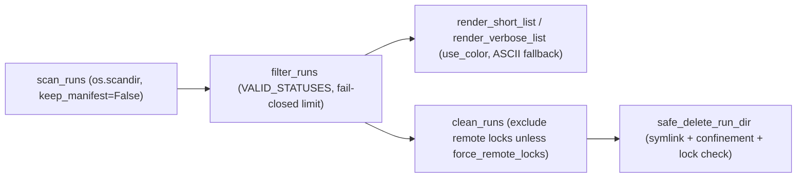

# IPD: Status, clean, and run-scanning safety, scalability, and terminal output

- Date: 2026-11-27
- Kind: child
- Concern: Eight-lens rollup findings `ROLL-05` (`EC-5`: `filter_runs` silently ignores `limit <= 0`, causing `pubrun clean --yes --limit 0` to delete all matching runs), `ROLL-18` (`PERF-4` / `MEM-7` / `UC-8`: `scan_runs()` retains every full `manifest.json` dict in RAM and `#1000+` recency index mismatches `_MAX_RECENCY_INDEX = 999`), `ROLL-21` (`SD-1` / `FUNC-2` / `UC-1`: empty `render_short_list` recommends `pubrun run -- python your_script.py` without `import pubrun`), `ROLL-24` (`UC-5`: remote-host crashed runs listed as clean candidates then unconditionally skipped with no `--force-remote-locks`), `ROLL-25` (`UX-8` / `SD-5`: invalid `--status` silently returns 0 runs and shows novice onboarding when runs exist), and `ROLL-35` (`FUNC-7`: dead `console.log` check and missing completed-run event/log stats; `UX-9`/`COMP-14`/`UX-16`: non-TTY ANSI leak, `DIM` styling, ASCII ellipsis fallback, dynamic `#` width, narrow terminal layout, `clean` re-prompting, and `find_run` prefix ambiguity), surfaced by `edge-cases`, `use-cases`, `performance`, `memory-resources`, `functionality`, `ui-ux`, `self-documentation`, and `compatibility`.
- Scope: Harden and optimize `src/pubrun/status.py` and `src/pubrun/report/output.py` (including a shared safe-delete helper and centralized TTY-aware `use_color`), with regression tests in `tests/test_status.py` and `tests/test_status_bugs.py`.
- Scope-Paths: src/pubrun/status.py, src/pubrun/report/output.py, tests/test_status.py, tests/test_status_bugs.py
- Item-Dependencies: none
- Status: to-review
- Review-Depth: complex
- Short-Description: Fix fail-closed limit<=0 in filter_runs, remote-lock clean safety with --force-remote-locks, status validation, completed-run event/log stats, scandir/non-retaining scans, and TTY-aware color
- Work-Kind: bug
- Priority: high
- Set: assess-8l
- Order: 6
- Highest E allocated: 05
- Author: Antigravity
- Id: m5s3g8

> Write and proofread this plan per the technical writing standard, `.aw/system/workflows/technical-writing/technical-writing.md`, including requirement 12 (diagrams).

## Workflow history

- 2026-11-27 /assess-all (Antigravity): created Child 06 of Set `assess-8l` covering status, clean, run-scanning safety/scalability, and terminal color/ASCII handling (`ROLL-05`, `ROLL-18`, `ROLL-21`, `ROLL-24`, `ROLL-25`, `ROLL-35`).

## Goal

Make `status.py` fail closed on invalid limits and statuses, safely handle remote-host locks in `clean_runs`, report accurate completed-run log/event sizes and empty-vs-filtered diagnostics, scale to 1,000+ runs without retaining full manifest dicts in memory, and centralize TTY-aware color and ASCII-safe rendering.

### Status scanning and safe-delete architecture

## Detailed Implementation Checklist (TODO)

Execution-state rule: mark an `E-*` item complete only after performing the action. Accepted execution states: blocked, failed, pending, performed; terminal gate demands `performed`.

### Task group 1: Fail-closed filtering, safe deletion, and remote-lock handling

- [ ] E-01 Harden `filter_runs()` and `clean_runs()` in `src/pubrun/status.py`:
  - Define canonical `VALID_STATUSES` (`completed`, `failed`, `interrupted`, `broken pipe`, `running`, `crashed`, `ghost`) and validate `status_filter` / `not_status_filter` tokens in `filter_runs()`, raising `ValueError` naming the unknown status and listing all valid statuses.
  - Fix `limit` handling in `filter_runs()`: reject `bool` or `limit < 0` with `ValueError("limit must be a non-negative integer")`, and return `[]` when `limit == 0` (never silently dropping the limit).
  - Extract a reusable `safe_delete_run_dir(run_dir, base_dir, force_remote_locks=False)` helper enforcing symlink rejection, parent-directory confinement, and active/remote lock checks.
  - In `clean_runs()`: accept `force_remote_locks: bool = False`; by default exclude runs with unverified remote-host locks from the deletion candidate table and print a clear notice explaining `--force-remote-locks`; report ignored invalid tokens in `_parse_selection()` and re-prompt once (or cleanly) in interactive mode instead of exiting silently on a typo.
  - Depends on: none
  - Expected outcome: `pubrun clean --yes --limit 0` deletes 0 runs; negative limit or unknown status fails closed with clear errors; remote-locked runs are skipped up front with an opt-in `--force-remote-locks` escape hatch.
  - Execution state: pending

### Task group 2: Scalable run scanning, completed-run stats, and selector consistency

- [ ] E-02 Optimize `scan_runs()`, `RunInfo`, and `find_run()` in `src/pubrun/status.py`:
  - Replace `base.iterdir()` + `is_symlink()`/`is_dir()` with `os.scandir()`.
  - Add `keep_manifest: bool = False` on `RunInfo` and `scan_runs()` (with an on-demand `load_manifest()` helper when full JSON is needed) so listing/clean/sidebar scans release full manifest dicts immediately after extracting summary scalar fields.
  - Accept optional pre-scanned `runs` in `find_run()` and add a directory-name fast path for exact run ID / prefix matches before falling back to full scans; distinguish 0 matches vs multiple ambiguous ID prefix matches with an actionable error.
  - Align `render_short_list()` and `find_run()` recency bounds so every printed `#N` index is selectable by `find_run(str(N))` (raise or remove the mismatch at `_MAX_RECENCY_INDEX = 999`).
  - Extract `_populate_artifact_sizes()` called from both `RunInfo._load_from_manifest()` and `_load_from_lock()` to compute `event_count` from `events.jsonl` and sum `stdout.log` + `stderr.log` sizes (with legacy `console.log` fallback), fixing `Events: -` and dead `Console Log:` on completed runs.
  - Depends on: E-01
  - Expected outcome: `scan_runs()` peak RAM drops by >90%, `Events:` and `Console Log:` populate on completed runs, and `#1000+` recency indices work consistently.
  - Execution state: pending

### Task group 3: Centralized color, ASCII fallback, onboarding copy, and responsive tables

- [ ] E-03 Centralize TTY-aware color gating in `src/pubrun/report/output.py` and apply it in `src/pubrun/status.py`:
  - Export `use_color(stream=None, force_no_color=False) -> bool` from `src/pubrun/report/output.py` honoring `--no-color`, `NO_COLOR`, `FORCE_COLOR`, and `stream.isatty()`.
  - Use `use_color()` in `status.py` (`_status_marker`, `_render_summary`) and remove all `\033[2m` (`DIM`) styling.
  - Add ASCII-safe fallback (`"..."` instead of `"\u2026"`) in `_truncate()` when the target stream encoding cannot encode `"\u2026"`.
  - Depends on: E-02
  - Expected outcome: Piped `pubrun status` emits zero ANSI escape codes, TTY mode emits zero `DIM` codes, and ASCII-encoded streams render without `UnicodeEncodeError`.
  - Execution state: pending

- [ ] E-04 Fix empty-state onboarding copy, filtered-empty messaging, and narrow-terminal layout in `src/pubrun/status.py`:
  - In `render_short_list()` and `render_verbose_list()`: when `all_runs` is empty, print accurate onboarding text (`import pubrun` in your script and run it normally, or run `pubrun init`; do not claim `pubrun run -- python your_script.py` tracks unmodified scripts). When `all_runs` is non-empty but `runs` is empty, print `"0 of N runs matched the filter criteria. Run 'pubrun status' to list all runs."`
  - Compute dynamic `#` column width from `len(runs)` so `#1000` never collides with `RUN ID`, drop low-priority columns (e.g. `COMMIT`) when terminal width `< 76`, and add a concise footer tip (`"Tip: pass a # index (e.g. 'pubrun show 1' or 'pubrun diff 1 2') to any command."`).
  - Depends on: E-03
  - Expected outcome: Empty vs filtered-empty states are accurate, onboarding copy matches reality, and 60-col to 120-col terminals render cleanly.
  - Execution state: pending

### Task group 4: Regression tests

- [ ] E-05 Add comprehensive tests in `tests/test_status.py` and `tests/test_status_bugs.py`:
  - Test `filter_runs` with `limit=0`, `limit=-1`, `limit=True`, invalid `--status`, and all 7 valid statuses.
  - Test `clean_runs` with `limit=0`, remote-host locks (excluded by default, deleted with `force_remote_locks=True`), and `safe_delete_run_dir` symlink/confinement guards.
  - Test completed-run `event_count` and `stdout.log`+`stderr.log` sizing, `keep_manifest=False` memory behavior, `#1000` recency index lookup, non-TTY ANSI suppression, ASCII stream rendering, and narrow-terminal widths (60/80/120 cols).
  - Depends on: E-04
  - Expected outcome: All new and existing status tests pass and three-platform `mypy` exits `0`.
  - Execution state: pending

## Project conventions discovered (Step 0)

- `src/pubrun/report/output.py` owns central CLI status prefixes and color policy (honoring `NO_COLOR`, `FORCE_COLOR`, non-TTY, and zero `DIM` styling).
- `clean_runs()` must always fail closed on invalid filters, symlinked run directories, out-of-directory paths, and active/unverified locks.

## Findings

| ID | Concerns | Severity | Remediation Risk | Persona | Summary |
|---|---|---|---|---|---|
| `ROLL-05` | edge-cases | High | Low (`usability`) | QA / Security | `filter_runs()` ignores `limit <= 0`, causing `pubrun clean --yes --limit 0` to delete all matching runs. |
| `ROLL-18` | performance; memory-resources; use-cases | High | Medium (`complexity`) | Power user / Operator | `scan_runs()` retains every full `manifest.json` dict in RAM and `#1000+` recency index mismatches `_MAX_RECENCY_INDEX = 999`. |
| `ROLL-21` | self-documentation; functionality; use-cases | High | Low (`usability`) | Complete novice | Empty `render_short_list()` recommends `pubrun run -- python your_script.py`, which tracks nothing without `import pubrun`. |
| `ROLL-24` | use-cases | High | Low (`functionality`) | HPC operator | Remote-host crashed runs are listed by `clean_runs` then unconditionally skipped with no `--force-remote-locks` escape hatch. |
| `ROLL-25` | ui-ux; self-documentation | High | Low (`usability`) | Novice / Power user | Invalid `--status` tokens silently match 0 runs and render novice onboarding even when runs exist. |
| `ROLL-35` | functionality; ui-ux; compatibility | Medium | Low (`usability`) | Power user / Operator | Completed runs show `Events: -` and check dead `console.log`; piped `status` leaks ANSI codes + `DIM`; `_truncate` lacks ASCII fallback; narrow terminals squeeze script names. |

## Proposed changes (ordered, validatable)

1. `E-01` (`src/pubrun/status.py`): Validate `VALID_STATUSES`, fail closed on `limit <= 0`, extract `safe_delete_run_dir()`, exclude remote locks by default, and add `force_remote_locks=False` + re-prompting.
2. `E-02` (`src/pubrun/status.py`): Adopt `os.scandir()`, `keep_manifest=False`, pre-scanned `find_run()` + prefix ambiguity reporting, `#1000+` recency alignment, and completed-run `_populate_artifact_sizes()`.
3. `E-03` (`src/pubrun/report/output.py`, `src/pubrun/status.py`): Centralize `use_color()`, remove `DIM`, and add ASCII ellipsis fallback.
4. `E-04` (`src/pubrun/status.py`): Fix empty-state onboarding copy, filtered-empty message, dynamic `#` width, narrow-terminal column drop, and `#` tip footer.
5. `E-05` (`tests/test_status.py`, `tests/test_status_bugs.py`): Add regression tests for all items above.

## Deferred / out of scope (with reason)

- Exposing `--force-remote-locks` and `--json` on CLI subparsers in `src/pubrun/__main__.py` is owned by child `2ge0ea` (Order 08).
  - Carrier: 2ge0ea
- Wiring `safe_delete_run_dir` into TUI single-run deletion in `src/pubrun/tui/widgets/actions.py` is owned by child `3q5rd5` (Order 09).
  - Carrier: 3q5rd5

## Scope check

- Over-scope: none. Every change maps directly to `ROLL-05`, `ROLL-18`, `ROLL-21`, `ROLL-24`, `ROLL-25`, and `ROLL-35`.
- Under-scope: none. All `status.py` and `report/output.py` items are covered.

## Required tests / validation

1. `pytest tests/test_status.py tests/test_status_bugs.py tests/test_runtime_safety.py -v`
2. `mypy && mypy --platform win32 && mypy --platform darwin`

## Spec / documentation sync

In-product onboarding text in `src/pubrun/status.py` is updated in `E-04`; `README.md` and `docs/cli.md` updates are handled in child `6y55x4` (Order 10).

## Open questions

None. All fixes preserve existing run directory formats and backward-compatible signatures.

## Validation and cross-check (verify before reporting done)

Validation-state rule: inspect evidence in a separate pass. Accepted validation results: blocked, failed, pass, pending; terminal gate demands `pass`.

- [ ] V-01 validates E-01
  - Required evidence: Pasted `pytest` output for `status.py::filter_runs`, `status.py::clean_runs`, and `status.py::safe_delete_run_dir` confirming `limit=0` returns `[]`, `limit=-1` raises `ValueError`, unknown statuses fail closed, and remote-host locks are skipped by default and deleted with `force_remote_locks=True`.
  - Observed evidence:
  - Result: pending

- [ ] V-02 validates E-02
  - Required evidence: Pasted `pytest` output for `status.py::scan_runs`, `status.py::RunInfo`, and `status.py::find_run` confirming `keep_manifest=False`, completed-run `event_count` & `console_log_size`, ambiguous prefix error, and `#1000` recency selection pass.
  - Observed evidence:
  - Result: pending

- [ ] V-03 validates E-03
  - Required evidence: Pasted `pytest` output for `report/output.py::use_color` and `status.py::_truncate` confirming non-TTY output has zero `\x1b[`, TTY output has zero `\x1b[2m`, and ASCII-encoded stream renders without `UnicodeEncodeError`.
  - Observed evidence:
  - Result: pending

- [ ] V-04 validates E-04
  - Required evidence: Pasted `pytest` output for `status.py::render_short_list` and `render_verbose_list` confirming empty-dir onboarding accuracy, filtered-empty `0 of N runs matched`, and 60/80/120-column rendering.
  - Observed evidence:
  - Result: pending

- [ ] V-05 validates E-05
  - Required evidence: Pasted output of `pytest tests/test_status.py tests/test_status_bugs.py tests/test_runtime_safety.py` and three-platform `mypy` exiting `0`.
  - Observed evidence:
  - Result: pending

## Approval and execution gate

Proposal only; requires review and explicit human approval before execution (`aw set plan approved m5s3g8 --by-human`). Not auto-executed. On completion, finalize to `.aw/records/plans/executed/`.
