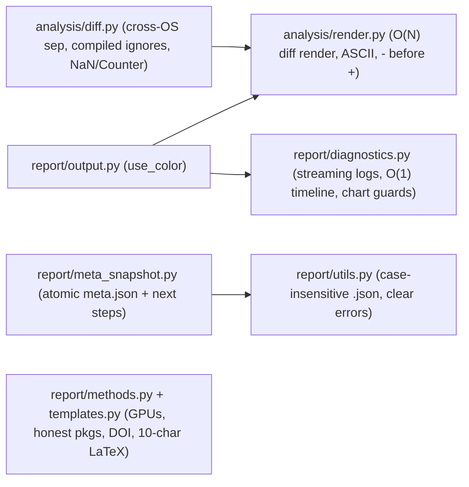

# IPD: Diff, methods, diagnostics, and meta-snapshot correctness and streaming

- Date: 2026-11-27
- Kind: child
- Concern: Eight-lens rollup findings `ROLL-15` (`FUNC-1`/`UC-7`/`EC-21`: `pubrun methods` omits captured GPUs, falsely claims `"Standard library dependencies were utilized"` for non-highlighted third-party packages, omits Zenodo DOI, and lacks full 10-char LaTeX escaping), `ROLL-20` (`MEM-3`/`PERF-11`/`EC-13`: whole-file log/event reads in `diagnostics.py`, chart/sparkline/duration crashes, single corrupt JSONL line aborting timeline), `ROLL-23` (`SD-3`/`UX-6`: `print_report` silently ignores unknown section names and outputs empty silence on `show logs`), `ROLL-27` (`UX-3`/`EC-18`/`SD-9`/`SD-12`/`COMP-13`: non-atomic `meta.json` write, missing setup instructions, case-sensitive `.json` check, garbled hydration prose), `ROLL-32` (`COMP-4`/`PERF-10`/`EC-12`/`UX-11`: cross-OS diff `os.pathsep`/`fnmatch`/`basename`, 3x slower `standard` diff, `O(N^2)` `_format_array_diff`, `NaN != NaN` and multiset list diff, silent empty inline diff and inverted `+/-`), and `ROLL-35` (`UX-9`/`COMP-14`/`UX-16`: TTY-aware color, no `DIM`, ASCII fallbacks, responsive package columns, local-time chart axis with `--utc`), surfaced by `functionality`, `use-cases`, `compatibility`, `performance`, `memory-resources`, `edge-cases`, `ui-ux`, and `self-documentation`.
- Scope: Fix `src/pubrun/analysis/diff.py`, `src/pubrun/analysis/render.py`, `src/pubrun/report/methods.py`, `src/pubrun/report/templates.py`, `src/pubrun/report/diagnostics.py`, `src/pubrun/report/meta_snapshot.py`, and `src/pubrun/report/utils.py`, with tests in `tests/test_reports.py` and `tests/test_methods_multi.py`.
- Scope-Paths: src/pubrun/analysis/diff.py, src/pubrun/analysis/render.py, src/pubrun/report/methods.py, src/pubrun/report/templates.py, src/pubrun/report/diagnostics.py, src/pubrun/report/meta_snapshot.py, src/pubrun/report/utils.py, tests/test_reports.py, tests/test_methods_multi.py
- Item-Dependencies: executed:m5s3g8
- Status: to-review
- Review-Depth: complex
- Short-Description: Fix methods GPU/stdlib/DOI/LaTeX bugs, cross-OS and O(N) diff/render bugs, streaming logs and O(1) timelines, chart/duration guards, and atomic meta.json with setup guidance
- Work-Kind: bug
- Priority: high
- Set: assess-8l
- Order: 7
- Highest E allocated: 05
- Author: Antigravity
- Id: caeqdz

> Write and proofread this plan per the technical writing standard, `.aw/system/workflows/technical-writing/technical-writing.md`, including requirement 12 (diagrams).

## Workflow history

- 2026-11-27 /assess-all (Antigravity): created Child 07 of Set `assess-8l` covering diff, methods, diagnostics, and meta-snapshot correctness, streaming, and cross-OS fidelity (`ROLL-15`, `ROLL-20`, `ROLL-23`, `ROLL-27`, `ROLL-32`, `ROLL-35`).

## Goal

Ensure `pubrun methods` produces factually accurate, LaTeX-safe methods sections including GPUs and Zenodo DOI; `pubrun diff` is deterministic across OSes and linear-time; `diagnostics.py` streams logs and timelines in `O(1)` memory without crashing on edge-case values; and `pubrun meta` writes atomically with clear setup instructions.

### Analysis and reporting pipeline

## Detailed Implementation Checklist (TODO)

Execution-state rule: mark an `E-*` item complete only after performing the action. Accepted execution states: blocked, failed, pending, performed; terminal gate demands `performed`.

### Task group 1: `methods.py` and `templates.py` publication accuracy

- [ ] E-01 Fix `src/pubrun/report/methods.py` and `src/pubrun/report/templates.py`:
  - Render captured `hardware.gpus` (count, model names, VRAM/driver when available) in both `MARKDOWN_TEMPLATE` and `LATEX_TEMPLATE`, and add GPU configuration to `_VARIANCE_FIELDS` in `generate_report_multi()`.
  - Fix the false `"Standard library dependencies were utilized."` branch in `generate_report()`: distinguish (a) highlighted packages present, (b) non-highlighted third-party packages recorded (list top packages or state package count accurately without claiming stdlib-only), and (c) truly zero third-party packages recorded.
  - Include the Zenodo concept DOI (`10.5281/zenodo.20801582`) in both templates (matching `pubrun cite`).
  - Expand `_escape_latex()` to escape all 10 LaTeX special characters (`\` first, then `& % $ # _ { } ~ ^`) and apply it consistently to every interpolated field in both single-run and multi-run LaTeX output.
  - Depends on: none
  - Expected outcome: Generated Markdown and LaTeX methods paragraphs include GPUs, never emit false stdlib-only claims, cite the Zenodo DOI, and compile cleanly with special characters.
  - Execution state: pending

### Task group 2: Cross-OS, linear-time `diff.py` and `render.py`

- [ ] E-02 Fix `src/pubrun/analysis/diff.py` and `src/pubrun/analysis/render.py`:
  - In `diff.py`: infer `*PATH*` separator and `argv[0]` basename rules (`ntpath` vs `posixpath`) per manifest from `manifest.get("host", {}).get("os_name")`; pre-split `ignores` into exact set, prefix tuple, and a single compiled `fnmatch.translate` regex using case-sensitive (`fnmatchcase`) semantics across all platforms; treat `NaN == NaN` as equal; use `collections.Counter` for multiset list diffs so duplicate multiplicity changes are not misreported as order changes; handle missing/`None` `"name"` keys in env/package lists safely; sanitize non-finite floats in `export_manifest()` with `allow_nan=False`.
  - In `render.py`: precompute first-occurrence index dicts in `_format_array_diff()` (`O(N)` instead of `O(N^2)`); emit `(no differences)` in `_render_inline()` when all diff buckets are empty; render `-` (old) before `+` (new) in `list_diff`; use `report/output.py::use_color()` (no `DIM`, zero ANSI when piped) and ASCII ellipsis fallback when stream cannot encode `"\u2026"`.
  - Depends on: none
  - Expected outcome: Cross-OS diffs are deterministic, `standard` diff drops from ~58 ms to <=22 ms, `_format_array_diff` drops from 234 ms to <=3 ms at N=2,000, and inline diff output is consistent and pipe-safe.
  - Execution state: pending

### Task group 3: Streaming diagnostics, chart guards, and atomic `meta_snapshot`

- [ ] E-03 Harden and stream `src/pubrun/report/diagnostics.py`:
  - Raise `DiagnosticsError` (exit code 2) listing `SHOW_SECTIONS` (`logs`, `env`, `packages`) when `section` is unrecognized; when `section == "logs"` finds neither `stdout.log` nor `stderr.log`, emit an informative stderr note pointing to `[console].capture_mode = "standard"` / `import pubrun.full`.
  - Stream `show logs` via 64 KiB chunks (`shutil.copyfileobj`) instead of `sf.read()`; stream `events.jsonl` timeline in `print_report()` using a 10-item head list + `collections.deque(maxlen=10)` with per-line JSON error handling (skipping truncated trailing lines with a count note instead of discarding the whole timeline).
  - In `read_resource_series()`: pre-filter lines with `if '"resource_sample"' not in line: continue` before `json.loads()`, and accept only finite non-bool numeric values.
  - Guard `draw_ascii_chart()` (`height >= 2`, `width >= 1`, empty `data`, out-of-range timestamps, narrow-width axis labels) and `_sparkline()` (`width >= 1`, ASCII fallback on non-UTF-8 streams); reject `<= 0` and non-finite durations in `parse_duration()` with clear valid-format examples (`'30s'`, `'10m'`, `'2h'`, `'1d'`).
  - Switch `diagnostics.py` color checks to `report/output.py::use_color()` (zero `DIM`), size `_print_packages_block()` columns dynamically from terminal width (2 cols at 80, 1 below 60), default chart X-axis timestamps to local time (with `Z` when `use_utc=True`), and guard `print_resources_report()` with `_as_dict()`.
  - Depends on: none
  - Expected outcome: Large logs and `events.jsonl` files render in `O(1)` memory, malformed values/truncated JSONL never crash diagnostics, unknown sections fail clearly, and terminal layout adapts cleanly.
  - Execution state: pending

- [ ] E-04 Harden `src/pubrun/report/meta_snapshot.py` and `src/pubrun/report/utils.py`:
  - Write `meta.json` atomically via temp file + `fsync` + `os.replace()` (`allow_nan=False`) in `generate_meta_snapshot()`.
  - Print exact, copy-pasteable next-step instructions at the end of `generate_meta_snapshot()` showing both `export PUBRUN_META_REF=...` and the `[report] meta_ref_allowed_dirs = [...]` setting required when `meta.json` lives outside `manifest_dir`.
  - In `report/utils.py`: check `meta_path.suffix.lower() == ".json"` (case-insensitive for Windows/macOS) and rewrite the garbled `"was tracking structurally"` hydration diagnostic prose to state the exact cause and recovery (`pubrun meta`).
  - Depends on: none
  - Expected outcome: Concurrent HPC jobs never read a truncated `meta.json`, users get immediate actionable setup steps, and `.JSON` filenames work on case-insensitive filesystems.
  - Execution state: pending

### Task group 4: Regression tests

- [ ] E-05 Add regression tests in `tests/test_reports.py` and `tests/test_methods_multi.py`:
  - Cover GPUs, non-highlighted packages (`polars`, `biopython`), empty packages, Zenodo DOI, and all 10 LaTeX special chars in single- and multi-run methods reports.
  - Cover cross-OS `PATH`/basename diff, `NaN == NaN`, duplicate multiset lists, empty inline diff, `-/+` ordering, and `_format_array_diff` N=2,000 linear speed.
  - Cover unknown `show` section error, empty `show logs` hint, truncated trailing JSONL line in timeline, `draw_ascii_chart` edge cases (`[]`, `height=1`, `NaN`), `parse_duration` negative/`nan`/`inf`, `use_utc` chart timestamps, ASCII sparkline/ellipsis, and atomic `meta.json` + `.JSON` hydration.
  - Depends on: E-01, E-02, E-03, E-04
  - Expected outcome: All new and existing report/diff tests pass and three-platform `mypy` exits `0`.
  - Execution state: pending

## Project conventions discovered (Step 0)

- `src/pubrun/report/output.py::use_color` (from child `m5s3g8`) centralizes TTY-aware color and prohibits `DIM` styling.
- `pubrun methods` targets publication-ready Markdown and LaTeX; `pubrun cite` already uses Zenodo concept DOI `10.5281/zenodo.20801582`.

## Findings

| ID | Concerns | Severity | Remediation Risk | Persona | Summary |
|---|---|---|---|---|---|
| `ROLL-15` | functionality; use-cases; edge-cases | High | Low (`functionality`) | Stakeholder / QA | `methods.py` omits GPUs, falsely claims stdlib-only for non-highlighted packages, omits Zenodo DOI, and lacks full 10-char LaTeX escaping. |
| `ROLL-20` | memory-resources; performance; edge-cases | High | Low (`functionality`) | Operator / QA | `diagnostics.py` reads full logs and `events.jsonl` into RAM, aborts whole timeline on one truncated line, and crashes on chart/sparkline/duration edge cases. |
| `ROLL-23` | ui-ux; self-documentation | High | Low (`usability`) | Complete novice | `print_report()` silently ignores unknown section names and outputs empty silence on `show logs` under default `capture_mode = "off"`. |
| `ROLL-27` | ui-ux; self-documentation; edge-cases | High | Low (`usability`) | HPC operator | `meta_snapshot.py` writes `meta.json` non-atomically with no next-step guidance; `report/utils.py` checks `.json` case-sensitively and emits garbled error prose. |
| `ROLL-32` | compatibility; performance; edge-cases; ui-ux | Medium | Low (`functionality`) | Power user | `diff.py` uses viewer OS `pathsep`/`fnmatch`/`basename`, linear `fnmatch` makes `standard` 3x slower than `deep`, `_format_array_diff` is `O(N^2)`, `NaN != NaN`, multiset lists misreported, inline diff silent when empty and reverses `+/-`. |
| `ROLL-35` | ui-ux; compatibility | Medium | Low (`usability`) | Power user | Piped ANSI leaks + `DIM`, missing ASCII sparkline/ellipsis fallback, 90-col package grid overflow, and unlabeled UTC chart X-axis. |

## Proposed changes (ordered, validatable)

1. `E-01` (`src/pubrun/report/methods.py`, `src/pubrun/report/templates.py`): Add GPU rendering and variance, honest non-highlighted package text, Zenodo DOI, and 10-char LaTeX escaping.
2. `E-02` (`src/pubrun/analysis/diff.py`, `src/pubrun/analysis/render.py`): Cross-OS `PATH`/basename, compiled `fnmatchcase` ignores, `NaN`/multiset diff, `O(N)` `_format_array_diff`, inline `(no differences)` & `-/+`, `use_color()`, and ASCII fallback.
3. `E-03` (`src/pubrun/report/diagnostics.py`): Unknown section error, empty-logs hint, streaming `show logs`, `O(1)` per-line resilient timeline, fast `read_resource_series`, chart/sparkline/duration guards, `use_color()`, responsive package columns, and local-time chart axis with `use_utc`.
4. `E-04` (`src/pubrun/report/meta_snapshot.py`, `src/pubrun/report/utils.py`): Atomic `meta.json` write, next-step setup instructions, case-insensitive `.json`, and clear hydration diagnostics.
5. `E-05` (`tests/test_reports.py`, `tests/test_methods_multi.py`): Regression tests for every change above.

## Deferred / out of scope (with reason)

- Wiring CLI `--utc` on `res`/`cpu`/`mem`, `[methods].format` CLI default, and moving decorative `pubrun methods` stdout banners to stderr live in `src/pubrun/__main__.py` and are owned by child `2ge0ea` (Order 08).
  - Carrier: 2ge0ea

## Scope check

- Over-scope: none. Every change maps directly to `ROLL-15`, `ROLL-20`, `ROLL-23`, `ROLL-27`, `ROLL-32`, and `ROLL-35`.
- Under-scope: none. All `analysis/` and `report/` items (excluding `reproducibility.py`, owned by `2ge0ea`) are covered.

## Required tests / validation

1. `pytest tests/test_reports.py tests/test_methods_multi.py tests/test_diff.py tests/test_hpc_hydration_e2e.py -v`
2. `mypy && mypy --platform win32 && mypy --platform darwin`

## Spec / documentation sync

Templates (`src/pubrun/report/templates.py`) and `meta.json` CLI output are self-documenting; no external doc changes are needed in this child.

## Open questions

None. Security confinement in `_is_meta_ref_allowed()` remains strict by default per orchestrator OQ-3.

## Validation and cross-check (verify before reporting done)

Validation-state rule: inspect evidence in a separate pass. Accepted validation results: blocked, failed, pass, pending; terminal gate demands `pass`.

- [ ] V-01 validates E-01
  - Required evidence: Pasted `pytest` output for `report/methods.py::generate_report`, `generate_report_multi`, and `_escape_latex` confirming GPU rendering, honest non-highlighted package text, Zenodo DOI, and 10-char LaTeX escaping pass.
  - Observed evidence:
  - Result: pending

- [ ] V-02 validates E-02
  - Required evidence: Pasted `pytest` output for `analysis/diff.py::compare_manifests` and `analysis/render.py::_format_array_diff`/`_render_inline` confirming cross-OS `PATH`/basename diff, `NaN`/multiset handling, inline `(no differences)`/`-/+`, non-TTY ANSI suppression, and linear timing.
  - Observed evidence:
  - Result: pending

- [ ] V-03 validates E-03
  - Required evidence: Pasted `pytest` output for `report/diagnostics.py::print_report`, `read_resource_series`, `draw_ascii_chart`, `_sparkline`, and `parse_duration` confirming streaming `show logs`, O(1) truncated-JSONL timeline, chart/duration guards, unknown section error, empty-logs hint, and ASCII fallback pass.
  - Observed evidence:
  - Result: pending

- [ ] V-04 validates E-04
  - Required evidence: Pasted `pytest` output for `report/meta_snapshot.py::generate_meta_snapshot` and `report/utils.py::hydrate_manifest_with_report` confirming atomic `meta.json` write, next-step output, `.JSON` case-insensitive suffix, and updated hydration error prose pass.
  - Observed evidence:
  - Result: pending

- [ ] V-05 validates E-05
  - Required evidence: Pasted output of `pytest tests/test_reports.py tests/test_methods_multi.py tests/test_diff.py tests/test_hpc_hydration_e2e.py` and three-platform `mypy` exiting `0`.
  - Observed evidence:
  - Result: pending

## Approval and execution gate

Proposal only; requires review and explicit human approval before execution (`aw set plan approved caeqdz --by-human`). Not auto-executed. On completion, finalize to `.aw/records/plans/executed/`.
