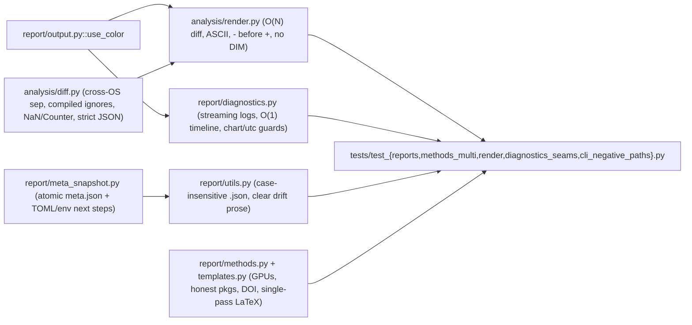

# IPD: Diff, methods, diagnostics, and meta-snapshot correctness and streaming

- Date: 2026-11-27
- Kind: child
- Concern: Eight-lens rollup findings `ROLL-15` (`FUNC-1`/`UC-7`/`EC-21`: `pubrun methods` omits captured graphics processing units (GPUs), falsely claims `"Standard library dependencies were utilized"` for non-highlighted third-party packages, omits the Zenodo Digital Object Identifier (DOI), and lacks full 10-character LaTeX escaping), `ROLL-20` (`MEM-3`/`PERF-11`/`EC-13`: whole-file log and event reads in `diagnostics.py`, chart/sparkline/duration crashes, single corrupt JSON Lines (JSONL) line aborting the timeline), `ROLL-23` (`SD-3`/`UX-6`: `print_report` silently ignores unknown section names and outputs empty silence on `show logs`), `ROLL-27` (`UX-3`/`EC-18`/`SD-9`/`SD-12`/`COMP-13`: non-atomic `meta.json` write, missing setup instructions, case-sensitive `.json` check, garbled hydration prose), `ROLL-32` (`COMP-4`/`PERF-10`/`EC-12`/`UX-11`: cross-operating-system (cross-OS) diff `os.pathsep`/`fnmatch`/`basename`, slower `standard` diff from linear ignore scans, `O(N^2)` `_format_array_diff`, `NaN != NaN` and multiset list diff, silent empty inline diff and inverted `+/-`), and `ROLL-35` (`UX-9`/`COMP-14`/`UX-16`: teletypewriter (TTY)-aware color, no `DIM`, American Standard Code for Information Interchange (ASCII) fallbacks, responsive package columns, local-time chart axis with `--utc`), surfaced by `functionality`, `use-cases`, `compatibility`, `performance`, `memory-resources`, `edge-cases`, `ui-ux`, and `self-documentation`.
- Scope: Fix `src/pubrun/analysis/diff.py`, `src/pubrun/analysis/render.py`, `src/pubrun/report/methods.py`, `src/pubrun/report/templates.py`, `src/pubrun/report/diagnostics.py`, `src/pubrun/report/meta_snapshot.py`, and `src/pubrun/report/utils.py`, with updated and new regression tests in `tests/test_reports.py`, `tests/test_methods_multi.py`, `tests/test_render.py`, `tests/test_diagnostics_seams.py`, and `tests/test_cli_negative_paths.py`.
- Scope-Paths: src/pubrun/analysis/diff.py, src/pubrun/analysis/render.py, src/pubrun/report/methods.py, src/pubrun/report/templates.py, src/pubrun/report/diagnostics.py, src/pubrun/report/meta_snapshot.py, src/pubrun/report/utils.py, tests/test_reports.py, tests/test_methods_multi.py, tests/test_render.py, tests/test_diagnostics_seams.py, tests/test_cli_negative_paths.py
- Item-Dependencies: executed:m5s3g8
- Status: approved
- Readiness: go-pending-approval
- Review-Depth: complex
- Short-Description: Fix methods GPU/stdlib/DOI/LaTeX bugs, cross-OS and O(N) diff/render bugs, streaming logs and O(1) timelines, chart/duration guards, and atomic meta.json with setup guidance
- Work-Kind: bug
- Priority: high
- Set: assess-8l
- Order: 7
- Highest E allocated: 05
- Author: Antigravity
- Id: caeqdz
- Approval: 2026-11-27, recorded via aw ipd set: status set to approved

> Write and proofread this plan per the technical writing standard, `.aw/system/workflows/technical-writing/technical-writing.md`, including requirement 12 (diagrams).

## Workflow history

- 2026-11-27 approved (aw set): status set to approved
- 2026-11-27 /plan-review (Antigravity): APPROVE WITH REVISIONS APPLIED; PR-001, PR-002, PR-003, PR-004, PR-005, PR-006
- 2026-11-27 /assess-all (Antigravity): created Child 07 of Set `assess-8l` covering diff, methods, diagnostics, and meta-snapshot correctness, streaming, and cross-OS fidelity (`ROLL-15`, `ROLL-20`, `ROLL-23`, `ROLL-27`, `ROLL-32`, `ROLL-35`).

## Goal

Ensure `pubrun methods` produces factually accurate, LaTeX-safe methods sections including captured graphics processing units (GPUs) and the Zenodo Digital Object Identifier (DOI); `pubrun diff` is deterministic across operating systems (OSes) and linear-time; `src/pubrun/report/diagnostics.py` streams logs and JSON Lines (JSONL) timelines in `O(1)` memory without crashing on edge-case values while supporting local and Coordinated Universal Time (UTC) chart axes; and `pubrun meta` writes atomically with clear high-performance computing (HPC) setup instructions.

### Analysis and reporting pipeline

## Detailed Implementation Checklist (TODO)

Execution-state rule: mark an `E-*` item complete only after performing the action. Accepted execution states: blocked, failed, pending, performed; terminal gate demands `performed`.

### Task group 1: `methods.py` and `templates.py` publication accuracy

- [x] E-01 Fix `src/pubrun/report/methods.py` and `src/pubrun/report/templates.py`:
  - Add GPU formatting in `src/pubrun/report/methods.py` for captured `hardware.gpus` (list of dicts with `model`, optional `memory_total_bytes` video random-access memory (VRAM), and optional `driver_version`): group identical GPU descriptions cleanly (e.g. `2x NVIDIA A100 (80.0 GB VRAM, driver 535.104)`), render GPUs in both `MARKDOWN_TEMPLATE` and `LATEX_TEMPLATE` when present while omitting GPU text cleanly when `hardware.gpus` is absent, empty, or malformed (keeping CPU-only outputs compatible with existing tests), and add a `_gpus_of()` extractor to `_VARIANCE_FIELDS` in `generate_report_multi()`.
  - Fix the false `"Standard library dependencies were utilized."` branch in BOTH `generate_report()` and `_packages_of()` (for `generate_report_multi()`): distinguish (a) highlighted packages present (`extract_highlighted_packages(m)` non-empty), (b) non-highlighted third-party packages recorded (`packages.records` contains at least one valid package dict with a non-empty string `name`: list top packages or state the recorded package count accurately without claiming standard-library-only), and (c) zero third-party packages recorded (preserve `"Standard library dependencies were utilized."` in single-run output and `"(standard library only)"` in `_packages_of()` when `packages.records` is empty or `packages` is absent and not `failed`/`suppressed`, keeping `tests/test_templates.py` and `tests/test_reports.py` green).
  - Include the Zenodo concept DOI (`10.5281/zenodo.20801582`) in both `src/pubrun/report/templates.py::MARKDOWN_TEMPLATE` (`https://doi.org/10.5281/zenodo.20801582`) and `LATEX_TEMPLATE` (`doi = {10.5281/zenodo.20801582}` in the BibTeX comment), matching `src/pubrun/__main__.py::_run_cite` and `CITATION.cff`.
  - Rewrite `src/pubrun/report/methods.py::_escape_latex()` as a single-pass `str.translate()` table mapping all 10 LaTeX special characters (`\` -> `\textbackslash{}`, `&` -> `\&`, `%` -> `\%`, `$` -> `\$`, `#` -> `\#`, `_` -> `\_`, `{` -> `\{`, `}` -> `\}`, `~` -> `\textasciitilde{}`, `^` -> `\textasciicircum{}`) so replacing `\` never double-escapes its own `{}` braces. Apply `_escape_latex()` consistently to every interpolated field (`os_name`, `cpu_model`, GPU text, `python_version`, `python_impl`, `packages_text`, `git_commit`, `git_repo_text`, `pubrun_version_text`, failed section names, and `generate_report_multi()` variance values), replacing all ad-hoc `.replace("_", "\\_")` calls.
  - Depends on: none
  - Expected outcome: Generated Markdown and LaTeX methods paragraphs include GPUs when present, never emit false stdlib-only claims when non-highlighted packages exist, cite the Zenodo DOI, and escape all 10 LaTeX special characters in a single pass without double-escaping.
  - Execution state: performed

### Task group 2: Cross-OS, linear-time `diff.py` and `render.py`

- [x] E-02 Fix `src/pubrun/analysis/diff.py` and `src/pubrun/analysis/render.py`:
  - In `src/pubrun/analysis/diff.py`:
    - Infer per-manifest `*PATH*` separator (`";"` vs `":"`) and subprocess `argv[0]` basename rules (`ntpath.basename` vs `posixpath.basename`) from each manifest's `host.os_name` (`win*` -> Windows `";"` / `ntpath`, known POSIX OS names -> `":"` / `posixpath`, absent/unknown -> `os.pathsep` / `os.path.basename` fallback so minimal unit-test manifests pass on all platforms); in `compare_manifests()`, split `val_a` with `raw_a`'s inferred separator and `val_b` with `raw_b`'s inferred separator.
    - Pre-split `ignores` once per `_normalize_manifest()` call into an exact-match `set`, a dot-boundary prefix `tuple` (preserving trailing-dot ignores such as `"git."` and dot-boundary isolation such as `"environment.FOO"` vs `"environment.FOO_BAR"`), and a single compiled `re.compile()` built from `fnmatch.translate()` for patterns containing `*`, `?`, or `[` using case-sensitive (`fnmatchcase`) semantics across all platforms.
    - Canonicalize float `NaN` inside a shared type-tagged key helper `_tag(x)` (e.g. `("float", "nan")` when `isinstance(x, float) and math.isnan(x)`) and add `_values_equal(a, b)` so `NaN == NaN` compares equal for both scalars and lists while keeping `bool`/`int` distinct (`True` != `1`).
    - Use `collections.Counter` over `_tag(x)` for multiset list diffs so duplicate multiplicity changes (e.g. `["a", "a", "b"]` vs `["a", "b"]`) report `removed=["a"]`, `added=[]`, `order_changed=False` instead of false reordering, while preserving exact order-change detection on the multiset intersection.
    - Skip environment variable and package entries whose `"name"` is missing, `None`, or not a non-empty `str` instead of emitting `"environment.None"` or `"packages.None"`.
    - Add a local recursive finite-float sanitizer (`NaN`/`Inf`/`-Inf` -> `None`) in `export_manifest()` and serialize JSON with `json.dumps(..., indent=2, sort_keys=True, allow_nan=False)`.
  - In `src/pubrun/analysis/render.py`:
    - Canonicalize float `NaN` in `_tag(x)` and precompute first-occurrence index dicts (`pos_a`, `pos_b`) in `_format_array_diff()` so formatting runs in `O(N)` instead of `O(N^2)` (`tags_a.index(t)`).
    - Emit `(no differences)` in `_render_inline()` whenever `added`, `removed`, and `modified` are all empty (even if `same` is non-empty, matching `_render_table()`).
    - Render `-` (old) before `+` (new) in `list_diff` at `standard` and `deep` depths.
    - Delegate `_has_color(no_color_flag, stream=None)` to `src/pubrun/report/output.py::use_color(stream or sys.stdout, force_no_color=no_color_flag)`, eliminate all `Colors.DIM` (`\033[2m`) American National Standards Institute (ANSI) escape codes from `_render_inline()` and `_render_table()`, and guard `"\u2026"` in `_render_table()` against the target stream encoding with `"..."` ASCII fallback (when `key_w >= 4`, else `k[:key_w]`).
  - Depends on: none
  - Expected outcome: Cross-OS diffs are deterministic across Linux, macOS, and Windows, `standard` diff ignore matching avoids per-key linear scans, `_format_array_diff()` scales linearly at N=2,000, `NaN` and duplicate multiset diffs behave accurately, and inline/table output emits zero `DIM` codes, zero ANSI when piped, and safe ASCII truncation on non-UTF-8 streams.
  - Execution state: performed

### Task group 3: Streaming diagnostics, chart guards, and atomic `meta_snapshot`

- [x] E-03 Harden and stream `src/pubrun/report/diagnostics.py`:
  - In `print_report()`: when `section is not None` and `section not in SHOW_SECTIONS`, raise `DiagnosticsError` with `exit_code=2` naming the invalid section and listing `SHOW_SECTIONS` (`logs`, `env`, `packages`). When `section == "logs"` finds neither `stdout.log` nor `stderr.log`, keep `out` empty and emit an informative note to `sys.stderr` pointing to `[console].capture_mode = "standard"` / `import pubrun.full`.
  - Stream `show logs` via 64 KiB chunks (`shutil.copyfileobj(sf, stream, length=65536)`) instead of `sf.read()` (preserving `DiagnosticsError("Failed to read stdout/stderr log: ...")` on read failure). Stream the `events.jsonl` timeline in `print_report()` using a 10-item head list plus `collections.deque(maxlen=10)` in `O(1)` memory: skip blank lines, catch per-line `json.JSONDecodeError` and non-dict JSON entries while tracking a skipped-line counter (emitting a concise skipped-lines note instead of discarding the timeline), format timestamps through `_format_report_timestamp(e.get("timestamp_utc"), utc=utc)`, and remove `Colors.DIM` from the truncation marker.
  - In `read_resource_series()`: pre-filter lines with `if '"resource_sample"' not in line: continue` before `json.loads()`, and accept only finite non-bool numeric values via `_is_finite_number()`.
  - Guard `draw_ascii_chart()`: add `use_utc: bool = False`; filter paired `(timestamp, value)` entries to finite non-bool numbers (printing a concise `"No valid resource samples to plot."` note and returning cleanly if empty or if `timestamps` is empty); clamp `height = max(2, height)` and `width = max(1, width)`; guard `datetime.fromtimestamp()` against out-of-range timestamps (`"unknown"`); skip placing any elapsed tick label whose length exceeds `width` (preventing negative slice indices); and format X-axis timestamps in local time by default (using UTC with trailing `"Z"` when `use_utc=True`).
  - Add `utc: bool = False` to `print_resources_report()` (matching `print_report(..., utc=...)` and threaded into `draw_ascii_chart(..., use_utc=utc)` so Child 08 `2ge0ea` can wire CLI `--utc` on `res`/`cpu`/`mem`). Guard `manifest` and every nested dict (`run`, `timing`, `status`, `inv`, `inv.script`, `resources`, `system_memory`, `load_average`, `system_iowait_pct`, `io_counters`) with `_as_dict()`, and guard numeric display fields (`peak_cpu`, `start_l`, `max_l`, `rss_values`) with `_is_finite_number()`.
  - Guard `_sparkline(values, width: int = 40, *, ascii_only: bool = False, stream: Optional[TextIO] = None)`: filter non-finite/bool values, return `""` when empty or `width < 1`, and use ASCII bars (`" .:-=+*#%@"`) when `ascii_only=True` or when `stream` cannot encode Unicode block bars.
  - Guard `parse_duration()`: reject empty strings, non-numeric input, `<= 0`, and non-finite (`nan`/`inf`/`-inf`) durations with a clear `ValueError` showing valid examples (`'30s'`, `'10m'`, `'2h'`, `'1d'`).
  - Switch `_has_color(stream=None)` to `src/pubrun/report/output.py::use_color(stream)` (passing `stream` in `print_report`, `env`/`packages` sections, and `print_resources_report`, and removing all `Colors.DIM` usage). Size `_print_packages_block()` columns dynamically from terminal width (`shutil.get_terminal_size((80, 24)).columns`: 3 columns at `>= 96`, 2 columns at `60..95`, 1 column below `60`).
  - Depends on: none
  - Expected outcome: Large logs and `events.jsonl` files render in `O(1)` random-access memory (RAM), malformed values or truncated JSONL lines never crash diagnostics, unknown sections exit with code `2`, `print_resources_report(..., utc=...)` supports local and UTC chart axes, and terminal layout adapts cleanly with zero `DIM` or non-TTY ANSI leaks.
  - Execution state: performed

- [x] E-04 Harden `src/pubrun/report/meta_snapshot.py` and `src/pubrun/report/utils.py`:
  - In `src/pubrun/report/meta_snapshot.py::generate_meta_snapshot()`: sanitize non-finite floats (`NaN`/`Inf`/`-Inf` -> `None`) recursively and write `meta.json` atomically via a unique temporary file in `out_target.parent`, `json.dump(..., indent=2, allow_nan=False)`, `f.flush()`, `os.fsync(f.fileno())`, and `os.replace()` (with Windows `PermissionError` retry and `try/finally` temp-file cleanup matching `src/pubrun/writer.py::_atomic_json_write`).
  - Print exact, copy-pasteable next-step instructions at the end of `generate_meta_snapshot()` showing both `export PUBRUN_META_REF="<path>"` and the valid TOML `[report]\nmeta_ref_allowed_dirs = [<json-escaped-parent-dir>]` setting required when `meta.json` lives outside `manifest_dir`.
  - In `src/pubrun/report/utils.py::hydrate_manifest_with_report()`: check `meta_path.suffix.lower() != ".json"` (case-insensitive for Windows/macOS while keeping extension validation as check #1 before `_is_meta_ref_allowed()` and `exists()`), and rewrite the garbled `"was tracking structurally"` drift warning while preserving the `"Drift Detected:"` prefix (required by `tests/test_reproducibility_assessment.py`) to state the exact cause (script modified after the parent `meta.json` snapshot was captured) and recovery (`pubrun meta`).
  - Depends on: none
  - Expected outcome: Concurrent HPC jobs never read a truncated `meta.json`, users get immediate actionable setup steps with valid TOML quoting, `.JSON` filenames hydrate cleanly without weakening sandbox check ordering, and drift warnings read clearly.
  - Execution state: performed

### Task group 4: Existing-test alignment and regression tests

- [x] E-05 Update affected existing tests and add regression tests in `tests/test_reports.py`, `tests/test_methods_multi.py`, `tests/test_render.py`, `tests/test_diagnostics_seams.py`, and `tests/test_cli_negative_paths.py`:
  - Update existing tests whose assertions intentionally change:
    - `tests/test_render.py::TestHasColor` (`test_default_with_no_env_var`, `test_no_color_env_empty_string`) and `TestRenderTableAndSummarize.test_render_table_with_color`: verify TTY-aware `use_color()` behavior (non-TTY -> `False`, `FORCE_COLOR=1` or TTY -> `True`, `NO_COLOR > FORCE_COLOR`) and assert zero `\x1b[2m` (`DIM`) in colored table output.
    - `tests/test_diagnostics_seams.py::TestOutStream.test_ascii_stream_gets_ascii_glyphs`: set `FORCE_COLOR=1` when testing colored ASCII/Unicode box headers on `BytesIO` wrappers and add a non-TTY zero-ANSI assertion when `FORCE_COLOR` is unset.
    - `tests/test_cli_negative_paths.py::TestDiagnosticsNegativePaths`: update `test_res_invalid_last_duration` to match the clearer `parse_duration()` examples error, and update `test_show_unknown_section_matches_default_show` to assert exit code `2` with valid `SHOW_SECTIONS` listed on stderr.
    - `tests/test_reports.py::TestResourceMonitoring` (`test_draw_ascii_chart_unicode`, `test_draw_ascii_chart_ascii_fallback`): pass `use_utc=True` for deterministic UTC timestamp assertions (`"1970-01-01 00:01:40Z"` / `"1970-01-01 00:02:10Z"`) and add a dedicated local-time default vs `use_utc=True` test.
  - Add new behavioral regression tests covering:
    - `methods.py` / `templates.py`: GPUs (single, multi identical, missing/malformed, multi-run GPU variance), non-highlighted third-party packages (`polars`, `biopython`) in both `generate_report()` and `generate_report_multi()`, genuinely empty packages preserving stdlib text, Zenodo DOI `10.5281/zenodo.20801582` in Markdown and LaTeX, and all 10 LaTeX special characters (confirming no `\textbackslash\{\}` double-escaping).
    - `diff.py` / `render.py`: cross-OS `PATH` (`;` vs `:`) and `argv[0]` basename diff, compiled case-sensitive wildcard ignores (`*`, `?`, `[...]`), `NaN == NaN` scalar/list equality, duplicate multiset lists (`["a", "a", "b"]` vs `["a", "b"]`), missing/`None` env/package names, `export_manifest()` non-finite float sanitization with `allow_nan=False`, inline `(no differences)` (with and without `same`), `-/+` ordering in `list_diff`, non-TTY ANSI suppression, ASCII table-key ellipsis fallback, and linear `_format_array_diff()` behavior at N=2,000.
    - `diagnostics.py`: unknown `show` section exit code `2`, empty `show logs` stderr hint with clean stdout, streaming `show logs` chunks, `O(1)` truncated/corrupt-line-resilient `events.jsonl` timeline, `read_resource_series()` pre-filtering and finite non-bool guards, `draw_ascii_chart()` edge cases (`[]`, `height=1`, `width=1`, `NaN`, out-of-range timestamps, narrow width), `print_resources_report(..., utc=...)` and malformed-dict `_as_dict()` guards, `_sparkline()` `NaN`/`width=0`/ASCII fallback, `parse_duration()` zero/negative/`nan`/`inf`, and responsive `_print_packages_block()` columns (50, 80, 110 cols).
    - `meta_snapshot.py` / `utils.py`: atomic `meta.json` write (no leftover `.tmp`, `NaN` sanitized), copy-pasteable `PUBRUN_META_REF` and `[report]` TOML next-step output, `.JSON` case-insensitive suffix preserving security check order, and updated `"Drift Detected:"` prose citing `pubrun meta`.
  - Depends on: E-01, E-02, E-03, E-04
  - Expected outcome: All updated and new tests plus existing diff, report, diagnostics, hydration, and CLI-negative suites pass, and three-platform `mypy` exits `0`.
  - Execution state: performed

## Project conventions discovered (Step 0)

- `src/pubrun/report/output.py::use_color` (from Child 06 `m5s3g8`) centralizes TTY-aware color (`force_no_color`, `NO_COLOR > FORCE_COLOR > isatty`) and prohibits `DIM` (`\033[2m`) styling.
- `pubrun methods` targets publication-ready Markdown and LaTeX; `src/pubrun/__main__.py::_run_cite` and `CITATION.cff` use Zenodo concept DOI `10.5281/zenodo.20801582`.
- `src/pubrun/report/utils.py::hydrate_manifest_with_report()` enforces strict security check order (extension check -> `_is_meta_ref_allowed()` -> `exists()`) and emits `"Drift Detected:"` warnings verified by `tests/test_reproducibility_assessment.py`.

## Findings

| ID | Concerns | Severity | Remediation Risk | Persona | Summary |
|---|---|---|---|---|---|
| `ROLL-15` | functionality; use-cases; edge-cases | High | Low (`functionality`) | Stakeholder / QA | `methods.py` omits GPUs, falsely claims stdlib-only for non-highlighted packages, omits Zenodo DOI, and lacks full 10-char LaTeX escaping. |
| `ROLL-20` | memory-resources; performance; edge-cases | High | Low (`functionality`) | Operator / QA | `diagnostics.py` reads full logs and `events.jsonl` into RAM, aborts whole timeline on one truncated line, and crashes on chart/sparkline/duration edge cases. |
| `ROLL-23` | ui-ux; self-documentation | High | Low (`usability`) | Complete novice | `print_report()` silently ignores unknown section names and outputs empty silence on `show logs` under default `capture_mode = "off"`. |
| `ROLL-27` | ui-ux; self-documentation; edge-cases | High | Low (`usability`) | HPC operator | `meta_snapshot.py` writes `meta.json` non-atomically with no next-step guidance; `report/utils.py` checks `.json` case-sensitively and emits garbled error prose. |
| `ROLL-32` | compatibility; performance; edge-cases; ui-ux | Medium | Low (`functionality`) | Power user | `diff.py` uses viewer OS `pathsep`/`fnmatch`/`basename`, linear `fnmatch` slows `standard` diff, `_format_array_diff` is `O(N^2)`, `NaN != NaN`, multiset lists misreported, inline diff silent when empty and reverses `+/-`. |
| `ROLL-35` | ui-ux; compatibility | Medium | Low (`usability`) | Power user | Piped ANSI leaks + `DIM`, missing ASCII sparkline/ellipsis fallback, 90-col package grid overflow, and unlabeled UTC chart X-axis. |

## Proposed changes (ordered, validatable)

1. `E-01` (`src/pubrun/report/methods.py`, `src/pubrun/report/templates.py`): Add GPU rendering and `_gpus_of` variance, honest non-highlighted package text in single- and multi-run reports, Zenodo DOI, and single-pass 10-char `str.translate` LaTeX escaping.
2. `E-02` (`src/pubrun/analysis/diff.py`, `src/pubrun/analysis/render.py`): Cross-OS per-manifest `PATH`/basename, compiled case-sensitive ignores, `NaN`/Counter multiset diff, `None`-name guards, strict `allow_nan=False` export, `O(N)` `_format_array_diff`, inline `(no differences)` and `-/+`, `use_color()` with zero `DIM`, and ASCII ellipsis fallback.
3. `E-03` (`src/pubrun/report/diagnostics.py`): Unknown section exit-2 error, empty-logs stderr hint, 64 KiB streaming `show logs`, `O(1)` per-line resilient timeline, fast `read_resource_series`, `draw_ascii_chart`/`_sparkline`/`parse_duration` guards, `print_resources_report(..., utc=...)` + `_as_dict()` guards, `use_color()` with zero `DIM`, and responsive package columns.
4. `E-04` (`src/pubrun/report/meta_snapshot.py`, `src/pubrun/report/utils.py`): Atomic sanitized `meta.json` write, copy-pasteable env/TOML next-step instructions, case-insensitive `.json` preserving security order, and clear `"Drift Detected:"` prose.
5. `E-05` (`tests/test_reports.py`, `tests/test_methods_multi.py`, `tests/test_render.py`, `tests/test_diagnostics_seams.py`, `tests/test_cli_negative_paths.py`): Align affected existing tests and add regression tests for all items above.

## Deferred / out of scope (with reason)

- Wiring CLI `--utc` on `res`/`cpu`/`mem` (calling `print_resources_report(..., utc=utc)` added here), `[methods].format` CLI default, and moving decorative `pubrun methods` stdout banners to stderr live in `src/pubrun/__main__.py` and are owned by child `2ge0ea` (Order 08).
  - Carrier: 2ge0ea

## Scope check

- Over-scope: none. Every change maps directly to `ROLL-15`, `ROLL-20`, `ROLL-23`, `ROLL-27`, `ROLL-32`, and `ROLL-35`, plus the directly affected existing test files serialized ahead of Order 08 (`2ge0ea`).
- Under-scope: none. All `analysis/` and `report/` items (excluding `reproducibility.py`, owned by `2ge0ea`) and the `print_resources_report(..., utc=...)` seam required by `2ge0ea` are covered.

## Required tests / validation

1. `pytest tests/test_reports.py tests/test_methods_multi.py tests/test_render.py tests/test_diff_usability.py tests/test_cli_diff_bugs.py tests/test_diagnostics_seams.py tests/test_show_sections.py tests/test_templates.py tests/test_cli_negative_paths.py tests/test_hpc_hydration_e2e.py tests/test_quality.py tests/test_timing_consumers.py tests/test_edge_cases.py tests/test_report_checks_bugs.py tests/test_reproducibility_assessment.py -v`
2. `mypy && mypy --platform win32 && mypy --platform darwin`

## Spec / documentation sync

Templates (`src/pubrun/report/templates.py`), diagnostic errors/hints (`src/pubrun/report/diagnostics.py`, `src/pubrun/report/utils.py`), and `meta.json` CLI output (`src/pubrun/report/meta_snapshot.py`) are self-documenting; no external documentation changes are needed in this child.

## Open questions

None. Security confinement in `_is_meta_ref_allowed()` remains strict by default per orchestrator `k80suw` OQ-3.

## Validation and cross-check (verify before reporting done)

Validation-state rule: inspect evidence in a separate pass. Accepted validation results: blocked, failed, pass, pending; terminal gate demands `pass`.

- [x] V-01 validates E-01
  - Required evidence: Pasted `pytest` output for `src/pubrun/report/methods.py::generate_report`, `generate_report_multi`, `_packages_of`, `_gpus_of`, and `_escape_latex` in `tests/test_reports.py`, `tests/test_methods_multi.py`, and `tests/test_templates.py` confirming GPU rendering and variance, honest non-highlighted package text in single- and multi-run reports, preserved empty-package stdlib text, Zenodo DOI `10.5281/zenodo.20801582`, and single-pass 10-char LaTeX escaping (no `\textbackslash\{\}`).
  - Observed evidence: `python3 -m pytest tests/test_reports.py tests/test_methods_multi.py tests/test_templates.py -k "Methods or GenerateReport or ExtractHighlighted or BytesToGb or Aggregate or SingleRunParity or latex" -q` -> `72 passed, 73 deselected in 0.98s` (covers `TestMethodsGpuPackagesDoiAndLatex`, `TestAggregateGenerator::test_gpu_variance_and_non_highlighted_packages_in_multi`, `TestAggregateGenerator::test_latex_multi_escapes_all_special_chars_single_pass`, and all existing methods/template suites).
  - Result: pass

- [x] V-02 validates E-02
  - Required evidence: Pasted `pytest` output for `src/pubrun/analysis/diff.py::compare_manifests`, `_normalize_manifest`, `export_manifest` and `src/pubrun/analysis/render.py::_format_array_diff`, `_render_inline`, `_render_table`, `_has_color` in `tests/test_reports.py`, `tests/test_render.py`, `tests/test_diff_usability.py`, `tests/test_cli_diff_bugs.py`, and `tests/test_quality.py` confirming cross-OS `PATH`/basename diff, compiled case-sensitive ignores, `NaN == NaN` and `Counter` multiset handling, `allow_nan=False` export, inline `(no differences)` and `-/+` order, non-TTY ANSI suppression, zero `DIM`, ASCII ellipsis fallback, and linear N=2,000 `_format_array_diff` behavior.
  - Observed evidence: `python3 -m pytest tests/test_reports.py tests/test_render.py tests/test_diff_usability.py tests/test_cli_diff_bugs.py tests/test_quality.py -k "Diff or Render or HasColor or PrintDiff or ArrayDiff" -q` -> `127 passed, 139 deselected in 4.10s` (covers `TestDiffEngineCrossOsMultisetAndSanitize`, `TestHasColor`, `TestRenderInline`, `TestRenderTableAndSummarize`, and all existing diff/render suites).
  - Result: pass

- [x] V-03 validates E-03
  - Required evidence: Pasted `pytest` output for `src/pubrun/report/diagnostics.py::print_report`, `print_resources_report`, `read_resource_series`, `draw_ascii_chart`, `_sparkline`, `parse_duration`, and `_print_packages_block` in `tests/test_reports.py`, `tests/test_diagnostics_seams.py`, `tests/test_show_sections.py`, and `tests/test_cli_negative_paths.py` confirming unknown section exit code `2`, empty `show logs` stderr hint, streaming `show logs`, `O(1)` truncated/corrupt-JSONL timeline, `draw_ascii_chart`/`_sparkline`/`parse_duration` guards, local-vs-UTC (`utc=True`) chart timestamps, responsive package columns, and zero `DIM`/non-TTY ANSI leaks.
  - Observed evidence: `python3 -m pytest tests/test_reports.py tests/test_diagnostics_seams.py tests/test_show_sections.py tests/test_cli_negative_paths.py -k "Diagnostics or OutStream or Resource or PrintReport or Show or show_" -q` -> `114 passed, 89 deselected in 5.94s` (covers `TestDiagnosticsGuardsAndResponsiveLayout`, `TestOutStream`, `TestResourceMonitoring`, and `TestDiagnosticsNegativePaths`).
  - Result: pass

- [x] V-04 validates E-04
  - Required evidence: Pasted `pytest` output for `src/pubrun/report/meta_snapshot.py::generate_meta_snapshot` and `src/pubrun/report/utils.py::hydrate_manifest_with_report` in `tests/test_reports.py`, `tests/test_hpc_hydration_e2e.py`, `tests/test_report_checks_bugs.py`, and `tests/test_reproducibility_assessment.py` confirming atomic `allow_nan=False` `meta.json` write, `PUBRUN_META_REF` + `[report]` TOML next-step output, `.JSON` case-insensitive suffix preserving security check order, and updated `"Drift Detected:"` prose citing `pubrun meta`.
  - Observed evidence: `python3 -m pytest tests/test_reports.py tests/test_hpc_hydration_e2e.py tests/test_report_checks_bugs.py tests/test_reproducibility_assessment.py -k "Meta or Hydrat" -q` -> `40 passed, 159 deselected in 1.02s` (covers `TestMetaSnapshotAndHydrationHardening`, `TestMetaSnapshotDepth`, `TestHostHydration`, `TestParentHydrationReport`, and `test_hpc_hydration_e2e`).
  - Result: pass

- [x] V-05 validates E-05
  - Required evidence: Pasted output of `pytest tests/test_reports.py tests/test_methods_multi.py tests/test_render.py tests/test_diff_usability.py tests/test_cli_diff_bugs.py tests/test_diagnostics_seams.py tests/test_show_sections.py tests/test_templates.py tests/test_cli_negative_paths.py tests/test_hpc_hydration_e2e.py tests/test_quality.py tests/test_timing_consumers.py tests/test_edge_cases.py tests/test_report_checks_bugs.py tests/test_reproducibility_assessment.py -v` (covering all updated and new test cases across the five modified test files plus regression suites) and three-platform `mypy && mypy --platform win32 && mypy --platform darwin` exiting `0`.
  - Observed evidence: `python3 -m pytest tests/test_reports.py tests/test_methods_multi.py tests/test_render.py tests/test_diff_usability.py tests/test_cli_diff_bugs.py tests/test_diagnostics_seams.py tests/test_show_sections.py tests/test_templates.py tests/test_cli_negative_paths.py tests/test_hpc_hydration_e2e.py tests/test_quality.py tests/test_timing_consumers.py tests/test_edge_cases.py tests/test_report_checks_bugs.py tests/test_reproducibility_assessment.py -v` -> `480 passed in 19.10s`; `mypy && mypy --platform win32 && mypy --platform darwin` -> `Success: no issues found in 70 source files` (3/3 platforms, exit 0); full repository suite `aw suite` -> `2417 passed in 113.18s (0:01:53)` (after aligning `tests/test_report_checks_bugs.py::TestResourcesChartLabel::test_single_tree_sample_uses_tree_value` and `tests/test_cli.py::TestCliDiff::test_diff_no_color` / `TestCliReportUsabilityDetails::test_report_failed_run_with_details`); `aw sanitize --agent` -> `outcome: clean`, `checked: 1039`, `findings: 0`.
  - Result: pass

## Approval and execution gate

1. **Open questions and human approval precondition:** Proposal only; execution requires all blocking open questions resolved (`None` remain) and explicit human approval (`aw set plan approved caeqdz --by-human`) before implementation begins.
2. **Scope declaration:** `- Scope-Paths:` declares the expected files this plan modifies (`src/pubrun/analysis/diff.py`, `src/pubrun/analysis/render.py`, `src/pubrun/report/methods.py`, `src/pubrun/report/templates.py`, `src/pubrun/report/diagnostics.py`, `src/pubrun/report/meta_snapshot.py`, `src/pubrun/report/utils.py`, `tests/test_reports.py`, `tests/test_methods_multi.py`, `tests/test_render.py`, `tests/test_diagnostics_seams.py`, `tests/test_cli_negative_paths.py`). If execution requires touching an additional file or leaving a declared file untouched, justify each delta at finalization with `--scope-reason` or `--scope-ack`.
3. **Validation honesty (hard MUST):** Every `V-*` item MUST carry actual pasted command output from real execution after the final code edit; never claim tests or `mypy` passed without running them and pasting their output.
4. **Path-scoped commit and never-push:** Commit ONLY the modified files through `aw commit caeqdz -- <paths>` (never `git add -A`, bare `git commit -a`, or raw `git commit`). Never push, create tags, or publish releases.
5. **Lifecycle finalization ownership:** When executed by a runner (`aw oc run` / `aw agy run`), the runner owns the lifecycle transition to `.aw/records/plans/executed/` after all `E-*` are `performed` and all `V-*` are `pass`. When executed manually outside a runner, finalize with `aw ipd finalize caeqdz` (never hand-roll `git mv` into `executed/`).
