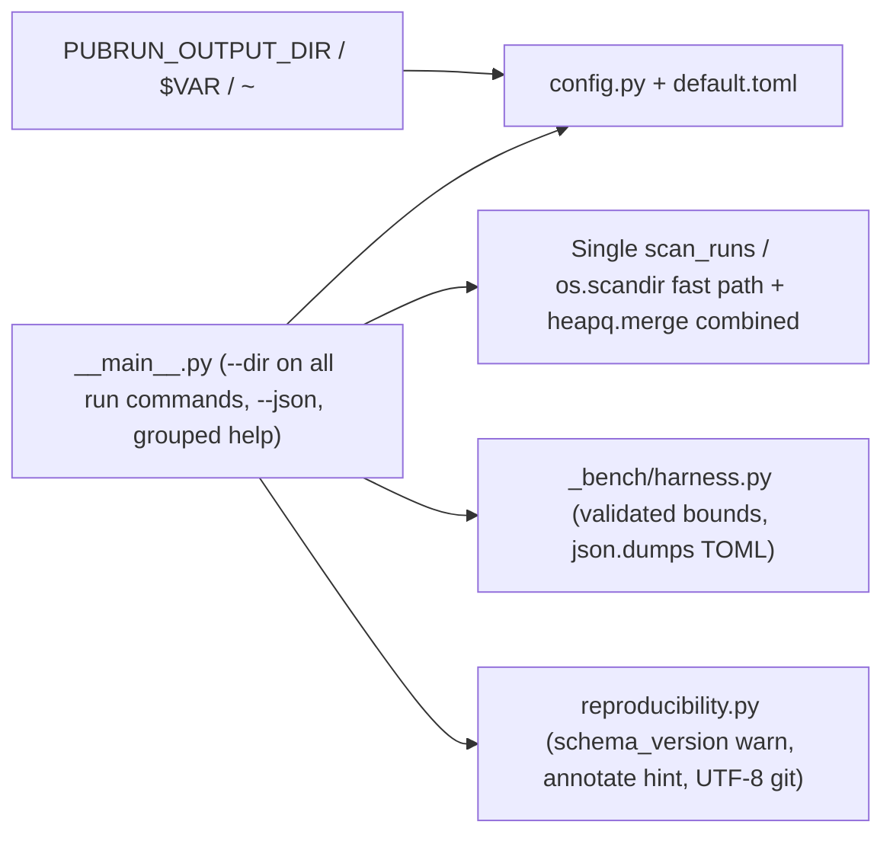

# IPD: CLI ergonomics, --dir/PUBRUN_OUTPUT_DIR, JSON output, streaming combined, and self-documenting help

- Date: 2026-11-27
- Kind: child
- Concern: Eight-lens rollup findings `ROLL-17` (`--dir` missing on 8 of 12 run-reading subcommands; missing `PUBRUN_OUTPUT_DIR` and `$VAR`/`~` expansion), `ROLL-18` (3-4x manifest rescans in `_run_diff`, `_run_combined`, `_run_methods_aggregate`; bare `pubrun` parsing all manifests), `ROLL-20` (`_run_combined` 3x RAM buffering, untimestamped line hoisting, uncaught `AmbiguousRunSelectorError`; `_run_report` full-file crash tail), `ROLL-21` (`pubrun run --help` import prerequisite & 6 mode explanations), `ROLL-22` (`default.toml` contradictions, `core.auto_start` vs `[imports].mode` precedence, `[methods].format` CLI default & stderr banner), `ROLL-23` (`show config <run>`, `show run config --all`, empty `combined` logs message, `bench` `--prepare-submission` tip & flag grouping), `ROLL-24` (`clean --force-remote-locks`), `ROLL-25` (`VALID_STATUSES` in `--help`), `ROLL-34` (UTF-8 subprocess flags in `__main__.py` & `reproducibility.py`; `python_runtime.py` `normcase`; `_bench/harness.py` `_toml_dumps` backslash escaping), and `ROLL-35` (`status --json`, `diff --json`, `res`/`cpu`/`mem --utc`, `pbr.exe`, `--no-browser`, grouped `--help`, unified `RUN` help, bare-`pubrun` quick start, `bench` `--iterations`/`--wait-timeout` validation, future `schema_version` warning, `reproducibility.py` seed suggestion & humanized tokens), surfaced by all eight lenses.
- Scope: Update `src/pubrun/__main__.py`, `src/pubrun/config.py`, `src/pubrun/resources/default.toml`, `src/pubrun/report/reproducibility.py`, `src/pubrun/_bench/harness.py`, and `src/pubrun/capture/python_runtime.py`, with tests in `tests/test_cli.py`, `tests/test_cli_negative_paths.py`, and `tests/test_bench_command.py`.
- Scope-Paths: src/pubrun/__main__.py, src/pubrun/config.py, src/pubrun/resources/default.toml, src/pubrun/report/reproducibility.py, src/pubrun/_bench/harness.py, src/pubrun/capture/python_runtime.py, tests/test_cli.py, tests/test_cli_negative_paths.py, tests/test_bench_command.py
- Item-Dependencies: executed:1o1cua, executed:l596kn, executed:m5s3g8, executed:caeqdz
- Status: to-review
- Review-Depth: complex
- Short-Description: Add consistent --dir and PUBRUN_OUTPUT_DIR, status/diff --json, streaming heapq combined logs, honest help/errors/bench tips, methods config format, and schema-version warnings
- Work-Kind: bug
- Priority: high
- Set: assess-8l
- Order: 8
- Highest E allocated: 05
- Author: Antigravity
- Id: 2ge0ea

> Write and proofread this plan per the technical writing standard, `.aw/system/workflows/technical-writing/technical-writing.md`, including requirement 12 (diagrams).

## Workflow history

- 2026-11-27 /assess-all (Antigravity): created Child 08 of Set `assess-8l` covering CLI `--dir`/`PUBRUN_OUTPUT_DIR`, `--json`, streaming `combined`, self-documenting help, `default.toml` sync, and `reproducibility.py` compatibility (`ROLL-17`, `ROLL-18`, `ROLL-20`, `ROLL-21`, `ROLL-22`, `ROLL-23`, `ROLL-24`, `ROLL-25`, `ROLL-34`, `ROLL-35`).

## Goal

Make every `pubrun` CLI command consistent, pipe-safe, self-documenting, and memory-bounded across custom output directories, large run histories, non-UTF-8 locales, and Windows `pbr.exe` invocations, while aligning `default.toml` comments with actual runtime behavior.

### CLI routing and output-dir plumbing

## Detailed Implementation Checklist (TODO)

Execution-state rule: mark an `E-*` item complete only after performing the action. Accepted execution states: blocked, failed, pending, performed; terminal gate demands `performed`.

### Task group 1: Output directory, config defaults, and `reproducibility.py`

- [ ] E-01 Add `PUBRUN_OUTPUT_DIR`, path expansion, and sync `src/pubrun/config.py`, `src/pubrun/resources/default.toml`, and `src/pubrun/capture/python_runtime.py`:
  - In `config.py::_resolve_layers()`: honor `PUBRUN_OUTPUT_DIR` (same precedence tier as `PUBRUN_META_REF`) and expand `~` and `$VAR` (`os.path.expandvars(os.path.expanduser(...))`) on resolved `core.output_dir`.
  - In `default.toml`: document `[imports].mode` precedence over `[core].auto_start`; explicitly mark reserved/unimplemented keys (`[imports]` provenance keys, `[capture.hardware]` precision/clock keys, `[capture.determinism]`, `[logging].write_summary`) as `# RESERVED (no effect)`; fix `[capture.environment].mode = "full"` and `[capture.resources].scope` comments; add `.config/pubrun/config.toml` and active env vars (`PUBRUN_OUTPUT_DIR`, `PUBRUN_IMPORT_CONFLICT`, `PUBRUN_DEBUG`, `NO_COLOR`, `PUBRUN_RESULTS_DIR`) to header resolution comments.
  - In `python_runtime.py::_detect_env_kind()`: compare Conda prefixes with `os.path.normcase()` for Windows drive-letter case invariance.
  - Depends on: none
  - Expected outcome: `PUBRUN_OUTPUT_DIR` and `$TMPDIR`/`~` expansion work cleanly; `default.toml` comments match actual runtime behavior everywhere.
  - Execution state: pending

- [ ] E-02 Update `src/pubrun/report/reproducibility.py` and `src/pubrun/_bench/harness.py`:
  - In `reproducibility.py`: emit an `unsupported_schema_version` warning finding when a manifest's `schema_version` major version is not `"1"`; update `determinism_seeds_not_recorded` suggestion to recommend `pubrun.annotate(seed=...)` (and recognize seed annotations if present); humanize `portability_diff` -> `portability diff` and `not_checked` -> `not checked` in `format_reproducibility_summary()` (keeping JSON keys unchanged); pass `encoding="utf-8", errors="replace"` in `_run_readonly_git()`.
  - In `_bench/harness.py`: validate `--iterations >= 1` and `--passes >= 1`; use `json.dumps(str(v))` in `_toml_dumps()` so Windows backslashes serialize as valid TOML; pass `encoding="utf-8", errors="replace"` in `_git_commit()`.
  - Depends on: none
  - Expected outcome: Future schema versions warn clearly, reproducibility text matches shipped APIs, `_toml_dumps` handles Windows backslashes, and git subprocesses decode UTF-8 safely.
  - Execution state: pending

### Task group 2: CLI `--dir`, `--json`, streaming, and single-scan plumbing

- [ ] E-03 Add `--dir`, `--json`, `--utc`, `--force-remote-locks`, and eliminate redundant scans and RAM buffering in `src/pubrun/__main__.py`:
  - Add `--dir PATH` consistently across `show`/`report`, `diff`, `methods`, `inspect`, `rerun`, `res`, `cpu`, and `mem`, threading `output_dir` into `_get_manifest_path()`, `find_run()`, `scan_runs()`, and `_run_methods_aggregate()`.
  - Add `--json` stdout output on `status` and `diff`, `--utc` on `res`/`cpu`/`mem`, `--force-remote-locks` on `clean`, and `--no-browser` (plus non-TTY / SSH-without-`DISPLAY` guard) on `report-bug`.
  - Eliminate 3-4x rescans: pass already-scanned runs into `find_run()` in `_run_diff` and `_run_combined`, skip `scan_runs()` in `_run_diff` when two filesystem paths are given, reuse `r.manifest` in `_run_methods_aggregate()`, and use `os.scandir()` directory count in bare `pubrun` instead of parsing all manifests.
  - Stream `_run_combined` via `heapq.merge` over per-file line iterators (preserving relative position of leading untimestamped lines instead of hoisting `""` to the top), catch `AmbiguousRunSelectorError` with `_emit_ambiguous_selector`, guard `p.stat()` with `OSError`, and emit the console-capture hint when zero log files exist.
  - Use `O(1)` tail reading (`collections.deque(lf, maxlen=10)`) in `_run_report` crash tails, stream `_run_report` `section == "logs"` via `shutil.copyfileobj`, pass `encoding="utf-8", errors="replace"` to `_run_gh` and CLI git subprocesses, and detect `pbr.exe` via `Path(argv[0]).stem.lower()`.
  - Depends on: E-01, E-02
  - Expected outcome: Every run-reading command honors `--dir`, `status`/`diff` emit `--json`, `_run_combined` runs in `O(K)` memory without hoisting or tracebacks, and redundant manifest scans are eliminated.
  - Execution state: pending

### Task group 3: Self-documenting help, onboarding, `methods`, `show`, and `bench` UX

- [ ] E-04 Fix `show`, `methods`, `bench`, `init`, `run`, and top-level help/errors in `src/pubrun/__main__.py`:
  - Wire `pubrun methods --format` default (`None`) to `resolve_config().get("methods", {}).get("format", "markdown")`, move decorative `--- Generated Computational Methods Section ---` banners to `stderr` so `stdout` is pure Markdown/LaTeX, and add a `--all` example plus long flag names (`--filter`, `--status`, `--limit`) to `methods --help` and notes.
  - Handle `pubrun show config <run>` gracefully (redirect or print exact `pubrun show run config <run>` hint), emit a clear note when `--all` is passed to `show run config` (since past runs do not persist layer provenance), reject `> 2` positional runs in `diff`, and distinguish empty `runs/` from 0-match filters in `show`, `combined`, and `methods --all`.
  - Fix `_print_safe_file_block()` tip to print the exact command `pubrun bench --submit-file "<redacted_path>" --prepare-submission` (avoiding accidental multi-minute re-runs), group `bench` options into `HPC scheduler options` vs `GitHub contribution options`, and validate `--iterations >= 1`, `--passes >= 1`, `--wait-timeout >= 0`.
  - Standardize `RUN` metavar/help mentioning recency indices (`#1`, `#2`) across all run-accepting subcommands; remove raw `config_extra` metavar; list all 7 valid statuses in `-s`/`-S` help; explain `import pubrun` prerequisite and all 6 modes in `run --help`; explain `meta` hydration in plain language and `--fail-on` thresholds in `inspect`/`rerun`; clarify `--export` filenames and default format in `diff --help`; hide duplicate `feedback` as an alias of `report-bug`; organize top-level `--help` with conceptual groups and quick-start examples; add a 3-line quick start to bare `pubrun` on empty runs; fix `pubrun init` contradictory step 2 copy and stale `pubrun report` crash hint.
  - Depends on: E-03
  - Expected outcome: CLI help, errors, tips, and outputs are accurate, pipe-clean, and learnable without external docs.
  - Execution state: pending

### Task group 4: Regression tests

- [ ] E-05 Add CLI and benchmark tests in `tests/test_cli.py`, `tests/test_cli_negative_paths.py`, and `tests/test_bench_command.py`:
  - Test `--dir` on `show`, `diff`, `methods --all`, `inspect`, `rerun`, `res`, `cpu`, `mem`; test `PUBRUN_OUTPUT_DIR` and `$VAR`/`~` expansion; test `status --json` and `diff --json`; test `methods` honoring `[methods].format = "latex"` and emitting banner-free stdout; test streaming `_run_combined` with leading untimestamped lines and ambiguous selectors; test `show config 1`, `show 1 bogus`, `pbr.exe --help`, `report-bug --no-browser`, `bench --iterations 0`/`-1`, `--wait-timeout -1`, and the `--prepare-submission` tip command; test future `schema_version = "2.0"` warning.
  - Depends on: E-04
  - Expected outcome: All new and existing CLI and benchmark tests pass and three-platform `mypy` exits `0`.
  - Execution state: pending

## Project conventions discovered (Step 0)

- `src/pubrun/__main__.py` hosts the `pubrun` and `pbr` CLI entrypoints and shares `status.py`, `diagnostics.py`, `methods.py`, and `reproducibility.py` (updated in children `1o1cua`, `l596kn`, `m5s3g8`, `caeqdz`).
- `src/pubrun/resources/default.toml` is copied verbatim by `pubrun init` and `--create-config`, so every comment must accurately match runtime behavior.

## Findings

| ID | Concerns | Severity | Remediation Risk | Persona | Summary |
|---|---|---|---|---|---|
| `ROLL-17` | functionality; ui-ux; use-cases | High | Low (`usability`) | Power user / HPC | `--dir` missing on 8 of 12 run-reading commands; no `PUBRUN_OUTPUT_DIR` env var or `$VAR`/`~` expansion. |
| `ROLL-18` | performance; use-cases | High | Medium (`complexity`) | Power user | `_run_diff`, `_run_combined`, and `_run_methods_aggregate` re-scan all manifests 3-4x; bare `pubrun` parses every manifest. |
| `ROLL-20` | memory-resources; edge-cases | High | Low (`functionality`) | Operator / QA | `_run_combined` buffers 3x log size, hoists untimestamped lines, and leaks `AmbiguousRunSelectorError` traceback; `_run_report` crash tail reads entire log file. |
| `ROLL-21` | self-documentation; functionality | High | Low (`usability`) | Complete novice | `pubrun run --help` omits `import pubrun` prerequisite and 6 mode definitions. |
| `ROLL-22` | self-documentation; ui-ux; functionality | High | Low (`usability`) | Novice / Power user | `core.auto_start = false` shadowed by `[imports].mode = "auto"`; `default.toml` comments contradict code; `pubrun methods` ignores `[methods].format` and prints banners to stdout. |
| `ROLL-23` | ui-ux; self-documentation | High | Low (`usability`) | Novice / Power user | `show config <run>` fails confusingly; `show run config --all` silently ignores `--all`; `bench --prepare-submission` tip re-runs suite and overloads `submit`. |
| `ROLL-24` / `ROLL-25` | use-cases; ui-ux; self-documentation | High | Low (`usability`) | HPC / Novice | `clean` lacks `--force-remote-locks`; `-s`/`-S` help omits full status list. |
| `ROLL-34` / `ROLL-35` | compatibility; edge-cases; ui-ux | Medium | Low (`usability`) | Power user / Operator | Missing `status`/`diff` `--json`, `res`/`cpu`/`mem --utc`, `--no-browser`, `pbr.exe`, grouped help, bare-`pubrun` quick start, `bench` negative arg validation, UTF-8 `git`/`gh`, `python_runtime` `normcase`, `_toml_dumps` escaping, and `schema_version` warning. |

## Proposed changes (ordered, validatable)

1. `E-01` (`src/pubrun/config.py`, `src/pubrun/resources/default.toml`, `src/pubrun/capture/python_runtime.py`): Add `PUBRUN_OUTPUT_DIR` + `$VAR`/`~` expansion, sync `default.toml` comments, and add `normcase` in `python_runtime.py`.
2. `E-02` (`src/pubrun/report/reproducibility.py`, `src/pubrun/_bench/harness.py`): Warn on unsupported future `schema_version`, fix seed suggestion and humanized tokens, add UTF-8 `git`, validate `bench` bounds, and fix `_toml_dumps`.
3. `E-03` (`src/pubrun/__main__.py`): Add `--dir` across all 8 commands, `status`/`diff` `--json`, `res`/`cpu`/`mem --utc`, `clean --force-remote-locks`, `report-bug --no-browser`, single-scan plumbing, streaming `heapq.merge` `_run_combined`, O(1) crash tail, UTF-8 `_run_gh`, and `pbr.exe`.
4. `E-04` (`src/pubrun/__main__.py`): Wire `[methods].format` + stderr banners, fix `show config <run>` / `show run config --all`, fix `bench` tip and argument groups, unify `RUN` help, group `--help`, add bare-`pubrun` quick start, and fix `init` copy.
5. `E-05` (`tests/test_cli.py`, `tests/test_cli_negative_paths.py`, `tests/test_bench_command.py`): Add regression tests for all items above.

## Deferred / out of scope (with reason)

- Updating `README.md` and `docs/cli.md` for `pubrun run` wording and Windows RSS notes is owned by child `6y55x4` (Order 10).
  - Carrier: 6y55x4

## Scope check

- Over-scope: none. Every change maps directly to verified findings in `ROLL-17`, `ROLL-18`, `ROLL-20` through `ROLL-25`, `ROLL-34`, and `ROLL-35`.
- Under-scope: none. All CLI, `config.py` output-dir, `default.toml`, `reproducibility.py`, and `_bench/harness.py` items are covered.

## Required tests / validation

1. `pytest tests/test_cli.py tests/test_cli_negative_paths.py tests/test_bench_command.py tests/test_reproducibility_preflight.py -v`
2. `mypy && mypy --platform win32 && mypy --platform darwin`

## Spec / documentation sync

`src/pubrun/resources/default.toml` and all CLI `--help` / error outputs are synced in `E-01` and `E-04`; `README.md` and `docs/cli.md` sync is handled in child `6y55x4` (Order 10).

## Open questions

None. All fixes preserve backward-compatible CLI aliases and defaults (`[Y/n]` on `bench` per OQ-7, `"fsync"` default per OQ-2, no `sitecustomize` injection per OQ-1).

## Validation and cross-check (verify before reporting done)

Validation-state rule: inspect evidence in a separate pass. Accepted validation results: blocked, failed, pass, pending; terminal gate demands `pass`.

- [ ] V-01 validates E-01
  - Required evidence: Pasted `pytest` output confirming `PUBRUN_OUTPUT_DIR`, `$VAR`/`~` expansion, `python_runtime.py` `normcase`, and `default.toml` accuracy pass.
  - Observed evidence:
  - Result: pending

- [ ] V-02 validates E-02
  - Required evidence: Pasted `pytest` output for `report/reproducibility.py` (`schema_version = "2.0"` warning, `determinism_seeds_not_recorded` suggestion, `format_reproducibility_summary`, `_run_readonly_git`) and `_bench/harness.py` (`_toml_dumps` Windows backslash round-trip, `--iterations`/`--passes` validation).
  - Observed evidence:
  - Result: pending

- [ ] V-03 validates E-03
  - Required evidence: Pasted `pytest` output for `__main__.py` confirming `--dir` across all 8 commands, `status --json`, `diff --json`, streaming `_run_combined` with untimestamped lines and ambiguous selectors, `pbr.exe`, and `--no-browser` pass.
  - Observed evidence:
  - Result: pending

- [ ] V-04 validates E-04
  - Required evidence: Pasted `pytest` output for `__main__.py` (`_run_methods`, `_run_show_config`, `_print_safe_file_block`, `_run_bench`, `main` help/onboarding) confirming `[methods].format` + clean stdout, `show config 1`, `bench` tip command without re-running harness, `bench` negative arg rejection, and updated `--help`/onboarding outputs pass.
  - Observed evidence:
  - Result: pending

- [ ] V-05 validates E-05
  - Required evidence: Pasted output of `pytest tests/test_cli.py tests/test_cli_negative_paths.py tests/test_bench_command.py tests/test_reproducibility_preflight.py` and three-platform `mypy` exiting `0`.
  - Observed evidence:
  - Result: pending

## Approval and execution gate

Proposal only; requires review and explicit human approval before execution (`aw set plan approved 2ge0ea --by-human`). Not auto-executed. On completion, finalize to `.aw/records/plans/executed/`.
