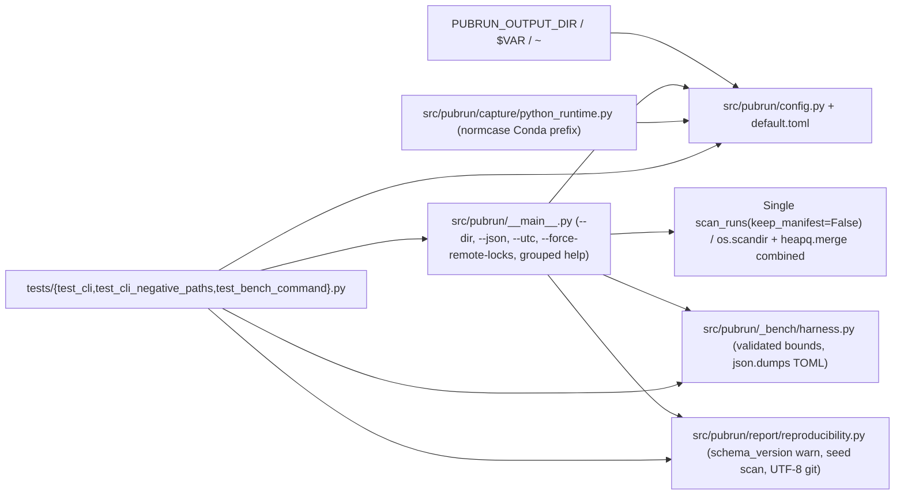

# IPD: CLI ergonomics, --dir/PUBRUN_OUTPUT_DIR, JSON output, streaming combined, and self-documenting help

- Date: 2026-11-27
- Kind: child
- Concern: Eight-lens rollup findings `ROLL-17` (`--dir` missing on 8 of 12 run-reading subcommands; missing `PUBRUN_OUTPUT_DIR` and `$VAR`/`~` expansion), `ROLL-18` (3-4x manifest rescans in `_run_diff`, `_run_combined`, `_run_methods_aggregate`; bare `pubrun` parsing all manifests; CLI callers still retaining full manifests in random-access memory (RAM)), `ROLL-20` (`_run_combined` 3x RAM buffering, untimestamped line hoisting, uncaught `AmbiguousRunSelectorError`; `_run_report` full-file crash tail), `ROLL-21` (`pubrun run --help` import prerequisite and 6 mode explanations), `ROLL-22` (`default.toml` contradictions, `core.auto_start` vs `[imports].mode` precedence, `[methods].format` command-line interface (CLI) default and `stderr` banner), `ROLL-23` (`show config <run>`, `show run config --all`, empty `combined` logs message, `bench` `--prepare-submission` tip and flag grouping), `ROLL-24` (`clean --force-remote-locks`), `ROLL-25` (`VALID_STATUSES` in `--help`), `ROLL-34` (Unicode Transformation Format 8-bit (UTF-8) subprocess decoding in `__main__.py`, `reproducibility.py`, and `_bench/harness.py`; `python_runtime.py::environment_kind` `normcase`; `_bench/harness.py::_toml_dumps` backslash escaping), and `ROLL-35` (`status --json`, `diff --json`, `res`/`cpu`/`mem --utc`, `pbr.exe`, `--no-browser`, grouped `--help`, unified `RUN` help, bare-`pubrun` quick start, `bench` `--iterations`/`--passes`/`--wait-timeout` validation, future `schema_version` warning, `reproducibility.py` seed suggestion and humanized tokens), surfaced by all eight lenses.
- Scope: Update `src/pubrun/__main__.py`, `src/pubrun/config.py`, `src/pubrun/resources/default.toml`, `src/pubrun/report/reproducibility.py`, `src/pubrun/_bench/harness.py`, and `src/pubrun/capture/python_runtime.py`, with updated and new regression tests in `tests/test_cli.py`, `tests/test_cli_negative_paths.py`, and `tests/test_bench_command.py`.
- Scope-Paths: src/pubrun/__main__.py, src/pubrun/config.py, src/pubrun/resources/default.toml, src/pubrun/report/reproducibility.py, src/pubrun/_bench/harness.py, src/pubrun/capture/python_runtime.py, tests/test_cli.py, tests/test_cli_negative_paths.py, tests/test_bench_command.py
- Item-Dependencies: executed:1o1cua, executed:l596kn, executed:m5s3g8, executed:caeqdz
- Status: reviewed
- Readiness: go-pending-approval
- Review-Depth: complex
- Short-Description: Add consistent --dir and PUBRUN_OUTPUT_DIR, status/diff --json, streaming heapq combined logs, honest help/errors/bench tips, methods config format, and schema-version warnings
- Work-Kind: bug
- Priority: high
- Set: assess-8l
- Order: 8
- Highest E allocated: 05
- Author: Antigravity
- Id: 2ge0ea

> Write and proofread this plan per the technical writing standard, `.aw/system/workflows/technical-writing/technical-writing.md`, including requirement 12 (diagrams).

## Workflow history

- 2026-11-27 /plan-review (Antigravity): APPROVE WITH REVISIONS APPLIED; PR-001, PR-002, PR-003, PR-004, PR-005, PR-006
- 2026-11-27 /assess-all (Antigravity): created Child 08 of Set `assess-8l` covering CLI `--dir`/`PUBRUN_OUTPUT_DIR`, `--json`, streaming `combined`, self-documenting help, `default.toml` sync, and `reproducibility.py` compatibility (`ROLL-17`, `ROLL-18`, `ROLL-20`, `ROLL-21`, `ROLL-22`, `ROLL-23`, `ROLL-24`, `ROLL-25`, `ROLL-34`, `ROLL-35`).

## Goal

Make every `pubrun` command-line interface (CLI) command consistent, pipe-safe, self-documenting, and memory-bounded across custom output directories, large run histories, non-UTF-8 locales, and Windows `pbr.exe` invocations, while aligning Tom's Obvious Minimal Language (TOML) comments in `src/pubrun/resources/default.toml` with actual runtime behavior and completing the CLI handoff seams from Children 06 (`m5s3g8`) and 07 (`caeqdz`).

### CLI routing and output-dir plumbing

## Detailed Implementation Checklist (TODO)

Execution-state rule: mark an `E-*` item complete only after performing the action. Accepted execution states: blocked, failed, pending, performed; terminal gate demands `performed`.

### Task group 1: Output directory, config defaults, and `reproducibility.py`

- [ ] E-01 Add `PUBRUN_OUTPUT_DIR`, path expansion, accurate `default.toml` comments, and Windows Conda prefix normalization in `src/pubrun/config.py`, `src/pubrun/resources/default.toml`, and `src/pubrun/capture/python_runtime.py`:
  - In `src/pubrun/config.py::_resolve_layers`: read `env_output_dir = os.environ.get("PUBRUN_OUTPUT_DIR", "").strip()`; when non-empty, append `("env", {"core": {"output_dir": env_output_dir}})` at the same environment-variable precedence tier as `PUBRUN_META_REF`.
  - In `src/pubrun/config.py`, apply a shared `_expand_output_dir(config: Dict[str, Any]) -> None` helper (using `_section(config, "core")` from Child 01 `1o1cua`) identically in BOTH `resolve_config()` and `resolve_config_with_provenance()` (and reflecting the expanded string in `provenance["core.output_dir"]["value"]` when non-empty) so `resolve_config_with_provenance()[0] == resolve_config()` remains byte-identical (`tests/test_show_config.py::TestShowConfigProvenance.test_provenance_does_not_change_resolved_value`). Expand non-empty `str` values with `os.path.expanduser(os.path.expandvars(raw))` so both `$VAR/...`, `~/...`, and `$VAR` containing `~` expand cleanly.
  - In `src/pubrun/resources/default.toml`:
    - Document `[imports].mode` precedence over `[core].auto_start` (and note that `[core].auto_start` is used only when `[imports].mode` is unset/legacy).
    - Mark genuinely unimplemented keys as `# RESERVED (no effect)`: `[imports]` provenance keys (`record_provenance`, `provenance_depth`, `provenance_path_mode`, `max_requests`), the three unimplemented `[capture.hardware]` flags (`capture_gpu_fp_precision`, `capture_cpu_clock_speed`, `capture_cpu_fp_precision`), `[capture.determinism].depth`, and `[logging].write_summary`. Do NOT mark `capture_gpu_clock_speed` as reserved (it is actively implemented in `src/pubrun/capture/hardware.py:187` and `src/pubrun/report/meta_snapshot.py:15,23,31`).
    - Fix `[capture.environment].mode` comments to state accurately that `"off"` suppresses capture, `"allowlist"` captures matching variables, and both `"filtered"` and `"full"` apply `[redaction]` when `[redaction].env_enabled = true` (per `src/pubrun/capture/environment.py:24-39`).
    - Fix `[capture.resources].scope` comments to state accurately that `"tree"` samples both process-tree resident memory (RSS) and process-tree CPU on Linux/macOS (per `src/pubrun/capture/resources.py:492-540`), falling back to process scope on Windows.
    - Add `./.config/pubrun/config.toml` and active environment variables (`PUBRUN_OUTPUT_DIR`, `PUBRUN_IMPORT_CONFLICT`, `PUBRUN_DEBUG`, `NO_COLOR`, `PUBRUN_RESULTS_DIR`) to the header resolution comments.
  - In `src/pubrun/capture/python_runtime.py::environment_kind`: compare Conda prefixes with `os.path.normcase(os.path.normpath(cp)) == os.path.normcase(os.path.normpath(sys.prefix))` for Windows drive-letter case invariance.
  - Depends on: none
  - Expected outcome: `PUBRUN_OUTPUT_DIR` and `$VAR`/`~` expansion work identically in `resolve_config()` and `resolve_config_with_provenance()`; empty/whitespace `PUBRUN_OUTPUT_DIR` is ignored; `default.toml` comments accurately reflect implemented vs reserved keys; and `python_runtime.py::environment_kind()` normalizes Windows drive-letter case.
  - Execution state: pending

- [ ] E-02 Update `src/pubrun/report/reproducibility.py` and `src/pubrun/_bench/harness.py`:
  - In `src/pubrun/report/reproducibility.py::_assess_capture_completeness`:
    - When `manifest.get("schema_version")` is a non-empty `str` whose major version (`sv.strip().split(".", 1)[0]`) is not `"1"`, emit a `WARN` finding with `code="unsupported_schema_version"`, `category="capture_completeness"`, `evidence_status="observed"`, `impact="material"`, noting the recorded `schema_version` and recommending upgrading `pubrun`.
    - Recognize explicit seed annotations when `manifest_path` is provided: stream `Path(manifest_path).parent / "events.jsonl"` with a bounded cap (up to 10,000 lines / 2 MiB, pre-filtering `if '"annotation"' not in line: continue` and ignoring `OSError`/`json.JSONDecodeError`), treating any `"annotation"` event whose `payload` dict contains a case-insensitive `"seed"` key with a non-`None` value as recorded seeds alongside `manifest.get("determinism", {}).get("registered_seeds")`. When neither is present, emit `determinism_seeds_not_recorded` recommending `pubrun.annotate(seed=...)`.
  - In `src/pubrun/report/reproducibility.py::format_reproducibility_summary`: humanize `portability_diff` -> `portability diff` and `not_checked` -> `not checked` in the rendered `Preflight [...]` text line while keeping all JavaScript Object Notation (JSON) dict keys and enum strings unchanged.
  - In `src/pubrun/report/reproducibility.py::_run_readonly_git`: pass `encoding="utf-8", errors="replace"` to `subprocess.run(...)`.
  - In `src/pubrun/_bench/harness.py`: validate `if args.iterations is not None and args.iterations < 1: ap.error("--iterations must be >= 1")` and `if args.passes is not None and args.passes < 1: ap.error("--passes must be >= 1")` in `main()` (checking `is not None` rather than truthiness so `0` is rejected rather than silently defaulted); serialize strings with `json.dumps(str(v))` in `_toml_dumps()` so Windows backslashes serialize as valid TOML; and pass `encoding="utf-8", errors="replace"` in `_git_commit()`.
  - Depends on: none
  - Expected outcome: Future `schema_version` manifests warn clearly, seed annotations in `events.jsonl` are recognized with bounded I/O and actionable `pubrun.annotate(seed=...)` guidance, summary text reads cleanly without changing JSON keys, `_toml_dumps` round-trips Windows paths through `tomllib.loads()`, `--iterations 0`/`-1` and `--passes 0`/`-1` fail with exit code `2`, and git subprocesses decode UTF-8 safely.
  - Execution state: pending

### Task group 2: CLI `--dir`, `--json`, streaming, and single-scan plumbing

- [ ] E-03 Add `--dir`, `--json`, `--utc`, `--force-remote-locks`, `--no-browser`, complete `m5s3g8`/`caeqdz` CLI handoffs, and eliminate redundant scans and RAM buffering in `src/pubrun/__main__.py`:
  - Add `--dir PATH` consistently across `show`/`report`, `diff`, `methods`, `inspect`, `rerun`, `res`/`resources`, `cpu`, and `mem`, threading `output_dir` into `_get_manifest_path()`, `_run_show_config("run", ...)`, `_run_report()` (including its crash-fallback completed-run suggestion), `_run_diff()`, `_run_methods()`, `_run_methods_aggregate()`, `_run_inspect()`, `_run_rerun()`, `_run_resources()`, `find_run()`, and `scan_runs()`.
  - Complete handoffs from Children 06 (`m5s3g8`) and 07 (`caeqdz`):
    - Update `src/pubrun/__main__.py::_emit_ambiguous_selector(e)` to branch on `getattr(e, "candidates", None)`: when `candidates` is non-empty (ambiguous ID prefix or directory substring where `e.by_recency` and `e.by_id` are `None`), print all matching candidate run IDs and directory names; otherwise keep the existing recency-vs-ID collision message. Catch `AmbiguousRunSelectorError` via `_emit_ambiguous_selector(e)` in `_run_diff()` and `_run_combined()` as well as `_get_manifest_path()`, `_run_status()`, and `_run_show_config()`.
    - Pass `keep_manifest=False` to `scan_runs()` in `_run_status()`, `_get_manifest_path()`, `_run_diff()`, `_run_combined()`, `_run_show_config("run", ...)`, and `show` (no-selector branch). Pass `all_runs=all_runs` to `render_verbose_list(runs, all_runs=all_runs)` in `_run_status()`.
    - Wire `--utc` on `res`/`resources`, `cpu`, and `mem`, passing `utc=utc` into `src/pubrun/report/diagnostics.py::print_resources_report(..., utc=utc)`.
    - Wire `--force-remote-locks` on `clean`, passing `force_remote_locks=force_remote_locks` into `src/pubrun/status.py::clean_runs(...)`.
    - Replace ad-hoc `use_color = not os.environ.get("NO_COLOR", "")` checks at `src/pubrun/__main__.py:1029,1182,1228,1322` with `src/pubrun/report/output.py::use_color(stream)` (using `sys.stderr` at line 1029 and `sys.stdout` at lines 1182, 1228, 1322).
  - Add `--json` stdout output on `status` and `diff` (strict RFC 8259 JSON via `allow_nan=False`, sanitizing non-finite floats via `src/pubrun/writer.py::_sanitize_json_value`):
    - `pubrun status --json` (list mode): emit `{"total_runs": len(all_runs), "matched_runs": len(runs), "runs": [...]}` where each entry serializes `index`, `run_id`, `run_dir` (`str`), `script`, `args`, `status`, `exit_code`, `started_at_utc`, `ended_at_utc`, `elapsed`, `workload_seconds`, `pid`, `hostname`, `git_commit`, `cwd`, `event_count`, and `console_log_size`. With a specific `run_id` (`pubrun status <run> --json`), emit `{"run": {...}}` with the same fields.
    - `pubrun diff --json`: reject `--json` combined with `--export` (exit code `2`); otherwise emit `{"run_a": name_a, "run_b": name_b, "depth": depth, "diff": diff_report}` to stdout (keeping `_out.info()` on stderr so stdout is pure JSON).
  - Add `--no-browser` on `report-bug` (and its `feedback` alias) and guard automatic `webbrowser.open(url)` behind a helper `_can_open_browser(no_browser: bool) -> bool` that returns `False` when `no_browser=True`, when `not sys.stdout.isatty()`, when running in a Secure Shell (SSH) session (`SSH_CLIENT`/`SSH_TTY`/`SSH_CONNECTION`) without `DISPLAY`/`WAYLAND_DISPLAY`, or on Linux without `DISPLAY`/`WAYLAND_DISPLAY` (still printing the diagnostics and URL cleanly).
  - Eliminate 3-4x rescans: pass already-scanned `runs=all_runs` into `find_run()` in `_run_diff()` and `_run_combined()`; in `_run_diff()`, skip `scan_runs()` entirely when two explicit filesystem paths (`Path(p).exists()`) are given; in `_run_methods_aggregate()`, scan with `keep_manifest=False` and read each matched run's manifest once via `r.load_manifest()` (avoiding scanning and retaining unselected manifests); in bare `pubrun` (`main()` fallback) and `_run_report()` crash-fallback scan, count/inspect `pubrun-*` directories via `os.scandir()` without parsing every manifest.
  - Stream `_run_combined()` in `O(K)` memory using `heapq.merge` and `contextlib.ExitStack`:
    - Check whether any `stdout.log` or `stderr.log` exists across `target_runs`; if zero log files exist, emit an informative hint to `stderr` pointing to `[console].capture_mode = "standard"` or `import pubrun.full` and return cleanly (instead of warning `"Logs lack timestamps"`).
    - Guard `p.stat()` with `try/except OSError`.
    - For timestamped interleaving, stream each open file via a generator yielding `(sort_ts, phase, file_idx, line_idx, formatted_line)`: buffer only leading untimestamped lines before a file's first timestamped line and emit them with `(first_ts, 0, file_idx, line_idx)` as soon as `first_ts` is seen (or fallback ISO timestamp from `r.started_at_utc` if a file has no timestamps), emit timestamped and trailing continuation lines with `(current_ts, 1, file_idx, line_idx)`, and close all handles deterministically via `ExitStack` even on `BrokenPipeError`.
  - In `_run_report()`: use `collections.deque(lf, maxlen=10)` for `O(1)` crash tails, stream `section == "logs"` in 64 KiB chunks via `shutil.copyfileobj(..., length=65536)`, and fix the stale `pubrun report {latest_completed}` suggestion to `pubrun show {latest_completed}`.
  - Pass `encoding="utf-8", errors="replace"` to all `text=True` `subprocess.run()` calls in `src/pubrun/__main__.py` (`_run_gh`, `_slurm_job_state` `squeue`/`sacct`, `_run_bench` submit, `_run_tests` mock script), and detect `pbr.exe` via `Path(argv[0]).stem.lower()` (normalizing `"pbr"` -> `"pbr"`, `"pubrun"` -> `"pubrun"`, fallback `"pubrun"`).
  - Depends on: E-01, E-02
  - Expected outcome: Every run-reading command honors `--dir` and `keep_manifest=False`, `_emit_ambiguous_selector()` handles prefix `candidates`, `status`/`diff` emit strict `--json`, `res`/`cpu`/`mem` support `--utc`, `clean` supports `--force-remote-locks`, `_run_combined()` streams in `O(K)` memory without hoisting leading untimestamped lines, `pbr.exe` is detected, and all `text=True` subprocesses decode UTF-8 safely.
  - Execution state: pending

### Task group 3: Self-documenting help, onboarding, `methods`, `show`, and `bench` UX

- [ ] E-04 Fix `show`, `methods`, `bench`, `init`, `run`, and top-level help/errors in `src/pubrun/__main__.py`:
  - In `methods`: change `--format` parser default from `"markdown"` to `None`; in `_run_methods()`, when `format_type is None`, resolve `resolve_config().get("methods", {}).get("format", "markdown")` (falling back to `"markdown"` if invalid/empty). Move decorative `--- Generated Computational Methods Section ---` and `-----------------------------------------------` banners to `sys.stderr` so `stdout` is pure Markdown or LaTeX (note `MARKDOWN_TEMPLATE` and `LATEX_TEMPLATE` retain `### Computational Methods` / `\subsection*{Computational Methods}` on stdout). Add a `--all` example and long flag names (`--filter`, `--status`, `--limit`) to `methods --help` and the `_METHODS_LARGE_SET` note.
  - In `show`: handle `pubrun show config <arg>` cleanly in `main()` before falling through to `_run_report()`: if `_sec == "default"`, dispatch `_run_show_config("default")`; otherwise print `_out.info(f"Interpreting 'show config {_sec}' as 'show run config {_sec}'.")` and dispatch `_run_show_config("run", run_selector=_sec, show_all=getattr(args, "all", False), output_dir=getattr(args, "dir", None))`. In `_run_show_config("run", ..., show_all=True)`, emit an informative note to `stderr` explaining that past runs persist only resolved values (not per-layer provenance) and pointing to `pubrun show config --all` for live provenance.
  - In `diff`: reject `len(run_dirs) > 2` with a clear error message and exit code `2` instead of silently ignoring extra positional arguments.
  - Distinguish empty `runs/` (`len(all_runs) == 0`: `"No runs found in '<dir>'."`) from 0-match filters (`len(all_runs) > 0` and `not matched`: `"0 of <N> runs matched the filter criteria."`) in `show`, `combined`, and `methods --all`.
  - In `bench`:
    - Fix `_print_safe_file_block()` tip to print the exact non-rerunning command `pubrun bench --submit-file "{redacted_path}" --prepare-submission`.
    - Group `bench` subparser options into explicit `argparse` argument groups (`HPC scheduler options` for `--local`, `--submit`, `--scheduler`, `-y/--yes`, `--wait-timeout`, and `GitHub contribution options` for `--contribute`, `--no-contribute`, `--prepare-submission`, `--submit-file`, `--no-submit`, `--gh-repo`), keeping mutually exclusive groups inside their respective argument groups.
    - Validate in `_run_bench()` BEFORE harness/scheduler dispatch (using `is not None`, never truthiness): `iterations < 1`, `passes < 1`, and `wait_timeout < 0` each emit `_print_error(...)` and exit with code `2`; forward `--iterations` and `--passes` whenever `is not None`.
  - Help, onboarding, and `init` clarity (zero em or en dashes in user-facing CLI strings added or modified):
    - Standardize `metavar="RUN"` and help text mentioning recency indices (`#1`, `#2`), run ID/prefix, or directory path across all run-accepting subcommands; set `metavar="RUN"` (removing raw `config_extra`) on `show_parser`'s third positional argument.
    - List all 7 `VALID_STATUSES` (`completed, failed, interrupted, broken_pipe, running, crashed, ghost`) in `-s`/`--status` and `-S`/`--not-status` help in `_add_run_filter_args()`.
    - Explain the `import pubrun` prerequisite and all 6 import modes (`auto`, `full`, `noauto`, `nopatch`, `noconsole`, `minimal`) in `run --help`.
    - Explain `meta` hydration in plain language in `meta --help` and `inspect --help`, explain `--fail-on` thresholds (`warn`, `mismatch`, `unknown`) in `inspect`/`rerun`, and clarify `--export` output filenames (`.pubrun_diff_A_*`, `.pubrun_diff_B_*`) and default format (`[diff].export_format`, default `txt`) in `diff --help`.
    - Convert `feedback` from a separate subparser to `aliases=["feedback"]` on `report-bug` and add `"feedback"` to `_known_aliases`, preserving `init`, `report-bug` registration order (`tests/test_cli_negative_paths.py:415`) and keeping `pubrun feedback` dispatch working (`tests/test_cli.py:739`).
    - Organize top-level `--help` description/epilog with conceptual command groups and quick-start examples while preserving `usage: {prog_name} ...` on line 0 (`tests/test_cli.py:734`) and `Examples:\n  {prog_name} <cmd>` on every subcommand (`tests/test_cli.py:1244-1253`).
    - Add a 3-line quick start to bare `pubrun` when zero runs exist, and fix `pubrun init` step 2 copy (`src/pubrun/__main__.py:3585`) so it does not contradict the opt-in `[console].capture_mode` tip on line 3589.
  - Depends on: E-03
  - Expected outcome: CLI help, errors, tips, and outputs are accurate, pipe-clean, and learnable without external docs, while all existing help/error-format tests remain compatible.
  - Execution state: pending

### Task group 4: Existing-test alignment and regression tests

- [ ] E-05 Update affected existing tests and add regression tests in `tests/test_cli.py`, `tests/test_cli_negative_paths.py`, and `tests/test_bench_command.py`, and run all validation commands:
  - Update existing tests in `tests/test_cli.py` whose internal call signatures or TTY assumptions change:
    - Update the 9 `mock_run_resources.assert_called_once_with(...)` tests (`tests/test_cli.py:1303-1520`) to include `output_dir=None` and `utc=False` (or match the updated `_run_resources` kwargs) and add tests passing `--dir` and `--utc`.
    - Update `tests/test_cli.py::TestCliBugReport.test_report_bug_and_feedback_open_browser_and_print_diagnostics` to simulate a TTY with display (e.g., monkeypatching `_can_open_browser` or `sys.stdout.isatty` + `DISPLAY`), and add separate tests verifying `--no-browser`, non-TTY, and SSH-without-`DISPLAY` skip `webbrowser.open()`.
    - Update `tests/test_cli.py::test_empty_invocation_shows_help_and_run_count` to create real `pubrun-*` directories in `tmp_path` (verifying `os.scandir()` counts runs without calling `scan_runs()` / parsing manifests) plus a 0-run quick-start assertion.
  - Add new behavioral regression tests across `tests/test_cli.py`, `tests/test_cli_negative_paths.py`, and `tests/test_bench_command.py` covering:
    - `PUBRUN_OUTPUT_DIR` (including empty/whitespace ignored), `$VAR`/`~` expansion in both `resolve_config()` and `resolve_config_with_provenance()`, `default.toml` reserved-vs-implemented accuracy (including `capture_gpu_clock_speed` still active), and `python_runtime.py::environment_kind()` Windows-case Conda prefix matching.
    - `reproducibility.py`: `schema_version = "2.0"` emitting `unsupported_schema_version` (`WARN`), `events.jsonl` seed annotation suppression vs `pubrun.annotate(seed=...)` suggestion, humanized `portability diff`/`not checked` in `format_reproducibility_summary()` with unchanged JSON keys, and UTF-8 decoding in `_run_readonly_git()`.
    - `_bench/harness.py`: `_toml_dumps()` Windows backslash round-trip through `tomllib.loads()`, and `--iterations 0`/`-1`, `--passes 0`/`-1` rejected with exit code `2`.
    - `__main__.py`: `--dir` on `show`, `show run config`, `diff`, `methods`, `methods --all`, `inspect`, `rerun`, `res`, `cpu`, `mem`; `status --json` (list and single-run) and `diff --json` (plus `--json` + `--export` exit `2`); `res`/`cpu`/`mem --utc`; `clean --force-remote-locks`; `methods` honoring `[methods].format = "latex"` and emitting banner-free stdout with banners on stderr; streaming `_run_combined` with leading untimestamped lines (not hoisted above earlier runs), zero log files hint, and ambiguous prefix selector via `_emit_ambiguous_selector`; `show config 1`, `show config default`, `show run config --all` stderr note, `diff` with 3 positional args (exit `2`), empty-dir vs 0-match filter errors, `pbr.exe --help`, `feedback` hidden alias still dispatching, `bench --iterations 0`/`-1`, `--passes 0`/`-1`, `--wait-timeout -1`, and `_print_safe_file_block()` printing `pubrun bench --submit-file "..." --prepare-submission`.
  - Run all commands in `## Required tests / validation`.
  - Depends on: E-04
  - Expected outcome: All updated, new, and existing CLI, status, diff, methods, config, reproducibility, and benchmark tests pass, and three-platform `mypy` exits `0`.
  - Execution state: pending

## Project conventions discovered (Step 0)

- `src/pubrun/__main__.py` hosts the `pubrun` and `pbr` CLI entrypoints and integrates with `status.py`, `report/output.py`, `report/diagnostics.py`, `report/methods.py`, and `report/reproducibility.py` (updated in Children `1o1cua`, `l596kn`, `m5s3g8`, and `caeqdz`).
- `src/pubrun/resources/default.toml` is copied verbatim by `pubrun init` and `--create-config`, so every comment must accurately match runtime behavior (`capture_gpu_clock_speed` is implemented; only `capture_gpu_fp_precision`, `capture_cpu_clock_speed`, `capture_cpu_fp_precision`, `[imports]` provenance keys, `[capture.determinism]`, and `[logging].write_summary` are reserved).
- Child 06 (`m5s3g8`) delegates four CLI follow-ups to `2ge0ea`: `keep_manifest=False` in CLI scans, `all_runs=all_runs` in `render_verbose_list()`, `_emit_ambiguous_selector()` handling `e.candidates`, and `--force-remote-locks` / `--json` subparser wiring. Child 07 (`caeqdz`) delegates CLI `--utc` on `res`/`cpu`/`mem` and `[methods].format` + stderr banners to `2ge0ea`.
- `tests/test_show_config.py::TestShowConfigProvenance.test_provenance_does_not_change_resolved_value` asserts `resolve_config_with_provenance()[0] == resolve_config()`, `tests/test_cli.py:734,1244-1253` pin help usage and `Examples:` formatting, and `tests/test_cli_negative_paths.py:415` pins `init, report-bug` primary command ordering.

## Findings

| ID | Concerns | Severity | Remediation Risk | Persona | Summary |
|---|---|---|---|---|---|
| `ROLL-17` | functionality; ui-ux; use-cases | High | Low (`usability`) | Power user / HPC | `--dir` missing on 8 of 12 run-reading commands (and `show run config`); no `PUBRUN_OUTPUT_DIR` env var or `$VAR`/`~` expansion. |
| `ROLL-18` | performance; use-cases | High | Medium (`complexity`) | Power user | `_run_diff`, `_run_combined`, and `_run_methods_aggregate` re-scan manifests 3-4x; CLI scans retain full manifests in RAM; bare `pubrun` parses every manifest. |
| `ROLL-20` | memory-resources; edge-cases | High | Low (`functionality`) | Operator / QA | `_run_combined` buffers 3x log size, hoists leading untimestamped lines, and leaks `AmbiguousRunSelectorError` traceback; `_run_report` crash tail reads entire log file. |
| `ROLL-21` | self-documentation; functionality | High | Low (`usability`) | Complete novice | `pubrun run --help` omits `import pubrun` prerequisite and 6 mode definitions. |
| `ROLL-22` | self-documentation; ui-ux; functionality | High | Low (`usability`) | Novice / Power user | `core.auto_start = false` shadowed by `[imports].mode = "auto"`; `default.toml` comments contradict code; `pubrun methods` ignores `[methods].format` and prints banners to stdout. |
| `ROLL-23` | ui-ux; self-documentation | High | Low (`usability`) | Novice / Power user | `show config <run>` fails confusingly; `show run config --all` silently ignores `--all`; `bench --prepare-submission` tip re-runs suite and overloads `submit`. |
| `ROLL-24` / `ROLL-25` | use-cases; ui-ux; self-documentation | High | Low (`usability`) | HPC / Novice | `clean` lacks `--force-remote-locks`; `-s`/`-S` help omits all 7 valid statuses. |
| `ROLL-34` / `ROLL-35` | compatibility; edge-cases; ui-ux | Medium | Low (`usability`) | Power user / Operator | Missing `status`/`diff` `--json`, `res`/`cpu`/`mem --utc`, `--no-browser`, `pbr.exe`, grouped help, bare-`pubrun` quick start, `bench` zero/negative arg validation, UTF-8 subprocess decoding, `python_runtime.py::environment_kind` `normcase`, `_toml_dumps` escaping, and `schema_version` warning. |

## Proposed changes (ordered, validatable)

1. `E-01` (`src/pubrun/config.py`, `src/pubrun/resources/default.toml`, `src/pubrun/capture/python_runtime.py`): Add `PUBRUN_OUTPUT_DIR` (stripped) + shared `$VAR`/`~` expansion across `resolve_config()` and `resolve_config_with_provenance()`, sync `default.toml` comments accurately (preserving implemented `capture_gpu_clock_speed`), and normalize Conda prefix case in `python_runtime.py::environment_kind()`.
2. `E-02` (`src/pubrun/report/reproducibility.py`, `src/pubrun/_bench/harness.py`): Emit `unsupported_schema_version` warning, recognize bounded `events.jsonl` seed annotations and recommend `pubrun.annotate(seed=...)`, humanize summary tokens without changing JSON keys, pass UTF-8 to `_run_readonly_git()` and `_git_commit()`, validate `harness.py` `--iterations`/`--passes >= 1`, and use `json.dumps` in `_toml_dumps()`.
3. `E-03` (`src/pubrun/__main__.py`): Add `--dir` across all 8 commands plus `show run config`, complete `m5s3g8`/`caeqdz` handoffs (`_emit_ambiguous_selector` `candidates`, `keep_manifest=False`, `render_verbose_list(..., all_runs=...)`, `res`/`cpu`/`mem --utc`, `clean --force-remote-locks`, `report/output.py::use_color`), add `status`/`diff` `--json`, add `report-bug --no-browser` + headless guard, eliminate redundant scans, stream `_run_combined` with `heapq.merge` + `ExitStack`, use `O(1)` crash tail and 64 KiB log streaming in `_run_report`, pass UTF-8 to all `text=True` subprocesses, and detect `pbr.exe`.
4. `E-04` (`src/pubrun/__main__.py`): Wire `[methods].format` + stderr banners, handle `show config <run>`/`default` and `show run config --all`, reject `> 2` positional `diff` runs, distinguish empty-dir vs 0-match filters, fix `bench` tip/groups/zero-negative validation, unify `RUN` metavar/help and 7-status help, group top-level `--help`, hide `feedback` as alias of `report-bug`, add bare-`pubrun` quick start, and fix `init` copy.
5. `E-05` (`tests/test_cli.py`, `tests/test_cli_negative_paths.py`, `tests/test_bench_command.py`): Align affected existing tests (`mock_run_resources`, `TestCliBugReport`, `test_empty_invocation_shows_help_and_run_count`) and add full regression coverage for all items above.

## Deferred / out of scope (with reason)

- Updating `README.md`, `docs/cli.md`, and `docs/configuration.md` (`PUBRUN_OUTPUT_DIR`, `pubrun run` wording, and Windows RSS notes) is owned by child `6y55x4` (Order 10) after all preceding children land.
  - Carrier: 6y55x4

## Scope check

- Over-scope: none. Every change maps directly to verified findings in `ROLL-17`, `ROLL-18`, `ROLL-20` through `ROLL-25`, `ROLL-34`, and `ROLL-35`, plus explicit handoffs from Children 06 (`m5s3g8`) and 07 (`caeqdz`).
- Under-scope: none. All CLI, `config.py` output-dir, `default.toml`, `reproducibility.py`, `_bench/harness.py`, `python_runtime.py`, and test alignment items are covered.

## Required tests / validation

1. `pytest tests/test_cli.py tests/test_cli_negative_paths.py tests/test_bench_command.py tests/test_combined.py tests/test_show_config.py tests/test_config.py tests/test_methods_multi.py tests/test_diff_usability.py tests/test_cli_diff_bugs.py tests/test_reproducibility_preflight.py tests/test_reproducibility_assessment.py tests/test_hardware.py -v`
2. `mypy && mypy --platform win32 && mypy --platform darwin`

## Spec / documentation sync

`src/pubrun/resources/default.toml` and all CLI `--help` / error outputs are synced in `E-01` and `E-04`; external documentation updates (`README.md`, `docs/cli.md`, `docs/configuration.md`) are deferred to child `6y55x4` (Order 10).

## Open questions

None. All fixes preserve backward-compatible CLI aliases and defaults (`[Y/n]` on `bench` per orchestrator `k80suw` OQ-7, `"fsync"` default per OQ-2, no `sitecustomize` injection per OQ-1), and all handoff contracts from `1o1cua`, `l596kn`, `m5s3g8`, and `caeqdz` are reconciled.

## Validation and cross-check (verify before reporting done)

Validation-state rule: inspect evidence in a separate pass. Accepted validation results: blocked, failed, pass, pending; terminal gate demands `pass`.

- [ ] V-01 validates E-01
  - Required evidence: Pasted `pytest tests/test_config.py tests/test_show_config.py tests/test_hardware.py tests/test_cli.py -v` output confirming `src/pubrun/config.py` (`PUBRUN_OUTPUT_DIR`, empty/whitespace ignored, `$VAR`/`~` expansion identical across `resolve_config()` and `resolve_config_with_provenance()`), `src/pubrun/capture/python_runtime.py::environment_kind` Windows-case Conda prefix matching, and `src/pubrun/resources/default.toml` accuracy (including active `capture_gpu_clock_speed` and reserved markers).
  - Observed evidence:
  - Result: pending

- [ ] V-02 validates E-02
  - Required evidence: Pasted `pytest tests/test_reproducibility_preflight.py tests/test_reproducibility_assessment.py tests/test_bench_command.py -v` output confirming `src/pubrun/report/reproducibility.py` (`unsupported_schema_version` warning for `schema_version = "2.0"`, bounded `events.jsonl` seed annotation recognition vs `pubrun.annotate(seed=...)` suggestion, humanized `format_reproducibility_summary()` with unchanged JSON keys, UTF-8 `_run_readonly_git()`) and `src/pubrun/_bench/harness.py` (`_toml_dumps()` Windows backslash `tomllib.loads()` round-trip, `--iterations 0`/`-1` and `--passes 0`/`-1` exit `2`).
  - Observed evidence:
  - Result: pending

- [ ] V-03 validates E-03
  - Required evidence: Pasted `pytest tests/test_cli.py tests/test_cli_negative_paths.py tests/test_combined.py tests/test_show_config.py tests/test_cli_diff_bugs.py -v` output confirming `--dir` across all 8 subcommands plus `show run config`, `_emit_ambiguous_selector()` prefix `candidates`, `keep_manifest=False` / single-scan paths, `status --json` and `diff --json`, `res`/`cpu`/`mem --utc`, `clean --force-remote-locks`, streaming `heapq.merge` `_run_combined` with non-hoisted leading untimestamped lines and empty-logs hint, `pbr.exe`, and `report-bug --no-browser`/non-TTY/SSH guard.
  - Observed evidence:
  - Result: pending

- [ ] V-04 validates E-04
  - Required evidence: Pasted `pytest tests/test_cli.py tests/test_cli_negative_paths.py tests/test_bench_command.py tests/test_methods_multi.py tests/test_show_config.py -v` output confirming `[methods].format` config default + banner-free stdout with stderr banners, `show config 1` / `show config default` / `show run config --all`, `diff` >2 args exit `2`, empty-dir vs 0-match messages, `_print_safe_file_block()` exact `--submit-file ... --prepare-submission` tip, grouped `bench` help + zero/negative arg rejection, hidden `feedback` alias, grouped top-level `--help`, bare-`pubrun` quick start, and updated `init` copy.
  - Observed evidence:
  - Result: pending

- [ ] V-05 validates E-05
  - Required evidence: Pasted output of Command 1 (all 12 targeted `pytest` suites, including aligned `mock_run_resources`, `TestCliBugReport`, and `test_empty_invocation_shows_help_and_run_count` tests) and Command 2 (`mypy && mypy --platform win32 && mypy --platform darwin`) all exiting `0`.
  - Observed evidence:
  - Result: pending

## Approval and execution gate

1. **Open questions and approval:** This plan is a proposal and MUST NOT be executed until all blocking open questions are resolved (none remain) and explicit human approval is recorded (`aw set plan approved 2ge0ea --by-human`).
2. **Scope declaration:** `- Scope-Paths:` declares the expected files this plan modifies (`src/pubrun/__main__.py`, `src/pubrun/config.py`, `src/pubrun/resources/default.toml`, `src/pubrun/report/reproducibility.py`, `src/pubrun/_bench/harness.py`, `src/pubrun/capture/python_runtime.py`, `tests/test_cli.py`, `tests/test_cli_negative_paths.py`, `tests/test_bench_command.py`). If execution requires touching an additional file or leaving a declared file untouched, justify each delta at finalization with `--scope-reason` or `--scope-ack`.
3. **Validation honesty (hard MUST):** Every `V-*` item MUST paste actual runner output from this workspace confirming exit `0` and the required behavior; never claim passing tests, `mypy`, or checks that were not actually run.
4. **Commits and push policy:** Commit ONLY files changed for this plan using `aw commit 2ge0ea -- <paths>` (never `git add -A`, bare `git add`, `git commit -a`, or raw `git commit`). Never push, tag, or publish.
5. **Lifecycle finalization:** On completion, this plan MUST be finalized to `.aw/records/plans/executed/` only after all `E-*` items are `performed` and all `V-*` items are `pass`. When run under `aw oc run` or `aw agy run`, the runner owns `aw ipd finalize 2ge0ea`; when executed manually outside a runner, the executor runs `aw ipd finalize 2ge0ea` (never hand-roll `git mv` to `executed/`).
