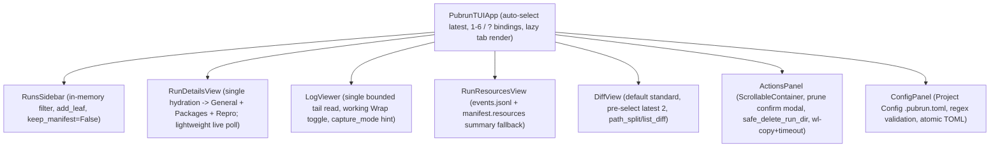

# IPD: TUI safety, meta_ref hydration, memory/responsiveness, and usability

- Date: 2026-11-27
- Kind: child
- Concern: Eight-lens rollup findings `ROLL-06` (`UX-1`/`EC-6`/`FUNC-5`: unconfirmed one-click `Execute Prune` leaking stderr; single-run delete skipping symlink/confinement/active-lock guards), `ROLL-19` (`PERF-5`/`MEM-3`/`MEM-7`/`UX-2`/`UX-5`/`UX-12`/`UX-13`/`FUNC-5`/`SD-2`/`SD-10`/`EC-17`/`COMP-12`: per-keystroke disk scans, double unbounded log reads, broken `Wrap Text` button, missing `meta_ref` hydration in General/Packages panes, eager hidden-tab parsing, 1s full-manifest re-parse in `refresh_live_metrics`, mislabeled `"TUI Settings"` non-atomic TOML writer with invalid escaping and `auto_start` shadowing, `DiffView` `basic` default & missing `path_split`/`list_diff` rendering, `RunResourcesView` ignoring `manifest.resources`, 80x24 clipping, Windows PowerShell `&&` rerun bug, Wayland `wl-copy` & clipboard timeout), surfaced by all eight lenses.
- Scope: Harden and polish `src/pubrun/tui/app.py`, `src/pubrun/tui/css/style.css`, and `src/pubrun/tui/widgets/{actions,config,details,diff,resources,sidebar,viewer}.py`, with Textual pilot and unit tests in `tests/test_tui.py` and `tests/test_tui_bugs.py`.
- Scope-Paths: src/pubrun/tui/app.py, src/pubrun/tui/css/style.css, src/pubrun/tui/widgets/actions.py, src/pubrun/tui/widgets/config.py, src/pubrun/tui/widgets/details.py, src/pubrun/tui/widgets/diff.py, src/pubrun/tui/widgets/resources.py, src/pubrun/tui/widgets/sidebar.py, src/pubrun/tui/widgets/viewer.py, tests/test_tui.py, tests/test_tui_bugs.py
- Item-Dependencies: executed:m5s3g8, executed:caeqdz
- Status: to-review
- Review-Depth: complex
- Short-Description: Add bulk-prune confirmation and safe single-run delete guards, hydrate meta_ref across views, eliminate per-keystroke disk scans and full-log reads, fix Wrap/ConfigPanel/DiffView/layout
- Work-Kind: bug
- Priority: high
- Set: assess-8l
- Order: 9
- Highest E allocated: 05
- Author: Antigravity
- Id: 3q5rd5

> Write and proofread this plan per the technical writing standard, `.aw/system/workflows/technical-writing/technical-writing.md`, including requirement 12 (diagrams).

## Workflow history

- 2026-11-27 /assess-all (Antigravity): created Child 09 of Set `assess-8l` covering TUI deletion safety, `meta_ref` hydration, memory/responsiveness, `ConfigPanel`, `LogViewer`, `DiffView`, and 80x24 layout (`ROLL-06`, `ROLL-19`).

## Goal

Make the optional `pubrun ui` TUI safe against accidental or unsafe deletions, responsive on large run directories and multi-hundred-MB logs, faithful to `meta_ref` hydration and CLI defaults, atomic and accurate when editing `.pubrun.toml`, and usable on 80x24 terminals.

### TUI interaction and lazy-loading architecture

## Detailed Implementation Checklist (TODO)

Execution-state rule: mark an `E-*` item complete only after performing the action. Accepted execution states: blocked, failed, pending, performed; terminal gate demands `performed`.

### Task group 1: Destructive action safety, clipboard, and rerun parity

- [ ] E-01 Harden `src/pubrun/tui/widgets/actions.py`:
  - Require a confirmation modal before `run_bulk_prune()` deletes runs, showing the exact matched run count and total disk space to be freed; capture both `stdout` and `stderr` during `clean_runs()` so no raw terminal output bleeds into the live TUI.
  - Route `handle_deletion_result()` through `status.safe_delete_run_dir()` so single-run deletion enforces symlink rejection, parent-directory confinement, and active/remote lock refusal.
  - Fix the archive destination label to `<output_dir>/archive/<run_id>.zip`, list valid statuses and age units in cleanup input placeholders/hints, and wrap `ActionsPanel` in `ScrollableContainer` so bottom controls never clip at 80x24.
  - In `copy_to_clipboard()`, add `wl-copy` (Wayland) to the Linux clipboard probes and pass `timeout=5, stdout=subprocess.DEVNULL, stderr=subprocess.DEVNULL` on every clipboard subprocess; align `_build_rerun_command()` with the canonical Windows-safe (no `&&`) and `sys_argv`-preserving rerun command builder.
  - Depends on: none
  - Expected outcome: Bulk prune requires confirmation with zero stderr bleed, single-run delete enforces all safety guards, clipboard never hangs and works on Wayland, and Windows rerun commands work in PowerShell 5.1.
  - Execution state: pending

### Task group 2: Hydration, in-memory sidebar, lazy tabs, and bounded `LogViewer`

- [ ] E-02 Fix `src/pubrun/tui/widgets/sidebar.py`, `src/pubrun/tui/widgets/details.py`, `src/pubrun/tui/widgets/resources.py`, and `src/pubrun/tui/app.py`:
  - In `RunsSidebar`: load runs via `scan_runs(..., keep_manifest=False)` only on mount and explicit refresh (`Ctrl+R`), filter `self.all_runs` in memory on `on_input_changed()` (matching `run_id`, `script`, `args`, and `status`), and add leaf nodes via `tree.root.add_leaf()`.
  - In `PubrunTUIApp`: auto-select the most recent run on mount when runs exist, render inactive tabs lazily on `TabbedContent.TabActivated` (marking tabs dirty on selection), rename Tab 5 from `"TUI Settings"` to `"Project Config"`, and add `1`-`6` tab shortcuts, `/` search focus, and `?` keybind help modal.
  - In `RunDetailsView`: hydrate the selected run's manifest **once** in `display_run()` and pass the hydrated dict to General Info, Packages, and Reproducibility panes; render `git.dirty is None` as `not checked`; reapply `#pkg-search` on run switch; render an onboarding panel when 0 runs exist; in `refresh_live_metrics()`, refresh only live PID/RSS/CPU/elapsed fields instead of re-parsing `manifest.json` every second.
  - In `RunResourcesView`: render `manifest.resources` summary fields (`system_memory`, `load_average`, `system_iowait_pct`, `io_counters`, peak RSS/CPU) alongside or as fallback when `events.jsonl` has no samples.
  - Depends on: E-01
  - Expected outcome: Typing in search causes zero disk scans, HPC `meta_ref` runs show hydrated hardware/git/packages across all panes, live refresh is lightweight, and inactive tabs do not block selection.
  - Execution state: pending

- [ ] E-03 Fix `src/pubrun/tui/widgets/viewer.py`:
  - Eliminate double-reading by guarding `select_widget.value = default_val` (loading each file once per selection), sort log files deterministically, and skip nonexistent `"console.log"`.
  - Read only a bounded tail window (e.g. last 5,000 lines / 2 MiB from EOF via `seek`) with a clear truncation banner so multi-hundred-MB logs never freeze or OOM the TUI.
  - Fix `#btn-toggle-wrap` to reload the current bounded log with the toggled `wrap` setting and update its label (`"Wrap: ON"` / `"Wrap: OFF"`).
  - Display an inline note when `stdout.log`/`stderr.log` are absent explaining `[console].capture_mode = "standard"` / `import pubrun.full`.
  - Depends on: E-02
  - Expected outcome: Selecting a run reads logs once with bounded RAM, `"Wrap Text"` visibly re-wraps loaded lines with state feedback, and empty console logs teach how to enable capture.
  - Execution state: pending

### Task group 3: Atomic `ConfigPanel`, `DiffView`, and responsive CSS

- [ ] E-04 Fix `src/pubrun/tui/widgets/config.py`, `src/pubrun/tui/widgets/diff.py`, and `src/pubrun/tui/css/style.css`:
  - In `ConfigPanel`: display the resolved target file path (`./.pubrun.toml`) in the header, remove dead `"cfg-profile"`, expose `[imports].mode` (or synchronize/warn on `auto_start` vs `[imports].mode`), validate `#cfg-sensitive-regex` with `re.compile()` before saving (preserving entered text on error), guard non-dict existing TOML sections, fix `dict_to_toml()` escaping/quoting/`None` handling with `tomllib.loads` round-trip validation, write atomically via temp file + `os.replace()`, and refresh `RunsSidebar` if `output_dir` changed.
  - In `DiffView`: default depth to `"standard"` (matching CLI/API), fix depth descriptions to match `default.toml`, list only comparable runs (with `manifest.json`), pre-select the two most recent comparable runs when empty, and render `path_split` `order_changed` notes and `list_diff` deltas consistently with `analysis/render.py`.
  - In `style.css` and `details.py`: make sidebar, modal dialog, and `DataTable` widths responsive for 80x24 terminals without horizontal/vertical clipping.
  - Depends on: E-02, E-03
  - Expected outcome: `ConfigPanel` writes valid TOML atomically with inline regex validation, `DiffView` matches CLI defaults and renders all diff types, and 80x24 terminals render without clipping.
  - Execution state: pending

### Task group 4: Textual pilot and unit tests

- [ ] E-05 Add Textual pilot and unit tests in `tests/test_tui.py` and `tests/test_tui_bugs.py`:
  - Verify `btn-prune-execute` opens confirmation modal and captures stderr without bleeding; verify `handle_deletion_result` refuses symlinks/out-of-dir/active locks; verify hydrated HPC child run renders parent packages/hardware in `RunDetailsView`; verify typing in `#runs-search` executes 0 `scan_runs` calls and matches `args`/`status`; verify `LogViewer` reads once with bounded tail and `#btn-toggle-wrap` updates label and re-wraps; verify `ConfigPanel` rejects `[unclosed` regex, writes valid TOML atomically, and handles `dict_to_toml` edge cases; verify `DiffView` default `"standard"`, pre-selection, and `path_split` reorder; verify `1`-`6`, `/`, `?` bindings and 80x24 layout.
  - Depends on: E-04
  - Expected outcome: All new and existing TUI tests pass and three-platform `mypy` exits `0`.
  - Execution state: pending

## Project conventions discovered (Step 0)

- The optional Textual TUI (`pubrun[tui]`) lives under `src/pubrun/tui/` and shares `status.safe_delete_run_dir` and `scan_runs(..., keep_manifest=False)` from child `m5s3g8` and diff/hydration helpers from child `caeqdz`.
- TUI behavior is verified via Textual pilot tests in `tests/test_tui.py`, `tests/test_tui_bugs.py`, and `tests/test_tui_widgets.py`.

## Findings

| ID | Concerns | Severity | Remediation Risk | Persona | Summary |
|---|---|---|---|---|---|
| `ROLL-06` | ui-ux; functionality; edge-cases | High | Low (`security`/`usability`) | Novice / Security | `Execute Prune` deletes runs in one click with no confirmation and leaks stderr; single-run delete skips symlink, parent-confinement, and active/remote lock guards. |
| `ROLL-19` | performance; memory-resources; ui-ux; functionality; self-documentation; edge-cases; compatibility | High | Low (`usability`/`functionality`) | Power user / Novice / Operator | Sidebar rescans disk per keystroke; `LogViewer` double-reads unbounded logs and `Wrap Text` does nothing; `RunDetailsView` skips `meta_ref` hydration in General/Packages and re-parses manifests every 1s; `"TUI Settings"` writes invalid/non-atomic TOML without regex validation; `DiffView` defaults to `basic` and drops `path_split`/`list_diff`; `ActionsPanel` clips at 80x24 and Windows rerun uses `&&`; `copy_to_clipboard` lacks `wl-copy` and `timeout`. |

## Proposed changes (ordered, validatable)

1. `E-01` (`src/pubrun/tui/widgets/actions.py`): Add bulk-prune confirmation modal + stderr capture, route single-run delete through `safe_delete_run_dir()`, fix archive label & `ScrollableContainer`, add `wl-copy` + `timeout=5`, and align Windows rerun builder.
2. `E-02` (`src/pubrun/tui/widgets/{sidebar,details,resources}.py`, `src/pubrun/tui/app.py`): In-memory sidebar filter + `add_leaf`, auto-select latest run, lazy tab rendering, single `meta_ref` hydration across General/Packages/Repro, lightweight live refresh, `manifest.resources` fallback, `"Project Config"` tab title, and `1`-`6`/`/`/`?` bindings.
3. `E-03` (`src/pubrun/tui/widgets/viewer.py`): Single bounded tail read, working `#btn-toggle-wrap` re-load & state label, deterministic sort, and empty-log capture hint.
4. `E-04` (`src/pubrun/tui/widgets/{config,diff}.py`, `src/pubrun/tui/css/style.css`): Target-path header, regex validation, `[imports].mode` handling, atomic valid `dict_to_toml`, sidebar refresh on `output_dir` change, `DiffView` `"standard"` default/pre-selection/`path_split`/`list_diff`, and 80x24 responsive CSS.
5. `E-05` (`tests/test_tui.py`, `tests/test_tui_bugs.py`): Add Textual pilot and unit tests for every fix above.

## Deferred / out of scope (with reason)

None. Every TUI safety, hydration, memory, responsiveness, and usability defect from the eight-lens rollup is addressed in this child plan.

## Scope check

- Over-scope: none. Every change maps directly to `ROLL-06` and `ROLL-19`.
- Under-scope: none. All TUI app, CSS, and widget files are covered.

## Required tests / validation

1. `pytest tests/test_tui.py tests/test_tui_bugs.py tests/test_tui_widgets.py -v`
2. `mypy && mypy --platform win32 && mypy --platform darwin`

## Spec / documentation sync

In-product TUI labels, empty states, and `?` keybind help are updated in `E-01` through `E-04`; no external documentation changes are required.

## Open questions

None. `ConfigPanel` remains an explicit `.pubrun.toml` editor with clear target-path labeling, validation, and atomic writes.

## Validation and cross-check (verify before reporting done)

Validation-state rule: inspect evidence in a separate pass. Accepted validation results: blocked, failed, pass, pending; terminal gate demands `pass`.

- [ ] V-01 validates E-01
  - Required evidence: Pasted `pytest` output for `tui/widgets/actions.py` (`run_bulk_prune`, `handle_deletion_result`, `copy_to_clipboard`, `_build_rerun_command`) confirming confirmation modal & stderr capture, `safe_delete_run_dir` guards, `wl-copy`/timeout clipboard, and Windows-safe rerun command pass.
  - Observed evidence:
  - Result: pending

- [ ] V-02 validates E-02
  - Required evidence: Pasted `pytest` output for `tui/widgets/details.py`, `sidebar.py`, `resources.py`, and `tui/app.py` confirming hydrated HPC `RunDetailsView`, zero `scan_runs` calls during search typing, auto-selection on mount, lazy tab rendering, and `RunResourcesView` manifest fallback pass.
  - Observed evidence:
  - Result: pending

- [ ] V-03 validates E-03
  - Required evidence: Pasted `pytest` output for `tui/widgets/viewer.py` (`display_run_logs`, `load_log_file`, `on_button_pressed`) confirming single bounded tail read, working `#btn-toggle-wrap` re-wrap + label state, and missing-console-log hint pass.
  - Observed evidence:
  - Result: pending

- [ ] V-04 validates E-04
  - Required evidence: Pasted `pytest` output for `tui/widgets/config.py`, `diff.py`, and `style.css` confirming `ConfigPanel` regex rejection & atomic `dict_to_toml` round-trips, `DiffView` `"standard"` default/pre-selection/`path_split`, and 80x24 layout pass.
  - Observed evidence:
  - Result: pending

- [ ] V-05 validates E-05
  - Required evidence: Pasted output of `pytest tests/test_tui.py tests/test_tui_bugs.py tests/test_tui_widgets.py` and three-platform `mypy` exiting `0`.
  - Observed evidence:
  - Result: pending

## Approval and execution gate

Proposal only; requires review and explicit human approval before execution (`aw set plan approved 3q5rd5 --by-human`). Not auto-executed. On completion, finalize to `.aw/records/plans/executed/`.
