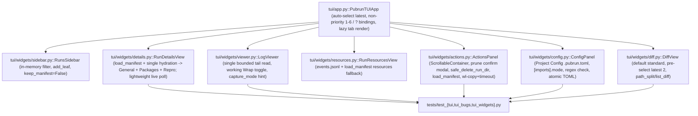

# IPD: TUI safety, meta_ref hydration, memory/responsiveness, and usability

- Date: 2026-11-27
- Kind: child
- Concern: Eight-lens rollup findings `ROLL-06` (`UX-1`/`EC-6`/`FUNC-5`: unconfirmed one-click `Execute Prune` leaking standard error (`stderr`); single-run delete skipping symlink, parent-directory confinement, and active-lock guards), `ROLL-19` (`PERF-5`/`MEM-3`/`MEM-7`/`UX-2`/`UX-5`/`UX-12`/`UX-13`/`FUNC-5`/`SD-2`/`SD-10`/`EC-17`/`COMP-12`: per-keystroke disk scans, double unbounded log reads, broken `Wrap Text` button, missing `meta_ref` hydration in General and Packages panes, eager hidden-tab parsing, 1-second full-manifest re-parse in `refresh_live_metrics`, mislabeled `"TUI Settings"` non-atomic TOML writer with invalid escaping and `auto_start` shadowing, `DiffView` `basic` default and missing `path_split`/`list_diff` rendering, `RunResourcesView` ignoring `manifest.resources`, 80x24 clipping, Windows PowerShell `&&` rerun bug, Wayland `wl-copy` and clipboard timeout), surfaced by all eight lenses.
- Scope: Harden and polish `src/pubrun/tui/app.py`, `src/pubrun/tui/css/style.css`, and `src/pubrun/tui/widgets/{actions,config,details,diff,resources,sidebar,viewer}.py`, with Textual pilot and unit tests in `tests/test_tui.py`, `tests/test_tui_bugs.py`, and `tests/test_tui_widgets.py`.
- Scope-Paths: src/pubrun/tui/app.py, src/pubrun/tui/css/style.css, src/pubrun/tui/widgets/actions.py, src/pubrun/tui/widgets/config.py, src/pubrun/tui/widgets/details.py, src/pubrun/tui/widgets/diff.py, src/pubrun/tui/widgets/resources.py, src/pubrun/tui/widgets/sidebar.py, src/pubrun/tui/widgets/viewer.py, tests/test_tui.py, tests/test_tui_bugs.py, tests/test_tui_widgets.py
- Item-Dependencies: executed:m5s3g8, executed:caeqdz
- Status: reviewed
- Readiness: go-pending-approval
- Review-Depth: complex
- Short-Description: Add bulk-prune confirmation and safe single-run delete guards, hydrate meta_ref across views, eliminate per-keystroke disk scans and full-log reads, fix Wrap/ConfigPanel/DiffView/layout
- Work-Kind: bug
- Priority: high
- Set: assess-8l
- Order: 9
- Highest E allocated: 05
- Author: Antigravity
- Id: 3q5rd5

> Write and proofread this plan per the technical writing standard, `.aw/system/workflows/technical-writing/technical-writing.md`, including requirement 12 (diagrams).

## Workflow history

- 2026-11-27 /plan-review (Antigravity): APPROVE WITH REVISIONS APPLIED; PR-001, PR-002, PR-003, PR-004, PR-005, PR-006
- 2026-11-27 /assess-all (Antigravity): created Child 09 of Set `assess-8l` covering TUI deletion safety, `meta_ref` hydration, memory/responsiveness, `ConfigPanel`, `LogViewer`, `DiffView`, and 80x24 layout (`ROLL-06`, `ROLL-19`).

## Goal

Make the optional `pubrun ui` terminal user interface (TUI) safe against accidental or unsafe deletions, responsive on large run directories and multi-hundred-MB logs, faithful to `meta_ref` hydration and command-line interface (CLI) defaults, atomic and accurate when editing `.pubrun.toml` (Tom's Obvious, Minimal Language (TOML)), and usable on 80x24 terminals.

### TUI interaction and lazy-loading architecture

## Detailed Implementation Checklist (TODO)

Execution-state rule: mark an `E-*` item complete only after performing the action. Accepted execution states: blocked, failed, pending, performed; terminal gate demands `performed`.

### Task group 1: Destructive action safety, clipboard, and rerun parity

- [ ] E-01 Harden `src/pubrun/tui/widgets/actions.py`:
  - Add a `ConfirmBulkPruneModal` confirmation modal pushed by `ActionsPanel.on_button_pressed()` when `#btn-prune-execute` is pressed: first validate age/status criteria and compute matched run count and total disk space to be freed using `scan_runs(self.output_dir, keep_manifest=False)` and `filter_runs(...)` (reporting invalid criteria without opening the modal, and notifying without deleting when 0 runs match); invoke `self.run_bulk_prune(dry_run=False)` only when confirmed (keeping direct `panel.run_bulk_prune(dry_run=...)` calls functional for unit tests). Capture both `stdout` and `stderr` (`contextlib.redirect_stdout` + `contextlib.redirect_stderr`) during `clean_runs()` so no raw terminal output bleeds into the live TUI.
  - Route BOTH `ActionsPanel.handle_deletion_result()` AND `ActionsPanel.archive_selected_run()`'s `delete_raw=True` branch through `src/pubrun/status.py::safe_delete_run_dir(run_dir, base_dir)` using the configured `output_dir` as `base_dir` (never `run_dir.parent`, which would defeat confinement). When `safe_delete_run_dir()` returns `(False, reason)`, notify `f"Deletion failed: {reason}"` with `severity="error"` (preserving error messages such as read-only filesystem errors) and leave `self.run_info` intact.
  - Update `ActionsPanel.display_run()` to load the manifest on demand via `run_info.load_manifest()` when `run_info.manifest is None` (required once `RunsSidebar` scans with `keep_manifest=False`), populating `self.raw_manifest`, rerun command, and methods citations cleanly.
  - Fix the archive destination label to `<output_dir>/archive/<run_id>.zip`, list all 7 valid statuses and supported age units (`d`, `h`, `m`, `s`, or bare days) in cleanup input placeholders/hints, and wrap `ActionsPanel` content in a `ScrollableContainer` so bottom bulk-cleanup controls never clip at 80x24.
  - In `copy_to_clipboard()`: add `["wl-copy"]` (Wayland) to the Linux clipboard probes alongside `xclip` and `xsel`, pass `timeout=5, stdout=subprocess.DEVNULL, stderr=subprocess.DEVNULL` on every `subprocess.run()` call, and catch `subprocess.TimeoutExpired` cleanly.
  - Extract a pure `_build_rerun_command(lock_data: Dict[str, Any]) -> str` helper from `ActionsPanel.display_run()`: on Windows (`sys.platform == "win32"`), emit PowerShell 5.1-safe two-line output (`cd <quoted_cwd>\n<py_cmd>`, never `&&`); on POSIX, preserve `cd <quoted_cwd> && <py_cmd>`; avoid duplicating `script` when `lock_data["argv"]` already starts with `script` or when `sys_argv` is present.
  - Depends on: none
  - Expected outcome: Clicking `Execute Prune` opens a confirmation modal with matched count and disk size and zero `stderr` bleed; single-run delete and archive `delete_raw` enforce all `safe_delete_run_dir` guards; `ActionsPanel` works with `keep_manifest=False` runs; clipboard never hangs and supports Wayland; and Windows rerun commands work in PowerShell 5.1.
  - Execution state: pending

### Task group 2: Hydration, in-memory sidebar, lazy tabs, and bounded `LogViewer`

- [ ] E-02 Fix `src/pubrun/tui/widgets/sidebar.py`, `src/pubrun/tui/widgets/details.py`, `src/pubrun/tui/widgets/resources.py`, and `src/pubrun/tui/app.py`:
  - In `src/pubrun/tui/widgets/sidebar.py::RunsSidebar`: load runs via `scan_runs(self.output_dir, keep_manifest=False)` only on mount and explicit refresh (`load_runs()`, triggered by `Ctrl+R` / `RefreshSidebar`), extract `_render_tree(filter_text)` to filter `self.all_runs` purely in memory on `on_input_changed()` (case-insensitively matching `run_id`, `script`, `args`, and `status`), and add run nodes via `tree.root.add_leaf()` so leaf rows do not show empty expand carets.
  - In `src/pubrun/tui/app.py::PubrunTUIApp`:
    - Auto-select the most recent run on mount when `sidebar.all_runs` is non-empty (displaying it in the active tab while leaving inactive tabs marked dirty). When `0` runs exist, show an onboarding panel in `RunDetailsView` with accurate `import pubrun` / `pubrun init` guidance.
    - Render inactive detail tabs (`tab-details`, `tab-logs`, `tab-resources`, `tab-actions`) lazily on `TabbedContent.TabActivated` (tracking per-tab dirty flags updated on `on_tree_node_selected()` and refresh) so clicking a run in the sidebar only parses the currently visible tab.
    - Rename Tab 5 (`#tab-config`) from `"TUI Settings"` to `"Project Config"`.
    - Add non-priority (`priority=False`, yielding to focused `Input` widgets) keybindings: `1`–`6` for switching workspace tabs, `/` to focus `#runs-search`, and `?` to open a keybind help modal (`KeybindHelpModal`).
  - In `src/pubrun/tui/widgets/details.py::RunDetailsView`:
    - In `display_run(run_info)`: load the manifest via `run_info.load_manifest()` when `run_info.manifest is None`, hydrate it **once** via `hydrate_manifest_with_report()`, and pass the cached hydrated manifest and `HydrationReport` to General Info, Python & Packages, Subprocesses, and Reproducibility sections (eliminating duplicate hydration and showing parent hardware, git, host, and packages for high-performance computing (HPC) `meta_ref` runs).
    - Render `git.dirty is None` as `not checked` (preserving `True` and `False`).
    - Reapply the current `#pkg-search` input text in `update_packages_pane()` when switching runs.
    - In `refresh_live_metrics()`: reload the active running run via `RunInfo(self.run_info.run_dir, keep_manifest=False)` so live process identifier (PID), resident set size (RSS), central processing unit (CPU), elapsed time, and lock-file fields refresh without retaining a full parsed manifest every second.
  - In `src/pubrun/tui/widgets/resources.py::RunResourcesView`:
    - Load `manifest = run_info.load_manifest()` on demand and render populated `manifest.resources` summary fields (`peak_rss_bytes`, `peak_cpu_percent`, `system_memory`, `load_average`, `system_iowait_pct`, `io_counters`) alongside per-sample `events.jsonl` digests, or as a fallback summary when `events.jsonl` has no samples. When BOTH `events.jsonl` has no samples AND `manifest.resources` has no recorded summary fields, preserve the `"No resource samples recorded for this run ..."` message (preserving existing tests). Keep `read_resource_series()` exceptions caught and rendered as `"Could not render resource usage: <Type>: <msg>"`.
  - Depends on: E-01
  - Expected outcome: Typing in `#runs-search` executes zero `scan_runs()` calls, HPC `meta_ref` runs show hydrated hardware/git/packages across all detail panes with `keep_manifest=False`, inactive tabs render lazily on activation, live refresh stays lightweight, and `RunResourcesView` surfaces `manifest.resources` metrics without breaking empty-run tests.
  - Execution state: pending

- [ ] E-03 Fix `src/pubrun/tui/widgets/viewer.py`:
  - Eliminate double-reading by updating `#select-log-file` inside `with select_widget.prevent(Select.Changed):` (or an equivalent suppression guard) before calling `self.load_log_file(default_val)` exactly once per run selection.
  - Sort discovered log files deterministically by filename, prioritizing `"stdout.log"` first, then `"stderr.log"`, and falling back to legacy `"console.log"` only when it exists on disk (keeping existing legacy `console.log` runs readable).
  - Read only a bounded tail window (last 5,000 lines within a 2 MiB byte window from end of file (EOF) via binary `seek()`) and prepend a clear truncation banner when truncated so multi-hundred-MB logs never freeze or run out of memory (OOM).
  - Fix `#btn-toggle-wrap` to toggle `log_content.wrap`, reload the current bounded log file so existing lines visibly re-wrap, and update the button label to `"Wrap: ON"` / `"Wrap: OFF"`.
  - When no log files exist in `run_dir`, display `"No log files found in this run directory."` plus an inline hint explaining `[console].capture_mode = "standard"` in `.pubrun.toml` or `import pubrun.full`.
  - Depends on: E-02
  - Expected outcome: Selecting a run reads its default log file once in bounded random-access memory (RAM), `"Wrap: ON"`/`"Wrap: OFF"` visibly re-wraps loaded lines with explicit state feedback, and empty log views teach how to enable console capture.
  - Execution state: pending

### Task group 3: Atomic `ConfigPanel`, `DiffView`, and responsive CSS

- [ ] E-04 Fix `src/pubrun/tui/widgets/config.py`, `src/pubrun/tui/widgets/diff.py`, and `src/pubrun/tui/css/style.css`:
  - In `src/pubrun/tui/widgets/config.py`:
    - Display the resolved target file path (`Path.cwd() / ".pubrun.toml"`) in the panel header.
    - Remove dead `"cfg-profile"` from `_SELECT_OPTIONS`.
    - Add an `[imports].mode` `Select` (`#cfg-imports-mode`: `auto`, `full`, `minimal`, `noauto`, `nopatch`, `off`) initialized from `resolve_config().get("imports", {}).get("mode", "auto")` with clear guidance that `[imports].mode` takes precedence over `[core].auto_start` (continuing to persist `[core].auto_start` cleanly for backward compatibility).
    - Validate `#cfg-sensitive-regex` via `re.compile()` before saving; on `re.error`, notify with `severity="error"`, abort saving, and preserve the user's entered text in the input widget.
    - Guard non-dict existing TOML sections in `save_settings()` (`if not isinstance(local_conf.get(sec), dict): local_conf[sec] = {}`).
    - Harden `dict_to_toml()`: omit `None` values (TOML has no `null`), quote non-bare keys safely via `json.dumps()`, ensure lists contain valid TOML scalars (skipping/coercing `None`), and validate the serialized TOML string via `tomllib.loads()` (using the `tomli` fallback on Python `<3.11`) before writing.
    - Write `.pubrun.toml` atomically via a unique temporary file in `target_path.parent`, `flush()`, `os.fsync()`, and `os.replace()` (with Windows `PermissionError` retry and `try/finally` temp cleanup). Keep `"Configuration saved to: .pubrun.toml"` as the first notification, and when `core.output_dir` changed (and the app was not locked to an explicit `--dir`), update the sidebar/workspace output directory and post `RefreshSidebar`.
  - In `src/pubrun/tui/widgets/diff.py::DiffView`:
    - Change the default depth `Select` value and empty-select fallback in `run_difference()` from `"basic"` to `"standard"` (matching CLI/API defaults), and update the three depth option descriptions to match `src/pubrun/resources/default.toml`.
    - In `populate_dropdowns(runs)`: include only comparable runs that have a `manifest.json` file; when both selections are empty/invalid and at least two comparable runs exist, pre-select the two most recent comparable runs (older baseline A, newer comparison B) while preserving valid existing selections.
    - In `render_diff_report()`: render `path_split` `order_changed` notes (`~ [ORDER CHANGED]` plus old/new paths) and `list_diff` deltas (`-` removed, `+` added, `~ [ORDER CHANGED]`) consistently with `src/pubrun/analysis/render.py`.
  - In `src/pubrun/tui/css/style.css` and `src/pubrun/tui/widgets/details.py`:
    - Make `#sidebar` width responsive (`width: 30%; min-width: 20; max-width: 35;`) and `#dialog-container` bounded (`max-width: 90%; width: 60;`) so 80x24 terminals do not clip modals or workspace panes.
    - Make `DataTable` column widths in `RunDetailsView` fit narrow terminals cleanly while preserving `subprocesses-table` `"Elapsed"` column `width=18` (pinned by `tests/test_timing_consumers.py`).
  - Depends on: E-02, E-03
  - Expected outcome: `ConfigPanel` writes validated TOML atomically with inline regex validation and `[imports].mode` visibility, `DiffView` defaults to `"standard"` with pre-selected comparable runs and full `path_split`/`list_diff` rendering, and 80x24 terminals render without clipping.
  - Execution state: pending

### Task group 4: Existing-test alignment and Textual pilot / unit tests

- [ ] E-05 Align affected existing tests and add Textual pilot and unit tests in `tests/test_tui.py`, `tests/test_tui_bugs.py`, and `tests/test_tui_widgets.py`:
  - Update existing tests whose assertions intentionally change:
    - `tests/test_tui_widgets.py::TestAppWiring.test_tree_selection_updates_details_logs_resources_and_actions`: activate `tab-logs`, `tab-resources`, and `tab-actions` via `_show_tab()` to verify lazy tab rendering updates each tab on activation.
    - `tests/test_tui_widgets.py::TestRunsSidebar.test_scan_failure_is_shown_as_a_tree_leaf`: accept `**_kwargs` (for `keep_manifest=False`) in `_boom`.
    - `tests/test_tui_widgets.py::TestCopyToClipboard`: update mock `_run` and `SimpleNamespace` for `timeout`, `stdout`, `stderr`, `DEVNULL`, `TimeoutExpired`, and Linux `wl-copy` probe order.
    - `tests/test_tui_widgets.py::TestLogViewerStates.test_missing_dir_and_dir_without_logs`: assert `"No log files found in this run directory."` plus the console-capture hint line.
    - `tests/test_tui_bugs.py::TestDiffView.test_blank_runs_report_selection_error` and `test_depth_fallback_and_warnings_preserved`: explicitly clear selects when testing the blank-selection guard (since `DiffView` now pre-selects the two latest comparable runs) and update empty-depth fallback assertion from `"basic"` to `"standard"`.
  - Add new Textual pilot and unit tests verifying:
    - Clicking `#btn-prune-execute` opens `ConfirmBulkPruneModal` with exact matched run count and disk size, cancels safely without deleting, deletes on confirm, and captures `stderr` without terminal bleed.
    - `handle_deletion_result()` and archive `delete_raw` refuse symlinks, out-of-directory paths, and active/remote locks via `safe_delete_run_dir()`.
    - `_build_rerun_command()` emits PowerShell-safe `\n` on `win32` (no `&&`) and avoids duplicating `script`.
    - Hydrated HPC `meta_ref` child run renders parent hardware, git, and packages in `RunDetailsView` and citations in `ActionsPanel` under `keep_manifest=False`; `git.dirty is None` renders `"not checked"`; `#pkg-search` reapplies on run switch; 0-run mount shows onboarding guidance.
    - Typing in `#runs-search` executes 0 `scan_runs()` calls and matches `args` and `status`; auto-select picks the newest run on mount; inactive tabs stay lazy until `TabActivated`; `1`–`6`, `/`, and `?` bindings work when unfocused and yield to focused `Input` widgets.
    - `RunResourcesView` renders `manifest.resources` summary fields when `events.jsonl` is absent while preserving the empty message when neither exists.
    - `LogViewer` calls `load_log_file()` once per run selection, truncates multi-MB logs to a bounded tail with banner, prioritizes `stdout.log` over legacy `console.log`, and `#btn-toggle-wrap` updates label (`"Wrap: ON"` / `"Wrap: OFF"`) and reloads lines.
    - `ConfigPanel` shows target `.pubrun.toml` path, exposes `[imports].mode`, rejects `[unclosed` regex without overwriting input or file, guards non-dict TOML sections, omits `None` in `dict_to_toml()` with `tomllib` round-trip validation, writes atomically with temp cleanup, and refreshes sidebar when `output_dir` changes.
    - `DiffView` defaults to `"standard"`, excludes non-manifest runs, pre-selects the two most recent comparable runs, and renders `path_split` reorder and `list_diff` deltas; 80x24 pilot mount (`size=(80, 24)`) renders without error or clipping.
  - Depends on: E-04
  - Expected outcome: All updated and new TUI tests plus `tests/test_timing_consumers.py` pass and three-platform `mypy` exits `0`.
  - Execution state: pending

## Project conventions discovered (Step 0)

- The optional Textual TUI (`pubrun[tui]`) lives under `src/pubrun/tui/` and shares `src/pubrun/status.py::safe_delete_run_dir()`, `scan_runs(..., keep_manifest=False)`, and `RunInfo.load_manifest()` from Child 06 (`m5s3g8`), plus diff/hydration helpers from Child 07 (`caeqdz`).
- TUI behavior is verified via Textual pilot tests in `tests/test_tui.py`, `tests/test_tui_bugs.py`, `tests/test_tui_widgets.py`, and `tests/test_timing_consumers.py` (which pins `subprocesses-table` `"Elapsed"` column `width=18`).

## Findings

| ID | Concerns | Severity | Remediation Risk | Persona | Summary |
|---|---|---|---|---|---|
| `ROLL-06` | ui-ux; functionality; edge-cases | High | Low (`security`/`usability`) | Novice / Security | `Execute Prune` deletes runs in one click with no confirmation and leaks stderr; single-run delete skips symlink, parent-confinement, and active/remote lock guards. |
| `ROLL-19` | performance; memory-resources; ui-ux; functionality; self-documentation; edge-cases; compatibility | High | Low (`usability`/`functionality`) | Power user / Novice / Operator | Sidebar rescans disk per keystroke; `LogViewer` double-reads unbounded logs and `Wrap Text` does nothing; `RunDetailsView` skips `meta_ref` hydration in General/Packages and re-parses manifests every 1s; `"TUI Settings"` writes invalid/non-atomic TOML without regex validation; `DiffView` defaults to `basic` and drops `path_split`/`list_diff`; `ActionsPanel` clips at 80x24 and Windows rerun uses `&&`; `copy_to_clipboard` lacks `wl-copy` and `timeout`. |

## Proposed changes (ordered, validatable)

1. `E-01` (`src/pubrun/tui/widgets/actions.py`): Add `ConfirmBulkPruneModal` + `stderr` capture, route single-run delete and archive `delete_raw` through `safe_delete_run_dir()`, load manifests via `load_manifest()`, fix archive label & `ScrollableContainer`, add `wl-copy` + `timeout=5`, and extract Windows-safe `_build_rerun_command()`.
2. `E-02` (`src/pubrun/tui/widgets/{sidebar,details,resources}.py`, `src/pubrun/tui/app.py`): In-memory sidebar filter + `add_leaf` + `keep_manifest=False`, auto-select latest run, lazy tab rendering, `load_manifest()` + single `meta_ref` hydration across General/Packages/Subprocesses/Repro, lightweight `keep_manifest=False` live refresh, `manifest.resources` fallback, `"Project Config"` tab title, and non-priority `1`–`6`/`/`/`?` bindings.
3. `E-03` (`src/pubrun/tui/widgets/viewer.py`): Single bounded tail read (`prevent(Select.Changed)` + 2 MiB / 5,000-line tail), working `#btn-toggle-wrap` reload & label state, deterministic `stdout.log` -> `stderr.log` -> `console.log` sort, and empty-log capture hint.
4. `E-04` (`src/pubrun/tui/widgets/{config,diff}.py`, `src/pubrun/tui/css/style.css`): Target-path header, regex validation, `[imports].mode` select, atomic `tomllib`-validated `dict_to_toml()`, sidebar refresh on `output_dir` change, `DiffView` `"standard"` default/pre-selection/`path_split`/`list_diff`, and 80x24 responsive CSS preserving `Elapsed` `width=18`.
5. `E-05` (`tests/test_tui.py`, `tests/test_tui_bugs.py`, `tests/test_tui_widgets.py`): Align affected existing tests and add Textual pilot and unit tests for every fix above.

## Deferred / out of scope (with reason)

None. Every TUI safety, hydration, memory, responsiveness, and usability defect from the eight-lens rollup is addressed in this child plan.

## Scope check

- Over-scope: none. Every change maps directly to `ROLL-06` and `ROLL-19`, plus aligning existing TUI widget tests in `tests/test_tui_widgets.py`.
- Under-scope: none. All TUI app, cascading style sheets (CSS), widget files, and affected TUI test suites are covered.

## Required tests / validation

1. `pytest tests/test_tui.py tests/test_tui_bugs.py tests/test_tui_widgets.py tests/test_timing_consumers.py -v`
2. `mypy && mypy --platform win32 && mypy --platform darwin`

## Spec / documentation sync

In-product TUI labels, empty states, and `?` keybind help are updated in `E-01` through `E-04`; no external documentation changes are required.

## Open questions

None. `ConfigPanel` remains an explicit `.pubrun.toml` editor with clear target-path labeling, validation, `[imports].mode` visibility, and atomic writes.

## Validation and cross-check (verify before reporting done)

Validation-state rule: inspect evidence in a separate pass. Accepted validation results: blocked, failed, pass, pending; terminal gate demands `pass`.

- [ ] V-01 validates E-01
  - Required evidence: Pasted `pytest` output for `src/pubrun/tui/widgets/actions.py::ActionsPanel` (`ConfirmBulkPruneModal`, `run_bulk_prune`, `handle_deletion_result`, `archive_selected_run`, `display_run`), `copy_to_clipboard`, and `_build_rerun_command` in `tests/test_tui.py`, `tests/test_tui_bugs.py`, and `tests/test_tui_widgets.py` confirming bulk-prune confirmation modal & stderr capture, `safe_delete_run_dir` guards on both delete and archive `delete_raw`, `load_manifest()` support, `wl-copy`/timeout clipboard, and Windows PowerShell-safe rerun command pass.
  - Observed evidence:
  - Result: pending

- [ ] V-02 validates E-02
  - Required evidence: Pasted `pytest` output for `src/pubrun/tui/widgets/details.py::RunDetailsView`, `sidebar.py::RunsSidebar`, `resources.py::RunResourcesView`, and `tui/app.py::PubrunTUIApp` in `tests/test_tui.py`, `tests/test_tui_bugs.py`, and `tests/test_tui_widgets.py` confirming hydrated HPC `RunDetailsView` under `keep_manifest=False`, zero `scan_runs` calls during search typing, auto-selection on mount, lazy tab activation, non-priority `1`–`6`/`/`/`?` bindings, lightweight live refresh, and `RunResourcesView` `manifest.resources` fallback pass.
  - Observed evidence:
  - Result: pending

- [ ] V-03 validates E-03
  - Required evidence: Pasted `pytest` output for `src/pubrun/tui/widgets/viewer.py::LogViewer` (`display_run_logs`, `load_log_file`, `on_button_pressed`) in `tests/test_tui_bugs.py` and `tests/test_tui_widgets.py` confirming single bounded tail read (1 `load_log_file` call per selection + truncation banner), working `#btn-toggle-wrap` reload + `"Wrap: ON"`/`"Wrap: OFF"` label state, deterministic log priority, and missing-console-log capture hint pass.
  - Observed evidence:
  - Result: pending

- [ ] V-04 validates E-04
  - Required evidence: Pasted `pytest` output for `src/pubrun/tui/widgets/config.py::ConfigPanel`/`dict_to_toml`, `diff.py::DiffView`, and `css/style.css` in `tests/test_tui.py`, `tests/test_tui_bugs.py`, `tests/test_tui_widgets.py`, and `tests/test_timing_consumers.py` confirming regex rejection preserving input, `[imports].mode` select, atomic `tomllib`-validated `dict_to_toml`, `DiffView` `"standard"` default/pre-selection/`path_split`/`list_diff`, 80x24 pilot layout, and `Elapsed` `width=18` preservation pass.
  - Observed evidence:
  - Result: pending

- [ ] V-05 validates E-05
  - Required evidence: Pasted output of `pytest tests/test_tui.py tests/test_tui_bugs.py tests/test_tui_widgets.py tests/test_timing_consumers.py -v` (covering all updated and new test classes across all three TUI test files plus timing-consumer TUI tests) and three-platform `mypy && mypy --platform win32 && mypy --platform darwin` exiting `0`.
  - Observed evidence:
  - Result: pending

## Approval and execution gate

1. **Open questions and human approval precondition:** Proposal only; execution requires all blocking open questions resolved (`None` remain) and explicit human approval (`aw set plan approved 3q5rd5 --by-human`) before implementation begins.
2. **Scope declaration:** `- Scope-Paths:` declares the expected files this plan modifies (`src/pubrun/tui/app.py`, `src/pubrun/tui/css/style.css`, `src/pubrun/tui/widgets/actions.py`, `src/pubrun/tui/widgets/config.py`, `src/pubrun/tui/widgets/details.py`, `src/pubrun/tui/widgets/diff.py`, `src/pubrun/tui/widgets/resources.py`, `src/pubrun/tui/widgets/sidebar.py`, `src/pubrun/tui/widgets/viewer.py`, `tests/test_tui.py`, `tests/test_tui_bugs.py`, `tests/test_tui_widgets.py`). If execution requires touching an additional file or leaving a declared file untouched, justify each delta at finalization with `--scope-reason` or `--scope-ack`.
3. **Validation honesty (hard MUST):** Every `V-*` item MUST carry actual pasted command output from real execution after the final code edit; never claim tests or `mypy` passed without running them and pasting their output.
4. **Path-scoped commit and never-push:** Commit ONLY the modified files through `aw commit 3q5rd5 -- <paths>` (never `git add -A`, bare `git commit -a`, or raw `git commit`). Never push, create tags, or publish releases.
5. **Lifecycle finalization ownership:** When executed by a runner (`aw oc run` / `aw agy run`), the runner owns the lifecycle transition to `.aw/records/plans/executed/` after all `E-*` are `performed` and all `V-*` are `pass`. When executed manually outside a runner, finalize with `aw ipd finalize 3q5rd5` (never hand-roll `git mv` into `executed/`).
